## 摘要

冻结 Dual-GRU 的完整排序、CSI1800 与 tail evidence; Validation ledger 更正见独立 audit.

后续独立 ledger audit 已确认旧 Validation gross ledger 未排除 split boundary positions. 13:58 baseline 的 corrected gross return 为 20.1322%, Sharpe 为 1.552499; 13:50 为 10.7110%, Sharpe 为 0.838975. 旧表、旧图作为历史 evidence 保留, 相应 Validation long-only 数值以 [ledger audit](/reports/astock-overnight/1016-overnight-ledger-audit/) 为准. 未对未审计的 CSI1800、其他 tail 或方案 A 结果推算更正值.

## 研究背景与目标

研究问题与数据合同以保留的源报告为准. 本页将既有研究证据登记为独立 publication, 关联对应 Study 与 Experiment.

## 数据与方法

2021-2023 为 Train; 2024 Validation 排除 9-10 月. 历史报告中的 2025 one-shot Test 已被查看, 当前仅能作为 historical confirmation, 不支持再次用其选择配置. 本次同步仅整理既有 evidence, 未训练、推理或重跑回测.

## 主要结果

Core v1 / Dual-GRU / OOS Evaluation

Validation 2024 与 one-shot Test 2025 分开评价. 十分组先于 entry audit 固定, cohort return 用于排序诊断, event-driven NAV 用于资金占用与 execution 评价.

13:58 signal

14:00 entry

next-day 10:00 planned exit

gross return

### 1. Headline

Validation 2024 RankIC

+0.1479

Validation 2024 Q10-Q1

+1.361%

Validation 2024 long NAV return

+16.724%

Validation 2024 break-even

3.63 bps

Test 2025 RankIC

+0.1145

Test 2025 Q10-Q1

+0.765%

Test 2025 long NAV return

+23.717%

Test 2025 break-even

4.29 bps

Short-only 与 long-short 为 gross, non-executable signal proxy. 报告不假设 borrow availability、borrow cost、margin 或固定 transaction cost.

### Validation 2024

| Series | Mean daily | Annualized Sharpe | Max drawdown |
| --- | --- | --- | --- |
| Cohort Q10 | +0.094% | +1.809 | -4.247% |
| Cohort -Q1 proxy | +1.267% | +9.584 | -7.623% |
| Cohort Q10-Q1 proxy | +1.361% | +11.248 | -4.137% |

### Test 2025

| Series | Mean daily | Annualized Sharpe | Max drawdown |
| --- | --- | --- | --- |
| Cohort Q10 | +0.091% | +1.913 | -5.667% |
| Cohort -Q1 proxy | +0.674% | +6.615 | -4.451% |
| Cohort Q10-Q1 proxy | +0.765% | +9.045 | -4.145% |

### 2. 十分组排序与收益

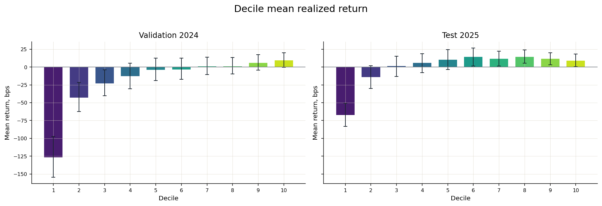

### Decile mean return

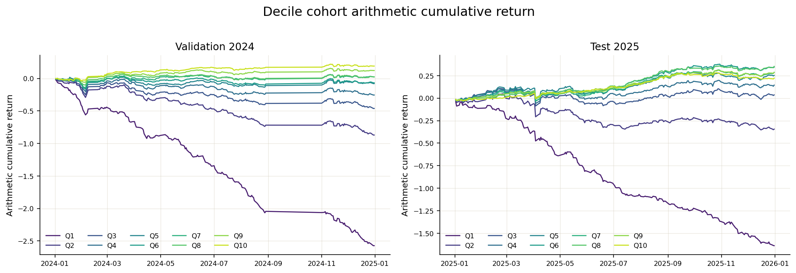

### Q1-Q10 cohort cumulative

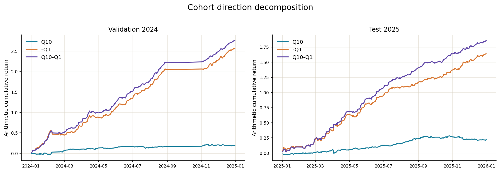

### 收益方向拆解

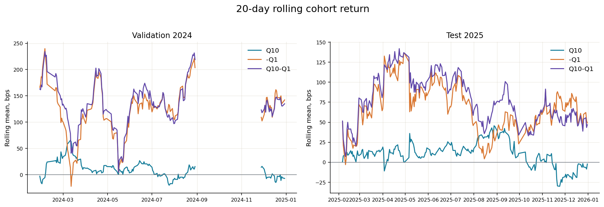

### 20-day rolling stability

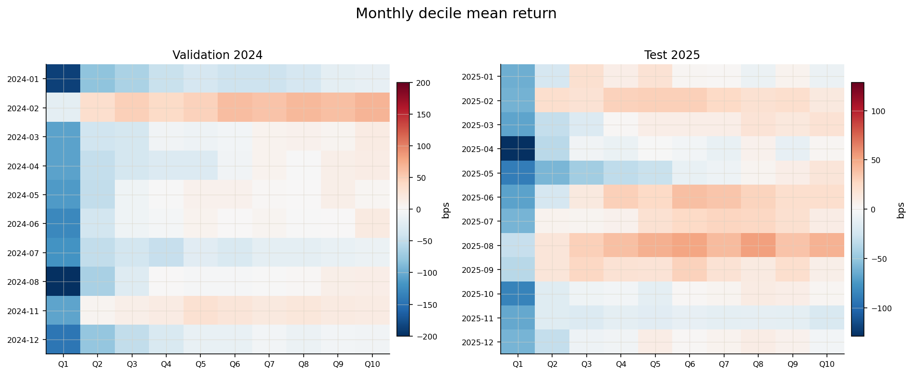

### Month x decile heatmap

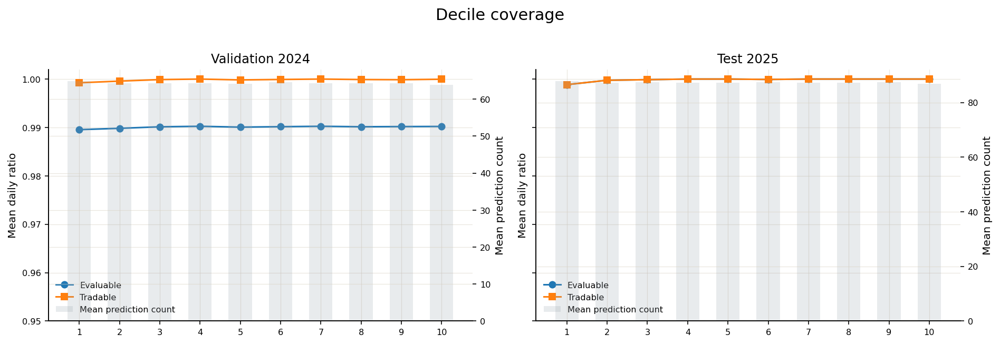

### Decile coverage

### 3. Portfolio 与 execution

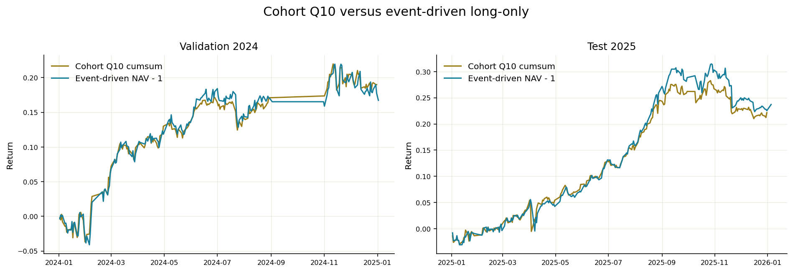

### Cohort Q10 versus event-driven long-only

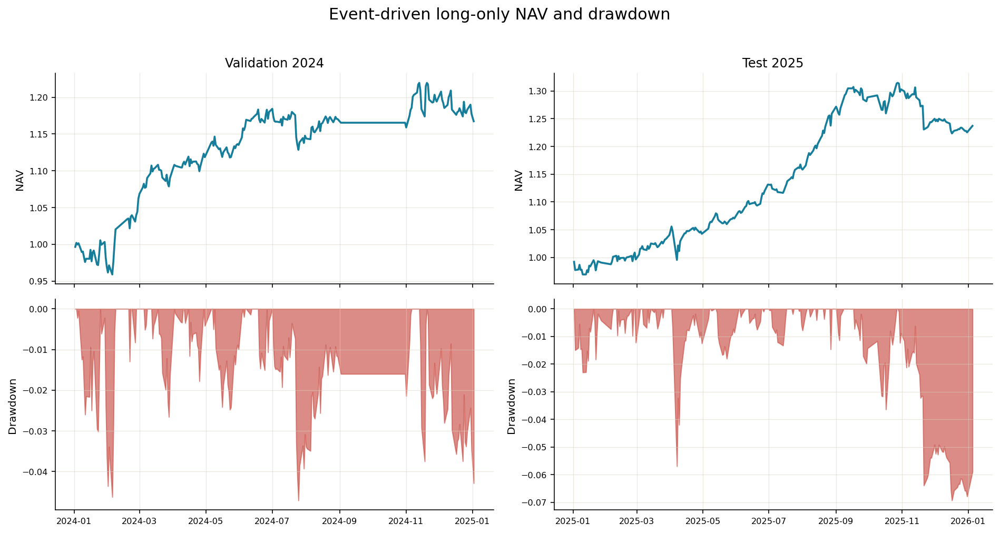

### Long-only NAV and drawdown

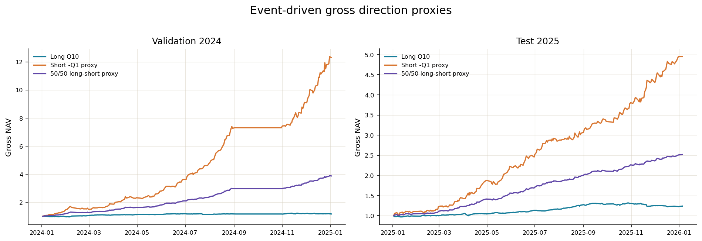

### Gross direction proxies

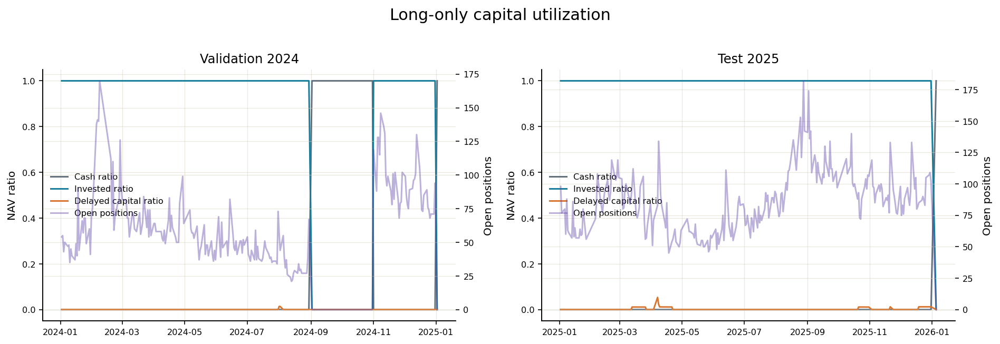

### Capital utilization

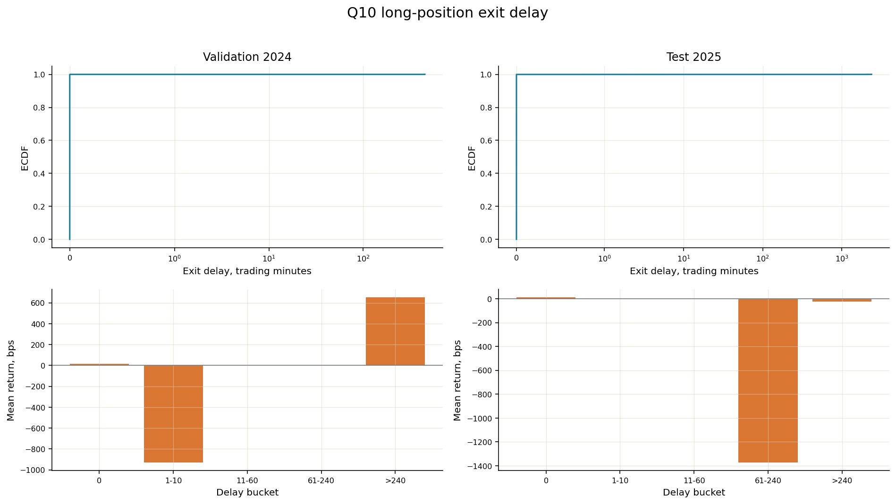

### Exit-delay diagnostics

### Validation 2024 exit delay

| Q10 positions | 13,096 |
| --- | --- |
| Delayed positions | 2 |
| Delayed ratio | +0.015% |
| Maximum trading-minute delay | 452 |
| Delayed mean raw return | -1.387% |

### Test 2025 exit delay

| Q10 positions | 21,109 |
| --- | --- |
| Delayed positions | 9 |
| Delayed ratio | +0.043% |
| Maximum trading-minute delay | 2,380 |
| Delayed mean raw return | -6.219% |

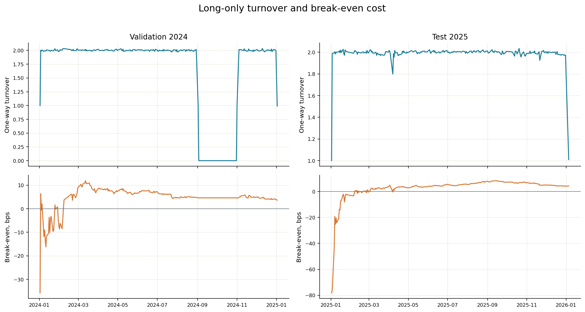

### Turnover and break-even cost

### 4. IC stability

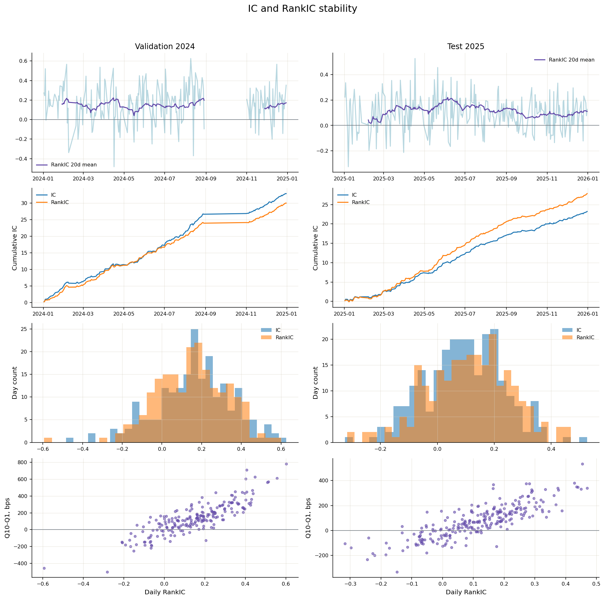

### IC dashboard

### Validation 2024 IC metrics

| Metric | Mean | Std | ICIR | Positive days | t-stat | Valid days |
| --- | --- | --- | --- | --- | --- | --- |
| Pearson IC | +0.1621 | +0.1905 | +13.232 | +82.759% | +12.119 | 203 |
| RankIC | +0.1479 | +0.1766 | +13.030 | +79.803% | +11.934 | 203 |

### Test 2025 IC metrics

| Metric | Mean | Std | ICIR | Positive days | t-stat | Valid days |
| --- | --- | --- | --- | --- | --- | --- |
| Pearson IC | +0.0955 | +0.1367 | +10.890 | +77.366% | +10.890 | 243 |
| RankIC | +0.1145 | +0.1467 | +12.168 | +78.189% | +12.168 | 243 |

### 5. 2021-2025 年度对比

2021-2023 是 selected checkpoint 的 train in-sample 结果, 不能解释为 generalization evidence. 2024 是用于 checkpoint selection 的 Validation, 且排除 9-10 月. 2025 是 one-shot Test.

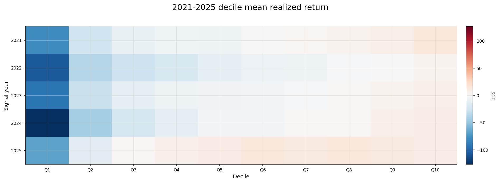

### Year x decile mean return

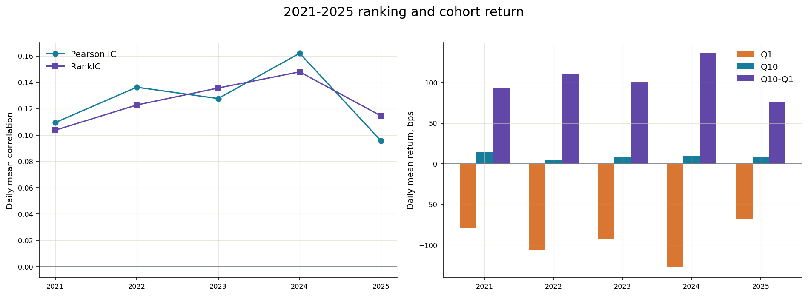

### Yearly ranking and cohort return

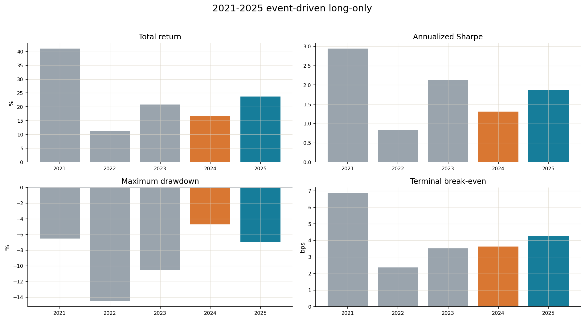

### Yearly event-driven long-only

### Yearly signal metrics

| Year | Role | Signal days | Pearson IC | Pearson ICIR | RankIC | Rank ICIR | Monotonicity | Q1, bps | Q10, bps | Q10-Q1, bps | Q10 95% CI, bps |
| --- | --- | --- | --- | --- | --- | --- | --- | --- | --- | --- | --- |
| 2021 | Train, in-sample | 243 | +0.1095 | +13.096 | +0.1037 | +13.791 | +0.988 | -79.24 | +14.45 | +93.69 | [+5.93, +22.81] |
| 2022 | Train, in-sample | 242 | +0.1363 | +15.575 | +0.1228 | +14.166 | +1.000 | -106.33 | +4.82 | +111.15 | [-5.68, +14.24] |
| 2023 | Train, in-sample | 242 | +0.1277 | +11.734 | +0.1357 | +15.107 | +1.000 | -92.82 | +7.80 | +100.62 | [-2.20, +18.20] |
| 2024 | Validation, selected, excludes Sep-Oct | 205 | +0.1621 | +13.232 | +0.1479 | +13.030 | +1.000 | -126.74 | +9.36 | +136.10 | [-0.15, +19.88] |
| 2025 | Test, one-shot | 243 | +0.0955 | +10.890 | +0.1145 | +12.168 | +0.733 | -67.40 | +9.12 | +76.52 | [+0.65, +18.12] |

### Yearly event-driven long-only

| Year | Total return | Annualized return | Annualized vol | Sharpe | Max drawdown | Positive days | Mean turnover | Break-even, bps |
| --- | --- | --- | --- | --- | --- | --- | --- | --- |
| 2021 | +41.020% | +40.822% | +11.886% | +2.942 | -6.525% | +59.016% | +1.989 | 6.86 |
| 2022 | +11.293% | +11.244% | +13.779% | +0.842 | -14.484% | +50.617% | +1.992 | 2.36 |
| 2023 | +20.842% | +20.748% | +9.046% | +2.130 | -10.521% | +55.556% | +1.992 | 3.52 |
| 2024 | +16.724% | +16.650% | +12.338% | +1.310 | -4.711% | +45.679% | +1.688 | 3.63 |
| 2025 | +23.717% | +23.609% | +11.640% | +1.880 | -6.937% | +59.016% | +1.989 | 4.29 |

### Yearly execution and gross proxies

| Year | Q10 positions | Delayed | Delay ratio | Max delay, min | Delayed mean return | Short proxy total | 50/50 proxy total |
| --- | --- | --- | --- | --- | --- | --- | --- |
| 2021 | 15,868 | 14 | +0.088% | 2,380 | -9.621% | +559.035% | +209.093% |
| 2022 | 15,192 | 8 | +0.053% | 223 | -6.242% | +1127.228% | +275.401% |
| 2023 | 12,830 | 4 | +0.031% | 211 | -14.013% | +802.700% | +234.651% |
| 2024 | 13,096 | 2 | +0.015% | 452 | -1.387% | +1130.818% | +287.532% |
| 2025 | 21,109 | 9 | +0.043% | 2,380 | -6.219% | +394.870% | +151.866% |

Short-only 与 50/50 long-short 是 gross, non-executable signal proxy.

### 6. CSI1800 股票池

CSI1800 定义为 strictly-lagged CSI300, CSI500 与 CSI1000 monthly snapshot 的 canonical union. 每期严格为 1,800 只. 每个 signal date 在该 pool 内独立 rerank, 再固定 decile 与 top-tail selection.

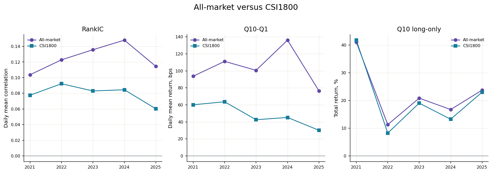

### All-market versus CSI1800

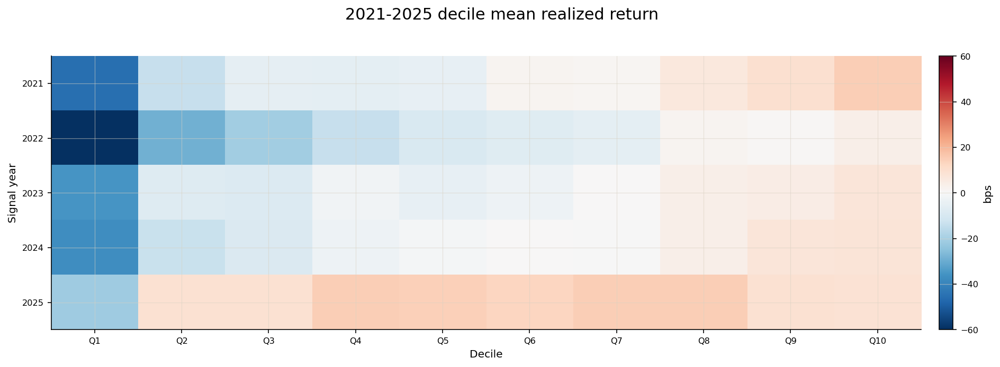

### CSI1800 year x decile mean return

### CSI1800 OOS metrics

| Split | Signal days | Pearson IC | RankIC | Monotonicity | Q1, bps | Q10, bps | Q10-Q1, bps | Long total | Long Sharpe | Long max DD | Turnover | Break-even, bps | Delayed |
| --- | --- | --- | --- | --- | --- | --- | --- | --- | --- | --- | --- | --- | --- |
| Validation 2024 | 205 | +0.0747 | +0.0846 | +0.988 | -37.38 | +7.84 | +45.22 | +13.240% | +1.064 | -5.481% | +1.688 | 2.91 | 1 |
| Test 2025 | 243 | +0.0498 | +0.0602 | +0.224 | -21.35 | +8.79 | +30.14 | +22.979% | +2.016 | -6.563% | +1.991 | 4.17 | 3 |

### CSI1800 yearly metrics

### Yearly signal metrics

| Year | Role | Signal days | Pearson IC | Pearson ICIR | RankIC | Rank ICIR | Monotonicity | Q1, bps | Q10, bps | Q10-Q1, bps | Q10 95% CI, bps |
| --- | --- | --- | --- | --- | --- | --- | --- | --- | --- | --- | --- |
| 2021 | Train, in-sample | 243 | +0.0765 | +9.128 | +0.0776 | +10.207 | +0.976 | -45.47 | +14.66 | +60.13 | [+5.96, +23.01] |
| 2022 | Train, in-sample | 242 | +0.0957 | +10.886 | +0.0922 | +10.858 | +0.988 | -60.01 | +3.66 | +63.67 | [-6.33, +13.22] |
| 2023 | Train, in-sample | 242 | +0.0744 | +7.059 | +0.0830 | +9.542 | +0.952 | -35.26 | +7.28 | +42.55 | [-2.67, +17.79] |
| 2024 | Validation, selected, excludes Sep-Oct | 205 | +0.0747 | +6.401 | +0.0846 | +7.221 | +0.988 | -37.38 | +7.84 | +45.22 | [-2.03, +18.24] |
| 2025 | Test, one-shot | 243 | +0.0498 | +5.110 | +0.0602 | +5.750 | +0.224 | -21.35 | +8.79 | +30.14 | [+0.47, +17.57] |

### Yearly event-driven long-only

| Year | Total return | Annualized return | Annualized vol | Sharpe | Max drawdown | Positive days | Mean turnover | Break-even, bps |
| --- | --- | --- | --- | --- | --- | --- | --- | --- |
| 2021 | +41.749% | +41.546% | +11.471% | +3.088 | -6.347% | +60.656% | +1.988 | 7.06 |
| 2022 | +8.234% | +8.199% | +13.671% | +0.645 | -14.202% | +51.440% | +1.991 | 1.74 |
| 2023 | +19.043% | +18.957% | +8.934% | +1.988 | -11.165% | +54.321% | +1.992 | 3.24 |
| 2024 | +13.240% | +13.182% | +12.356% | +1.064 | -5.481% | +45.267% | +1.688 | 2.91 |
| 2025 | +22.979% | +22.875% | +10.494% | +2.016 | -6.563% | +56.148% | +1.991 | 4.17 |

### Yearly execution and gross proxies

| Year | Q10 positions | Delayed | Delay ratio | Max delay, min | Delayed mean return | Short proxy total | 50/50 proxy total |
| --- | --- | --- | --- | --- | --- | --- | --- |
| 2021 | 12,697 | 11 | +0.087% | 2,380 | -7.227% | +193.038% | +106.171% |
| 2022 | 11,778 | 7 | +0.059% | 223 | -5.772% | +313.248% | +114.123% |
| 2023 | 9,438 | 4 | +0.042% | 211 | -14.013% | +128.078% | +66.301% |
| 2024 | 9,678 | 1 | +0.010% | 452 | +6.508% | +115.410% | +58.611% |
| 2025 | 14,130 | 3 | +0.021% | 2,380 | -12.369% | +64.639% | +44.097% |

Short-only 与 50/50 long-short 是 gross, non-executable signal proxy.

### 7. Top 5%, 1% 与 0.5%

每个 signal date 按既有 deterministic order 选择最高 prediction 的 ceil(p x N) 只股票. Selection 在 14:00 entry audit 前固定, 不因不可买或不可评价而 refill. All-market 与 CSI1800 分别排序.

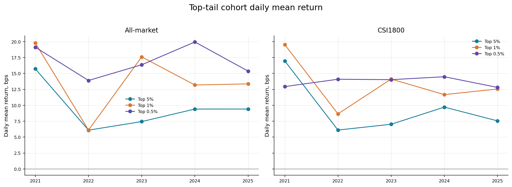

### Top-tail cohort mean return

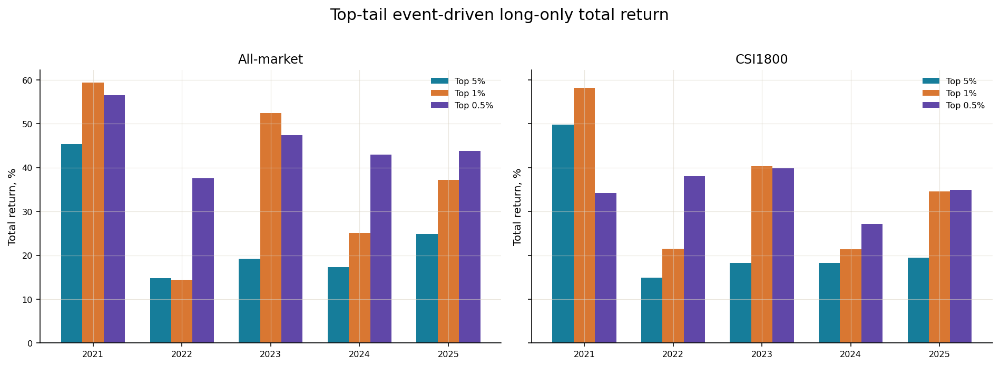

### Top-tail event-driven long-only

### Top-tail OOS metrics

| Scope | Group | Selection | Mean names | Tradable | Cohort mean, bps | 95% CI, bps | Cohort Sharpe | Long total | Long Sharpe | Long max DD | Turnover | Break-even, bps | Delayed |
| --- | --- | --- | --- | --- | --- | --- | --- | --- | --- | --- | --- | --- | --- |
| All-market | Validation 2024 | Top 5% | 32.7 | +99.993% | +9.40 | [-0.82, +20.00] | +1.790 | +17.274% | +1.326 | -5.856% | +1.688 | 3.74 | 2 |
| All-market | Validation 2024 | Top 1% | 6.9 | +100.000% | +13.18 | [+0.15, +28.23] | +2.235 | +25.131% | +1.694 | -5.779% | +1.687 | 5.27 | 1 |
| All-market | Validation 2024 | Top 0.5% | 3.7 | +100.000% | +19.94 | [+5.20, +36.26] | +2.820 | +42.931% | +2.323 | -6.785% | +1.686 | 8.45 | 1 |
| All-market | Test 2025 | Top 5% | 44.1 | +100.000% | +9.41 | [+0.08, +18.84] | +2.113 | +24.905% | +2.110 | -6.496% | +1.991 | 4.50 | 2 |
| All-market | Test 2025 | Top 1% | 9.2 | +100.000% | +13.36 | [+4.11, +22.68] | +2.590 | +37.257% | +2.458 | -6.897% | +1.994 | 6.46 | 0 |
| All-market | Test 2025 | Top 0.5% | 4.9 | +100.000% | +15.37 | [+4.01, +27.81] | +2.618 | +43.769% | +2.595 | -6.426% | +1.994 | 7.28 | 0 |
| CSI1800 | Validation 2024 | Top 5% | 24.3 | +100.000% | +9.71 | [+0.02, +19.60] | +1.888 | +18.252% | +1.405 | -4.570% | +1.688 | 3.95 | 1 |
| CSI1800 | Validation 2024 | Top 1% | 5.3 | +100.000% | +11.67 | [-2.86, +28.03] | +1.863 | +21.350% | +1.421 | -6.866% | +1.687 | 4.53 | 1 |
| CSI1800 | Validation 2024 | Top 0.5% | 2.9 | +100.000% | +14.48 | [-1.31, +31.48] | +1.972 | +27.114% | +1.514 | -8.224% | +1.684 | 5.81 | 1 |
| CSI1800 | Test 2025 | Top 5% | 29.8 | +100.000% | +7.55 | [-0.12, +15.57] | +1.735 | +19.413% | +1.773 | -5.517% | +1.990 | 3.64 | 1 |
| CSI1800 | Test 2025 | Top 1% | 6.4 | +100.000% | +12.56 | [+2.37, +22.53] | +2.409 | +34.574% | +2.246 | -7.731% | +1.993 | 5.85 | 0 |
| CSI1800 | Test 2025 | Top 0.5% | 3.4 | +100.000% | +12.80 | [+0.01, +25.75] | +2.076 | +34.950% | +1.997 | -7.706% | +1.994 | 5.77 | 0 |

### Top-tail yearly metrics

| Scope | Group | Selection | Mean names | Tradable | Cohort mean, bps | 95% CI, bps | Cohort Sharpe | Long total | Long Sharpe | Long max DD | Turnover | Break-even, bps | Delayed |
| --- | --- | --- | --- | --- | --- | --- | --- | --- | --- | --- | --- | --- | --- |
| All-market | 2021 Train, in-sample | Top 5% | 33.3 | +99.970% | +15.71 | [+6.52, +24.65] | +3.136 | +45.387% | +3.045 | -6.866% | +1.993 | 7.49 | 5 |
| All-market | 2021 Train, in-sample | Top 1% | 7.1 | +99.954% | +19.77 | [+9.43, +29.67] | +2.902 | +59.340% | +2.909 | -7.756% | +1.992 | 9.19 | 2 |
| All-market | 2021 Train, in-sample | Top 0.5% | 3.8 | +99.918% | +19.12 | [+6.57, +30.95] | +2.364 | +56.440% | +2.414 | -7.746% | +1.992 | 8.49 | 1 |
| All-market | 2022 Train, in-sample | Top 5% | 32.1 | +100.000% | +6.09 | [-4.52, +16.12] | +1.068 | +14.789% | +1.079 | -13.318% | +1.992 | 3.03 | 4 |
| All-market | 2022 Train, in-sample | Top 1% | 6.8 | +100.000% | +6.10 | [-6.23, +18.73] | +0.913 | +14.413% | +0.941 | -12.812% | +1.992 | 2.86 | 1 |
| All-market | 2022 Train, in-sample | Top 0.5% | 3.6 | +100.000% | +13.89 | [+0.40, +27.36] | +1.807 | +37.556% | +1.875 | -11.850% | +1.993 | 6.53 | 0 |
| All-market | 2023 Train, in-sample | Top 5% | 27.2 | +100.000% | +7.44 | [-2.74, +18.08] | +1.920 | +19.274% | +1.972 | -10.745% | +1.992 | 3.27 | 2 |
| All-market | 2023 Train, in-sample | Top 1% | 5.8 | +100.000% | +17.60 | [+6.40, +28.60] | +3.429 | +52.368% | +3.505 | -4.527% | +1.994 | 7.74 | 0 |
| All-market | 2023 Train, in-sample | Top 0.5% | 3.2 | +100.000% | +16.36 | [+2.94, +30.90] | +2.619 | +47.445% | +2.803 | -8.641% | +1.994 | 7.02 | 0 |
| All-market | 2024 Validation, selected, excludes Sep-Oct | Top 5% | 32.7 | +99.993% | +9.40 | [-0.82, +20.00] | +1.790 | +17.274% | +1.326 | -5.856% | +1.688 | 3.74 | 2 |
| All-market | 2024 Validation, selected, excludes Sep-Oct | Top 1% | 6.9 | +100.000% | +13.18 | [+0.15, +28.23] | +2.235 | +25.131% | +1.694 | -5.779% | +1.687 | 5.27 | 1 |
| All-market | 2024 Validation, selected, excludes Sep-Oct | Top 0.5% | 3.7 | +100.000% | +19.94 | [+5.20, +36.26] | +2.820 | +42.931% | +2.323 | -6.785% | +1.686 | 8.45 | 1 |
| All-market | 2025 Test, one-shot | Top 5% | 44.1 | +100.000% | +9.41 | [+0.08, +18.84] | +2.113 | +24.905% | +2.110 | -6.496% | +1.991 | 4.50 | 2 |
| All-market | 2025 Test, one-shot | Top 1% | 9.2 | +100.000% | +13.36 | [+4.11, +22.68] | +2.590 | +37.257% | +2.458 | -6.897% | +1.994 | 6.46 | 0 |
| All-market | 2025 Test, one-shot | Top 0.5% | 4.9 | +100.000% | +15.37 | [+4.01, +27.81] | +2.618 | +43.769% | +2.595 | -6.426% | +1.994 | 7.28 | 0 |
| CSI1800 | 2021 Train, in-sample | Top 5% | 26.8 | +99.961% | +16.97 | [+8.06, +25.99] | +3.392 | +49.823% | +3.333 | -7.040% | +1.993 | 8.16 | 4 |
| CSI1800 | 2021 Train, in-sample | Top 1% | 5.8 | +99.941% | +19.53 | [+7.98, +30.36] | +2.851 | +58.143% | +2.915 | -7.990% | +1.992 | 8.93 | 2 |
| CSI1800 | 2021 Train, in-sample | Top 0.5% | 3.1 | +99.897% | +12.93 | [-0.76, +25.40] | +1.581 | +34.248% | +1.597 | -12.825% | +1.990 | 5.49 | 1 |
| CSI1800 | 2022 Train, in-sample | Top 5% | 25.1 | +100.000% | +6.11 | [-3.47, +15.56] | +1.093 | +14.888% | +1.116 | -11.209% | +1.992 | 3.00 | 4 |
| CSI1800 | 2022 Train, in-sample | Top 1% | 5.4 | +100.000% | +8.65 | [-3.97, +21.36] | +1.221 | +21.485% | +1.277 | -11.495% | +1.993 | 4.09 | 1 |
| CSI1800 | 2022 Train, in-sample | Top 0.5% | 3.0 | +100.000% | +14.09 | [+2.14, +26.50] | +1.788 | +38.092% | +1.886 | -9.664% | +1.993 | 6.78 | 0 |
| CSI1800 | 2023 Train, in-sample | Top 5% | 20.2 | +100.000% | +7.02 | [-3.56, +18.03] | +1.702 | +18.228% | +1.773 | -11.675% | +1.992 | 3.09 | 1 |
| CSI1800 | 2023 Train, in-sample | Top 1% | 4.5 | +100.000% | +14.12 | [-0.32, +28.86] | +2.493 | +40.375% | +2.640 | -10.328% | +1.993 | 6.06 | 0 |
| CSI1800 | 2023 Train, in-sample | Top 0.5% | 2.5 | +100.000% | +14.02 | [+2.10, +26.75] | +2.121 | +39.850% | +2.302 | -9.425% | +1.993 | 6.16 | 0 |
| CSI1800 | 2024 Validation, selected, excludes Sep-Oct | Top 5% | 24.3 | +100.000% | +9.71 | [+0.02, +19.60] | +1.888 | +18.252% | +1.405 | -4.570% | +1.688 | 3.95 | 1 |
| CSI1800 | 2024 Validation, selected, excludes Sep-Oct | Top 1% | 5.3 | +100.000% | +11.67 | [-2.86, +28.03] | +1.863 | +21.350% | +1.421 | -6.866% | +1.687 | 4.53 | 1 |
| CSI1800 | 2024 Validation, selected, excludes Sep-Oct | Top 0.5% | 2.9 | +100.000% | +14.48 | [-1.31, +31.48] | +1.972 | +27.114% | +1.514 | -8.224% | +1.684 | 5.81 | 1 |
| CSI1800 | 2025 Test, one-shot | Top 5% | 29.8 | +100.000% | +7.55 | [-0.12, +15.57] | +1.735 | +19.413% | +1.773 | -5.517% | +1.990 | 3.64 | 1 |
| CSI1800 | 2025 Test, one-shot | Top 1% | 6.4 | +100.000% | +12.56 | [+2.37, +22.53] | +2.409 | +34.574% | +2.246 | -7.731% | +1.993 | 5.85 | 0 |
| CSI1800 | 2025 Test, one-shot | Top 0.5% | 3.4 | +100.000% | +12.80 | [+0.01, +25.75] | +2.076 | +34.950% | +1.997 | -7.706% | +1.994 | 5.77 | 0 |

## 限制与适用边界

后续独立 ledger audit 已确认旧 Validation gross ledger 未排除 split boundary positions. 13:58 baseline 的 corrected gross return 为 20.1322%, Sharpe 为 1.552499; 13:50 为 10.7110%, Sharpe 为 0.838975. 旧表、旧图作为历史 evidence 保留, 相应 Validation long-only 数值以 [ledger audit](/reports/astock-overnight/1016-overnight-ledger-audit/) 为准. 未对未审计的 CSI1800、其他 tail 或方案 A 结果推算更正值.

2021-2023 为 Train; 2024 Validation 排除 9-10 月. 历史报告中的 2025 one-shot Test 已被查看, 当前仅能作为 historical confirmation, 不支持再次用其选择配置. 本次同步仅整理既有 evidence, 未训练、推理或重跑回测.

### 8. Lineage 与限制

| Evaluation code commit | aeb674eaa0c109d19dad24953b11ef4d4f475cf2 |
| --- | --- |
| Experiment run | 20260918T082705Z |
| Experiment content hash | e5d3817440da32d86e485c31c2493c57433dd7b9c8a204aae6b3acd86fc99dc2 |
| Selected checkpoint | checkpoints/step-000617.pt |
| Dataset run | 20260917T162415Z |
| Dataset content hash | f5f289cd319f0b5af73f7e769c591714014f3a0043852d5574203dee9504d057 |
| Factor set | core-v1 |
| Factor set hash | 2a6a3cc0f79049ed6b74994c3d50f5b5d8b22e374549490b7003bf38755ce1d3 |
| Universe content hash | 2337df726828d6b0ae06a067be78d9c78d51a44630a582a71b4ec9caca15e7f1 |
| CSI1800 membership hash | feae8dd8d951f1e5d0373b03febb362bf04fcbf3968155ac17bd545b0be3fc08 |
| CSI1800 source-file manifest hash | ac513ea49df71fb97ec72598eb6a1abb242e0d60adb731530a8bba22cd9aa564 |

- Test 是 selected checkpoint 的 one-shot evaluation, 未参与 model selection.
- 所有收益均为 gross. Break-even cost 是容量边界, 不是实际成本估计.
- Cohort cumulative 只表示 signal-date 排序收益累积, event-driven long-only 才表示 available-cash portfolio NAV.
- Headline number 可回溯到同目录 parquet, metrics YAML 和 manifest.yaml.

## 结论

冻结 Dual-GRU 的完整排序、CSI1800 与 tail evidence; Validation ledger 更正见独立 audit.

## 附录

来源: `astock-overnight/reports/baseline-evaluation-20260918T141822Z.html`.

Source SHA-256: `92e987fa2bfe8a371a255e67c066e362145c1ccfbb3a39101dcf918274783cbf`.

同步日期: 2026-11-03. 原始归档保留源字节; 本内容包仅移除机器本地路径, 不重新计算研究指标.
