## 摘要

锁板过滤后的完整模型 Evaluation, 需结合对照研究区分直接过滤与 retraining.

后续独立 ledger audit 已确认旧 Validation gross ledger 未排除 split boundary positions. 13:58 baseline 的 corrected gross return 为 20.1322%, Sharpe 为 1.552499; 13:50 为 10.7110%, Sharpe 为 0.838975. 旧表、旧图作为历史 evidence 保留, 相应 Validation long-only 数值以 [ledger audit](/reports/astock-overnight/1016-overnight-ledger-audit/) 为准. 未对未审计的 CSI1800、其他 tail 或方案 A 结果推算更正值.

## 研究背景与目标

研究问题与数据合同以保留的源报告为准. 本页将既有研究证据登记为独立 publication, 关联对应 Study 与 Experiment.

## 数据与方法

2021-2023 为 Train; 2024 Validation 排除 9-10 月. 历史报告中的 2025 one-shot Test 已被查看, 当前仅能作为 historical confirmation, 不支持再次用其选择配置. 本次同步仅整理既有 evidence, 未训练、推理或重跑回测.

## 主要结果

Core v1 / Dual-GRU / OOS Evaluation

Validation 2024 与 one-shot Test 2025 分开评价. 十分组先于 entry audit 固定, cohort return 用于排序诊断, event-driven NAV 用于资金占用与 execution 评价.

13:58 signal

14:00 entry

next-day 10:00 planned exit

gross return

### 1. Headline

Validation 2024 RankIC

+0.1449

Validation 2024 Q10-Q1

+1.359%

Validation 2024 long NAV return

+17.560%

Validation 2024 break-even

3.78 bps

Test 2025 RankIC

+0.1132

Test 2025 Q10-Q1

+0.791%

Test 2025 long NAV return

+28.560%

Test 2025 break-even

5.12 bps

Short-only 与 long-short 为 gross, non-executable signal proxy. 报告不假设 borrow availability、borrow cost、margin 或固定 transaction cost.

### Validation 2024

| Series | Mean daily | Annualized Sharpe | Max drawdown |
| --- | --- | --- | --- |
| Cohort Q10 | +0.097% | +1.765 | -4.386% |
| Cohort -Q1 proxy | +1.261% | +9.734 | -7.694% |
| Cohort Q10-Q1 proxy | +1.359% | +11.709 | -4.551% |

### Test 2025

| Series | Mean daily | Annualized Sharpe | Max drawdown |
| --- | --- | --- | --- |
| Cohort Q10 | +0.107% | +2.206 | -5.082% |
| Cohort -Q1 proxy | +0.683% | +6.879 | -4.240% |
| Cohort Q10-Q1 proxy | +0.791% | +9.832 | -3.944% |

### 2. 十分组排序与收益

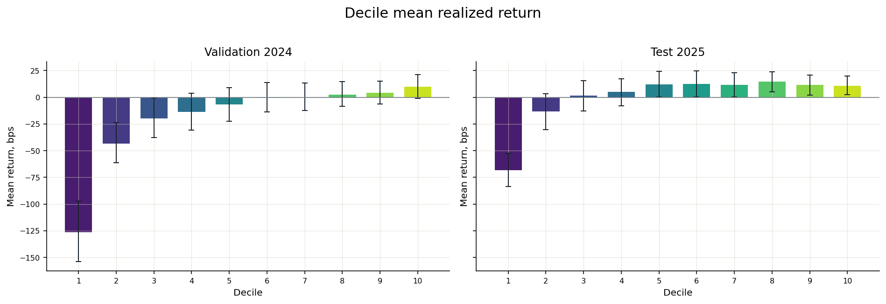

### Decile mean return

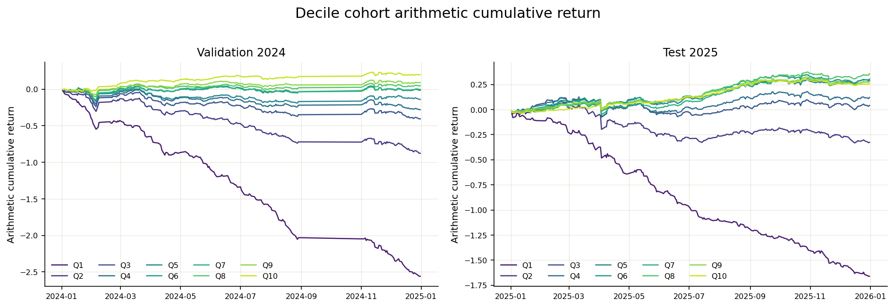

### Q1-Q10 cohort cumulative

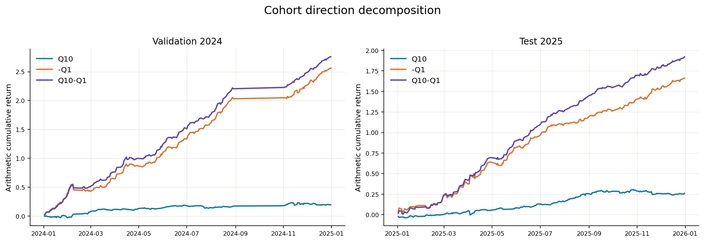

### 收益方向拆解

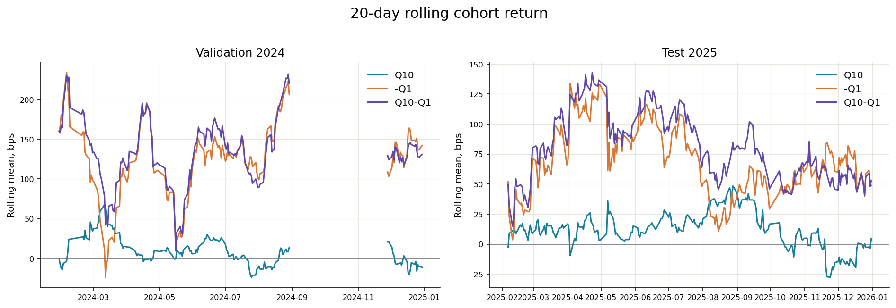

### 20-day rolling stability

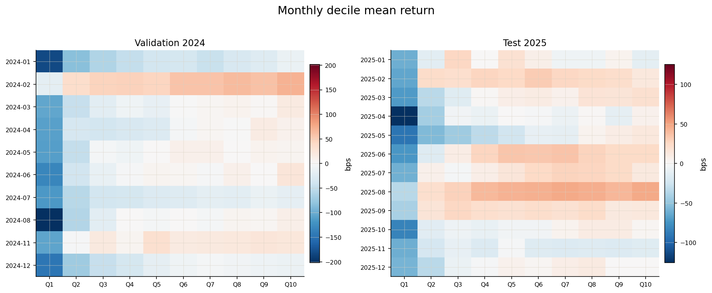

### Month x decile heatmap

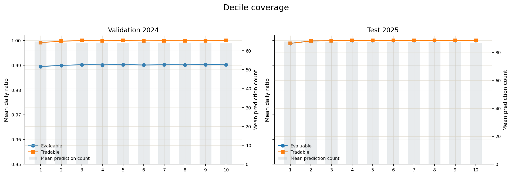

### Decile coverage

### 3. Portfolio 与 execution

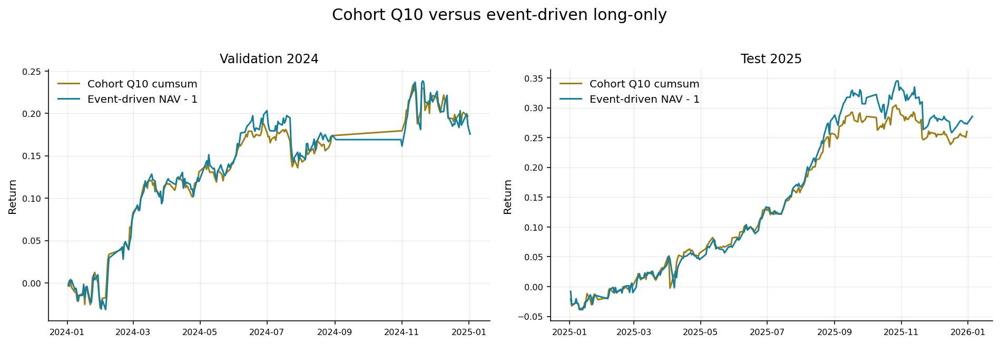

### Cohort Q10 versus event-driven long-only

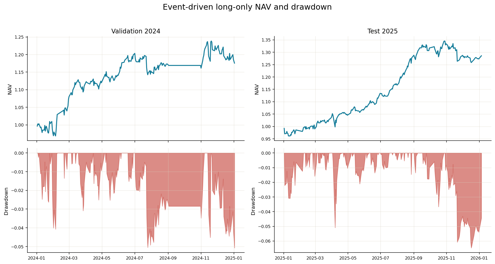

### Long-only NAV and drawdown

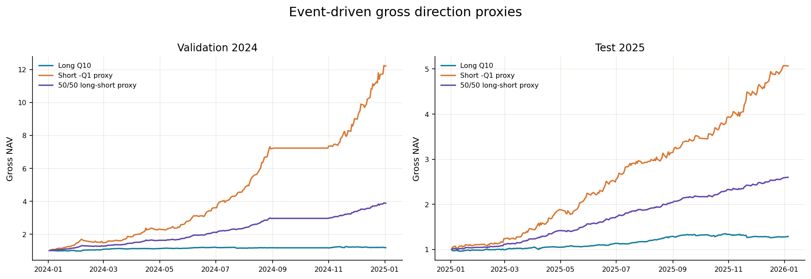

### Gross direction proxies

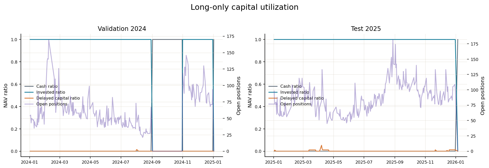

### Capital utilization

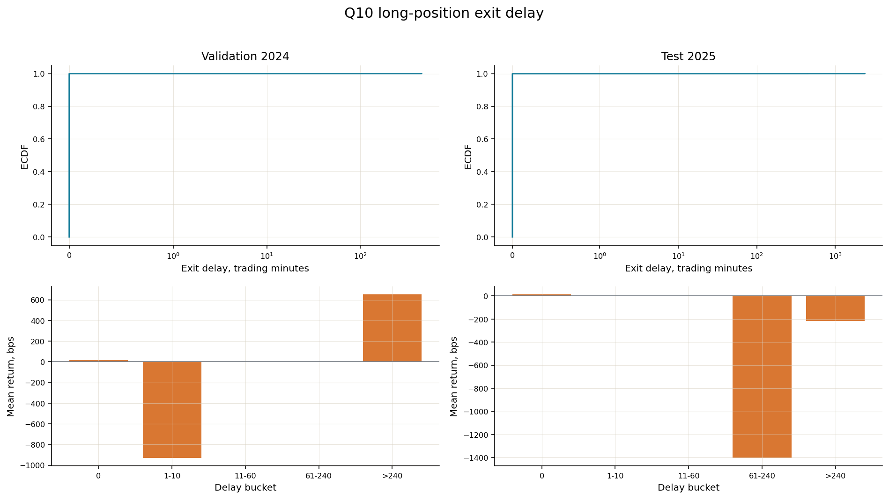

### Exit-delay diagnostics

### Validation 2024 exit delay

| Q10 positions | 13,095 |
| --- | --- |
| Delayed positions | 2 |
| Delayed ratio | +0.015% |
| Maximum trading-minute delay | 452 |
| Delayed mean raw return | -1.387% |

### Test 2025 exit delay

| Q10 positions | 21,105 |
| --- | --- |
| Delayed positions | 10 |
| Delayed ratio | +0.047% |
| Maximum trading-minute delay | 2,380 |
| Delayed mean raw return | -9.281% |

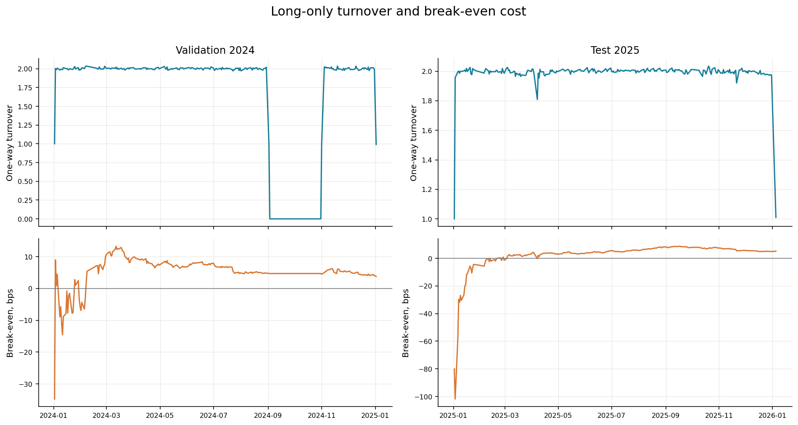

### Turnover and break-even cost

### 4. IC stability

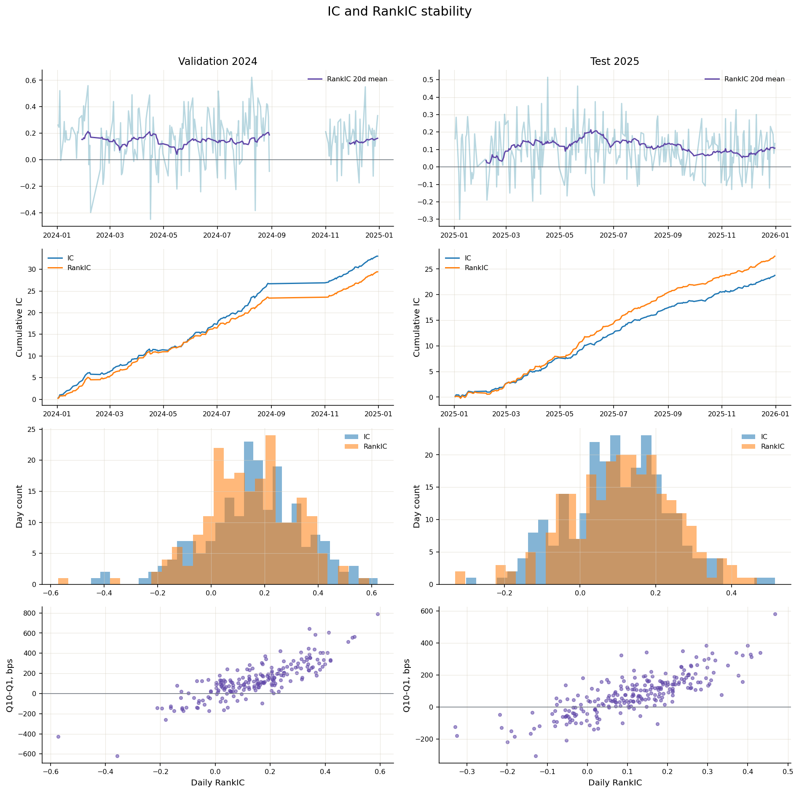

### IC dashboard

### Validation 2024 IC metrics

| Metric | Mean | Std | ICIR | Positive days | t-stat | Valid days |
| --- | --- | --- | --- | --- | --- | --- |
| Pearson IC | +0.1627 | +0.1859 | +13.614 | +82.759% | +12.469 | 203 |
| RankIC | +0.1449 | +0.1667 | +13.528 | +84.729% | +12.390 | 203 |

### Test 2025 IC metrics

| Metric | Mean | Std | ICIR | Positive days | t-stat | Valid days |
| --- | --- | --- | --- | --- | --- | --- |
| Pearson IC | +0.0978 | +0.1307 | +11.659 | +77.778% | +11.659 | 243 |
| RankIC | +0.1132 | +0.1366 | +12.917 | +79.012% | +12.917 | 243 |

### 5. 2021-2025 年度对比

2021-2023 是 selected checkpoint 的 train in-sample 结果, 不能解释为 generalization evidence. 2024 是用于 checkpoint selection 的 Validation, 且排除 9-10 月. 2025 是 one-shot Test.

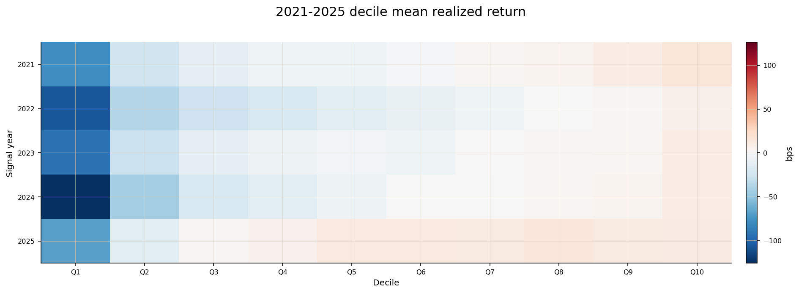

### Year x decile mean return

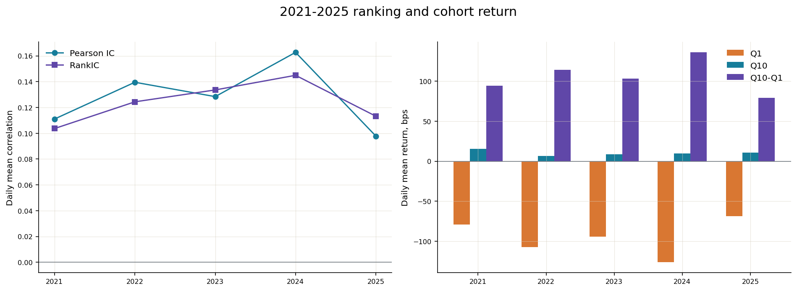

### Yearly ranking and cohort return

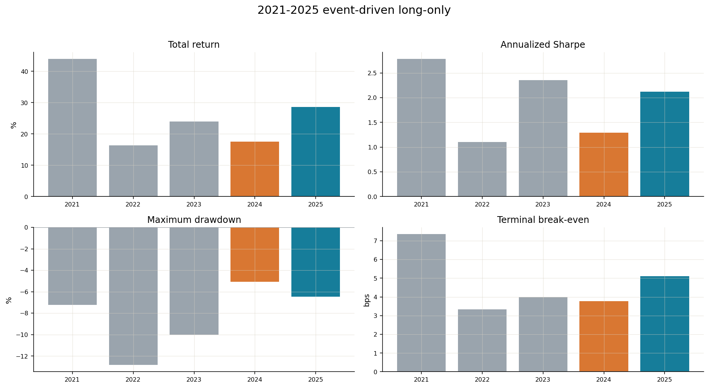

### Yearly event-driven long-only

### Yearly signal metrics

| Year | Role | Signal days | Pearson IC | Pearson ICIR | RankIC | Rank ICIR | Monotonicity | Q1, bps | Q10, bps | Q10-Q1, bps | Q10 95% CI, bps |
| --- | --- | --- | --- | --- | --- | --- | --- | --- | --- | --- | --- |
| 2021 | Train, in-sample | 243 | +0.1110 | +13.749 | +0.1037 | +14.744 | +0.988 | -78.83 | +15.33 | +94.15 | [+5.09, +25.26] |
| 2022 | Train, in-sample | 242 | +0.1395 | +16.598 | +0.1244 | +15.099 | +1.000 | -107.11 | +6.69 | +113.80 | [-3.80, +16.32] |
| 2023 | Train, in-sample | 242 | +0.1284 | +12.038 | +0.1336 | +15.774 | +0.988 | -94.32 | +8.87 | +103.20 | [-1.32, +19.53] |
| 2024 | Validation, selected, excludes Sep-Oct | 205 | +0.1627 | +13.614 | +0.1449 | +13.528 | +1.000 | -126.15 | +9.71 | +135.85 | [-0.85, +21.42] |
| 2025 | Test, one-shot | 243 | +0.0978 | +11.659 | +0.1132 | +12.917 | +0.661 | -68.35 | +10.71 | +79.06 | [+2.26, +19.80] |

### Yearly event-driven long-only

| Year | Total return | Annualized return | Annualized vol | Sharpe | Max drawdown | Positive days | Mean turnover | Break-even, bps |
| --- | --- | --- | --- | --- | --- | --- | --- | --- |
| 2021 | +43.904% | +43.689% | +13.357% | +2.783 | -7.238% | +62.295% | +1.988 | 7.35 |
| 2022 | +16.285% | +16.213% | +14.571% | +1.104 | -12.825% | +54.321% | +1.992 | 3.33 |
| 2023 | +24.014% | +23.904% | +9.276% | +2.358 | -10.002% | +55.967% | +1.992 | 4.00 |
| 2024 | +17.560% | +17.482% | +13.113% | +1.294 | -5.074% | +48.148% | +1.688 | 3.78 |
| 2025 | +28.560% | +28.428% | +12.155% | +2.120 | -6.471% | +59.016% | +1.989 | 5.12 |

### Yearly execution and gross proxies

| Year | Q10 positions | Delayed | Delay ratio | Max delay, min | Delayed mean return | Short proxy total | 50/50 proxy total |
| --- | --- | --- | --- | --- | --- | --- | --- |
| 2021 | 15,868 | 18 | +0.113% | 2,380 | -8.390% | +552.677% | +210.863% |
| 2022 | 15,187 | 10 | +0.066% | 452 | -10.545% | +1151.725% | +287.683% |
| 2023 | 12,828 | 3 | +0.023% | 211 | -13.191% | +836.261% | +245.338% |
| 2024 | 13,095 | 2 | +0.015% | 452 | -1.387% | +1120.787% | +287.426% |
| 2025 | 21,105 | 10 | +0.047% | 2,380 | -9.281% | +406.803% | +159.876% |

Short-only 与 50/50 long-short 是 gross, non-executable signal proxy.

### 6. CSI1800 股票池

CSI1800 定义为 strictly-lagged CSI300, CSI500 与 CSI1000 monthly snapshot 的 canonical union. 每期严格为 1,800 只. 每个 signal date 在该 pool 内独立 rerank, 再固定 decile 与 top-tail selection.

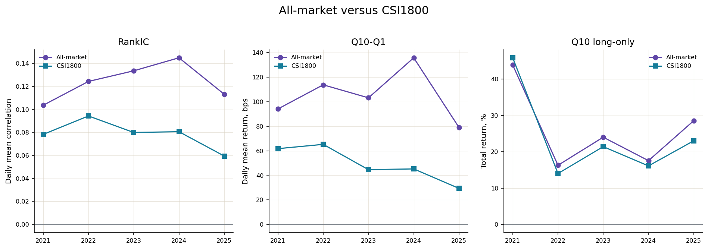

### All-market versus CSI1800

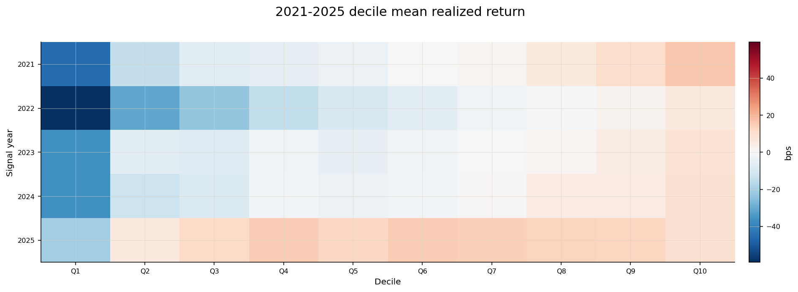

### CSI1800 year x decile mean return

### CSI1800 OOS metrics

| Split | Signal days | Pearson IC | RankIC | Monotonicity | Q1, bps | Q10, bps | Q10-Q1, bps | Long total | Long Sharpe | Long max DD | Turnover | Break-even, bps | Delayed |
| --- | --- | --- | --- | --- | --- | --- | --- | --- | --- | --- | --- | --- | --- |
| Validation 2024 | 205 | +0.0747 | +0.0806 | +0.964 | -36.25 | +9.00 | +45.25 | +16.113% | +1.228 | -5.093% | +1.688 | 3.49 | 1 |
| Test 2025 | 243 | +0.0524 | +0.0595 | +0.358 | -20.55 | +8.84 | +29.39 | +23.027% | +1.879 | -7.079% | +1.990 | 4.20 | 4 |

### CSI1800 yearly metrics

### Yearly signal metrics

| Year | Role | Signal days | Pearson IC | Pearson ICIR | RankIC | Rank ICIR | Monotonicity | Q1, bps | Q10, bps | Q10-Q1, bps | Q10 95% CI, bps |
| --- | --- | --- | --- | --- | --- | --- | --- | --- | --- | --- | --- |
| 2021 | Train, in-sample | 243 | +0.0783 | +9.803 | +0.0783 | +11.032 | +1.000 | -45.88 | +15.89 | +61.77 | [+5.66, +25.80] |
| 2022 | Train, in-sample | 242 | +0.0985 | +11.634 | +0.0943 | +11.530 | +1.000 | -59.40 | +5.87 | +65.27 | [-4.30, +15.48] |
| 2023 | Train, in-sample | 242 | +0.0746 | +7.367 | +0.0800 | +9.642 | +0.976 | -36.56 | +8.08 | +44.63 | [-2.43, +19.23] |
| 2024 | Validation, selected, excludes Sep-Oct | 205 | +0.0747 | +6.705 | +0.0806 | +7.350 | +0.964 | -36.25 | +9.00 | +45.25 | [-1.23, +20.17] |
| 2025 | Test, one-shot | 243 | +0.0524 | +5.766 | +0.0595 | +6.171 | +0.358 | -20.55 | +8.84 | +29.39 | [+0.11, +18.16] |

### Yearly event-driven long-only

| Year | Total return | Annualized return | Annualized vol | Sharpe | Max drawdown | Positive days | Mean turnover | Break-even, bps |
| --- | --- | --- | --- | --- | --- | --- | --- | --- |
| 2021 | +45.888% | +45.662% | +13.177% | +2.922 | -7.092% | +60.246% | +1.986 | 7.60 |
| 2022 | +14.016% | +13.955% | +14.091% | +0.998 | -12.622% | +52.675% | +1.992 | 2.87 |
| 2023 | +21.414% | +21.317% | +9.183% | +2.151 | -11.280% | +55.556% | +1.992 | 3.59 |
| 2024 | +16.113% | +16.042% | +12.779% | +1.228 | -5.093% | +47.737% | +1.688 | 3.49 |
| 2025 | +23.027% | +22.923% | +11.330% | +1.879 | -7.079% | +57.787% | +1.990 | 4.20 |

### Yearly execution and gross proxies

| Year | Q10 positions | Delayed | Delay ratio | Max delay, min | Delayed mean return | Short proxy total | 50/50 proxy total |
| --- | --- | --- | --- | --- | --- | --- | --- |
| 2021 | 12,698 | 17 | +0.134% | 2,380 | -8.088% | +196.430% | +110.474% |
| 2022 | 11,777 | 7 | +0.059% | 223 | -9.237% | +307.663% | +118.269% |
| 2023 | 9,437 | 2 | +0.021% | 211 | -11.577% | +135.303% | +70.576% |
| 2024 | 9,677 | 1 | +0.010% | 452 | +6.508% | +110.115% | +58.628% |
| 2025 | 14,129 | 4 | +0.028% | 2,380 | -10.402% | +61.780% | +42.905% |

Short-only 与 50/50 long-short 是 gross, non-executable signal proxy.

### 7. Top 5%, 1% 与 0.5%

每个 signal date 按既有 deterministic order 选择最高 prediction 的 ceil(p x N) 只股票. Selection 在 14:00 entry audit 前固定, 不因不可买或不可评价而 refill. All-market 与 CSI1800 分别排序.

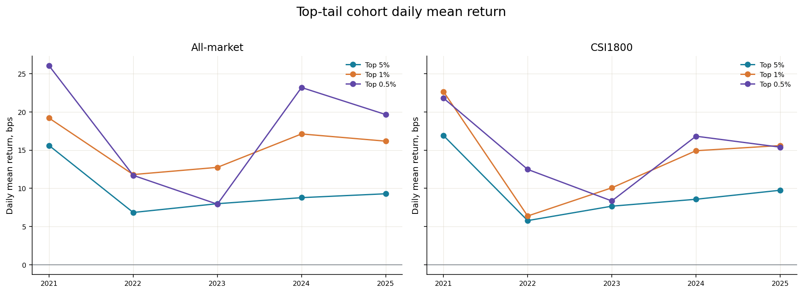

### Top-tail cohort mean return

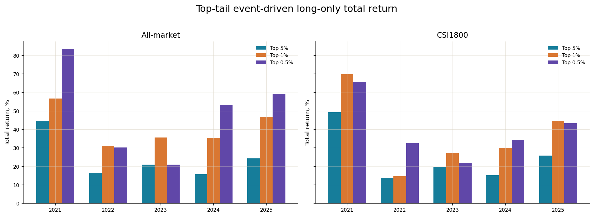

### Top-tail event-driven long-only

### Top-tail OOS metrics

| Scope | Group | Selection | Mean names | Tradable | Cohort mean, bps | 95% CI, bps | Cohort Sharpe | Long total | Long Sharpe | Long max DD | Turnover | Break-even, bps | Delayed |
| --- | --- | --- | --- | --- | --- | --- | --- | --- | --- | --- | --- | --- | --- |
| All-market | Validation 2024 | Top 5% | 32.7 | +99.993% | +8.78 | [-0.63, +18.87] | +1.597 | +15.749% | +1.187 | -4.484% | +1.688 | 3.44 | 2 |
| All-market | Validation 2024 | Top 1% | 6.9 | +100.000% | +17.12 | [+3.94, +31.94] | +2.567 | +35.435% | +2.114 | -5.850% | +1.688 | 7.16 | 1 |
| All-market | Validation 2024 | Top 0.5% | 3.7 | +100.000% | +23.20 | [+7.34, +40.39] | +2.942 | +53.163% | +2.531 | -6.166% | +1.687 | 10.52 | 1 |
| All-market | Test 2025 | Top 5% | 44.1 | +100.000% | +9.29 | [-0.85, +19.20] | +1.902 | +24.336% | +1.892 | -7.249% | +1.990 | 4.41 | 3 |
| All-market | Test 2025 | Top 1% | 9.2 | +100.000% | +16.18 | [+4.82, +27.58] | +2.926 | +46.806% | +2.912 | -8.337% | +1.993 | 7.64 | 1 |
| All-market | Test 2025 | Top 0.5% | 4.9 | +100.000% | +19.66 | [+8.96, +30.86] | +3.058 | +59.221% | +2.972 | -6.748% | +1.995 | 9.35 | 0 |
| CSI1800 | Validation 2024 | Top 5% | 24.3 | +100.000% | +8.57 | [-0.83, +18.46] | +1.579 | +15.298% | +1.165 | -4.498% | +1.688 | 3.36 | 1 |
| CSI1800 | Validation 2024 | Top 1% | 5.3 | +100.000% | +14.92 | [+0.75, +30.36] | +2.200 | +29.864% | +1.806 | -6.418% | +1.687 | 6.20 | 1 |
| CSI1800 | Validation 2024 | Top 0.5% | 2.9 | +100.000% | +16.82 | [-0.37, +35.74] | +2.066 | +34.396% | +1.712 | -8.573% | +1.684 | 7.31 | 1 |
| CSI1800 | Test 2025 | Top 5% | 29.8 | +100.000% | +9.75 | [+0.62, +18.94] | +2.086 | +25.855% | +2.110 | -6.137% | +1.990 | 4.69 | 1 |
| CSI1800 | Test 2025 | Top 1% | 6.4 | +100.000% | +15.60 | [+5.41, +25.75] | +2.834 | +44.759% | +2.761 | -6.178% | +1.994 | 7.46 | 0 |
| CSI1800 | Test 2025 | Top 0.5% | 3.4 | +100.000% | +15.39 | [+6.32, +25.14] | +2.286 | +43.384% | +2.204 | -7.671% | +1.994 | 7.12 | 0 |

### Top-tail yearly metrics

| Scope | Group | Selection | Mean names | Tradable | Cohort mean, bps | 95% CI, bps | Cohort Sharpe | Long total | Long Sharpe | Long max DD | Turnover | Break-even, bps | Delayed |
| --- | --- | --- | --- | --- | --- | --- | --- | --- | --- | --- | --- | --- | --- |
| All-market | 2021 Train, in-sample | Top 5% | 33.3 | +99.990% | +15.61 | [+4.58, +26.46] | +2.760 | +44.738% | +2.690 | -7.200% | +1.992 | 7.27 | 9 |
| All-market | 2021 Train, in-sample | Top 1% | 7.1 | +100.000% | +19.20 | [+7.34, +30.98] | +2.554 | +56.654% | +2.569 | -7.507% | +1.992 | 8.98 | 2 |
| All-market | 2021 Train, in-sample | Top 0.5% | 3.8 | +100.000% | +26.05 | [+11.71, +38.68] | +2.849 | +83.478% | +2.910 | -9.352% | +1.991 | 11.41 | 2 |
| All-market | 2022 Train, in-sample | Top 5% | 32.1 | +100.000% | +6.84 | [-4.30, +17.77] | +1.095 | +16.671% | +1.138 | -14.003% | +1.992 | 3.41 | 3 |
| All-market | 2022 Train, in-sample | Top 1% | 6.8 | +100.000% | +11.80 | [-0.60, +24.98] | +1.623 | +31.015% | +1.681 | -9.930% | +1.993 | 5.87 | 1 |
| All-market | 2022 Train, in-sample | Top 0.5% | 3.6 | +100.000% | +11.70 | [-1.79, +25.46] | +1.440 | +30.181% | +1.497 | -11.038% | +1.992 | 5.73 | 0 |
| All-market | 2023 Train, in-sample | Top 5% | 27.2 | +100.000% | +7.99 | [-2.60, +18.88] | +2.075 | +20.976% | +2.125 | -12.133% | +1.992 | 3.53 | 2 |
| All-market | 2023 Train, in-sample | Top 1% | 5.8 | +100.000% | +12.75 | [+1.60, +23.64] | +2.285 | +35.569% | +2.349 | -9.284% | +1.992 | 5.56 | 1 |
| All-market | 2023 Train, in-sample | Top 0.5% | 3.2 | +100.000% | +7.93 | [-6.94, +24.47] | +1.197 | +21.032% | +1.309 | -17.277% | +1.992 | 3.41 | 0 |
| All-market | 2024 Validation, selected, excludes Sep-Oct | Top 5% | 32.7 | +99.993% | +8.78 | [-0.63, +18.87] | +1.597 | +15.749% | +1.187 | -4.484% | +1.688 | 3.44 | 2 |
| All-market | 2024 Validation, selected, excludes Sep-Oct | Top 1% | 6.9 | +100.000% | +17.12 | [+3.94, +31.94] | +2.567 | +35.435% | +2.114 | -5.850% | +1.688 | 7.16 | 1 |
| All-market | 2024 Validation, selected, excludes Sep-Oct | Top 0.5% | 3.7 | +100.000% | +23.20 | [+7.34, +40.39] | +2.942 | +53.163% | +2.531 | -6.166% | +1.687 | 10.52 | 1 |
| All-market | 2025 Test, one-shot | Top 5% | 44.1 | +100.000% | +9.29 | [-0.85, +19.20] | +1.902 | +24.336% | +1.892 | -7.249% | +1.990 | 4.41 | 3 |
| All-market | 2025 Test, one-shot | Top 1% | 9.2 | +100.000% | +16.18 | [+4.82, +27.58] | +2.926 | +46.806% | +2.912 | -8.337% | +1.993 | 7.64 | 1 |
| All-market | 2025 Test, one-shot | Top 0.5% | 4.9 | +100.000% | +19.66 | [+8.96, +30.86] | +3.058 | +59.221% | +2.972 | -6.748% | +1.995 | 9.35 | 0 |
| CSI1800 | 2021 Train, in-sample | Top 5% | 26.8 | +100.000% | +16.91 | [+5.85, +28.38] | +2.958 | +49.367% | +2.896 | -7.675% | +1.992 | 8.01 | 7 |
| CSI1800 | 2021 Train, in-sample | Top 1% | 5.8 | +100.000% | +22.66 | [+10.73, +34.03] | +2.877 | +69.868% | +2.869 | -7.383% | +1.992 | 10.53 | 2 |
| CSI1800 | 2021 Train, in-sample | Top 0.5% | 3.1 | +100.000% | +21.81 | [+4.86, +38.09] | +2.290 | +65.843% | +2.285 | -12.288% | +1.992 | 9.52 | 1 |
| CSI1800 | 2022 Train, in-sample | Top 5% | 25.0 | +100.000% | +5.77 | [-4.92, +16.57] | +0.929 | +13.718% | +0.980 | -13.811% | +1.992 | 2.82 | 3 |
| CSI1800 | 2022 Train, in-sample | Top 1% | 5.4 | +100.000% | +6.38 | [-8.03, +20.59] | +0.850 | +14.789% | +0.897 | -12.262% | +1.992 | 2.95 | 1 |
| CSI1800 | 2022 Train, in-sample | Top 0.5% | 3.0 | +100.000% | +12.48 | [+0.92, +23.69] | +1.526 | +32.634% | +1.616 | -9.783% | +1.992 | 6.17 | 0 |
| CSI1800 | 2023 Train, in-sample | Top 5% | 20.2 | +100.000% | +7.66 | [-2.73, +18.14] | +1.862 | +19.853% | +1.934 | -11.909% | +1.992 | 3.35 | 2 |
| CSI1800 | 2023 Train, in-sample | Top 1% | 4.5 | +100.000% | +10.07 | [-4.23, +24.44] | +1.730 | +27.271% | +1.848 | -15.792% | +1.993 | 4.26 | 0 |
| CSI1800 | 2023 Train, in-sample | Top 0.5% | 2.5 | +100.000% | +8.35 | [-7.29, +26.24] | +1.103 | +21.923% | +1.203 | -18.553% | +1.992 | 3.52 | 0 |
| CSI1800 | 2024 Validation, selected, excludes Sep-Oct | Top 5% | 24.3 | +100.000% | +8.57 | [-0.83, +18.46] | +1.579 | +15.298% | +1.165 | -4.498% | +1.688 | 3.36 | 1 |
| CSI1800 | 2024 Validation, selected, excludes Sep-Oct | Top 1% | 5.3 | +100.000% | +14.92 | [+0.75, +30.36] | +2.200 | +29.864% | +1.806 | -6.418% | +1.687 | 6.20 | 1 |
| CSI1800 | 2024 Validation, selected, excludes Sep-Oct | Top 0.5% | 2.9 | +100.000% | +16.82 | [-0.37, +35.74] | +2.066 | +34.396% | +1.712 | -8.573% | +1.684 | 7.31 | 1 |
| CSI1800 | 2025 Test, one-shot | Top 5% | 29.8 | +100.000% | +9.75 | [+0.62, +18.94] | +2.086 | +25.855% | +2.110 | -6.137% | +1.990 | 4.69 | 1 |
| CSI1800 | 2025 Test, one-shot | Top 1% | 6.4 | +100.000% | +15.60 | [+5.41, +25.75] | +2.834 | +44.759% | +2.761 | -6.178% | +1.994 | 7.46 | 0 |
| CSI1800 | 2025 Test, one-shot | Top 0.5% | 3.4 | +100.000% | +15.39 | [+6.32, +25.14] | +2.286 | +43.384% | +2.204 | -7.671% | +1.994 | 7.12 | 0 |

## 限制与适用边界

后续独立 ledger audit 已确认旧 Validation gross ledger 未排除 split boundary positions. 13:58 baseline 的 corrected gross return 为 20.1322%, Sharpe 为 1.552499; 13:50 为 10.7110%, Sharpe 为 0.838975. 旧表、旧图作为历史 evidence 保留, 相应 Validation long-only 数值以 [ledger audit](/reports/astock-overnight/1016-overnight-ledger-audit/) 为准. 未对未审计的 CSI1800、其他 tail 或方案 A 结果推算更正值.

2021-2023 为 Train; 2024 Validation 排除 9-10 月. 历史报告中的 2025 one-shot Test 已被查看, 当前仅能作为 historical confirmation, 不支持再次用其选择配置. 本次同步仅整理既有 evidence, 未训练、推理或重跑回测.

### 8. Lineage 与限制

| Evaluation code commit | 85db5e4d7194ef0d5a0af43e36a9eb33d1a21386 |
| --- | --- |
| Experiment run | 20260920T030509Z |
| Experiment content hash | 5387e703044a7fb82e3880ee2e85d1b0c2745bc6129b7f5b2eed314c0c1bd460 |
| Selected checkpoint | checkpoints/step-000617.pt |
| Dataset run | 20260919T174500Z |
| Dataset content hash | a320525735a39db1919241d7817d3e839bd086ab2a8611e10b81264d20bbaa31 |
| Factor set | core-v1 |
| Factor set hash | 2a6a3cc0f79049ed6b74994c3d50f5b5d8b22e374549490b7003bf38755ce1d3 |
| Universe content hash | 2337df726828d6b0ae06a067be78d9c78d51a44630a582a71b4ec9caca15e7f1 |
| CSI1800 membership hash | feae8dd8d951f1e5d0373b03febb362bf04fcbf3968155ac17bd545b0be3fc08 |
| CSI1800 source-file manifest hash | ac513ea49df71fb97ec72598eb6a1abb242e0d60adb731530a8bba22cd9aa564 |

- Test 是 selected checkpoint 的 one-shot evaluation, 未参与 model selection.
- 所有收益均为 gross. Break-even cost 是容量边界, 不是实际成本估计.
- Cohort cumulative 只表示 signal-date 排序收益累积, event-driven long-only 才表示 available-cash portfolio NAV.
- Headline number 可回溯到同目录 parquet, metrics YAML 和 manifest.yaml.

## 结论

锁板过滤后的完整模型 Evaluation, 需结合对照研究区分直接过滤与 retraining.

## 附录

来源: `astock-overnight/reports/signal-limit-sample-filter-plan-a.html`.

Source SHA-256: `29d21b478fa4ab686a7d7bc1f3a75eae454e7488f04c18eff7cd0c80a1fcbc8c`.

同步日期: 2026-11-03. 原始归档保留源字节; 本内容包仅移除机器本地路径, 不重新计算研究指标.
