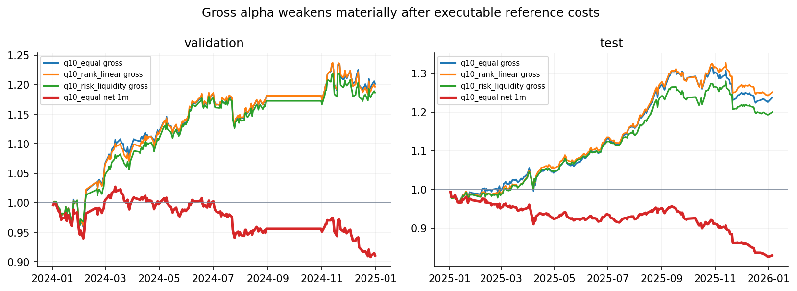
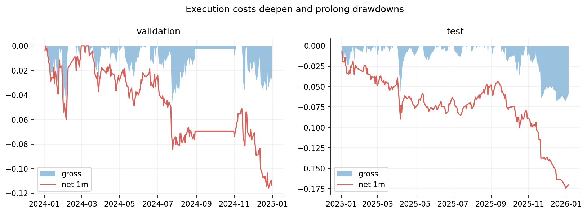
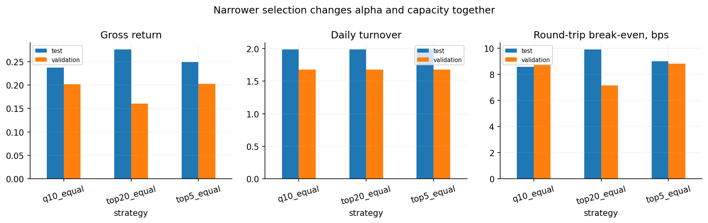
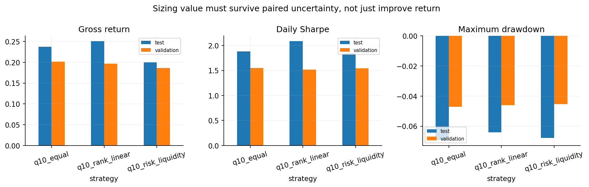
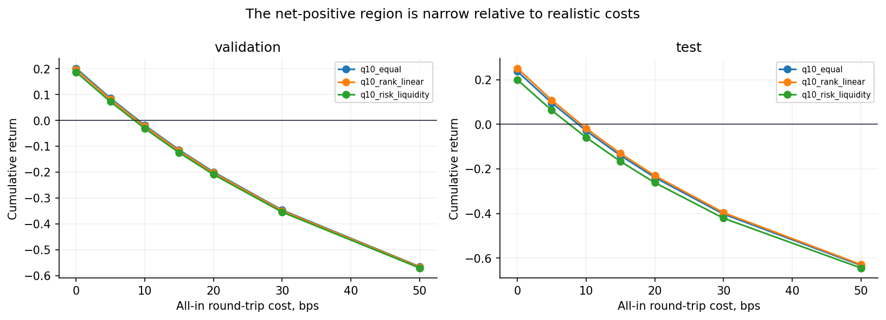
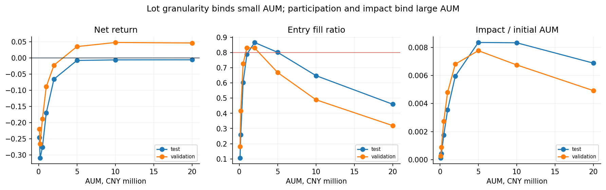
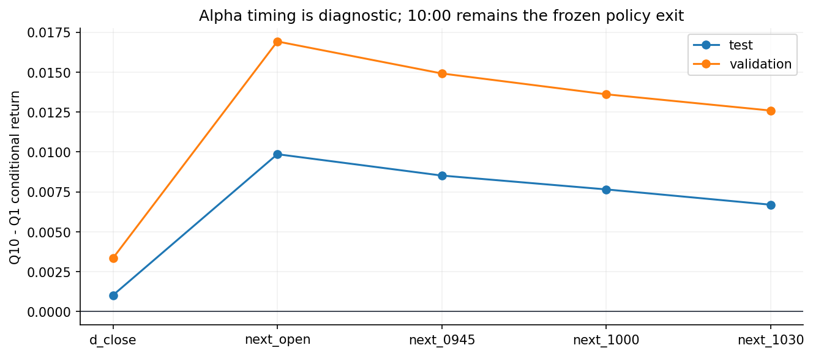
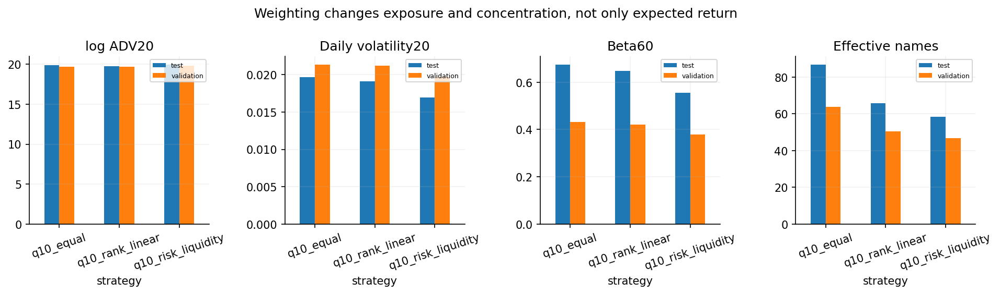
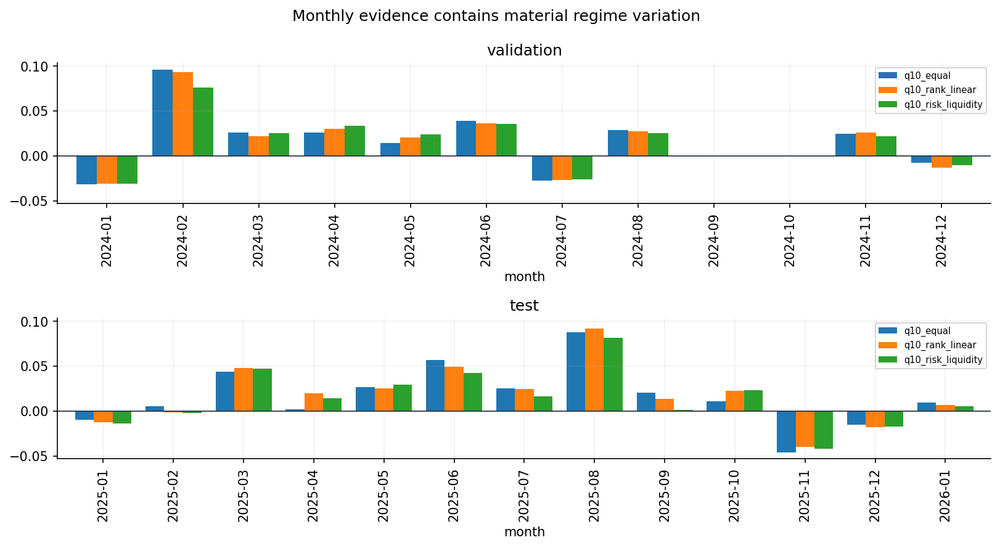
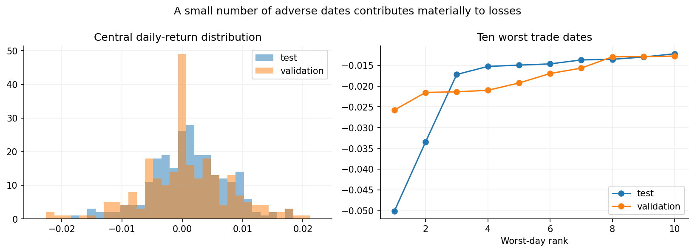

## 摘要

完成成本、容量和 independent review; 没有共同通过净收益与 80% fill gate 的 AUM, CONTINUE_RESEARCH.

本报告已应用 evaluable exclusion. 2025 为 contaminated historical confirmation. Reference fee 为报告冻结假设, 不代表本次验证了现行费率.

## 研究背景与目标

研究问题与数据合同以保留的源报告为准. 本页将既有研究证据登记为独立 publication, 关联对应 Study 与 Experiment.

## 数据与方法

2021-2023 为 Train; 2024 Validation 排除 9-10 月. 历史报告中的 2025 one-shot Test 已被查看, 当前仅能作为 historical confirmation, 不支持再次用其选择配置. 本次同步仅整理既有 evidence, 未训练、推理或重跑回测.

## 主要结果

FROZEN DUAL-GRU / STRATEGY RESEARCH

Generated: 2026-10-14T19:42:01.833440+00:00 · Git: 15a023a20b14ab50e8dd0e5483542f2e575a6791 · Artifact: 20261014T174954Z

### 1. Executive conclusion

本研究冻结 prediction model、features、labels 和 scores，只研究 prediction → portfolio → execution → realized PnL。最终结论为 **CONTINUE_RESEARCH** 。

最接近可行的策略是 **q10_equal** 。当前 binding constraint: turnover-dependent costs and 100-share lot granularity remove the gross margin before a common >=80% fill region is reached。



### 2. Final verdict

CONTINUE_RESEARCH

Reference-cost feasible AUM: 无同时通过 development 与 2025 confirmation gate 的 AUM。2025 已被历史结果查看污染，因此只能作为 historical confirmation，不能恢复为 untouched test。

| split | daily_mean_rank_ic | daily_rank_ic_std | positive_rank_ic_ratio | signal_date_count | finite_rank_ic_date_count |
| --- | --- | --- | --- | --- | --- |
| test | 0.114489 | 0.146676 | 0.781893 | 243 | 243 |
| validation | 0.147947 | 0.176631 | 0.798030 | 205 | 203 |

### 3. Recommended strategy specification

| field | contract |
| --- | --- |
| Model | 20260918T082705Z / checkpoints/step-000617.pt |
| Universe | Frozen factor-complete SSE/SZSE universe; exclude BSE, ST history, delisting period, suspension, <60 calendar days listed |
| Signal | D 13:58 minute end |
| Rank / selection | Daily full-universe deterministic rank; decile == 10 |
| Weighting | equal |
| Position cap | max(3%, 1/N) when the absolute cap is infeasible |
| Liquidity cap | 1% lagged ADV20; 10% entry/exit minute participation; 100-share buy lots |
| Entry | D 14:00 minute VWAP; Close for zero-volume/amount; reject suspended or locked upper-limit bar |
| Exit | T+1 10:00 minute VWAP; one-price upper limit exits at up_limit |
| Delayed exit | Earliest 10 consecutive sellable minutes; continue across dates; delisting writeoff at zero |
| Reference cost | 5 bps sell tax + 0.1 bps/side transfer + 1 bps/side broker, CNY 5 minimum + 1 bps/side spread + square-root impact |
| Target AUM | No historically validated feasible range |
| Health gates | Frozen artifact hashes, complete input partitions, order/cash/position reconciliation, participation and cost gates |
| Risk limits | No new neutrality optimizer; monitor beta, industry max weight, single-name cap, delayed cash trap |
| Known failure | turnover-dependent costs and 100-share lot granularity remove the gross margin before a common >=80% fill region is reached |

| split | strategy | observation_count | position_count | terminal_nav | total_return | annualized_return | annualized_volatility | sharpe | maximum_drawdown | daily_hit_rate | mean_daily_turnover | cumulative_traded_notional | break_even_bps_one_way | break_even_bps_round_trip_on_entry | mean_capital_utilization | mean_open_positions | delayed_position_count | maximum_exit_delay_trading_minutes | maximum_delayed_capital_ratio |
| --- | --- | --- | --- | --- | --- | --- | --- | --- | --- | --- | --- | --- | --- | --- | --- | --- | --- | --- | --- |
| validation | q10_equal | 242 | 12935 | 1.201322 | 0.201322 | 0.191018 | 0.123039 | 1.552499 | -0.047105 | 0.462810 | 1.678873 | 457.744099 | 4.398128 | 8.800127 | 0.838843 | 53.458678 | 2 | 452 | 0.013677 |
| test | q10_equal | 244 | 21109 | 1.237166 | 0.237166 | 0.218839 | 0.116404 | 1.879994 | -0.069367 | 0.590164 | 1.988525 | 552.923409 | 4.289307 | 8.582294 | 0.995902 | 86.692623 | 9 | 2380 | 0.053258 |

| split | strategy | aum_cny | cost_mode | total_return | annualized_return | sharpe | maximum_drawdown | fill_ratio | mean_invested_ratio | total_cost_cny | broker_cost_cny | stamp_duty_cny | transfer_fee_cny | spread_slippage_cny | market_impact_cny | entry_order_count | capped_entry_fraction | lot_rounded_entry_fraction | rejected_entry_count | maximum_participation |
| --- | --- | --- | --- | --- | --- | --- | --- | --- | --- | --- | --- | --- | --- | --- | --- | --- | --- | --- | --- | --- |
| validation | q10_equal | 1000000.0 | reference | -0.089273 | -0.088835 | -0.882556 | -0.115871 | 0.831474 | 0.697541 | 246548.276122 | 122920.0 | 82531.301304 | 3299.679299 | 32996.792990 | 4800.502529 | 12292 | 0.067035 | 0.993004 | 643 | 0.153846 |
| test | q10_equal | 1000000.0 | reference | -0.170217 | -0.181600 | -1.996218 | -0.174356 | 0.789831 | 0.786823 | 325920.103581 | 194370.0 | 88906.374335 | 3554.697947 | 35546.979466 | 3542.051834 | 19437 | 0.021197 | 0.997685 | 1672 | 0.100000 |

### 4. Evidence hierarchy and contamination warning

1. Model training: 2021-2023。
2. Strategy development: 2024，排除 9-10 月。
3. Historical confirmation: 2025，已有 baseline、tail 和 signal-limit 结果被查看。
4. Future forward evidence: 尚不存在，是进入实盘前的必要条件。

策略矩阵冻结于 2026-10-14T12:57:00+00:00。发现 Q10 小于 34 只时，3% cap 数学上不可行，因此预先固定 effective cap = max(3%, 1/N)。

### 5. Canonical Q10 baseline reconstruction

每日在完整 prediction group 内按 prediction ASC、stock code ASC 排序后划分 decile；Q10 membership 在 entry audit 前确定，不 refill。14:00 使用该分钟 VWAP，零成交时用 Close；T+1 10:00 按 frozen sellability contract 卖出，失败后等待 10 个连续可卖分钟，旧仓持续占用 capital。

4.2893 bps 是 profit / (entry notional + non-writeoff exit proceeds)，即 one-way traded-notional break-even；按 entry notional 计的 round-trip break-even 为 8.5823 bps。

| metric | value |
| --- | --- |
| rank_universe | all factor-complete prediction rows per signal date |
| membership | decile == 10 before entry feasibility, without refill |
| weighting | equal among executable Q10 members using available cash |
| terminal_nav | 1.237166 |
| gross_return | 0.237166 |
| maximum_drawdown | -0.069367 |
| mean_daily_turnover | 1.988525 |
| cumulative_traded_notional | 552.923409 |
| break_even_bps_one_way | 4.289307 |
| break_even_bps_round_trip_on_entry | 8.582294 |
| mean_capital_utilization | 0.995902 |
| delayed_position_count | 9 |
| maximum_exit_delay_trading_minutes | 2380 |
| daily_mean_rank_ic | 0.114489 |
| maximum_nav_difference_vs_formal | 0.0 |
| maximum_turnover_difference_vs_formal | 0.0 |
| break_even_definition | (terminal NAV - initial capital) / cumulative(entry notional + non-writeoff exit proceeds) * 10000 |



### 6. Selection breadth

只比较预注册 Top20%、Q10 和 Top5%。更窄组合同时提高 concentration、lot rejection 和 impact，不能只按 total return 选 winner。



| split | strategy | observation_count | position_count | terminal_nav | total_return | annualized_return | annualized_volatility | sharpe | maximum_drawdown | daily_hit_rate | mean_daily_turnover | cumulative_traded_notional | break_even_bps_one_way | break_even_bps_round_trip_on_entry | mean_capital_utilization | mean_open_positions | delayed_position_count | maximum_exit_delay_trading_minutes | maximum_delayed_capital_ratio |
| --- | --- | --- | --- | --- | --- | --- | --- | --- | --- | --- | --- | --- | --- | --- | --- | --- | --- | --- | --- |
| validation | top20_equal | 242 | 25966 | 1.160290 | 0.160290 | 0.156921 | 0.128461 | 1.221546 | -0.060787 | 0.475207 | 1.678764 | 446.967675 | 3.586162 | 7.174897 | 0.838843 | 107.305785 | 4 | 452 | 0.006829 |
| validation | q10_equal | 242 | 12935 | 1.201322 | 0.201322 | 0.191018 | 0.123039 | 1.552499 | -0.047105 | 0.462810 | 1.678873 | 457.744099 | 4.398128 | 8.800127 | 0.838843 | 53.458678 | 2 | 452 | 0.013677 |
| validation | top5_equal | 242 | 6616 | 1.202254 | 0.202254 | 0.192102 | 0.125548 | 1.530107 | -0.051347 | 0.454545 | 1.678690 | 458.509582 | 4.411128 | 8.826150 | 0.838843 | 27.347107 | 2 | 452 | 0.027049 |

### 7. Weighting

Q10 内比较 equal、rank-linear 和 risk/liquidity-aware。Raw prediction magnitude 不用于 sizing。Challenger 只有在 development paired block-bootstrap 95% lower bound 大于 0 时才能替换 equal weight。



| split | strategy | comparator | mean_difference | confidence_95_lower | confidence_95_upper | probability_positive |
| --- | --- | --- | --- | --- | --- | --- |
| validation | q10_rank_linear | q10_equal | -0.000017 | -0.000123 | 0.000087 | 0.3778 |
| validation | q10_risk_liquidity | q10_equal | -0.000055 | -0.000283 | 0.000142 | 0.3196 |
| test | q10_rank_linear | q10_equal | 0.000042 | -0.000155 | 0.000269 | 0.6314 |
| test | q10_risk_liquidity | q10_equal | -0.000133 | -0.000382 | 0.000132 | 0.1536 |

### 8. Cost frontier

Reference cost 拆为 sell stamp duty 5 bps、transfer 0.1 bps/side、broker 1 bps/side、minimum CNY 5/parent order、spread/slippage 1 bps/side 和 square-root impact。Broker quote 已包含 0.541 bps/side exchange/regulatory fee，未重复计算。



| split | strategy | all_in_round_trip_cost_bps | observation_count | position_count | terminal_nav | total_return | annualized_return | annualized_volatility | sharpe | maximum_drawdown | daily_hit_rate | mean_daily_turnover | cumulative_traded_notional | break_even_bps_one_way | break_even_bps_round_trip_on_entry | mean_capital_utilization | mean_open_positions | delayed_position_count | maximum_exit_delay_trading_minutes | maximum_delayed_capital_ratio |
| --- | --- | --- | --- | --- | --- | --- | --- | --- | --- | --- | --- | --- | --- | --- | --- | --- | --- | --- | --- | --- |
| validation | q10_equal | 0.0 | 242 | 12935 | 1.201322 | 0.201322 | 0.191018 | 0.123039 | 1.552499 | -0.047105 | 0.462810 | 1.678873 | 457.744099 | 4.398128 | 8.800127 | 0.838843 | 53.458678 | 2 | 452 | 0.013677 |
| validation | q10_equal | 5.0 | 242 | 12935 | 1.085456 | 0.085456 | 0.089525 | 0.122878 | 0.728568 | -0.059144 | 0.454545 | 1.678039 | 434.550021 | 1.966538 | 3.933849 | 0.838843 | 53.458678 | 2 | 452 | 0.013690 |
| validation | q10_equal | 10.0 | 242 | 12935 | 0.980715 | -0.019285 | -0.011968 | 0.122784 | -0.097474 | -0.080059 | 0.421488 | 1.677204 | 412.868345 | -0.467087 | -0.934131 | 0.838843 | 53.458678 | 2 | 452 | 0.013704 |
| validation | q10_equal | 15.0 | 242 | 12935 | 0.886037 | -0.113963 | -0.113462 | 0.122756 | -0.924284 | -0.146263 | 0.400826 | 1.676369 | 392.589657 | -2.902855 | -5.804026 | 0.838843 | 53.458678 | 2 | 452 | 0.013717 |
| validation | q10_equal | 20.0 | 242 | 12935 | 0.800458 | -0.199542 | -0.214955 | 0.122796 | -1.750510 | -0.210524 | 0.376033 | 1.675535 | 373.612915 | -5.340875 | -10.676049 | 0.838843 | 53.458678 | 2 | 452 | 0.013731 |
| validation | q10_equal | 30.0 | 242 | 12935 | 0.653199 | -0.346801 | -0.417941 | 0.123075 | -3.395838 | -0.346081 | 0.342975 | 1.673866 | 339.199029 | -10.224105 | -20.427324 | 0.838843 | 53.458678 | 2 | 452 | 0.013758 |
| validation | q10_equal | 50.0 | 242 | 12935 | 0.434705 | -0.565295 | -0.823915 | 0.124426 | -6.621739 | -0.563940 | 0.243802 | 1.670527 | 282.333379 | -20.022258 | -39.964497 | 0.838843 | 53.458678 | 2 | 452 | 0.013813 |
| validation | q10_rank_linear | 0.0 | 242 | 12935 | 1.196407 | 0.196407 | 0.186919 | 0.123078 | 1.518704 | -0.046062 | 0.458678 | 1.678637 | 457.377539 | 4.294198 | 8.592085 | 0.838843 | 53.458678 | 2 | 452 | 0.026284 |
| validation | q10_rank_linear | 5.0 | 242 | 12935 | 1.081027 | 0.081027 | 0.085439 | 0.122920 | 0.695079 | -0.057696 | 0.454545 | 1.677802 | 434.196009 | 1.866150 | 3.732997 | 0.838843 | 53.458678 | 2 | 452 | 0.026309 |
| validation | q10_rank_linear | 10.0 | 242 | 12935 | 0.976726 | -0.023274 | -0.016041 | 0.122829 | -0.130595 | -0.086014 | 0.433884 | 1.676968 | 412.525926 | -0.564194 | -1.128325 | 0.838843 | 53.458678 | 2 | 452 | 0.026335 |
| validation | q10_rank_linear | 15.0 | 242 | 12935 | 0.882442 | -0.117558 | -0.117521 | 0.122804 | -0.956976 | -0.145510 | 0.417355 | 1.676133 | 392.257982 | -2.996950 | -5.992103 | 0.838843 | 53.458678 | 2 | 452 | 0.026361 |
| validation | q10_rank_linear | 20.0 | 242 | 12935 | 0.797220 | -0.202780 | -0.219000 | 0.122846 | -1.782716 | -0.209685 | 0.376033 | 1.675299 | 373.291227 | -5.432228 | -10.858558 | 0.838843 | 53.458678 | 2 | 452 | 0.026387 |
| validation | q10_rank_linear | 30.0 | 242 | 12935 | 0.650572 | -0.349428 | -0.421960 | 0.123131 | -3.426905 | -0.348948 | 0.326446 | 1.673629 | 338.895359 | -10.310801 | -20.600361 | 0.838843 | 53.458678 | 2 | 452 | 0.026438 |
| validation | q10_rank_linear | 50.0 | 242 | 12935 | 0.432976 | -0.567024 | -0.827879 | 0.124494 | -6.649966 | -0.565832 | 0.256198 | 1.670291 | 282.059715 | -20.102972 | -40.125279 | 0.838843 | 53.458678 | 2 | 452 | 0.026542 |
| validation | q10_risk_liquidity | 0.0 | 242 | 12935 | 1.186557 | 0.186557 | 0.177694 | 0.114996 | 1.545225 | -0.045271 | 0.458678 | 1.678615 | 453.687411 | 4.112008 | 8.227400 | 0.838843 | 53.458678 | 2 | 452 | 0.021312 |
| validation | q10_risk_liquidity | 5.0 | 242 | 12935 | 1.072117 | 0.072117 | 0.076210 | 0.114840 | 0.663615 | -0.056302 | 0.442149 | 1.677780 | 430.708411 | 1.674391 | 3.349342 | 0.838843 | 53.458678 | 2 | 452 | 0.021333 |
| validation | q10_risk_liquidity | 10.0 | 242 | 12935 | 0.968666 | -0.031334 | -0.025274 | 0.114757 | -0.220244 | -0.088395 | 0.417355 | 1.676946 | 409.227207 | -0.765679 | -1.531240 | 0.838843 | 53.458678 | 2 | 452 | 0.021353 |
| validation | q10_risk_liquidity | 15.0 | 242 | 12935 | 0.875153 | -0.124847 | -0.126759 | 0.114744 | -1.104706 | -0.137794 | 0.404959 | 1.676111 | 389.135513 | -3.208314 | -6.414570 | 0.838843 | 53.458678 | 2 | 452 | 0.021374 |
| validation | q10_risk_liquidity | 20.0 | 242 | 12935 | 0.790627 | -0.209373 | -0.228243 | 0.114804 | -1.988117 | -0.210253 | 0.367769 | 1.675277 | 370.333322 | -5.653628 | -11.300868 | 0.838843 | 53.458678 | 2 | 452 | 0.021395 |
| validation | q10_risk_liquidity | 30.0 | 242 | 12935 | 0.645180 | -0.354820 | -0.431212 | 0.115136 | -3.745227 | -0.354292 | 0.330579 | 1.673607 | 336.234938 | -10.552732 | -21.083215 | 0.838843 | 53.458678 | 2 | 452 | 0.021437 |
| validation | q10_risk_liquidity | 50.0 | 242 | 12935 | 0.429372 | -0.570628 | -0.837149 | 0.116647 | -7.176780 | -0.569412 | 0.243802 | 1.670269 | 279.888007 | -20.387716 | -40.692469 | 0.838843 | 53.458678 | 2 | 452 | 0.021522 |
| test | q10_equal | 0.0 | 244 | 21109 | 1.237166 | 0.237166 | 0.218839 | 0.116404 | 1.879994 | -0.069367 | 0.590164 | 1.988525 | 552.923409 | 4.289307 | 8.582294 | 0.995902 | 86.692623 | 9 | 2380 | 0.053258 |
| test | q10_equal | 5.0 | 244 | 21109 | 1.095994 | 0.095994 | 0.098095 | 0.116340 | 0.843171 | -0.094353 | 0.540984 | 1.987526 | 519.059997 | 1.849381 | 3.699446 | 0.995902 | 86.692623 | 9 | 2380 | 0.053285 |
| test | q10_equal | 10.0 | 244 | 21109 | 0.970873 | -0.029127 | -0.022649 | 0.116278 | -0.194780 | -0.125941 | 0.512295 | 1.986527 | 487.843970 | -0.597048 | -1.194024 | 0.995902 | 86.692623 | 9 | 2380 | 0.053311 |
| test | q10_equal | 15.0 | 244 | 21109 | 0.859986 | -0.140014 | -0.143391 | 0.116219 | -1.233803 | -0.156816 | 0.463115 | 1.985528 | 459.046962 | -3.050111 | -6.098362 | 0.995902 | 86.692623 | 9 | 2380 | 0.053338 |
| test | q10_equal | 20.0 | 244 | 21109 | 0.761717 | -0.238283 | -0.264132 | 0.116161 | -2.273844 | -0.238094 | 0.422131 | 1.984529 | 432.461384 | -5.509916 | -11.013764 | 0.995902 | 86.692623 | 9 | 2380 | 0.053364 |
| test | q10_equal | 30.0 | 244 | 21109 | 0.597477 | -0.402523 | -0.505612 | 0.116052 | -4.356754 | -0.401784 | 0.356557 | 1.982532 | 385.186482 | -10.450068 | -20.878319 | 0.995902 | 86.692623 | 9 | 2380 | 0.053418 |
| test | q10_equal | 50.0 | 244 | 21109 | 0.367338 | -0.632662 | -0.988560 | 0.115861 | -8.532293 | -0.631481 | 0.237705 | 1.978536 | 309.925353 | -20.413380 | -40.743589 | 0.995902 | 86.692623 | 9 | 2380 | 0.053524 |
| test | q10_rank_linear | 0.0 | 244 | 21109 | 1.250948 | 0.250948 | 0.229108 | 0.109737 | 2.087796 | -0.064053 | 0.565574 | 1.989946 | 555.673334 | 4.516098 | 9.036277 | 0.995902 | 86.692623 | 9 | 2380 | 0.032493 |
| test | q10_rank_linear | 5.0 | 244 | 21109 | 1.108106 | 0.108106 | 0.108270 | 0.109674 | 0.987205 | -0.084753 | 0.528689 | 1.988949 | 521.516112 | 2.072908 | 4.146676 | 0.995902 | 86.692623 | 9 | 2380 | 0.032509 |
| test | q10_rank_linear | 10.0 | 244 | 21109 | 0.981515 | -0.018485 | -0.012566 | 0.109613 | -0.114644 | -0.115812 | 0.504098 | 1.987952 | 490.035007 | -0.377209 | -0.754390 | 0.995902 | 86.692623 | 9 | 2380 | 0.032526 |
| test | q10_rank_linear | 15.0 | 244 | 21109 | 0.869335 | -0.130665 | -0.133402 | 0.109554 | -1.217683 | -0.146469 | 0.475410 | 1.986954 | 460.998791 | -2.834391 | -5.667176 | 0.995902 | 86.692623 | 9 | 2380 | 0.032542 |
| test | q10_rank_linear | 20.0 | 244 | 21109 | 0.769930 | -0.230070 | -0.254238 | 0.109498 | -2.321848 | -0.227594 | 0.434426 | 1.985957 | 434.197300 | -5.298751 | -10.591890 | 0.995902 | 86.692623 | 9 | 2380 | 0.032559 |
| test | q10_rank_linear | 30.0 | 244 | 21109 | 0.603810 | -0.396190 | -0.495907 | 0.109392 | -4.533282 | -0.393646 | 0.377049 | 1.983962 | 386.551450 | -10.249336 | -20.477683 | 0.995902 | 86.692623 | 9 | 2380 | 0.032591 |
| test | q10_rank_linear | 50.0 | 244 | 21109 | 0.371096 | -0.628904 | -0.979236 | 0.109208 | -8.966674 | -0.626598 | 0.266393 | 1.979972 | 310.740698 | -20.238876 | -40.395994 | 0.995902 | 86.692623 | 9 | 2380 | 0.032657 |
| test | q10_risk_liquidity | 0.0 | 244 | 21109 | 1.199562 | 0.199562 | 0.186399 | 0.101187 | 1.842123 | -0.067815 | 0.586066 | 1.990273 | 545.359594 | 3.659266 | 7.321212 | 0.995902 | 86.692623 | 9 | 2380 | 0.017757 |
| test | q10_risk_liquidity | 5.0 | 244 | 21109 | 1.062529 | 0.062529 | 0.065528 | 0.101129 | 0.647968 | -0.090116 | 0.512295 | 1.989276 | 512.081290 | 1.221077 | 2.442452 | 0.995902 | 86.692623 | 9 | 2380 | 0.017766 |
| test | q10_risk_liquidity | 10.0 | 244 | 21109 | 0.941094 | -0.058906 | -0.055342 | 0.101073 | -0.547544 | -0.122314 | 0.467213 | 1.988279 | 481.399669 | -1.223641 | -2.446982 | 0.995902 | 86.692623 | 9 | 2380 | 0.017775 |
| test | q10_risk_liquidity | 15.0 | 244 | 21109 | 0.833487 | -0.166513 | -0.176211 | 0.101019 | -1.744328 | -0.163746 | 0.422131 | 1.987282 | 453.090903 | -3.675036 | -7.347371 | 0.995902 | 86.692623 | 9 | 2380 | 0.017784 |
| test | q10_risk_liquidity | 20.0 | 244 | 21109 | 0.738140 | -0.261860 | -0.297080 | 0.100969 | -2.942300 | -0.259042 | 0.393443 | 1.986286 | 426.951526 | -6.133237 | -12.258956 | 0.995902 | 86.692623 | 9 | 2380 | 0.017793 |
| test | q10_risk_liquidity | 30.0 | 244 | 21109 | 0.578816 | -0.421184 | -0.538816 | 0.100874 | -5.341463 | -0.418397 | 0.319672 | 1.984292 | 380.457570 | -11.070462 | -22.116440 | 0.995902 | 86.692623 | 9 | 2380 | 0.017811 |
| test | q10_risk_liquidity | 50.0 | 244 | 21109 | 0.355655 | -0.644345 | -1.022281 | 0.100715 | -10.150228 | -0.641920 | 0.241803 | 1.980304 | 306.397767 | -21.029697 | -41.971130 | 0.995902 | 86.692623 | 9 | 2380 | 0.017848 |

### 9. Capacity frontier

Entry 同时受 1% lagged ADV20、10% 14:00 bar amount 和 100-share lot 约束；未成交 remainder 取消且不 refill。Exit 每分钟不超过 10% volume，未完成部分跨分钟和交易日继续；一字涨停按 up-limit 全量可卖。



| split | strategy | aum_cny | cost_mode | total_return | annualized_return | sharpe | maximum_drawdown | fill_ratio | mean_invested_ratio | total_cost_cny | broker_cost_cny | stamp_duty_cny | transfer_fee_cny | spread_slippage_cny | market_impact_cny | entry_order_count | capped_entry_fraction | lot_rounded_entry_fraction | rejected_entry_count | maximum_participation |
| --- | --- | --- | --- | --- | --- | --- | --- | --- | --- | --- | --- | --- | --- | --- | --- | --- | --- | --- | --- | --- |
| validation | q10_equal | 100000.0 | reference | -0.219548 | -0.248451 | -9.678397 | -0.219548 | 0.181034 | 0.150493 | 2.500436e+04 | 22660.000000 | 1.610236e+03 | 64.378934 | 643.789337 | 25.956551 | 2266 | 0.000441 | 1.000000 | 10669 | 0.076923 |
| validation | q10_equal | 200000.0 | reference | -0.265541 | -0.308490 | -6.266052 | -0.265541 | 0.415620 | 0.345121 | 6.811405e+04 | 57530.000000 | 7.229542e+03 | 289.031620 | 2890.316196 | 175.160129 | 5753 | 0.002260 | 0.999305 | 7182 | 0.100000 |
| validation | q10_equal | 500000.0 | reference | -0.188606 | -0.206179 | -2.427108 | -0.188606 | 0.727423 | 0.609144 | 1.592634e+05 | 108890.000000 | 3.403550e+04 | 1360.770574 | 13607.705741 | 1369.426944 | 10889 | 0.016255 | 0.996878 | 2046 | 0.100000 |
| validation | q10_equal | 1000000.0 | reference | -0.089273 | -0.088835 | -0.882556 | -0.115871 | 0.831474 | 0.697541 | 2.465483e+05 | 122920.000000 | 8.253130e+04 | 3299.679299 | 32996.792990 | 4800.502529 | 12292 | 0.067035 | 0.993004 | 643 | 0.153846 |
| validation | q10_equal | 2000000.0 | reference | -0.022796 | -0.017801 | -0.171626 | -0.074416 | 0.831002 | 0.697282 | 3.888496e+05 | 128706.157059 | 1.712246e+05 | 6845.552251 | 68455.522512 | 13617.788705 | 12751 | 0.201004 | 0.980707 | 184 | 0.307692 |
| validation | q10_equal | 5000000.0 | reference | 0.034688 | 0.038330 | 0.422537 | -0.051191 | 0.669170 | 0.561807 | 7.168154e+05 | 165893.327534 | 3.556592e+05 | 14217.465986 | 142174.659862 | 38870.715363 | 12870 | 0.497591 | 0.955400 | 65 | 0.820513 |
| validation | q10_equal | 10000000.0 | reference | 0.047350 | 0.049048 | 0.678985 | -0.033100 | 0.489441 | 0.410932 | 1.046544e+06 | 228421.621456 | 5.213424e+05 | 20838.495064 | 208384.950643 | 67556.827474 | 12891 | 0.722597 | 0.934295 | 44 | 1.641026 |
| validation | q10_equal | 20000000.0 | reference | 0.045904 | 0.046380 | 0.903247 | -0.022284 | 0.319152 | 0.267833 | 1.358271e+06 | 289429.501601 | 6.740663e+05 | 26939.888812 | 269398.888119 | 98436.867912 | 12909 | 0.871098 | 0.921450 | 26 | 1.769231 |
| validation | q10_rank_linear | 100000.0 | reference | -0.225327 | -0.255743 | -8.158445 | -0.225327 | 0.232509 | 0.192651 | 2.663238e+04 | 23610.000000 | 2.070715e+03 | 82.787602 | 827.876022 | 41.004697 | 2361 | 0.000424 | 1.000000 | 10574 | 0.100000 |
| validation | q10_rank_linear | 200000.0 | reference | -0.250636 | -0.287970 | -5.117108 | -0.250636 | 0.474866 | 0.395445 | 6.701596e+04 | 54660.000000 | 8.416324e+03 | 336.484089 | 3364.840892 | 238.311513 | 5466 | 0.004757 | 0.998719 | 7469 | 0.100000 |
| validation | q10_rank_linear | 500000.0 | reference | -0.163020 | -0.174848 | -2.008245 | -0.165151 | 0.739474 | 0.619939 | 1.469615e+05 | 94740.000000 | 3.514711e+04 | 1405.229818 | 14052.298177 | 1616.827381 | 9474 | 0.028393 | 0.995778 | 3461 | 0.102564 |
| validation | q10_rank_linear | 1000000.0 | reference | -0.082653 | -0.081611 | -0.814418 | -0.109706 | 0.820913 | 0.688844 | 2.354480e+05 | 112290.000000 | 8.188529e+04 | 3273.883832 | 32738.838316 | 5260.016004 | 11229 | 0.089322 | 0.990649 | 1706 | 0.205128 |
| validation | q10_rank_linear | 2000000.0 | reference | -0.021233 | -0.016590 | -0.166128 | -0.074033 | 0.789729 | 0.662911 | 3.729687e+05 | 124293.281926 | 1.630530e+05 | 6518.813906 | 65188.139059 | 13915.504164 | 12124 | 0.224596 | 0.979215 | 811 | 0.435897 |
| validation | q10_rank_linear | 5000000.0 | reference | 0.022399 | 0.025755 | 0.306253 | -0.046972 | 0.607712 | 0.510254 | 6.613254e+05 | 164600.779935 | 3.201196e+05 | 12797.049313 | 127970.493130 | 35837.551039 | 12639 | 0.467838 | 0.956484 | 296 | 1.128205 |
| validation | q10_rank_linear | 10000000.0 | reference | 0.039573 | 0.041049 | 0.634611 | -0.029993 | 0.435601 | 0.365666 | 9.334328e+05 | 212053.285268 | 4.598682e+05 | 18381.436619 | 183814.366193 | 59315.491734 | 12805 | 0.642093 | 0.942132 | 130 | 1.769231 |
| validation | q10_rank_linear | 20000000.0 | reference | 0.041308 | 0.041694 | 0.907772 | -0.020985 | 0.284262 | 0.238545 | 1.207815e+06 | 262621.031327 | 5.972668e+05 | 23870.334325 | 238703.343254 | 85353.806172 | 12878 | 0.776207 | 0.930113 | 57 | 1.769231 |
| validation | q10_risk_liquidity | 100000.0 | reference | -0.206482 | -0.231664 | -7.628846 | -0.206482 | 0.245246 | 0.203841 | 2.678122e+04 | 23540.000000 | 2.227426e+03 | 89.035720 | 890.357200 | 34.402550 | 2354 | 0.000425 | 1.000000 | 10581 | 0.076923 |
| validation | q10_risk_liquidity | 200000.0 | reference | -0.237234 | -0.270409 | -5.174777 | -0.237234 | 0.480422 | 0.400562 | 6.536029e+04 | 52770.000000 | 8.608562e+03 | 344.163365 | 3441.633648 | 195.930704 | 5277 | 0.003411 | 0.999052 | 7658 | 0.100000 |
| validation | q10_risk_liquidity | 500000.0 | reference | -0.171163 | -0.185337 | -2.351135 | -0.173259 | 0.734067 | 0.615121 | 1.421167e+05 | 91060.000000 | 3.454605e+04 | 1381.276797 | 13812.767973 | 1316.612141 | 9106 | 0.018889 | 0.997255 | 3829 | 0.100000 |
| validation | q10_risk_liquidity | 1000000.0 | reference | -0.095983 | -0.096890 | -1.029295 | -0.105665 | 0.832932 | 0.698705 | 2.336789e+05 | 110800.000000 | 8.222907e+04 | 3287.785735 | 32877.857351 | 4484.210106 | 11080 | 0.068321 | 0.992690 | 1855 | 0.102564 |
| validation | q10_risk_liquidity | 2000000.0 | reference | -0.033707 | -0.029893 | -0.313171 | -0.080061 | 0.818462 | 0.686992 | 3.777249e+05 | 124319.252253 | 1.673609e+05 | 6691.330972 | 66913.309721 | 12440.171936 | 12038 | 0.190812 | 0.982057 | 897 | 0.230769 |
| validation | q10_risk_liquidity | 5000000.0 | reference | 0.011641 | 0.015045 | 0.181247 | -0.052279 | 0.651698 | 0.547258 | 6.982701e+05 | 173491.926472 | 3.404683e+05 | 13611.168437 | 136111.684371 | 34586.964134 | 12619 | 0.441081 | 0.959585 | 316 | 0.641026 |
| validation | q10_risk_liquidity | 10000000.0 | reference | 0.037875 | 0.039552 | 0.591343 | -0.031297 | 0.474498 | 0.398448 | 1.010315e+06 | 228893.604072 | 5.008070e+05 | 20018.388369 | 200183.883694 | 60412.608259 | 12815 | 0.630589 | 0.942177 | 120 | 1.282051 |
| validation | q10_risk_liquidity | 20000000.0 | reference | 0.042866 | 0.043332 | 0.887436 | -0.023329 | 0.310154 | 0.260353 | 1.315145e+06 | 285118.858732 | 6.528626e+05 | 26092.777923 | 260927.779226 | 90143.418493 | 12884 | 0.781667 | 0.929370 | 51 | 1.769231 |
| test | q10_equal | 100000.0 | reference | -0.245925 | -0.280849 | -20.353492 | -0.245925 | 0.105909 | 0.103482 | 2.601483e+04 | 24390.000000 | 1.120537e+03 | 44.807275 | 448.072753 | 11.413826 | 2439 | 0.000000 | 1.000000 | 18670 | 0.041667 |
| test | q10_equal | 200000.0 | reference | -0.309276 | -0.367777 | -12.376076 | -0.309282 | 0.258218 | 0.250573 | 6.744012e+04 | 59830.000000 | 5.224715e+03 | 208.932736 | 2089.327359 | 87.149234 | 5983 | 0.000167 | 1.000000 | 15126 | 0.083333 |
| test | q10_equal | 500000.0 | reference | -0.276196 | -0.319208 | -4.536492 | -0.278169 | 0.603609 | 0.596791 | 1.970706e+05 | 150410.000000 | 3.180480e+04 | 1271.602418 | 12716.024176 | 868.200905 | 15041 | 0.003391 | 0.999535 | 6068 | 0.100000 |
| test | q10_equal | 1000000.0 | reference | -0.170217 | -0.181600 | -1.996218 | -0.174356 | 0.789831 | 0.786823 | 3.259201e+05 | 194370.000000 | 8.890637e+04 | 3554.697947 | 35546.979466 | 3542.051834 | 19437 | 0.021197 | 0.997685 | 1672 | 0.100000 |
| test | q10_equal | 2000000.0 | reference | -0.065808 | -0.062782 | -0.628632 | -0.120517 | 0.866788 | 0.863830 | 5.172712e+05 | 206530.000000 | 2.075562e+05 | 8298.391342 | 82983.913415 | 11902.731440 | 20653 | 0.088994 | 0.991817 | 456 | 0.122222 |
| test | q10_equal | 5000000.0 | reference | -0.008044 | -0.003738 | -0.040292 | -0.105910 | 0.802005 | 0.798058 | 9.870941e+05 | 233049.975875 | 4.947017e+05 | 19778.601141 | 197786.011408 | 41777.812451 | 21007 | 0.332080 | 0.970724 | 102 | 0.300000 |
| test | q10_equal | 10000000.0 | reference | -0.006301 | -0.003404 | -0.044726 | -0.089546 | 0.648398 | 0.644725 | 1.575585e+06 | 344183.496788 | 7.973632e+05 | 31879.400699 | 318794.006988 | 83365.190707 | 21031 | 0.584138 | 0.948790 | 78 | 0.300000 |
| test | q10_equal | 20000000.0 | reference | -0.006056 | -0.004478 | -0.079774 | -0.065482 | 0.459949 | 0.457587 | 2.231496e+06 | 474923.480089 | 1.124400e+06 | 44954.884758 | 449548.847575 | 137669.488128 | 21071 | 0.786626 | 0.931232 | 38 | 0.573034 |
| test | q10_rank_linear | 100000.0 | reference | -0.239183 | -0.271925 | -14.980236 | -0.239183 | 0.140834 | 0.137576 | 2.563858e+04 | 23470.000000 | 1.491776e+03 | 59.653836 | 596.538362 | 20.606879 | 2347 | 0.000426 | 1.000000 | 18762 | 0.083333 |
| test | q10_rank_linear | 200000.0 | reference | -0.284251 | -0.332166 | -9.140226 | -0.284260 | 0.324796 | 0.317386 | 6.763888e+04 | 57840.000000 | 6.706184e+03 | 268.139464 | 2681.394645 | 143.160189 | 5784 | 0.001902 | 1.000000 | 15325 | 0.100000 |
| test | q10_rank_linear | 500000.0 | reference | -0.240751 | -0.271849 | -4.016175 | -0.242412 | 0.645242 | 0.640598 | 1.818190e+05 | 130650.000000 | 3.473645e+04 | 1388.843580 | 13888.435796 | 1155.277798 | 13065 | 0.010716 | 0.999082 | 8044 | 0.100000 |
| test | q10_rank_linear | 1000000.0 | reference | -0.127432 | -0.132140 | -1.562499 | -0.129994 | 0.792454 | 0.789803 | 3.065483e+05 | 170610.000000 | 9.141658e+04 | 3654.872151 | 36548.721506 | 4318.105503 | 17061 | 0.045015 | 0.995428 | 4048 | 0.100000 |
| test | q10_rank_linear | 2000000.0 | reference | -0.046808 | -0.043695 | -0.485857 | -0.107119 | 0.829278 | 0.826166 | 4.935648e+05 | 192227.784360 | 2.003184e+05 | 8008.736084 | 80087.360842 | 12922.502085 | 19172 | 0.128573 | 0.987795 | 1937 | 0.200000 |
| test | q10_rank_linear | 5000000.0 | reference | -0.013271 | -0.010163 | -0.128110 | -0.092430 | 0.715503 | 0.711775 | 9.101372e+05 | 238989.280492 | 4.390518e+05 | 17553.635345 | 175536.353452 | 39006.148626 | 20340 | 0.333776 | 0.970796 | 769 | 0.300000 |
| test | q10_rank_linear | 10000000.0 | reference | -0.002245 | -0.000188 | -0.002927 | -0.071523 | 0.556718 | 0.553556 | 1.374336e+06 | 317774.479331 | 6.834155e+05 | 27323.100078 | 273231.000783 | 72592.191982 | 20736 | 0.517747 | 0.954331 | 373 | 0.300000 |
| test | q10_rank_linear | 20000000.0 | reference | -0.001619 | -0.000511 | -0.010869 | -0.053682 | 0.389627 | 0.387561 | 1.904228e+06 | 416114.927338 | 9.534274e+05 | 38118.379547 | 381183.795474 | 115383.461299 | 20948 | 0.681736 | 0.940376 | 161 | 0.321637 |
| test | q10_risk_liquidity | 100000.0 | reference | -0.271332 | -0.314803 | -14.590595 | -0.271332 | 0.188645 | 0.184928 | 2.916146e+04 | 26310.000000 | 1.967126e+03 | 78.664748 | 786.647479 | 19.020277 | 2631 | 0.000000 | 1.000000 | 18478 | 0.050847 |
| test | q10_risk_liquidity | 200000.0 | reference | -0.302678 | -0.358113 | -9.924343 | -0.302678 | 0.365050 | 0.358241 | 6.664271e+04 | 55760.000000 | 7.482473e+03 | 299.237851 | 2992.378512 | 108.622969 | 5576 | 0.000897 | 1.000000 | 15533 | 0.097561 |
| test | q10_risk_liquidity | 500000.0 | reference | -0.249250 | -0.283500 | -4.676330 | -0.249698 | 0.647481 | 0.642619 | 1.704024e+05 | 119740.000000 | 3.459848e+04 | 1383.481415 | 13834.814150 | 845.620634 | 11974 | 0.005512 | 0.999248 | 9135 | 0.100000 |
| test | q10_risk_liquidity | 1000000.0 | reference | -0.155084 | -0.164751 | -2.121912 | -0.157431 | 0.800085 | 0.796945 | 2.983394e+05 | 163910.000000 | 9.108727e+04 | 3642.058197 | 36420.581972 | 3279.517596 | 16391 | 0.028918 | 0.997133 | 4718 | 0.100000 |
| test | q10_risk_liquidity | 2000000.0 | reference | -0.081684 | -0.081277 | -0.961538 | -0.112959 | 0.850894 | 0.847780 | 4.919405e+05 | 190414.122927 | 2.022258e+05 | 8085.746526 | 80857.465257 | 10357.331284 | 18858 | 0.098208 | 0.990614 | 2251 | 0.125000 |
| test | q10_risk_liquidity | 5000000.0 | reference | -0.032042 | -0.029288 | -0.369172 | -0.099212 | 0.762505 | 0.758731 | 9.567657e+05 | 252929.376790 | 4.646990e+05 | 18579.994800 | 185799.948004 | 34757.398764 | 20257 | 0.295996 | 0.972800 | 852 | 0.300000 |
| test | q10_risk_liquidity | 10000000.0 | reference | -0.011179 | -0.009003 | -0.135779 | -0.078473 | 0.606284 | 0.602806 | 1.482518e+06 | 343427.361799 | 7.430324e+05 | 29707.589210 | 297075.892105 | 69275.124195 | 20720 | 0.493147 | 0.956467 | 389 | 0.300000 |
| test | q10_risk_liquidity | 20000000.0 | reference | -0.006705 | -0.005472 | -0.110179 | -0.057694 | 0.429328 | 0.426937 | 2.081414e+06 | 455041.272406 | 1.048875e+06 | 41935.534592 | 419355.345920 | 116206.840755 | 20929 | 0.673611 | 0.941660 | 180 | 0.300000 |

| split | tradable | label_status | exclusion_reason | count |
| --- | --- | --- | --- | --- |
| test | True | complete |  | 21109 |
| validation | False | entry_limit_up_locked | entry_limit_up_locked | 1 |
| validation | True | complete |  | 12935 |
| validation | True | purged_boundary | purged_boundary | 161 |

### 10. Alpha realization / exit-time curve

同一 D-day signal 在 D close、T+1 open、09:45、10:00 和 10:30 结算。该分析只解释 alpha decay，不据此新增或选择 checkpoint。



| split | checkpoint | signal_date_count | q1_mean_return | q10_mean_return | spread_mean_return | delayed_ratio | spread_retained_vs_1000 |
| --- | --- | --- | --- | --- | --- | --- | --- |
| test | d_close | 243 | -0.000568 | 0.000455 | 0.001023 | 0.004457 | 0.133711 |
| test | next_0945 | 243 | -0.007691 | 0.000829 | 0.008520 | 0.002853 | 1.113332 |
| test | next_1000 | 243 | -0.006740 | 0.000912 | 0.007652 | 0.003278 | 1.000000 |
| test | next_1030 | 243 | -0.005433 | 0.001262 | 0.006694 | 0.003207 | 0.874813 |
| test | next_open | 243 | -0.009750 | 0.000107 | 0.009858 | 0.001863 | 1.288174 |
| validation | d_close | 203 | -0.003264 | 0.000081 | 0.003345 | 0.007409 | 0.245755 |
| validation | next_0945 | 203 | -0.014416 | 0.000499 | 0.014915 | 0.004876 | 1.095878 |
| validation | next_1000 | 203 | -0.012674 | 0.000936 | 0.013610 | 0.005106 | 1.000000 |
| validation | next_1030 | 203 | -0.011969 | 0.000623 | 0.012593 | 0.005797 | 0.925235 |
| validation | next_open | 203 | -0.017565 | -0.000646 | 0.016919 | 0.002918 | 1.243107 |

### 11. Risk/exposure decomposition

Size 使用 strictly-prior CSI300/500/1000/other proxy；没有 market-cap 数据，因此不能将其解释为精确 size loading。Industry 使用 date-effective SW2021 L1，beta 使用 lagged 60-day stock/eligible-market returns。



| split | strategy | weighted_log_adv20 | weighted_volatility20 | weighted_beta60 | single_name_hhi | effective_name_count | maximum_weight |
| --- | --- | --- | --- | --- | --- | --- | --- |
| test | q10_equal | 19.876829 | 0.019646 | 0.675525 | 0.012423 | 86.868313 | 0.012423 |
| test | q10_rank_linear | 19.771670 | 0.019126 | 0.648642 | 0.016313 | 65.754417 | 0.023451 |
| test | q10_risk_liquidity | 19.972725 | 0.016965 | 0.554720 | 0.017914 | 58.257111 | 0.029840 |
| validation | q10_equal | 19.708016 | 0.021373 | 0.432925 | 0.018609 | 63.719212 | 0.018609 |
| validation | q10_rank_linear | 19.657713 | 0.021170 | 0.420086 | 0.022238 | 50.314278 | 0.027740 |
| validation | q10_risk_liquidity | 19.815575 | 0.019749 | 0.378012 | 0.023015 | 46.880286 | 0.030423 |

| split | strategy | mean_industry_hhi | mean_maximum_industry_weight |
| --- | --- | --- | --- |
| test | q10_equal | 0.074307 | 0.147770 |
| test | q10_rank_linear | 0.081848 | 0.165465 |
| test | q10_risk_liquidity | 0.083912 | 0.169641 |
| validation | q10_equal | 0.091878 | 0.190370 |
| validation | q10_rank_linear | 0.100030 | 0.205916 |
| validation | q10_risk_liquidity | 0.101513 | 0.209094 |

| split | strategy | size_proxy | weight |
| --- | --- | --- | --- |
| test | q10_equal | csi1000 | 0.195281 |
| test | q10_equal | csi300 | 0.396814 |
| test | q10_equal | csi500 | 0.314889 |
| test | q10_equal | other | 0.096206 |
| test | q10_rank_linear | csi1000 | 0.197434 |
| test | q10_rank_linear | csi300 | 0.383293 |
| test | q10_rank_linear | csi500 | 0.328297 |
| test | q10_rank_linear | other | 0.094151 |
| test | q10_risk_liquidity | csi1000 | 0.139543 |
| test | q10_risk_liquidity | csi300 | 0.515871 |
| test | q10_risk_liquidity | csi500 | 0.287367 |
| test | q10_risk_liquidity | other | 0.059345 |
| validation | q10_equal | csi1000 | 0.168356 |
| validation | q10_equal | csi300 | 0.479802 |
| validation | q10_equal | csi500 | 0.289988 |
| validation | q10_equal | other | 0.073214 |
| validation | q10_rank_linear | csi1000 | 0.173788 |
| validation | q10_rank_linear | csi300 | 0.468662 |
| validation | q10_rank_linear | csi500 | 0.295428 |
| validation | q10_rank_linear | other | 0.073659 |
| validation | q10_risk_liquidity | csi1000 | 0.131045 |
| validation | q10_risk_liquidity | csi300 | 0.553881 |
| validation | q10_risk_liquidity | csi500 | 0.269089 |
| validation | q10_risk_liquidity | other | 0.054591 |

### 12. Robustness and uncertainty

重要比较以 signal/trade date 为统计单位，使用 20-day circular block、5,000 resamples；没有把同日重叠 stocks 当作独立样本。



| split | strategy | month | period_return |
| --- | --- | --- | --- |
| test | q10_equal | 2025-01 | -0.009198 |
| test | q10_equal | 2025-02 | 0.005706 |
| test | q10_equal | 2025-03 | 0.044080 |
| test | q10_equal | 2025-04 | 0.002081 |
| test | q10_equal | 2025-05 | 0.026585 |
| test | q10_equal | 2025-06 | 0.057177 |
| test | q10_equal | 2025-07 | 0.025763 |
| test | q10_equal | 2025-08 | 0.087584 |
| test | q10_equal | 2025-09 | 0.020827 |
| test | q10_equal | 2025-10 | 0.011220 |
| test | q10_equal | 2025-11 | -0.045496 |
| test | q10_equal | 2025-12 | -0.014747 |
| test | q10_equal | 2026-01 | 0.009619 |
| test | q10_rank_linear | 2025-01 | -0.012224 |
| test | q10_rank_linear | 2025-02 | -0.001306 |
| test | q10_rank_linear | 2025-03 | 0.047819 |
| test | q10_rank_linear | 2025-04 | 0.020067 |
| test | q10_rank_linear | 2025-05 | 0.025216 |
| test | q10_rank_linear | 2025-06 | 0.049781 |
| test | q10_rank_linear | 2025-07 | 0.025023 |
| test | q10_rank_linear | 2025-08 | 0.092142 |
| test | q10_rank_linear | 2025-09 | 0.013803 |
| test | q10_rank_linear | 2025-10 | 0.022670 |
| test | q10_rank_linear | 2025-11 | -0.039913 |
| test | q10_rank_linear | 2025-12 | -0.017527 |
| test | q10_rank_linear | 2026-01 | 0.006900 |
| test | q10_risk_liquidity | 2025-01 | -0.013745 |
| test | q10_risk_liquidity | 2025-02 | -0.001948 |
| test | q10_risk_liquidity | 2025-03 | 0.047445 |
| test | q10_risk_liquidity | 2025-04 | 0.014776 |
| test | q10_risk_liquidity | 2025-05 | 0.029420 |
| test | q10_risk_liquidity | 2025-06 | 0.042955 |
| test | q10_risk_liquidity | 2025-07 | 0.016541 |
| test | q10_risk_liquidity | 2025-08 | 0.081783 |
| test | q10_risk_liquidity | 2025-09 | 0.001594 |
| test | q10_risk_liquidity | 2025-10 | 0.023143 |
| test | q10_risk_liquidity | 2025-11 | -0.041521 |
| test | q10_risk_liquidity | 2025-12 | -0.017126 |
| test | q10_risk_liquidity | 2026-01 | 0.005883 |
| validation | q10_equal | 2024-01 | -0.031116 |
| validation | q10_equal | 2024-02 | 0.096356 |
| validation | q10_equal | 2024-03 | 0.026222 |
| validation | q10_equal | 2024-04 | 0.026019 |
| validation | q10_equal | 2024-05 | 0.014819 |
| validation | q10_equal | 2024-06 | 0.039422 |
| validation | q10_equal | 2024-07 | -0.027211 |
| validation | q10_equal | 2024-08 | 0.029197 |
| validation | q10_equal | 2024-09 | 0.000000 |
| validation | q10_equal | 2024-10 | 0.000000 |
| validation | q10_equal | 2024-11 | 0.024679 |
| validation | q10_equal | 2024-12 | -0.007447 |
| validation | q10_rank_linear | 2024-01 | -0.030456 |
| validation | q10_rank_linear | 2024-02 | 0.093287 |
| validation | q10_rank_linear | 2024-03 | 0.021953 |
| validation | q10_rank_linear | 2024-04 | 0.030266 |
| validation | q10_rank_linear | 2024-05 | 0.020583 |
| validation | q10_rank_linear | 2024-06 | 0.036567 |
| validation | q10_rank_linear | 2024-07 | -0.026591 |
| validation | q10_rank_linear | 2024-08 | 0.027913 |
| validation | q10_rank_linear | 2024-09 | 0.000000 |
| validation | q10_rank_linear | 2024-10 | 0.000000 |
| validation | q10_rank_linear | 2024-11 | 0.026257 |
| validation | q10_rank_linear | 2024-12 | -0.013167 |
| validation | q10_risk_liquidity | 2024-01 | -0.030721 |
| validation | q10_risk_liquidity | 2024-02 | 0.076077 |
| validation | q10_risk_liquidity | 2024-03 | 0.025597 |
| validation | q10_risk_liquidity | 2024-04 | 0.034043 |
| validation | q10_risk_liquidity | 2024-05 | 0.023933 |
| validation | q10_risk_liquidity | 2024-06 | 0.035808 |
| validation | q10_risk_liquidity | 2024-07 | -0.025597 |
| validation | q10_risk_liquidity | 2024-08 | 0.025740 |
| validation | q10_risk_liquidity | 2024-09 | 0.000000 |
| validation | q10_risk_liquidity | 2024-10 | 0.000000 |
| validation | q10_risk_liquidity | 2024-11 | 0.022122 |
| validation | q10_risk_liquidity | 2024-12 | -0.009962 |

| split | strategy | comparator | mean_difference | confidence_95_lower | confidence_95_upper | probability_positive |
| --- | --- | --- | --- | --- | --- | --- |
| validation | q10_rank_linear | q10_equal | -0.000017 | -0.000123 | 0.000087 | 0.3778 |
| validation | q10_risk_liquidity | q10_equal | -0.000055 | -0.000283 | 0.000142 | 0.3196 |
| test | q10_rank_linear | q10_equal | 0.000042 | -0.000155 | 0.000269 | 0.6314 |
| test | q10_risk_liquidity | q10_equal | -0.000133 | -0.000382 | 0.000132 | 0.1536 |

### 13. Failure cases and drawdown periods

表中同时列出最大回撤 trough、最差 5 日对全部亏损的贡献、stock contribution concentration 和 delayed-exit PnL。



| split | strategy | trough_date | maximum_drawdown | worst_day_return | five_worst_days_return_sum | five_worst_share_of_all_losses | top_10pct_stock_share_of_positive_pnl | delayed_position_ratio | delayed_pnl | normal_pnl |
| --- | --- | --- | --- | --- | --- | --- | --- | --- | --- | --- |
| test | q10_equal | 2025-12-17 | -0.069367 | -0.050098 | -0.130992 | 0.250005 | 0.396508 | 0.000426 | -0.008778 | 0.245944 |
| test | q10_rank_linear | 2025-12-31 | -0.064053 | -0.039051 | -0.118503 | 0.235410 | 0.421130 | 0.000426 | -0.007960 | 0.258907 |
| test | q10_risk_liquidity | 2025-12-31 | -0.067815 | -0.038012 | -0.113781 | 0.248708 | 0.438356 | 0.000426 | -0.004531 | 0.204092 |
| validation | q10_equal | 2024-07-25 | -0.047105 | -0.025758 | -0.108966 | 0.187528 | 0.399934 | 0.000155 | -0.000667 | 0.201989 |
| validation | q10_rank_linear | 2024-07-25 | -0.046062 | -0.025714 | -0.109241 | 0.186401 | 0.434798 | 0.000155 | -0.000779 | 0.197186 |
| validation | q10_risk_liquidity | 2024-07-25 | -0.045271 | -0.025482 | -0.107393 | 0.196737 | 0.483324 | 0.000155 | -0.000017 | 0.186573 |

### 14. Independent review findings

~~~~text
---
intention: 独立审查 frozen overnight strategy 的因果性, 执行语义, 记账, 成本, 容量和报告一致性.
reviewed_artifact: [artifact-root]/astock-overnight/strategy_research/20261014T174954Z
reviewed_commit: 15a023a20b14ab50e8dd0e5483542f2e575a6791
review_status: passed_with_medium_notes
---

# Overnight strategy independent review

## 1. 结论

新 formal artifact 通过 independent review. Commit `15a023a20b14ab50e8dd0e5483542f2e575a6791` 已完整修复上一轮 HIGH finding. Strategy weights, gross/cost portfolio, alpha, capacity 和 exposure 均排除 `evaluable=false`, ranking coverage 则继续保留完整 signal-date universe.

本次发现 0 个 CRITICAL, 0 个 HIGH, 3 个 MEDIUM, 2 个 LOW. 没有阻止 finalizer 的 correctness finding. Artifact 的 `CONTINUE_RESEARCH` verdict 与独立复算一致: gross alpha 存在, 但 reference costs 和 100-share lot granularity 使 preregistered AUM grid 中不存在 validation/test 同时满足 `net return > 0` 且 `fill ratio >= 80%` 的共同区域. 当前 evidence 不支持 production promotion, 仍需要 future forward evidence.

## 2. 审查边界和独立方法

审查对象为新 artifact, 指定 commit, frozen config 和 formal evaluation. 复算使用独立 Pandas/NumPy event replay, raw `stock1d` files, frozen predictions 和 formal exit tape. 没有 import 或调用 `astock_overnight.strategy_*` 的计算函数.

关键 accounting identities:

```text
gross NAV_t = cash_t + marked open positions_t
turnover_t = (entry notional_t + non-writeoff exit proceeds_t) / NAV_(t-1)
one-way break-even = terminal gross profit / cumulative traded notional * 10,000
candidate net NAV_t = cash_t + adjusted-close marked remaining base units_t
candidate total cost = broker + stamp duty + transfer + spread/slippage + impact
```

独立 event order 为: 先处理当日 14:00 及以前 exits, 再以当时 available cash 下单, 再处理 14:00 以后 exits, 最后使用 raw daily `close * adj_factor` mark remaining positions. Security code transition `300114 -> 302132` 按 2025-02-17 的 date-effective rule canonicalize.

## 3. Purge fix 验证

### 3.1 Sample-level exclusion

Formal validation predictions 有 1,643 个 `evaluable=false` observations. 其中 2024-08-30 有 675 个 `purged_boundary` rows, 2024-12-31 有 941 个 `purged_boundary` rows. Q10 中两日分别为 67 和 94 个, 合计 161 个. 此外 2024-02-05 有 1 个 Q10 `entry_limit_up_locked` non-evaluable row. 新 `q10_weights.parquet` 因此比旧 artifact 少 162 rows.

逐表 sample-id intersection 结果:

| Outcome table | Rows | Intersection with all validation `evaluable=false` |
| --- | ---: | ---: |
| `q10_weights.parquet` | 34,044 | 0 |
| `gross_positions.parquet` | 187,773 | 0 |
| `alpha_rows.parquet` | 342,275 | 0 |
| `exit_capacity_tape.parquet` | 195,506 | 0 |

`exposure.parquet`, `size_exposure.parquet` 和 `industry_exposure.parquet` 不含 sample ID, 但 validation 均只有 203 个 legal dates, 2024-08-30 和 2024-12-31 的 rows 均为 0. Capacity daily 没有 sample ID, 本审查通过无 overlap 的 exit tape 和独立 capacity event replay 验证其 legal input set.

### 3.2 Ranking coverage 保留

`selection_daily.parquet` 保留 205 个 validation signal dates. 两个 boundary dates 仍分别保留 top20/Q10/top5 coverage rows, 但 `evaluable_count=0`, `mean_return=NaN`. `rank_ic.parquet` 同样报告 205 个 signal dates 和 203 个 finite RankIC dates. 这实现了 ranking coverage 与 outcome eligibility 的明确分离.

### 3.3 Full rerun evidence

相对旧 corrected artifact, 新 heavy tables 的 row deltas 与 exclusion 一致:

```text
q10_weights            -162
gross_positions        -887
alpha_rows            -1615
exit_capacity_tape     -909
exposure                 -6
size_exposure           -24
industry_exposure        -6
selection_daily           0
rank_ic                   0
```

新 artifact 是从 frozen inputs 执行 `python scripts/research_overnight_strategy.py` 的 full rerun. Manifest 没有 `derived_from` 或 summary-only rebuild lineage. 旧 source-heavy artifact 不再是新 formal artifact 的 derivation parent.

## 4. 独立复算

### 4.1 Validation Q10 gross, turnover 和 cost frontier

独立实现从 frozen predictions 取 `split=validation, decile=10, evaluable=true, tradable=true`, 使用 raw adjusted-close marks 重建完整 event ledger. Formal daily NAV 和 turnover 的 maximum absolute difference 均为 0.

| Metric | Independent value | Formal difference |
| --- | ---: | ---: |
| Position count | 12,935 | 0 |
| Observation count | 242 | 0 |
| Gross cumulative return | 0.201321728955825 | 0 |
| Maximum drawdown | -0.047105119213275 | 0 |
| Mean daily turnover | 1.678873105213277 | 0 |
| Cumulative turnover, `sum(turnover_t)` | 406.287291461613 | N/A, formal summary 未单列 |
| Cumulative traded notional, initial capital=1 | 457.744099093321 | `5.68e-14` |
| Terminal one-way break-even | 4.398128328789 bps | 0 |
| Round-trip break-even on entry notional | 8.800127066392 bps | 0 |

对 `0/5/10/15/20/30/50 bps` 全部 7 档 validation cost sweep 逐档重新执行 event ledger. Total return, MDD 和 mean turnover 均与 formal CSV 一致到 `1.25e-14` 以内. 例如 10 bps round-trip cost 下, total return 为 `-0.019284555120200`, MDD 为 `-0.080059019966358`, mean turnover 为 `1.677203905534642`.

### 4.2 Validation alpha realization

独立按 `split, signal_date, checkpoint, decile` 先做 equal-cohort mean, 再计算 daily Q10-Q1 spread 和 checkpoint summary. 所有 summary fields 与 `alpha_summary.parquet` 一致到 `4.44e-16` 以内. Canonical `next_1000` 的 68,455 个 alpha rows 与 frozen `realized_return` 逐 row exact, maximum difference 为 0.

Validation `next_1000`:

```text
signal_date_count       203
Q1 mean return          -0.012674459831550
Q10 mean return          0.000935888796820
Q10-Q1 spread            0.013610348628370
delayed ratio            0.005105958230958
```

两个 purged boundary dates 在 `alpha_rows.parquet` 中均为 0 rows.

### 4.3 CNY 2m reference-cost capacity event replay

Artifact 未持久化 capacity order ledger. 本审查从 raw daily data 独立重建 lagged ADV20 和 volatility20, 独立重建 legal Q10 equal weights, 再以 `exit_capacity_tape.parquet` 重放 lot-rounded buys, partial exits, broker minimum, stamp duty, transfer fee, spread/slippage 和 square-root impact. Replay 没有使用 formal result summary 作为状态输入.

| Metric | Validation independent | Test independent | Maximum formal difference |
| --- | ---: | ---: | ---: |
| Terminal NAV | CNY 1,954,407.868786 | CNY 1,868,384.138185 | `2.33e-10` CNY |
| Net cumulative return | -0.022796065606927 | -0.065807930907453 | `9.71e-17` |
| Maximum drawdown | -0.074416221408119 | -0.120516516050270 | `5.55e-17` |
| Entry fill ratio | 0.831001752589684 | 0.866787714386525 | 0 |
| Total cost | CNY 388,849.641185 | CNY 517,271.233578 | `5.82e-11` CNY |
| Broker cost | CNY 128,706.157059 | CNY 206,530.000000 | 0 |
| Stamp duty | CNY 171,224.620657 | CNY 207,556.197381 | `2.91e-11` CNY |
| Transfer fee | CNY 6,845.552251 | CNY 8,298.391342 | 0 |
| Spread/slippage | CNY 68,455.522512 | CNY 82,983.913415 | 0 |
| Market impact | CNY 13,617.788705 | CNY 11,902.731440 | 0 |

Validation/test 的 entry order count, capped fraction, lot-rounded fraction, rejected count 和 maximum participation 也全部一致到浮点精度. Cost-component sum 与 daily total cost reconcile.

### 4.4 Canonical 2025 baseline invariant

新 artifact 的 test subsets 与旧合法 test evidence row/value exact. 核对范围包括 Q10 weights, gross positions/daily/summary, alpha rows/summary, exit tape, capacity daily/summary, exposure, selection coverage, RankIC 和 3 个 exported CSV.

独立 test gross replay 结果:

| Metric | Independent value | Formal difference |
| --- | ---: | ---: |
| Position count | 21,109 | 0 |
| Observation count | 244 | 0 |
| Gross cumulative return | 0.237165802897637 | 0 |
| Maximum drawdown | -0.069367097116072 | 0 |
| Mean daily turnover | 1.988524655144857 | 0 |
| Cumulative turnover, `sum(turnover_t)` | 485.200015855345 | N/A, formal summary 未单列 |
| Cumulative traded notional, initial capital=1 | 552.923409000342 | 0 |
| Terminal one-way break-even | 4.289306602635 bps | 0 |
| Round-trip break-even on entry notional | 8.582294414479 bps | 0 |

因此 fix 没有改变 2025 canonical baseline 或 CNY 2m reference-cost case.

## 5. Hashes, lineage 和 decision

Repo HEAD 与 manifest 均为 `15a023a20b14ab50e8dd0e5483542f2e575a6791`. Commit diff 在 weights, gross, alpha, capacity 和 exposure input boundaries 加入 `evaluable=true`, 并新增 boundary-row regression test.

Hash audit:

- Manifest 中 24 个 `result_files` SHA-256 全部与实际文件一致, mismatch 为 0.
- Frozen config SHA-256 为 `80531178f11aab544c53c55cd196724f51ec540f4412df08d96f39d49d73dc6c`, 与 manifest 一致.
- Formal predictions SHA-256 为 `a4db9db90ba59b47de6910a8cc09ba9a0f917f8519e6729e8428d79626912b92`, 与 manifest 一致.
- Checkpoint SHA-256 为 `e2695cc29381dd819283e35a87ac484d22138b9649902fed2a4cf44a29a1fd83`, 与 manifest 一致.
- Reports 目录中的 capacity CSV, cost-frontier CSV, daily CSV, manifest JSON 和 results JSON 均与新 artifact byte-identical.

Decision audit:

- `recommended_strategy=q10_equal` 与 validation weighting comparison 一致. Rank-linear 和 risk-liquidity 的 paired block-bootstrap 95% CI 均未证明优于 equal weight.
- Q10 equal reference-cost grid 中, validation 在 CNY 1m/2m 达到 80% fill 但 net return 为负. CNY 5m 以上部分 validation returns 为正, 但 fill 低于 80%.
- Test 在 CNY 2m 达到 80% fill 但 net return 为负. CNY 5m 仍为负, 更高 AUM fill 低于 80%.
- 因此 `reference_cost_feasible_aum_cny=[]` 和 `CONTINUE_RESEARCH` 均由 tables 支持.

Artifact 保持 `analysis_complete_pending_independent_review` 是 review 前的正确状态. 本 review 写入后可运行 finalizer, 但本审查没有修改 artifact manifest 或生成 final HTML.

## 6. Findings

### CRITICAL/HIGH

无.

上一轮 HIGH 已关闭. 所有 outcome-bearing sample IDs 与 validation `evaluable=false` 的交集为 0, 两个 purged dates 只存在于 ranking coverage.

### MEDIUM-1: Selection-breadth stage 缺少 paired liquidity/capacity evidence

Top20%, Q10 和 Top5% 的 formal comparison 提供 gross performance, turnover, break-even 和 holdings, 但 liquidity distribution, concentration 和 aggregate entry-capacity proxy 只对 Q10 finalists 完整计算. `retain_q10` 的方向合理, 但 breadth trade-off 的 audit table 不完整.

建议在 development legal dates 上补充 3 个 breadth rules 的 lagged ADV distribution, effective-name concentration 和 preregistered aggregate entry-capacity proxy. 该 gap 不改变本次 negative promotion decision.

### MEDIUM-2: Capacity central result 未持久化 order ledger

Artifact 保存 exit tape 和 capacity daily/summary, 但未保存 capacity buy/sell orders. 因此 broker minimum, fragmented exits, participation 和 cost components 不能仅依赖 formal result files 逐单复核. 本审查必须从 raw daily inputs 和 exit tape 完整 replay 才能验证.

建议为 finalists 至少持久化一个 reference AUM order ledger, 包含 parent order, child fill, ADV, bar amount, participation, lot rounding, cap/reject reason 和 cost components.

### MEDIUM-3: Industry exposure 未单独披露 unknown coverage

`unknown` 被作为一个 industry bucket 参与 HHI 和 largest-industry. 旧 source-identical exposure audit 显示 q10_equal test 的 unknown mean weight 为 `8.4020%`, maximum 为 `23.7037%`, 且约 `25.1%` dates 的 `largest_industry=unknown`. 这会把 classification coverage 混入 industry concentration.

建议同时报告 classified weight coverage, unknown weight, full-bucket HHI 和 conditional-on-classified HHI.

### LOW-1: Annualized return 是 arithmetic convention

Strategy summary 使用 `mean(daily_return) * annualization_days`, 不是 CAGR. Sharpe 与该 convention 一致, 所有数值可复算. Final report 应称为 arithmetic annualized mean return, 避免与 geometric annualized return 混淆.

### LOW-2: Participation metric 混合正常 cap 和 upper-limit exception

`maximum_participation` 包含 one-price upper-limit full-fill exception, 因而可以超过 10% normal-bar cap. Q10 equal test CNY 2m reference 为 `12.2222%`, validation 为 `30.7692%`. 这符合 frozen exception, 但 aggregate metric 容易被误读为 cap breach.

建议分别报告 normal-bar maximum participation 和 unrestricted upper-limit exit participation.

## 7. 十二项审查结果

| Item | Status | Evidence |
| --- | --- | --- |
| Temporal causality | PASS | Entry 在 D 14:00, lagged ADV/volatility through D-1. Purged boundary outcomes 不进入 strategy paths. |
| Universe/rank semantics | PASS | 独立重排 344,040 rows. `prediction_count`, decile, `rank_from_top` mismatch 均为 0. Legal Q10 membership symmetric difference 为 0. |
| Entry/exit pricing | PASS | 343,972 个 entry VWAP 和 342,391 个 exit VWAP identities error 为 0. Frozen raw checks 覆盖 4 个 `current_price` 和 1,585 个 up-limit exits. |
| Corporate action | PASS | 2,208 个 adjusted-factor-change realized-return identities error 为 0. Date-effective code transition 和 adjusted-close replay 通过. |
| Delayed exit | PASS | 593 个 delayed rows 均记录 10-bar window. Frozen raw window audit 通过. Q10 test 有 9 个 delayed exits, maximum delay 为 2,380 trading minutes. |
| Cash accounting | PASS | Validation/test gross 和 CNY 2m capacity 的 `NAV=cash+invested value` event replay 通过. |
| Turnover | PASS | Validation/test mean turnover, cumulative turnover, traded notional 和 break-even 已独立复算. Writeoff 不计 fictitious exit trade. |
| Cost | PASS | Validation 7 档 cost frontier 和 CNY 2m reference 的 5 个 cost components 均独立复算. 未发现 fee double count. |
| Capacity | PASS with audit gap | Validation/test CNY 2m lot, cap, partial exit 和 cost event replay 与 formal exact. Order-ledger gap 见 MEDIUM-2. |
| Performance metrics | PASS with naming note | Gross/net return, MDD, volatility, Sharpe, hit rate 和 RankIC formulas 均复算通过. Naming note 见 LOW-1. |
| Selection bias | PASS with evidence limitation | Matrix 在新 results 前冻结, 2025 contamination 明确披露, purge fix 生效. Breadth evidence gap 见 MEDIUM-1. |
| Chart/data consistency | PASS at artifact layer | Published CSV/JSON 与 artifact byte-identical. Final HTML 按 workflow 尚未生成, 因此 rendered chart pixel/series comparison 留给 finalizer validation, 不构成当前 artifact finding. |

## 8. Review gate

新 formal artifact 没有 unresolved CRITICAL/HIGH. 可以进入 report finalizer. Final decision 必须保持 `CONTINUE_RESEARCH`, 不得解读为 production approval.

unresolved_critical_high: 0
~~~~

### 15. Forward-shadow acceptance criteria

- 至少 60 个新 signal dates，期间不改模型、策略或 cost gates。
- Order intent、reject、fill、cash 和 position ledger 每日完整对账，零 unresolved HIGH/CRITICAL contract breach。
- Reference cost 后 cumulative PnL 为正；20-day block-bootstrap mean daily net return 的下界不要求为正，但 point estimate 必须为正。
- Fill ratio ≥ 80%，实际 participation 不超过预注册 cap，delayed positions 与 cash trap 不突破历史 stress envelope。
- 实际费用、spread 和 impact 分项不得系统性高于 reference model 25%；超过即停止 promotion 并回到 research。

## 限制与适用边界

本报告已应用 evaluable exclusion. 2025 为 contaminated historical confirmation. Reference fee 为报告冻结假设, 不代表本次验证了现行费率.

2021-2023 为 Train; 2024 Validation 排除 9-10 月. 历史报告中的 2025 one-shot Test 已被查看, 当前仅能作为 historical confirmation, 不支持再次用其选择配置. 本次同步仅整理既有 evidence, 未训练、推理或重跑回测.

## 结论

完成成本、容量和 independent review; 没有共同通过净收益与 80% fill gate 的 AUM, CONTINUE_RESEARCH.

## 附录

### 16. Reproducibility manifest

Commands: `python scripts/research_overnight_strategy.py` ；独立 review 后运行 report finalizer。Formal predictions SHA-256: `a4db9db90ba59b47de6910a8cc09ba9a0f917f8519e6729e8428d79626912b92` 。

| schema_version | status | research_id | generated_at_utc | git_commit | working_tree_clean | config_path | config_sha256 | frozen_prediction | matrix_frozen_at_utc | commands | result_files |
| --- | --- | --- | --- | --- | --- | --- | --- | --- | --- | --- | --- |
| 1 | analysis_complete_pending_independent_review | frozen-baseline-overnight-policy-v1 | 2026-10-14T17:49:54.609163+00:00 | 15a023a20b14ab50e8dd0e5483542f2e575a6791 | True | [local-workspace]/astock-overnight/configs/strategy-research.yaml | 80531178f11aab544c53c55cd196724f51ec540f4412df08d96f39d49d73dc6c | {'evaluation_id': '20260918T141822Z', 'evaluation_path': '[artifact-root]/astock-overnight/evaluations/20260918T141822Z', 'evaluation_content_hash': '00c54fb9e147d26b57130aa6079b3d93f1d1ec04f8003dd48872056282c07453', 'predictions_sha256': 'a4db9db90ba59b47de6910a8cc09ba9a0f917f8519e6729e8428d79626912b92', 'experiment_id': '20260918T082705Z', 'experiment_path': '[artifact-root]/astock-overnight/experiments/20260918T082705Z', 'experiment_content_hash': 'e5d3817440da32d86e485c31c2493c57433dd7b9c8a204aae6b3acd86fc99dc2', 'checkpoint': 'checkpoints/step-000617.pt', 'checkpoint_sha256': 'e2695cc29381dd819283e35a87ac484d22138b9649902fed2a4cf44a29a1fd83', 'dataset_path': '[artifact-root]/astock-overnight/datasets/20260917T162415Z', 'dataset_content_hash': 'f5f289cd319f0b5af73f7e769c591714014f3a0043852d5574203dee9504d057', 'factor_run_path': '[artifact-root]/astock-overnight/factor_runs/20260917T135701Z', 'factor_content_hash': '6b8f2bb26b70b01143f510b472a1e0667ce1f5a9c90b3a839c3baa1c62159ed8', 'data_run_path': '[artifact-root]/astock-overnight/runs/20260916T162746Z', 'universe_content_hash': '2337df726828d6b0ae06a067be78d9c78d51a44630a582a71b4ec9caca15e7f1', 'score_column': 'prediction', 'target': 'Cross-sectional z-score of adjusted realized return from D 14:00 entry to canonical actual exit.'} | 2026-10-14T12:57:00+00:00 | [python scripts/research_overnight_strategy.py] | {'alpha_rows.parquet': 'dcebfd446004838b5846ab5d2e288dc63f6e784a648672c933581ec35d59c6be', 'alpha_summary.parquet': 'f21b8256169f6a186acf42c8d40fafa6586cc11d67660e910a17bb1b229e5b19', 'bootstrap.parquet': 'f322319ac658c1993cda011ca1f71cab7b691be7a4c62e8beee8215b013edaee', 'capacity_daily.parquet': '697e3f075cc8014e73b1a269a4e751d490855e6f56fe0a1b0dd0dc3ec45400f1', 'execution_blocks.parquet': '023023947b48b66b44b5e9682f28e00f79af30506a59f23ecb036e59688b2611', 'exit_capacity_tape.parquet': 'a0255e648c2f4d1e5cf6c31f154615931aa029d2f770139edbc360ee543cdb07', 'exposure.parquet': 'bcc1bba01e850e184d1f803c8e279d6f9c2c2fb6376ed95aeaf3ceb6047f34c1', 'failure_cases.parquet': '1c3e8dd9f39d45906b03d6b92fe719ef57a9b5d88ebd7f782b83a37168b82675', 'gross_daily.parquet': '22b7e05f179d24174b5da731f52da084eff47020b6dcdce73db0689e09769336', 'gross_positions.parquet': '5f7983cdcddbb5783c797f7dc0133a7c43c2903976b994c22bf52ebf657ac836', 'gross_summary.parquet': 'bca0f0e664c92957fefe152617a4ecff62cbbb6e034cdd368142e50570b2427c', 'industry_exposure.parquet': 'f0fd7a94b19fce9785bf44e7c96cccd507e1f81452d290183fcc8bb866017be9', 'monthly.parquet': 'c6064727eb2890bb7c45db29b670356c782d3e22fc2c6415362bd4448ebf6586', 'overnight-strategy-capacity.csv': '19d57bb7a8f1b358a6d18bccde7222f33ff40f89b661578b033756c995856b06', 'overnight-strategy-cost-frontier.csv': 'b392a3f1f658a1b4fc5cc4119dcb97d11a00be98cc60a50f6bfccc0e9c2bde12', 'overnight-strategy-daily.csv': 'ab78267cdd93726258fc516a020ec24e50658eadc5ea68850ada2ffeeb28a65f', 'overnight-strategy-results.json': 'd252d8a254cc3fff6abc9c4ef4c14739aecc73ea2705f17c411b8feb3e58c607', 'q10_weights.parquet': '2c711203be2ad67350524e83228228ac1a2cb8453fed4a89e4dffa775bb6cdc4', 'quarterly.parquet': 'ca742bc42404e890ad923be971dfc38f1a11e013e7cabc61dd6a5345f22dde23', 'rank_ic.parquet': '9a7bb865f3b5fb36d4ef88d738be3b544a494cdc04447598ca96882b4238bd87', 'research-log.yaml': '091284a2a36400eade0d5b58eac19ca9be13946d2b28a549f1e4796a5e637bfc', 'selection_daily.parquet': 'ec1e05ade5e1b88ef4e2738e154e2eb3818750c2592c76d4c0f0f50ff9592e45', 'size_exposure.parquet': 'e21fff9981fc5c764caa8f9d046e3a9deb0916a747da2c3b0427e900ff529b78', 'strategy-research.yaml': '80531178f11aab544c53c55cd196724f51ec540f4412df08d96f39d49d73dc6c'} |

### 17. Appendix: metric definitions and underlying tables

### Metric definitions

- **Turnover**: (entry notional + exit proceeds) / prior close NAV。
- **One-way break-even**: terminal profit / cumulative two-sided traded notional × 10,000。
- **Round-trip break-even**: terminal profit / cumulative entry notional × 10,000。
- **Fill ratio**: filled entry notional / sum of daily target allocations。
- **Impact**: eta × ex-ante daily volatility20 × sqrt(parent order / lagged ADV20)，eta=0.10。
- **Sharpe**: mean daily return × annualization / (daily standard deviation × sqrt(annualization))。

### Development gross summary

| split | strategy | observation_count | position_count | terminal_nav | total_return | annualized_return | annualized_volatility | sharpe | maximum_drawdown | daily_hit_rate | mean_daily_turnover | cumulative_traded_notional | break_even_bps_one_way | break_even_bps_round_trip_on_entry | mean_capital_utilization | mean_open_positions | delayed_position_count | maximum_exit_delay_trading_minutes | maximum_delayed_capital_ratio |
| --- | --- | --- | --- | --- | --- | --- | --- | --- | --- | --- | --- | --- | --- | --- | --- | --- | --- | --- | --- |
| validation | top20_equal | 242 | 25966 | 1.160290 | 0.160290 | 0.156921 | 0.128461 | 1.221546 | -0.060787 | 0.475207 | 1.678764 | 446.967675 | 3.586162 | 7.174897 | 0.838843 | 107.305785 | 4 | 452 | 0.006829 |
| validation | q10_equal | 242 | 12935 | 1.201322 | 0.201322 | 0.191018 | 0.123039 | 1.552499 | -0.047105 | 0.462810 | 1.678873 | 457.744099 | 4.398128 | 8.800127 | 0.838843 | 53.458678 | 2 | 452 | 0.013677 |
| validation | top5_equal | 242 | 6616 | 1.202254 | 0.202254 | 0.192102 | 0.125548 | 1.530107 | -0.051347 | 0.454545 | 1.678690 | 458.509582 | 4.411128 | 8.826150 | 0.838843 | 27.347107 | 2 | 452 | 0.027049 |
| validation | q10_rank_linear | 242 | 12935 | 1.196407 | 0.196407 | 0.186919 | 0.123078 | 1.518704 | -0.046062 | 0.458678 | 1.678637 | 457.377539 | 4.294198 | 8.592085 | 0.838843 | 53.458678 | 2 | 452 | 0.026284 |
| validation | q10_risk_liquidity | 242 | 12935 | 1.186557 | 0.186557 | 0.177694 | 0.114996 | 1.545225 | -0.045271 | 0.458678 | 1.678615 | 453.687411 | 4.112008 | 8.227400 | 0.838843 | 53.458678 | 2 | 452 | 0.021312 |

### 2025 historical confirmation

| split | strategy | observation_count | position_count | terminal_nav | total_return | annualized_return | annualized_volatility | sharpe | maximum_drawdown | daily_hit_rate | mean_daily_turnover | cumulative_traded_notional | break_even_bps_one_way | break_even_bps_round_trip_on_entry | mean_capital_utilization | mean_open_positions | delayed_position_count | maximum_exit_delay_trading_minutes | maximum_delayed_capital_ratio |
| --- | --- | --- | --- | --- | --- | --- | --- | --- | --- | --- | --- | --- | --- | --- | --- | --- | --- | --- | --- |
| test | top20_equal | 244 | 42337 | 1.276229 | 0.276229 | 0.250695 | 0.123368 | 2.032084 | -0.067360 | 0.602459 | 1.989317 | 556.493840 | 4.963740 | 9.932409 | 0.995902 | 173.799180 | 23 | 2380 | 0.087524 |
| test | q10_equal | 244 | 21109 | 1.237166 | 0.237166 | 0.218839 | 0.116404 | 1.879994 | -0.069367 | 0.590164 | 1.988525 | 552.923409 | 4.289307 | 8.582294 | 0.995902 | 86.692623 | 9 | 2380 | 0.053258 |
| test | top5_equal | 244 | 10722 | 1.249051 | 0.249051 | 0.227370 | 0.107759 | 2.109989 | -0.064958 | 0.561475 | 1.990737 | 553.843140 | 4.496776 | 8.997598 | 0.995902 | 43.987705 | 2 | 2380 | 0.023836 |
| test | q10_rank_linear | 244 | 21109 | 1.250948 | 0.250948 | 0.229108 | 0.109737 | 2.087796 | -0.064053 | 0.565574 | 1.989946 | 555.673334 | 4.516098 | 9.036277 | 0.995902 | 86.692623 | 9 | 2380 | 0.032493 |
| test | q10_risk_liquidity | 244 | 21109 | 1.199562 | 0.199562 | 0.186399 | 0.101187 | 1.842123 | -0.067815 | 0.586066 | 1.990273 | 545.359594 | 3.659266 | 7.321212 | 0.995902 | 86.692623 | 9 | 2380 | 0.017757 |

### Official cost sources

~~~~text
{
  "verified_at": "2026-10-14",
  "stamp_duty": "https://m.mof.gov.cn/czxw/202308/t20230827_3904226.htm",
  "consolidated_sse_fee_schedule": "https://one.sse.com.cn/onething/gptz/",
  "handling_fee_change": "https://www.csrc.gov.cn/csrc/c100028/c7426794/content.shtml"
}
~~~~

来源: `astock-overnight/reports/overnight-strategy-research.html`.

Source SHA-256: `64e3921b3d294f7b318d50e5bace77f9689699bdc95ed8d9a714b2efe1930f5a`.

同步日期: 2026-11-03. 原始归档保留源字节; 本内容包仅移除机器本地路径, 不重新计算研究指标.
