## 摘要

结论. 13:50 在 Validation 与 one-shot Test 均表现出正向排序能力. Validation/Test daily mean RankIC 为 0.1332/0.1039, RankIC > 0 days 为 83.3%/79.8%; event-driven Q10 long-only gross total return 为 10.7%/37.7%, annualized Sharpe 为 0.84/2.50, MDD 为 -8.2%/-5.9%. 2025 的 portfolio outcome 更强, 但 RankIC 较 2024 低; Test 为 one-shot, 且结果未扣交易成本.

| Period | Daily mean RankIC | RankIC > 0 days | Q10 cohort return > 0 days | Event-driven Q10 gross total return | Annualized Sharpe | MDD |
| --- | --- | --- | --- | --- | --- | --- |
| Validation 2024 | 0.1332 | 83.3% | 51.7% | 10.7% | 0.84 | -8.2% |
| Test 2025 | 0.1039 | 79.8% | 59.3% | 37.7% | 2.50 | -5.9% |

RankIC > 0 days 为 valid signal dates 中 daily Spearman IC 大于 0 的比例. Q10 cohort return > 0 days 为 signal dates 中 equal-weight Q10 realized return 大于 0 的比例. Event-driven return, Sharpe 与 MDD 来自 corrected available-cash ledger.

## 研究背景与目标

本报告评估 A 股隔夜收益率排序模型在 13:50 signal cutoff 下的独立训练结果。核心问题是 13:50 信号能否在固定 14:00 entry、下一交易日 10:00 planned exit 和 delayed-exit 规则下，形成稳定的横截面排序与 long-only gross portfolio path。报告同时检查 all-market、CSI1800、年度、月度和 Top-tail 结果。

## 数据与方法

### 实验定义

| 项目 | 定义 |
| --- | --- |
| Signal / execution | D 13:50 signal; D 14:00 entry; next trade date 10:00 planned exit |
| Split | Train 2021-2023; Validation 2024 excluding Sep-Oct; Test 2025 |
| Minute input | MinuteIndex 51..170 (120 bars) |
| Daily input | D-20..D-1 |
| Label | Adjusted realized return from D 14:00 entry to planned next-trade-date 10:00 exit; delayed exit follows the fixed sellability state machine |
| Model | Dual-GRU late fusion; minute/daily hidden size 64/64 |
| Selected checkpoint | step 630; selected by Validation daily mean RankIC |

### 数据与 label 口径

- Train 为 2021-2023; Validation 为 2024 且排除 9-10 月; Test 为 2025 one-shot.
- 每个 sample 是 stock-day. Minute sequence 使用 D 当日 51..170 共 120 bars, daily sequence 使用 D-20..D-1.
- Label 为 adjusted realized return: D 14:00 entry 到下一交易日 10:00 planned exit; 无法卖出时执行既定 delayed-exit state machine.
- Event ledger 先以 score selection, 14:00 tradable 与 split eligibility 固定 entry set; future realized return 不参与建仓决定.
- Stock factor 与 target 做 cross-sectional z-score; market factor 只使用 Train statistics; 不 winsorize.

### Corrected portfolio replay

审计结论. Frozen source Validation ledger 存在 split-boundary contamination; 当前报告不使用该 ledger, 而是从 frozen predictions, causal split eligibility, trade calendar 和 raw adjusted closes 重放全部 portfolio ledgers. 下表的 ERROR 仅描述 source artifact. Remaining limitation: corrected replay 从 frozen predictions 开始, 未从 raw factors 重新训练或推理.

## 主要结果

### 十分组排序

所有日期图使用连续 evaluation observation index, tick label 显示实际日期. 2024/9-10 不占据横轴宽度, 因此横向距离不表示 calendar days.

**Decile mean return.**

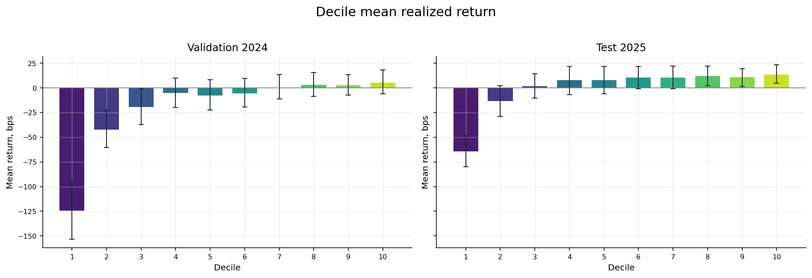

**Decile coverage.**

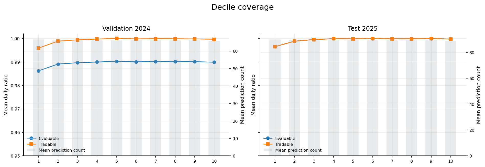

**Decile cohort cumulative return.**

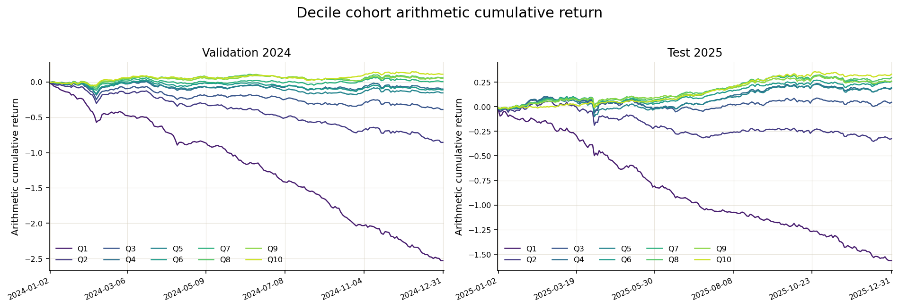

**Cohort direction decomposition.**

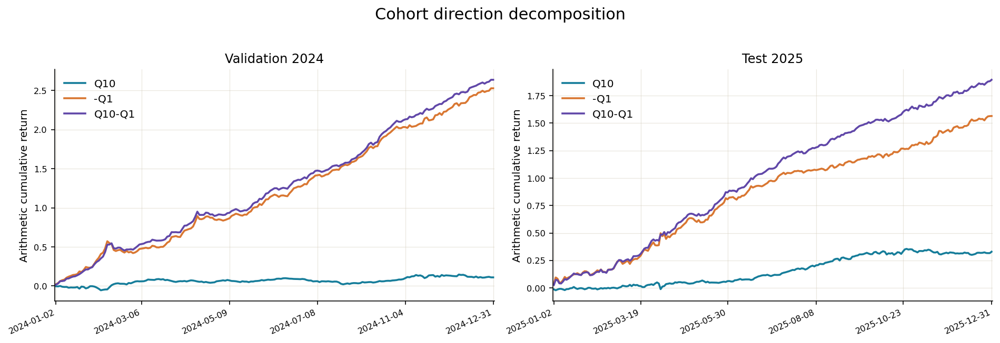

**20-day cohort stability.**

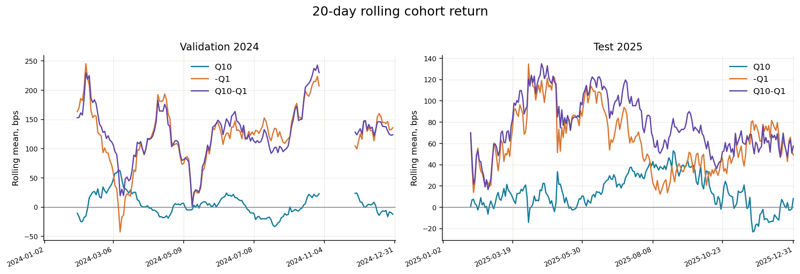

**Monthly decile return.**

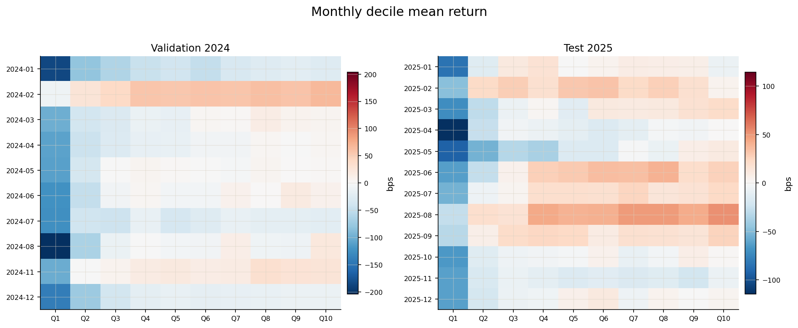

### Long-only 与 execution

**Long-only NAV and drawdown.**

 - 1.")

| Period | Total return | Annualized return | Annualized vol | Sharpe | MDD | Positive days | Mean turnover | Break-even, bps |
| --- | --- | --- | --- | --- | --- | --- | --- | --- |
| Validation 2024 | +10.711% | +10.711% | +13.157% | +0.839 | -8.167% | +45.455% | +1.678 | 2.49 |
| Test 2025 | +37.723% | +37.543% | +13.118% | +2.497 | -5.913% | +60.656% | +1.991 | 6.63 |

**Cohort and event-driven paths.**

 / initial capital - 1.")

**Gross direction paths.**

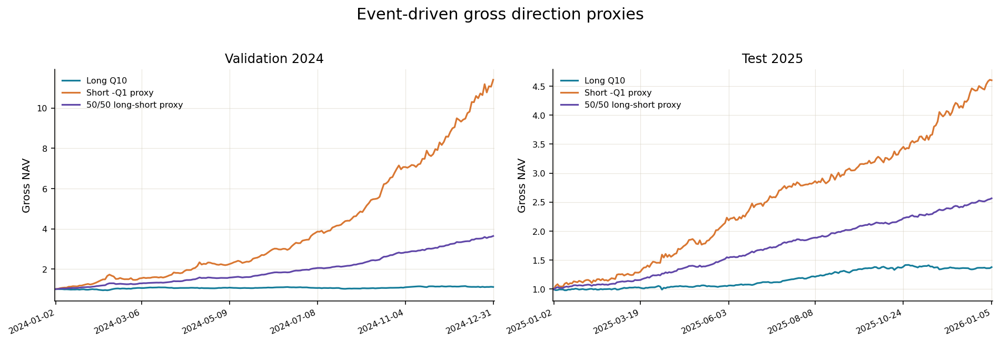

**Exit-delay diagnostics.**

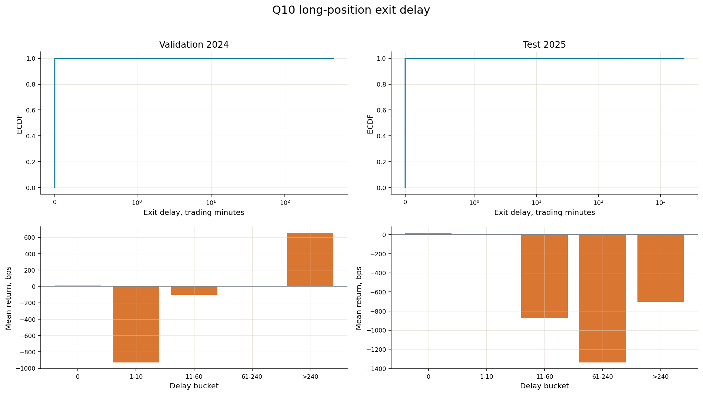

**Turnover and break-even.**

 / previous NAV; 下排 expanding break-even bps = (current NAV - initial capital) / cumulative one-way traded notional × 10,000. 目的: 同时观察交易强度与 gross alpha 可承受的成本预算.")

**Validation 2024 exit delay.**

| 指标 | 值 |
| --- | --- |
| Q10 positions | 13,305 |
| Delayed positions | 3 |
| Delayed ratio | +0.023% |
| Maximum trading-minute delay | 452 |
| Delayed mean raw return | -1.263% |

**Test 2025 exit delay.**

| 指标 | 值 |
| --- | --- |
| Q10 positions | 21,655 |
| Delayed positions | 12 |
| Delayed ratio | +0.055% |
| Maximum trading-minute delay | 2,380 |
| Delayed mean raw return | -10.634% |

### IC 与稳定性

**IC dashboard.**

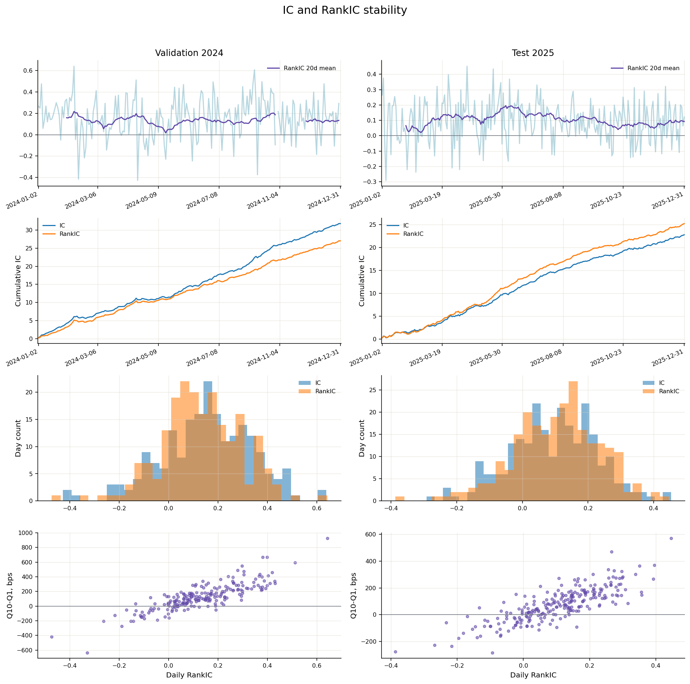

**Validation 2024 IC metrics.**

| Metric | Mean | Std | ICIR | Positive days | t-stat | Valid days |
| --- | --- | --- | --- | --- | --- | --- |
| Pearson IC | +0.1567 | +0.1852 | +13.165 | +81.281% | +12.057 | 203 |
| RankIC | +0.1332 | +0.1612 | +12.858 | +83.251% | +11.776 | 203 |

**Test 2025 IC metrics.**

| Metric | Mean | Std | ICIR | Positive days | t-stat | Valid days |
| --- | --- | --- | --- | --- | --- | --- |
| Pearson IC | +0.0939 | +0.1320 | +11.087 | +76.955% | +11.087 | 243 |
| RankIC | +0.1039 | +0.1311 | +12.353 | +79.835% | +12.353 | 243 |

### Train + Validation + Test 合集

**解释边界.** 该合集按时间连接 2021-2023 Train, 2024 Validation 和 2025 Test, 其中 2024 仍排除 9-10 月. Train 是 in-sample, Validation 参与 checkpoint selection, 因此本节只描述全期路径, 不能解释为纯 OOS generalization evidence. Decile 沿用每日固定 selection; long-only 使用一个不按年份或 split 重置的 available-cash ledger, 并保留原 split eligibility.

**Combined Q1-Q10 mean return.**

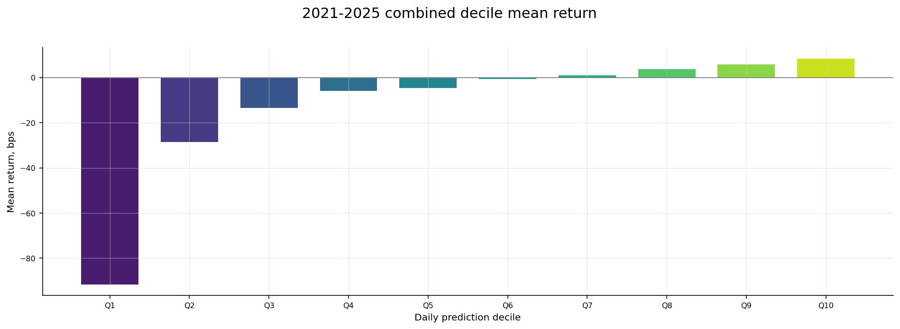

**Combined Q10 long-only NAV and drawdown.**

 - 1. 2024/9-10 不占横轴宽度, 横向距离不表示 calendar days.")

### 2021-2025 年度稳定性

2021-2023 为 Train in-sample; 2024 为用于 checkpoint selection 的 Validation 且排除 9-10 月; 2025 为 one-shot Test.

**Year x decile return.**

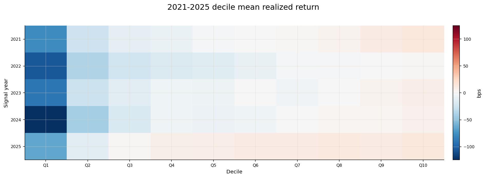

**Yearly ranking evidence.**

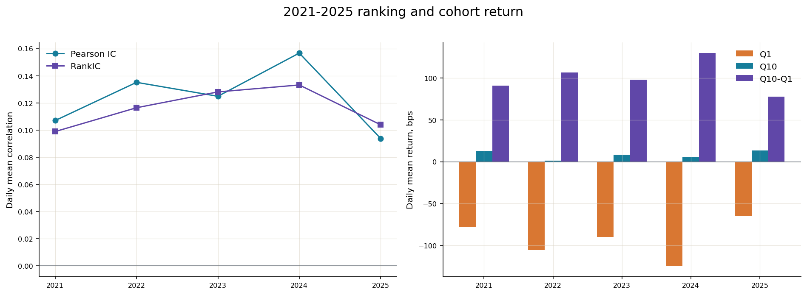

**Yearly long-only portfolio.**

 × 100; annualized Sharpe = mean(daily return) / std(daily return) × sqrt(annualization days); MDD % = min[NAV / max(1, running peak NAV) - 1] × 100; terminal break-even bps = (terminal NAV - initial capital) / cumulative one-way traded notional × 10,000. Position 可跨年退出.")

**Yearly signal metrics.**

| Year | Role | Signal days | Pearson IC | Pearson ICIR | RankIC | Rank ICIR | Monotonicity | Q1, bps | Q10, bps | Q10-Q1, bps | Q10 95% CI, bps |
| --- | --- | --- | --- | --- | --- | --- | --- | --- | --- | --- | --- |
| 2021 | Train, in-sample | 243 | +0.1070 | +13.699 | +0.0989 | +14.523 | +1.000 | -78.35 | +12.84 | +91.19 | [+0.85, +24.47] |
| 2022 | Train, in-sample | 242 | +0.1352 | +16.042 | +0.1165 | +14.249 | +1.000 | -105.84 | +1.16 | +107.00 | [-10.19, +11.96] |
| 2023 | Train, in-sample | 242 | +0.1249 | +12.052 | +0.1281 | +16.139 | +0.976 | -90.15 | +8.23 | +98.38 | [-2.03, +18.73] |
| 2024 | Validation, selected, excludes Sep-Oct | 205 | +0.1567 | +13.165 | +0.1332 | +12.858 | +0.952 | -124.60 | +5.38 | +129.97 | [-6.12, +18.01] |
| 2025 | Test, one-shot | 243 | +0.0939 | +11.087 | +0.1039 | +12.353 | +0.976 | -64.39 | +13.57 | +77.96 | [+4.91, +23.18] |

**Yearly event-driven long-only.**

| Year | Total return | Annualized return | Annualized vol | Sharpe | Max drawdown | Positive days | Mean turnover | Break-even, bps |
| --- | --- | --- | --- | --- | --- | --- | --- | --- |
| 2021 | +35.065% | +34.899% | +15.131% | +2.055 | -8.353% | +58.607% | +1.984 | 6.03 |
| 2022 | +1.691% | +1.684% | +14.777% | +0.187 | -17.258% | +52.675% | +1.991 | 0.37 |
| 2023 | +21.310% | +21.310% | +9.857% | +2.010 | -10.491% | +54.959% | +1.992 | 3.60 |
| 2024 | +10.711% | +10.711% | +13.157% | +0.839 | -8.167% | +45.455% | +1.678 | 2.49 |
| 2025 | +37.723% | +37.543% | +13.118% | +2.497 | -5.913% | +60.656% | +1.991 | 6.63 |

**Yearly execution and gross proxies.**

| Year | Q10 positions | Delayed | Delay ratio | Max delay, min | Delayed mean return | Short proxy total | 50/50 proxy total |
| --- | --- | --- | --- | --- | --- | --- | --- |
| 2021 | 16,182 | 22 | +0.136% | 2,380 | -8.496% | +546.538% | +200.000% |
| 2022 | 15,538 | 13 | +0.084% | 452 | -11.942% | +1112.321% | +257.121% |
| 2023 | 13,153 | 4 | +0.030% | 211 | -11.450% | +741.474% | +223.825% |
| 2024 | 13,305 | 3 | +0.023% | 452 | -1.263% | +1040.688% | +264.049% |
| 2025 | 21,655 | 12 | +0.055% | 2,380 | -10.634% | +360.310% | +156.514% |

Short-only 与 50/50 long-short 是 gross, non-executable signal proxy.

### CSI1800 robustness

CSI1800 使用严格早于 signal date 的 CSI300、CSI500 与 CSI1000 monthly constituents canonical union，并在 pool 内重新排序。

**CSI1800 yearly evidence.**

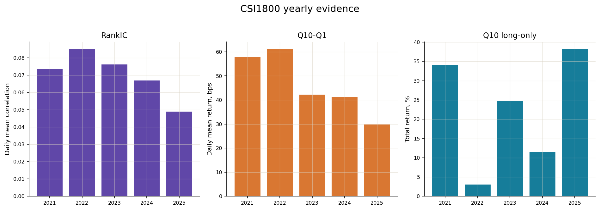

**CSI1800 year x decile return.**

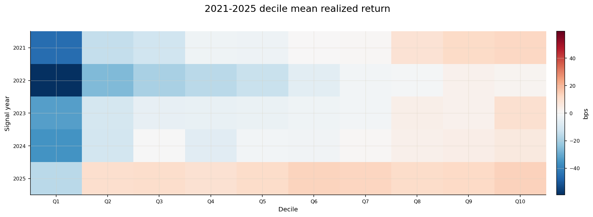

| Split | Signal days | Pearson IC | RankIC | Monotonicity | Q1, bps | Q10, bps | Q10-Q1, bps | Long total | Long Sharpe | Long max DD | Turnover | Break-even, bps | Delayed |
| --- | --- | --- | --- | --- | --- | --- | --- | --- | --- | --- | --- | --- | --- |
| Validation 2024 | 205 | +0.0656 | +0.0668 | +0.915 | -35.51 | +5.76 | +41.27 | +11.550% | +0.912 | -8.574% | +1.678 | 2.67 | 2 |
| Test 2025 | 243 | +0.0459 | +0.0490 | +0.855 | -16.13 | +13.67 | +29.80 | +38.207% | +2.656 | -5.161% | +1.992 | 6.74 | 5 |

**CSI1800 yearly signal metrics.**

| Year | Role | Signal days | Pearson IC | Pearson ICIR | RankIC | Rank ICIR | Monotonicity | Q1, bps | Q10, bps | Q10-Q1, bps | Q10 95% CI, bps |
| --- | --- | --- | --- | --- | --- | --- | --- | --- | --- | --- | --- |
| 2021 | Train, in-sample | 243 | +0.0758 | +9.730 | +0.0734 | +10.438 | +0.988 | -45.35 | +12.49 | +57.84 | [+0.93, +23.65] |
| 2022 | Train, in-sample | 242 | +0.0934 | +11.292 | +0.0850 | +10.394 | +0.988 | -59.43 | +1.72 | +61.15 | [-8.87, +12.13] |
| 2023 | Train, in-sample | 242 | +0.0729 | +7.763 | +0.0761 | +9.673 | +0.988 | -32.88 | +9.37 | +42.25 | [-1.30, +20.39] |
| 2024 | Validation, selected, excludes Sep-Oct | 205 | +0.0656 | +6.126 | +0.0668 | +6.373 | +0.915 | -35.51 | +5.76 | +41.27 | [-6.02, +18.54] |
| 2025 | Test, one-shot | 243 | +0.0459 | +5.334 | +0.0490 | +5.531 | +0.855 | -16.13 | +13.67 | +29.80 | [+5.08, +23.65] |

**CSI1800 yearly event-driven long-only.**

| Year | Total return | Annualized return | Annualized vol | Sharpe | Max drawdown | Positive days | Mean turnover | Break-even, bps |
| --- | --- | --- | --- | --- | --- | --- | --- | --- |
| 2021 | +34.076% | +33.915% | +14.865% | +2.040 | -8.092% | +57.787% | +1.984 | 5.92 |
| 2022 | +3.080% | +3.067% | +14.426% | +0.281 | -15.920% | +51.852% | +1.991 | 0.66 |
| 2023 | +24.650% | +24.650% | +9.966% | +2.262 | -10.162% | +58.264% | +1.993 | 4.10 |
| 2024 | +11.550% | +11.550% | +12.895% | +0.912 | -8.574% | +46.694% | +1.678 | 2.67 |
| 2025 | +38.207% | +38.024% | +12.434% | +2.656 | -5.161% | +59.836% | +1.992 | 6.74 |

**CSI1800 yearly execution and gross proxies.**

| Year | Q10 positions | Delayed | Delay ratio | Max delay, min | Delayed mean return | Short proxy total | 50/50 proxy total |
| --- | --- | --- | --- | --- | --- | --- | --- |
| 2021 | 12,899 | 18 | +0.140% | 2,380 | -8.940% | +193.306% | +100.903% |
| 2022 | 11,991 | 9 | +0.075% | 452 | -12.889% | +309.032% | +107.976% |
| 2023 | 9,627 | 4 | +0.042% | 211 | -11.450% | +116.372% | +65.753% |
| 2024 | 9,760 | 2 | +0.020% | 452 | +2.746% | +99.510% | +51.593% |
| 2025 | 14,390 | 5 | +0.035% | 2,380 | -9.800% | +44.775% | +43.439% |

Short-only 与 50/50 long-short 是 gross, non-executable signal proxy.

### Top 10% / 5% / 1% / 0.5%

Q10 对应 Top 10%; Top 5%、1% 和 0.5% 每日按 `ceil(p × N)` 固定 selection，entry audit 后不 rerank 或 refill。

**All-market top-tail cohort return.**

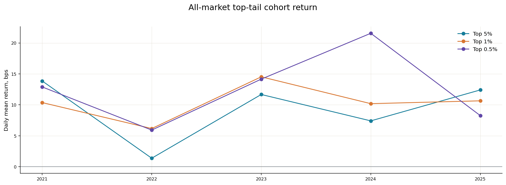

**All-market top-tail portfolio.**

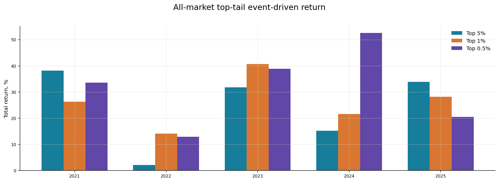

**Validation/Test top-tail 指标.**

| Scope | Group | Selection | Mean names | Tradable | Cohort mean, bps | 95% CI, bps | Cohort Sharpe | Long total | Long Sharpe | Long max DD | Turnover | Break-even, bps | Delayed |
| --- | --- | --- | --- | --- | --- | --- | --- | --- | --- | --- | --- | --- | --- |
| All-market | Validation 2024 | Top 5% | 33.6 | +99.972% | +7.41 | [-4.89, +20.41] | +1.261 | +15.255% | +1.126 | -8.091% | +1.679 | 3.44 | 1 |
| All-market | Validation 2024 | Top 1% | 7.1 | +100.000% | +10.19 | [-2.88, +25.24] | +1.491 | +21.582% | +1.338 | -9.023% | +1.679 | 4.75 | 0 |
| All-market | Validation 2024 | Top 0.5% | 3.8 | +100.000% | +21.56 | [+6.90, +37.49] | +2.728 | +52.514% | +2.440 | -6.402% | +1.681 | 10.55 | 0 |
| All-market | Test 2025 | Top 5% | 45.3 | +99.946% | +12.41 | [+2.97, +22.72] | +2.331 | +33.933% | +2.282 | -5.897% | +1.991 | 6.08 | 4 |
| All-market | Test 2025 | Top 1% | 9.5 | +99.890% | +10.65 | [-0.55, +23.12] | +1.772 | +28.156% | +1.745 | -7.422% | +1.993 | 5.02 | 0 |
| All-market | Test 2025 | Top 0.5% | 5.0 | +100.000% | +8.26 | [-11.21, +27.68] | +1.176 | +20.473% | +1.171 | -14.336% | +1.992 | 3.76 | 0 |
| CSI1800 | Validation 2024 | Top 5% | 24.8 | +99.974% | +6.77 | [-5.65, +20.09] | +1.171 | +13.796% | +1.058 | -7.946% | +1.679 | 3.15 | 1 |
| CSI1800 | Validation 2024 | Top 1% | 5.4 | +100.000% | +10.49 | [-4.94, +28.33] | +1.425 | +22.102% | +1.300 | -9.157% | +1.680 | 4.82 | 0 |
| CSI1800 | Validation 2024 | Top 0.5% | 3.0 | +100.000% | +18.41 | [+0.87, +38.41] | +2.235 | +42.886% | +2.039 | -8.479% | +1.681 | 8.89 | 0 |
| CSI1800 | Test 2025 | Top 5% | 30.3 | +99.945% | +12.36 | [+3.16, +22.53] | +2.313 | +33.739% | +2.267 | -6.166% | +1.993 | 6.06 | 1 |
| CSI1800 | Test 2025 | Top 1% | 6.5 | +100.000% | +11.39 | [-1.05, +25.81] | +1.776 | +30.301% | +1.827 | -7.137% | +1.993 | 5.45 | 0 |
| CSI1800 | Test 2025 | Top 0.5% | 3.5 | +100.000% | +11.85 | [-5.21, +29.48] | +1.623 | +31.286% | +1.666 | -10.262% | +1.993 | 5.53 | 0 |

**2021-2025 yearly top-tail 指标.**

| Scope | Group | Selection | Mean names | Tradable | Cohort mean, bps | 95% CI, bps | Cohort Sharpe | Long total | Long Sharpe | Long max DD | Turnover | Break-even, bps | Delayed |
| --- | --- | --- | --- | --- | --- | --- | --- | --- | --- | --- | --- | --- | --- |
| All-market | 2021 Train, in-sample | Top 5% | 34.0 | +99.897% | +13.86 | [+1.34, +26.40] | +2.036 | +38.134% | +2.053 | -9.776% | +1.984 | 6.66 | 14 |
| All-market | 2021 Train, in-sample | Top 1% | 7.2 | +99.850% | +10.37 | [-8.43, +30.16] | +1.261 | +26.315% | +1.219 | -12.624% | +1.989 | 4.69 | 4 |
| All-market | 2021 Train, in-sample | Top 0.5% | 3.8 | +99.815% | +12.89 | [-6.38, +32.11] | +1.345 | +33.612% | +1.323 | -13.701% | +1.989 | 5.65 | 2 |
| All-market | 2022 Train, in-sample | Top 5% | 32.8 | +99.968% | +1.38 | [-9.33, +11.64] | +0.221 | +2.158% | +0.218 | -15.589% | +1.991 | 0.47 | 6 |
| All-market | 2022 Train, in-sample | Top 1% | 7.0 | +100.000% | +6.17 | [-7.32, +19.66] | +0.823 | +14.146% | +0.842 | -18.419% | +1.991 | 3.04 | 1 |
| All-market | 2022 Train, in-sample | Top 0.5% | 3.8 | +100.000% | +5.92 | [-10.84, +23.06] | +0.695 | +12.878% | +0.714 | -17.608% | +1.990 | 2.71 | 1 |
| All-market | 2023 Train, in-sample | Top 5% | 28.0 | +100.000% | +11.68 | [+1.14, +22.41] | +2.749 | +31.782% | +2.761 | -9.387% | +1.993 | 5.10 | 1 |
| All-market | 2023 Train, in-sample | Top 1% | 6.0 | +100.000% | +14.53 | [+1.74, +26.99] | +2.629 | +40.642% | +2.586 | -10.974% | +1.994 | 6.29 | 0 |
| All-market | 2023 Train, in-sample | Top 0.5% | 3.2 | +100.000% | +14.16 | [+0.21, +28.28] | +2.151 | +38.878% | +2.072 | -11.647% | +1.994 | 6.13 | 0 |
| All-market | 2024 Validation, selected, excludes Sep-Oct | Top 5% | 33.6 | +99.972% | +7.41 | [-4.89, +20.41] | +1.261 | +15.255% | +1.126 | -8.091% | +1.679 | 3.44 | 1 |
| All-market | 2024 Validation, selected, excludes Sep-Oct | Top 1% | 7.1 | +100.000% | +10.19 | [-2.88, +25.24] | +1.491 | +21.582% | +1.338 | -9.023% | +1.679 | 4.75 | 0 |
| All-market | 2024 Validation, selected, excludes Sep-Oct | Top 0.5% | 3.8 | +100.000% | +21.56 | [+6.90, +37.49] | +2.728 | +52.514% | +2.440 | -6.402% | +1.681 | 10.55 | 0 |
| All-market | 2025 Test, one-shot | Top 5% | 45.3 | +99.946% | +12.41 | [+2.97, +22.72] | +2.331 | +33.933% | +2.282 | -5.897% | +1.991 | 6.08 | 4 |
| All-market | 2025 Test, one-shot | Top 1% | 9.5 | +99.890% | +10.65 | [-0.55, +23.12] | +1.772 | +28.156% | +1.745 | -7.422% | +1.993 | 5.02 | 0 |
| All-market | 2025 Test, one-shot | Top 0.5% | 5.0 | +100.000% | +8.26 | [-11.21, +27.68] | +1.176 | +20.473% | +1.171 | -14.336% | +1.992 | 3.76 | 0 |
| CSI1800 | 2021 Train, in-sample | Top 5% | 27.3 | +99.871% | +14.73 | [+1.94, +27.51] | +2.170 | +41.163% | +2.203 | -9.428% | +1.982 | 7.07 | 14 |
| CSI1800 | 2021 Train, in-sample | Top 1% | 5.8 | +99.814% | +11.03 | [-7.48, +30.00] | +1.344 | +28.426% | +1.280 | -13.903% | +1.989 | 5.07 | 4 |
| CSI1800 | 2021 Train, in-sample | Top 0.5% | 3.1 | +99.897% | +12.21 | [-9.02, +33.59] | +1.177 | +31.165% | +1.175 | -18.310% | +1.987 | 5.50 | 3 |
| CSI1800 | 2022 Train, in-sample | Top 5% | 25.5 | +100.000% | +0.65 | [-10.01, +11.17] | +0.102 | +0.317% | +0.094 | -15.766% | +1.991 | 0.07 | 4 |
| CSI1800 | 2022 Train, in-sample | Top 1% | 5.5 | +100.000% | +6.58 | [-7.28, +21.00] | +0.833 | +15.135% | +0.858 | -19.217% | +1.991 | 3.22 | 1 |
| CSI1800 | 2022 Train, in-sample | Top 0.5% | 3.0 | +100.000% | +7.54 | [-7.89, +23.84] | +0.807 | +16.943% | +0.820 | -16.086% | +1.990 | 3.54 | 1 |
| CSI1800 | 2023 Train, in-sample | Top 5% | 20.7 | +100.000% | +12.14 | [+0.46, +23.93] | +2.749 | +33.205% | +2.792 | -11.051% | +1.993 | 5.29 | 1 |
| CSI1800 | 2023 Train, in-sample | Top 1% | 4.5 | +100.000% | +13.74 | [+2.79, +24.59] | +2.439 | +37.944% | +2.396 | -8.559% | +1.994 | 6.10 | 0 |
| CSI1800 | 2023 Train, in-sample | Top 0.5% | 2.5 | +100.000% | +12.50 | [-1.68, +26.73] | +1.797 | +33.243% | +1.757 | -12.009% | +1.993 | 5.42 | 0 |
| CSI1800 | 2024 Validation, selected, excludes Sep-Oct | Top 5% | 24.8 | +99.974% | +6.77 | [-5.65, +20.09] | +1.171 | +13.796% | +1.058 | -7.946% | +1.679 | 3.15 | 1 |
| CSI1800 | 2024 Validation, selected, excludes Sep-Oct | Top 1% | 5.4 | +100.000% | +10.49 | [-4.94, +28.33] | +1.425 | +22.102% | +1.300 | -9.157% | +1.680 | 4.82 | 0 |
| CSI1800 | 2024 Validation, selected, excludes Sep-Oct | Top 0.5% | 3.0 | +100.000% | +18.41 | [+0.87, +38.41] | +2.235 | +42.886% | +2.039 | -8.479% | +1.681 | 8.89 | 0 |
| CSI1800 | 2025 Test, one-shot | Top 5% | 30.3 | +99.945% | +12.36 | [+3.16, +22.53] | +2.313 | +33.739% | +2.267 | -6.166% | +1.993 | 6.06 | 1 |
| CSI1800 | 2025 Test, one-shot | Top 1% | 6.5 | +100.000% | +11.39 | [-1.05, +25.81] | +1.776 | +30.301% | +1.827 | -7.137% | +1.993 | 5.45 | 0 |
| CSI1800 | 2025 Test, one-shot | Top 0.5% | 3.5 | +100.000% | +11.85 | [-5.21, +29.48] | +1.623 | +31.286% | +1.666 | -10.262% | +1.993 | 5.53 | 0 |

## 限制与适用边界

- Test 2025 是 one-shot Test; Validation 2024 参与 checkpoint selection，并排除 9-10 月。
- 2021-2023 年度结果属于 Train in-sample。Train + Validation + Test 合集只描述全期路径，不能解释为纯 OOS generalization evidence。
- Long-only、short-only 和 50/50 long-short 均为 gross 结果。报告未扣 transaction cost、price impact、borrow、margin 或可借约束。
- Corrected replay 从 frozen predictions 开始，未从 raw factors 重新训练或推理。
- Short-only 与 50/50 long-short 只用于 signal diagnosis，不是 executable portfolio。

## 结论

13:50 在 Validation 与 one-shot Test 均表现出正向排序能力。Validation/Test daily mean RankIC 为 0.1332/0.1039，corrected event-driven Q10 long-only gross total return 为 10.7%/37.7%。2025 portfolio outcome 更强，但 RankIC 低于 2024。当前证据支持保留 13:50 作为待继续验证的 signal candidate；在交易成本、price impact 和 execution promotion gate 完成前，不能据此判断策略可上线。

## 附录

### 审计与复现

| Check | Status | Evidence |
| --- | --- | --- |
| 13:50 frozen event-ledger contamination | ERROR | validation: purged Q10=163, frozen return=0.087437, corrected=0.107110; test: purged Q10=0, frozen return=0.377233, corrected=0.377233. ERROR applies to the frozen source ledger; this report uses the corrected replay. |
| 13:50 corrected portfolio replay | PASS | all-market and CSI1800 OOS/yearly Q1/Q10 plus Top 5%/1%/0.5% were rebuilt from frozen predictions and raw adjusted closes |
| 13:50 artifact status | PASS | evaluation=complete, experiment=complete, dataset=complete |
| 13:50 identity and split | PASS | rows=806,146, duplicate keys=0; Train=2021-2023, Validation=2024 excluding Sep-Oct, Test=2025 |
| 13:50 IC and deciles | PASS | recomputed 448 daily IC rows and 4,480 daily decile rows from predictions |
| 13:50 report summaries | PASS | frozen IC/decile summaries and corrected OOS/yearly/top-tail portfolio summaries match their row-level ledgers |

| 字段 | 值 |
| --- | --- |
| Evaluation code commit | 80b8d83f7bc0f8ccaafb5880cfd2ea5b01cd2405 |
| Experiment run | 20261015T162946Z |
| Experiment content hash | c85013316d896cf7b6100e8726ff72894afa321337d1eebb057639ab01ec2a0d |
| Selected checkpoint | checkpoints/step-000630.pt |
| Dataset run | 20261015T102000Z |
| Dataset content hash | 075ef606b909a3dfe4ef788b2cc7fcb407e8040694e9e71a5f85c9c5544dc408 |
| Factor set | core-v1 |
| Factor set hash | 2a6a3cc0f79049ed6b74994c3d50f5b5d8b22e374549490b7003bf38755ce1d3 |
| Universe content hash | 0dbdd33904db5e83310ff9c1f98eb069fc20a2fc153b6645c0d2b82b89948728 |
| CSI1800 membership hash | feae8dd8d951f1e5d0373b03febb362bf04fcbf3968155ac17bd545b0be3fc08 |
| CSI1800 source-file manifest hash | ac513ea49df71fb97ec72598eb6a1abb242e0d60adb731530a8bba22cd9aa564 |

本内容包保留源报告的 21 张 raster 图和 18 张表；图像直接从源 HTML 的 data URI 解码，未重绘。
