## 摘要

Validation 排序信号仍存, Q10 gross 21.14%, CNY 1m reference net -60.36%; 2025 Test 未运行.

这是 drop_factor 单 arm Validation evidence. 未提供同合同 paired baseline, 不据此声称删除因子优于 baseline. 各组合规则只在此 arm 内比较.

## 研究背景与目标

研究问题与数据合同以保留的源报告为准. 本页将既有研究证据登记为独立 publication, 关联对应 Study 与 Experiment.

## 数据与方法

2021-2023 为 Train; 2024 Validation 排除 9-10 月. 历史报告中的 2025 one-shot Test 已被查看, 当前仅能作为 historical confirmation, 不支持再次用其选择配置. 本次同步仅整理既有 evidence, 未训练、推理或重跑回测.

## 主要结果

单因子消融 arm（drop_factor）· 重新物化 / 训练 / 预测 / 评价 · 所有表现指标均为 Validation 口径

Train 2021–2023 | Validation 2024（剔除 9–10 月） | 2025 Test 未运行

生成日期：2026-10-23 · 数据根目录：[local-workspace]/astock-overnight-artifacts/development-20261023-r3

### 执行摘要

样本留存（Validation）

91.91%

932,658 / 1,014,739

日均 RankIC

0.0961

203 个有效日 · 71.43% 为正 · std 0.1894

Q10 gross 总收益

21.14%

Sharpe 1.32 · MDD -7.72%

Q10 reference net（1m CNY）

-60.36%

Fill 56.34% · 资金占用 45.23%

Break-even 成本

≈9.3 bps

按买入名义计的 round-trip

- 信号存活： 删除 bar_clv 后模型仍保有强排序能力。Validation 共 205 个 signal dates（203 日有有限 RankIC），日均 RankIC 0.0961、71.43% 的交易日为正；decile 平均已实现收益自 Q1 的 -59.0 bps 近似单调升至 Q10 的 +10.0 bps（相邻档单调性 0.988）。
- 毛利可观： Q10 等权 unconstrained gross 在 242 个 trade dates 上总收益 21.14% 、Sharpe 1.32、最大回撤 -7.72%；arm 内加权规则更优，q10_risk_liquidity 达 26.58% 、Sharpe 1.86。
- 成本主导侵蚀： 均匀 round-trip 成本约 10 bps 即把 Q10 gross 毛利打平（21.14% → -1.09%）；在逐笔 reference fee（broker 每单最低 5 CNY）下，100 万 CNY 容量账本净收益 -60.36% ，总成本 69.2 万 CNY，其中约 92% 为 broker 费。
- 容量可用但偏贵： 1m CNY 下 fill ratio 56.34%、平均资金占用 45.23%；随 AUM 增大成交与资金占用改善（20m 时 fill 50.91%），但净收益在 0.5–1m 区间最差（-63.2% / -60.4%）。
- alpha 以隔夜为主： D close 结算 Q10−Q1 spread 仅 10.0 bps，隔夜跳升至 71.3 bps，10:00 仍保有 69.0 bps、10:30 为 66.5 bps——剔除 bar_clv 后模型的区分度主要来自隔夜段，日内延续但缓慢衰减。

### 1 留存与核心指标

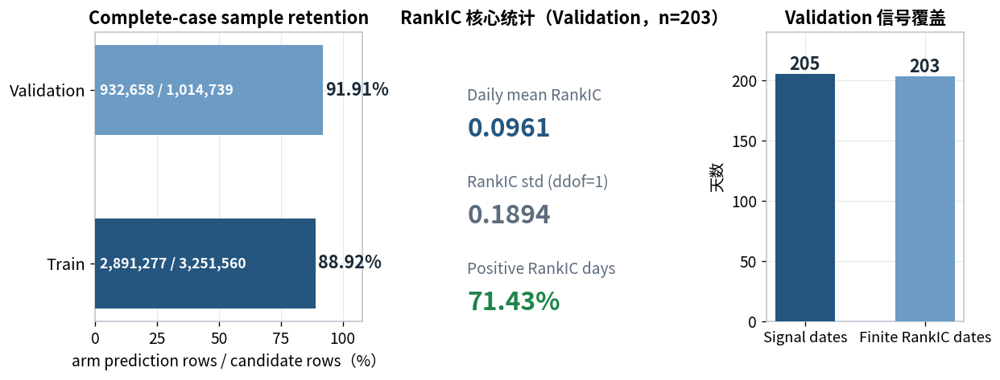

### Q10 组合核心指标（Validation）

| 路径 | Total return | Sharpe | Max drawdown | Fill ratio | Mean invested |
| --- | --- | --- | --- | --- | --- |
| Q10 gross, unconstrained | 21.14% | 1.32 | -7.72% | — | — |
| Q10 reference, CNY 1m | -60.36% | -9.90 | -60.36% | 56.34% | 45.23% |

怎么看：

删除 bar_clv 后样本留存率为 Train 88.92%（2,891,277 / 3,251,560）、Validation 91.91%（932,658 / 1,014,739），信号产出未受实质影响。Q10 等权组合在无成本、无容量约束下取得 21.14% 的 Validation 总收益与 1.32 的 Sharpe；但一旦施加倍量容量约束与 reference 成本，100 万 CNY 账本净收益转为 -60.36%——两条路径的差异主要来自成本与成交率，而非信号本身。

口径：候选数 = 每日研究 universe 候选数之和（retention_daily.parquet 的 candidate_count）；留存数 = 删除 bar_clv 后满足完整 factor 输入并实际生成 prediction 的 stock-date 数（Train 取 train_predictions.parquet 行数 2,891,277，Validation 取 predictions.parquet 行数 932,658）。每日 RankIC = 当日 evaluable 股票 prediction 与 realized_return 的 Spearman 相关系数；std 为样本标准差（ddof=1）；缺失日期不填 0。Total return = terminal NAV / 初始资金 − 1；Sharpe = mean(daily)×A / [std(daily)×√A]，gross 路径 A=242、capacity 路径 A=243，不扣无风险利率；Max drawdown = min(NAVₜ / max(初始资金, 历史NAV) − 1)。Fill ratio = Σ成交买入名义 / Σ目标买入名义；Mean invested = mean(持仓市值 / NAV)；unconstrained gross 路径不报告这两项。

### 2 排序能力与 decile

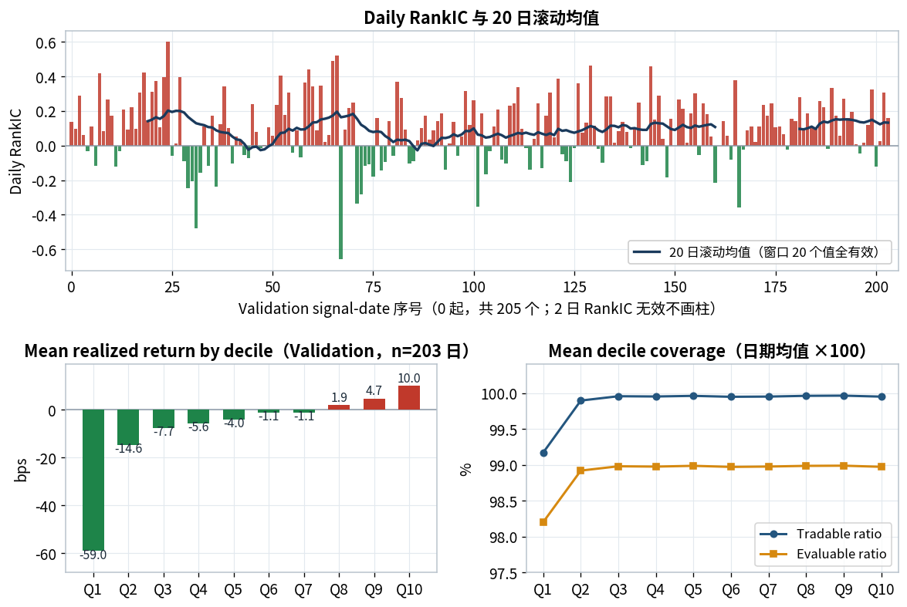

怎么看：

日度 RankIC 绝大多数为正（红柱占多数），20 日滚动均值稳定在 0.05–0.20 区间，无明显衰减段。Decile 收益近似单调抬升（仅 Q6→Q7 微幅回落 0.1 bps)： Q1 平均 -59.0 bps,Q10 +10.0 bps，相邻档单调性约 98.8%；覆盖率上 Q1 略低（tradable 99.2%、evaluable 98.2%),Q2–Q10 均接近 100%——最低分组的覆盖缺口值得在实盘前关注。

口径：横轴为按日期升序的 signal-date 序号（0 起），非自然日间距；2 个 RankIC 无效日期不画柱，滚动均值要求窗口内 20 个值全部有效。Decile 收益 = 每个 signal date 内对 evaluable 股票等权取均值、再对有效日期等权、×10,000（bps）;realized_return = 复权退出价 / 复权进入价 − 1，为 signal-date cohort 的 gross return，不含仓位、资金占用与交易成本。Coverage = 每日 ratio 的日期算术均值 ×100（先按日计算、不 pooled）。

### 3 组合路径

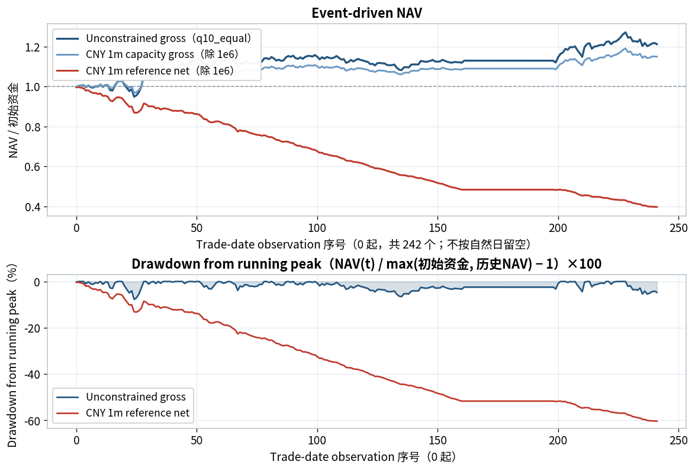

怎么看：

三条路径同源分叉：unconstrained gross 一路走高至 1.21；施加容量约束但免成本（capacity gross）走势接近、略低；再叠加 reference 成本后（reference net）持续阴跌至 0.40，最大回撤 -60.36%。NAV 在 9–10 月呈平台（该段无 Validation signal，持仓按事件账本延续），验证了对齐方式与「2024 剔除 9–10 月」的设定一致。

口径：横轴为按日期升序的 trade-date observation 序号（0 起，共 242 个），不按自然日留空；日期对齐来自各自事件账本，持仓可跨 signal date 延续。Unconstrained gross 读 gross_daily.parquet 的 q10_equal（初始资金 1);capacity gross 与 reference net 读 capacity_daily.parquet 中 q10_equal、AUM=100 万、对应 cost_mode 的同一条 ledger,NAV 除以 1e6 后作图。Drawdown = (NAVₜ / max(初始资金, 历史NAV) − 1) × 100，只画 unconstrained gross 与 reference net；第 1 节表格中的 Max drawdown 即该序列最小值。

### 4 arm 内组合规则与均匀成本敏感性

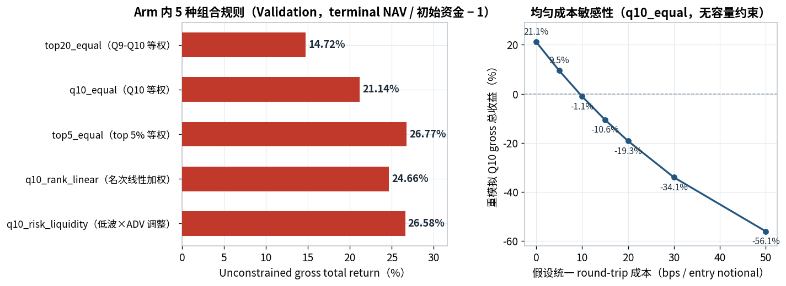

怎么看：

五种组合规则的 unconstrained gross 总收益介于 14.72%（top20_equal）与 26.58%(q10_risk_liquidity）之间——更集中的持仓与权重优化都有效，q10_risk_liquidity 同时把 Sharpe 提到 1.86、回撤压到 -4.38%。但成本敏感性显示 Q10 等权对成本极度敏感：round-trip 成本 5 bps 时收益还剩 9.47%,10 bps 即转负——本 arm 的 alpha 毛利对执行成本的安全垫不足 10 bps。

口径：top20_equal 取 Q9–Q10 等权；q10_equal 取 Q10 等权；top5_equal 取最高预测的 ceil(0.05N) 只等权；q10_rank_linear 在 Q10 内按预测名次线性加权；q10_risk_liquidity 在名次权重上乘以带上下限的相对低波动与 ADV20 因子、归一化并施加单票权重 cap。所有选择在 entry audit 前固定、不 refill。成本曲线：对每笔仓位在退出时从 realized return 扣除 cost_bps/10,000 后重模拟 Q10 gross event ledger，不采用逐笔 reference fee、不施加容量约束，因此不能与第 5 节 reference-cost AUM 曲线视作同一模型。

### 5 容量、成本与执行

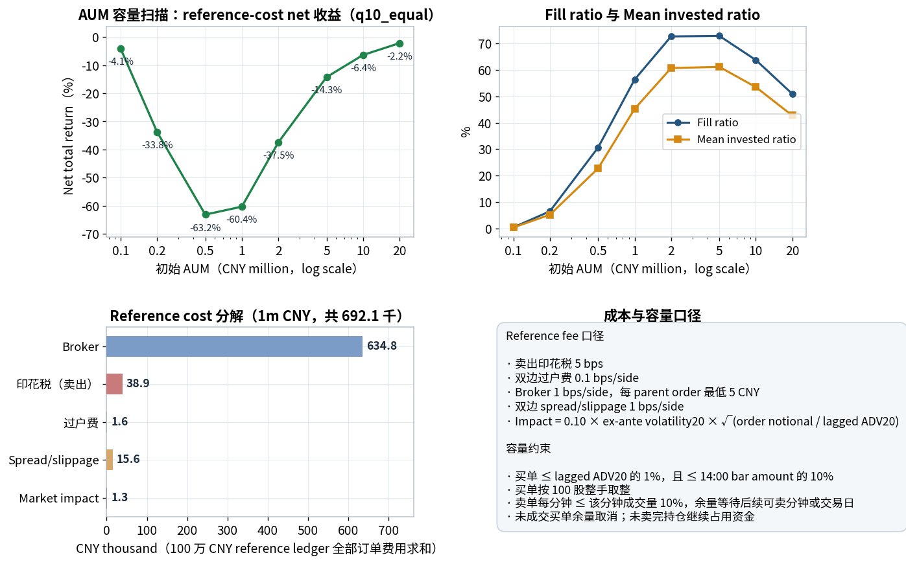

### 执行表（100 万 CNY reference ledger，q10_equal）

| Entry orders | Rejected entries | Fill ratio | Mean invested ratio | Total cost |
| --- | --- | --- | --- | --- |
| 63,478 | 28,735 | 56.34% | 45.23% | 692,090 CNY |

怎么看：

AUM 扫描呈「U 形」：0.1m 时虽几乎全额成交但成本占比过大（-4.09%),0.5–1m 区间净亏损最深（-63.2% / -60.4%)——该区间目标名义已上量、而 broker 每单最低 5 CNY 的约束在小额拆单下被反复触发；继续放大到 10–20m，成交与资金占用改善、净亏损收敛至 -6.4% / -2.2%，但始终未能转正。成本分解确认 broker 费 63.5 万 CNY 占总成本约 92%，是侵蚀的首因；1m 账本上 92,213 笔目标买单中 28,735 笔完全未成交。

口径：横轴为初始 AUM / 1e6（CNY million，log scale），每个点独立运行 q10_equal 的 reference-cost capacity ledger。Fill ratio / Mean invested ratio 定义同第 1 节。成本分解为 100 万 CNY reference ledger 全部订单的该项费用求和 ÷ 1,000(CNY thousand);Total cost 为每日 entry cost 与 exit cost 之和（692,090 CNY），并非图中单项之和。容量约束：买单 ≤ lagged ADV20 的 1% 且 ≤ 14:00 bar amount 的 10%、按 100 股整手；卖单每分钟 ≤ 该分钟成交量 10%，余量继续等待可卖分钟或后续交易日；未成交买单余量取消，未卖完持仓继续占用资金。Reference fee：卖出印花税 5 bps、双边过户费 0.1 bps/side、broker 1 bps/side（每 parent order 最低 5 CNY)、双边 spread/slippage 1 bps/side;Impact = 0.10 × ex-ante volatility20 × √(order notional / lagged ADV20)。

### 6 退出时点、月度与集中度

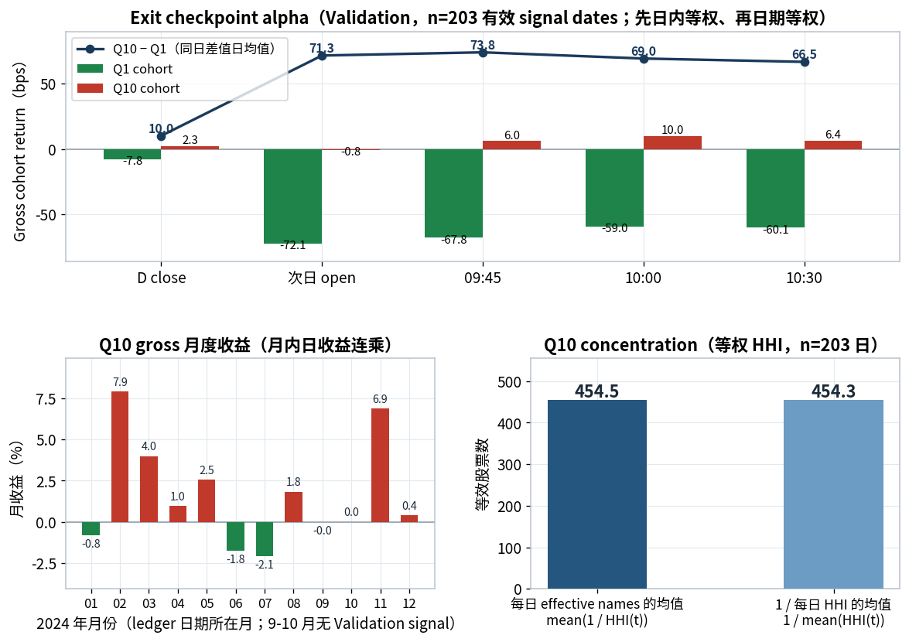

### Exit checkpoint alpha（bps，Validation n=203）

| 结算时点 | Q1 cohort | Q10 cohort | Q10 − Q1 |
| --- | --- | --- | --- |
| D close | -7.76 | +2.29 | +10.05 |
| 次日 open | -72.09 | -0.77 | +71.33 |
| 09:45 | -67.79 | +5.98 | +73.77 |
| 10:00 | -59.04 | +10.00 | +69.04 |
| 10:30 | -60.05 | +6.43 | +66.48 |

怎么看：

alpha 的时间结构清晰：D close 时点 Q10−Q1 仅 10.0 bps；隔夜一跳后（次日 open）拉开到 71.3 bps，主要由 Q1 继续下跌贡献（-72.1 bps）而非 Q10 上涨（-0.8 bps）;09:45 后 Q10 转正并保持在 +6.0~+10.0 bps，spread 缓慢收窄至 10:30 的 66.5 bps。月度收益全年 7 个月为正、4 个月为负（跌幅均不超过 2.1%)、10 月约 0,2 月（+7.9%）与 11 月（+6.9%）是主要贡献。Q10 等效股票数约 454 只（HHI≈0.0022)，单票与行业暴露高度分散（最大行业权重约 11.5%，医药生物为主）。

口径：exit checkpoint 为固定结算时点（D close、次日 open、09:45、10:00、10:30)，先在每个 signal date 的 Q1/Q10 内等权计算 realized_return、再对 203 个有效 signal dates 等权并 ×10,000(bps);Q10−Q1 为同日两 cohort 收益之差的日期均值。这是研究 alpha decay 的 gross cohort 指标，不是可执行组合收益。月度收益 = 月内 unconstrained gross q10_equal 每日 event-ledger return 连乘，只显示含有 ledger 日期的月份（9–10 月无 signal，收益≈0)。Concentration：对每个 signal date 的 Q10 等权 w 计算 single-name HHI = Σw²、effective names = 1/HHI；两柱汇总顺序不同——第一柱为每日 effective names 的算术均值（454.5)，第二柱为 1 / 每日 HHI 的均值（454.3)，不应视为重复数值。

### 7 稳健性与 exposure

### 稳健性表（gross_summary，Validation 各策略 unconstrained gross）

| 策略 | Return | Sharpe | MDD | Daily turnover | Break-even bps | Delayed positions |
| --- | --- | --- | --- | --- | --- | --- |
| top20_equal | 14.72% | 0.90 | -10.81% | 1.677 | 6.75 | 461 |
| q10_equal | 21.14% | 1.32 | -7.72% | 1.677 | 9.31 | 173 |
| top5_equal | 26.77% | 1.70 | -5.52% | 1.678 | 11.46 | 59 |
| q10_rank_linear | 24.66% | 1.56 | -6.22% | 1.678 | 10.65 | 173 |
| q10_risk_liquidity | 26.58% | 1.86 | -4.38% | 1.678 | 11.52 | 173 |

### Bootstrap：挑战策略 vs q10_equal（同日 gross daily return 差）

| 比较 | Mean bps/day | 95% low | 95% high | P(>0) |
| --- | --- | --- | --- | --- |
| Q10 rank_linear vs q10_equal | +1.14 | 0.14 | 2.30 | 0.988 |
| Q10 risk_liquidity vs q10_equal | +1.68 | -1.17 | 4.20 | 0.894 |

### Exposure(q10_equal，先日内汇总、再日期等权）

| 指标 | 数值 |
| --- | --- |
| Weighted log ADV20 | 18.50 |
| Weighted volatility20 | 2.11% |
| Weighted beta60 | 0.656 |
| Single-name HHI | 0.0022 |
| Industry HHI（SW2021 L1） | 0.0549 |
| Max industry weight | 11.47% |

怎么看：

五个策略的日换手几乎相同（约 1.68 倍 prior-close NAV)，因此 Break-even bps 主要由收益水平决定，从 top20_equal 的 6.75 到 q10_risk_liquidity 的 11.52。Bootstrap 显示 q10_rank_linear 相对 q10_equal 的日均超额 +1.14 bps(95% CI [0.14, 2.30],P(>0)=0.988）较为确定；q10_risk_liquidity 的 +1.68 bps 点估计更高但区间跨零（95% CI [-1.17, 4.20],P(>0)=0.894)。Exposure 端组合偏向高流动性（log ADV20 加权 18.5)、低波动（2.11%）与高 beta(0.656）的股票，单票与行业均高度分散。

口径：Return / Sharpe / MDD 与第 1 节同公式。Daily turnover = mean[(entry notional + exit proceeds) / prior-close NAV]。Break-even bps = (terminal NAV − initial capital) / 累计 entry notional × 10,000，为按买入名义金额计的 round-trip break-even。Delayed positions = 实际退出延迟交易分钟数大于 0 的仓位数。Bootstrap：20 个 trade dates 的 circular moving-block bootstrap(5000 次重复、块长 20、seed 42）对同日 gross daily_return 差重采样，Mean bps/day = mean(挑战策略 − q10_equal) × 10,000,95% low/high 为均值差的 2.5% / 97.5% 分位数，P(>0) 为重采样中均值差大于 0 的比例；统计单位为日期而非股票。Exposure：每个 signal date 先在 Q10 内计算持仓权重汇总（ADV20 为截至前一日的 20 交易日平均成交额，CNY;beta 为滞后 60 日个股对 eligible-market 收益的估计），再对日期等权平均；行业为日期有效的 SW2021 L1 分类。这些 exposure 是选股时权重特征，不是执行后实际持仓权重。

## 限制与适用边界

这是 drop_factor 单 arm Validation evidence. 未提供同合同 paired baseline, 不据此声称删除因子优于 baseline. 各组合规则只在此 arm 内比较.

2021-2023 为 Train; 2024 Validation 排除 9-10 月. 历史报告中的 2025 one-shot Test 已被查看, 当前仅能作为 historical confirmation, 不支持再次用其选择配置. 本次同步仅整理既有 evidence, 未训练、推理或重跑回测.

## 结论

Validation 排序信号仍存, Q10 gross 21.14%, CNY 1m reference net -60.36%; 2025 Test 未运行.

## 附录

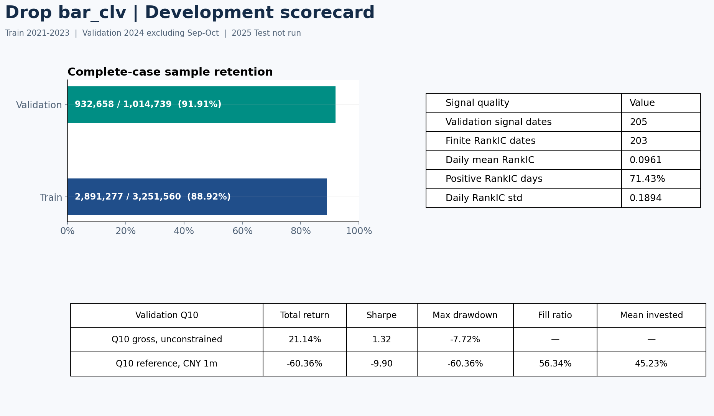

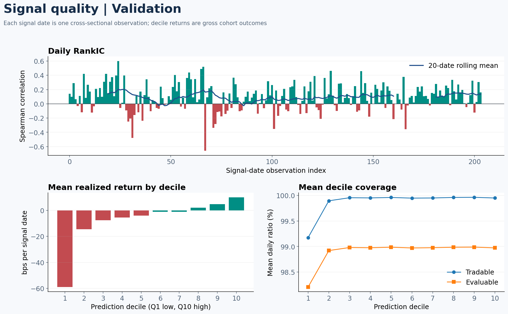

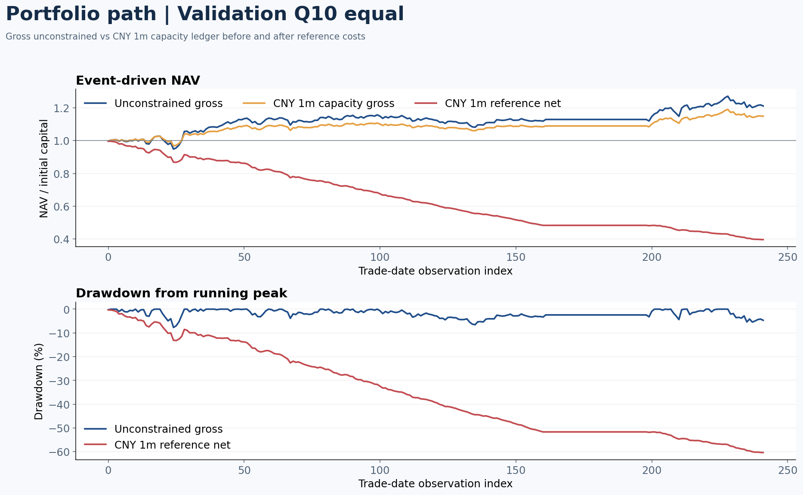

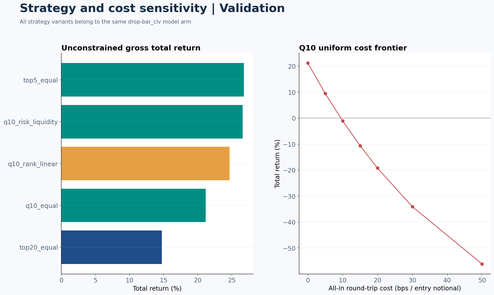

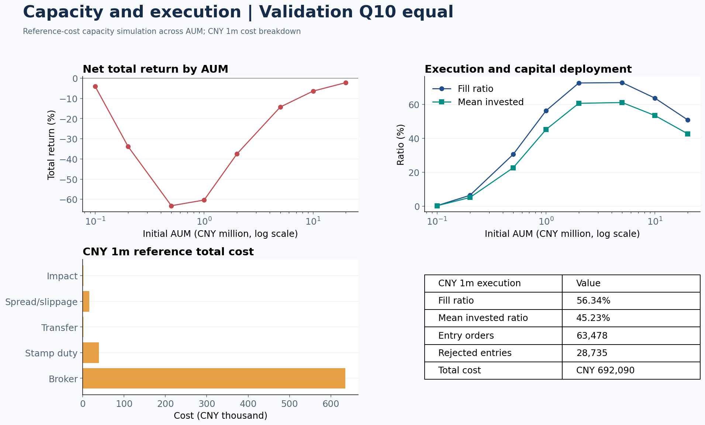

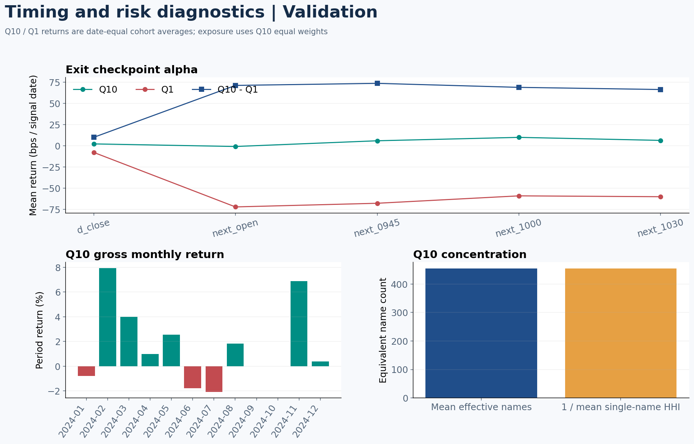

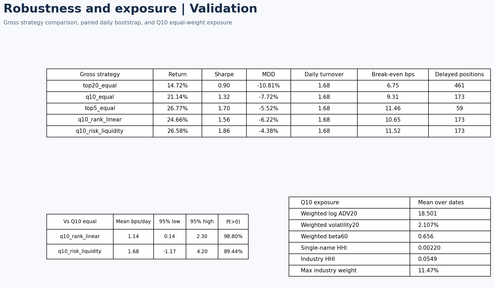

### 删除 `bar_clv` arm: 图表计算规则

### 范围与数据

报告只使用 `drop_factor` arm, 即从模型输入中删除 `bar_clv` 后重新物化、训练、预测和评价的结果. Train 为 2021-2023, Validation 为 2024 且排除 9-10 月. 图中的投资表现、RankIC、decile 和执行数据均属 Validation. 2025 Test 未运行. `Q10 equal` 等名称是此 arm 内的组合构造, 不是其他模型 arm.

数据源位于 `[workspace]/astock-overnight-artifacts/development-20261023-r3`: 留存分母来自 `retention/retention_daily.parquet`, arm 留存数来自物化后的 dataset/evaluation; 排序指标来自 `evaluations/20261023T083654Z`; 组合指标来自 `strategy/drop_factor/20261023T085508Z`. 图像直接读取这些已完成的 artifact, 未重新训练或回测. 百分比先按原始小数计算, 显示时四舍五入.

### 第 1 图: 留存与核心指标

- `Complete-case sample retention` 横轴为 `arm prediction rows / candidate rows`, 单位 %. 纵轴为 Train、Validation. 条内依次是留存数、候选数和比例: Train `2,891,277 / 3,251,560 = 88.92%`; Validation `932,658 / 1,014,739 = 91.91%`. 候选数为每日研究 universe 候选数之和; 留存数为删除 `bar_clv` 后满足完整 factor 输入并实际生成 prediction 的 stock-date 数.
- `Validation signal dates` 为 `ic_daily.parquet` 的日期行数, 205. `Finite RankIC dates` 为其中 RankIC 非空且有限的日期数, 203. 缺失的日期不填 0.
- `Daily mean RankIC` 为 203 个有效日 RankIC 的算术均值. 每日 RankIC 是当日 `evaluable=true` 股票的 `prediction` 与 `realized_return` 的 Spearman 相关系数. `Positive RankIC days` 为有效日中 RankIC 大于 0 的比例. `Daily RankIC std` 是有效日 RankIC 的样本标准差, `ddof=1`.
- 下方表格中的 `Q10` 是每日在完整 prediction group 内按 `(prediction ASC, stock_code ASC)` 排序, 以 `1 + floor(10r/N)` 固定 decile 后得到的最高预测十分组. `Q10 gross, unconstrained` 使用 available-cash event ledger, 不受订单流动性、100 股整手和交易成本限制. `Q10 reference, CNY 1m` 从 100 万 CNY 初始资金出发, 施加订单容量与 reference cost, 未成交买单余量取消, 未卖完持仓继续占用资金.
- `Total return = terminal NAV / initial capital - 1`. `Sharpe = mean(daily return) × A / [sample_std(daily return) × sqrt(A)]`. Gross 路径的 `A=242`, capacity 路径的 `A=243`, 与各自已发布 artifact 的实现一致. 无 risk-free rate 扣除. `Max drawdown` 为 `min(NAV_t / max(initial capital, NAV_1,...,NAV_t) - 1)`.
- `Fill ratio = sum(filled entry notional) / sum(target entry allocation)`. `Mean invested = mean(invested_value / NAV)` over trade dates. 表内 `—` 表示 unconstrained gross 路径不报告这两个 capacity 指标.

### 第 2 图: 排序能力与 decile

- `Daily RankIC` 横轴是按日期升序的 Validation signal-date 序号, 从 0 开始, 不是自然日间距. 纵轴是当日 Spearman RankIC; 无有效标签的日期不画柱. 蓝线为最近 20 个 observation 的 RankIC 算术均值, 要求窗口内 20 个值均有效. 205 个 signal dates 中只有 203 个有效 RankIC.
- `Mean realized return by decile` 横轴是 prediction decile Q1-Q10. 纵轴为先在每个 signal date 的该 decile 内对 `evaluable=true` 股票的 `realized_return` 等权取均值, 再对有效日期等权取算术均值, 最后乘 10,000, 单位 bps. `realized_return = exit_price × exit_adj_factor / (entry_price × entry_adj_factor) - 1`. 这是 signal-date cohort 的 gross return, 不包含仓位、资金占用或交易成本.
- `Mean decile coverage` 横轴仍是 Q1-Q10. 纵轴为每日 ratio 的日期算术均值乘 100. `Tradable ratio = tradable_count / prediction_count`; `Evaluable ratio = evaluable_count / prediction_count`. 先计算每日比例, 不将所有股票日 pooled 后再除.

### 第 3 图: 组合路径

- 两图横轴均为按日期升序的 trade-date observation 序号, 从 0 开始. 图中 2024 年 9-10 月没有 Validation signal; 索引不按自然日留空. 对齐的日期来自各自事件账本, 持仓可跨 signal date 延续.
- `Event-driven NAV` 纵轴为每日收盘 NAV / 初始资金. `Unconstrained gross` 读取 `gross_daily.parquet` 的 `q10_equal`; `CNY 1m capacity gross` 和 `CNY 1m reference net` 读取 `capacity_daily.parquet` 的同一策略、AUM 和对应 cost mode. 后两条用 NAV 除以 1,000,000. Gross capacity 路径仍实施订单容量和整手限制, 只是成本为 0. Reference net 路径扣除 broker、stamp duty、transfer、spread/slippage、impact.
- `Drawdown from running peak` 纵轴为每日 `NAV_t / max(initial capital, NAV_1,...,NAV_t) - 1`, 再乘 100. 图中仅画 unconstrained gross 和 reference net. 第 1 图的 `Max drawdown` 是这条序列的最小值.

### 第 4 图: arm 内策略和均匀成本敏感性

- 左图纵轴是同一模型 arm 的组合规则: `top20_equal` 取 Q9-Q10 并等权; `q10_equal` 取 Q10 并等权; `top5_equal` 取最高预测的 `ceil(0.05N)` 只股票并等权; `q10_rank_linear` 在 Q10 内按预测名次线性加权; `q10_risk_liquidity` 在名次权重上乘以受上下限约束的相对低波动和 ADV20 因子, 再归一化并应用单票权重 cap. 横轴为各策略 unconstrained gross event ledger 的 `terminal NAV / initial capital - 1`, 单位 %. 所有选择均在 entry audit 前固定, 不 refill.
- 右图横轴为假设的统一 round-trip 交易成本, 单位 bps / entry notional. 对每笔仓位在退出时从 realized return 扣除 `cost_bps / 10,000`, 然后重新模拟 Q10 gross event ledger. 纵轴为重新模拟的总收益, 单位 %. 这条曲线不采用逐笔 reference fee, 也不施加 capacity 约束, 因而不能与第 5 图的 reference-cost AUM 曲线视作同一模型.

### 第 5 图: 容量、成本与执行表

- 上方两图横轴是初始 AUM / 1,000,000, 单位 CNY million, 使用 log scale. 每个点都独立运行 `q10_equal` reference-cost capacity ledger. 左图纵轴为 net `terminal NAV / initial AUM - 1`, 单位 %. 右图纵轴分别为 `Fill ratio` 和 `Mean invested ratio`, 计算同第 1 图, 单位 %.
- 下方成本图横轴为 CNY thousand, 即相应字段除以 1,000; 纵轴依次为 broker、卖出 stamp duty、transfer fee、spread/slippage、market impact. 每项是 100 万 CNY reference ledger 中所有订单的该项费用求和. `Total cost` 是每日 entry cost 与 exit cost 之和, 单位 CNY; 不是图中单个成本柱. Reference fee 使用卖出印花税 5 bps、双边过户费 0.1 bps/side、broker 1 bps/side 且每 parent order 最低 5 CNY、双边 spread/slippage 1 bps/side. Impact rate 为 `0.10 × ex-ante volatility20 × sqrt(order notional / lagged ADV20)`, 对对应订单 notional 收取.
- 执行表中的 `Entry orders` 是实际成交的 buy order 行数. `Rejected entries` 是逐日目标买单中 fill 为 0 的计数之和. `Fill ratio`、`Mean invested ratio` 和 `Total cost` 的定义见上. 容量约束为买单不超过 lagged ADV20 的 1%、14:00 bar amount 的 10%, 且按 100 股整手取整; 卖单每分钟不超过该分钟成交量的 10%, 余量继续等待可卖分钟或后续交易日.

### 第 6 图: 退出时点与风险

- `Exit checkpoint alpha` 横轴是固定结算时点: D close、次日 open、09:45、10:00、10:30. 纵轴为先在每个 signal date 的 Q1 或 Q10 内等权计算 `realized_return`, 再对 203 个有效 signal dates 等权取均值并乘 10,000, 单位 bps. `Q10 - Q1` 是同日两个 cohort return 之差的日期均值. 这是研究 alpha decay 的 gross cohort 指标, 不是可执行组合收益.
- `Q10 gross monthly return` 横轴是 trade-date 所在月份. 纵轴为该月 unconstrained gross `q10_equal` 的每日 event-ledger return 连乘: `[prod(1 + daily_return) - 1] × 100`, 单位 %. 只显示含有该策略 ledger 日期的月份.
- `Q10 concentration` 纵轴为等效股票数. 对每个 signal date 的 Q10 equal weights `w_i` 定义 `single-name HHI = sum(w_i²)`、`effective names = 1 / HHI`. 第一根柱是每日 `effective names` 的算术均值; 第二根柱是 `1 / mean(daily HHI)`. 两者的汇总顺序不同, 不应视为重复数值.

### 第 7 图: 稳健性与 exposure 表

- 上表逐行取 `gross_summary.parquet` 的同一 arm、Validation 策略. `Return`、`Sharpe`、`MDD` 分别与第 1 图的 gross total return、Sharpe、Max drawdown 同公式. `Daily turnover = mean[(entry notional + exit proceeds) / prior-close NAV]`. `Break-even bps = (terminal NAV - initial capital) / cumulative entry notional × 10,000`; 这是按买入名义金额计的 round-trip break-even. `Delayed positions` 是实际退出延迟交易分钟数大于 0 的仓位数.
- 左下 bootstrap 表比较 `q10_rank_linear` 或 `q10_risk_liquidity` 与 `q10_equal` 的同日 gross `daily_return` 差. `Mean bps/day = mean(challenger return - Q10 equal return) × 10,000`. `95% low/high` 是 20 个 trade dates 的 circular moving-block bootstrap、5,000 次重复得到的均值差 2.5% / 97.5% 分位数, 也乘 10,000. `P(>0)` 是重复样本中均值差大于 0 的比例. 统计单位是日期, 不是股票.
- 右下 exposure 表对每个 signal date 先在 Q10 内计算持仓权重汇总, 然后对日期等权平均. `Weighted log ADV20 = sum_i w_i × ln(ADV20_i)`, ADV20 为截至前一日的 20 交易日平均成交额, 单位 CNY. `Weighted volatility20 = sum_i w_i × volatility20_i`. `Weighted beta60 = sum_i w_i × beta60_i`, beta 为滞后 60 日个股收益对 eligible-market 收益的估计. `Single-name HHI = sum_i w_i²`. `Industry HHI = sum_j W_j²`, `W_j` 为同一行业所有股票权重之和; 行业使用日期有效的 SW2021 L1 分类. `Max industry weight = max_j W_j`. 这些 exposure 是选股时权重特征, 不是执行后实际持仓权重.

来源: `astock-overnight/reports/drop-bar-clv-only/report-briefing.html`.

Source SHA-256: `67c11b3f6da769d70b8622cc2c1d11927c524a5fd59eb63a846f10991cdc353f`.

同步日期: 2026-11-03. 原始归档保留源字节; 本内容包仅移除机器本地路径, 不重新计算研究指标.
