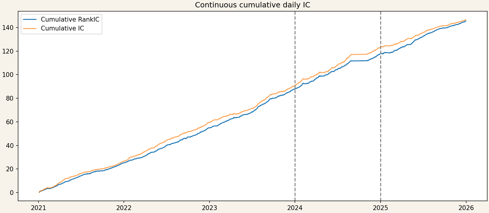
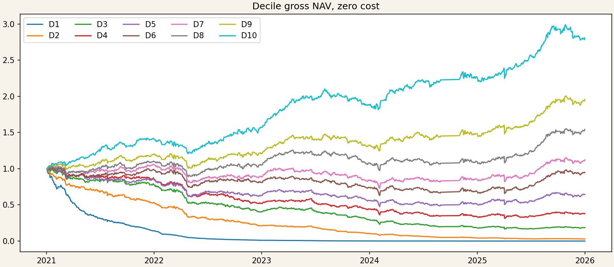
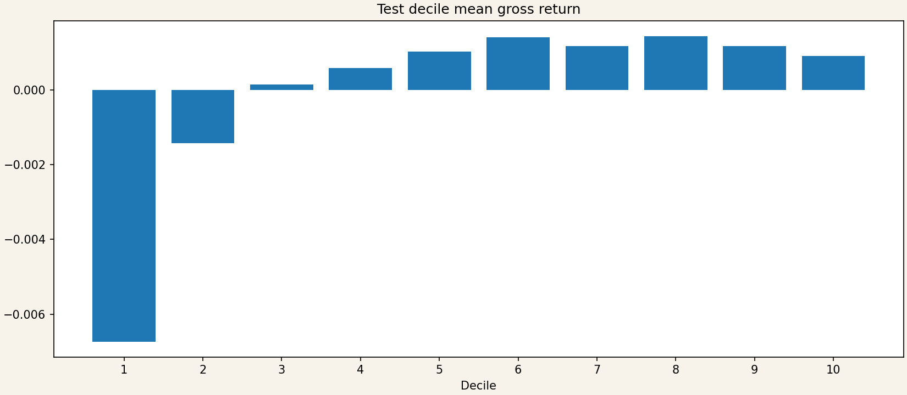
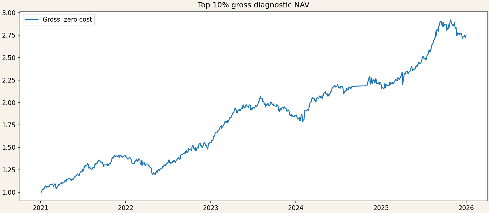
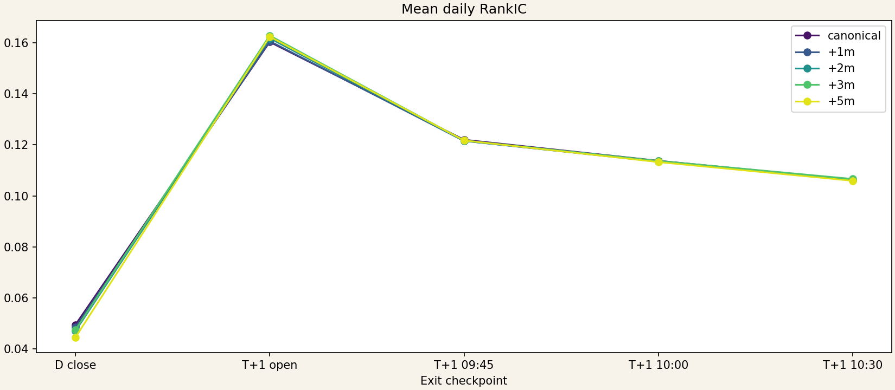
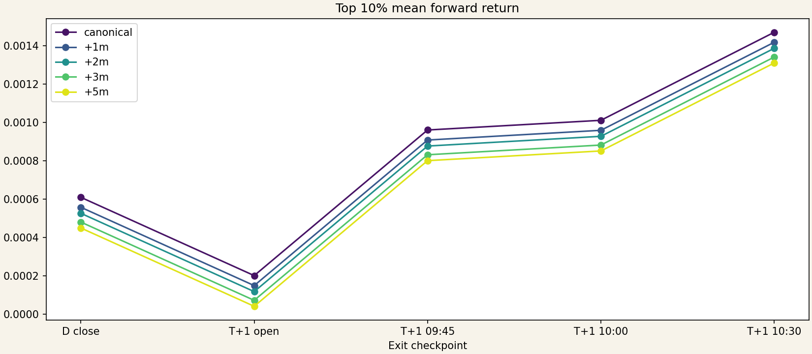
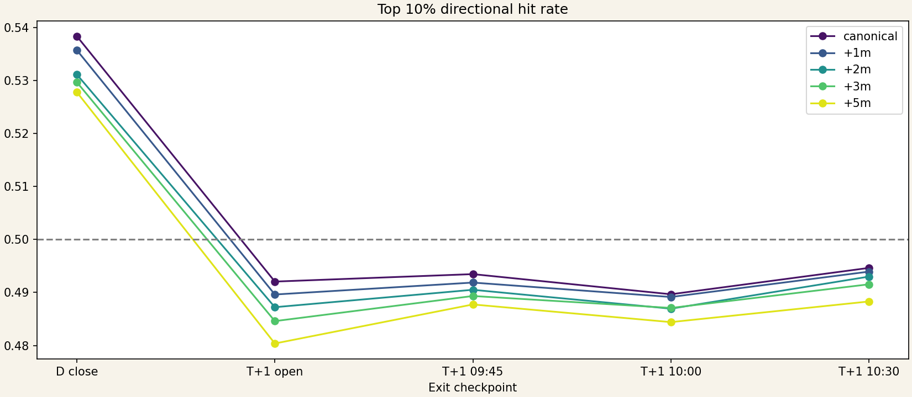

## 摘要

固定预测的 IC、decile、Top-percentile 和 delay-alpha 诊断, 高 turnover 限制成本后收益.

诊断中的 cohort cumulation、固定成本假设与 available-cash event ledger 是不同合同, 不直接比较 NAV.

### 1. Executive summary

Test mean RankIC=0.1145. Top-10% test gross cumulative=23.96%, net=-23.76%. Canonical strategy有统计排序，但高 turnover 使 cost 成为主要限制。

## 研究背景与目标

研究问题与数据合同以保留的源报告为准. 本页将既有研究证据登记为独立 publication, 关联对应 Study 与 Experiment.

## 数据与方法

2021-2023 为 Train; 2024 Validation 排除 9-10 月. 历史报告中的 2025 one-shot Test 已被查看, 当前仅能作为 historical confirmation, 不支持再次用其选择配置. 本次同步仅整理既有 evidence, 未训练、推理或重跑回测.

## 主要结果

Diagnostic only. 未训练模型、未改 feature/normalization、未重选 checkpoint。Net 统一扣 10 bps/side；不含 impact。Delay grid 使用原始价格重建，缺失价格不参与。

### 3. Train / validation / test definition

| split | start | end | days | mean_ic | mean_rank_ic | rank_ic_std | positive_days | rank_icir |
| --- | --- | --- | --- | --- | --- | --- | --- | --- |
| test | 2025-01-02 | 2025-12-31 | 243 | 0.095532 | 0.114489 | 0.146676 | 0.781893 | 12.167734 |
| train | 2021-01-04 | 2023-12-29 | 727 | 0.124457 | 0.120690 | 0.131407 | 0.823934 | 24.763951 |
| validation | 2024-01-02 | 2024-12-31 | 205 | 0.162074 | 0.147947 | 0.176631 | 0.790244 | 11.992696 |

### 4. Cumulative daily IC

曲线连续累计且不在 split 边界归零。Overnight 每日一个 cross-section；pooled metric 与 daily metric 相同。

### 5. Cross-sectional decile strategy

| decile | mean_return | mean_turnover |
| --- | --- | --- |
| 1 | -0.006740 | 2.000000 |
| 2 | -0.001416 | 2.000000 |
| 3 | 0.000148 | 2.000000 |
| 4 | 0.000595 | 2.000000 |
| 5 | 0.001038 | 2.000000 |
| 6 | 0.001418 | 2.000000 |
| 7 | 0.001177 | 2.000000 |
| 8 | 0.001448 | 2.000000 |
| 9 | 0.001176 | 2.000000 |
| 10 | 0.000912 | 2.000000 |

每个 decile 独立 equal-weight long-only，按 signal date cohort gross return 计量，不扣手续费。所有曲线按日期排序并从 NAV=1 开始；这不是 event-driven capacity simulation。

### 6. Top-percentile strategy

| gross_cumulative | net_cumulative | net_annualized | net_sharpe | net_max_drawdown | mean_turnover | mean_positions | hit_rate | break_even_bps_per_side |
| --- | --- | --- | --- | --- | --- | --- | --- | --- |
| 0.239576 | -0.237613 | -0.237613 | -2.281188 | -0.243391 | 2.000000 | 87.748971 | 0.490372 | 4.559849 |

### Cost sensitivity

| cost_bps_per_side | cumulative_return | annualized_return | sharpe | max_drawdown |
| --- | --- | --- | --- | --- |
| 0 | 0.239576 | 0.239576 | 1.912056 | -0.070892 |
| 5 | -0.027752 | -0.027752 | -0.184566 | -0.127918 |
| 10 | -0.237613 | -0.237613 | -2.281188 | -0.243391 |
| 20 | -0.531559 | -0.531559 | -6.474432 | -0.534185 |

### 7. Delay × alpha decay

| delay | horizon | ic | rank_ic | icir | positive_ic_day_ratio | top_return | top_net_return_5bps | top_net_return_10bps | top_net_return_20bps | hit_rate | turnover | obs | days |
| --- | --- | --- | --- | --- | --- | --- | --- | --- | --- | --- | --- | --- | --- |
| canonical | D close | 0.036903 | 0.049450 | 4.851729 | 0.633745 | 0.000609 | -0.000391 | -0.001391 | -0.003391 | 0.538339 | 2.000000 | 212159 | 243 |
| canonical | T+1 open | 0.201605 | 0.160351 | 17.269387 | 0.868313 | 0.000201 | -0.000799 | -0.001799 | -0.003799 | 0.492049 | 2.000000 | 212083 | 243 |
| canonical | T+1 09:45 | 0.112308 | 0.122013 | 13.055283 | 0.794239 | 0.000960 | -0.000040 | -0.001040 | -0.003040 | 0.493457 | 2.000000 | 212083 | 243 |
| canonical | T+1 10:00 | 0.094643 | 0.113774 | 12.104203 | 0.773663 | 0.001011 | 0.000011 | -0.000989 | -0.002989 | 0.489657 | 2.000000 | 212083 | 243 |
| canonical | T+1 10:30 | 0.077811 | 0.106363 | 11.307403 | 0.777778 | 0.001470 | 0.000470 | -0.000530 | -0.002530 | 0.494629 | 2.000000 | 212083 | 243 |
| +1m | D close | 0.032226 | 0.048530 | 4.792031 | 0.641975 | 0.000557 | -0.000443 | -0.001443 | -0.003443 | 0.535713 | 2.000000 | 212159 | 243 |
| +1m | T+1 open | 0.199759 | 0.160682 | 17.494455 | 0.868313 | 0.000149 | -0.000851 | -0.001851 | -0.003851 | 0.489610 | 2.000000 | 212083 | 243 |
| +1m | T+1 09:45 | 0.110648 | 0.121539 | 13.136035 | 0.802469 | 0.000908 | -0.000092 | -0.001092 | -0.003092 | 0.491862 | 2.000000 | 212083 | 243 |
| +1m | T+1 10:00 | 0.093021 | 0.113411 | 12.163328 | 0.777778 | 0.000958 | -0.000042 | -0.001042 | -0.003042 | 0.489141 | 2.000000 | 212083 | 243 |
| +1m | T+1 10:30 | 0.076258 | 0.106052 | 11.346321 | 0.773663 | 0.001417 | 0.000417 | -0.000583 | -0.002583 | 0.493926 | 2.000000 | 212083 | 243 |
| +2m | D close | 0.029471 | 0.046993 | 4.712059 | 0.629630 | 0.000526 | -0.000474 | -0.001474 | -0.003474 | 0.531117 | 2.000000 | 212159 | 243 |
| +2m | T+1 open | 0.199190 | 0.161816 | 17.717770 | 0.868313 | 0.000117 | -0.000883 | -0.001883 | -0.003883 | 0.487218 | 2.000000 | 212083 | 243 |
| +2m | T+1 09:45 | 0.109868 | 0.121583 | 13.301536 | 0.802469 | 0.000876 | -0.000124 | -0.001124 | -0.003124 | 0.490501 | 2.000000 | 212083 | 243 |
| +2m | T+1 10:00 | 0.092245 | 0.113508 | 12.275246 | 0.781893 | 0.000927 | -0.000073 | -0.001073 | -0.003073 | 0.486937 | 2.000000 | 212083 | 243 |
| +2m | T+1 10:30 | 0.075497 | 0.106315 | 11.444182 | 0.781893 | 0.001386 | 0.000386 | -0.000614 | -0.002614 | 0.492987 | 2.000000 | 212083 | 243 |
| +3m | D close | 0.029781 | 0.047429 | 4.729318 | 0.641975 | 0.000480 | -0.000520 | -0.001520 | -0.003520 | 0.529663 | 2.000000 | 212159 | 243 |
| +3m | T+1 open | 0.199352 | 0.162870 | 17.785219 | 0.880658 | 0.000072 | -0.000928 | -0.001928 | -0.003928 | 0.484591 | 2.000000 | 212083 | 243 |
| +3m | T+1 09:45 | 0.109692 | 0.121736 | 13.303933 | 0.810700 | 0.000831 | -0.000169 | -0.001169 | -0.003169 | 0.489329 | 2.000000 | 212083 | 243 |
| +3m | T+1 10:00 | 0.092109 | 0.113728 | 12.265694 | 0.777778 | 0.000882 | -0.000118 | -0.001118 | -0.003118 | 0.487077 | 2.000000 | 212083 | 243 |
| +3m | T+1 10:30 | 0.075356 | 0.106630 | 11.463941 | 0.777778 | 0.001340 | 0.000340 | -0.000660 | -0.002660 | 0.491533 | 2.000000 | 212083 | 243 |
| +5m | D close | 0.029018 | 0.044488 | 4.431041 | 0.637860 | 0.000449 | -0.000551 | -0.001551 | -0.003551 | 0.527787 | 2.000000 | 212159 | 243 |
| +5m | T+1 open | 0.200032 | 0.162416 | 17.808578 | 0.880658 | 0.000041 | -0.000959 | -0.001959 | -0.003959 | 0.480370 | 2.000000 | 212083 | 243 |
| +5m | T+1 09:45 | 0.109533 | 0.121725 | 13.301482 | 0.810700 | 0.000800 | -0.000200 | -0.001200 | -0.003200 | 0.487734 | 2.000000 | 212083 | 243 |
| +5m | T+1 10:00 | 0.091907 | 0.113254 | 12.219495 | 0.773663 | 0.000851 | -0.000149 | -0.001149 | -0.003149 | 0.484404 | 2.000000 | 212083 | 243 |
| +5m | T+1 10:30 | 0.075127 | 0.105915 | 11.374931 | 0.773663 | 0.001309 | 0.000309 | -0.000691 | -0.002691 | 0.488297 | 2.000000 | 212083 | 243 |

最高 RankIC: +3m/T+1 open. 最高 Top return: canonical/T+1 10:30. 这些是 preregistered diagnostic cells，不用于选参。

### 8. Stability diagnostics

| split | month | mean | std | count |
| --- | --- | --- | --- | --- |
| test | 2025-01 | 0.057048 | 0.210966 | 18 |
| test | 2025-02 | 0.089466 | 0.181688 | 18 |
| test | 2025-03 | 0.126925 | 0.174889 | 21 |
| test | 2025-04 | 0.117266 | 0.177570 | 21 |
| test | 2025-05 | 0.213193 | 0.162304 | 19 |
| test | 2025-06 | 0.131048 | 0.135053 | 20 |
| test | 2025-07 | 0.134059 | 0.119892 | 23 |
| test | 2025-08 | 0.131437 | 0.094084 | 21 |
| test | 2025-09 | 0.068401 | 0.103264 | 22 |
| test | 2025-10 | 0.107511 | 0.114640 | 17 |
| test | 2025-11 | 0.069298 | 0.112470 | 20 |
| test | 2025-12 | 0.122694 | 0.114456 | 23 |
| train | 2021-01 | 0.143021 | 0.150077 | 20 |
| train | 2021-02 | 0.075046 | 0.126590 | 15 |
| train | 2021-03 | 0.133462 | 0.106209 | 23 |
| train | 2021-04 | 0.113591 | 0.087464 | 21 |
| train | 2021-05 | 0.119435 | 0.110588 | 18 |
| train | 2021-06 | 0.123530 | 0.091528 | 21 |
| train | 2021-07 | 0.076414 | 0.141853 | 22 |
| train | 2021-08 | 0.093490 | 0.128611 | 22 |
| train | 2021-09 | 0.031270 | 0.147378 | 20 |
| train | 2021-10 | 0.104065 | 0.123292 | 16 |
| train | 2021-11 | 0.098509 | 0.081385 | 22 |
| train | 2021-12 | 0.122677 | 0.078714 | 23 |
| train | 2022-01 | 0.121690 | 0.114683 | 19 |
| train | 2022-02 | 0.103139 | 0.101733 | 16 |
| train | 2022-03 | 0.085165 | 0.121056 | 23 |
| train | 2022-04 | 0.163645 | 0.118474 | 19 |
| train | 2022-05 | 0.143390 | 0.116411 | 19 |
| train | 2022-06 | 0.142999 | 0.115199 | 21 |
| train | 2022-07 | 0.085629 | 0.108290 | 21 |
| train | 2022-08 | 0.130890 | 0.137404 | 23 |
| train | 2022-09 | 0.114883 | 0.215530 | 21 |
| train | 2022-10 | 0.091833 | 0.117674 | 16 |
| train | 2022-11 | 0.142373 | 0.169570 | 22 |
| train | 2022-12 | 0.142576 | 0.131716 | 22 |
| train | 2023-01 | 0.103719 | 0.080494 | 16 |
| train | 2023-02 | 0.136196 | 0.117029 | 20 |
| train | 2023-03 | 0.132126 | 0.132300 | 23 |
| train | 2023-04 | 0.074256 | 0.181990 | 19 |
| train | 2023-05 | 0.119983 | 0.144912 | 20 |
| train | 2023-06 | 0.114017 | 0.116489 | 20 |
| train | 2023-07 | 0.222786 | 0.162845 | 21 |
| train | 2023-08 | 0.144231 | 0.096998 | 23 |
| train | 2023-09 | 0.179666 | 0.161475 | 20 |
| train | 2023-10 | 0.124249 | 0.155835 | 17 |
| train | 2023-11 | 0.118509 | 0.156162 | 22 |
| train | 2023-12 | 0.144006 | 0.113373 | 20 |
| validation | 2024-01 | 0.170452 | 0.136882 | 22 |
| validation | 2024-02 | 0.094656 | 0.253418 | 15 |
| validation | 2024-03 | 0.167149 | 0.179172 | 21 |
| validation | 2024-04 | 0.129661 | 0.241355 | 20 |
| validation | 2024-05 | 0.148081 | 0.132929 | 20 |
| validation | 2024-06 | 0.134858 | 0.163488 | 19 |
| validation | 2024-07 | 0.132478 | 0.156603 | 23 |
| validation | 2024-08 | 0.196964 | 0.184249 | 21 |
| validation | 2024-11 | 0.112982 | 0.159025 | 21 |
| validation | 2024-12 | 0.175253 | 0.165957 | 21 |

### 9. Main conclusions

- Predictability: train/validation/test 均为正，但强度存在 regime variation。
- Ordering: tail separation 比全 decile 单调性更稳定。
- Latency: 以 delay table 的 canonical→+5m 差值为准，不能从 nominal target 单独推断。
- Production: 主要约束是 turnover/cost 与真实 execution，不是缺少更复杂模型。
- Next experiment: 固定 signal 后做 shadow execution，直接区分 signal decay 与 fill/cost 损失。

### 10. Limitations

Decile/Top NAV 是 cohort diagnostic；固定成本不含 spread、impact、lot size 与容量。某日 cohort 没有任何 evaluable position 时按全现金处理，gross return 与 turnover 记为 0，NAV 平直延续。Delay study 使用可得 minute VWAP/close 与 adj_factor，但不重放 price-limit/suspension delayed-exit state machine，因此不等同 production PnL。多 horizon overlap 只比较 mean forward return，没有对重叠收益做 cumprod。

## 限制与适用边界

诊断中的 cohort cumulation、固定成本假设与 available-cash event ledger 是不同合同, 不直接比较 NAV.

2021-2023 为 Train; 2024 Validation 排除 9-10 月. 历史报告中的 2025 one-shot Test 已被查看, 当前仅能作为 historical confirmation, 不支持再次用其选择配置. 本次同步仅整理既有 evidence, 未训练、推理或重跑回测.

## 结论

固定预测的 IC、decile、Top-percentile 和 delay-alpha 诊断, 高 turnover 限制成本后收益.

## 附录

### 2. Data / model / artifact contract

| field | value |
| --- | --- |
| model | dual_gru baseline |
| checkpoint | checkpoints/step-000617.pt |
| prediction_artifact | [artifact-root]/astock-overnight/evaluations/20260918T141822Z |
| train | 2021-01-04..2023-12-29 |
| validation | 2024-01-02..2024-12-31, Sep-Oct excluded by canonical split policy |
| test | 2025-01-02..2025-12-31 |
| target | adjusted realized return: D 14:00 VWAP/close to actual canonical T+1 10:00-or-delayed exit |
| signal_time | D 13:58 |
| frequency | one cross-section per trade date |
| universe | canonical complete-case A-share prediction group; no post-entry refill |

### 11. Reproducibility manifest

~~~~text
{
  "schema_version": 1,
  "generator": "[workspace]/astock-overnight/scripts/generate_signal_diagnostics.py",
  "git_revision": "3618b72671668c059d5acf92c647d380978643b9",
  "contract": {
    "model": "dual_gru baseline",
    "checkpoint": "checkpoints/step-000617.pt",
    "prediction_artifact": "[artifact-root]/astock-overnight/evaluations/20260918T141822Z",
    "train": "2021-01-04..2023-12-29",
    "validation": "2024-01-02..2024-12-31, Sep-Oct excluded by canonical split policy",
    "test": "2025-01-02..2025-12-31",
    "target": "adjusted realized return: D 14:00 VWAP/close to actual canonical T+1 10:00-or-delayed exit",
    "signal_time": "D 13:58",
    "frequency": "one cross-section per trade date",
    "universe": "canonical complete-case A-share prediction group; no post-entry refill"
  },
  "assumptions": {
    "diagnostic_cost_bps_per_side": [
      0,
      5,
      10,
      20
    ],
    "capital": "normalized NAV=1; equal weight",
    "delay_entry_price": "minute VWAP when Vol and Amount positive, else Close",
    "delay_exit_price": "D close and intraday checkpoints use Close; T+1 open uses Open",
    "overlap": "arithmetic mean/cumsum only"
  },
  "inputs": {
    "manifest.yaml": {
      "path": "[artifact-root]/astock-overnight/evaluations/20260918T141822Z/manifest.yaml",
      "sha256": "2ba930b3afe319381008d90c210b531845b7e1b0e60bae54e8ae01af91fb94ea"
    },
    "train_predictions.parquet": {
      "path": "[artifact-root]/astock-overnight/evaluations/20260918T141822Z/train_predictions.parquet",
      "sha256": "6d988c406b1ff5782eeeaaebfd227f505b7176fdf3e03646536142c11b3f514f"
    },
    "predictions.parquet": {
      "path": "[artifact-root]/astock-overnight/evaluations/20260918T141822Z/predictions.parquet",
      "sha256": "a4db9db90ba59b47de6910a8cc09ba9a0f917f8519e6729e8428d79626912b92"
    }
  },
  "outputs": [
    "daily-ic.csv",
    "decile-backtest.csv",
    "top-percentile-backtest.csv",
    "delay-alpha-decay.csv",
    "signal-diagnostics.html"
  ]
}
~~~~

来源: `astock-overnight/reports/signal-diagnostics.html`.

Source SHA-256: `36ff7c3c4b8fc9ccc2fe920f590187b3a17596c7c9f8e450ed472778bdb5bcf5`.

同步日期: 2026-11-03. 源报告未登记生成日期, 本页 date 使用同步日期. 原始归档保留源字节; 本内容包仅移除机器本地路径, 不重新计算研究指标.
