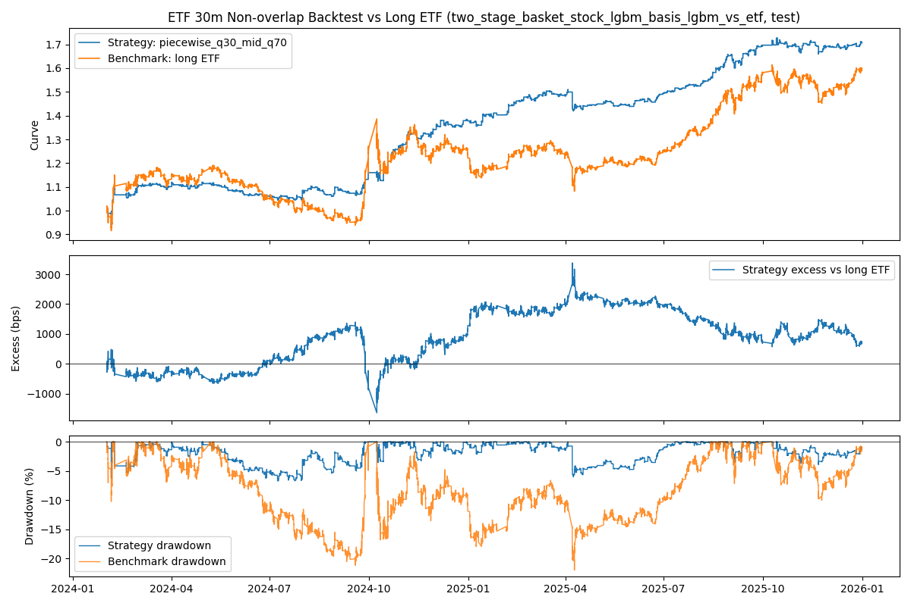
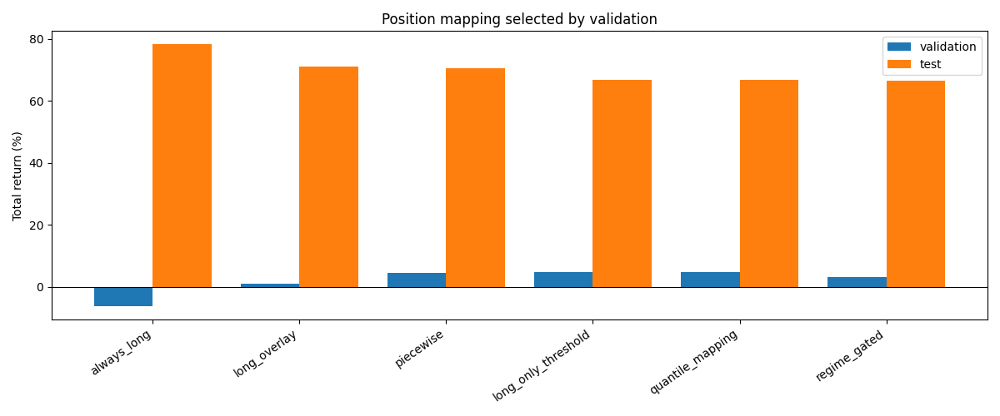
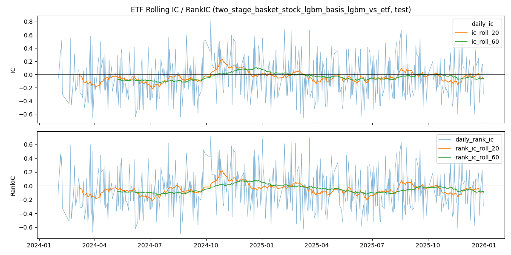
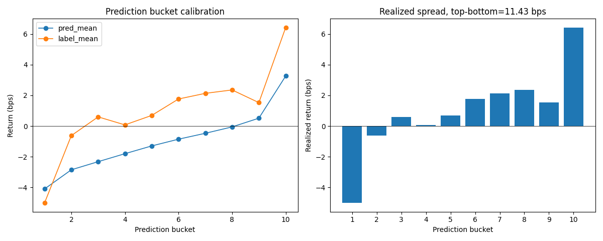
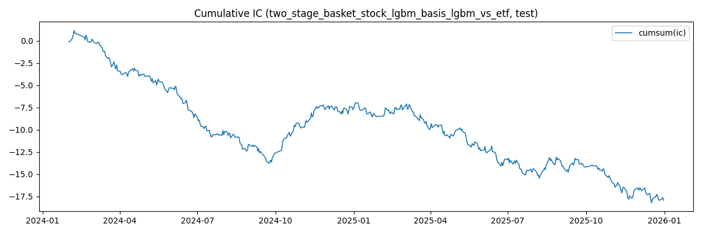
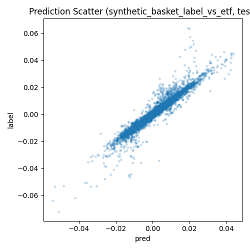

## 摘要

六组回测、篮子预测与 ETF 对照的阶段性研究结果。

### 一页结论

- 预测端不是无效: ETF selected model 在 test 上 IC=0.107647, RankIC=0.037103。
- 合成端质量较高: synthetic vs real ETF test IC=0.972738, RankIC=0.980706。
- 交易端的主要问题已经定位: pred < 0 不能直接解释成可做空信号, 更合理的解释是降低 long exposure。
- 当前默认候选规则为低分位空仓, 中间分位 0.25 仓, 高分位满仓。

## 研究背景与目标

本页是历史研究报告的统一模板版本。研究问题、实验定义、数据口径、表格和图像证据均沿用已校验的历史原版。

## 数据与方法

### Clean Benchmark 定义

| 项目 | 当前口径 |
| --- | --- |
| Run | run_20260428_182124 |
| 模型 | two_stage_basket_stock_lgbm_basis_lgbm_vs_etf |
| 数据切分 | Train 20210101-20231231, Test 20240201-20251231 |
| 交易频率 | 30m 非重叠交易, trade_count=3241 |
| Benchmark | ETF actual close path 的 long ETF benchmark |
| Known limitation | 无 transaction cost, 无 slippage; 规则由 train/validation 实验选择, 但仍需 rolling validation。 |

## 主要结果

生成日期: 2026-05-02 · ETF: 510500 · Horizon: 30m · Train: 20210101-20231231 · Test: 20240201-20251231

主基准: run_20260428_182124 · 当前默认候选交易规则: `piecewise_q30_mid_q70`

### 模型结果

### Stock Alpha

| model | TS-IC | TS-RankIC | Daily ICIR | Daily RankICIR |
| --- | --- | --- | --- | --- |
| lgbm | 0.091224 | 0.101063 | 2.161 | 1.860 |
| xgb | 0.087250 | 0.098161 | 2.278 | 1.956 |

### Basket / Basis

| 层级 | best model | IC | RankIC |
| --- | --- | --- | --- |
| Basket | basket_stock_lgbm | 0.113067 | 0.053319 |
| Basis eval | basis_basket_stock_lgbm | 0.101141 | 0.034161 |
| ETF final | two_stage_basket_stock_lgbm_basis_lgbm_vs_etf | 0.107647 | 0.037103 |

### ETF 模型对比

| model | IC | RankIC | DirAcc | RMSE | MAE |
| --- | --- | --- | --- | --- | --- |
| raw_basket_stock_lgbm_vs_etf | 0.101141 | 0.034161 | 0.5124 | 0.004375 | 0.002939 |
| raw_basket_stock_xgb_vs_etf | 0.059748 | 0.021040 | 0.5112 | 0.004387 | 0.002942 |
| two_stage_basket_stock_lgbm_basis_lgbm_vs_etf | 0.107647 | 0.037103 | 0.5170 | 0.004377 | 0.002940 |
| two_stage_basket_stock_lgbm_basis_xgb_vs_etf | 0.105693 | 0.035212 | 0.5165 | 0.004378 | 0.002940 |
| two_stage_basket_stock_xgb_basis_lgbm_vs_etf | 0.068014 | 0.024907 | 0.5144 | 0.004389 | 0.002943 |
| two_stage_basket_stock_xgb_basis_xgb_vs_etf | 0.066621 | 0.022409 | 0.5137 | 0.004390 | 0.002943 |

### 交易规则: Piecewise 作为当前默认候选

| 规则 | 参数 | 解释 |
| --- | --- | --- |
| piecewise_q30_mid_q70 | low_threshold: -0.00024340470354042255 high_threshold: -2.751216384198176e-05 low_pos: 0.0 mid_pos: 0.25 high_pos: 1.0 | 基于 calib 期 q30/q70 阈值。低预测空仓, 中间预测保留 0.25 long exposure, 高预测满仓。 |

| trade_count | active | flat | participation | avg_exposure | return | benchmark | excess | maxDD |
| --- | --- | --- | --- | --- | --- | --- | --- | --- |
| 3241 | 2401 | 840 | 0.7408 | 0.3965 | 70.62% | 59.55% | 693.8 bps | -6.70% |

### 六种 position mapping 实验

实验流程: calib 使用 train split 的 2021-2022, validation 使用 train split 的 2023, test 使用 2024-2025。每个 family 先在 validation 中选参数, test 只做最终验收。

| family | val return | val excess | val Calmar | val part. | test return | test excess | test Calmar | test part. |
| --- | --- | --- | --- | --- | --- | --- | --- | --- |
| piecewise | 4.52% | 1154.6 bps | 0.724 | 0.724 | 70.62% | -430.4 bps | 10.535 | 0.741 |
| long_only_threshold | 4.90% | 1195.4 bps | 0.710 | 0.217 | 66.74% | -648.0 bps | 9.480 | 0.282 |
| quantile_mapping | 4.90% | 1195.4 bps | 0.710 | 0.217 | 66.74% | -648.0 bps | 9.480 | 0.282 |
| regime_gated | 3.19% | 1013.0 bps | 0.422 | 0.309 | 66.52% | -660.0 bps | 8.126 | 0.412 |
| long_overlay | 1.04% | 782.8 bps | 0.151 | 0.822 | 71.10% | -403.3 bps | 9.518 | 0.816 |
| always_long | -6.30% | 0.0 bps | -0.367 | 1.000 | 78.29% | 0.0 bps | 5.206 | 1.000 |

- piecewise 是 validation 选择的最优 family, test Calmar 也是 selected families 中最高。
- always_long 在 test 上收益最高, 但 validation 表现为 -6.30%, 不能用 test 反向选择。
- long_overlay 在 test 接近 piecewise, 但 validation Calmar 明显较弱, 当前不作为默认。

calib pred quantiles: q30=-0.00024340470354042255, q50=-0.00010556556595395121, q70=-2.751216384198176e-05。

### 图表

## 限制与适用边界

解释边界与可比性限制沿用历史原版中的原始说明。

## 结论

### 为什么不是继续改模型

当前证据更支持先修改回测和交易映射, 而不是马上重做模型。模型 IC 与 bucket sorting 说明信号有排序信息; 旧的 `sign(pred)` 把负预测解释成 short, 在正 drift 市场里产生过强净空头暴露, 这是策略跑输 long ETF 的主要原因。

- 旧 sign(pred) : short trades 占 77.45%, 平均净 exposure 为 -0.5489, 策略收益 16.29%。
- long_only_pred_gt_0 : 收益提升到 47.12%, 最大回撤降到 -7.52%, 说明不做空是正确方向。
- piecewise : 收益进一步到 70.62%, 最大回撤 -6.70%, 同时保留较低平均仓位。

### 后续研究优先级

1. 加入 transaction cost 和 slippage, 用 turnover 与 participation 判断 piecewise 的真实可交易性。
2. 把 piecewise 参数选择改成 rolling validation 或 expanding validation, 避免单一 2023 validation 偶然性。
3. 继续分析 2025 偏空问题, 检查 pred distribution drift 与 market drift 的关系。
4. 在不改变模型主体前提下, 比较 benchmark-aware overlay 与 piecewise 的稳定性。
