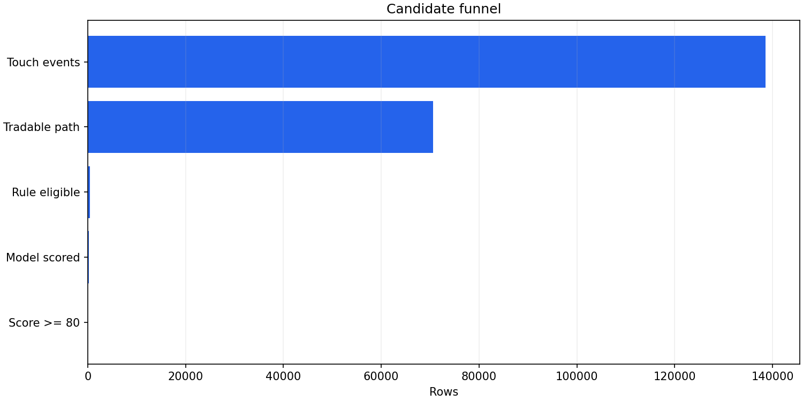
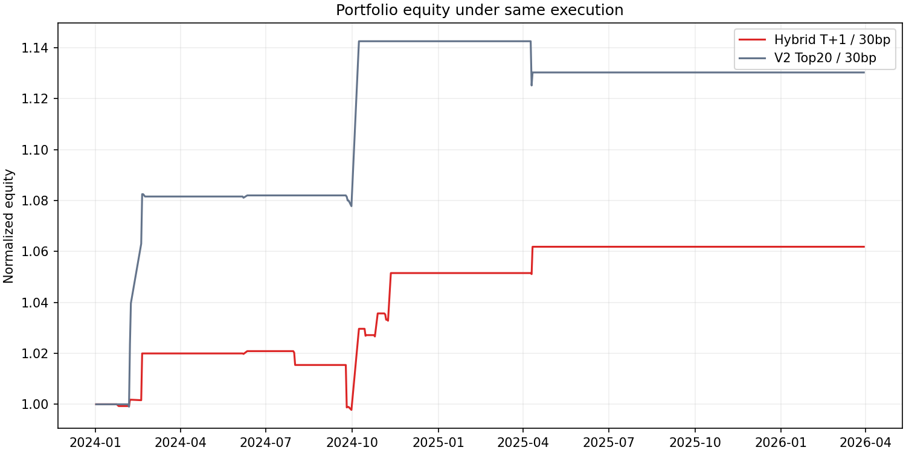
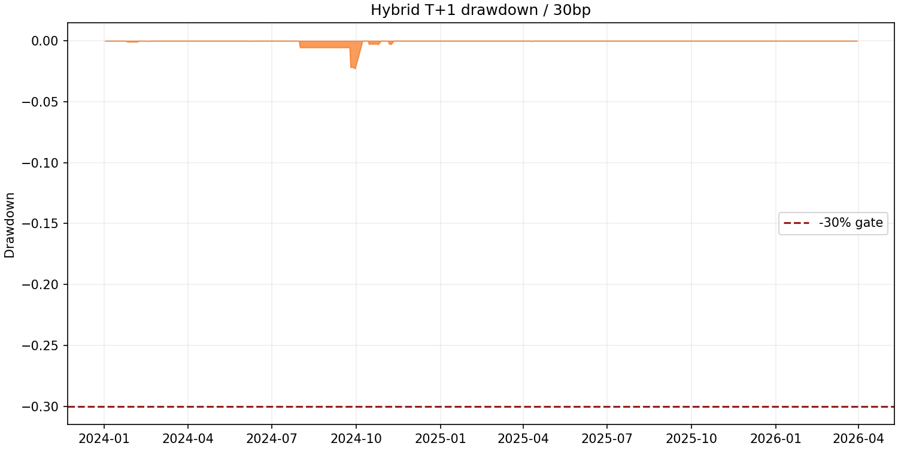

## 摘要

首次触板候选、交易路径和 T+1 组合表现的静态研究报告。

### 1. 冻结测试验收

| 验收项 | 结果 | 通过 |
| --- | --- | --- |
| 30bp 年化收益 ≥ 20% | 0.83% | False |
| 超过同执行 V2 Top20 | 1.74% | True |
| 最大回撤 ≤ 30% | -0.04% | True |

**解读：** 三条门槛必须同时通过才可进入仿真盘。收益门槛、相对基线和回撤约束分别防止只看绝对收益、只看模型分数或忽略尾部风险。

## 研究背景与目标

本页是历史研究报告的统一模板版本。研究问题、实验定义、数据口径、表格和图像证据均沿用已校验的历史原版。

## 数据与方法

### 8. T+1 退出状态机

| 退出方法 | 样本数 | 均值 | 中位数 | 胜率 |
| --- | --- | --- | --- | --- |
| mechanical_t1_gross_return | 488 | 1.05% | -0.17% | 47.13% |
| ret_t1_open_minute | 488 | 0.46% | 0.00% | 48.36% |
| ret_t1_0935_minute | 488 | 1.01% | 0.43% | 53.48% |
| ret_t1_1000_minute | 488 | 1.35% | 0.67% | 54.10% |
| ret_t1_1030_minute | 488 | 1.42% | 0.87% | 54.71% |
| ret_t1_close_minute | 488 | 1.44% | 0.64% | 53.48% |

**解读：** 机械退出与开盘、09:35、10:00、10:30、收盘基线并列，验证动态纪律是否真的优于固定时间。所有动态信号在分钟收盘后判定，并在下一可交易分钟成交。

## 主要结果

### 2. 候选漏斗

**解读：** 漏斗收缩主要来自分时路径、板块强度和攻防规则，而模型只负责在规则通过后排序；这避免把模型分数当作放宽交易纪律的理由。

| 阶段 | 数量 |
| --- | --- |
| 涨停触板样本 | 138625 |
| 路径可交易 | 70660 |
| 固定规则通过 | 488 |
| 模型已评分 | 270 |
| 分数≥80 | 30 |

**解读：** 表中每一级均可由 strategy_candidates_scored.parquet 复核，未通过样本保留 rule_reason，不存在静默删除。

### 3. 收益、成本与基线

| strategy_name | period | stress_bps | effective_extra_bps | total_return | annualized_return | max_drawdown | sharpe | trade_count | win_rate | mean_return |
| --- | --- | --- | --- | --- | --- | --- | --- | --- | --- | --- |
| hybrid_t1 | validation_plus_test | 20 | 25.0000 | 6.44% | 2.96% | -2.19% | 0.9261 | 15 | 60.00% | 3.16% |
| hybrid_t1 | validation | 20 | 25.0000 | 5.39% | 5.64% | -2.19% | 1.1944 | 14 | 57.14% | 3.01% |
| hybrid_t1 | frozen_test | 20 | 25.0000 | 1.00% | 0.85% | -0.03% | 0.8931 | 1 | 100.00% | 5.35% |
| hybrid_t1 | validation_plus_test | 30 | 35.0000 | 6.19% | 2.85% | -2.26% | 0.8947 | 15 | 60.00% | 3.06% |
| hybrid_t1 | validation | 30 | 35.0000 | 5.15% | 5.39% | -2.26% | 1.1493 | 14 | 57.14% | 2.90% |
| hybrid_t1 | frozen_test | 30 | 35.0000 | 0.98% | 0.83% | -0.04% | 0.8842 | 1 | 100.00% | 5.24% |
| hybrid_t1 | validation_plus_test | 50 | 55.0000 | 5.66% | 2.61% | -2.41% | 0.8297 | 15 | 60.00% | 2.85% |
| hybrid_t1 | validation | 50 | 55.0000 | 4.67% | 4.88% | -2.41% | 1.0554 | 14 | 57.14% | 2.70% |
| hybrid_t1 | frozen_test | 50 | 55.0000 | 0.94% | 0.80% | -0.06% | 0.8655 | 1 | 100.00% | 5.03% |
| v2_top20_same_execution | validation_plus_test | 30 | 35.0000 | 13.03% | 5.89% | -1.52% | 1.1487 | 19 | 68.42% | 3.62% |
| v2_top20_same_execution | validation | 30 | 35.0000 | 14.26% | 14.95% | -0.43% | 1.9122 | 15 | 80.00% | 4.89% |
| v2_top20_same_execution | frozen_test | 30 | 35.0000 | -1.07% | -0.91% | -1.52% | -0.6172 | 4 | 25.00% | -1.11% |

**解读：** 20/30/50bp 三档压力成本显示策略对摩擦的敏感度；effective_extra_bps 为压力成本加基础滑点。V2 基线使用相同成交、仓位和退出引擎，因此差异主要来自新规则与 walk-forward 排序。

### 4. 净值路径

**解读：** 净值图用于判断收益是否由少数阶段贡献，并直接比较策略与同执行基线；若优势只集中在单一行情阶段，不应据此扩大实盘仓位。

**解读：** 回撤的深度和恢复时间比单一最大值更重要；连续回撤通常意味着市场状态或成交模型漂移，应触发降仓而非只等待均值回归。

### 5. 入场分支

| entry_branch | trades | win_rate | mean_return | total_pnl |
| --- | --- | --- | --- | --- |
| rapid_queue | 4 | 75.00% | 7.75% | 42538.3635 |
| reseal | 10 | 60.00% | 1.53% | 20015.3296 |
| turnover_sweep | 1 | 0.00% | -0.37% | -693.3472 |

**解读：** 秒拉排板、换手扫板和回封板必须分别评估。若秒拉分支的真实 L2 成交率低，即使条件收益高也不能用扫板假设替代排队风险。

### 6. 进攻与防御

| regime | trades | win_rate | mean_return | total_pnl |
| --- | --- | --- | --- | --- |
| attack | 13 | 53.85% | 2.97% | 58461.3396 |
| defense | 2 | 100.00% | 3.62% | 3399.0062 |

**解读：** 进攻样本要求情绪与全市场实时广度同时满足，防御样本只允许超跌干净首板。两组收益差异可检验‘中高位进攻、低位防御’是否真的改善风险收益。

### 7. 成交真实性与容量

| fill_source | trades | win_rate | mean_return | total_notional |
| --- | --- | --- | --- | --- |
| actual_l2 | 15 | 60.00% | 3.06% | 2482287.0000 |

**解读：** actual_l2 与 modeled_fill 被强制分栏。2025-06-30 之后没有真实 L2，相关收益只能视为模型外推；换手/回封扫板还受触板分钟成交额 10% 的容量上限约束。

### 9. 股票池分层评估

| dimension | pool | samples | mean_return | win_rate |
| --- | --- | --- | --- | --- |
| cap_group | 中市值 | 202 | 0.55% | 39.11% |
| cap_group | 大市值_top30% | 190 | 0.84% | 44.21% |
| cap_group | 小市值_bottom30% | 96 | 1.00% | 43.75% |
| index_group | 其他 | 452 | 0.70% | 41.37% |
| index_group | 沪深300成分 | 36 | 1.44% | 50.00% |
| other_pool | 20%涨跌幅 | 56 | 1.61% | 41.07% |
| other_pool | 普通主板首板 | 359 | 0.50% | 40.95% |
| other_pool | 行业中军 | 58 | 0.86% | 43.10% |
| other_pool | 连板前排 | 15 | 3.04% | 66.67% |

**解读：** 市值、沪深300成分与其他策略角色分别切片，避免把小票效应、指数流动性和中军效应混为一谈。样本少的分层只用于风险提示，不据此单独调参。

### 10. 年度稳定性与样本外训练

| year | trades | win_rate | mean_return | pnl |
| --- | --- | --- | --- | --- |
| 2024 | 14 | 57.14% | 2.90% | 51533.2889 |
| 2025 | 1 | 100.00% | 5.24% | 10327.0570 |

**解读：** 年度表检查收益是否跨年份稳定。模型按季度扩展训练，且训练标签的实际退出日期必须早于测试信号日；2025–2026 冻结测试不参与阈值优化。

| test_quarter | test_start | test_rows | return_train_rows | fill_train_rows | latest_return_label_date | status | fill_model | mean_predicted_return | mean_fill_probability |
| --- | --- | --- | --- | --- | --- | --- | --- | --- | --- |
| 2022Q2 | 20220429 | 35 | 154 | 153 | 20220331 | insufficient_return_history | None | — | — |
| 2022Q3 | 20220707 | 5 | 189 | 187 | 20220701 | insufficient_return_history | None | — | — |
| 2022Q4 | 20221014 | 24 | 194 | 192 | 20220923 | insufficient_return_history | None | — | — |
| 2023Q1 | 20230113 | 2 | 218 | 216 | 20221227 | scored | classifier | -0.0099 | 0.1394 |
| 2023Q2 | 20230426 | 6 | 220 | 218 | 20230323 | scored | classifier | 0.0099 | 0.5478 |
| 2023Q3 | 20230731 | 8 | 226 | 224 | 20230628 | scored | classifier | 0.0183 | 0.3751 |
| 2023Q4 | 20231010 | 9 | 234 | 232 | 20230919 | scored | classifier | 0.0084 | 0.5180 |
| 2024Q1 | 20240102 | 59 | 243 | 241 | 20231229 | scored | classifier | -0.0074 | 0.2411 |
| 2024Q2 | 20240401 | 23 | 301 | 290 | 20240321 | scored | classifier | 0.0060 | 0.2119 |
| 2024Q3 | 20240710 | 60 | 325 | 312 | 20240611 | scored | classifier | -0.0069 | 0.4632 |
| 2024Q4 | 20241015 | 38 | 385 | 366 | 20241008 | scored | classifier | -0.0106 | 0.3780 |
| 2025Q1 | 20250114 | 8 | 423 | 402 | 20241211 | scored | classifier | 0.0242 | 0.1714 |
| 2025Q2 | 20250403 | 23 | 431 | 409 | 20250318 | scored | classifier | -0.0031 | 0.3980 |
| 2025Q3 | 20250818 | 5 | 454 | 432 | 20250617 | scored | classifier | -0.0305 | 0.1640 |
| 2025Q4 | 20251014 | 15 | 459 | 432 | 20250826 | scored | classifier | -0.0171 | 0.1987 |
| 2026Q1 | 20260105 | 14 | 474 | 432 | 20251223 | scored | classifier | -0.0134 | 0.1517 |

**解读：** 审计表列出每个测试季度的训练样本、最新已解析标签日期和成交模型来源，可直接检查时间穿越与早期历史不足。

## 限制与适用边界

### 12. 数据边界与限制

行业归属来源： `sw2021_point_in_time` 。真实 Level-2 最后日期： `20250630` ； 此后成交为模型估计。竞价成交量接口无权限，因此本版只使用开盘缺口，不构造竞价量代理。 扫描器只输出研究候选，不连接券商、不发送委托。报告内收益不构成投资建议。

## 结论

### 11. 对打板与追涨停策略的建议

1. 只在规则漏斗通过后使用模型排序；分数不能覆盖弱板块、受损分时、连板过晚或 14:30 后入场等硬性拒绝。
2. 秒拉板坚持排队成交口径，换手板与回封板才允许扫板；没有真实 L2 的阶段先按模型成交降级，并把实盘监控重点放在排队位置与撤单。
3. 进攻阶段可做板块前排连板，防御阶段仅做超跌干净首板；市场广度跌破阈值后不应沿用进攻仓位。
4. 主板早盘基础仓位 25%，20% 涨跌幅或 14:00 后基础仓位 12.5%，再乘置信度；行业总仓不得超过 50%。
5. T+1 退出执行机械状态机。高开/平开不能由红翻绿，低开未在 09:35 修复先减半；最迟 10:30 退出。趋势延长必须单独记账，不能回填主策略收益。
6. 上线顺序应为历史回放、只读实时扫描、仿真盘、极小资金。30bp 压力成本三条验收门槛未同时通过时，不进入下一阶段。
