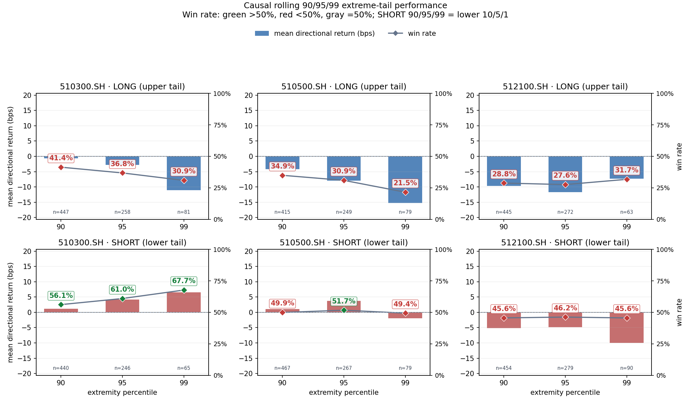
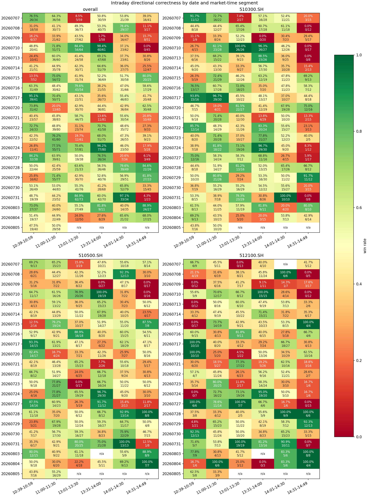
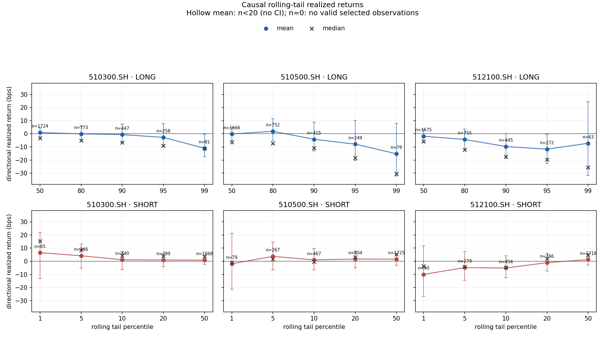

## 摘要

本报告记录 live-predictor 在 2026-08-05 上午的研究监控结果。系统从 10:39 至 11:30 覆盖 52 个决策分钟，为 510300、510500 和 512100 生成 156 条预测；在 13:10 的因果事后水位下，156 条均已成熟，没有 pending 记录。

### 一页结论

- 数据与推理链路通过本次门禁：1,800 只目标证券全部成功获取，失败和未解决证券均为 0。
- 当日上午三 ETF 合计方向样本胜率为 48.98%（48/98），不同 ETF 之间表现不一致。
- 历史评价期加当日成熟样本的 99% 极端尾部中，三只 ETF 的 Long 平均方向收益均为负；Short 仅 510300 保持正收益。
- 当前模型属于 shadow_candidate，signal_actionability=non_actionable；结果只用于研究诊断，不构成交易建议。

## 研究背景与目标

live-predictor 位于训练研究与实时数据源之间，负责数据质量门禁、分钟级推理、三只 ETF 成分篮子聚合、事后收益评价和运行监控。本次报告检验两个问题：

1. 直接 TDX 一分钟 K 线能否完整驱动 1,800 只成分股的上午预测链路；
2. 当前冻结模型在历史评价背景和当日已成熟样本中的方向表现是否一致。

报告不评估真实 ETF 成交，也不据单日上午结果做模型晋升判断。

## 数据与方法

| 项目 | 口径 |
| --- | --- |
| 交易日 | 2026-08-05 |
| 决策区间 | 10:39–11:30，52 个分钟 |
| 模型 | shadow-reference-baseline-v2-bvwap-seed7-13662623 |
| 股票范围 | 三只 ETF 的 point-in-time 成分权重并集，共 1,800 只 |
| 实时输入 | TDX 直接一分钟 K 线；只接受已经完成的分钟 |
| 预测输出 | 每分钟分别生成 510300、510500、512100 三条篮子预测 |
| 事后收益 | 使用预测时冻结的成分权重，评价 t+1 至 t+10 成分篮子收益 |
| 方向判断 | 沿用模型包冻结的 20/80 信号；FLAT、零收益、无效和 pending 不进入胜负分母 |
| 历史背景 | 完整历史评价期与当日成熟样本合并；滚动阈值严格滞后一条 |

薄成交 K 线只有在价格与金额可用时才允许按 amount / close 重建 volume，并显式标记；这类记录可以进入模型特征，但不进入执行和事后 VWAP。未来分钟数据一律过滤。

## 主要结果

### 数据与运行门禁

| 指标 | 结果 |
| --- | ---: |
| 成功证券 | 1,800 |
| 失败证券 | 0 |
| 未解决证券 | 0 |
| 有效 endpoint | 1 |
| 实测请求吞吐 | 542.35 symbols/s |
| 原始观测 K 线 | 212,822 |
| 确认无成交 K 线 | 3,720 |
| 重建 volume 的 K 线 | 1,258 |
| 过滤的未来 K 线 | 1,800 |
| 生成 / 成熟 / pending 预测 | 156 / 156 / 0 |

门禁结果支持“链路在本次上午窗口内完整运行”的判断，但单一有效 endpoint 仍是明确的单点故障域。

### 2026-08-05 上午方向结果

| ETF | 正确 | 错误 | 方向样本 n | 胜率 |
| --- | ---: | ---: | ---: | ---: |
| 510300.SH | 17 | 19 | 36 | 47.22% |
| 510500.SH | 23 | 22 | 45 | 51.11% |
| 512100.SH | 8 | 9 | 17 | 47.06% |
| 合计 | 48 | 50 | 98 | 48.98% |

当日结果接近随机方向基准，且只有 510500 略高于 50%。这是一项观察，不构成统计显著性或可交易性结论。

### 历史评价期加当日样本的 99% 极端尾部

| ETF | Long 平均方向收益 | Long 胜率 | Short 平均方向收益 | Short 胜率 |
| --- | ---: | ---: | ---: | ---: |
| 510300.SH | -11.05 bps | 30.86% | +6.53 bps | 67.69% |
| 510500.SH | -15.24 bps | 21.52% | -1.91 bps | 49.37% |
| 512100.SH | -7.27 bps | 31.75% | -9.99 bps | 45.56% |

最极端的 Long 预测没有表现出正向收益；Short 的改善只出现在 510300，不能推广到三只 ETF。

## 限制与适用边界

- 模型是 provenance 已验证但非原始 selected checkpoint 的 shadow_candidate，明确不可执行。
- 当前数据链路只有一个有效 endpoint；吞吐通过不等于具备节点级高可用。
- 当日上午只有 52 个决策分钟，且十分钟事后窗口互相重叠，样本并不独立。
- 历史尾部阈值和当日结果共享同一模型与评价体系，不能视为新的独立验证集。
- 成分篮子收益不等于 ETF 实际成交收益，报告未覆盖滑点、费用、冲击或可借券约束。
- 1,258 根薄成交 K 线使用受控 volume 重建；它们不会进入事后执行 VWAP，但仍可能影响模型特征。

## 结论

本次扫描确认 live-predictor 已形成可复现的实时数据、模型推理、持久化和因果事后评价链路，08-05 上午数据门禁完整通过。信号层面尚未形成一致优势：当日上午合计胜率低于 50%，历史 99% Long 极端尾部在三只 ETF 上均为负，Short 也只有 510300 为正。因此当前结果适合作为运行和模型行为诊断，不支持进入纸面交易或实盘执行。

## 附录

- 权威运行：20260805T140155+0800
- 原始自包含报告 SHA-256：5175581e26183c5bb55138c9011e43eea8d770152601130851700d629164baa5
- 报告镜像：live-predictor/reports/20260805T140155+0800_report.html
- 原始报告的 3 张内嵌图像均已通过完整解码与联系表视觉检查。
