## 摘要

### 实验身份与首页摘要

**预测质量 Test / OOS, 主 horizon**

| Mean Daily IC | Mean Daily RankIC | Pooled IC | Pooled RankIC | Top 1% 中位数超越率 | Top 10% 中位数超越率 | Top 10% 正收益率 | 覆盖率 | 有效 OOS 日 |
| --- | --- | --- | --- | --- | --- | --- | --- | --- |
| 0.113 | 0.0834 | 0.120 | 0.0922 | 58.16% | 52.35% | 44.03% | 94.12% | 205 |

**经济信号 Test / OOS, 主 horizon**

| Top 10% 平均未来收益 / bps |
| --- |
| 6.60 |

**Top 1% 净值与成本 万一免五假设**

| 假设单边滑点 / bps | 期末 NAV | 累计总成本 / 初始资金 | 期末持仓数 |
| --- | --- | --- | --- |
| 0 | 5.82 | 9.71 | 48 |
| 1 | 3.83 | 11.2 | 48 |
| 3 | 1.71 | 11.3 | 47 |
| 5 | 0.776 | 10.3 | 41 |

中位数超越率: Top 1% 或 Top 10% 可评估样本的 target 严格高于同 timestamp 可评估截面 target 中位数的比例. Top 10% 正收益率: 实际未来收益大于 0 的高预测组样本比例. 两者口径不同.

理想化组合结果: 旧组合章节为 gross 对照; 成本策略单列净值与费用.

执行假设: 生效配置决定调仓频率、entry lag、持有与资金分配; 高换手 gross 收益不等于可实现收益.

| 样本数 | 理论样本数 | 有效日 | 覆盖率 |
| --- | --- | --- | --- |
| 175,645,762 | 186,610,990 | 205 | 94.12% |

| 样本 | 开始日期 | 结束日期 | 股票数 | Inference 样本数 |
| --- | --- | --- | --- | --- |
| val | 20240102 | 20240229 | 5,318 | 33,747,260 |
| test | 20240301 | 20241231 | 5,399 | 187,646,586 |

**样本定义、split 与频率**

```text
end_date: 20241231
evaluation:
  benchmark_codes:
  - 000300.SH
  - 000905.SH
  - 000852.SH
  context_fields:
  - price
  - vwap
  - volatility
  horizons:
  - 5
  - 10
  - 15
  - 20
  - 25
  - 30
  minimum_weight_coverage: 0.8
  volatility_days: 20
label:
  entry_lag_minutes: 1
  holding_minutes: 10
listing_exclusion_trade_days: 60
start_date: 20210104
train_end_date: 20231229
validation_end_date: 20240229
window_size: 60
```

数据类型: A 股分钟 panel; prediction 频率: 每个可用分钟窗口端点.

**实际模型与训练配置**

```text
experiment_id: baseline
model:
  dropout: 0.0
  hidden_size: 384
  layers: 2
  mlp_widths:
  - 512
  - 512
prediction_kind: return_prediction
run_id: baseline-exps-full-20261023-r3
tracking:
  enabled: true
  uri: http://172.22.0.1:5000
training:
  device: cuda:0
  epoch_count: 1
  gap_gate:
    enabled: true
    fraction: 0.1
    threshold: 0.15
  learning_rate: 0.001
  log_every: 50
  minimum_lr: 0.000001
  num_workers: 8
  precision: fp16
  save_fraction: 0.05
  seed: 7
  selection:
    std_penalty: 0.5
    top_k: 2
    validation_days: 20
  train_diagnostic_panels: 3891
  validate_fraction: 0.1
  warmup_start_factor: 0.001
  warmup_steps: 200
  weight_decay: 0.01
```

## 研究背景与目标

检验固定 baseline 预测信号的动态 Top 1% 持仓, 在真实分钟成交量约束和 A 股单边费用假设下, 组合收益对滑点和停牌的敏感性. 这份报告属于成本诊断, 不构成可执行交易回测.

## 数据与方法

使用 `baseline-exps-full-20261023-r3` 的固定 PredictionArtifact 和选中 checkpoint `step_105343`. 派生价格输入加入每日 `adj_factor` 与分钟 `Vol`; prediction、target、benchmark 保持不变. Validation 为 2024-01-02 至 2024-02-29, Test 为 2024-03-01 至 2024-12-31, 成本回放覆盖 205 个 Test 交易日.

每个预测分钟按有限 prediction 降序, 以 StockCode 破同分, 取 `ceil(n × 1%)` 个成员. 在下一分钟仅对有行情且 `Vol > 0` 的股票执行: 先卖出退出成员, 再以固定金额买入新成员; 留存股数不变, 现金不足则停止后续买入. 无成交时延后卖出并跳过买入; 持仓跨日, Test 终点不强制清仓.

费用假设: 买卖各付佣金 1 bp 且免最低 5 元, 过户费双边各 0.1 bp, 印花税卖出 5 bps. 单边滑点分别为 0、1、3、5 bps. 持仓估值以有成交的 `Close × adj_factor` 为 total-return proxy; 无成交时沿用末次有成交的调整后价格. 0 bps 表示无额外滑点, 仍支付上述费用.

Top 组中位数超越率 = Top 组 target 严格高于同一预测 timestamp 可评估截面 target 中位数的比例. 年化超额收益率（线性） = 日均超额 × 252. 旧 Top 10% 和 10min 组合仍是 gross 对照, 与成本组合口径不同.

## 主要结果

### Top 1% 持仓与成本诊断

| 假设单边滑点 / bps | 期末 NAV | 期末现金占初始资金 | 期末持仓占初始资金 | 期末持仓数 | 每笔固定建仓金额 |
| --- | --- | --- | --- | --- | --- |
| 0 | 5.82 | 493.01% | 89.13% | 48 | 0.0185 |
| 1 | 3.83 | 294.23% | 89.13% | 48 | 0.0185 |
| 3 | 1.71 | 83.64% | 87.28% | 47 | 0.0185 |
| 5 | 0.776 | 1.53% | 76.12% | 41 | 0.0185 |

| 假设单边滑点 / bps | 受阻卖出 stock-date 数 | 期末无成交持仓数 | 期末无成交持仓估值 / 初始资金 | 期末无成交持仓估值 / NAV |
| --- | --- | --- | --- | --- |
| 0 | 47,764 | 11 | 0.207 | 3.55% |
| 1 | 43,104 | 11 | 0.207 | 5.39% |
| 3 | 29,646 | 10 | 0.188 | 11.00% |
| 5 | 20,478 | 10 | 0.187 | 24.13% |

| 假设单边滑点 / bps | 累计总成本 / 初始资金 | 累计基准成交额 / 初始资金 | 累计滑点成本 / 初始资金 | 累计佣金 / 初始资金 | 累计过户费 / 初始资金 | 累计印花税 / 初始资金 |
| --- | --- | --- | --- | --- | --- | --- |
| 0 | 9.71 | 26,971 | 0 | 2.70 | 0.270 | 6.75 |
| 1 | 11.2 | 24,384 | 2.44 | 2.44 | 0.244 | 6.10 |
| 3 | 11.3 | 17,112 | 5.13 | 1.71 | 0.171 | 4.28 |
| 5 | 10.3 | 11,930 | 5.97 | 1.19 | 0.119 | 2.98 |

| 假设单边滑点 / bps | 基准 | 有效日 | 日均超额 | 年化超额收益率（线性） | 超额胜率 | 累计超额 | 最大回撤 | Sharpe |
| --- | --- | --- | --- | --- | --- | --- | --- | --- |
| 0 | 000300.SH | 205 | 0.79% | 199.00% | 67.80% | 389.93% | -15.88% | 8.17 |
| 0 | 000852.SH | 205 | 0.79% | 199.87% | 64.88% | 389.90% | -18.93% | 7.19 |
| 0 | 000905.SH | 205 | 0.81% | 203.95% | 68.78% | 408.19% | -18.24% | 7.84 |
| 1 | 000300.SH | 205 | 0.60% | 150.41% | 57.56% | 225.96% | -30.38% | 4.82 |
| 1 | 000852.SH | 205 | 0.60% | 151.28% | 55.61% | 228.24% | -22.84% | 4.85 |
| 1 | 000905.SH | 205 | 0.62% | 155.36% | 59.02% | 239.53% | -24.61% | 5.04 |
| 3 | 000300.SH | 205 | 0.21% | 52.12% | 47.32% | 45.16% | -44.25% | 1.46 |
| 3 | 000852.SH | 205 | 0.21% | 52.99% | 49.27% | 46.33% | -39.85% | 1.50 |
| 3 | 000905.SH | 205 | 0.23% | 57.07% | 48.29% | 51.33% | -39.77% | 1.62 |
| 5 | 000300.SH | 205 | -0.17% | -43.08% | 40.49% | -34.18% | -60.17% | -1.05 |
| 5 | 000852.SH | 205 | -0.17% | -42.21% | 39.02% | -33.72% | -59.76% | -1.03 |
| 5 | 000905.SH | 205 | -0.15% | -38.13% | 41.46% | -31.40% | -59.15% | -0.937 |

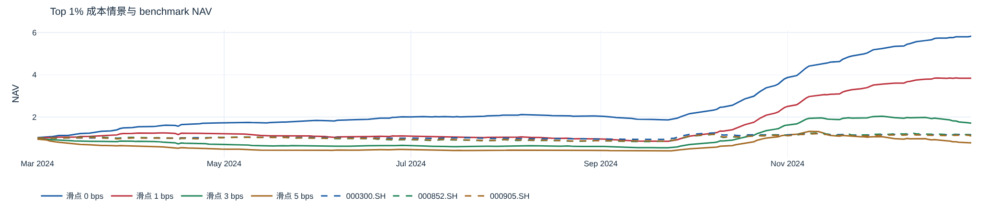

每分钟选择动态 Top 1%, t+1 分钟仅在有成交量时按 Close 卖出退出股票并买入新股票; 无分钟行或零成交时延后卖出、跳过买入, 留存股数不变. 每笔新买入按固定 A, 现金不足则停止. 持仓跨日, 期末不强制清仓; 未恢复成交的仓位按最后一次实际成交价估值, 可能高于可回收金额. 受阻卖出按每只股票每日计一次. 万一免五为佣金 1 bp 且无 5 元最低额的假设; 过户费双边 0.1 bp, 印花税卖出 5 bps. 滑点 0/1/3/5 bps 为假设, 不是实测值. 有成交时用 Close × adj_factor 近似跨日公司行动收益, 无成交时沿用上一成交价的调整后估值. 同日买卖可能违反 A 股 T+1, 此处仅作成本诊断, 不代表可执行收益.

### Train / Validation / Test 累计 daily IC

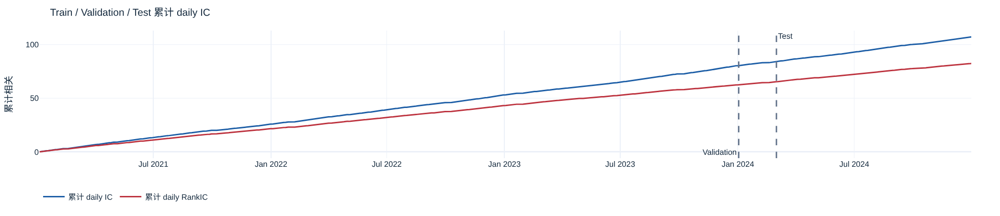

| 样本 | 开始日期 | 结束日期 | 有效日 | 有效 timestamp | 有效样本 |
| --- | --- | --- | --- | --- | --- |
| train | 20210104 | 20231229 | 727 | 117,047 | 545,252,682 |
| val | 20240102 | 20240229 | 37 | 5,957 | 31,589,005 |
| test | 20240301 | 20241231 | 205 | 33,005 | 175,645,762 |

Train 是选中 checkpoint 在训练日期的样本内诊断. Validation 与 Test 使用同一模型; 累计值逐日累加 daily IC, 不使用 pooled IC.

### 训练诊断与泛化

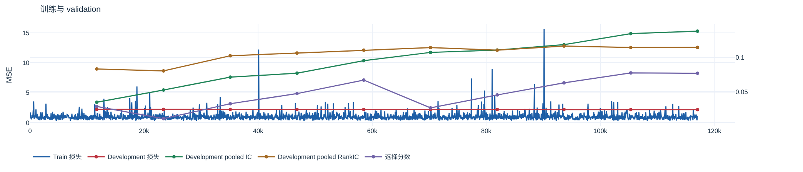

选中 checkpoint: 105343. 仅使用 validation 选择模型.

```text
std_penalty: 0.5
top_k: 2
validation_days: 20
```

| 训练 step | 选择分数 | Pooled IC | Pooled RankIC |
| --- | --- | --- | --- |
| 11,705 | 0.0285 | 0.0346 | 0.0833 |
| 23,410 | 0.0107 | 0.0525 | 0.0805 |
| 35,115 | 0.0325 | 0.0713 | 0.103 |
| 46,819 | 0.0473 | 0.0771 | 0.107 |
| 58,524 | 0.0671 | 0.0954 | 0.111 |
| 70,229 | 0.0265 | 0.107 | 0.114 |
| 81,933 | 0.0454 | 0.111 | 0.111 |
| 93,638 | 0.0630 | 0.119 | 0.117 |
| 105,343 | 0.0775 | 0.135 | 0.115 |
| 117,047 | 0.0770 | 0.139 | 0.115 |

| 样本 | Mean Daily IC | Mean Daily RankIC | Pooled IC | Pooled RankIC | 方差比 |
| --- | --- | --- | --- | --- | --- |
| val | 0.102 | 0.0778 | 0.135 | 0.115 | 0.0257 |
| test | 0.113 | 0.0834 | 0.120 | 0.0922 | 0.0191 |

| 样本 | 分组 | 实际收益 / bps | 正收益比例 |
| --- | --- | --- | --- |
| val | Top 5% | 8.89 | 46.54% |
| val | Top 10% | 6.19 | 44.66% |
| test | Top 5% | 9.63 | 45.84% |
| test | Top 10% | 6.60 | 44.03% |

### 各 horizon 预测质量

| Horizon / min | 样本数 | 理论样本数 | 覆盖率 | 有效日 | Mean Daily IC | Mean Daily RankIC | ICIR | RankICIR | IC t-stat | RankIC t-stat | Pooled IC | Pooled RankIC | 方差比 |
| --- | --- | --- | --- | --- | --- | --- | --- | --- | --- | --- | --- | --- | --- |
| 5.00 | 181,100,682 | 192,068,975 | 94.29% | 205 | 0.109 | 0.0802 | 7.88 | 5.97 | 113 | 85.4 | 0.113 | 0.0854 | 0.0355 |
| 10.0 | 175,645,762 | 186,610,990 | 94.12% | 205 | 0.113 | 0.0834 | 6.58 | 4.73 | 94.3 | 67.7 | 0.120 | 0.0922 | 0.0191 |
| 15.0 | 170,190,842 | 181,153,005 | 93.95% | 205 | 0.109 | 0.0814 | 5.80 | 3.97 | 83.1 | 56.8 | 0.126 | 0.0916 | 0.0129 |
| 20.0 | 164,735,922 | 175,695,020 | 93.76% | 205 | 0.106 | 0.0794 | 5.30 | 3.55 | 75.8 | 50.9 | 0.128 | 0.0915 | 0.00967 |
| 25.0 | 159,281,002 | 170,237,035 | 93.56% | 205 | 0.101 | 0.0766 | 4.88 | 3.27 | 69.9 | 46.9 | 0.126 | 0.0909 | 0.00769 |
| 30.0 | 153,826,082 | 164,779,050 | 93.35% | 205 | 0.0974 | 0.0742 | 4.58 | 3.08 | 65.5 | 44.1 | 0.125 | 0.0892 | 0.00632 |

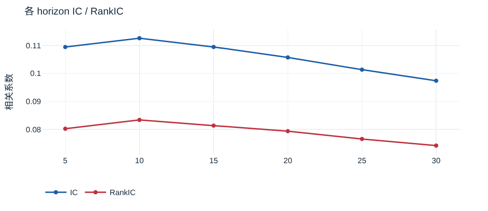

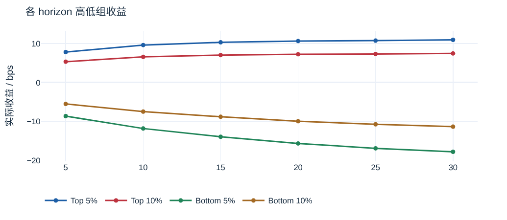

| 均值 | 中位数 | 标准差 | 偏度 | 超额峰度 | 样本数 |
| --- | --- | --- | --- | --- | --- |
| 0.0000391 | 0.0000415 | 0.000713 | -1.94 | 64.6 | 187,646,586 |

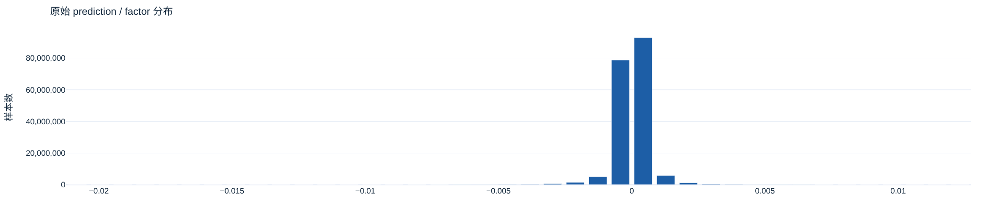

### 预测值分位组统计

| 分组 | 样本数 | 中位数相对比例 | 实际收益 / bps | 正收益比例 | 样本 | Horizon / min |
| --- | --- | --- | --- | --- | --- | --- |
| All | 175,645,762 | 49.42% | 0.0920 | 38.96% | test | 10.0 |
| Bottom 5% | 8,795,482 | 57.64% | -11.8 | 30.20% | test | 10.0 |
| Top 5% | 8,795,482 | 53.95% | 9.63 | 45.84% | test | 10.0 |
| Bottom 10% | 17,578,582 | 54.88% | -7.45 | 32.59% | test | 10.0 |
| Top 10% | 17,578,582 | 52.35% | 6.60 | 44.03% | test | 10.0 |
| Top 1% | 1,781,786 | 58.16% | 19.3 | 50.48% | test | 10.0 |

| 分组 | 样本数 | 中位数相对比例 | 实际收益 / bps | 正收益比例 | 样本 | Horizon / min |
| --- | --- | --- | --- | --- | --- | --- |
| Q0 | 17,578,582 | 54.88% | -7.45 | 32.59% | test | 10.0 |
| Q1 | 17,563,425 | 49.93% | -1.50 | 36.84% | test | 10.0 |
| Q2 | 17,566,145 | 48.51% | -0.764 | 37.97% | test | 10.0 |
| Q3 | 17,563,071 | 47.49% | -0.298 | 38.62% | test | 10.0 |
| Q4 | 17,559,890 | 46.66% | 0.0421 | 39.05% | test | 10.0 |
| Q5 | 17,569,459 | 47.61% | 0.370 | 39.42% | test | 10.0 |
| Q6 | 17,565,649 | 48.22% | 0.709 | 39.80% | test | 10.0 |
| Q7 | 17,563,567 | 48.87% | 1.18 | 40.25% | test | 10.0 |
| Q8 | 17,566,003 | 49.69% | 2.04 | 41.00% | test | 10.0 |
| Q9 | 17,549,971 | 52.36% | 6.60 | 44.03% | test | 10.0 |

Top 组为中位数超越率, 即 target 严格高于同分钟截面中位数的比例; Bottom 组为严格低于的比例. 等于中位数不计入.

### 旧 Top 10% gross 对照

| 策略 | 有效日 | 日均收益 | 日均换手 |
| --- | --- | --- | --- |
| Bottom 10% | 205 | -3.23% | 6075.05% |
| Bottom 5% | 205 | -4.82% | 5953.42% |
| Top 10% | 205 | 3.49% | 6071.57% |
| Top 5% | 205 | 5.10% | 6290.91% |

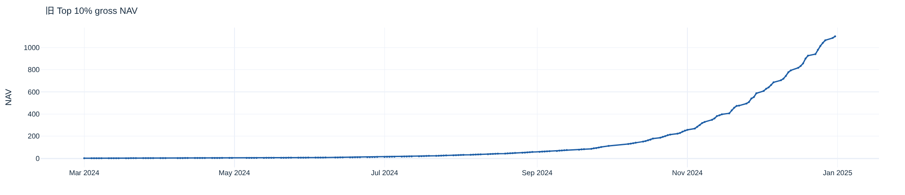

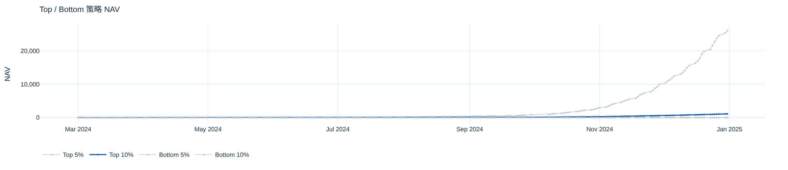

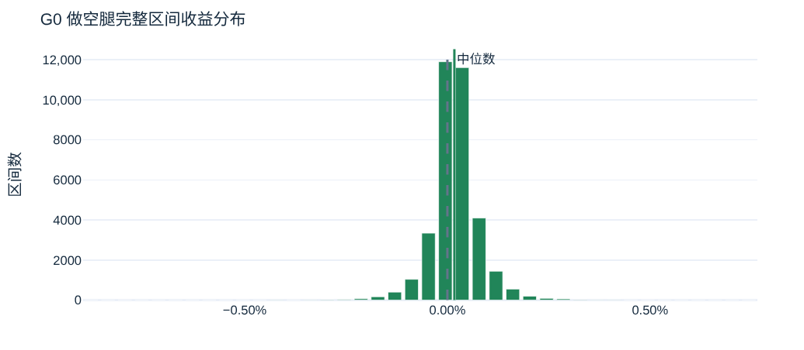

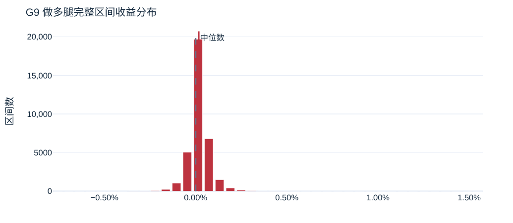

每个 prediction minute 用当前截面重新选股, 在下一分钟 Close 全额调至最新等权组合; 下一次调仓允许提前卖出. Prediction target 仍为 10min, 实际持有区间为 1min. 旧对照策略为 Top 10% 等权多头; G0-G9 与其他 Top/Bottom 各是独立的单位资金假设组合, 不同时合并投入. 交易额以每日初始资金 1 为单位, gross 收益未扣成本.

### Q0-Q9 组合 NAV

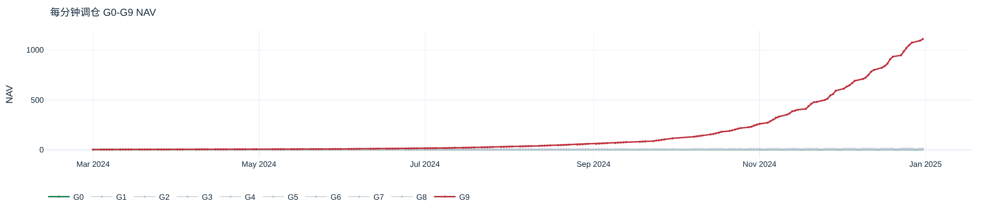

### 换手与资金占用

| 策略 | 有效日 | 日均换手 |
| --- | --- | --- |
| G0 | 205 | 6075.05% |
| G1 | 205 | 10658.68% |
| G2 | 205 | 12266.33% |
| G3 | 205 | 12940.60% |
| G4 | 205 | 13199.68% |
| G5 | 205 | 13205.65% |
| G6 | 205 | 12970.41% |
| G7 | 205 | 12365.33% |
| G8 | 205 | 10870.98% |
| G9 | 205 | 6072.38% |
| Long-short | 205 | — |

| 策略 | 平均目标资金占用 | 最小目标资金占用 | 最大目标资金占用 |
| --- | --- | --- | --- |
| Bottom 10% | 99.42% | 0.00% | 100.00% |
| Bottom 5% | 99.42% | 0.00% | 100.00% |
| G0 | 99.42% | 0.00% | 100.00% |
| G1 | 99.42% | 0.00% | 100.00% |
| G2 | 99.42% | 0.00% | 100.00% |
| G3 | 99.42% | 0.00% | 100.00% |
| G4 | 99.42% | 0.00% | 100.00% |
| G5 | 99.42% | 0.00% | 100.00% |
| G6 | 99.42% | 0.00% | 100.00% |
| G7 | 99.42% | 0.00% | 100.00% |
| G8 | 99.42% | 0.00% | 100.00% |
| G9 | 99.42% | 0.00% | 100.00% |
| Top 10% | 99.42% | 0.00% | 100.00% |
| Top 5% | 99.42% | 0.00% | 100.00% |

资金占用为目标权重之和; 缺失执行价对应收益缺失, 不代表实际可成交额.

### 旧 gross Benchmark 与超额

| 基准 | 有效日 | 日均超额 | 年化超额收益率（线性） | 超额胜率 | 累计超额 | 最大回撤 | Sharpe |
| --- | --- | --- | --- | --- | --- | --- | --- |
| 000300.SH | 205 | 3.40% | 857.71% | 99.51% | 93912.01% | -0.01% | 42.6 |
| 000852.SH | 205 | 3.41% | 858.58% | 98.54% | 94292.00% | -1.95% | 39.3 |
| 000905.SH | 205 | 3.42% | 862.66% | 99.02% | 97602.46% | -1.22% | 42.3 |

**Benchmark 构造与匹配覆盖率**

| 日期 | 基准 | 日收益 | 匹配权重覆盖率 | 权重日期 |
| --- | --- | --- | --- | --- |
| 20240301 | 000300.SH | 0.62% | 100.00% | 20240229 |
| 20240301 | 000905.SH | 0.60% | 100.00% | 20240229 |
| 20240301 | 000852.SH | 1.07% | 100.00% | 20240229 |
| 20240304 | 000300.SH | 0.08% | 100.00% | 20240229 |
| 20240304 | 000905.SH | 0.17% | 100.00% | 20240229 |
| 20240304 | 000852.SH | 0.48% | 100.00% | 20240229 |
| 20240305 | 000300.SH | 0.70% | 100.00% | 20240229 |
| 20240305 | 000905.SH | -0.68% | 100.00% | 20240229 |
| 20240305 | 000852.SH | -0.98% | 100.00% | 20240229 |
| 20240306 | 000300.SH | -0.40% | 100.00% | 20240229 |
| 20240306 | 000905.SH | -0.04% | 100.00% | 20240229 |
| 20240306 | 000852.SH | 0.12% | 99.86% | 20240229 |
| 20240307 | 000300.SH | -0.60% | 100.00% | 20240229 |
| 20240307 | 000905.SH | -1.36% | 100.00% | 20240229 |
| 20240307 | 000852.SH | -1.44% | 99.86% | 20240229 |
| 20240308 | 000300.SH | 0.41% | 100.00% | 20240229 |
| 20240308 | 000905.SH | 1.34% | 100.00% | 20240229 |
| 20240308 | 000852.SH | 1.25% | 99.86% | 20240229 |
| 20240311 | 000300.SH | 1.30% | 100.00% | 20240229 |
| 20240311 | 000905.SH | 1.75% | 100.00% | 20240229 |
| 20240311 | 000852.SH | 1.82% | 99.76% | 20240229 |
| 20240312 | 000300.SH | 0.28% | 100.00% | 20240229 |
| 20240312 | 000905.SH | -0.28% | 100.00% | 20240229 |
| 20240312 | 000852.SH | 0.58% | 99.96% | 20240229 |
| 20240313 | 000300.SH | -0.70% | 100.00% | 20240229 |
| 20240313 | 000905.SH | -0.17% | 100.00% | 20240229 |
| 20240313 | 000852.SH | 0.44% | 99.96% | 20240229 |
| 20240314 | 000300.SH | -0.28% | 100.00% | 20240229 |
| 20240314 | 000905.SH | -0.41% | 100.00% | 20240229 |
| 20240314 | 000852.SH | -0.62% | 99.96% | 20240229 |
| 20240315 | 000300.SH | 0.21% | 100.00% | 20240229 |
| 20240315 | 000905.SH | 1.12% | 100.00% | 20240229 |
| 20240315 | 000852.SH | 1.24% | 99.96% | 20240229 |
| 20240318 | 000300.SH | 0.92% | 100.00% | 20240229 |
| 20240318 | 000905.SH | 1.34% | 100.00% | 20240229 |
| 20240318 | 000852.SH | 1.64% | 99.96% | 20240229 |
| 20240319 | 000300.SH | -0.71% | 100.00% | 20240229 |
| 20240319 | 000905.SH | -0.90% | 100.00% | 20240229 |
| 20240319 | 000852.SH | -0.74% | 100.00% | 20240229 |
| 20240320 | 000300.SH | 0.22% | 99.79% | 20240229 |
| 20240320 | 000905.SH | 0.28% | 100.00% | 20240229 |
| 20240320 | 000852.SH | 0.90% | 100.00% | 20240229 |
| 20240321 | 000300.SH | -0.13% | 99.79% | 20240229 |
| 20240321 | 000905.SH | -0.52% | 100.00% | 20240229 |
| 20240321 | 000852.SH | -0.05% | 100.00% | 20240229 |
| 20240322 | 000300.SH | -1.01% | 99.79% | 20240229 |
| 20240322 | 000905.SH | -1.52% | 100.00% | 20240229 |
| 20240322 | 000852.SH | -1.15% | 100.00% | 20240229 |
| 20240325 | 000300.SH | -0.54% | 99.79% | 20240229 |
| 20240325 | 000905.SH | -1.62% | 100.00% | 20240229 |
| 20240325 | 000852.SH | -2.26% | 100.00% | 20240229 |
| 20240326 | 000300.SH | 0.50% | 99.79% | 20240229 |
| 20240326 | 000905.SH | -0.16% | 100.00% | 20240229 |
| 20240326 | 000852.SH | -0.32% | 100.00% | 20240229 |
| 20240327 | 000300.SH | -1.16% | 100.00% | 20240229 |
| 20240327 | 000905.SH | -2.42% | 100.00% | 20240229 |
| 20240327 | 000852.SH | -3.31% | 100.00% | 20240229 |
| 20240328 | 000300.SH | 0.53% | 100.00% | 20240229 |
| 20240328 | 000905.SH | 1.28% | 100.00% | 20240229 |
| 20240328 | 000852.SH | 2.16% | 100.00% | 20240229 |
| 20240329 | 000300.SH | 0.45% | 100.00% | 20240229 |
| 20240329 | 000905.SH | 1.17% | 100.00% | 20240229 |
| 20240329 | 000852.SH | 1.07% | 100.00% | 20240229 |
| 20240401 | 000300.SH | 1.64% | 100.00% | 20240329 |
| 20240401 | 000905.SH | 2.18% | 100.00% | 20240329 |
| 20240401 | 000852.SH | 2.16% | 100.00% | 20240329 |
| 20240402 | 000300.SH | -0.42% | 100.00% | 20240329 |
| 20240402 | 000905.SH | -0.37% | 100.00% | 20240329 |
| 20240402 | 000852.SH | -0.51% | 100.00% | 20240329 |
| 20240403 | 000300.SH | -0.36% | 100.00% | 20240329 |
| 20240403 | 000905.SH | -0.13% | 100.00% | 20240329 |
| 20240403 | 000852.SH | -0.58% | 100.00% | 20240329 |
| 20240408 | 000300.SH | -0.88% | 100.00% | 20240329 |
| 20240408 | 000905.SH | -1.42% | 100.00% | 20240329 |
| 20240408 | 000852.SH | -1.84% | 100.00% | 20240329 |
| 20240409 | 000300.SH | -0.07% | 100.00% | 20240329 |
| 20240409 | 000905.SH | 0.84% | 100.00% | 20240329 |
| 20240409 | 000852.SH | 1.28% | 100.00% | 20240329 |
| 20240410 | 000300.SH | -0.83% | 100.00% | 20240329 |
| 20240410 | 000905.SH | -1.29% | 100.00% | 20240329 |
| 20240410 | 000852.SH | -1.88% | 100.00% | 20240329 |
| 20240411 | 000300.SH | -0.01% | 100.00% | 20240329 |
| 20240411 | 000905.SH | 0.48% | 100.00% | 20240329 |
| 20240411 | 000852.SH | 0.23% | 100.00% | 20240329 |
| 20240412 | 000300.SH | -0.82% | 100.00% | 20240329 |
| 20240412 | 000905.SH | -0.47% | 100.00% | 20240329 |
| 20240412 | 000852.SH | -0.77% | 100.00% | 20240329 |
| 20240415 | 000300.SH | 2.12% | 100.00% | 20240329 |
| 20240415 | 000905.SH | 1.18% | 100.00% | 20240329 |
| 20240415 | 000852.SH | -0.99% | 100.00% | 20240329 |
| 20240416 | 000300.SH | -1.07% | 100.00% | 20240329 |
| 20240416 | 000905.SH | -2.82% | 100.00% | 20240329 |
| 20240416 | 000852.SH | -4.29% | 100.00% | 20240329 |
| 20240417 | 000300.SH | 1.55% | 100.00% | 20240329 |
| 20240417 | 000905.SH | 2.93% | 99.89% | 20240329 |
| 20240417 | 000852.SH | 4.51% | 100.00% | 20240329 |
| 20240418 | 000300.SH | 0.11% | 100.00% | 20240329 |
| 20240418 | 000905.SH | 0.19% | 99.89% | 20240329 |
| 20240418 | 000852.SH | -0.01% | 100.00% | 20240329 |
| 20240419 | 000300.SH | -0.81% | 100.00% | 20240329 |
| 20240419 | 000905.SH | -0.71% | 99.89% | 20240329 |
| 20240419 | 000852.SH | -0.49% | 100.00% | 20240329 |
| 20240422 | 000300.SH | -0.23% | 100.00% | 20240329 |
| 20240422 | 000905.SH | -0.81% | 99.89% | 20240329 |
| 20240422 | 000852.SH | -0.30% | 100.00% | 20240329 |
| 20240423 | 000300.SH | -0.66% | 100.00% | 20240329 |
| 20240423 | 000905.SH | -1.05% | 99.89% | 20240329 |
| 20240423 | 000852.SH | -0.43% | 100.00% | 20240329 |
| 20240424 | 000300.SH | 0.46% | 100.00% | 20240329 |
| 20240424 | 000905.SH | 1.08% | 99.89% | 20240329 |
| 20240424 | 000852.SH | 1.74% | 100.00% | 20240329 |
| 20240425 | 000300.SH | 0.24% | 100.00% | 20240329 |
| 20240425 | 000905.SH | -0.06% | 99.89% | 20240329 |
| 20240425 | 000852.SH | 0.16% | 99.92% | 20240329 |
| 20240426 | 000300.SH | 1.61% | 100.00% | 20240329 |
| 20240426 | 000905.SH | 2.21% | 99.68% | 20240329 |
| 20240426 | 000852.SH | 2.02% | 100.00% | 20240329 |
| 20240429 | 000300.SH | 1.17% | 100.00% | 20240329 |
| 20240429 | 000905.SH | 2.07% | 99.68% | 20240329 |
| 20240429 | 000852.SH | 2.49% | 99.66% | 20240329 |
| 20240430 | 000300.SH | -0.49% | 100.00% | 20240329 |
| 20240430 | 000905.SH | -0.74% | 99.68% | 20240329 |
| 20240430 | 000852.SH | -0.88% | 99.22% | 20240329 |
| 20240506 | 000300.SH | 1.48% | 100.00% | 20240430 |
| 20240506 | 000905.SH | 1.61% | 99.81% | 20240430 |
| 20240506 | 000852.SH | 2.00% | 99.93% | 20240430 |
| 20240507 | 000300.SH | 0.03% | 100.00% | 20240430 |
| 20240507 | 000905.SH | -0.03% | 99.81% | 20240430 |
| 20240507 | 000852.SH | 0.33% | 99.93% | 20240430 |
| 20240508 | 000300.SH | -0.77% | 100.00% | 20240430 |
| 20240508 | 000905.SH | -1.23% | 99.81% | 20240430 |
| 20240508 | 000852.SH | -1.58% | 99.93% | 20240430 |
| 20240509 | 000300.SH | 0.95% | 100.00% | 20240430 |
| 20240509 | 000905.SH | 1.80% | 99.81% | 20240430 |
| 20240509 | 000852.SH | 1.64% | 99.93% | 20240430 |
| 20240510 | 000300.SH | 0.06% | 100.00% | 20240430 |
| 20240510 | 000905.SH | -0.35% | 99.81% | 20240430 |
| 20240510 | 000852.SH | -0.94% | 99.93% | 20240430 |
| 20240513 | 000300.SH | -0.05% | 100.00% | 20240430 |
| 20240513 | 000905.SH | -0.57% | 99.81% | 20240430 |
| 20240513 | 000852.SH | -0.99% | 99.93% | 20240430 |
| 20240514 | 000300.SH | -0.19% | 100.00% | 20240430 |
| 20240514 | 000905.SH | -0.07% | 99.81% | 20240430 |
| 20240514 | 000852.SH | 0.60% | 99.93% | 20240430 |
| 20240515 | 000300.SH | -0.76% | 100.00% | 20240430 |
| 20240515 | 000905.SH | -0.96% | 100.00% | 20240430 |
| 20240515 | 000852.SH | -0.95% | 99.93% | 20240430 |
| 20240516 | 000300.SH | 0.40% | 100.00% | 20240430 |
| 20240516 | 000905.SH | -0.34% | 100.00% | 20240430 |
| 20240516 | 000852.SH | -0.10% | 99.93% | 20240430 |
| 20240517 | 000300.SH | 1.03% | 100.00% | 20240430 |
| 20240517 | 000905.SH | 1.26% | 100.00% | 20240430 |
| 20240517 | 000852.SH | 1.37% | 99.93% | 20240430 |
| 20240520 | 000300.SH | 0.35% | 100.00% | 20240430 |
| 20240520 | 000905.SH | 0.60% | 99.85% | 20240430 |
| 20240520 | 000852.SH | 0.60% | 99.76% | 20240430 |
| 20240521 | 000300.SH | -0.37% | 100.00% | 20240430 |
| 20240521 | 000905.SH | -0.77% | 100.00% | 20240430 |
| 20240521 | 000852.SH | -1.08% | 99.76% | 20240430 |
| 20240522 | 000300.SH | 0.25% | 100.00% | 20240430 |
| 20240522 | 000905.SH | -0.11% | 100.00% | 20240430 |
| 20240522 | 000852.SH | 0.09% | 99.93% | 20240430 |
| 20240523 | 000300.SH | -1.15% | 100.00% | 20240430 |
| 20240523 | 000905.SH | -1.91% | 100.00% | 20240430 |
| 20240523 | 000852.SH | -2.27% | 99.93% | 20240430 |
| 20240524 | 000300.SH | -1.09% | 100.00% | 20240430 |
| 20240524 | 000905.SH | -0.87% | 100.00% | 20240430 |
| 20240524 | 000852.SH | -1.11% | 99.93% | 20240430 |
| 20240527 | 000300.SH | 0.96% | 100.00% | 20240430 |
| 20240527 | 000905.SH | 1.10% | 100.00% | 20240430 |
| 20240527 | 000852.SH | 1.03% | 99.93% | 20240430 |
| 20240528 | 000300.SH | -0.73% | 100.00% | 20240430 |
| 20240528 | 000905.SH | -1.02% | 100.00% | 20240430 |
| 20240528 | 000852.SH | -1.04% | 99.93% | 20240430 |
| 20240529 | 000300.SH | 0.14% | 100.00% | 20240430 |
| 20240529 | 000905.SH | 0.28% | 100.00% | 20240430 |
| 20240529 | 000852.SH | 0.08% | 99.82% | 20240430 |
| 20240530 | 000300.SH | -0.50% | 100.00% | 20240430 |
| 20240530 | 000905.SH | -0.25% | 100.00% | 20240430 |
| 20240530 | 000852.SH | -0.22% | 99.82% | 20240430 |
| 20240531 | 000300.SH | -0.39% | 100.00% | 20240430 |
| 20240531 | 000905.SH | 0.06% | 100.00% | 20240430 |
| 20240531 | 000852.SH | 0.46% | 99.82% | 20240430 |
| 20240603 | 000300.SH | 0.25% | 100.00% | 20240531 |
| 20240603 | 000905.SH | -0.64% | 100.00% | 20240531 |
| 20240603 | 000852.SH | -1.30% | 99.82% | 20240531 |
| 20240604 | 000300.SH | 0.76% | 100.00% | 20240531 |
| 20240604 | 000905.SH | 1.29% | 100.00% | 20240531 |
| 20240604 | 000852.SH | 0.56% | 99.82% | 20240531 |
| 20240605 | 000300.SH | -0.54% | 100.00% | 20240531 |
| 20240605 | 000905.SH | -1.15% | 100.00% | 20240531 |
| 20240605 | 000852.SH | -1.28% | 99.82% | 20240531 |
| 20240606 | 000300.SH | -0.05% | 100.00% | 20240531 |
| 20240606 | 000905.SH | -0.85% | 100.00% | 20240531 |
| 20240606 | 000852.SH | -2.13% | 99.82% | 20240531 |
| 20240607 | 000300.SH | -0.44% | 100.00% | 20240531 |
| 20240607 | 000905.SH | -0.26% | 100.00% | 20240531 |
| 20240607 | 000852.SH | 0.55% | 99.82% | 20240531 |
| 20240611 | 000300.SH | -0.85% | 100.00% | 20240531 |
| 20240611 | 000905.SH | 0.18% | 100.00% | 20240531 |
| 20240611 | 000852.SH | 0.91% | 99.82% | 20240531 |
| 20240612 | 000300.SH | 0.05% | 100.00% | 20240531 |
| 20240612 | 000905.SH | 0.35% | 100.00% | 20240531 |
| 20240612 | 000852.SH | 0.37% | 99.82% | 20240531 |
| 20240613 | 000300.SH | -0.48% | 100.00% | 20240531 |
| 20240613 | 000905.SH | -0.68% | 100.00% | 20240531 |
| 20240613 | 000852.SH | -0.70% | 99.93% | 20240531 |
| 20240614 | 000300.SH | 0.60% | 100.00% | 20240531 |
| 20240614 | 000905.SH | 0.40% | 100.00% | 20240531 |
| 20240614 | 000852.SH | 0.07% | 99.93% | 20240531 |
| 20240617 | 000300.SH | -0.18% | 100.00% | 20240531 |
| 20240617 | 000905.SH | -0.01% | 100.00% | 20240531 |
| 20240617 | 000852.SH | -0.14% | 99.93% | 20240531 |
| 20240618 | 000300.SH | 0.26% | 100.00% | 20240531 |
| 20240618 | 000905.SH | 0.48% | 100.00% | 20240531 |
| 20240618 | 000852.SH | 0.85% | 99.93% | 20240531 |
| 20240619 | 000300.SH | -0.31% | 100.00% | 20240531 |
| 20240619 | 000905.SH | -1.07% | 100.00% | 20240531 |
| 20240619 | 000852.SH | -1.26% | 99.88% | 20240531 |
| 20240620 | 000300.SH | -0.74% | 100.00% | 20240531 |
| 20240620 | 000905.SH | -1.44% | 100.00% | 20240531 |
| 20240620 | 000852.SH | -1.99% | 99.88% | 20240531 |
| 20240621 | 000300.SH | -0.21% | 100.00% | 20240531 |
| 20240621 | 000905.SH | 0.16% | 100.00% | 20240531 |
| 20240621 | 000852.SH | 0.03% | 99.88% | 20240531 |
| 20240624 | 000300.SH | -0.51% | 100.00% | 20240531 |
| 20240624 | 000905.SH | -2.16% | 100.00% | 20240531 |
| 20240624 | 000852.SH | -3.24% | 99.80% | 20240531 |
| 20240625 | 000300.SH | -0.50% | 100.00% | 20240531 |
| 20240625 | 000905.SH | -0.72% | 100.00% | 20240531 |
| 20240625 | 000852.SH | -0.68% | 99.80% | 20240531 |
| 20240626 | 000300.SH | 0.70% | 100.00% | 20240531 |
| 20240626 | 000905.SH | 1.63% | 100.00% | 20240531 |
| 20240626 | 000852.SH | 2.79% | 99.80% | 20240531 |
| 20240627 | 000300.SH | -0.70% | 100.00% | 20240531 |
| 20240627 | 000905.SH | -1.79% | 100.00% | 20240531 |
| 20240627 | 000852.SH | -2.41% | 99.80% | 20240531 |
| 20240628 | 000300.SH | 0.22% | 100.00% | 20240531 |
| 20240628 | 000905.SH | 0.34% | 100.00% | 20240531 |
| 20240628 | 000852.SH | 0.61% | 99.80% | 20240531 |
| 20240701 | 000300.SH | 0.48% | 100.00% | 20240628 |
| 20240701 | 000905.SH | 1.22% | 100.00% | 20240628 |
| 20240701 | 000852.SH | 0.91% | 99.99% | 20240628 |
| 20240702 | 000300.SH | -0.18% | 100.00% | 20240628 |
| 20240702 | 000905.SH | -1.06% | 100.00% | 20240628 |
| 20240702 | 000852.SH | -0.70% | 99.99% | 20240628 |
| 20240703 | 000300.SH | -0.22% | 100.00% | 20240628 |
| 20240703 | 000905.SH | -0.77% | 100.00% | 20240628 |
| 20240703 | 000852.SH | -0.78% | 99.99% | 20240628 |
| 20240704 | 000300.SH | -0.50% | 100.00% | 20240628 |
| 20240704 | 000905.SH | -1.52% | 100.00% | 20240628 |
| 20240704 | 000852.SH | -2.14% | 99.99% | 20240628 |
| 20240705 | 000300.SH | -0.38% | 100.00% | 20240628 |
| 20240705 | 000905.SH | 0.73% | 100.00% | 20240628 |
| 20240705 | 000852.SH | 1.06% | 99.99% | 20240628 |
| 20240708 | 000300.SH | -0.81% | 100.00% | 20240628 |
| 20240708 | 000905.SH | -1.70% | 100.00% | 20240628 |
| 20240708 | 000852.SH | -2.43% | 99.99% | 20240628 |
| 20240709 | 000300.SH | 1.22% | 100.00% | 20240628 |
| 20240709 | 000905.SH | 1.97% | 100.00% | 20240628 |
| 20240709 | 000852.SH | 2.21% | 99.99% | 20240628 |
| 20240710 | 000300.SH | -0.19% | 100.00% | 20240628 |
| 20240710 | 000905.SH | -0.66% | 99.89% | 20240628 |
| 20240710 | 000852.SH | -0.39% | 99.99% | 20240628 |
| 20240711 | 000300.SH | 1.38% | 100.00% | 20240628 |
| 20240711 | 000905.SH | 2.03% | 99.89% | 20240628 |
| 20240711 | 000852.SH | 2.47% | 99.99% | 20240628 |
| 20240712 | 000300.SH | 0.28% | 100.00% | 20240628 |
| 20240712 | 000905.SH | -0.36% | 99.89% | 20240628 |
| 20240712 | 000852.SH | -0.31% | 99.99% | 20240628 |
| 20240715 | 000300.SH | 0.13% | 100.00% | 20240628 |
| 20240715 | 000905.SH | -0.73% | 100.00% | 20240628 |
| 20240715 | 000852.SH | -1.03% | 99.99% | 20240628 |
| 20240716 | 000300.SH | 0.73% | 100.00% | 20240628 |
| 20240716 | 000905.SH | 0.27% | 100.00% | 20240628 |
| 20240716 | 000852.SH | 0.19% | 99.99% | 20240628 |
| 20240717 | 000300.SH | 0.15% | 100.00% | 20240628 |
| 20240717 | 000905.SH | -0.81% | 100.00% | 20240628 |
| 20240717 | 000852.SH | -0.78% | 99.99% | 20240628 |
| 20240718 | 000300.SH | 0.59% | 100.00% | 20240628 |
| 20240718 | 000905.SH | 0.48% | 100.00% | 20240628 |
| 20240718 | 000852.SH | 0.37% | 99.93% | 20240628 |
| 20240719 | 000300.SH | 0.59% | 99.87% | 20240628 |
| 20240719 | 000905.SH | -0.08% | 100.00% | 20240628 |
| 20240719 | 000852.SH | 0.26% | 99.93% | 20240628 |
| 20240722 | 000300.SH | -0.69% | 99.87% | 20240628 |
| 20240722 | 000905.SH | -0.12% | 100.00% | 20240628 |
| 20240722 | 000852.SH | 0.13% | 99.93% | 20240628 |
| 20240723 | 000300.SH | -2.10% | 99.87% | 20240628 |
| 20240723 | 000905.SH | -2.94% | 100.00% | 20240628 |
| 20240723 | 000852.SH | -2.74% | 99.93% | 20240628 |
| 20240724 | 000300.SH | -0.63% | 99.87% | 20240628 |
| 20240724 | 000905.SH | -1.16% | 100.00% | 20240628 |
| 20240724 | 000852.SH | -1.37% | 99.93% | 20240628 |
| 20240725 | 000300.SH | -0.55% | 99.87% | 20240628 |
| 20240725 | 000905.SH | -0.07% | 99.56% | 20240628 |
| 20240725 | 000852.SH | 0.08% | 99.93% | 20240628 |
| 20240726 | 000300.SH | 0.48% | 99.87% | 20240628 |
| 20240726 | 000905.SH | 1.58% | 99.56% | 20240628 |
| 20240726 | 000852.SH | 1.54% | 99.93% | 20240628 |
| 20240729 | 000300.SH | -0.52% | 99.87% | 20240628 |
| 20240729 | 000905.SH | -0.58% | 99.56% | 20240628 |
| 20240729 | 000852.SH | -0.38% | 99.93% | 20240628 |
| 20240730 | 000300.SH | -0.63% | 99.87% | 20240628 |
| 20240730 | 000905.SH | -0.22% | 99.56% | 20240628 |
| 20240730 | 000852.SH | 0.34% | 99.93% | 20240628 |
| 20240731 | 000300.SH | 2.21% | 99.87% | 20240628 |
| 20240731 | 000905.SH | 4.09% | 99.56% | 20240628 |
| 20240731 | 000852.SH | 4.06% | 99.71% | 20240628 |
| 20240801 | 000300.SH | -0.66% | 99.89% | 20240731 |
| 20240801 | 000905.SH | -0.69% | 99.37% | 20240731 |
| 20240801 | 000852.SH | -0.22% | 99.86% | 20240731 |
| 20240802 | 000300.SH | -1.02% | 100.00% | 20240731 |
| 20240802 | 000905.SH | -1.33% | 99.37% | 20240731 |
| 20240802 | 000852.SH | -1.40% | 99.86% | 20240731 |
| 20240805 | 000300.SH | -1.22% | 100.00% | 20240731 |
| 20240805 | 000905.SH | -2.00% | 99.58% | 20240731 |
| 20240805 | 000852.SH | -2.74% | 99.86% | 20240731 |
| 20240806 | 000300.SH | 0.01% | 100.00% | 20240731 |
| 20240806 | 000905.SH | 1.23% | 99.58% | 20240731 |
| 20240806 | 000852.SH | 1.54% | 99.86% | 20240731 |
| 20240807 | 000300.SH | -0.05% | 100.00% | 20240731 |
| 20240807 | 000905.SH | 0.03% | 99.58% | 20240731 |
| 20240807 | 000852.SH | -0.12% | 99.86% | 20240731 |
| 20240808 | 000300.SH | 0.05% | 100.00% | 20240731 |
| 20240808 | 000905.SH | 0.11% | 100.00% | 20240731 |
| 20240808 | 000852.SH | -0.10% | 99.86% | 20240731 |
| 20240809 | 000300.SH | -0.29% | 100.00% | 20240731 |
| 20240809 | 000905.SH | -0.72% | 100.00% | 20240731 |
| 20240809 | 000852.SH | -0.75% | 99.86% | 20240731 |
| 20240812 | 000300.SH | -0.18% | 100.00% | 20240731 |
| 20240812 | 000905.SH | -0.13% | 100.00% | 20240731 |
| 20240812 | 000852.SH | -0.61% | 99.86% | 20240731 |
| 20240813 | 000300.SH | 0.28% | 100.00% | 20240731 |
| 20240813 | 000905.SH | 0.39% | 100.00% | 20240731 |
| 20240813 | 000852.SH | 0.54% | 99.86% | 20240731 |
| 20240814 | 000300.SH | -0.74% | 100.00% | 20240731 |
| 20240814 | 000905.SH | -1.38% | 100.00% | 20240731 |
| 20240814 | 000852.SH | -1.02% | 99.86% | 20240731 |
| 20240815 | 000300.SH | 1.00% | 100.00% | 20240731 |
| 20240815 | 000905.SH | 0.68% | 100.00% | 20240731 |
| 20240815 | 000852.SH | 0.92% | 99.92% | 20240731 |
| 20240816 | 000300.SH | 0.15% | 100.00% | 20240731 |
| 20240816 | 000905.SH | -0.58% | 100.00% | 20240731 |
| 20240816 | 000852.SH | -0.76% | 99.92% | 20240731 |
| 20240819 | 000300.SH | 0.33% | 100.00% | 20240731 |
| 20240819 | 000905.SH | 0.26% | 100.00% | 20240731 |
| 20240819 | 000852.SH | 0.17% | 99.92% | 20240731 |
| 20240820 | 000300.SH | -0.73% | 100.00% | 20240731 |
| 20240820 | 000905.SH | -1.74% | 100.00% | 20240731 |
| 20240820 | 000852.SH | -1.83% | 99.92% | 20240731 |
| 20240821 | 000300.SH | -0.33% | 100.00% | 20240731 |
| 20240821 | 000905.SH | -0.33% | 100.00% | 20240731 |
| 20240821 | 000852.SH | -0.65% | 99.92% | 20240731 |
| 20240822 | 000300.SH | -0.30% | 99.86% | 20240731 |
| 20240822 | 000905.SH | -1.19% | 100.00% | 20240731 |
| 20240822 | 000852.SH | -1.23% | 99.92% | 20240731 |
| 20240823 | 000300.SH | 0.44% | 99.86% | 20240731 |
| 20240823 | 000905.SH | 0.09% | 100.00% | 20240731 |
| 20240823 | 000852.SH | 0.07% | 99.92% | 20240731 |
| 20240826 | 000300.SH | -0.06% | 99.86% | 20240731 |
| 20240826 | 000905.SH | 0.16% | 100.00% | 20240731 |
| 20240826 | 000852.SH | 0.46% | 99.92% | 20240731 |
| 20240827 | 000300.SH | -0.61% | 99.86% | 20240731 |
| 20240827 | 000905.SH | -1.09% | 100.00% | 20240731 |
| 20240827 | 000852.SH | -1.21% | 99.92% | 20240731 |
| 20240828 | 000300.SH | -0.49% | 99.86% | 20240731 |
| 20240828 | 000905.SH | 0.12% | 100.00% | 20240731 |
| 20240828 | 000852.SH | 0.24% | 99.92% | 20240731 |
| 20240829 | 000300.SH | -0.18% | 99.86% | 20240731 |
| 20240829 | 000905.SH | 1.33% | 100.00% | 20240731 |
| 20240829 | 000852.SH | 1.65% | 99.92% | 20240731 |
| 20240830 | 000300.SH | 1.42% | 99.86% | 20240731 |
| 20240830 | 000905.SH | 1.85% | 100.00% | 20240731 |
| 20240830 | 000852.SH | 1.94% | 99.92% | 20240731 |
| 20240902 | 000300.SH | -1.69% | 99.85% | 20240830 |
| 20240902 | 000905.SH | -1.99% | 100.00% | 20240830 |
| 20240902 | 000852.SH | -2.09% | 100.00% | 20240830 |
| 20240903 | 000300.SH | 0.28% | 98.99% | 20240830 |
| 20240903 | 000905.SH | 1.10% | 100.00% | 20240830 |
| 20240903 | 000852.SH | 0.87% | 100.00% | 20240830 |
| 20240904 | 000300.SH | -0.66% | 98.99% | 20240830 |
| 20240904 | 000905.SH | -0.32% | 100.00% | 20240830 |
| 20240904 | 000852.SH | -0.50% | 100.00% | 20240830 |
| 20240905 | 000300.SH | 0.18% | 99.14% | 20240830 |
| 20240905 | 000905.SH | 0.44% | 100.00% | 20240830 |
| 20240905 | 000852.SH | 0.80% | 100.00% | 20240830 |
| 20240906 | 000300.SH | -0.83% | 98.26% | 20240830 |
| 20240906 | 000905.SH | -1.39% | 100.00% | 20240830 |
| 20240906 | 000852.SH | -1.73% | 100.00% | 20240830 |
| 20240909 | 000300.SH | -1.20% | 98.26% | 20240830 |
| 20240909 | 000905.SH | -0.67% | 100.00% | 20240830 |
| 20240909 | 000852.SH | -0.71% | 100.00% | 20240830 |
| 20240910 | 000300.SH | 0.10% | 98.26% | 20240830 |
| 20240910 | 000905.SH | 0.03% | 100.00% | 20240830 |
| 20240910 | 000852.SH | 0.30% | 100.00% | 20240830 |
| 20240911 | 000300.SH | -0.29% | 98.26% | 20240830 |
| 20240911 | 000905.SH | 0.14% | 100.00% | 20240830 |
| 20240911 | 000852.SH | -0.04% | 100.00% | 20240830 |
| 20240912 | 000300.SH | -0.43% | 98.26% | 20240830 |
| 20240912 | 000905.SH | -0.39% | 100.00% | 20240830 |
| 20240912 | 000852.SH | -0.38% | 100.00% | 20240830 |
| 20240913 | 000300.SH | -0.40% | 98.26% | 20240830 |
| 20240913 | 000905.SH | -1.01% | 100.00% | 20240830 |
| 20240913 | 000852.SH | -1.24% | 100.00% | 20240830 |
| 20240918 | 000300.SH | 0.36% | 98.26% | 20240830 |
| 20240918 | 000905.SH | 0.26% | 100.00% | 20240830 |
| 20240918 | 000852.SH | -0.32% | 100.00% | 20240830 |
| 20240919 | 000300.SH | 0.83% | 99.12% | 20240830 |
| 20240919 | 000905.SH | 1.33% | 100.00% | 20240830 |
| 20240919 | 000852.SH | 1.91% | 100.00% | 20240830 |
| 20240920 | 000300.SH | 0.17% | 99.12% | 20240830 |
| 20240920 | 000905.SH | -0.50% | 100.00% | 20240830 |
| 20240920 | 000852.SH | -0.45% | 100.00% | 20240830 |
| 20240923 | 000300.SH | 0.36% | 99.12% | 20240830 |
| 20240923 | 000905.SH | -0.07% | 100.00% | 20240830 |
| 20240923 | 000852.SH | 0.10% | 100.00% | 20240830 |
| 20240924 | 000300.SH | 4.43% | 99.12% | 20240830 |
| 20240924 | 000905.SH | 4.40% | 100.00% | 20240830 |
| 20240924 | 000852.SH | 3.96% | 100.00% | 20240830 |
| 20240925 | 000300.SH | 1.50% | 99.12% | 20240830 |
| 20240925 | 000905.SH | 0.89% | 100.00% | 20240830 |
| 20240925 | 000852.SH | 0.95% | 100.00% | 20240830 |
| 20240926 | 000300.SH | 4.28% | 99.12% | 20240830 |
| 20240926 | 000905.SH | 4.35% | 100.00% | 20240830 |
| 20240926 | 000852.SH | 4.03% | 100.00% | 20240830 |
| 20240927 | 000300.SH | 4.47% | 99.12% | 20240830 |
| 20240927 | 000905.SH | 5.33% | 100.00% | 20240830 |
| 20240927 | 000852.SH | 5.39% | 100.00% | 20240830 |
| 20240930 | 000300.SH | 8.42% | 99.12% | 20240830 |
| 20240930 | 000905.SH | 10.40% | 99.90% | 20240830 |
| 20240930 | 000852.SH | 11.08% | 100.00% | 20240830 |
| 20241008 | 000300.SH | 5.97% | 99.27% | 20240930 |
| 20241008 | 000905.SH | 7.19% | 99.90% | 20240930 |
| 20241008 | 000852.SH | 8.64% | 100.00% | 20240930 |
| 20241009 | 000300.SH | -7.08% | 99.27% | 20240930 |
| 20241009 | 000905.SH | -6.82% | 99.90% | 20240930 |
| 20241009 | 000852.SH | -7.68% | 100.00% | 20240930 |
| 20241010 | 000300.SH | 1.33% | 100.00% | 20240930 |
| 20241010 | 000905.SH | -0.58% | 99.90% | 20240930 |
| 20241010 | 000852.SH | -1.02% | 100.00% | 20240930 |
| 20241011 | 000300.SH | -2.73% | 100.00% | 20240930 |
| 20241011 | 000905.SH | -3.80% | 99.90% | 20240930 |
| 20241011 | 000852.SH | -4.15% | 100.00% | 20240930 |
| 20241014 | 000300.SH | 1.87% | 100.00% | 20240930 |
| 20241014 | 000905.SH | 2.48% | 99.90% | 20240930 |
| 20241014 | 000852.SH | 3.56% | 100.00% | 20240930 |
| 20241015 | 000300.SH | -2.65% | 100.00% | 20240930 |
| 20241015 | 000905.SH | -2.42% | 99.90% | 20240930 |
| 20241015 | 000852.SH | -1.99% | 100.00% | 20240930 |
| 20241016 | 000300.SH | -0.66% | 100.00% | 20240930 |
| 20241016 | 000905.SH | -0.15% | 99.90% | 20240930 |
| 20241016 | 000852.SH | 0.34% | 100.00% | 20240930 |
| 20241017 | 000300.SH | -1.17% | 100.00% | 20240930 |
| 20241017 | 000905.SH | -0.83% | 99.90% | 20240930 |
| 20241017 | 000852.SH | -0.41% | 100.00% | 20240930 |
| 20241018 | 000300.SH | 3.65% | 100.00% | 20240930 |
| 20241018 | 000905.SH | 4.03% | 99.90% | 20240930 |
| 20241018 | 000852.SH | 4.34% | 100.00% | 20240930 |
| 20241021 | 000300.SH | 0.26% | 100.00% | 20240930 |
| 20241021 | 000905.SH | 1.07% | 100.00% | 20240930 |
| 20241021 | 000852.SH | 1.72% | 99.91% | 20240930 |
| 20241022 | 000300.SH | 0.63% | 100.00% | 20240930 |
| 20241022 | 000905.SH | 0.94% | 100.00% | 20240930 |
| 20241022 | 000852.SH | 0.67% | 99.87% | 20240930 |
| 20241023 | 000300.SH | 0.46% | 100.00% | 20240930 |
| 20241023 | 000905.SH | 0.40% | 100.00% | 20240930 |
| 20241023 | 000852.SH | 0.31% | 99.87% | 20240930 |
| 20241024 | 000300.SH | -1.13% | 100.00% | 20240930 |
| 20241024 | 000905.SH | -0.86% | 100.00% | 20240930 |
| 20241024 | 000852.SH | -0.71% | 99.87% | 20240930 |
| 20241025 | 000300.SH | 0.72% | 100.00% | 20240930 |
| 20241025 | 000905.SH | 1.49% | 100.00% | 20240930 |
| 20241025 | 000852.SH | 1.99% | 99.87% | 20240930 |
| 20241028 | 000300.SH | 0.24% | 100.00% | 20240930 |
| 20241028 | 000905.SH | 1.24% | 100.00% | 20240930 |
| 20241028 | 000852.SH | 1.76% | 99.87% | 20240930 |
| 20241029 | 000300.SH | -1.02% | 100.00% | 20240930 |
| 20241029 | 000905.SH | -1.29% | 99.76% | 20240930 |
| 20241029 | 000852.SH | -1.74% | 99.87% | 20240930 |
| 20241030 | 000300.SH | -0.85% | 100.00% | 20240930 |
| 20241030 | 000905.SH | 0.30% | 99.70% | 20240930 |
| 20241030 | 000852.SH | 0.36% | 99.87% | 20240930 |
| 20241031 | 000300.SH | -0.02% | 100.00% | 20240930 |
| 20241031 | 000905.SH | 0.91% | 99.70% | 20240930 |
| 20241031 | 000852.SH | 1.46% | 99.89% | 20240930 |
| 20241101 | 000300.SH | -0.02% | 100.00% | 20241031 |
| 20241101 | 000905.SH | -1.18% | 99.70% | 20241031 |
| 20241101 | 000852.SH | -3.05% | 99.94% | 20241031 |
| 20241104 | 000300.SH | 1.42% | 100.00% | 20241031 |
| 20241104 | 000905.SH | 1.69% | 99.93% | 20241031 |
| 20241104 | 000852.SH | 2.10% | 99.94% | 20241031 |
| 20241105 | 000300.SH | 2.53% | 100.00% | 20241031 |
| 20241105 | 000905.SH | 3.10% | 99.93% | 20241031 |
| 20241105 | 000852.SH | 3.54% | 99.97% | 20241031 |
| 20241106 | 000300.SH | -0.50% | 100.00% | 20241031 |
| 20241106 | 000905.SH | 0.18% | 100.00% | 20241031 |
| 20241106 | 000852.SH | 0.42% | 99.87% | 20241031 |
| 20241107 | 000300.SH | 2.99% | 100.00% | 20241031 |
| 20241107 | 000905.SH | 1.88% | 100.00% | 20241031 |
| 20241107 | 000852.SH | 1.78% | 99.87% | 20241031 |
| 20241108 | 000300.SH | -0.97% | 100.00% | 20241031 |
| 20241108 | 000905.SH | -0.24% | 100.00% | 20241031 |
| 20241108 | 000852.SH | 0.33% | 99.87% | 20241031 |
| 20241111 | 000300.SH | 0.62% | 100.00% | 20241031 |
| 20241111 | 000905.SH | 1.71% | 100.00% | 20241031 |
| 20241111 | 000852.SH | 2.40% | 99.87% | 20241031 |
| 20241112 | 000300.SH | -1.08% | 100.00% | 20241031 |
| 20241112 | 000905.SH | -1.02% | 100.00% | 20241031 |
| 20241112 | 000852.SH | -1.25% | 99.87% | 20241031 |
| 20241113 | 000300.SH | 0.66% | 100.00% | 20241031 |
| 20241113 | 000905.SH | -0.04% | 100.00% | 20241031 |
| 20241113 | 000852.SH | -0.26% | 99.87% | 20241031 |
| 20241114 | 000300.SH | -1.67% | 100.00% | 20241031 |
| 20241114 | 000905.SH | -2.80% | 100.00% | 20241031 |
| 20241114 | 000852.SH | -3.11% | 99.87% | 20241031 |
| 20241115 | 000300.SH | -1.69% | 100.00% | 20241031 |
| 20241115 | 000905.SH | -2.50% | 100.00% | 20241031 |
| 20241115 | 000852.SH | -2.37% | 99.87% | 20241031 |
| 20241118 | 000300.SH | -0.43% | 100.00% | 20241031 |
| 20241118 | 000905.SH | -1.53% | 100.00% | 20241031 |
| 20241118 | 000852.SH | -2.46% | 99.91% | 20241031 |
| 20241119 | 000300.SH | 0.69% | 100.00% | 20241031 |
| 20241119 | 000905.SH | 1.78% | 100.00% | 20241031 |
| 20241119 | 000852.SH | 2.69% | 99.91% | 20241031 |
| 20241120 | 000300.SH | 0.21% | 100.00% | 20241031 |
| 20241120 | 000905.SH | 0.93% | 100.00% | 20241031 |
| 20241120 | 000852.SH | 1.96% | 100.00% | 20241031 |
| 20241121 | 000300.SH | 0.07% | 100.00% | 20241031 |
| 20241121 | 000905.SH | -0.08% | 100.00% | 20241031 |
| 20241121 | 000852.SH | 0.20% | 100.00% | 20241031 |
| 20241122 | 000300.SH | -3.09% | 100.00% | 20241031 |
| 20241122 | 000905.SH | -3.92% | 100.00% | 20241031 |
| 20241122 | 000852.SH | -3.77% | 100.00% | 20241031 |
| 20241125 | 000300.SH | -0.48% | 100.00% | 20241031 |
| 20241125 | 000905.SH | -0.29% | 99.65% | 20241031 |
| 20241125 | 000852.SH | 0.34% | 100.00% | 20241031 |
| 20241126 | 000300.SH | -0.15% | 100.00% | 20241031 |
| 20241126 | 000905.SH | -0.76% | 99.65% | 20241031 |
| 20241126 | 000852.SH | -1.07% | 100.00% | 20241031 |
| 20241127 | 000300.SH | 1.73% | 100.00% | 20241031 |
| 20241127 | 000905.SH | 2.04% | 99.65% | 20241031 |
| 20241127 | 000852.SH | 2.29% | 100.00% | 20241031 |
| 20241128 | 000300.SH | -0.86% | 100.00% | 20241031 |
| 20241128 | 000905.SH | -0.82% | 99.65% | 20241031 |
| 20241128 | 000852.SH | -0.52% | 99.84% | 20241031 |
| 20241129 | 000300.SH | 1.11% | 100.00% | 20241031 |
| 20241129 | 000905.SH | 1.64% | 99.65% | 20241031 |
| 20241129 | 000852.SH | 1.70% | 100.00% | 20241031 |
| 20241202 | 000300.SH | 0.79% | 100.00% | 20241129 |
| 20241202 | 000905.SH | 1.57% | 99.68% | 20241129 |
| 20241202 | 000852.SH | 2.01% | 100.00% | 20241129 |
| 20241203 | 000300.SH | 0.11% | 100.00% | 20241129 |
| 20241203 | 000905.SH | -0.20% | 99.68% | 20241129 |
| 20241203 | 000852.SH | -0.16% | 100.00% | 20241129 |
| 20241204 | 000300.SH | -0.54% | 100.00% | 20241129 |
| 20241204 | 000905.SH | -0.90% | 99.68% | 20241129 |
| 20241204 | 000852.SH | -1.56% | 99.82% | 20241129 |
| 20241205 | 000300.SH | -0.22% | 100.00% | 20241129 |
| 20241205 | 000905.SH | 0.42% | 99.68% | 20241129 |
| 20241205 | 000852.SH | 1.30% | 100.00% | 20241129 |
| 20241206 | 000300.SH | 1.32% | 100.00% | 20241129 |
| 20241206 | 000905.SH | 1.33% | 99.68% | 20241129 |
| 20241206 | 000852.SH | 1.03% | 100.00% | 20241129 |
| 20241209 | 000300.SH | -0.18% | 100.00% | 20241129 |
| 20241209 | 000905.SH | -0.54% | 100.00% | 20241129 |
| 20241209 | 000852.SH | -0.74% | 100.00% | 20241129 |
| 20241210 | 000300.SH | 0.74% | 100.00% | 20241129 |
| 20241210 | 000905.SH | 0.79% | 100.00% | 20241129 |
| 20241210 | 000852.SH | 0.94% | 100.00% | 20241129 |
| 20241211 | 000300.SH | -0.16% | 100.00% | 20241129 |
| 20241211 | 000905.SH | 0.92% | 100.00% | 20241129 |
| 20241211 | 000852.SH | 1.33% | 100.00% | 20241129 |
| 20241212 | 000300.SH | 1.00% | 100.00% | 20241129 |
| 20241212 | 000905.SH | 0.88% | 100.00% | 20241129 |
| 20241212 | 000852.SH | 0.69% | 100.00% | 20241129 |
| 20241213 | 000300.SH | -2.37% | 100.00% | 20241129 |
| 20241213 | 000905.SH | -1.86% | 100.00% | 20241129 |
| 20241213 | 000852.SH | -2.12% | 99.97% | 20241129 |
| 20241216 | 000300.SH | -0.62% | 100.00% | 20241129 |
| 20241216 | 000905.SH | -1.05% | 100.00% | 20241129 |
| 20241216 | 000852.SH | -1.12% | 99.97% | 20241129 |
| 20241217 | 000300.SH | 0.26% | 100.00% | 20241129 |
| 20241217 | 000905.SH | -1.09% | 100.00% | 20241129 |
| 20241217 | 000852.SH | -2.00% | 99.72% | 20241129 |
| 20241218 | 000300.SH | 0.55% | 100.00% | 20241129 |
| 20241218 | 000905.SH | 0.59% | 100.00% | 20241129 |
| 20241218 | 000852.SH | 0.78% | 99.72% | 20241129 |
| 20241219 | 000300.SH | 0.09% | 100.00% | 20241129 |
| 20241219 | 000905.SH | 0.17% | 100.00% | 20241129 |
| 20241219 | 000852.SH | 0.22% | 99.72% | 20241129 |
| 20241220 | 000300.SH | -0.36% | 100.00% | 20241129 |
| 20241220 | 000905.SH | 0.19% | 100.00% | 20241129 |
| 20241220 | 000852.SH | 0.91% | 99.75% | 20241129 |
| 20241223 | 000300.SH | 0.14% | 99.80% | 20241129 |
| 20241223 | 000905.SH | -1.63% | 100.00% | 20241129 |
| 20241223 | 000852.SH | -2.82% | 99.65% | 20241129 |
| 20241224 | 000300.SH | 1.29% | 99.80% | 20241129 |
| 20241224 | 000905.SH | 1.35% | 100.00% | 20241129 |
| 20241224 | 000852.SH | 1.08% | 99.65% | 20241129 |
| 20241225 | 000300.SH | 0.02% | 99.80% | 20241129 |
| 20241225 | 000905.SH | -0.90% | 100.00% | 20241129 |
| 20241225 | 000852.SH | -1.17% | 99.65% | 20241129 |
| 20241226 | 000300.SH | -0.05% | 99.80% | 20241129 |
| 20241226 | 000905.SH | 0.75% | 100.00% | 20241129 |
| 20241226 | 000852.SH | 1.06% | 99.62% | 20241129 |
| 20241227 | 000300.SH | -0.13% | 99.80% | 20241129 |
| 20241227 | 000905.SH | 0.29% | 100.00% | 20241129 |
| 20241227 | 000852.SH | 0.29% | 99.62% | 20241129 |
| 20241230 | 000300.SH | 0.48% | 99.80% | 20241129 |
| 20241230 | 000905.SH | -0.04% | 100.00% | 20241129 |
| 20241230 | 000852.SH | -0.42% | 99.53% | 20241129 |
| 20241231 | 000300.SH | -1.63% | 99.80% | 20241129 |
| 20241231 | 000905.SH | -2.80% | 100.00% | 20241129 |
| 20241231 | 000852.SH | -3.10% | 99.79% | 20241129 |

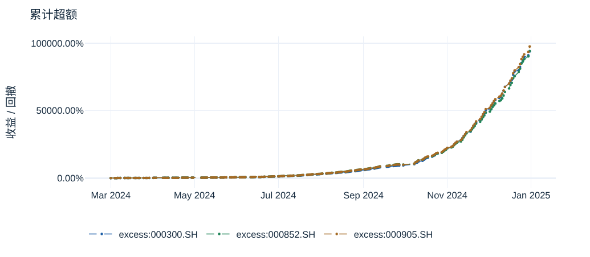

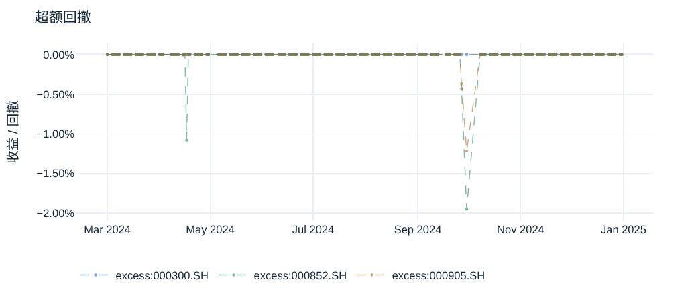

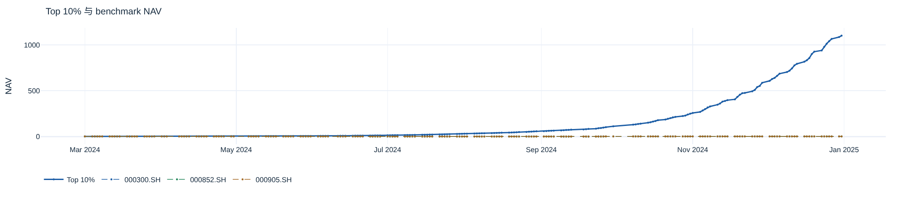

Benchmark 使用预测日前最近一期指数权重与交付的 stock1d 日收益, 按匹配权重归一化. 日期与覆盖率见上表.

Top 10% 策略仅日内持仓并在收盘前清仓, benchmark 是整日收益; 两者暴露时段不同, 超额仅按约定统计口径比较.

### 时间与环境稳健性

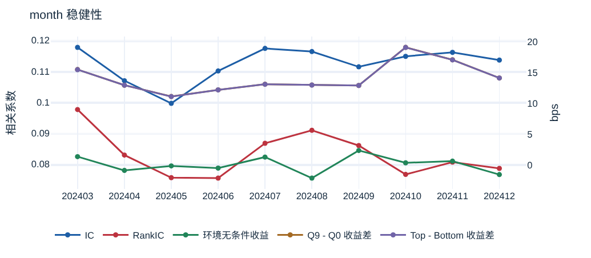

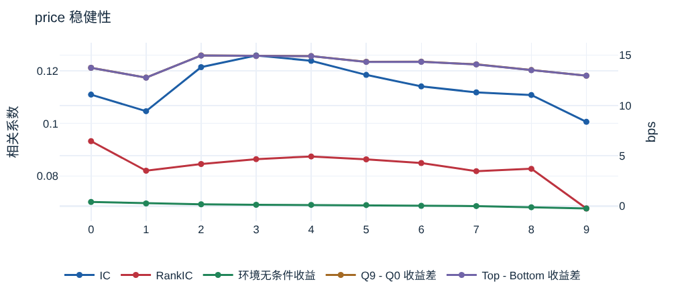

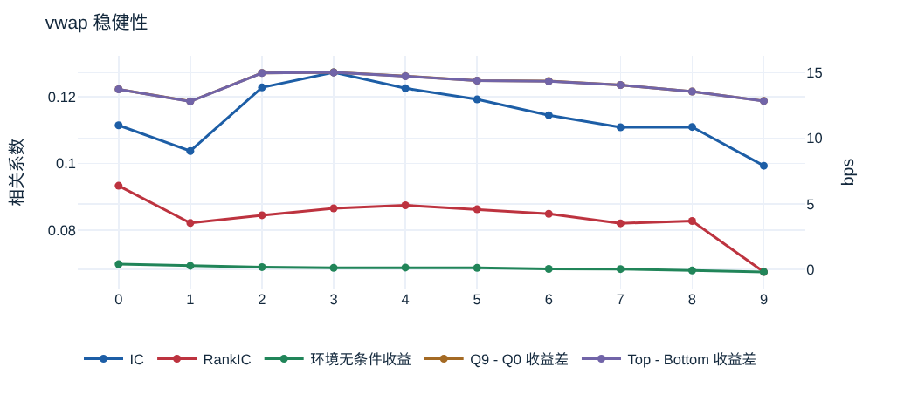

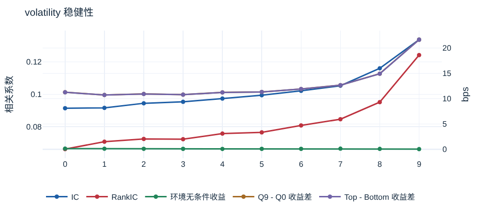

**完整环境分桶结果**

| 环境变量 | 分桶 | 样本数 | IC | RankIC | 环境无条件收益 / bps | Q9 未来收益 / bps | Q0 未来收益 / bps | Q9 - Q0 收益差 / bps | Top 10% 未来收益 / bps | Bottom 10% 未来收益 / bps | Top - Bottom 收益差 / bps |
| --- | --- | --- | --- | --- | --- | --- | --- | --- | --- | --- | --- |
| month | 202403 | 17,980,931 | 0.118 | 0.0976 | 1.39 | 8.38 | -7.10 | 15.5 | 8.37 | -7.10 | 15.5 |
| month | 202404 | 17,159,454 | 0.107 | 0.0830 | -0.843 | 4.82 | -8.13 | 13.0 | 4.81 | -8.13 | 12.9 |
| month | 202405 | 17,122,805 | 0.0997 | 0.0757 | -0.108 | 5.25 | -5.86 | 11.1 | 5.25 | -5.86 | 11.1 |
| month | 202406 | 16,290,501 | 0.110 | 0.0755 | -0.462 | 5.58 | -6.61 | 12.2 | 5.58 | -6.61 | 12.2 |
| month | 202407 | 19,703,108 | 0.117 | 0.0868 | 1.32 | 7.57 | -5.53 | 13.1 | 7.56 | -5.53 | 13.1 |
| month | 202408 | 18,838,625 | 0.116 | 0.0909 | -2.08 | 4.21 | -8.77 | 13.0 | 4.20 | -8.77 | 13.0 |
| month | 202409 | 16,261,724 | 0.111 | 0.0860 | 2.39 | 8.34 | -4.56 | 12.9 | 8.34 | -4.56 | 12.9 |
| month | 202410 | 15,411,242 | 0.115 | 0.0767 | 0.393 | 9.05 | -10.0 | 19.1 | 9.04 | -10.0 | 19.1 |
| month | 202411 | 17,989,335 | 0.116 | 0.0807 | 0.659 | 8.85 | -8.20 | 17.1 | 8.84 | -8.20 | 17.0 |
| month | 202412 | 18,888,037 | 0.114 | 0.0787 | -1.51 | 4.38 | -9.73 | 14.1 | 4.38 | -9.73 | 14.1 |
| price | 0 | 17,578,582 | 0.111 | 0.0932 | 0.416 | 6.58 | -7.17 | 13.7 | 6.57 | -7.17 | 13.7 |
| price | 1 | 17,563,425 | 0.105 | 0.0820 | 0.266 | 6.05 | -6.72 | 12.8 | 6.04 | -6.72 | 12.8 |
| price | 2 | 17,566,145 | 0.121 | 0.0845 | 0.180 | 6.97 | -8.00 | 15.0 | 6.96 | -8.00 | 15.0 |
| price | 3 | 17,563,071 | 0.126 | 0.0864 | 0.136 | 6.99 | -7.93 | 14.9 | 6.98 | -7.93 | 14.9 |
| price | 4 | 17,559,890 | 0.124 | 0.0874 | 0.120 | 7.07 | -7.83 | 14.9 | 7.06 | -7.83 | 14.9 |
| price | 5 | 17,569,459 | 0.118 | 0.0863 | 0.108 | 6.90 | -7.44 | 14.3 | 6.89 | -7.44 | 14.3 |
| price | 6 | 17,565,649 | 0.114 | 0.0849 | 0.0324 | 6.80 | -7.54 | 14.3 | 6.79 | -7.54 | 14.3 |
| price | 7 | 17,563,567 | 0.112 | 0.0818 | 0.00714 | 6.76 | -7.33 | 14.1 | 6.75 | -7.33 | 14.1 |
| price | 8 | 17,566,003 | 0.111 | 0.0827 | -0.111 | 6.23 | -7.29 | 13.5 | 6.22 | -7.29 | 13.5 |
| price | 9 | 17,549,971 | 0.101 | 0.0676 | -0.234 | 5.51 | -7.45 | 13.0 | 5.50 | -7.45 | 13.0 |
| vwap | 0 | 17,578,582 | 0.111 | 0.0933 | 0.387 | 6.54 | -7.20 | 13.7 | 6.53 | -7.20 | 13.7 |
| vwap | 1 | 17,563,425 | 0.104 | 0.0821 | 0.268 | 6.09 | -6.73 | 12.8 | 6.08 | -6.73 | 12.8 |
| vwap | 2 | 17,566,145 | 0.123 | 0.0844 | 0.167 | 6.94 | -8.05 | 15.0 | 6.93 | -8.05 | 15.0 |
| vwap | 3 | 17,563,071 | 0.127 | 0.0865 | 0.112 | 6.96 | -8.07 | 15.0 | 6.95 | -8.07 | 15.0 |
| vwap | 4 | 17,559,890 | 0.123 | 0.0874 | 0.135 | 7.03 | -7.72 | 14.7 | 7.02 | -7.72 | 14.7 |
| vwap | 5 | 17,569,459 | 0.119 | 0.0862 | 0.107 | 6.96 | -7.45 | 14.4 | 6.95 | -7.45 | 14.4 |
| vwap | 6 | 17,565,649 | 0.114 | 0.0849 | 0.0277 | 6.78 | -7.59 | 14.4 | 6.77 | -7.59 | 14.4 |
| vwap | 7 | 17,563,567 | 0.111 | 0.0820 | 0.0164 | 6.75 | -7.31 | 14.1 | 6.75 | -7.31 | 14.1 |
| vwap | 8 | 17,566,003 | 0.111 | 0.0827 | -0.0941 | 6.31 | -7.26 | 13.6 | 6.31 | -7.26 | 13.6 |
| vwap | 9 | 17,549,971 | 0.0993 | 0.0674 | -0.206 | 5.53 | -7.31 | 12.8 | 5.53 | -7.31 | 12.8 |
| volatility | 0 | 17,496,452 | 0.0914 | 0.0662 | 0.132 | 5.58 | -5.69 | 11.3 | 5.58 | -5.69 | 11.3 |
| volatility | 1 | 17,480,861 | 0.0916 | 0.0708 | 0.123 | 5.12 | -5.61 | 10.7 | 5.11 | -5.61 | 10.7 |
| volatility | 2 | 17,483,250 | 0.0944 | 0.0725 | 0.0999 | 5.25 | -5.69 | 10.9 | 5.24 | -5.69 | 10.9 |
| volatility | 3 | 17,480,950 | 0.0954 | 0.0723 | 0.0906 | 5.08 | -5.72 | 10.8 | 5.07 | -5.72 | 10.8 |
| volatility | 4 | 17,476,811 | 0.0973 | 0.0758 | 0.0730 | 5.28 | -5.97 | 11.2 | 5.27 | -5.97 | 11.2 |
| volatility | 5 | 17,486,410 | 0.0994 | 0.0765 | 0.0898 | 5.38 | -5.94 | 11.3 | 5.38 | -5.94 | 11.3 |
| volatility | 6 | 17,483,554 | 0.102 | 0.0808 | 0.0891 | 5.71 | -6.21 | 11.9 | 5.70 | -6.21 | 11.9 |
| volatility | 7 | 17,480,646 | 0.105 | 0.0846 | 0.126 | 6.12 | -6.55 | 12.7 | 6.11 | -6.55 | 12.7 |
| volatility | 8 | 17,483,465 | 0.116 | 0.0952 | 0.0774 | 6.97 | -7.97 | 14.9 | 6.96 | -7.97 | 14.9 |
| volatility | 9 | 17,466,630 | 0.134 | 0.124 | 0.0383 | 10.0 | -11.7 | 21.7 | 10.0 | -11.7 | 21.7 |

**Top 10% 策略环境归因**

**环境归因汇总**

| 环境变量 | 分桶 | 有效日 | 日均收益贡献 | 日均换手 | 累计 Gross PnL | 累计换手 | Ledger 行数 |
| --- | --- | --- | --- | --- | --- | --- | --- |
| month | 202403 | 21 | 3.82% | 6167.04% | 0.803 | 129507.85% | 2,594,641 |
| month | 202404 | 20 | 2.96% | 5995.78% | 0.592 | 119915.69% | 2,457,544 |
| month | 202405 | 20 | 2.75% | 5846.55% | 0.550 | 116931.05% | 2,436,805 |
| month | 202406 | 19 | 3.33% | 6080.26% | 0.633 | 115525.01% | 2,341,911 |
| month | 202407 | 23 | 3.83% | 6277.96% | 0.880 | 144393.11% | 2,855,553 |
| month | 202408 | 22 | 3.02% | 6145.23% | 0.664 | 135195.02% | 2,714,934 |
| month | 202409 | 19 | 3.61% | 6250.91% | 0.685 | 118767.20% | 2,355,107 |
| month | 202410 | 18 | 4.59% | 6064.70% | 0.826 | 109164.66% | 2,213,188 |
| month | 202411 | 21 | 4.16% | 5946.30% | 0.874 | 124872.24% | 2,570,384 |
| month | 202412 | 22 | 2.90% | 5927.29% | 0.639 | 130400.31% | 2,697,032 |
| price | 0 | 205 | 0.66% | 1086.98% | 1.36 | 222831.81% | 4,165,429 |
| price | 1 | 205 | 0.26% | 605.99% | 0.542 | 124228.17% | 2,324,686 |
| price | 2 | 205 | 0.28% | 535.86% | 0.576 | 109850.92% | 2,246,119 |
| price | 3 | 205 | 0.30% | 533.21% | 0.617 | 109307.18% | 2,309,767 |
| price | 4 | 205 | 0.34% | 554.97% | 0.692 | 113769.76% | 2,438,784 |
| price | 5 | 205 | 0.35% | 572.13% | 0.710 | 117287.02% | 2,480,288 |
| price | 6 | 205 | 0.34% | 571.67% | 0.704 | 117191.35% | 2,440,933 |
| price | 7 | 205 | 0.34% | 560.96% | 0.694 | 114996.59% | 2,378,983 |
| price | 8 | 205 | 0.34% | 574.07% | 0.700 | 117685.33% | 2,432,806 |
| price | 9 | 205 | 0.27% | 475.73% | 0.553 | 97524.02% | 2,019,304 |
| volatility | -1 | 205 | 0.06% | 47.38% | 0.115 | 9713.35% | 230,316 |
| volatility | 0 | 205 | 0.17% | 384.53% | 0.339 | 78828.64% | 1,470,041 |
| volatility | 1 | 205 | 0.20% | 471.21% | 0.403 | 96598.61% | 1,772,675 |
| volatility | 2 | 205 | 0.22% | 502.39% | 0.446 | 102990.02% | 1,914,310 |
| volatility | 3 | 205 | 0.23% | 522.99% | 0.473 | 107212.81% | 2,019,264 |
| volatility | 4 | 205 | 0.25% | 548.61% | 0.515 | 112465.17% | 2,164,486 |
| volatility | 5 | 205 | 0.28% | 576.20% | 0.566 | 118121.30% | 2,295,150 |
| volatility | 6 | 205 | 0.31% | 607.56% | 0.626 | 124549.26% | 2,468,244 |
| volatility | 7 | 205 | 0.36% | 663.09% | 0.742 | 135933.94% | 2,779,484 |
| volatility | 8 | 205 | 0.48% | 757.63% | 0.992 | 155314.98% | 3,338,908 |
| volatility | 9 | 205 | 0.94% | 989.97% | 1.93 | 202944.05% | 4,784,221 |
| vwap | 0 | 205 | 0.66% | 1084.13% | 1.35 | 222247.00% | 4,150,072 |
| vwap | 1 | 205 | 0.26% | 606.21% | 0.540 | 124272.94% | 2,320,381 |
| vwap | 2 | 205 | 0.28% | 535.45% | 0.574 | 109767.08% | 2,243,279 |
| vwap | 3 | 205 | 0.30% | 533.27% | 0.611 | 109319.46% | 2,309,021 |
| vwap | 4 | 205 | 0.34% | 554.71% | 0.690 | 113716.22% | 2,435,909 |
| vwap | 5 | 205 | 0.35% | 572.22% | 0.715 | 117305.48% | 2,480,362 |
| vwap | 6 | 205 | 0.34% | 572.02% | 0.700 | 117264.53% | 2,445,408 |
| vwap | 7 | 205 | 0.34% | 562.35% | 0.702 | 115280.84% | 2,386,997 |
| vwap | 8 | 205 | 0.34% | 574.91% | 0.705 | 117855.73% | 2,440,430 |
| vwap | 9 | 205 | 0.27% | 476.31% | 0.559 | 97642.85% | 2,025,240 |

各 bucket 贡献来自同一条 Top 10% 等权多头策略的逐股 ledger. gross PnL 与收益贡献以每日初始资金 1 归一; 换手不含首次建仓. 各 context 的 bucket 贡献逐日合计等于该策略的日收益与换手. bucket -1 表示该时点缺少可用 context; 这些 bucket 不是独立资金组合.

### 10min 调仓诊断对照

| 策略 | 1min 有效日 | 1min 日均收益 | 1min 日均换手 | 10min 有效日 | 10min 日均收益 | 10min 日均换手 |
| --- | --- | --- | --- | --- | --- | --- |
| G0 | 205 | -3.23% | 6075.05% | 205 | -1.14% | 1101.47% |
| G1 | 205 | -0.87% | 10658.68% | 205 | -0.22% | 1338.69% |
| G2 | 205 | -0.47% | 12266.33% | 205 | -0.11% | 1377.00% |
| G3 | 205 | -0.21% | 12940.60% | 205 | -0.05% | 1385.79% |
| G4 | 205 | -0.02% | 13199.68% | 205 | -0.00% | 1386.17% |
| G5 | 205 | 0.18% | 13205.65% | 205 | 0.05% | 1385.26% |
| G6 | 205 | 0.38% | 12970.41% | 205 | 0.10% | 1383.93% |
| G7 | 205 | 0.67% | 12365.33% | 205 | 0.16% | 1377.77% |
| G8 | 205 | 1.13% | 10870.98% | 205 | 0.28% | 1344.35% |
| G9 | 205 | 3.49% | 6072.38% | 205 | 0.95% | 1092.19% |
| Long-short | 205 | 3.36% | — | 205 | 1.04% | — |

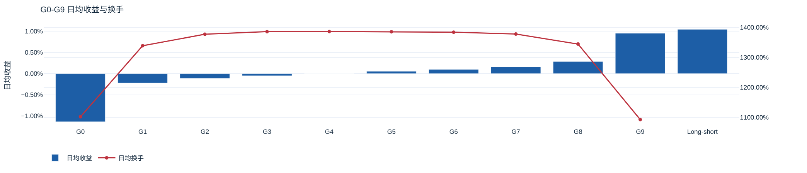

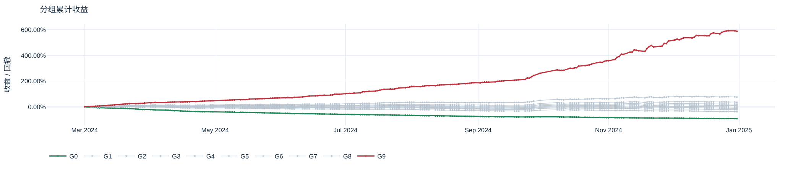

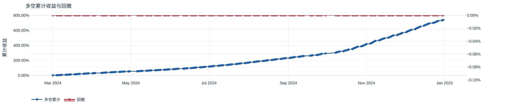

旧 10min 非重叠满额复利口径, 与 1min gross 对照分开计算; 仅作为诊断对照. 与成本策略在同一次 evaluation 中计算.

## 限制与适用边界

分钟 `Vol > 0` 不保证可按 Close 成交. 未模拟 A 股 T+1、整手、涨跌停或真实排队成交. 调整因子只是公司行动收益的近似, 不等于逐项分红和股份登记. 期末无成交持仓按末次有成交的调整后价格估值, 其金额未验证可回收性.

### 限制与执行假设

Top 1% 组合已扣假设佣金、过户费、印花税与滑点; 旧 Top 10% 和 10min 组合仍为 gross 对照. 同日买卖可能违反 A 股 T+1, 净值仅为成本诊断.

## 结论

### 研究结论

主 horizon 10min: 日均 IC 0.113, RankIC 0.0834; 有效 OOS 日 205, coverage 94.12%.

Horizon 从 5min 到 30min: IC 0.109 → 0.0974, RankIC 0.0802 → 0.0742.

Q0 / Q9 实际收益为 -7.45 / 6.60 bps; 完整分组关系见 Q 表.

G0 / G9 日均收益 -3.23% / 3.49%, 日均换手 6075.05% / 6072.38%.

旧 gross 对照 Top 10%: 日均 gross 收益 3.49%, 日均换手 6071.57%, 期末 NAV 1,101.

Top 1% 成本诊断: 万一免五、0 bps 假设滑点下期末 NAV 5.82, 累计成本 9.71; 期末无成交持仓 11 只, 末次成交价估值 0.207 个初始资金单位, 占 NAV 3.55%; 受阻卖出 47,764 个 stock-date. 该估值未验证可回收性; 其余假设见成本情景表.

Development → OOS: IC 0.102 → 0.113, RankIC 0.0778 → 0.0834.

month 首/末桶 IC 0.118 / 0.114, 环境无条件收益 1.39 / -1.51 bps; Q9-Q0 收益差 15.5 / 14.1 bps.

price 首/末桶 IC 0.111 / 0.101, 环境无条件收益 0.416 / -0.234 bps; Q9-Q0 收益差 13.7 / 13.0 bps.

vwap 首/末桶 IC 0.111 / 0.0993, 环境无条件收益 0.387 / -0.206 bps; Q9-Q0 收益差 13.7 / 12.8 bps.

volatility 首/末桶 IC 0.0914 / 0.134, 环境无条件收益 0.132 / 0.0383 bps; Q9-Q0 收益差 11.3 / 21.7 bps.

Top 5% 实际收益 9.63 bps, 正收益比例 45.84%.

Top 10% 实际收益 6.60 bps, 正收益比例 44.03%.

Top 1% 净收益相对 000300.SH: 日均超额 0.79%, 累计超额 389.93%, 最大回撤 -15.88%.

Top 1% 净收益相对 000852.SH: 日均超额 0.79%, 累计超额 389.90%, 最大回撤 -18.93%.

Top 1% 净收益相对 000905.SH: 日均超额 0.81%, 累计超额 408.19%, 最大回撤 -18.24%.

## 附录

正式 EvaluationArtifact ID: `2d8038201c2e4e10e14fb29839d7f912fedb6246c1f6a6574a51d4c7a8db15fc`. 源报告 SHA-256: `2fd1ef24dc0c2fede099b403596ef60145b41db96623c62c25f97b40226df5b9`. 本内容包从该已验证报告整理; 图表为对应 Plotly 图的浏览器渲染快照.

### 生效评估配置与指标口径

**公共指标定义**

```text
---
intention: 为 factor 和 experiment 报告提供唯一的指标定义.
---

# 样本、尺度与覆盖

最终研究结果使用 OOS/test, development 用于训练诊断和泛化比较. 不用 OOS 选择 checkpoint、预测方向或模型版本.

样本键为 StockCode、Date、MinuteIndex; 日期、bar end 和 entry lag 继承 prediction artifact. 每个 horizon 独立选择有效 prediction/target 样本, 不用最长 horizon 的有效性裁剪全部 horizon.

target 和收益型 prediction 的原始尺度为 log return. IC 和 variance ratio 在该尺度计算; bps、组合收益和复利使用 simple return = expm1(log return). 任意因子的 variance ratio 仅是尺度诊断, 不宣称收益预测误差.

coverage = 有效 prediction 与相应 target 的样本数 / 契约声明的理论可评估样本数. 缺少分母时不得用已过滤后的样本数替代.

# IC

逐 prediction timestamp 计算截面 Pearson IC 和 Spearman RankIC, 再在每天等权平均有效时点, 最后对有效 OOS 日等权统计. pooled correlation 将全部有效样本合并计算一次, 与 Mean Daily IC 分开显示.

主 horizon 的 daily IC/RankIC 逐日覆盖已发布 PredictionArtifact 的 train、validation、test 日期. train 使用冻结的 selected checkpoint, 仅作为 in-sample diagnostic. 累计曲线按日期对有效 daily IC/RankIC 求和; 缺失的日值不补零. split 边界按输入契约的日期定义, 不参与 checkpoint selection.

- Mean Daily IC / Mean Daily RankIC: 对应日度序列均值.
- Pooled IC / Pooled RankIC: 将对应 split/horizon 的全部有效 stock × timestamp 样本合并后, 分别计算一次 Pearson / Spearman correlation.
- ICIR: 日度 IC 均值 / 日度 IC 样本标准差.
- RankICIR: 日度 RankIC 均值 / 日度 RankIC 样本标准差.
- 对应 t-statistic: 日度序列均值 / 标准误, 样本标准差采用 ddof=1.
- prediction / target variance ratio: 有效 OOS 样本的 prediction 样本方差 / target 样本方差.

无法定义 correlation 或标准差的样本组不产生有限指标, 记录有效时点/日数. horizons 取自 prediction artifact 的 feature contract, 不在报告中重建 label.

# 样本分组

Top 1%、Top/Bottom 5%/10% 与 Q0-Q9 的 quantile scope、ties 和截尾策略由 evaluation config 显式给出. Q0 最低, Q9 最高; 同一套分组结果被所有图表复用.

Baseline 在每个 timestamp 按 prediction、StockCode 升序稳定排序. Top/Bottom 的样本数为 ceil(n × fraction); Q 编号为 floor(升序零起点位置 × 10 / n). Spearman correlation 使用 average rank, 不沿用成员分组的 StockCode tie-break.

`hit_rate` 是相对同 prediction timestamp 全部可评估样本 target 中位数的比例:

- Top、Q5-Q9: target 严格高于中位数.
- Bottom、Q0-Q4: target 严格低于中位数.
- 所有样本行使用对应高/低半组条件后汇总; 等于中位数计为未命中.

Top 组的展示名为“中位数超越率”.

top5_positive_rate / top10_positive_rate 是对应 Top 组 target > 0 的比例, 与上述指标分开命名.

Average Future Return = 分组 simple target return 均值, 展示为均值 × 10000 bps. top5_prediction_return_bps / top10_prediction_return_bps 沿用这一实际收益含义, 不是 prediction 的平均值.

# Executive Summary

首页只展示主 horizon 的 OOS/test 结果. `summary.feather` 是 machine-readable summary, 逐字段投影自同一 EvaluationArtifact 的 `ic.feather` 和 `groups.feather`; HTML renderer 只格式化这些已保存值, 不重新计算指标.

- `mean_daily_ic`、`mean_daily_rank_ic`、`pooled_ic`、`pooled_rank_ic`、`coverage`、`valid_oos_days`: 来自主 horizon 的 test IC row.
- `top1_above_median_rate`、`top10_above_median_rate`: 分别来自主 horizon test `Top 1%`、`Top 10%` row 的 `hit_rate`.
- `top10_positive_rate`: 来自同一 Top 10% row 的 `positive_rate`, 即 realized future return > 0 的样本比例.
- `top10_average_future_return_bps`: 来自同一 Top 10% row 的 `return_bps`.

# 日内组合

G0-G9 按显式 rebalance timestamp 的 prediction 截面等数量分组并等权持有. entry 延迟和退出时点必须来自配置; 用交付的 Close 路径计算实际持有区间的 simple return, 不直接替换为主训练 label.

仅纳入退出分钟不超过 240 的日内交易, 不跨日持有. 分组不依据未来 entry/exit 价格是否缺失重新选成员. 任一成员执行收益缺失, 该组 period return 及当日 daily return 均缺失; NAV 仅在有效 daily return 上连乘, 缺失日不绘制 NAV 点.

日内收益按配置声明的资金分配与聚合规则形成 daily return. 重叠持有区间必须声明资金分配, 不将其作为全额连续交易直接复利. 配置未给出的调仓或聚合规则没有默认值.

正式 1min 策略使用 `capital=full_rebalance`, `rebalance_minutes=1`, `holding_minutes=1`. 每分钟根据当时 prediction 截面重新确定 G0-G9、Top/Bottom 5%/10% 的等权目标. `Top 10%` 等权多头是报告主策略, 其 daily return 复利形成总策略 NAV; Top 5% 与 G0-G9 独立展示. 每条策略各自是单位资金的假设组合, 不把所有策略同时合并投资. 预测与训练 target 仍为 10min; 执行在 prediction 后 `entry_lag_minutes=1` 的 Close, 当前目标在下一分钟 Close 盯市并退出或调整. 因允许提前退出, 实际持有 1min, 不存在十个重叠的全额资金仓位. 同一策略在当前执行价的调仓前权重, 由上一区间目标权重按该区间价格收益漂移并归一化; `delta_weight=target_weight-previous_weight`. 每只股票的 `turnover=abs(delta_weight)/2`; `trade_amount=abs(delta_weight) × capital_before`, 其中每日初始资金归一为 1. 首次建仓记录交易额, 但不纳入平均换手. 最后一笔持仓在估值分钟执行日终 liquidation, 交易额与换手入账, 无新增持仓收益. 持仓的 `gross_pnl=target_weight × position_return × capital_before`; period return 为所有持仓的权重收益之和, daily return 对分钟 period 复利. 缺失任何持仓执行价格时该 period 与整日组合收益缺失, 不改选成员或填零.

10min 诊断使用 `capital=sequential_full`, `rebalance_minutes=holding_minutes=10`, 与 1min 主策略保持不同交易/资金规则. 新主 evaluation 在同一 Artifact 内以 diagnostic_* 表保存该诊断, 不要求单独发布 Artifact; 独立 10min 调用和历史双 Artifact 结果仍保留各自原身份. 不把两条收益曲线混为同一组合.

group_mean_ret 为各组有效 OOS daily return 算术均值. 每次 turnover 为相邻调仓组合权重差的一半绝对值和, 按日求和后取有效日均值; 首次建仓不计入均值.

longshort_ret = 0.5 × G9 daily return - 0.5 × G0 daily return. G0 做空腿分布使用 -G0 period return; G9 做多腿使用 G9 period return. 两腿的正负收益均完整展示.

NAV 从 1 开始, NAV_t = product(1 + daily_return). 累计收益 = NAV - 1. drawdown = NAV / 历史最高 NAV - 1, 历史最高值包含初始 NAV=1.

# Benchmark 与超额

benchmark_return 直接使用 prediction artifact 交付的日收益. 构造来源、权重日期、匹配覆盖率随输入交付, evaluation 不读取指数权重和 stock1d 重算.

正式 1min Top 10% 策略仅日内持仓并清仓, 而 benchmark 是 stock1d 整日收益; 两者暴露时段不同. 超额统计只按下列已定义日收益差计算, 不代表相同持仓时段或可实现收益的比较.

在组合和 benchmark 同时有效的日期:

- 正式 1min 报告: excess_ret = Top 10% daily return - benchmark_return.
- 旧 10min 诊断: excess_ret = G9 daily return - benchmark_return.
- 日均超额 = mean(excess_ret).
- 年化超额收益率（线性） = 日均超额 × 252.
- 超额胜率 = mean(excess_ret > 0).
- 超额累计 = product(1 + excess_ret) - 1.
- 超额 Sharpe = mean(excess_ret) / std(excess_ret, ddof=1) × sqrt(252).
- 超额回撤在相应累计超额 NAV 上计算.

# Top 1% 持仓与成本诊断

启用 `cost_diagnostic=top1_membership_waive_minimum` 时, 每个 prediction minute 用全部有限 prediction 降序、StockCode 升序取 `ceil(n × 1%)` 只. 在下一分钟仅当存在该分钟行情且 `Vol > 0` 时按 Close 先全卖退出成员, 留存成员股数不变, 再按排名为未持有成员各买入固定金额 `A`. 无分钟行或零成交时延后卖出、跳过买入; 现金不足支付整笔及费用时停止该分钟后续买入. 持仓跨日; test 终点只估值, 不清仓.

初始资金为 1, `A = 1 / [首分钟入选数 × (1 + 6.1 / 10000)]`, 四个情景共用. `A` 是未加滑点的 Close 名义金额. 买入基准股数为 `A / Close`; 实际买入价为 `Close × (1 + s)`, 卖出价为 `Close × (1 - s)`, `s` 为假设单边滑点 0/1/3/5 bps. 佣金双边各 1 bp, 假设免 5 元最低额并已含交易规费; 过户费双边各 0.1 bp; 印花税卖出 5 bps. 费用按加滑点后的实际成交额计. 现金逐笔扣费, 不透支.

有成交时持仓估值使用 `Close × 当日 adj_factor` 的 total-return proxy, 以固定调整后单位跨日结转. 无成交时沿用上一次有成交的调整后价格; 期末仍无成交的持仓也按该价格估值, 不表示可回收金额. `cost_daily.blocked_exits` 按每个情景每日受阻卖出的不同股票计数, `stale_positions` 是日末无当日成交的持仓数, `stale_value` 是这些仓位按末次成交价计算的估值. 期末 `terminal_stale_nav_share = terminal_stale_value / terminal_nav`. `cost_daily.return = NAV_t / NAV_{t-1} - 1`; `cost_excess.annual_excess = mean(cost_daily.return - benchmark_return) × 252`. 成本情景超额的累计、胜率、回撤和 Sharpe 沿用上文相同日收益差公式, benchmark NAV 在匹配日收益上复利. 调整因子不等于逐项现金分红和股份登记模拟. 未模拟 T+1、整手和涨跌停的实际可成交性; `Vol > 0` 也不保证能按 Close 成交, 该结果只作成本敏感性诊断.

# 稳健性与分布

时间按连续月份分组. price/VWAP/volatility 默认在每个 prediction timestamp 内按截面 quantile 分桶, 使用交付的 context; 窗口和可得时点来自输入契约. 不以当日收盘后的信息回填盘中环境.

每桶按同一 IC 规则计算 IC/RankIC. 环境无条件收益为桶内所有样本的 simple future return 均值. 模型条件收益先在完整 prediction timestamp 截面按 prediction 确定 Q0-Q9 和 Top/Bottom 10% membership, 再与环境桶相交计算对应收益与 spread. spread 是两个成员组收益均值之差. 不换成不相关的 stock1d 当日收益, 也不将无条件收益称为组合收益.

正式 1min 报告另对既有 Top 10% 策略的逐股 ledger 做环境归因, 不为 bucket 建立独立资金组合. month 取交易月份; price、VWAP、volatility 在当时完整且 context 有限的 stock 截面按数值、StockCode 稳定分成 10 桶. 使用 prediction minute 的 context; liquidation 沿用最后持仓分钟. context 缺失归入 bucket -1, 不丢弃 PnL 或换手. 每桶的 gross PnL 除以每日初始资金 1, 即该桶对既有策略 daily return 的贡献; 首次建仓不计入换手. 每个 context 的各桶 daily gross PnL 和 turnover 必须分别合计为 Top 10% 策略当日 return 和 turnover. 汇总表展示各桶有效日平均贡献、平均换手与期间合计, 不是各桶可投资 NAV.

分布图及 Mean/Median/Std/偏度/峰度使用同一份 transformation 后样本. normalization/winsorization 仅作用于配置指定的展示或统计范围, 不改变预测方向和既有分组口径.

# Metadata

报告保留 source_experiment_ids, experiment/run/checkpoint 身份, prediction artifact 身份, evaluation config, evaluation 代码版本, split/样本范围, horizon/entry lag, quantile/ties, normalization/winsorization, rebalance/持有/资金分配/日收益聚合和 benchmark 定义.

身份、参数和数值事实各保存一次; summary、table、figure 和解释只读取统一结果. 不在 HTML 生成阶段重新计算指标.

## 数据不足与缺失结果

空 OOS 时继续保存结果表和报告: 有效样本与天数计数为零, 未定义统计保留 NaN, 不生成虚构 NAV. 无合格调仓时, 组合收益、换手和超额保持缺失, 但已具备输入的样本 IC、分组和分布仍按各自口径计算. 首页与结论明确标注对应的数据不足原因, 不将缺失结果解释为零收益或无预测能力.
```

**生效 evaluation 配置**

```text
cost_diagnostic: top1_membership_waive_minimum
diagnostic_portfolio:
  capital: sequential_full
  costs: none
  daily_aggregation: compound
  entry_lag_minutes: 1
  holding_minutes: 10
  rebalance_minutes: 10
  rebalance_offset: 0
grouping:
  buckets: 10
  scope: timestamp
  ties: stock_code
  winsorization: none
main_strategy: Top 10%
portfolio:
  capital: full_rebalance
  costs: none
  daily_aggregation: compound
  entry_lag_minutes: 1
  holding_minutes: 1
  rebalance_minutes: 1
  rebalance_offset: 0
report_kind: experiment
study_experiment_id: top1-membership-cost
```

### 交付要求状态

本 artifact 未记录独立 review 结论. 发布前的展示验收状态由实验记录维护.
