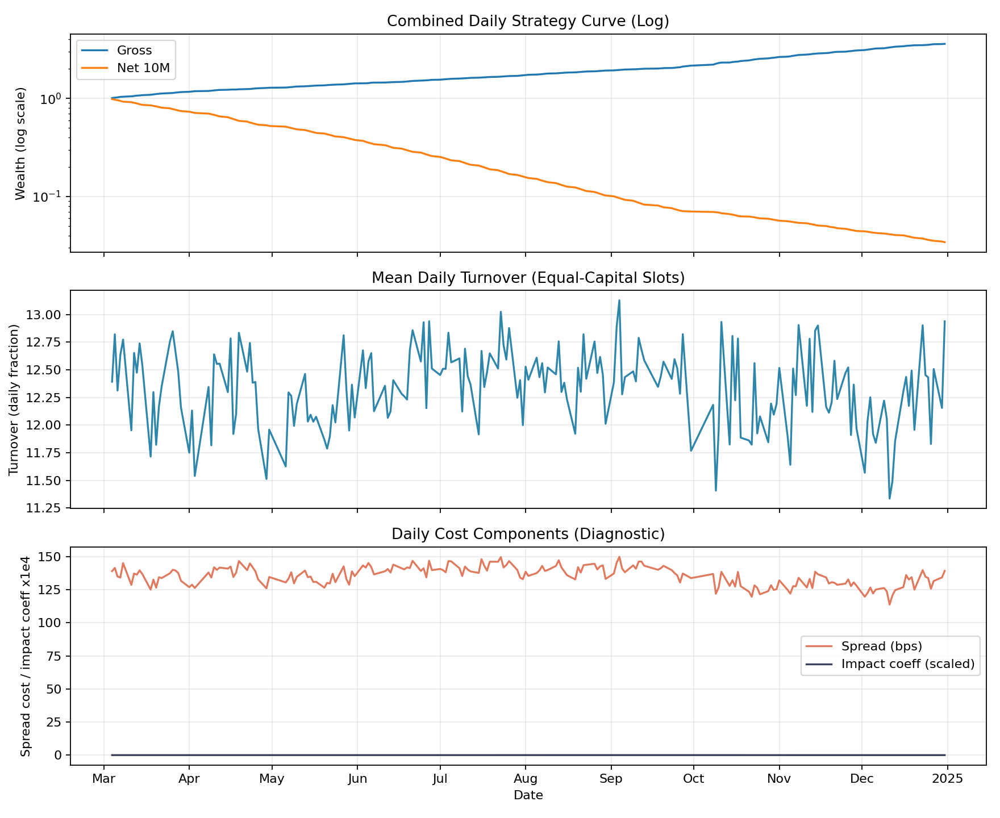
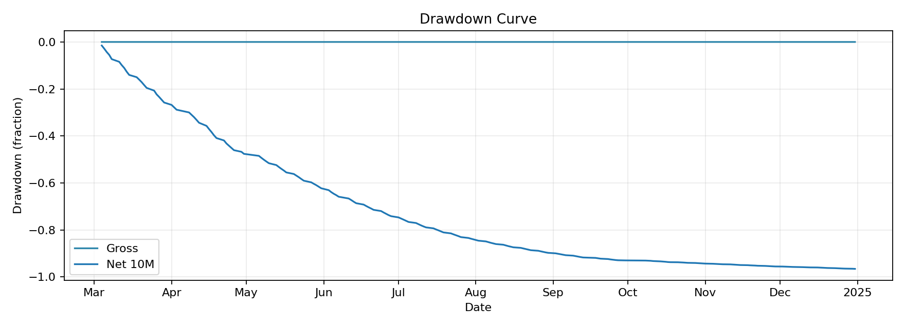
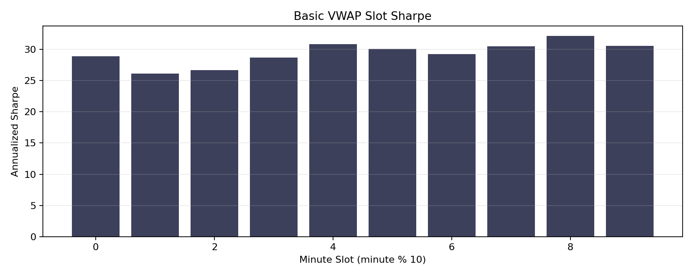
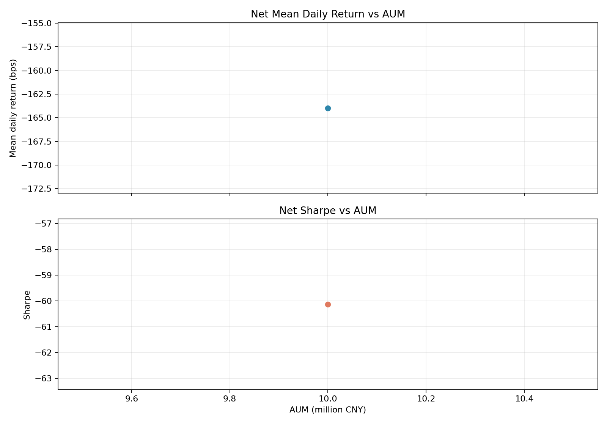

## 摘要

**历史结果: 历史成功.** 36D单臂完成全链路, iter6762覆盖176134322行test. Gross累计收益260.18%, 10M net累计收益−96.58%. 无 matched旧特征control, 中央结果未记录pooled IC scalar.

历史成功/失败按实验流程是否成功完成判断. 无增益, 成本后亏损, 归档和当前 artifact 缺失不改变历史成功事实. 失败的实验臂保留失败原因, 不填造未产生的 OOS 指标. 本次只整理已有材料, 未启动训练, 推理或回测.

## 研究背景与目标

本报告围绕36D feature-set evaluation整理原始研究证据. 当前材料对应 registry report `0825-feature-audit-portfolio-report-0827`, 来源SHA256为 `6e1166f857dcb594b14249352ba6fecbfc8f99f2e729f6e8826af0e2e0fa9e70`. 原报告的实验方法, 图表, 结果和解释保留在下文.

## 数据与方法

实验身份为 `0825-feature-audit`. Split, label, sampler, feature与checkpoint定义按原报告记录, 不从其他实验借用缺失字段. 汇总入口见[全实验综述](../../prediction-nn-1min/1103-nn-registry-summary/).

## 主要结果

| 记录项 | 当前解释 |
| --- | --- |
| 实验 | 0825-feature-audit |
| 报告类型 | portfolio_backtest_html |
| 历史状态 | 历史成功 |
| 证据 | 0825-feature-audit-portfolio-report-0827 |

Current conclusion

组合结论以 net return, drawdown, turnover, fill ratio 与容量假设共同判断; 信号 IC 不由本报告重复定义. 

01

Decision snapshot

### 成本后结果

首个 AUM 情景是 headline, 不代表容量上限; 完整敏感性见下方表格和图. 

Net daily return

-1.6396%

AUM 10M CNY

Net Sharpe

-60.135

rf=0, ddof=1, sqrt(252)

Max drawdown

-96.58%

NAV starts at 1

Mean fill ratio

94.05%

execution diagnostic

Daily turnover

12.3347

equal-capital slots

Impact eta

0.50

square-root proxy

02

Return evidence

### Gross 与 net 情景

未定义的 Sharpe 或年化收益显示为 —, 不会以 nan 或无穷大制造可比性. 

| Return type | Mean daily | Annualized | Sharpe | Max drawdown |
| --- | --- | --- | --- | --- |
| Gross | 0.6307% | 386.93% | 30.339 | -0.01% |
| Net 10M | -1.6396% | -98.45% | -60.135 | -96.58% |

| Impact budget | Estimated AUM |
| --- | --- |
| 10bps | 0.12M |
| 20bps | 0.48M |

03

Execution diagnostics

### 曲线与容量

图像内联为 base64; 报告移动后仍保留全部证据. 

### Strategy curves

### Drawdown

### Slot Sharpe

### Capacity sweep

## 限制与适用边界

36D单臂完成全链路, iter6762覆盖176134322行test. Gross累计收益260.18%, 10M net累计收益−96.58%. 无 matched旧特征control, 中央结果未记录pooled IC scalar. 当前artifact可得性只影响复现, 不作为历史成功/失败判据. 只有matched合同内的结果可以直接比较.

## 结论

本次归档保留上述历史事实. 研究结论, 推广门槛和执行限制分别解释, 不把模型无增益或净收益为负改写成实验流程失败.
