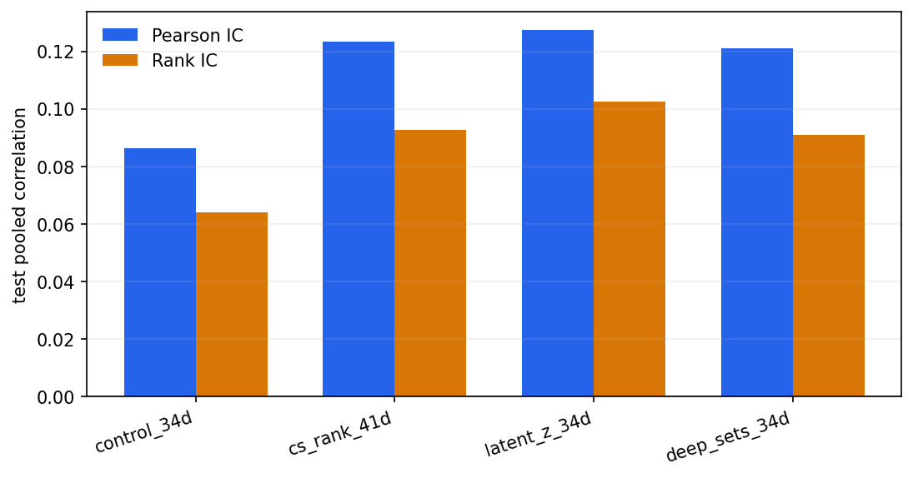
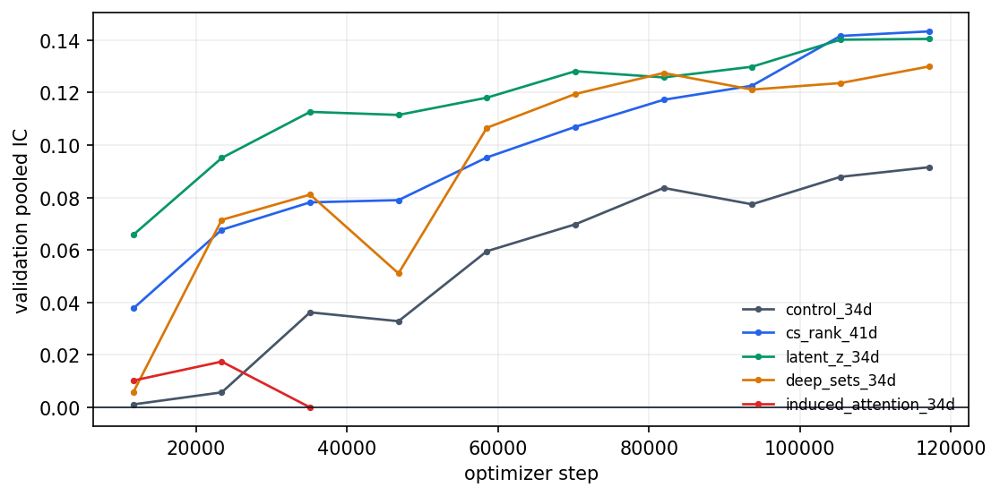

## 摘要

**历史结果: 历史成功, 四臂完成.** Control/CS rank/latent-z/Deep Sets R2 test IC为0.086462/0.123293/0.127345/0.121030. Induced attention 在test前失败; Deep Sets经历中断后R2成功恢复. 四个完成臂10M净Sharpe均负.

历史成功/失败按实验流程是否成功完成判断. 无增益, 成本后亏损, 归档和当前 artifact 缺失不改变历史成功事实. 失败的实验臂保留失败原因, 不填造未产生的 OOS 指标. 本次只整理已有材料, 未启动训练, 推理或回测.

### Executive Summary

完成臂使用同一 test universe; 未完成 test 的实验臂保持 not run. 

| experiment | status | test pooled IC | test Rank IC | >=P95 direction accuracy | all direction accuracy |
| --- | --- | --- | --- | --- | --- |
| control_34d | complete | 0.086462 | 0.064166 | 46.87% | 56.07% |
| cs_rank_41d | complete | 0.123293 | 0.092832 | 48.88% | 52.31% |
| latent_z_34d | complete | 0.127345 | 0.102452 | 50.13% | 52.50% |
| deep_sets_34d | complete | 0.121030 | 0.090978 | 48.69% | 51.84% |
| induced_attention_34d | paused | not run | not run | not run | not run |

### Direction accuracy definitions

两个方向指标回答不同问题: 前者只评估最高约 5% 的强多头信号, 后者评估全部 OOS 样本. 

>=P95 direction accuracy

\[\operatorname{DA}_{P95}=\mathbb{E}\!\left[\mathbf{1}\{\operatorname{sign}(\hat y)=\operatorname{sign}(y)\}\mid \hat y\ge Q_{0.95}(\hat y)\right]\]

只统计 test prediction 位于第 95 百分位及以上的有限样本, 即最高约 5%. 

All direction accuracy

\[\operatorname{DA}_{\mathrm{all}}=\mathbb{E}\!\left[\mathbf{1}\{\operatorname{sign}(\hat y)=\operatorname{sign}(y)\}\right]\]

统计全部有限 test 样本; sign(0)=0. 

### Test IC comparison

02

2. Experiment Setup And Data Pipeline

## 研究背景与目标

本报告围绕Market CS 五臂研究整理原始研究证据. 当前材料对应 registry report `0827-market-cs-comparison-0831`, 来源SHA256为 `644e49bae5ec6f5e2b551571140b1b697490daf1b5b3c28ba7ec64c868c7ddf5`. 原报告的实验方法, 图表, 结果和解释保留在下文.

## 数据与方法

实验身份为 `0827-market-cs`. Split, label, sampler, feature与checkpoint定义按原报告记录, 不从其他实验借用缺失字段. 汇总入口见[全实验综述](../../prediction-nn-1min/1103-nn-registry-summary/).

### Experiment Setup And Data Pipeline

研究方法在训练前固定; 各臂共享数据, panel 顺序, 标签, 优化器和 checkpoint 口径. 

### 2.1. Per-Experiment Research Methods

每个实验组独立说明研究目的, 思路来源, 相对基线变化, 具体执行方法和数学定义. 

### control_34d / complete

研究目的: 建立不使用显式横截面 rank 或市场集合上下文的 matched baseline.  核心思路: 只让共享 GRU 编码每只股票自身 60 根分钟序列, 隔离后续横截面增量.  思路来源: 0825 feature-audit 的 34D baseline; matched ablation 设计.  相对 control_34d: 参考臂; 定义其他实验的 feature/context 增量, 不额外引入横截面输入.  具体方法: 41D 物理输入在 train-only pooled z-score 后固定屏蔽 7 个 rank 列; 逐股票 GRU hidden 直接进入公共预测头.  步骤 1: 对共享 41D 物理输入执行 train-only pooled z-score. ; 步骤 2: 用固定 mask 将 7 个 rank 列置零, 保留 34 个 base feature. ; 步骤 3: 两层 GRU 编码 60-bar 序列, 最后时点 hidden 输入公共 MLP. 

Active input

\[\tilde{\mathbf{x}}_{i,t}=\mathbf{m}_{\mathrm{base}}\odot z_{\mathrm{train}}(\mathbf{x}_{i,t})\]

m_base 只开启 34 个 base feature. 

Temporal encoder

\[\mathbf{h}_i=\operatorname{GRU}(\tilde{\mathbf{x}}_{i,1:60})_{\mathrm{last}}\]

h_i 是股票 i 的 384D 最终 hidden. 

Prediction

\[\hat y_i=\rho(\mathbf{h}_i)\]

rho 是共享 Linear-LayerNorm-ReLU 预测头. 

### cs_rank_41d / complete

研究目的: 检验显式分钟横截面相对位置能否补充单股票绝对时序状态.  核心思路: 把不同尺度收益, 波动率和成交额在同一分钟 panel 内转成 percentile/rank.  思路来源: 经典横截面排序因子与 rank normalization; 本项目 7-rank 预登记.  相对 control_34d: 唯一开启全部 7 个显式 rank 列; 模型结构, 参数量和训练口径与 control 相同.  具体方法: 启用全部 41 列; 7 个 rank 仅使用 point-in-time feature-valid panel 计算, 随后与 34D base 一同进入相同 GRU.  步骤 1: 按 date-time 构造只依赖当时 feature validity 的横截面 U_t. ; 步骤 2: 对 5/20/60/240m return, 20/60m RV 和 log amount 使用 average-tie percentile rank. ; 步骤 3: 将 7 个 rank 与 34D base 拼接, 经共同标准化和相同 GRU/MLP 训练. 

Point-in-time universe

\[U_t=\{j:\mathbf{x}_{j,t}\ \mathrm{is\ valid}\}\]

未来 label availability 不进入 U_t. 

Percentile rank

\[r_{i,t,k}=\frac{\operatorname{average\_rank}_{U_t}(v_{i,t,k})}{|U_t|}\]

与 pandas rank(method=average, pct=True) 一致. 

Active input

\[\tilde{\mathbf{x}}_{i,t}=[\mathbf{x}^{\mathrm{base}}_{i,t},\mathbf{r}_{i,t,1:7}]\]

该臂启用全部 41 个逻辑输入. 

Prediction

\[\mathbf{h}_i=\operatorname{GRU}(\tilde{\mathbf{x}}_{i,1:60})_{\mathrm{last}},\quad \hat y_i=\rho(\mathbf{h}_i)\]

预测结构与 control 完全相同. 

### latent_z_34d / complete

研究目的: 检验股票 hidden 相对同分钟其余股票分布的位置是否提供增量.  核心思路: 对每只股票构造 leave-one-out 均值和标准差, 避免自身同时进入参照分布.  思路来源: 横截面 z-score 与 leave-one-out moment estimator.  相对 control_34d: 输入仍为 34D; 仅在 GRU hidden 后增加无参数 LOO z-position context, 并扩展 MLP 输入.  具体方法: 屏蔽 7 个 rank; 在 GRU hidden 上计算 LOO z-position, 并把 [h_i, z_i] 输入公共预测头.  步骤 1: 使用与 control 相同的 34D mask 和 GRU 得到每只股票 hidden. ; 步骤 2: 在同一分钟 panel 内逐 hidden 维计算排除股票 i 的均值与总体标准差. ; 步骤 3: 拼接本地 hidden 与 LOO z-position, 再通过公共两层预测头输出. 

LOO mean

\[\mathbf{\mu}_{-i}=\frac{1}{N-1}\sum_{j\ne i}\mathbf{h}_j\]

每只股票使用不含自身的市场均值. 

LOO variance

\[\mathbf{\sigma}_{-i}^{2}=\frac{1}{N-1}\sum_{j\ne i}(\mathbf{h}_j-\mathbf{\mu}_{-i})^{2}\]

实现以 centered sum-of-squares 恒等式稳定计算. 

Relative position

\[\mathbf{z}_i=\frac{\mathbf{h}_i-\mathbf{\mu}_{-i}}{\mathbf{\sigma}_{-i}+\varepsilon}\]

epsilon=1e-5, 单股票 panel 返回零 context. 

Prediction

\[\hat y_i=\rho([\mathbf{h}_i,\mathbf{z}_i])\]

rho 接收 768D hidden-context 拼接. 

### deep_sets_34d / complete

研究目的: 检验可学习的全市场分布摘要是否优于固定 mean/std.  核心思路: 用共享 phi 映射每只股票 hidden, 均值聚合得到 permutation-invariant 市场 token.  思路来源: Deep Sets, Zaheer et al. (2017), arXiv:1703.06114.  相对 control_34d: 输入仍为 34D; 用可学习 phi 和 panel mean 产生一个共享 384D market context.  具体方法: 屏蔽 7 个 rank; c = mean_j phi(h_j) 对 panel 聚合, 再把相同 c 广播给每只股票并输入公共预测头.  步骤 1: 使用 34D mask 和公共 GRU 得到 panel hidden H. ; 步骤 2: 每只股票独立经过共享的两层 Linear-LayerNorm-ReLU 映射 phi. ; 步骤 3: 对股票轴取均值得到 permutation-invariant token c, 广播后与 h_i 拼接预测. 

Element map

\[\mathbf{u}_j=\phi(\mathbf{h}_j)\]

phi 为两层 384D Linear-LayerNorm-ReLU 网络. 

Set aggregation

\[\mathbf{c}=\frac{1}{N}\sum_{j=1}^{N}\mathbf{u}_j\]

均值聚合对股票排列不变. 

Broadcast

\[\mathbf{c}_i=\mathbf{c},\quad i=1,\ldots,N\]

同一分钟所有股票共享市场摘要. 

Prediction

\[\hat y_i=\rho([\mathbf{h}_i,\mathbf{c}])\]

本地状态与学习到的市场分布摘要共同预测. 

### induced_attention_34d / paused

研究目的: 检验少量 inducing token 能否表达均值和标准差无法描述的多峰市场结构.  核心思路: 先由 32 个 token cross-attend 全市场, 再由每只股票反向读取 token.  思路来源: Set Transformer ISAB, Lee et al. (2019), PMLR 97.  相对 control_34d: 输入仍为 34D; 增加 32 个 inducing token, 两次 8-head post-norm MAB 和 context 拼接.  具体方法: 屏蔽 7 个 rank; 8-head post-norm MAB 依次执行 I->H 和 H->I, context 与股票 hidden 拼接后进入公共预测头.  步骤 1: 使用 34D mask 和公共 GRU 得到股票 hidden 集合 H. ; 步骤 2: 32 个可学习 inducing token I 以 H 为 key/value 聚合市场信息. ; 步骤 3: 每只股票 hidden 再以 induced token Z 为 key/value 解码股票特定 context C_i. ; 步骤 4: 将 [h_i, C_i] 输入公共预测头; 训练中常数预测门禁可 fail closed. 

Scaled attention

\[\operatorname{Att}(Q,K,V)=\operatorname{softmax}\!\left(\frac{QK^{\mathsf T}}{\sqrt{d_{\mathrm{head}}}}\right)V\]

每个 head 独立投影后再拼接. 

MAB residual

\[R=\operatorname{LN}(Q+\operatorname{Att}(Q,K,K)),\quad \operatorname{MAB}(Q,K)=\operatorname{LN}(R+\operatorname{FFN}(R))\]

与实现的 post-norm residual block 一致. 

Induce

\[Z=\operatorname{MAB}(I,H),\quad I\in\mathbb{R}^{32\times384}\]

token 数 32, attention heads=8. 

Decode

\[C=\operatorname{MAB}(H,Z)\]

得到每只股票对应的 context C_i. 

Prediction

\[\hat y_i=\rho([\mathbf{h}_i,\mathbf{C}_i])\]

该臂最终因 validation prediction collapse 被暂停. 

### 2.2. Shared Data Contract

唯一实验轴是 active feature projection 或 market context. 

| field | value |
| --- | --- |
| artifact_id | 6589947466234739b27e243d253a3c48 |
| dataset_cache_key | e74adc442d96d5ecfcd932bd39289a25be2366d12c20d78a83d8f9aeda2a3460 |
| panel_fingerprint | 28573283d9bba84f03cb51f8855fe97b16e99fba1912860c461e58084518926d |
| physical / active features | 41 / 34 |
| train / val / test rows | 553,895,223 / 31,737,447 / 176,134,322 |

03

3. Signal Quality Comparison

## 主要结果

| 记录项 | 当前解释 |
| --- | --- |
| 实验 | 0827-market-cs |
| 报告类型 | comparison_report_html |
| 历史状态 | 历史成功, 四臂完成 |
| 证据 | 0827-market-cs-comparison-0831 |

Recommended next steps

1. 优先复现 latent_z_34d 与 control_34d: 增加至少 3 个 seed 和滚动 OOS split, 确认 IC, Rank IC 及 latent_z_34d 的 >=P95 方向优势是否稳定, 并分析 control_34d 全样本方向准确率更高是否来自标签方向不平衡. 
2. 只有复现通过后, 才进行 latent_z_34d 与 7-rank 输入的组合消融, 继续共享数据, panel 和 mask 契约. 
3. induced_attention_34d 只继续 bounded smoke; 采用 pre-norm, 零初始化残差门控等稳定化方案, prediction dispersion 与 token-diversity 门禁通过前不启动全量训练. 
4. Deep Sets 暂不扩大; 所有候选在 promotion 前必须重新验证 10M AUM 成本, 换手与容量, 当前负 net return 不支持部署. 

01

1. Executive Summary

### Signal Quality Comparison

同一 test universe 允许完成臂直接横向比较; validation 曲线仅用于选择和诊断. 

| experiment | validation IC | validation Rank IC | test IC | test Rank IC |
| --- | --- | --- | --- | --- |
| control_34d | 0.059532 | 0.054348 | 0.086462 | 0.064166 |
| cs_rank_41d | 0.141584 | 0.111418 | 0.123293 | 0.092832 |
| latent_z_34d | 0.140156 | 0.125761 | 0.127345 | 0.102452 |
| deep_sets_34d | 0.123617 | 0.118860 | 0.121030 | 0.090978 |
| induced_attention_34d | -0.000009 | 0.000004 | not run | not run |

### Available validation checkpoint curves

04

4. Model And Train Comparison

### Model And Train Comparison

参数量由实际模型实例化计算; Deep Sets recovery 保留 source checkpoint lineage. 

| experiment | status | active features | context | parameters | best/last checkpoint |
| --- | --- | --- | --- | --- | --- |
| control_34d | complete | 34 | none | 1,841,281 | 58524 |
| cs_rank_41d | complete | 41 | none | 1,841,281 | 105343 |
| latent_z_34d | complete | 34 | latent_z | 2,037,889 | 105343 |
| deep_sets_34d | complete | 34 | deep_sets | 2,335,105 | 105343 |
| induced_attention_34d | paused | 34 | induced_attention | 4,417,921 | 46819 |

| experiment | artifact status | output count | train metric scope | ETF scope |
| --- | --- | --- | --- | --- |
| control_34d | complete | 74 | 3891 batches / 31875072 rows | full_train_val_test |
| cs_rank_41d | complete | 74 | 3891 batches / 31875072 rows | full_train_val_test |
| latent_z_34d | complete | 74 | 3891 batches / 31875072 rows | full_train_val_test |
| deep_sets_34d | complete | 74 | 3891 batches / 31875072 rows | full_train_val_test |
| induced_attention_34d | not applicable | 0 | not run | not run |

| finding | root cause | remediation |
| --- | --- | --- |
| tables/figures previously shown as unavailable | formal workflow stopped after the lightweight summary report and never invoked the research artifact chain | successful workers now materialize raw predictions and the complete research artifact manifest before HTML |
| historical prediction return scale was ambiguous | legacy manifests omitted output scale and current metadata moved label normalization parameters | new manifests carry raw_label scale plus normalization fingerprint; report inputs reject other scales |
| ETF cumulative-return semantics | forward log returns had been passed directly to simple-return compounding | the report pipeline applies expm1 before strategy and benchmark compounding |

05

5. Trading And Cost Comparison

### Trading And Cost Comparison

仅完成 test/backtest 的实验臂进入共同 10M AUM execution-aware 比较. 

| experiment | gross daily | gross Sharpe | net daily 10M | net Sharpe 10M | drawdown | turnover | fill |
| --- | --- | --- | --- | --- | --- | --- | --- |
| control_34d | 76.39 bps | 31.769134 | -160.62 bps | -41.621835 | -96.34% | 11.815937 | 94.03% |
| cs_rank_41d | 87.19 bps | 45.395270 | -150.01 bps | -39.747621 | -95.44% | 11.556330 | 94.01% |
| latent_z_34d | 100.19 bps | 42.554951 | -135.70 bps | -39.213925 | -93.86% | 11.809049 | 94.02% |
| deep_sets_34d | 89.09 bps | 40.407814 | -149.02 bps | -39.045298 | -95.34% | 11.807929 | 94.01% |

06

6. Resource Diagnostics

### Resource Diagnostics

CPU, 内存和 GPU 指标用于解释运行包络, 不作为模型效果结论. 

| experiment | samples | process CPU % | RSS GiB | GPU MiB | GPU util % | temperature C |
| --- | --- | --- | --- | --- | --- | --- |
| control_34d | 766 | 1200.729137 | 49.514076 | 9579.000000 | 100.000000 | 87.000000 |
| cs_rank_41d | 756 | 1158.130503 | 46.974407 | 9581.000000 | 100.000000 | 76.000000 |
| latent_z_34d | 781 | 1152.180189 | 57.487206 | 9123.000000 | 100.000000 | 78.000000 |
| deep_sets_34d | 408 | 1037.503271 | 52.537373 | 9363.000000 | 100.000000 | 79.000000 |
| induced_attention_34d | 207 | 998.872523 | 44.843616 | 6379.000000 | 100.000000 | 77.000000 |

07

7. Appendix

## 限制与适用边界

Control/CS rank/latent-z/Deep Sets R2 test IC为0.086462/0.123293/0.127345/0.121030. Induced attention 在test前失败; Deep Sets经历中断后R2成功恢复. 四个完成臂10M净Sharpe均负. 当前artifact可得性只影响复现, 不作为历史成功/失败判据. 只有matched合同内的结果可以直接比较.

## 结论

本次归档保留上述历史事实. 研究结论, 推广门槛和执行限制分别解释, 不把模型无增益或净收益为负改写成实验流程失败.

## 附录

### Appendix

Run, MLflow, 配置和 Git identity 保持逐臂可追溯. 

| experiment | run_id | MLflow run | config SHA-256 | Git commit |
| --- | --- | --- | --- | --- |
| control_34d | 0829cs-s7-l-control_34d | 1dd271e6f3bb41e8a665bab18eee4b8b | 8e92a379bbf407f7c1212b7b7a5b1ca1606866c86c20252d3eb9b961b6e4a5b2 | 88458306f57ad953b9cc9048a32b19bf7b5c9689 |
| cs_rank_41d | 0829cs-s7-l-cs_rank_41d | f54f790158474e368465944eed7eb606 | 7cc83247740f8a5e775899520970f124b77b454d3e0de7a90a6f9f31cb1b7921 | 88458306f57ad953b9cc9048a32b19bf7b5c9689 |
| latent_z_34d | 0829cs-s7-l-latent_z_34d | 640bb3b2abba4c228a29e27722eae20d | d36fe22783eb4558fe1138dfeb38df5039c0fd589264734f659a4619eebe3762 | 88458306f57ad953b9cc9048a32b19bf7b5c9689 |
| deep_sets_34d | 0829cs-s7-l-deep_sets_34d-r2 | 6e4f36759bdb46cd9ec6bb5357052811 | 052fc9d2361803437f0ad21c8fe0c06cbca47b180bc13c4a65e273f7bb91c93e | a8c25b273fa97bb3f496639e1483d9a5889cbc3a |
| induced_attention_34d | 0829cs-s7-l-induced_attention_34d | 1cf190091e484613897cbbf946a7928c | 43119f9d651e3253169a0fb3840f650a54430ad44f251384f59ec4ff731175c1 | 88458306f57ad953b9cc9048a32b19bf7b5c9689 |
