## 摘要

**历史结果: 历史成功, 四臂完成.** Control/CS rank/latent-z/Deep Sets R2 test IC为0.086462/0.123293/0.127345/0.121030. Induced attention 在test前失败; Deep Sets经历中断后R2成功恢复. 四个完成臂10M净Sharpe均负.

历史成功/失败按实验流程是否成功完成判断. 无增益, 成本后亏损, 归档和当前 artifact 缺失不改变历史成功事实. 失败的实验臂保留失败原因, 不填造未产生的 OOS 指标. 本次只整理已有材料, 未启动训练, 推理或回测.

### Executive Summary

模板字段按固定顺序展示; headline 指标均来自本次完整 research artifact bundle. 

benchmark

control_34d

none

selected_checkpoint

58524

validation-only selection

train_pooled_ic

0.090891

fixed sample: 3,891 batches / 31,875,072 rows

test_pooled_ic

0.086462

176,134,322

top_prediction_return_bps

5.899675

test top prediction bucket

top95_hit

46.87%

test top 5% predictions

etf_top95_hit

57.75%

test ETF proxy top 5%

overfit_variance_ratio

0.009634

test prediction variance / target variance

model_class

MarketContextGruMlpRegressor

1,841,281 parameters

train_range

2021-01-04 to 2023-12-29

train-only normalization fit

val_range

2024-01-02 to 2024-02-29

checkpoint selection only

test_range

2024-03-01 to 2024-12-31

final evaluation only

| field | explanation |
| --- | --- |
| benchmark | 实验标识.  |
| selected_checkpoint | 最终用于 evaluation 的 checkpoint iteration.  |
| train_pooled_ic | core_ic_summary_train.yaml 当前覆盖的 train-report 样本合并后计算的 Pearson IC; 启用 train report sample 时不是 full-train 指标.  |
| test_pooled_ic | test split 上把所有样本合并后计算的 Pearson IC.  |
| top_prediction_return_bps | 最高 prediction 分组的平均 prediction return, 单位 bps.  |
| top95_hit | test split 中按 prediction 从高到低排序后取最高 5% 样本, 即 prediction >= test prediction 的 95% 分位; 该子样本内 target > 0 的比例.  |
| etf_top95_hit | test split 中先按重要股票池合成 ETF minute-level prediction/real return, 再按 etf_prediction 从高到低排序后取最高 5% 样本; 该子样本内 etf_real_return > 0 的比例.  |
| overfit_variance_ratio | test split 中 prediction 样本方差 / target 样本方差, 用作 overfit 系数; 数值越大表示 prediction 方差相对 label 越高.  |
| model_class | 模型类名.  |
| train_range | 训练集交易日范围.  |
| val_range | 验证集交易日范围.  |
| test_range | 测试集交易日范围.  |

02

2. Data Pipeline

## 研究背景与目标

本报告围绕Market CS 五臂研究整理原始研究证据. 当前材料对应 registry report `0827-market-cs-control-0831`, 来源SHA256为 `304397c8094b8ca04dc4eddf8725aa85471774f4787c466a02e5e95e64660582`. 原报告的实验方法, 图表, 结果和解释保留在下文.

## 数据与方法

实验身份为 `0827-market-cs`. Split, label, sampler, feature与checkpoint定义按原报告记录, 不从其他实验借用缺失字段. 汇总入口见[全实验综述](../../prediction-nn-1min/1103-nn-registry-summary/).

### Data Pipeline

五臂共享同一 41D 物理 artifact, row identity, panel ordering 和 train-only normalization. 

### 2.1. Data Basics

逻辑 active feature 通过 pooled z-score 后的固定投影实现; 物理 GRU 输入宽度始终为 41. 

| field | value |
| --- | --- |
| train_days | 727 |
| val_days | 37 |
| test_days | 205 |
| train_rows | 553,895,223 |
| val_rows | 31,737,447 |
| test_rows | 176,134,322 |
| feature_dim | 41 physical / 34 active |
| features | ret_1m, ret_2m, ret_3m, ret_5m, ret_10m, hl, oc, log_vol, log_amount, log_vol_5m_mean, log_amount_5m_mean, vol_same_minute_60d_pct, vol_trailing_5m_pct, vol_trailing_20m_pct, amount_trailing_60m_pct, minute_norm, vol_10m, state_realized_vol_5m, state_realized_vol_shell_5_20m, state_realized_vol_shell_20_60m, state_realized_vol_shell_60_120m, state_realized_vol_shell_120_240m, state_realized_vol_shell_240_480m, state_range_5m, state_range_20m, state_range_60m, state_range_120m, state_range_240m, state_range_480m, state_return_shell_5_20m, state_return_shell_20_60m, state_return_shell_60_120m, state_return_shell_120_240m, state_return_shell_240_480m |
| label_horizon_minutes | 10 |
| label_entry_lag_minutes | 1 |

| field | explanation |
| --- | --- |
| features | 模型输入 feature 列表.  |
| feature_dim | 模型输入 feature 维度.  |
| label_horizon_minutes | entry 到 exit 的实际持有期, 单位 minutes.  |
| label_entry_lag_minutes | label entry lag, 单位 minutes.  |

### 2.2. Data Normalization

清洗统计来自共享 data-clean artifact; rank 和 context 都不改变 split 或标准化 fit scope. 

| field | value |
| --- | --- |
| feature_normalization | pooled_zscore; train_only |
| label_normalization | pooled_zscore; train_only |
| label_horizon_minutes | 10 |
| label_entry_lag_minutes | 1 |
| train_kept_rate | not stored in report summary |
| val_kept_rate | not stored in report summary |
| test_kept_rate | not stored in report summary |
| max_invalid_ratio | 0.041494 |

| field | total_count | finite_count | nan_count | nan_ratio | inf_ratio | invalid_ratio | mean_finite | std_finite | skew_finite | kurtosis_finite | min_finite | max_finite |
| --- | --- | --- | --- | --- | --- | --- | --- | --- | --- | --- | --- | --- |
| ret_1m | 1154507748 | 1149717258 | 4790490 | 0.004149 | 0.000000 | 0.004149 | 0.000001 | 0.002284 | 0.332178 | 524.604788 | -1.672727 | 0.759663 |
| ret_2m | 1154507748 | 1144926768 | 9580980 | 0.008299 | 0.000000 | 0.008299 | 0.000004 | 0.002928 | 0.933046 | 267.199689 | -1.672727 | 0.798906 |
| ret_3m | 1154507748 | 1140136278 | 14371470 | 0.012448 | 0.000000 | 0.012448 | 0.000007 | 0.003416 | 1.220015 | 185.034283 | -1.672727 | 0.798906 |
| ret_5m | 1154507748 | 1130555298 | 23952450 | 0.020747 | 0.000000 | 0.020747 | 0.000011 | 0.004185 | 1.487963 | 125.885503 | -1.672727 | 0.798906 |
| ret_10m | 1154507748 | 1106602848 | 47904900 | 0.041494 | 0.000000 | 0.041494 | 0.000012 | 0.005543 | 1.616300 | 78.308005 | -1.672727 | 0.865563 |
| hl | 1154507748 | 1154507748 | 0 | 0.000000 | 0.000000 | 0.000000 | 0.000622 | 0.000759 | 6.625821 | 384.235154 | 0.000000 | 0.434688 |
| oc | 1154507748 | 1154507748 | 0 | 0.000000 | 0.000000 | 0.000000 | 0.000005 | 0.000716 | 0.807232 | 305.329560 | -0.312980 | 0.353188 |
| log_vol | 1154507748 | 1154507748 | 0 | 0.000000 | 0.000000 | 0.000000 | 9.041346 | 2.868792 | -1.615542 | 3.227835 | 0.000000 | 20.340768 |
| log_amount | 1154507748 | 1154507748 | 0 | 0.000000 | 0.000000 | 0.000000 | 11.435779 | 3.351959 | -2.143654 | 5.130353 | 0.000000 | 22.619835 |
| log_vol_5m_mean | 1154507748 | 1154507748 | 0 | 0.000000 | 0.000000 | 0.000000 | 9.080030 | 2.395991 | -1.178611 | 2.390045 | 0.000000 | 20.127985 |
| log_amount_5m_mean | 1154507748 | 1154507748 | 0 | 0.000000 | 0.000000 | 0.000000 | 11.483564 | 2.737884 | -1.640929 | 4.078448 | 0.000000 | 21.933402 |
| vol_same_minute_60d_pct | 1154507748 | 1147649611 | 6858137 | 0.005940 | 0.000000 | 0.005940 | 0.500503 | 0.297898 | 0.010429 | -1.224365 | 0.000000 | 1.000000 |
| vol_trailing_5m_pct | 1154507748 | 1154498343 | 9405 | 0.000008 | 0.000000 | 0.000008 | 0.493844 | 0.343189 | 0.039355 | -1.280546 | 0.000000 | 1.000000 |
| vol_trailing_20m_pct | 1154507748 | 1154470128 | 37620 | 0.000033 | 0.000000 | 0.000033 | 0.493187 | 0.309097 | 0.038864 | -1.238083 | 0.000000 | 1.000000 |
| amount_trailing_60m_pct | 1154507748 | 1154394888 | 112860 | 0.000098 | 0.000000 | 0.000098 | 0.492823 | 0.304257 | 0.040368 | -1.261618 | 0.000000 | 1.000000 |
| minute_norm | 1154507748 | 1154507748 | 0 | 0.000000 | 0.000000 | 0.000000 | 0.500000 | 0.289875 | -0.000000 | -1.200041 | 0.000000 | 1.000000 |
| vol_10m | 1154507748 | 1144926768 | 9580980 | 0.008299 | 0.000000 | 0.008299 | 0.000570 | 0.000516 | 16.378499 | 9073.355221 | 0.000000 | 0.617598 |
| state_realized_vol_5m | 1154507748 | 1147537841 | 6969907 | 0.006037 | 0.000000 | 0.006037 | 0.003817 | 0.003982 | 11.509101 | 2100.446606 | 0.000000 | 4.326676 |
| state_realized_vol_shell_5_20m | 1154507748 | 1147494311 | 7013437 | 0.006075 | 0.000000 | 0.006075 | 0.007152 | 0.006323 | 8.227069 | 607.709954 | 0.000000 | 4.391918 |
| state_realized_vol_shell_20_60m | 1154507748 | 1147381511 | 7126237 | 0.006173 | 0.000000 | 0.006173 | 0.012313 | 0.009544 | 6.231639 | 255.980016 | 0.000000 | 4.402562 |
| state_realized_vol_shell_60_120m | 1154507748 | 1147246611 | 7261137 | 0.006289 | 0.000000 | 0.006289 | 0.015416 | 0.011229 | 5.616893 | 192.500745 | 0.000000 | 4.403834 |
| state_realized_vol_shell_120_240m | 1154507748 | 1146937611 | 7570137 | 0.006557 | 0.000000 | 0.006557 | 0.022658 | 0.014594 | 4.854178 | 129.653750 | 0.000000 | 4.407839 |
| state_realized_vol_shell_240_480m | 1154507748 | 1146320328 | 8187420 | 0.007092 | 0.000000 | 0.007092 | 0.033107 | 0.018785 | 4.307459 | 90.790637 | 0.000000 | 4.448893 |
| state_range_5m | 1154507748 | 1147541397 | 6966351 | 0.006034 | 0.000000 | 0.006034 | 0.004887 | 0.005185 | 8.152644 | 795.609658 | 0.000000 | 4.326676 |
| state_range_20m | 1154507748 | 1147488066 | 7019682 | 0.006080 | 0.000000 | 0.006080 | 0.010356 | 0.010231 | 5.478281 | 153.551252 | 0.000000 | 4.326676 |
| state_range_60m | 1154507748 | 1147345866 | 7161882 | 0.006203 | 0.000000 | 0.006203 | 0.019035 | 0.016811 | 4.031091 | 66.258543 | 0.000000 | 4.326676 |
| state_range_120m | 1154507748 | 1147132566 | 7375182 | 0.006388 | 0.000000 | 0.006388 | 0.028234 | 0.022304 | 3.360529 | 44.705540 | 0.000000 | 4.326676 |
| state_range_240m | 1154507748 | 1146705966 | 7801782 | 0.006758 | 0.000000 | 0.006758 | 0.041697 | 0.029431 | 2.908754 | 31.236718 | 0.000000 | 4.326676 |
| state_range_480m | 1154507748 | 1145883576 | 8624172 | 0.007470 | 0.000000 | 0.007470 | 0.060320 | 0.041867 | 2.661780 | 18.630342 | 0.000000 | 4.326676 |
| state_return_shell_5_20m | 1154507748 | 1147494311 | 7013437 | 0.006075 | 0.000000 | 0.006075 | -0.000007 | 0.007927 | 1.948638 | 191.038994 | -3.336278 | 1.833443 |
| state_return_shell_20_60m | 1154507748 | 1147381511 | 7126237 | 0.006173 | 0.000000 | 0.006173 | -0.000019 | 0.012654 | 1.546156 | 74.692023 | -3.559421 | 1.834436 |
| state_return_shell_60_120m | 1154507748 | 1147246611 | 7261137 | 0.006289 | 0.000000 | 0.006289 | -0.000026 | 0.015402 | 1.319948 | 50.578430 | -3.524330 | 1.838381 |
| state_return_shell_120_240m | 1154507748 | 1146937611 | 7570137 | 0.006557 | 0.000000 | 0.006557 | -0.000047 | 0.021640 | 0.992915 | 26.801442 | -3.395118 | 1.910637 |
| state_return_shell_240_480m | 1154507748 | 1146320328 | 8187420 | 0.007092 | 0.000000 | 0.007092 | -0.000078 | 0.030894 | 0.802110 | 14.788736 | -3.336278 | 1.891549 |
| stock_ret_5m_cs_rank | 1154507748 | 1147537841 | 6969907 | 0.006037 | 0.000000 | 0.006037 | 0.500102 | 0.287098 | -0.001112 | -1.173250 | 0.000186 | 1.000000 |
| stock_ret_20m_cs_rank | 1154507748 | 1147484511 | 7023237 | 0.006083 | 0.000000 | 0.006083 | 0.500102 | 0.288292 | -0.000264 | -1.194513 | 0.000186 | 1.000000 |
| stock_ret_60m_cs_rank | 1154507748 | 1147342311 | 7165437 | 0.006206 | 0.000000 | 0.006206 | 0.500102 | 0.288583 | -0.000071 | -1.198720 | 0.000186 | 1.000000 |
| stock_ret_240m_cs_rank | 1154507748 | 1146702411 | 7805337 | 0.006761 | 0.000000 | 0.006761 | 0.500102 | 0.288670 | 0.000001 | -1.199923 | 0.000186 | 1.000000 |
| stock_rv_20m_cs_rank | 1154507748 | 1147484511 | 7023237 | 0.006083 | 0.000000 | 0.006083 | 0.500102 | 0.288673 | 0.000063 | -1.200113 | 0.000186 | 1.000000 |
| stock_rv_60m_cs_rank | 1154507748 | 1147342311 | 7165437 | 0.006206 | 0.000000 | 0.006206 | 0.500102 | 0.288675 | 0.000010 | -1.200027 | 0.000186 | 1.000000 |
| stock_log_amount_cs_rank | 1154507748 | 1154507748 | 0 | 0.000000 | 0.000000 | 0.000000 | 0.500101 | 0.287690 | 0.003189 | -1.191131 | 0.000405 | 1.000000 |

| field | explanation |
| --- | --- |
| feature_normalization | feature normalization 方法和 fit scope.  |
| label_normalization | label normalization 方法和 fit scope.  |
| kept_rate | 清洗后保留样本数 / 清洗前样本数.  |
| max_invalid_ratio | 单个字段中 invalid 样本占比的最大值.  |

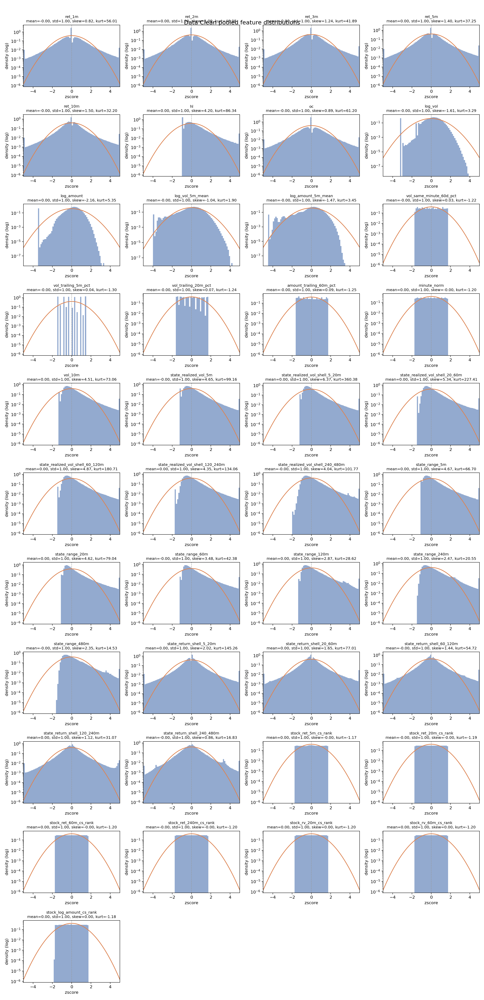

### Data Clean Distribution Overview

### 2.3. Label Distribution

Label 分布按 train/validation/test 展示; normalization 参数只在 train 上拟合. 

| split | count | mean_raw_bps | std_raw_bps | zero_ratio | abs_raw_gt_1pct_ratio |
| --- | --- | --- | --- | --- | --- |
| train | 553895223 | -0.074756 | 42.226774 | 0.186758 | 0.028167 |
| val | 31737447 | -0.863159 | 62.464198 | 0.147426 | 0.076608 |
| test | 176134322 | -0.035505 | 50.207416 | 0.174398 | 0.039702 |

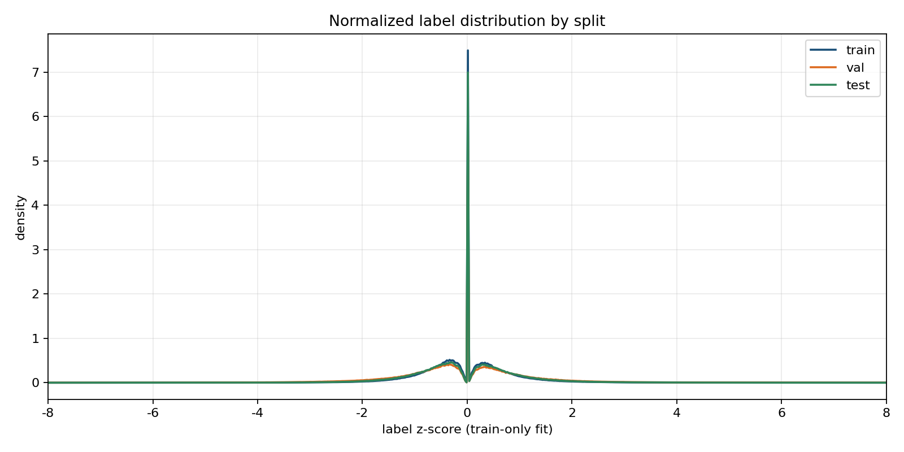

### Label Distribution By Split

03

3. Evaluation

## 主要结果

| 记录项 | 当前解释 |
| --- | --- |
| 实验 | 0827-market-cs |
| 报告类型 | full_report_html |
| 历史状态 | 历史成功, 四臂完成 |
| 证据 | 0827-market-cs-control-0831 |

Current conclusion

control_34d: test pooled IC=0.086462, pooled Rank IC=0.064166; 结果仅用于 seed 7 matched screening. 

01

1. Executive Summary

### Evaluation

Test 不参与 checkpoint 选择; 暂停臂的 test 指标保持 not run. 

### 3.1. IC Summary

Train headline 使用固定 3,891 batches / 31,875,072 rows; test 使用完整 split. 

| split | pooled_ic | pooled_rank_ic | count |
| --- | --- | --- | --- |
| train_report_sample | 0.090891 | 0.081086 | 31875072 |
| test | 0.086462 | 0.064166 | 176134322 |

| field | explanation |
| --- | --- |
| pooled_ic | 合并样本后计算的 Pearson IC.  |
| pooled_rank_ic | 合并样本后计算的 Rank IC.  |
| pearson_ic | corr(prediction, target).  |
| rank_ic | corr(rank(prediction), rank(target)).  |

### 3.2. Signal Quality 1: bucket (10)

完整 test prediction 按全局 prediction 十等分, 报告每桶实际 label 与日度 top-minus-bottom spread. 

| signal_bucket | mean_prediction | mean_label_bps | t_stat | hit_rate | row_count | top_bottom_signal_spread_bps |
| --- | --- | --- | --- | --- | --- | --- |
| 1 | -0.000975 | -6.657370 | -346.383056 | 0.347538 | 17613433 | 12.557045 |
| 2 | -0.000334 | -1.330501 | -116.423896 | 0.376054 | 17613433 | 12.557045 |
| 3 | -0.000247 | -0.718784 | -68.433380 | 0.373561 | 17613432 | 12.557045 |
| 4 | -0.000178 | -0.396741 | -38.951309 | 0.380700 | 17613432 | 12.557045 |
| 5 | -0.000115 | -0.126071 | -12.639441 | 0.384303 | 17613432 | 12.557045 |
| 6 | -0.000064 | 0.070971 | 7.345052 | 0.383880 | 17613432 | 12.557045 |
| 7 | -0.000014 | 0.312591 | 32.928738 | 0.386311 | 17613432 | 12.557045 |
| 8 | 0.000024 | 0.779942 | 82.544906 | 0.395054 | 17613432 | 12.557045 |
| 9 | 0.000097 | 1.811886 | 176.926627 | 0.416174 | 17613432 | 12.557045 |
| 10 | 0.000445 | 5.899675 | 384.748112 | 0.453534 | 17613432 | 12.557045 |

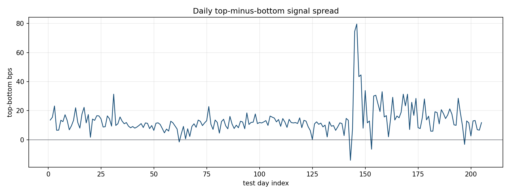

### Daily Top-Minus-Bottom Signal Spread

### 3.3. Signal Quality 2: Important Stock Pool

CSI300/CSI500/CSI1000 成分股按日期 membership 聚合; test 与 validation checkpoint 证据分开保存. 

| pool | display_name | etf_code | index_code | pearson_ic | rank_ic | mean_prediction_return | mean_real_return | real_return_positive_ratio | prediction_positive_ratio | count |
| --- | --- | --- | --- | --- | --- | --- | --- | --- | --- | --- |
| csi1000_etf_sh | 1000 ETF | 512100.SH | 000852.SH | 0.064412 | 0.041428 | -0.000111 | -0.000008 | 0.395829 | 0.282852 | 32955251 |
| csi300_etf_sh | 沪深300 ETF(沪) | 510300.SH | 000300.SH | 0.057918 | 0.034158 | -0.000077 | 0.000014 | 0.413560 | 0.313698 | 9885400 |
| csi500_etf_sh | 中证500 ETF(沪) | 510500.SH | 000905.SH | 0.053601 | 0.033306 | -0.000096 | -0.000013 | 0.393433 | 0.273950 | 16488815 |

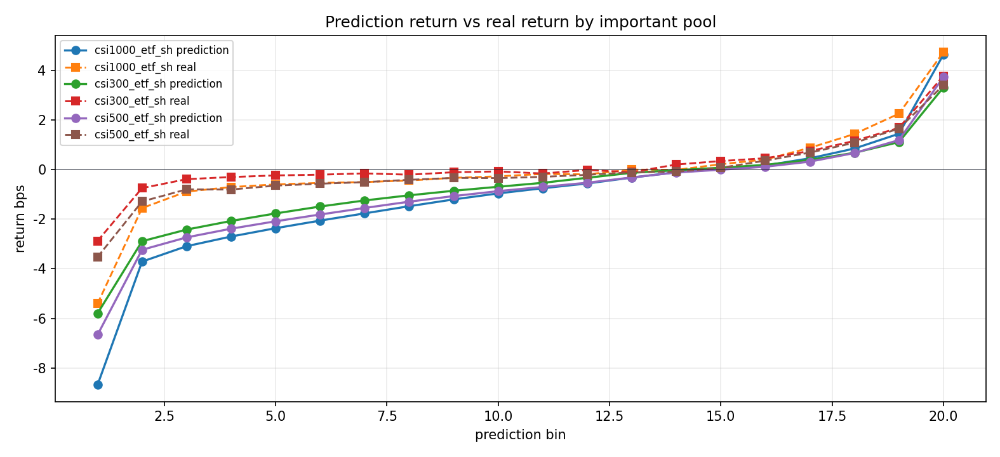

### Prediction Return vs Real Return

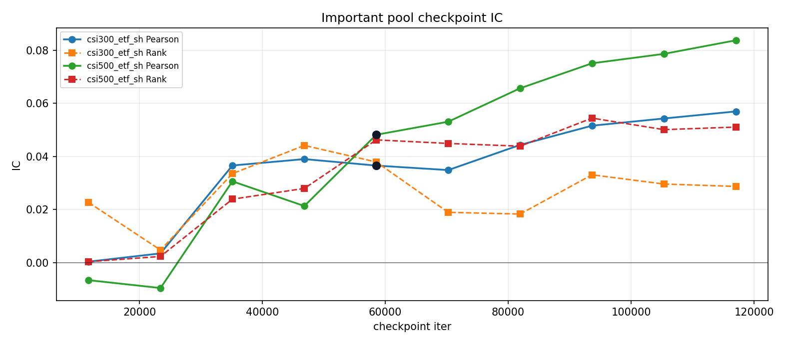

### Important Pool Checkpoint IC

### 3.4. Goodness Of Fit

Train 固定样本与完整 test 使用相同等频校准分箱; 表格仅折叠展示首尾 bins. 

| split | prediction_bin | mean_prediction | mean_label | mean_label_bps | label_std | label_se | label_p05 | label_p95 | label_ci90_low | label_ci90_high | row_count |
| --- | --- | --- | --- | --- | --- | --- | --- | --- | --- | --- | --- |
| train | 1 | -0.002387 | -0.002335 | -23.349420 | 0.009508 | 0.000017 | -0.015999 | 0.010788 | -0.002363 | -0.002307 | 318751 |
| train | 2 | -0.001237 | -0.001027 | -10.270683 | 0.006667 | 0.000012 | -0.010218 | 0.008586 | -0.001046 | -0.001008 | 318751 |
| train | 3 | -0.000944 | -0.000794 | -7.940147 | 0.005900 | 0.000010 | -0.009005 | 0.007720 | -0.000811 | -0.000777 | 318751 |
| train | 4 | -0.000768 | -0.000641 | -6.413200 | 0.005693 | 0.000010 | -0.008618 | 0.007685 | -0.000658 | -0.000625 | 318751 |
| train | 5 | -0.000646 | -0.000603 | -6.027148 | 0.005507 | 0.000010 | -0.008387 | 0.007489 | -0.000619 | -0.000587 | 318751 |
| train | 6 | -0.000558 | -0.000536 | -5.362873 | 0.005494 | 0.000010 | -0.008263 | 0.007617 | -0.000552 | -0.000520 | 318751 |
| train | 7 | -0.000504 | -0.000497 | -4.969172 | 0.005320 | 0.000009 | -0.008040 | 0.007605 | -0.000512 | -0.000481 | 318751 |
| train | 8 | -0.000476 | -0.000451 | -4.514825 | 0.005074 | 0.000009 | -0.007653 | 0.007238 | -0.000466 | -0.000437 | 318751 |
| train | 9 | -0.000452 | -0.000417 | -4.170330 | 0.005034 | 0.000009 | -0.007500 | 0.007139 | -0.000432 | -0.000402 | 318751 |
| train | 10 | -0.000431 | -0.000403 | -4.034446 | 0.004902 | 0.000009 | -0.007381 | 0.007036 | -0.000418 | -0.000389 | 318751 |
| test | 91 | 0.000159 | 0.000269 | 2.693978 | 0.004729 | 0.000004 | -0.006288 | 0.006995 | 0.000264 | 0.000275 | 1761343 |
| test | 92 | 0.000176 | 0.000292 | 2.916971 | 0.004878 | 0.000004 | -0.006473 | 0.007221 | 0.000286 | 0.000298 | 1761343 |
| test | 93 | 0.000197 | 0.000316 | 3.156163 | 0.005019 | 0.000004 | -0.006688 | 0.007456 | 0.000309 | 0.000322 | 1761343 |
| test | 94 | 0.000223 | 0.000346 | 3.462831 | 0.005201 | 0.000004 | -0.006898 | 0.007720 | 0.000340 | 0.000353 | 1761343 |
| test | 95 | 0.000254 | 0.000381 | 3.808085 | 0.005378 | 0.000004 | -0.007162 | 0.008017 | 0.000374 | 0.000387 | 1761343 |
| test | 96 | 0.000293 | 0.000428 | 4.280057 | 0.005598 | 0.000004 | -0.007414 | 0.008368 | 0.000421 | 0.000435 | 1761343 |
| test | 97 | 0.000363 | 0.000493 | 4.933445 | 0.006007 | 0.000005 | -0.007859 | 0.008982 | 0.000486 | 0.000501 | 1761343 |
| test | 98 | 0.000482 | 0.000587 | 5.869812 | 0.006385 | 0.000005 | -0.008366 | 0.009658 | 0.000579 | 0.000595 | 1761343 |
| test | 99 | 0.000686 | 0.000767 | 7.674655 | 0.007144 | 0.000005 | -0.009319 | 0.011061 | 0.000759 | 0.000776 | 1761343 |
| test | 100 | 0.001620 | 0.002020 | 20.200838 | 0.011185 | 0.000008 | -0.013352 | 0.019935 | 0.002006 | 0.002034 | 1761343 |

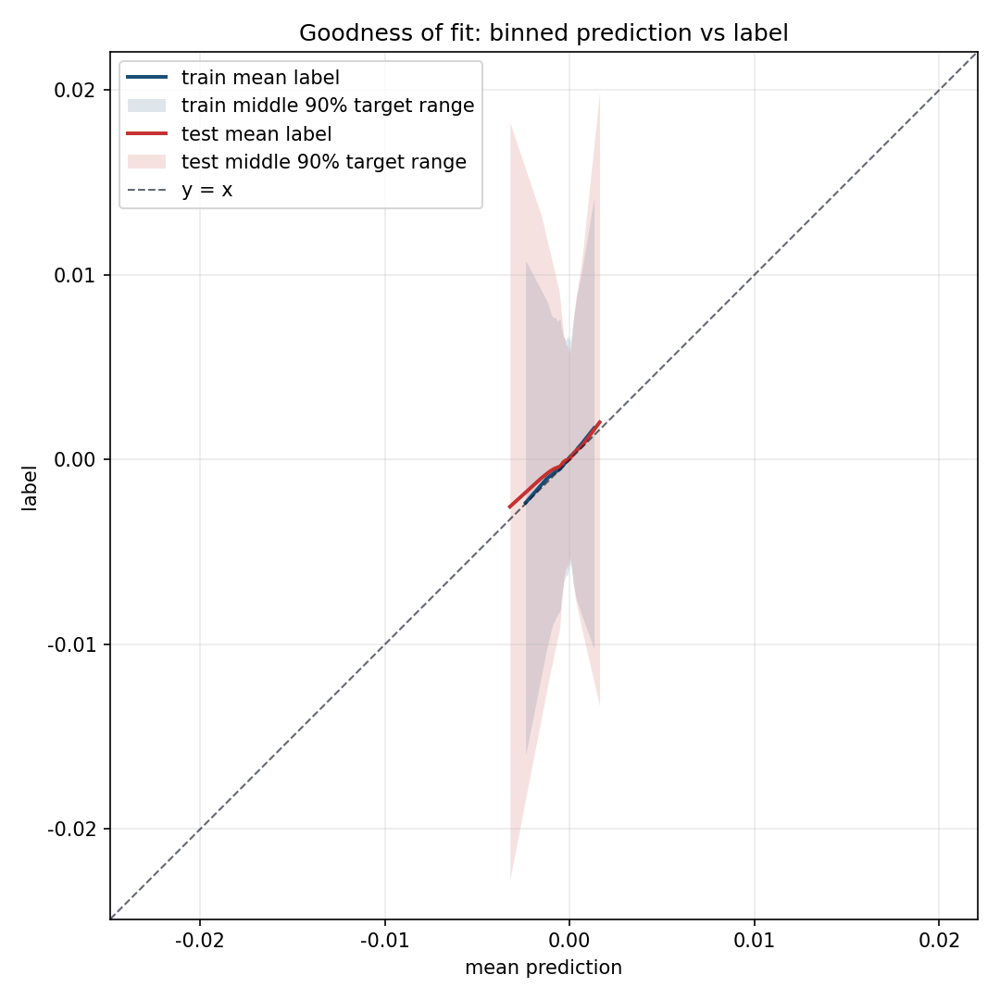

### Train/Test Goodness Of Fit

### 3.5. Liquidity By ADV

ADV 使用 shifted 20-trading-day stock1d amount mean, 并在完整 test date-code universe 上分桶. 

| adv_bucket | bucket_label | row_count | day_count | mean_adv_amount | median_adv_amount | mean_ic | mean_rank_ic | icir | rank_icir | top5_return_bps | top5_hit_rate | top5_row_count |
| --- | --- | --- | --- | --- | --- | --- | --- | --- | --- | --- | --- | --- |
| 1 | Bottom20% | 33579609 | 205 | 22043.429610 | 22557.850150 | 0.101297 | 0.079578 | 5.027074 | 4.442581 | 8.126884 | 0.435030 | 1694847 |
| 2 | 20~40% | 33579609 | 205 | 49378.094708 | 48886.620950 | 0.069828 | 0.048845 | 3.183165 | 2.616456 | 4.967814 | 0.427432 | 1695008 |
| 3 | 40~60% | 33579609 | 205 | 89103.411146 | 87560.379700 | 0.078267 | 0.047284 | 3.494999 | 2.121649 | 5.251098 | 0.442198 | 1694203 |
| 4 | 60~80% | 33579448 | 205 | 170679.829077 | 165081.435150 | 0.088066 | 0.052971 | 3.374798 | 1.999320 | 5.988377 | 0.458452 | 1695008 |
| 5 | Top20% | 33579448 | 205 | 714122.143913 | 442449.002300 | 0.092802 | 0.061498 | 2.684901 | 1.835540 | 6.302323 | 0.470296 | 1695008 |

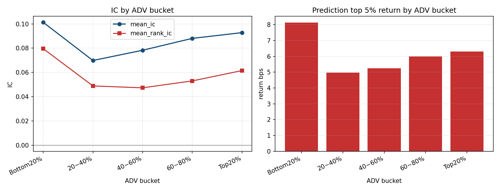

### ADV Liquidity Bucket Metrics

04

4. Train Metrics

### Train Metrics

模型参数, checkpoint selection 和运行身份来自 config, sidecar 与 summary. 

### 4.1. Checkpoint Selection

Checkpoint 只由 validation 选择; 所有候选 checkpoint 的 train headline 使用同一确定性样本. 

| key | value |
| --- | --- |
| best_iter | 58524 |
| selection_metric | checkpoint_selection/score |
| selection_rule | early_top_k |
| candidate_count | 10 |

| iter | selected | val/objective/mse | val/quality/global_ic | val/quality/rank_ic | val/dist/pred_std_over_target_std | decision | metric_rank |
| --- | --- | --- | --- | --- | --- | --- | --- |
| 11705 | False | 2.188300 | 0.001145 | 0.010015 | — | reject | 10.000000 |
| 23410 | False | 2.191138 | 0.005733 | 0.001823 | — | reject | 9.000000 |
| 35115 | False | 2.187815 | 0.036234 | 0.020969 | — | reject | 7.000000 |
| 46819 | False | 2.195820 | 0.032859 | 0.030501 | — | reject | 8.000000 |
| 58524 | True | 2.181793 | 0.059532 | 0.054348 | — | promote | 6.000000 |
| 70229 | False | 2.178276 | 0.069777 | 0.056753 | — | reject | 5.000000 |
| 81933 | False | 2.173058 | 0.083652 | 0.057665 | — | reject | 3.000000 |
| 93638 | False | 2.176952 | 0.077420 | 0.069504 | — | reject | 4.000000 |
| 105343 | False | 2.171961 | 0.087873 | 0.067893 | — | reject | 2.000000 |
| 117047 | False | 2.170259 | 0.091540 | 0.068373 | — | reject | 1.000000 |

| iter | pooled_ic | pooled_rank_ic | count | scope |
| --- | --- | --- | --- | --- |
| 11705 | 0.010271 | 0.037702 | 31875072 | fixed train sample: 3891 batches |
| 23410 | 0.045881 | 0.053187 | 31875072 | fixed train sample: 3891 batches |
| 35115 | 0.073639 | 0.065326 | 31875072 | fixed train sample: 3891 batches |
| 46819 | 0.072431 | 0.080011 | 31875072 | fixed train sample: 3891 batches |
| 58524 | 0.086934 | 0.078487 | 31875072 | fixed train sample: 3891 batches |
| 70229 | 0.082870 | 0.061656 | 31875072 | fixed train sample: 3891 batches |
| 81933 | 0.088686 | 0.065123 | 31875072 | fixed train sample: 3891 batches |
| 93638 | 0.094113 | 0.077127 | 31875072 | fixed train sample: 3891 batches |
| 105343 | 0.096285 | 0.078440 | 31875072 | fixed train sample: 3891 batches |

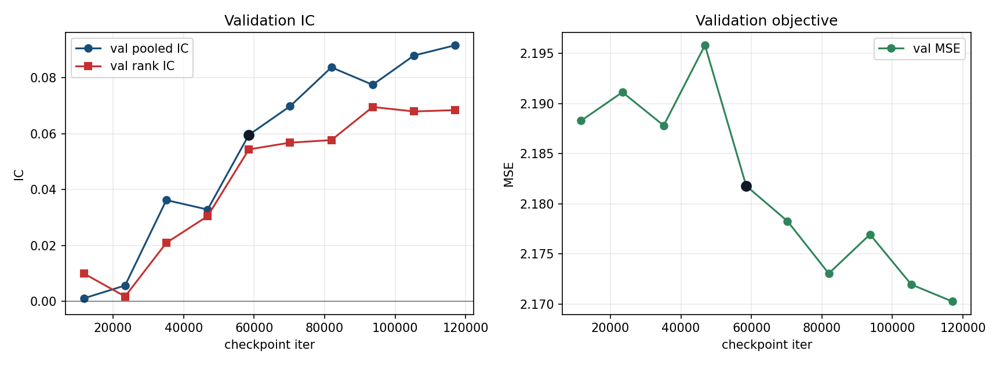

### Checkpoint Selection Metrics

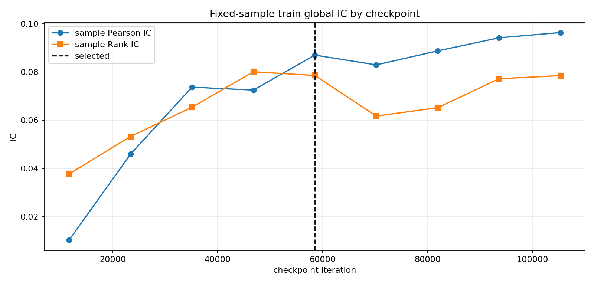

### Fixed-Sample Train Global IC By Checkpoint

### 4.2. Model And Method

本实验仅改变 active feature projection 或 context architecture. 

| experiment | status | research purpose | idea | source | baseline difference | concrete method | formula summary |
| --- | --- | --- | --- | --- | --- | --- | --- |
| control_34d | complete | 建立不使用显式横截面 rank 或市场集合上下文的 matched baseline.  | 只让共享 GRU 编码每只股票自身 60 根分钟序列, 隔离后续横截面增量.  | 0825 feature-audit 的 34D baseline; matched ablation 设计.  | 参考臂; 定义其他实验的 feature/context 增量, 不额外引入横截面输入.  | 41D 物理输入在 train-only pooled z-score 后固定屏蔽 7 个 rank 列; 逐股票 GRU hidden 直接进入公共预测头.  | x_tilde[i,t] = m_base * z_train(x[i,t]); h_i = GRU(x_tilde[i,1:60])_last; y_hat_i = rho(h_i) |

### 4.2.1. GRU

所有臂共享两层单向 GRU 编码器. 

| field | value |
| --- | --- |
| input_tensor | batch, panel, 60, 41 |
| gru_hidden_size | 384 |
| gru_num_layers | 2 |
| gru_bidirectional | False |
| gru_dropout | 0.000000 |

### 4.2.2. MLP

公共预测头使用 Linear-LayerNorm-ReLU block; context 臂将 hidden 与 context 拼接. 

| field | value |
| --- | --- |
| mlp_effective_hidden_width | 512, 512 |
| mlp_dropout | 0.000000 |
| trainable_parameter | 1,841,281 |

### 4.2.3. Method

41D 物理输入在 train-only pooled z-score 后固定屏蔽 7 个 rank 列; 逐股票 GRU hidden 直接进入公共预测头. 

| field | value |
| --- | --- |
| parameter_initialization | PyTorch default GRU/Linear; Xavier inducing tokens |
| lr_scheduler/type | 200-step LinearWarmup + CosineAnnealing |
| optimizer | AdamW |
| approx_total_epochs | 1 exact sampler epoch |
| final_iter | 117047 |
| checkpoint_selection | early_top_k |

| step | operation |
| --- | --- |
| 1 | 对共享 41D 物理输入执行 train-only pooled z-score.  |
| 2 | 用固定 mask 将 7 个 rank 列置零, 保留 34 个 base feature.  |
| 3 | 两层 GRU 编码 60-bar 序列, 最后时点 hidden 输入公共 MLP.  |

| symbol | formula | implementation meaning |
| --- | --- | --- |
| Active input | x_tilde[i,t] = m_base * z_train(x[i,t]) | m_base 只开启 34 个 base feature.  |
| Temporal encoder | h_i = GRU(x_tilde[i,1:60])_last | h_i 是股票 i 的 384D 最终 hidden.  |
| Prediction | y_hat_i = rho(h_i) | rho 是共享 Linear-LayerNorm-ReLU 预测头.  |

### 4.3. Training Monitoring

TensorBoard event files和资源监控 JSONL 共同提供训练过程证据. 

| samples | host CPU % | process CPU % | RSS GiB | host RAM % | min free RAM GiB | GPU MiB | GPU util % | GPU temp C | min cache GiB |
| --- | --- | --- | --- | --- | --- | --- | --- | --- | --- |
| 766 | 54.100000 | 1200.729137 | 49.514076 | 22.100000 | 392.362053 | 9579.000000 | 100.000000 | 87.000000 | 210.100769 |

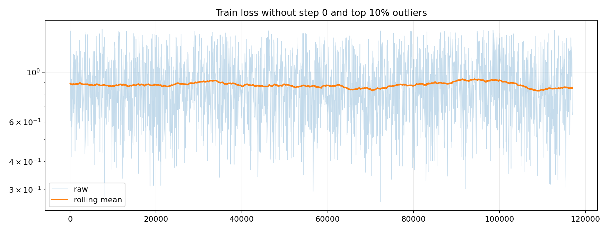

### Train Loss

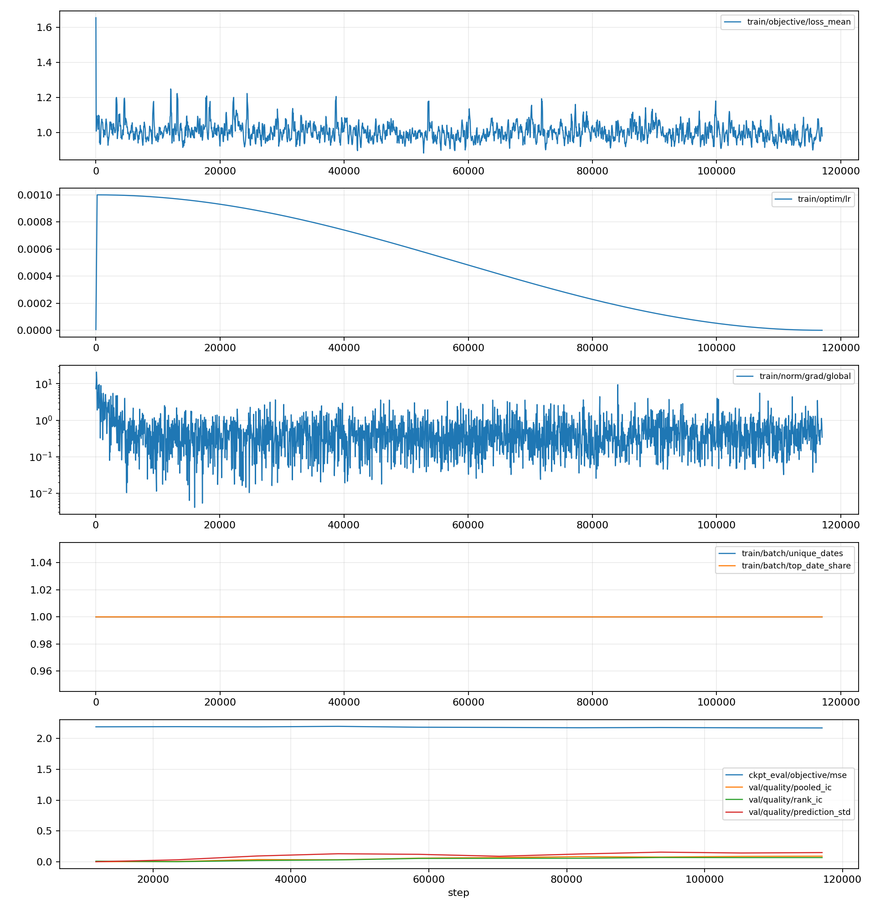

### Train Monitoring Curves

05

5. Trading And Cost

### Trading And Cost

只有完成正式 test 和 backtest 的实验臂报告 execution-aware 摘要. 

### 5.0. Cost Model Status

ETF proxy 使用完整 train-validation-test 时间线; raw forward log return 经 expm1 转为 simple return 后复利. 

| field | value |
| --- | --- |
| status | available |
| available_metric | 10M AUM execution-aware portfolio summary |

| gross daily | gross Sharpe | net daily 10M | net Sharpe 10M | max drawdown | turnover | fill |
| --- | --- | --- | --- | --- | --- | --- |
| 76.39 bps | 31.769134 | -160.62 bps | -41.621835 | -96.34% | 11.815937 | 94.03% |

### 5.1. Cumulative Prediction, Real, And Excess Returns

按 pool 使用 trailing threshold, 5-minute rebalance 与连续 full-hold benchmark. 

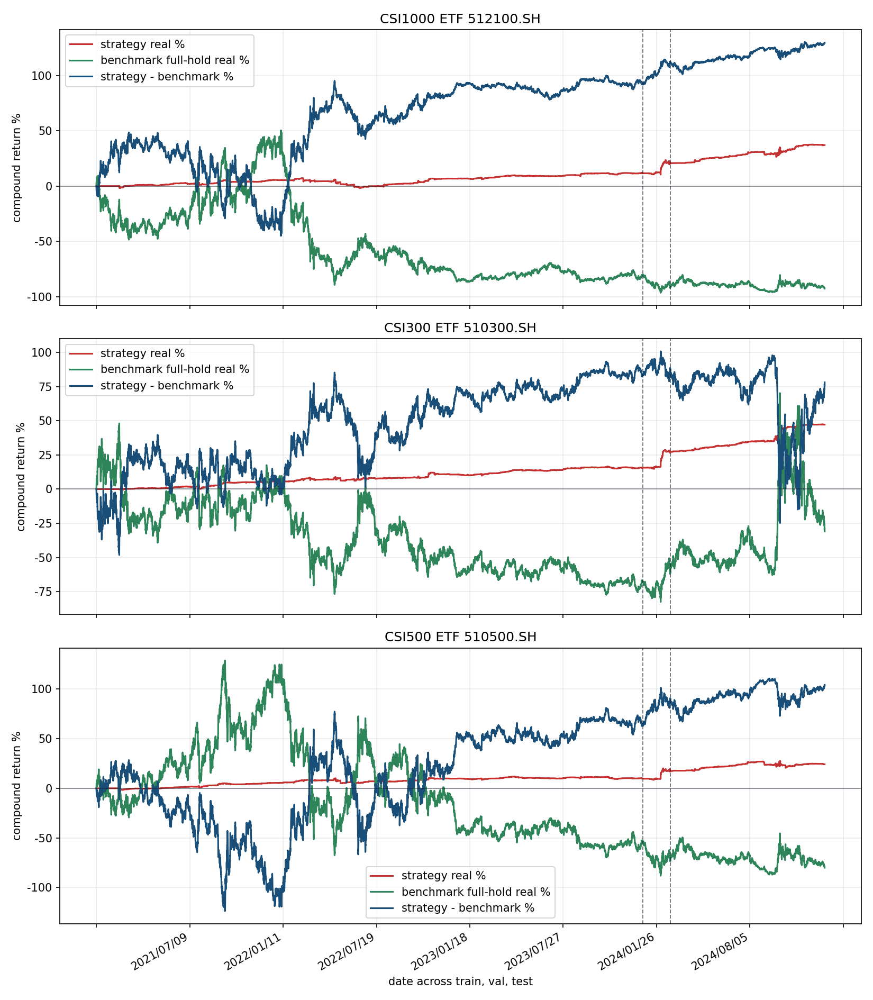

### Train/Val/Test Cumulative Returns

### 5.2. Single-Side Cost Sensitivity

成本扫描同时报告完整 timeline, test-only 以及排除 2024-09/10 的 test. 

| pool | date | test_minute_index | single_side_cost_bps | net_strategy_cumulative_return |
| --- | --- | --- | --- | --- |
| csi1000_etf_sh | 240301 | 1 | 0.000000 | 0.000000 |
| csi1000_etf_sh | 240301 | 2 | 0.000000 | 0.000000 |
| csi1000_etf_sh | 240301 | 3 | 0.000000 | 0.000000 |
| csi1000_etf_sh | 240301 | 4 | 0.000000 | 0.000000 |
| csi1000_etf_sh | 240301 | 5 | 0.000000 | 0.000000 |
| csi1000_etf_sh | 240301 | 6 | 0.000000 | 0.000000 |
| csi1000_etf_sh | 240301 | 7 | 0.000000 | 0.000000 |
| csi1000_etf_sh | 240301 | 8 | 0.000000 | 0.000000 |
| csi1000_etf_sh | 240301 | 9 | 0.000000 | 0.000000 |
| csi1000_etf_sh | 240301 | 10 | 0.000000 | 0.000000 |
| csi1000_etf_sh | 240301 | 11 | 0.000000 | 0.000000 |
| csi1000_etf_sh | 240301 | 12 | 0.000000 | 0.000000 |
| csi1000_etf_sh | 240301 | 13 | 0.000000 | 0.000000 |
| csi1000_etf_sh | 240301 | 14 | 0.000000 | 0.000000 |
| csi1000_etf_sh | 240301 | 15 | 0.000000 | 0.000000 |
| csi1000_etf_sh | 240301 | 16 | 0.000000 | 0.000000 |
| csi1000_etf_sh | 240301 | 17 | 0.000000 | 0.000000 |
| csi1000_etf_sh | 240301 | 18 | 0.000000 | 0.000000 |
| csi1000_etf_sh | 240301 | 19 | 0.000000 | 0.000000 |
| csi1000_etf_sh | 240301 | 20 | 0.000000 | 0.000000 |
| csi1000_etf_sh | 240301 | 21 | 0.000000 | 0.000000 |
| csi1000_etf_sh | 240301 | 22 | 0.000000 | 0.000000 |
| csi1000_etf_sh | 240301 | 23 | 0.000000 | 0.000000 |
| csi1000_etf_sh | 240301 | 24 | 0.000000 | 0.000000 |
| csi1000_etf_sh | 240301 | 25 | 0.000000 | 0.000000 |
| csi1000_etf_sh | 240301 | 26 | 0.000000 | 0.000000 |
| csi1000_etf_sh | 240301 | 27 | 0.000000 | 0.000000 |
| csi1000_etf_sh | 240301 | 28 | 0.000000 | 0.000000 |
| csi1000_etf_sh | 240301 | 29 | 0.000000 | 0.000000 |
| csi1000_etf_sh | 240301 | 30 | 0.000000 | 0.000000 |
| csi1000_etf_sh | 240301 | 31 | 0.000000 | 0.000000 |
| csi1000_etf_sh | 240301 | 32 | 0.000000 | 0.000000 |
| csi1000_etf_sh | 240301 | 33 | 0.000000 | 0.000000 |
| csi1000_etf_sh | 240301 | 34 | 0.000000 | 0.000000 |
| csi1000_etf_sh | 240301 | 35 | 0.000000 | 0.000000 |
| csi1000_etf_sh | 240301 | 36 | 0.000000 | 0.000000 |
| csi1000_etf_sh | 240301 | 37 | 0.000000 | 0.000000 |
| csi1000_etf_sh | 240301 | 38 | 0.000000 | 0.000000 |
| csi1000_etf_sh | 240301 | 39 | 0.000000 | 0.000000 |
| csi1000_etf_sh | 240301 | 40 | 0.000000 | 0.000000 |
| csi1000_etf_sh | 240301 | 41 | 0.000000 | 0.000000 |
| csi1000_etf_sh | 240301 | 42 | 0.000000 | 0.002615 |
| csi1000_etf_sh | 240301 | 43 | 0.000000 | 0.002615 |
| csi1000_etf_sh | 240301 | 44 | 0.000000 | 0.002615 |
| csi1000_etf_sh | 240301 | 45 | 0.000000 | 0.002615 |
| csi1000_etf_sh | 240301 | 46 | 0.000000 | 0.002615 |
| csi1000_etf_sh | 240301 | 47 | 0.000000 | 0.002615 |
| csi1000_etf_sh | 240301 | 48 | 0.000000 | 0.002615 |
| csi1000_etf_sh | 240301 | 49 | 0.000000 | 0.002615 |
| csi1000_etf_sh | 240301 | 50 | 0.000000 | 0.002615 |
| csi1000_etf_sh | 240301 | 51 | 0.000000 | 0.002615 |
| csi1000_etf_sh | 240301 | 52 | 0.000000 | 0.002615 |
| csi1000_etf_sh | 240301 | 53 | 0.000000 | 0.002615 |
| csi1000_etf_sh | 240301 | 54 | 0.000000 | 0.002615 |
| csi1000_etf_sh | 240301 | 55 | 0.000000 | 0.002615 |
| csi1000_etf_sh | 240301 | 56 | 0.000000 | 0.002615 |
| csi1000_etf_sh | 240301 | 57 | 0.000000 | 0.002615 |
| csi1000_etf_sh | 240301 | 58 | 0.000000 | 0.002615 |
| csi1000_etf_sh | 240301 | 59 | 0.000000 | 0.002615 |
| csi1000_etf_sh | 240301 | 60 | 0.000000 | 0.002615 |
| csi500_etf_sh | 241231 | 32946 | 10.000000 | -0.304791 |
| csi500_etf_sh | 241231 | 32947 | 10.000000 | -0.304791 |
| csi500_etf_sh | 241231 | 32948 | 10.000000 | -0.304791 |
| csi500_etf_sh | 241231 | 32949 | 10.000000 | -0.304791 |
| csi500_etf_sh | 241231 | 32950 | 10.000000 | -0.304791 |
| csi500_etf_sh | 241231 | 32951 | 10.000000 | -0.304791 |
| csi500_etf_sh | 241231 | 32952 | 10.000000 | -0.304791 |
| csi500_etf_sh | 241231 | 32953 | 10.000000 | -0.304791 |
| csi500_etf_sh | 241231 | 32954 | 10.000000 | -0.304791 |
| csi500_etf_sh | 241231 | 32955 | 10.000000 | -0.304791 |
| csi500_etf_sh | 241231 | 32956 | 10.000000 | -0.304791 |
| csi500_etf_sh | 241231 | 32957 | 10.000000 | -0.304791 |
| csi500_etf_sh | 241231 | 32958 | 10.000000 | -0.304791 |
| csi500_etf_sh | 241231 | 32959 | 10.000000 | -0.304791 |
| csi500_etf_sh | 241231 | 32960 | 10.000000 | -0.304791 |
| csi500_etf_sh | 241231 | 32961 | 10.000000 | -0.304791 |
| csi500_etf_sh | 241231 | 32962 | 10.000000 | -0.304791 |
| csi500_etf_sh | 241231 | 32963 | 10.000000 | -0.304791 |
| csi500_etf_sh | 241231 | 32964 | 10.000000 | -0.304791 |
| csi500_etf_sh | 241231 | 32965 | 10.000000 | -0.304791 |
| csi500_etf_sh | 241231 | 32966 | 10.000000 | -0.304791 |
| csi500_etf_sh | 241231 | 32967 | 10.000000 | -0.304791 |
| csi500_etf_sh | 241231 | 32968 | 10.000000 | -0.304791 |
| csi500_etf_sh | 241231 | 32969 | 10.000000 | -0.304791 |
| csi500_etf_sh | 241231 | 32970 | 10.000000 | -0.304791 |
| csi500_etf_sh | 241231 | 32971 | 10.000000 | -0.304791 |
| csi500_etf_sh | 241231 | 32972 | 10.000000 | -0.304791 |
| csi500_etf_sh | 241231 | 32973 | 10.000000 | -0.304791 |
| csi500_etf_sh | 241231 | 32974 | 10.000000 | -0.304791 |
| csi500_etf_sh | 241231 | 32975 | 10.000000 | -0.304791 |
| csi500_etf_sh | 241231 | 32976 | 10.000000 | -0.304791 |
| csi500_etf_sh | 241231 | 32977 | 10.000000 | -0.304791 |
| csi500_etf_sh | 241231 | 32978 | 10.000000 | -0.304791 |
| csi500_etf_sh | 241231 | 32979 | 10.000000 | -0.304791 |
| csi500_etf_sh | 241231 | 32980 | 10.000000 | -0.304791 |
| csi500_etf_sh | 241231 | 32981 | 10.000000 | -0.304791 |
| csi500_etf_sh | 241231 | 32982 | 10.000000 | -0.304791 |
| csi500_etf_sh | 241231 | 32983 | 10.000000 | -0.304791 |
| csi500_etf_sh | 241231 | 32984 | 10.000000 | -0.304791 |
| csi500_etf_sh | 241231 | 32985 | 10.000000 | -0.304791 |
| csi500_etf_sh | 241231 | 32986 | 10.000000 | -0.304791 |
| csi500_etf_sh | 241231 | 32987 | 10.000000 | -0.304791 |
| csi500_etf_sh | 241231 | 32988 | 10.000000 | -0.304791 |
| csi500_etf_sh | 241231 | 32989 | 10.000000 | -0.304791 |
| csi500_etf_sh | 241231 | 32990 | 10.000000 | -0.304791 |
| csi500_etf_sh | 241231 | 32991 | 10.000000 | -0.304791 |
| csi500_etf_sh | 241231 | 32992 | 10.000000 | -0.304791 |
| csi500_etf_sh | 241231 | 32993 | 10.000000 | -0.304791 |
| csi500_etf_sh | 241231 | 32994 | 10.000000 | -0.304791 |
| csi500_etf_sh | 241231 | 32995 | 10.000000 | -0.304791 |
| csi500_etf_sh | 241231 | 32996 | 10.000000 | -0.304791 |
| csi500_etf_sh | 241231 | 32997 | 10.000000 | -0.304791 |
| csi500_etf_sh | 241231 | 32998 | 10.000000 | -0.304791 |
| csi500_etf_sh | 241231 | 32999 | 10.000000 | -0.304791 |
| csi500_etf_sh | 241231 | 33000 | 10.000000 | -0.304791 |
| csi500_etf_sh | 241231 | 33001 | 10.000000 | -0.304791 |
| csi500_etf_sh | 241231 | 33002 | 10.000000 | -0.304791 |
| csi500_etf_sh | 241231 | 33003 | 10.000000 | -0.304791 |
| csi500_etf_sh | 241231 | 33004 | 10.000000 | -0.304791 |
| csi500_etf_sh | 241231 | 33005 | 10.000000 | -0.304791 |

| split | pool | date | day_index | single_side_cost_bps | net_strategy_cumulative_return |
| --- | --- | --- | --- | --- | --- |
| train | csi1000_etf_sh | 210104 | 1 | 0.000000 | 0.000000 |
| train | csi1000_etf_sh | 210104 | 2 | 0.000000 | 0.000000 |
| train | csi1000_etf_sh | 210104 | 3 | 0.000000 | 0.000000 |
| train | csi1000_etf_sh | 210104 | 4 | 0.000000 | 0.000000 |
| train | csi1000_etf_sh | 210104 | 5 | 0.000000 | 0.000000 |
| train | csi1000_etf_sh | 210104 | 6 | 0.000000 | 0.000000 |
| train | csi1000_etf_sh | 210104 | 7 | 0.000000 | 0.000000 |
| train | csi1000_etf_sh | 210104 | 8 | 0.000000 | 0.000000 |
| train | csi1000_etf_sh | 210104 | 9 | 0.000000 | 0.000000 |
| train | csi1000_etf_sh | 210104 | 10 | 0.000000 | 0.000000 |
| train | csi1000_etf_sh | 210104 | 11 | 0.000000 | 0.000000 |
| train | csi1000_etf_sh | 210104 | 12 | 0.000000 | 0.000000 |
| train | csi1000_etf_sh | 210104 | 13 | 0.000000 | 0.000000 |
| train | csi1000_etf_sh | 210104 | 14 | 0.000000 | 0.000000 |
| train | csi1000_etf_sh | 210104 | 15 | 0.000000 | 0.000000 |
| train | csi1000_etf_sh | 210104 | 16 | 0.000000 | 0.000000 |
| train | csi1000_etf_sh | 210104 | 17 | 0.000000 | 0.000000 |
| train | csi1000_etf_sh | 210104 | 18 | 0.000000 | 0.000000 |
| train | csi1000_etf_sh | 210104 | 19 | 0.000000 | 0.000000 |
| train | csi1000_etf_sh | 210104 | 20 | 0.000000 | 0.000000 |
| train | csi1000_etf_sh | 210104 | 21 | 0.000000 | 0.000000 |
| train | csi1000_etf_sh | 210104 | 22 | 0.000000 | 0.000000 |
| train | csi1000_etf_sh | 210104 | 23 | 0.000000 | 0.000000 |
| train | csi1000_etf_sh | 210104 | 24 | 0.000000 | 0.000000 |
| train | csi1000_etf_sh | 210104 | 25 | 0.000000 | 0.000000 |
| train | csi1000_etf_sh | 210104 | 26 | 0.000000 | 0.000000 |
| train | csi1000_etf_sh | 210104 | 27 | 0.000000 | 0.000000 |
| train | csi1000_etf_sh | 210104 | 28 | 0.000000 | 0.000000 |
| train | csi1000_etf_sh | 210104 | 29 | 0.000000 | 0.000000 |
| train | csi1000_etf_sh | 210104 | 30 | 0.000000 | 0.000000 |
| train | csi1000_etf_sh | 210104 | 31 | 0.000000 | 0.000000 |
| train | csi1000_etf_sh | 210104 | 32 | 0.000000 | 0.000000 |
| train | csi1000_etf_sh | 210104 | 33 | 0.000000 | 0.000000 |
| train | csi1000_etf_sh | 210104 | 34 | 0.000000 | 0.000000 |
| train | csi1000_etf_sh | 210104 | 35 | 0.000000 | 0.000000 |
| train | csi1000_etf_sh | 210104 | 36 | 0.000000 | 0.000000 |
| train | csi1000_etf_sh | 210104 | 37 | 0.000000 | 0.000000 |
| train | csi1000_etf_sh | 210104 | 38 | 0.000000 | 0.000000 |
| train | csi1000_etf_sh | 210104 | 39 | 0.000000 | 0.000000 |
| train | csi1000_etf_sh | 210104 | 40 | 0.000000 | 0.000000 |
| train | csi1000_etf_sh | 210104 | 41 | 0.000000 | 0.000000 |
| train | csi1000_etf_sh | 210104 | 42 | 0.000000 | 0.000000 |
| train | csi1000_etf_sh | 210104 | 43 | 0.000000 | 0.000000 |
| train | csi1000_etf_sh | 210104 | 44 | 0.000000 | 0.000000 |
| train | csi1000_etf_sh | 210104 | 45 | 0.000000 | 0.000000 |
| train | csi1000_etf_sh | 210104 | 46 | 0.000000 | 0.000000 |
| train | csi1000_etf_sh | 210104 | 47 | 0.000000 | 0.000000 |
| train | csi1000_etf_sh | 210104 | 48 | 0.000000 | 0.000000 |
| train | csi1000_etf_sh | 210104 | 49 | 0.000000 | 0.000000 |
| train | csi1000_etf_sh | 210104 | 50 | 0.000000 | 0.000000 |
| train | csi1000_etf_sh | 210104 | 51 | 0.000000 | 0.000000 |
| train | csi1000_etf_sh | 210104 | 52 | 0.000000 | 0.000000 |
| train | csi1000_etf_sh | 210104 | 53 | 0.000000 | 0.000000 |
| train | csi1000_etf_sh | 210104 | 54 | 0.000000 | 0.000000 |
| train | csi1000_etf_sh | 210104 | 55 | 0.000000 | 0.000000 |
| train | csi1000_etf_sh | 210104 | 56 | 0.000000 | 0.000000 |
| train | csi1000_etf_sh | 210104 | 57 | 0.000000 | 0.000000 |
| train | csi1000_etf_sh | 210104 | 58 | 0.000000 | 0.000000 |
| train | csi1000_etf_sh | 210104 | 59 | 0.000000 | 0.000000 |
| train | csi1000_etf_sh | 210104 | 60 | 0.000000 | 0.000000 |
| test | csi500_etf_sh | 241231 | 155950 | 10.000000 | -0.819550 |
| test | csi500_etf_sh | 241231 | 155951 | 10.000000 | -0.819550 |
| test | csi500_etf_sh | 241231 | 155952 | 10.000000 | -0.819550 |
| test | csi500_etf_sh | 241231 | 155953 | 10.000000 | -0.819550 |
| test | csi500_etf_sh | 241231 | 155954 | 10.000000 | -0.819550 |
| test | csi500_etf_sh | 241231 | 155955 | 10.000000 | -0.819550 |
| test | csi500_etf_sh | 241231 | 155956 | 10.000000 | -0.819550 |
| test | csi500_etf_sh | 241231 | 155957 | 10.000000 | -0.819550 |
| test | csi500_etf_sh | 241231 | 155958 | 10.000000 | -0.819550 |
| test | csi500_etf_sh | 241231 | 155959 | 10.000000 | -0.819550 |
| test | csi500_etf_sh | 241231 | 155960 | 10.000000 | -0.819550 |
| test | csi500_etf_sh | 241231 | 155961 | 10.000000 | -0.819550 |
| test | csi500_etf_sh | 241231 | 155962 | 10.000000 | -0.819550 |
| test | csi500_etf_sh | 241231 | 155963 | 10.000000 | -0.819550 |
| test | csi500_etf_sh | 241231 | 155964 | 10.000000 | -0.819550 |
| test | csi500_etf_sh | 241231 | 155965 | 10.000000 | -0.819550 |
| test | csi500_etf_sh | 241231 | 155966 | 10.000000 | -0.819550 |
| test | csi500_etf_sh | 241231 | 155967 | 10.000000 | -0.819550 |
| test | csi500_etf_sh | 241231 | 155968 | 10.000000 | -0.819550 |
| test | csi500_etf_sh | 241231 | 155969 | 10.000000 | -0.819550 |
| test | csi500_etf_sh | 241231 | 155970 | 10.000000 | -0.819550 |
| test | csi500_etf_sh | 241231 | 155971 | 10.000000 | -0.819550 |
| test | csi500_etf_sh | 241231 | 155972 | 10.000000 | -0.819550 |
| test | csi500_etf_sh | 241231 | 155973 | 10.000000 | -0.819550 |
| test | csi500_etf_sh | 241231 | 155974 | 10.000000 | -0.819550 |
| test | csi500_etf_sh | 241231 | 155975 | 10.000000 | -0.819550 |
| test | csi500_etf_sh | 241231 | 155976 | 10.000000 | -0.819550 |
| test | csi500_etf_sh | 241231 | 155977 | 10.000000 | -0.819550 |
| test | csi500_etf_sh | 241231 | 155978 | 10.000000 | -0.819550 |
| test | csi500_etf_sh | 241231 | 155979 | 10.000000 | -0.819550 |
| test | csi500_etf_sh | 241231 | 155980 | 10.000000 | -0.819550 |
| test | csi500_etf_sh | 241231 | 155981 | 10.000000 | -0.819550 |
| test | csi500_etf_sh | 241231 | 155982 | 10.000000 | -0.819550 |
| test | csi500_etf_sh | 241231 | 155983 | 10.000000 | -0.819550 |
| test | csi500_etf_sh | 241231 | 155984 | 10.000000 | -0.819550 |
| test | csi500_etf_sh | 241231 | 155985 | 10.000000 | -0.819550 |
| test | csi500_etf_sh | 241231 | 155986 | 10.000000 | -0.819550 |
| test | csi500_etf_sh | 241231 | 155987 | 10.000000 | -0.819550 |
| test | csi500_etf_sh | 241231 | 155988 | 10.000000 | -0.819550 |
| test | csi500_etf_sh | 241231 | 155989 | 10.000000 | -0.819550 |
| test | csi500_etf_sh | 241231 | 155990 | 10.000000 | -0.819550 |
| test | csi500_etf_sh | 241231 | 155991 | 10.000000 | -0.819550 |
| test | csi500_etf_sh | 241231 | 155992 | 10.000000 | -0.819550 |
| test | csi500_etf_sh | 241231 | 155993 | 10.000000 | -0.819550 |
| test | csi500_etf_sh | 241231 | 155994 | 10.000000 | -0.819550 |
| test | csi500_etf_sh | 241231 | 155995 | 10.000000 | -0.819550 |
| test | csi500_etf_sh | 241231 | 155996 | 10.000000 | -0.819550 |
| test | csi500_etf_sh | 241231 | 155997 | 10.000000 | -0.819550 |
| test | csi500_etf_sh | 241231 | 155998 | 10.000000 | -0.819550 |
| test | csi500_etf_sh | 241231 | 155999 | 10.000000 | -0.819550 |
| test | csi500_etf_sh | 241231 | 156000 | 10.000000 | -0.819550 |
| test | csi500_etf_sh | 241231 | 156001 | 10.000000 | -0.819550 |
| test | csi500_etf_sh | 241231 | 156002 | 10.000000 | -0.819550 |
| test | csi500_etf_sh | 241231 | 156003 | 10.000000 | -0.819550 |
| test | csi500_etf_sh | 241231 | 156004 | 10.000000 | -0.819550 |
| test | csi500_etf_sh | 241231 | 156005 | 10.000000 | -0.819550 |
| test | csi500_etf_sh | 241231 | 156006 | 10.000000 | -0.819550 |
| test | csi500_etf_sh | 241231 | 156007 | 10.000000 | -0.819550 |
| test | csi500_etf_sh | 241231 | 156008 | 10.000000 | -0.819550 |
| test | csi500_etf_sh | 241231 | 156009 | 10.000000 | -0.819550 |

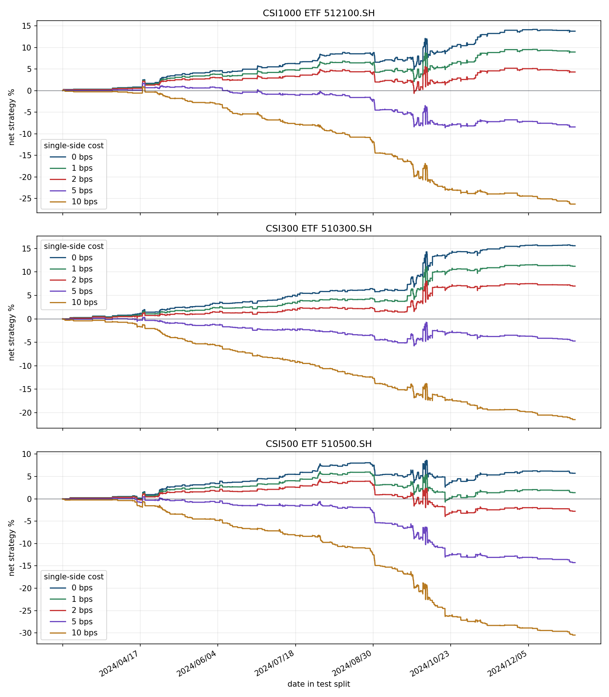

### Test Cost Sensitivity

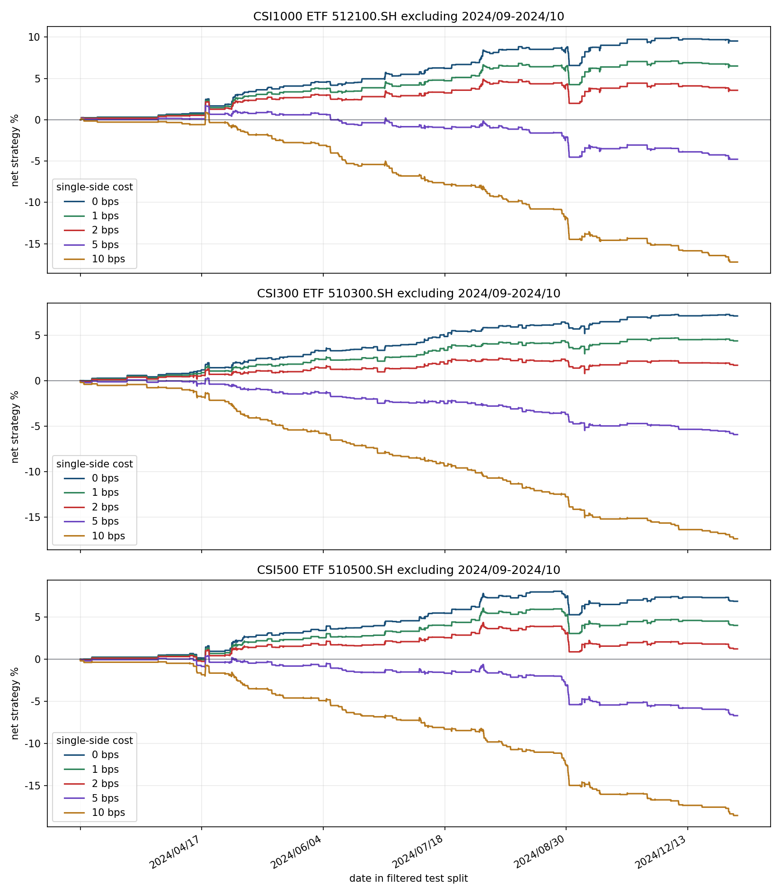

### Test Cost Sensitivity Excluding 2024-09/10

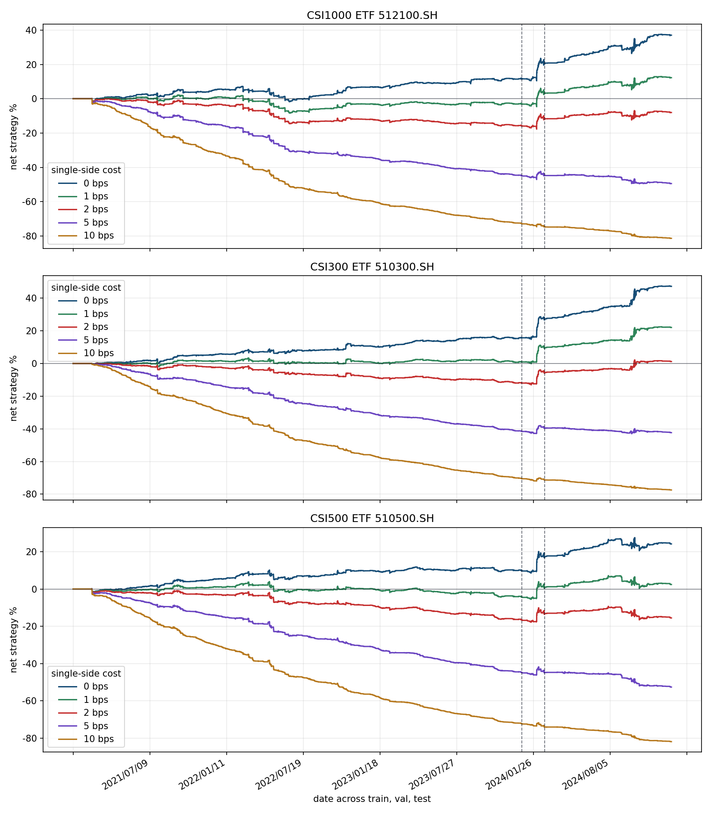

### Full Timeline Cost Sensitivity

### 5.3. ETF Trade Return Distribution

Trade rows are defined by position open/close episodes under the same ETF proxy rule.

| scope | pool | display_name | trade_id | start_date | start_time | end_date | end_time | holding_minutes | trade_return_bps |
| --- | --- | --- | --- | --- | --- | --- | --- | --- | --- |
| train_val_test | csi1000_etf_sh | 1000 ETF | 1 | 210219 | 143000 | 210219 | 144900 | 20 | 19.897841 |
| train_val_test | csi1000_etf_sh | 1000 ETF | 2 | 210222 | 104400 | 210222 | 104800 | 5 | 0.692940 |
| train_val_test | csi1000_etf_sh | 1000 ETF | 3 | 210222 | 134400 | 210222 | 134800 | 5 | -40.702684 |
| train_val_test | csi1000_etf_sh | 1000 ETF | 4 | 210222 | 135400 | 210222 | 135800 | 5 | -41.600097 |
| train_val_test | csi1000_etf_sh | 1000 ETF | 5 | 210222 | 140400 | 210222 | 142300 | 20 | -120.030829 |
| train_val_test | csi1000_etf_sh | 1000 ETF | 6 | 210222 | 142900 | 210222 | 143300 | 5 | 48.288681 |
| train_val_test | csi1000_etf_sh | 1000 ETF | 7 | 210222 | 144900 | 210223 | 104200 | 5 | -42.197309 |
| train_val_test | csi1000_etf_sh | 1000 ETF | 8 | 210224 | 105200 | 210224 | 105600 | 5 | 52.374853 |
| train_val_test | csi1000_etf_sh | 1000 ETF | 9 | 210301 | 141900 | 210301 | 142300 | 5 | 9.436224 |
| train_val_test | csi1000_etf_sh | 1000 ETF | 10 | 210301 | 142900 | 210302 | 104200 | 25 | 64.112973 |
| train_val_test | csi1000_etf_sh | 1000 ETF | 11 | 210302 | 105800 | 210302 | 110200 | 5 | 20.014286 |
| train_val_test | csi1000_etf_sh | 1000 ETF | 12 | 210302 | 111800 | 210302 | 112200 | 5 | 5.389587 |
| train_val_test | csi1000_etf_sh | 1000 ETF | 13 | 210302 | 132800 | 210302 | 133200 | 5 | 18.251585 |
| train_val_test | csi1000_etf_sh | 1000 ETF | 14 | 210303 | 143700 | 210304 | 104000 | 15 | 24.121875 |
| train_val_test | csi1000_etf_sh | 1000 ETF | 15 | 210304 | 143600 | 210304 | 144000 | 5 | -14.000427 |
| train_val_test | csi1000_etf_sh | 1000 ETF | 16 | 210305 | 143500 | 210305 | 143900 | 5 | 3.832315 |
| train_val_test | csi1000_etf_sh | 1000 ETF | 17 | 210308 | 144400 | 210308 | 144800 | 5 | 2.899047 |
| train_val_test | csi1000_etf_sh | 1000 ETF | 18 | 210311 | 141600 | 210311 | 142000 | 5 | -0.887957 |
| train_val_test | csi1000_etf_sh | 1000 ETF | 19 | 210311 | 144600 | 210312 | 103900 | 5 | 19.248751 |
| train_val_test | csi1000_etf_sh | 1000 ETF | 20 | 210316 | 144800 | 210317 | 104100 | 5 | 6.155006 |
| train_val_test | csi1000_etf_sh | 1000 ETF | 21 | 210317 | 143700 | 210317 | 144600 | 10 | 5.385392 |
| train_val_test | csi1000_etf_sh | 1000 ETF | 22 | 210318 | 144100 | 210319 | 103900 | 10 | -1.375595 |
| train_val_test | csi1000_etf_sh | 1000 ETF | 23 | 210322 | 143400 | 210323 | 104200 | 20 | 35.104233 |
| train_val_test | csi1000_etf_sh | 1000 ETF | 24 | 210323 | 110300 | 210323 | 110700 | 5 | 14.969964 |
| train_val_test | csi1000_etf_sh | 1000 ETF | 25 | 210326 | 141500 | 210326 | 141900 | 5 | 2.586538 |
| train_val_test | csi1000_etf_sh | 1000 ETF | 26 | 210326 | 143000 | 210326 | 144900 | 20 | 7.395386 |
| train_val_test | csi1000_etf_sh | 1000 ETF | 27 | 210329 | 144400 | 210330 | 104200 | 10 | 3.663904 |
| train_val_test | csi1000_etf_sh | 1000 ETF | 28 | 210401 | 144100 | 210402 | 103900 | 10 | -8.535919 |
| train_val_test | csi1000_etf_sh | 1000 ETF | 29 | 210402 | 144500 | 210402 | 144900 | 5 | 7.432407 |
| train_val_test | csi1000_etf_sh | 1000 ETF | 30 | 210406 | 143400 | 210407 | 104200 | 20 | -5.766769 |
| train_val_test | csi1000_etf_sh | 1000 ETF | 31 | 210407 | 143800 | 210408 | 104100 | 15 | 16.687465 |
| train_val_test | csi1000_etf_sh | 1000 ETF | 32 | 210408 | 143700 | 210408 | 144100 | 5 | -6.421630 |
| train_val_test | csi1000_etf_sh | 1000 ETF | 33 | 210408 | 144700 | 210409 | 104000 | 5 | -10.391758 |
| train_val_test | csi1000_etf_sh | 1000 ETF | 34 | 210414 | 142300 | 210414 | 142700 | 5 | -1.838122 |
| train_val_test | csi1000_etf_sh | 1000 ETF | 35 | 210414 | 144800 | 210415 | 104100 | 5 | 3.934715 |
| train_val_test | csi1000_etf_sh | 1000 ETF | 36 | 210415 | 143200 | 210415 | 143600 | 5 | -0.249039 |
| train_val_test | csi1000_etf_sh | 1000 ETF | 37 | 210415 | 144700 | 210416 | 104000 | 5 | 4.567338 |
| train_val_test | csi1000_etf_sh | 1000 ETF | 38 | 210416 | 140600 | 210416 | 141500 | 10 | 7.941507 |
| train_val_test | csi1000_etf_sh | 1000 ETF | 39 | 210416 | 142600 | 210419 | 103900 | 25 | 0.922857 |
| train_val_test | csi1000_etf_sh | 1000 ETF | 40 | 210419 | 110000 | 210419 | 110400 | 5 | 3.354812 |
| train_val_test | csi1000_etf_sh | 1000 ETF | 41 | 210419 | 131000 | 210419 | 131400 | 5 | -1.938074 |
| train_val_test | csi1000_etf_sh | 1000 ETF | 42 | 210419 | 142500 | 210419 | 144900 | 25 | 3.400435 |
| train_val_test | csi1000_etf_sh | 1000 ETF | 43 | 210420 | 140900 | 210420 | 141300 | 5 | -2.153158 |
| train_val_test | csi1000_etf_sh | 1000 ETF | 44 | 210420 | 144400 | 210421 | 104200 | 10 | -4.085718 |
| train_val_test | csi1000_etf_sh | 1000 ETF | 45 | 210422 | 144700 | 210423 | 104000 | 5 | 6.945729 |
| train_val_test | csi1000_etf_sh | 1000 ETF | 46 | 210426 | 144000 | 210426 | 144900 | 10 | -33.106086 |
| train_val_test | csi1000_etf_sh | 1000 ETF | 47 | 210429 | 144200 | 210430 | 104000 | 10 | -25.252254 |
| train_val_test | csi1000_etf_sh | 1000 ETF | 48 | 210506 | 104500 | 210506 | 104900 | 5 | -6.221642 |
| train_val_test | csi1000_etf_sh | 1000 ETF | 49 | 210512 | 143100 | 210513 | 103900 | 20 | 17.993338 |
| train_val_test | csi1000_etf_sh | 1000 ETF | 50 | 210513 | 112500 | 210513 | 112900 | 5 | -9.932972 |
| train_val_test | csi1000_etf_sh | 1000 ETF | 51 | 210513 | 135000 | 210513 | 135400 | 5 | 23.911141 |
| train_val_test | csi1000_etf_sh | 1000 ETF | 52 | 210513 | 143000 | 210513 | 143400 | 5 | -4.506887 |
| train_val_test | csi1000_etf_sh | 1000 ETF | 53 | 210514 | 142900 | 210514 | 143300 | 5 | 3.171852 |
| train_val_test | csi1000_etf_sh | 1000 ETF | 54 | 210514 | 143900 | 210517 | 104200 | 15 | 20.400074 |
| train_val_test | csi1000_etf_sh | 1000 ETF | 55 | 210517 | 144300 | 210517 | 144700 | 5 | 3.183404 |
| train_val_test | csi1000_etf_sh | 1000 ETF | 56 | 210518 | 144200 | 210519 | 104000 | 10 | 8.322374 |
| train_val_test | csi1000_etf_sh | 1000 ETF | 57 | 210519 | 144100 | 210519 | 144500 | 5 | 2.448886 |
| train_val_test | csi1000_etf_sh | 1000 ETF | 58 | 210521 | 144400 | 210524 | 104200 | 10 | 11.466160 |
| train_val_test | csi1000_etf_sh | 1000 ETF | 59 | 210524 | 144300 | 210525 | 104100 | 10 | 16.160504 |
| train_val_test | csi1000_etf_sh | 1000 ETF | 60 | 210525 | 142700 | 210526 | 104000 | 25 | 7.238894 |
| test | csi500_etf_sh | 中证500 ETF(沪) | 905 | 241009 | 142000 | 241009 | 142900 | 10 | -41.200505 |
| test | csi500_etf_sh | 中证500 ETF(沪) | 906 | 241009 | 143500 | 241009 | 144900 | 15 | -252.895052 |
| test | csi500_etf_sh | 中证500 ETF(沪) | 907 | 241010 | 112400 | 241010 | 112800 | 5 | 78.447540 |
| test | csi500_etf_sh | 中证500 ETF(沪) | 908 | 241010 | 141900 | 241010 | 142300 | 5 | -18.390230 |
| test | csi500_etf_sh | 中证500 ETF(沪) | 909 | 241010 | 142900 | 241010 | 143300 | 5 | 26.322822 |
| test | csi500_etf_sh | 中证500 ETF(沪) | 910 | 241010 | 144400 | 241011 | 104200 | 10 | -28.383746 |
| test | csi500_etf_sh | 中证500 ETF(沪) | 911 | 241011 | 143300 | 241011 | 143700 | 5 | -42.863380 |
| test | csi500_etf_sh | 中证500 ETF(沪) | 912 | 241014 | 133200 | 241014 | 133600 | 5 | -31.558367 |
| test | csi500_etf_sh | 中证500 ETF(沪) | 913 | 241014 | 141200 | 241014 | 141600 | 5 | 0.765954 |
| test | csi500_etf_sh | 中证500 ETF(沪) | 914 | 241015 | 104100 | 241015 | 104500 | 5 | -9.675839 |
| test | csi500_etf_sh | 中证500 ETF(沪) | 915 | 241015 | 111100 | 241015 | 111500 | 5 | 24.182808 |
| test | csi500_etf_sh | 中证500 ETF(沪) | 916 | 241015 | 142100 | 241015 | 142500 | 5 | 22.993167 |
| test | csi500_etf_sh | 中证500 ETF(沪) | 917 | 241015 | 144100 | 241015 | 144500 | 5 | -24.701068 |
| test | csi500_etf_sh | 中证500 ETF(沪) | 918 | 241017 | 142400 | 241017 | 143300 | 10 | 7.174164 |
| test | csi500_etf_sh | 中证500 ETF(沪) | 919 | 241017 | 144900 | 241018 | 104200 | 5 | -4.715354 |
| test | csi500_etf_sh | 中证500 ETF(沪) | 920 | 241018 | 144300 | 241021 | 104100 | 10 | -215.959115 |
| test | csi500_etf_sh | 中证500 ETF(沪) | 921 | 241021 | 105700 | 241021 | 110100 | 5 | 39.465137 |
| test | csi500_etf_sh | 中证500 ETF(沪) | 922 | 241021 | 140200 | 241021 | 140600 | 5 | 10.898653 |
| test | csi500_etf_sh | 中证500 ETF(沪) | 923 | 241021 | 144700 | 241022 | 104000 | 5 | 14.349903 |
| test | csi500_etf_sh | 中证500 ETF(沪) | 924 | 241022 | 134600 | 241022 | 135500 | 10 | 33.702801 |
| test | csi500_etf_sh | 中证500 ETF(沪) | 925 | 241023 | 140500 | 241023 | 141400 | 10 | 40.924966 |
| test | csi500_etf_sh | 中证500 ETF(沪) | 926 | 241023 | 143500 | 241023 | 143900 | 5 | -22.071168 |
| test | csi500_etf_sh | 中证500 ETF(沪) | 927 | 241023 | 144500 | 241023 | 144900 | 5 | 15.881974 |
| test | csi500_etf_sh | 中证500 ETF(沪) | 928 | 241025 | 140300 | 241025 | 140700 | 5 | 12.197016 |
| test | csi500_etf_sh | 中证500 ETF(沪) | 929 | 241025 | 142800 | 241025 | 143200 | 5 | 17.116930 |
| test | csi500_etf_sh | 中证500 ETF(沪) | 930 | 241025 | 144300 | 241025 | 144700 | 5 | 18.034456 |
| test | csi500_etf_sh | 中证500 ETF(沪) | 931 | 241029 | 112100 | 241029 | 112500 | 5 | -51.315758 |
| test | csi500_etf_sh | 中证500 ETF(沪) | 932 | 241029 | 130100 | 241029 | 130500 | 5 | -5.068310 |
| test | csi500_etf_sh | 中证500 ETF(沪) | 933 | 241031 | 134900 | 241031 | 135300 | 5 | 50.477220 |
| test | csi500_etf_sh | 中证500 ETF(沪) | 934 | 241031 | 143400 | 241031 | 143800 | 5 | -43.244558 |
| test | csi500_etf_sh | 中证500 ETF(沪) | 935 | 241031 | 144400 | 241031 | 144800 | 5 | 15.687733 |
| test | csi500_etf_sh | 中证500 ETF(沪) | 936 | 241105 | 140100 | 241105 | 140500 | 5 | 14.338526 |
| test | csi500_etf_sh | 中证500 ETF(沪) | 937 | 241105 | 144100 | 241106 | 103900 | 10 | 9.474169 |
| test | csi500_etf_sh | 中证500 ETF(沪) | 938 | 241106 | 111500 | 241106 | 111900 | 5 | 75.063928 |
| test | csi500_etf_sh | 中证500 ETF(沪) | 939 | 241106 | 143000 | 241106 | 143400 | 5 | -32.190888 |
| test | csi500_etf_sh | 中证500 ETF(沪) | 940 | 241106 | 144500 | 241106 | 144900 | 5 | 49.402946 |
| test | csi500_etf_sh | 中证500 ETF(沪) | 941 | 241108 | 104300 | 241108 | 104700 | 5 | 40.055641 |
| test | csi500_etf_sh | 中证500 ETF(沪) | 942 | 241108 | 110800 | 241108 | 111200 | 5 | -25.527083 |
| test | csi500_etf_sh | 中证500 ETF(沪) | 943 | 241108 | 112300 | 241108 | 130200 | 10 | -0.205708 |
| test | csi500_etf_sh | 中证500 ETF(沪) | 944 | 241108 | 142800 | 241108 | 143200 | 5 | -0.662141 |
| test | csi500_etf_sh | 中证500 ETF(沪) | 945 | 241112 | 104100 | 241112 | 104500 | 5 | -0.520443 |
| test | csi500_etf_sh | 中证500 ETF(沪) | 946 | 241112 | 141100 | 241112 | 142000 | 10 | -16.339655 |
| test | csi500_etf_sh | 中证500 ETF(沪) | 947 | 241112 | 143600 | 241112 | 144000 | 5 | 3.066217 |
| test | csi500_etf_sh | 中证500 ETF(沪) | 948 | 241119 | 144100 | 241119 | 144500 | 5 | 16.465027 |
| test | csi500_etf_sh | 中证500 ETF(沪) | 949 | 241121 | 141900 | 241121 | 142300 | 5 | 32.570838 |
| test | csi500_etf_sh | 中证500 ETF(沪) | 950 | 241127 | 143500 | 241127 | 143900 | 5 | 15.450251 |
| test | csi500_etf_sh | 中证500 ETF(沪) | 951 | 241128 | 143400 | 241128 | 143800 | 5 | -26.052181 |
| test | csi500_etf_sh | 中证500 ETF(沪) | 952 | 241128 | 144400 | 241129 | 104200 | 10 | 2.757320 |
| test | csi500_etf_sh | 中证500 ETF(沪) | 953 | 241129 | 141300 | 241129 | 142200 | 10 | 4.659702 |
| test | csi500_etf_sh | 中证500 ETF(沪) | 954 | 241129 | 144800 | 241202 | 104100 | 5 | 14.117072 |
| test | csi500_etf_sh | 中证500 ETF(沪) | 955 | 241202 | 143200 | 241202 | 143600 | 5 | 21.049563 |
| test | csi500_etf_sh | 中证500 ETF(沪) | 956 | 241206 | 143800 | 241209 | 104100 | 15 | 5.766709 |
| test | csi500_etf_sh | 中证500 ETF(沪) | 957 | 241210 | 143600 | 241210 | 144000 | 5 | -14.795895 |
| test | csi500_etf_sh | 中证500 ETF(沪) | 958 | 241210 | 144600 | 241211 | 103900 | 5 | -2.218111 |
| test | csi500_etf_sh | 中证500 ETF(沪) | 959 | 241211 | 144000 | 241211 | 144900 | 10 | 12.283864 |
| test | csi500_etf_sh | 中证500 ETF(沪) | 960 | 241218 | 143500 | 241218 | 143900 | 5 | -5.856651 |
| test | csi500_etf_sh | 中证500 ETF(沪) | 961 | 241226 | 144400 | 241226 | 144800 | 5 | 2.709534 |
| test | csi500_etf_sh | 中证500 ETF(沪) | 962 | 241227 | 140300 | 241227 | 140700 | 5 | -30.743961 |
| test | csi500_etf_sh | 中证500 ETF(沪) | 963 | 241227 | 144800 | 241230 | 104100 | 5 | -9.049797 |
| test | csi500_etf_sh | 中证500 ETF(沪) | 964 | 241230 | 144200 | 241230 | 144600 | 5 | -3.525124 |

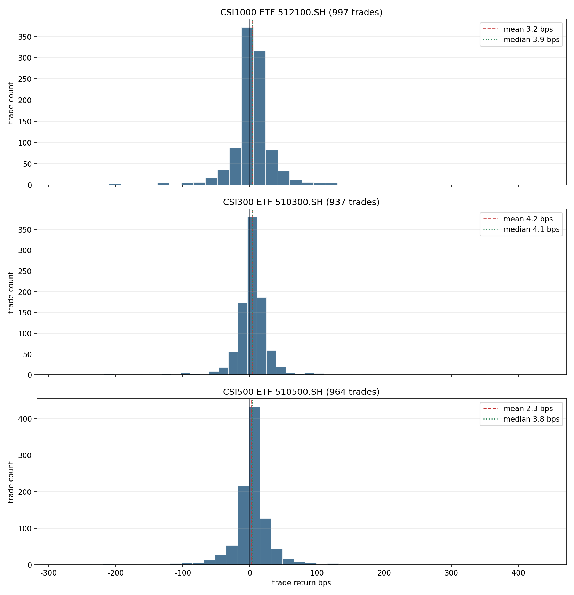

### ETF Trade Return Distribution

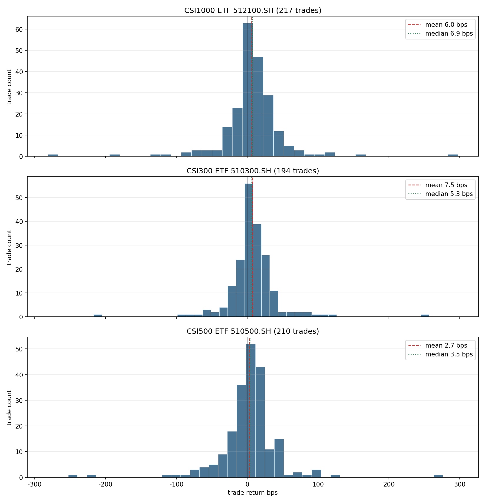

### ETF Test Trade Return Distribution

### 5.4. Entry Delay Decay Experiment

Open signals are delayed while preserving the registered rebalance and holding logic.

| scope | split | pool | display_name | date | x_index | delay_minutes | delayed_strategy_cumulative_return |
| --- | --- | --- | --- | --- | --- | --- | --- |
| train_val_test | train | csi1000_etf_sh | 1000 ETF | 210104 | 1 | 0 | 0.000000 |
| train_val_test | train | csi1000_etf_sh | 1000 ETF | 210104 | 2 | 0 | 0.000000 |
| train_val_test | train | csi1000_etf_sh | 1000 ETF | 210104 | 3 | 0 | 0.000000 |
| train_val_test | train | csi1000_etf_sh | 1000 ETF | 210104 | 4 | 0 | 0.000000 |
| train_val_test | train | csi1000_etf_sh | 1000 ETF | 210104 | 5 | 0 | 0.000000 |
| train_val_test | train | csi1000_etf_sh | 1000 ETF | 210104 | 6 | 0 | 0.000000 |
| train_val_test | train | csi1000_etf_sh | 1000 ETF | 210104 | 7 | 0 | 0.000000 |
| train_val_test | train | csi1000_etf_sh | 1000 ETF | 210104 | 8 | 0 | 0.000000 |
| train_val_test | train | csi1000_etf_sh | 1000 ETF | 210104 | 9 | 0 | 0.000000 |
| train_val_test | train | csi1000_etf_sh | 1000 ETF | 210104 | 10 | 0 | 0.000000 |
| train_val_test | train | csi1000_etf_sh | 1000 ETF | 210104 | 11 | 0 | 0.000000 |
| train_val_test | train | csi1000_etf_sh | 1000 ETF | 210104 | 12 | 0 | 0.000000 |
| train_val_test | train | csi1000_etf_sh | 1000 ETF | 210104 | 13 | 0 | 0.000000 |
| train_val_test | train | csi1000_etf_sh | 1000 ETF | 210104 | 14 | 0 | 0.000000 |
| train_val_test | train | csi1000_etf_sh | 1000 ETF | 210104 | 15 | 0 | 0.000000 |
| train_val_test | train | csi1000_etf_sh | 1000 ETF | 210104 | 16 | 0 | 0.000000 |
| train_val_test | train | csi1000_etf_sh | 1000 ETF | 210104 | 17 | 0 | 0.000000 |
| train_val_test | train | csi1000_etf_sh | 1000 ETF | 210104 | 18 | 0 | 0.000000 |
| train_val_test | train | csi1000_etf_sh | 1000 ETF | 210104 | 19 | 0 | 0.000000 |
| train_val_test | train | csi1000_etf_sh | 1000 ETF | 210104 | 20 | 0 | 0.000000 |
| train_val_test | train | csi1000_etf_sh | 1000 ETF | 210104 | 21 | 0 | 0.000000 |
| train_val_test | train | csi1000_etf_sh | 1000 ETF | 210104 | 22 | 0 | 0.000000 |
| train_val_test | train | csi1000_etf_sh | 1000 ETF | 210104 | 23 | 0 | 0.000000 |
| train_val_test | train | csi1000_etf_sh | 1000 ETF | 210104 | 24 | 0 | 0.000000 |
| train_val_test | train | csi1000_etf_sh | 1000 ETF | 210104 | 25 | 0 | 0.000000 |
| train_val_test | train | csi1000_etf_sh | 1000 ETF | 210104 | 26 | 0 | 0.000000 |
| train_val_test | train | csi1000_etf_sh | 1000 ETF | 210104 | 27 | 0 | 0.000000 |
| train_val_test | train | csi1000_etf_sh | 1000 ETF | 210104 | 28 | 0 | 0.000000 |
| train_val_test | train | csi1000_etf_sh | 1000 ETF | 210104 | 29 | 0 | 0.000000 |
| train_val_test | train | csi1000_etf_sh | 1000 ETF | 210104 | 30 | 0 | 0.000000 |
| train_val_test | train | csi1000_etf_sh | 1000 ETF | 210104 | 31 | 0 | 0.000000 |
| train_val_test | train | csi1000_etf_sh | 1000 ETF | 210104 | 32 | 0 | 0.000000 |
| train_val_test | train | csi1000_etf_sh | 1000 ETF | 210104 | 33 | 0 | 0.000000 |
| train_val_test | train | csi1000_etf_sh | 1000 ETF | 210104 | 34 | 0 | 0.000000 |
| train_val_test | train | csi1000_etf_sh | 1000 ETF | 210104 | 35 | 0 | 0.000000 |
| train_val_test | train | csi1000_etf_sh | 1000 ETF | 210104 | 36 | 0 | 0.000000 |
| train_val_test | train | csi1000_etf_sh | 1000 ETF | 210104 | 37 | 0 | 0.000000 |
| train_val_test | train | csi1000_etf_sh | 1000 ETF | 210104 | 38 | 0 | 0.000000 |
| train_val_test | train | csi1000_etf_sh | 1000 ETF | 210104 | 39 | 0 | 0.000000 |
| train_val_test | train | csi1000_etf_sh | 1000 ETF | 210104 | 40 | 0 | 0.000000 |
| train_val_test | train | csi1000_etf_sh | 1000 ETF | 210104 | 41 | 0 | 0.000000 |
| train_val_test | train | csi1000_etf_sh | 1000 ETF | 210104 | 42 | 0 | 0.000000 |
| train_val_test | train | csi1000_etf_sh | 1000 ETF | 210104 | 43 | 0 | 0.000000 |
| train_val_test | train | csi1000_etf_sh | 1000 ETF | 210104 | 44 | 0 | 0.000000 |
| train_val_test | train | csi1000_etf_sh | 1000 ETF | 210104 | 45 | 0 | 0.000000 |
| train_val_test | train | csi1000_etf_sh | 1000 ETF | 210104 | 46 | 0 | 0.000000 |
| train_val_test | train | csi1000_etf_sh | 1000 ETF | 210104 | 47 | 0 | 0.000000 |
| train_val_test | train | csi1000_etf_sh | 1000 ETF | 210104 | 48 | 0 | 0.000000 |
| train_val_test | train | csi1000_etf_sh | 1000 ETF | 210104 | 49 | 0 | 0.000000 |
| train_val_test | train | csi1000_etf_sh | 1000 ETF | 210104 | 50 | 0 | 0.000000 |
| train_val_test | train | csi1000_etf_sh | 1000 ETF | 210104 | 51 | 0 | 0.000000 |
| train_val_test | train | csi1000_etf_sh | 1000 ETF | 210104 | 52 | 0 | 0.000000 |
| train_val_test | train | csi1000_etf_sh | 1000 ETF | 210104 | 53 | 0 | 0.000000 |
| train_val_test | train | csi1000_etf_sh | 1000 ETF | 210104 | 54 | 0 | 0.000000 |
| train_val_test | train | csi1000_etf_sh | 1000 ETF | 210104 | 55 | 0 | 0.000000 |
| train_val_test | train | csi1000_etf_sh | 1000 ETF | 210104 | 56 | 0 | 0.000000 |
| train_val_test | train | csi1000_etf_sh | 1000 ETF | 210104 | 57 | 0 | 0.000000 |
| train_val_test | train | csi1000_etf_sh | 1000 ETF | 210104 | 58 | 0 | 0.000000 |
| train_val_test | train | csi1000_etf_sh | 1000 ETF | 210104 | 59 | 0 | 0.000000 |
| train_val_test | train | csi1000_etf_sh | 1000 ETF | 210104 | 60 | 0 | 0.000000 |
| test | test | csi500_etf_sh | 中证500 ETF(沪) | 241231 | 32946 | 3 | 0.051075 |
| test | test | csi500_etf_sh | 中证500 ETF(沪) | 241231 | 32947 | 3 | 0.051075 |
| test | test | csi500_etf_sh | 中证500 ETF(沪) | 241231 | 32948 | 3 | 0.051075 |
| test | test | csi500_etf_sh | 中证500 ETF(沪) | 241231 | 32949 | 3 | 0.051075 |
| test | test | csi500_etf_sh | 中证500 ETF(沪) | 241231 | 32950 | 3 | 0.051075 |
| test | test | csi500_etf_sh | 中证500 ETF(沪) | 241231 | 32951 | 3 | 0.051075 |
| test | test | csi500_etf_sh | 中证500 ETF(沪) | 241231 | 32952 | 3 | 0.051075 |
| test | test | csi500_etf_sh | 中证500 ETF(沪) | 241231 | 32953 | 3 | 0.051075 |
| test | test | csi500_etf_sh | 中证500 ETF(沪) | 241231 | 32954 | 3 | 0.051075 |
| test | test | csi500_etf_sh | 中证500 ETF(沪) | 241231 | 32955 | 3 | 0.051075 |
| test | test | csi500_etf_sh | 中证500 ETF(沪) | 241231 | 32956 | 3 | 0.051075 |
| test | test | csi500_etf_sh | 中证500 ETF(沪) | 241231 | 32957 | 3 | 0.051075 |
| test | test | csi500_etf_sh | 中证500 ETF(沪) | 241231 | 32958 | 3 | 0.051075 |
| test | test | csi500_etf_sh | 中证500 ETF(沪) | 241231 | 32959 | 3 | 0.051075 |
| test | test | csi500_etf_sh | 中证500 ETF(沪) | 241231 | 32960 | 3 | 0.051075 |
| test | test | csi500_etf_sh | 中证500 ETF(沪) | 241231 | 32961 | 3 | 0.051075 |
| test | test | csi500_etf_sh | 中证500 ETF(沪) | 241231 | 32962 | 3 | 0.051075 |
| test | test | csi500_etf_sh | 中证500 ETF(沪) | 241231 | 32963 | 3 | 0.051075 |
| test | test | csi500_etf_sh | 中证500 ETF(沪) | 241231 | 32964 | 3 | 0.051075 |
| test | test | csi500_etf_sh | 中证500 ETF(沪) | 241231 | 32965 | 3 | 0.051075 |
| test | test | csi500_etf_sh | 中证500 ETF(沪) | 241231 | 32966 | 3 | 0.051075 |
| test | test | csi500_etf_sh | 中证500 ETF(沪) | 241231 | 32967 | 3 | 0.051075 |
| test | test | csi500_etf_sh | 中证500 ETF(沪) | 241231 | 32968 | 3 | 0.051075 |
| test | test | csi500_etf_sh | 中证500 ETF(沪) | 241231 | 32969 | 3 | 0.051075 |
| test | test | csi500_etf_sh | 中证500 ETF(沪) | 241231 | 32970 | 3 | 0.051075 |
| test | test | csi500_etf_sh | 中证500 ETF(沪) | 241231 | 32971 | 3 | 0.051075 |
| test | test | csi500_etf_sh | 中证500 ETF(沪) | 241231 | 32972 | 3 | 0.051075 |
| test | test | csi500_etf_sh | 中证500 ETF(沪) | 241231 | 32973 | 3 | 0.051075 |
| test | test | csi500_etf_sh | 中证500 ETF(沪) | 241231 | 32974 | 3 | 0.051075 |
| test | test | csi500_etf_sh | 中证500 ETF(沪) | 241231 | 32975 | 3 | 0.051075 |
| test | test | csi500_etf_sh | 中证500 ETF(沪) | 241231 | 32976 | 3 | 0.051075 |
| test | test | csi500_etf_sh | 中证500 ETF(沪) | 241231 | 32977 | 3 | 0.051075 |
| test | test | csi500_etf_sh | 中证500 ETF(沪) | 241231 | 32978 | 3 | 0.051075 |
| test | test | csi500_etf_sh | 中证500 ETF(沪) | 241231 | 32979 | 3 | 0.051075 |
| test | test | csi500_etf_sh | 中证500 ETF(沪) | 241231 | 32980 | 3 | 0.051075 |
| test | test | csi500_etf_sh | 中证500 ETF(沪) | 241231 | 32981 | 3 | 0.051075 |
| test | test | csi500_etf_sh | 中证500 ETF(沪) | 241231 | 32982 | 3 | 0.051075 |
| test | test | csi500_etf_sh | 中证500 ETF(沪) | 241231 | 32983 | 3 | 0.051075 |
| test | test | csi500_etf_sh | 中证500 ETF(沪) | 241231 | 32984 | 3 | 0.051075 |
| test | test | csi500_etf_sh | 中证500 ETF(沪) | 241231 | 32985 | 3 | 0.051075 |
| test | test | csi500_etf_sh | 中证500 ETF(沪) | 241231 | 32986 | 3 | 0.051075 |
| test | test | csi500_etf_sh | 中证500 ETF(沪) | 241231 | 32987 | 3 | 0.051075 |
| test | test | csi500_etf_sh | 中证500 ETF(沪) | 241231 | 32988 | 3 | 0.051075 |
| test | test | csi500_etf_sh | 中证500 ETF(沪) | 241231 | 32989 | 3 | 0.051075 |
| test | test | csi500_etf_sh | 中证500 ETF(沪) | 241231 | 32990 | 3 | 0.051075 |
| test | test | csi500_etf_sh | 中证500 ETF(沪) | 241231 | 32991 | 3 | 0.051075 |
| test | test | csi500_etf_sh | 中证500 ETF(沪) | 241231 | 32992 | 3 | 0.051075 |
| test | test | csi500_etf_sh | 中证500 ETF(沪) | 241231 | 32993 | 3 | 0.051075 |
| test | test | csi500_etf_sh | 中证500 ETF(沪) | 241231 | 32994 | 3 | 0.051075 |
| test | test | csi500_etf_sh | 中证500 ETF(沪) | 241231 | 32995 | 3 | 0.051075 |
| test | test | csi500_etf_sh | 中证500 ETF(沪) | 241231 | 32996 | 3 | 0.051075 |
| test | test | csi500_etf_sh | 中证500 ETF(沪) | 241231 | 32997 | 3 | 0.051075 |
| test | test | csi500_etf_sh | 中证500 ETF(沪) | 241231 | 32998 | 3 | 0.051075 |
| test | test | csi500_etf_sh | 中证500 ETF(沪) | 241231 | 32999 | 3 | 0.051075 |
| test | test | csi500_etf_sh | 中证500 ETF(沪) | 241231 | 33000 | 3 | 0.051075 |
| test | test | csi500_etf_sh | 中证500 ETF(沪) | 241231 | 33001 | 3 | 0.051075 |
| test | test | csi500_etf_sh | 中证500 ETF(沪) | 241231 | 33002 | 3 | 0.051075 |
| test | test | csi500_etf_sh | 中证500 ETF(沪) | 241231 | 33003 | 3 | 0.051075 |
| test | test | csi500_etf_sh | 中证500 ETF(沪) | 241231 | 33004 | 3 | 0.051075 |
| test | test | csi500_etf_sh | 中证500 ETF(沪) | 241231 | 33005 | 3 | 0.051075 |

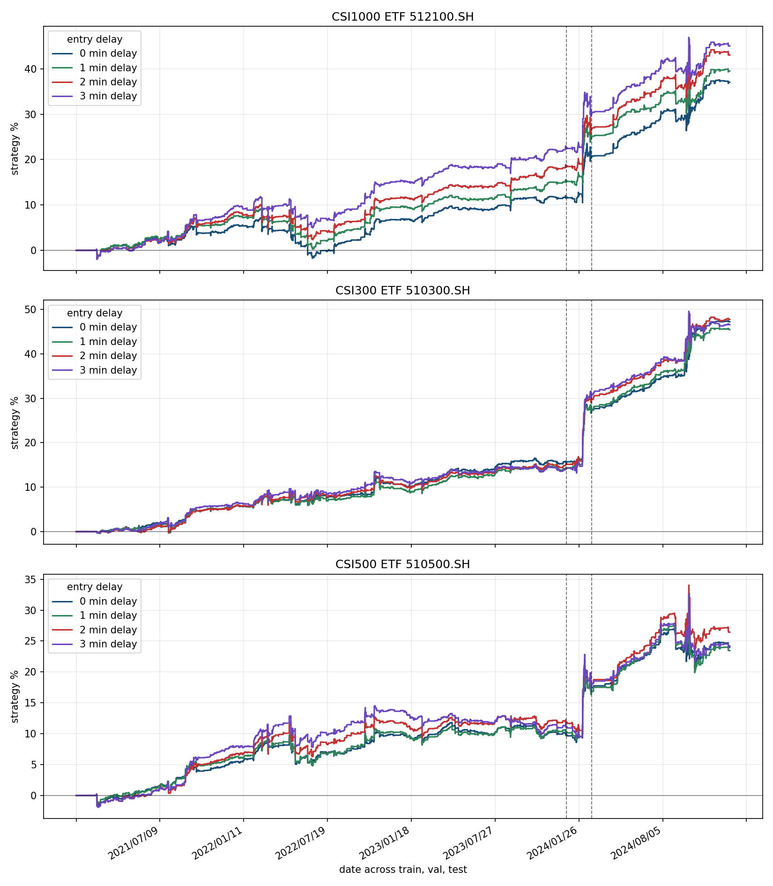

### Entry Delay Decay

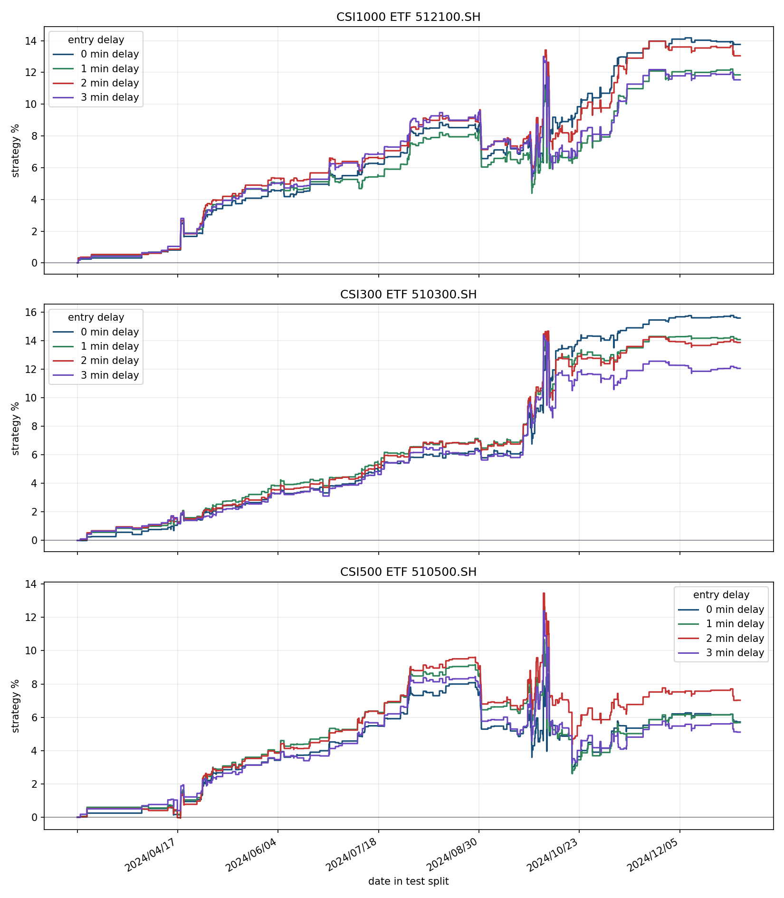

### Test Entry Delay Decay

06

6. Robustness Diagnostics

### Robustness Diagnostics

完成臂使用完整 robustness artifact; 暂停臂不生成 OOS diagnostics. 

### 6.1. IC by volatility rank

Rolling IC conditioned on volatility rank.

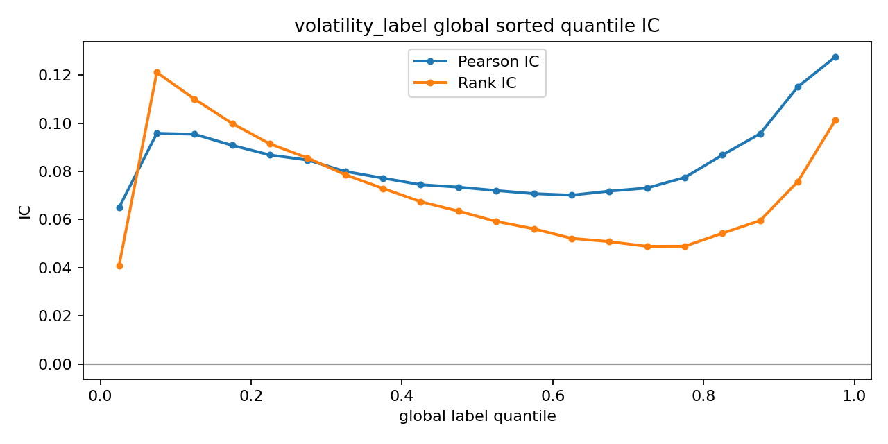

### IC By Volatility Rank

### 6.2. IC by price rank

Rolling IC conditioned on price rank.

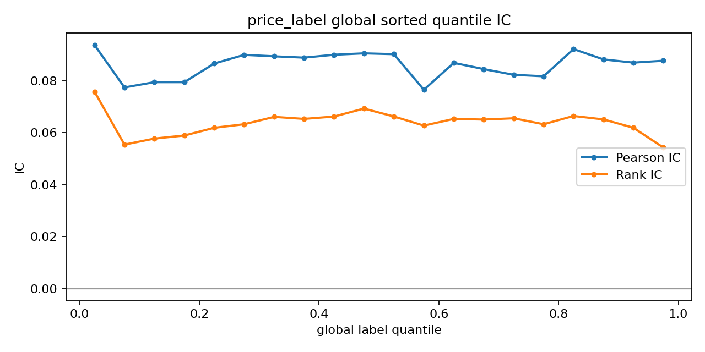

### IC By Price Rank

### 6.3. Train/test intraday IC curve

Same minute-of-session aggregation for fixed train sample and full test.

| time | pooled_ic_train | sample_count_train | pooled_ic_test | sample_count_test |
| --- | --- | --- | --- | --- |
| 103900 | 0.085345 | 201695 | 0.260839 | 1094002 |
| 104000 | 0.067287 | 201695 | 0.198067 | 1094002 |
| 104100 | 0.079379 | 201695 | 0.103708 | 1094002 |
| 104200 | 0.074565 | 201695 | 0.083953 | 1094002 |
| 104300 | 0.067673 | 201695 | 0.107877 | 1094002 |
| 104400 | 0.059162 | 201695 | 0.122107 | 1094002 |
| 104500 | 0.050894 | 201695 | 0.115039 | 1094002 |
| 104600 | 0.056189 | 201695 | 0.088049 | 1094002 |
| 104700 | 0.054810 | 201695 | 0.056294 | 1094002 |
| 104800 | 0.064015 | 201695 | 0.038241 | 1094002 |
| 104900 | 0.069943 | 201695 | 0.023472 | 1094002 |
| 105000 | 0.062176 | 201695 | 0.020799 | 1094002 |
| 105100 | 0.066845 | 201695 | 0.038357 | 1094002 |
| 105200 | 0.078138 | 201695 | 0.058297 | 1094002 |
| 105300 | 0.084479 | 201695 | 0.080517 | 1094002 |
| 105400 | 0.093907 | 201695 | 0.085621 | 1094002 |
| 105500 | 0.094769 | 201695 | 0.098537 | 1094002 |
| 105600 | 0.102003 | 199181 | 0.108117 | 1094002 |
| 105700 | 0.118796 | 197532 | 0.124209 | 1094002 |
| 105800 | 0.127278 | 197532 | 0.123696 | 1094002 |
| 105900 | 0.126140 | 197532 | 0.120844 | 1094002 |
| 110000 | 0.097854 | 197532 | 0.105786 | 1094002 |
| 110100 | 0.085537 | 197532 | 0.112640 | 1094002 |
| 110200 | 0.082282 | 197532 | 0.078226 | 1094002 |
| 110300 | 0.080126 | 197532 | 0.041043 | 1094002 |
| 110400 | 0.067536 | 197532 | 0.015183 | 1094002 |
| 110500 | 0.065895 | 197532 | 0.000312 | 1094002 |
| 110600 | 0.077746 | 197532 | -0.009883 | 1094002 |
| 110700 | 0.079650 | 197532 | -0.024396 | 1094002 |
| 110800 | 0.086967 | 197532 | -0.028206 | 1094002 |
| 110900 | 0.093038 | 197532 | -0.023939 | 1094002 |
| 111000 | 0.081348 | 197532 | -0.030440 | 1094002 |
| 111100 | 0.074089 | 197532 | -0.023218 | 1094002 |
| 111200 | 0.076962 | 197532 | -0.014181 | 1094002 |
| 111300 | 0.086199 | 197532 | 0.036815 | 1094002 |
| 111400 | 0.088163 | 197532 | 0.072095 | 1094002 |
| 111500 | 0.082531 | 197532 | 0.101917 | 1094002 |
| 111600 | 0.089450 | 197532 | 0.122333 | 1094002 |
| 111700 | 0.090334 | 197532 | 0.142079 | 1094002 |
| 111800 | 0.095738 | 197532 | 0.163836 | 1094002 |
| 141000 | 0.093728 | 197532 | 0.108945 | 1094002 |
| 141100 | 0.089693 | 197532 | 0.109882 | 1094002 |
| 141200 | 0.104516 | 197532 | 0.112220 | 1094002 |
| 141300 | 0.110874 | 197532 | 0.110323 | 1094002 |
| 141400 | 0.112365 | 197532 | 0.107232 | 1094002 |
| 141500 | 0.102236 | 197532 | 0.093298 | 1094002 |
| 141600 | 0.093007 | 197532 | 0.081364 | 1094002 |
| 141700 | 0.090219 | 197532 | 0.058682 | 1094002 |
| 141800 | 0.087503 | 197532 | 0.049401 | 1094002 |
| 141900 | 0.082667 | 197532 | 0.050447 | 1094002 |
| 142000 | 0.075649 | 197532 | 0.049132 | 1094002 |
| 142100 | 0.068004 | 197532 | 0.038469 | 1094002 |
| 142200 | 0.077296 | 197532 | 0.048760 | 1094002 |
| 142300 | 0.090106 | 197532 | 0.066177 | 1094002 |
| 142400 | 0.107587 | 197532 | 0.079460 | 1094002 |
| 142500 | 0.103567 | 197532 | 0.097440 | 1094002 |
| 142600 | 0.107002 | 197532 | 0.110156 | 1094002 |
| 142700 | 0.115268 | 197532 | 0.124202 | 1094002 |
| 142800 | 0.119536 | 197532 | 0.123368 | 1094002 |
| 142900 | 0.128111 | 197532 | 0.111939 | 1094002 |
| 143000 | 0.110679 | 197532 | 0.094201 | 1094002 |
| 143100 | 0.120450 | 197532 | 0.122672 | 1094002 |
| 143200 | 0.128246 | 197532 | 0.120517 | 1094002 |
| 143300 | 0.134952 | 197532 | 0.115108 | 1094002 |
| 143400 | 0.128332 | 197532 | 0.107770 | 1094002 |
| 143500 | 0.137661 | 197532 | 0.097764 | 1094002 |
| 143600 | 0.137866 | 197532 | 0.082994 | 1094002 |
| 143700 | 0.134028 | 197532 | 0.075150 | 1094002 |
| 143800 | 0.142737 | 197532 | 0.080711 | 1094002 |
| 143900 | 0.140798 | 197532 | 0.079036 | 1094002 |
| 144000 | 0.126016 | 197532 | 0.083970 | 1094002 |
| 144100 | 0.126262 | 197532 | 0.103442 | 1094002 |
| 144200 | 0.130230 | 197532 | 0.102279 | 1094002 |
| 144300 | 0.131604 | 197532 | 0.078740 | 1094002 |
| 144400 | 0.137998 | 197532 | 0.068266 | 1094002 |
| 144500 | 0.125270 | 197532 | 0.052572 | 1094002 |
| 144600 | 0.124844 | 197532 | 0.048890 | 1094002 |
| 144700 | 0.120599 | 197532 | 0.056816 | 1094002 |
| 144800 | 0.115847 | 197532 | 0.056160 | 1094002 |
| 144900 | 0.115468 | 197532 | 0.067814 | 1094002 |

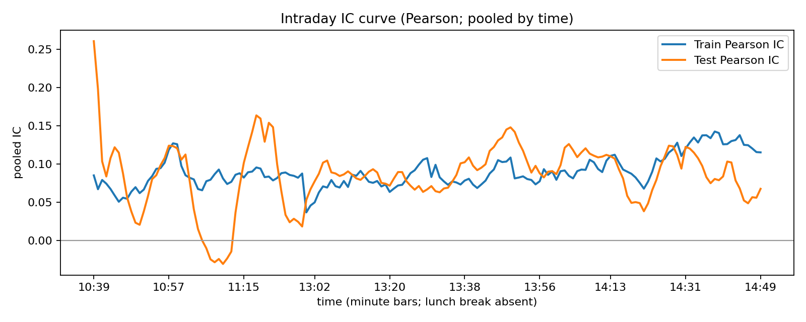

### Train/Test Intraday IC

### 6.4. Monthly signal spread and net efficiency

Monthly IC, Rank IC, signal spread and strategy efficiency expose regime concentration.

| month | top_minus_bottom_bps | strategy_bps_per_turnover |
| --- | --- | --- |
| 2024/03 | 13.241726 | 6.328116 |
| 2024/04 | 12.837389 | 4.691117 |
| 2024/05 | 9.268154 | 4.016069 |
| 2024/06 | 9.340732 | 2.152405 |
| 2024/07 | 11.491359 | 5.818228 |
| 2024/08 | 11.484839 | -2.627229 |
| 2024/09 | 8.429343 | 1.541211 |
| 2024/10 | 27.144503 | 3.576601 |
| 2024/11 | 17.966040 | 5.634319 |
| 2024/12 | 13.235218 | -0.461788 |

| month | pearson_ic | rank_ic | sample_count |
| --- | --- | --- | --- |
| 2024/03 | 0.092020 | 0.072418 | 18060980 |
| 2024/04 | 0.097575 | 0.090491 | 17208163 |
| 2024/05 | 0.077383 | 0.054847 | 17163405 |
| 2024/06 | 0.083459 | 0.055115 | 16320248 |
| 2024/07 | 0.086326 | 0.058747 | 19730550 |
| 2024/08 | 0.090220 | 0.068157 | 18876767 |
| 2024/09 | 0.024727 | 0.028866 | 16298996 |
| 2024/10 | 0.103608 | 0.061541 | 15457127 |
| 2024/11 | 0.089369 | 0.073941 | 18056633 |
| 2024/12 | 0.096473 | 0.068675 | 18961453 |

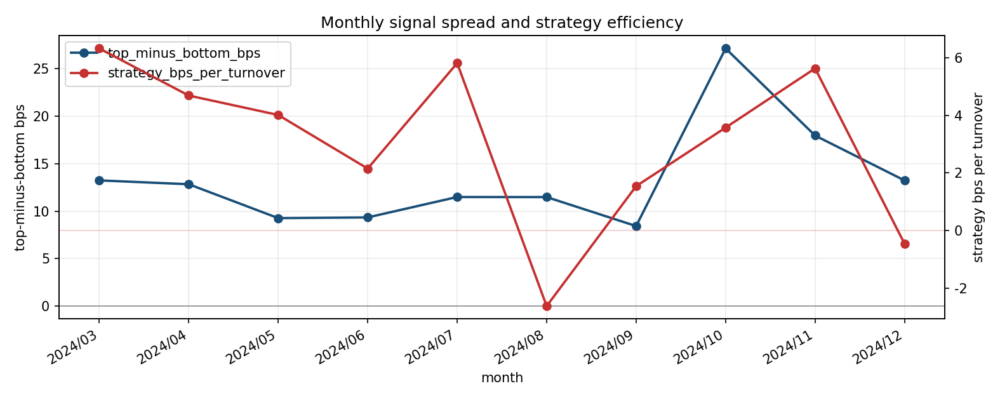

### Monthly Signal Spread And Net Efficiency

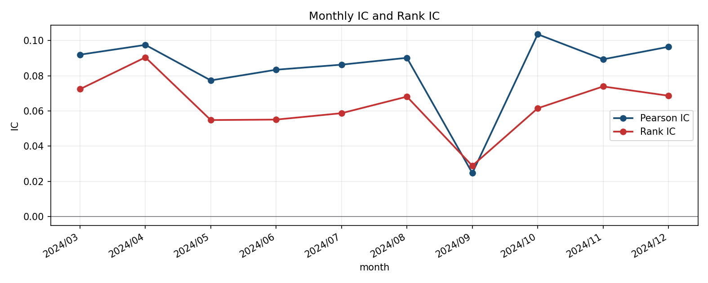

### Monthly IC And Rank IC

### 6.5. Return Realization

Top-5% predictions are remeasured over multiple forward holding horizons.

| holding_minutes | mean_return | mean_return_bps | row_count | prediction_p95 |
| --- | --- | --- | --- | --- |
| 1 | 0.000244 | 2.441826 | 8806718 | 0.000271 |
| 2 | 0.000411 | 4.113936 | 8806718 | 0.000271 |
| 3 | 0.000530 | 5.302742 | 8806718 | 0.000271 |
| 4 | 0.000616 | 6.156232 | 8806718 | 0.000271 |
| 5 | 0.000680 | 6.802196 | 8806718 | 0.000271 |
| 6 | 0.000733 | 7.329859 | 8806718 | 0.000271 |
| 7 | 0.000774 | 7.741918 | 8806718 | 0.000271 |
| 8 | 0.000804 | 8.036063 | 8806718 | 0.000271 |
| 9 | 0.000829 | 8.291872 | 8806718 | 0.000271 |
| 10 | 0.000859 | 8.591724 | 8806718 | 0.000271 |
| 11 | 0.000889 | 8.890216 | 8699230 | 0.000271 |
| 12 | 0.000922 | 9.216477 | 8592097 | 0.000271 |
| 13 | 0.000955 | 9.554771 | 8487402 | 0.000271 |
| 14 | 0.000990 | 9.897247 | 8387008 | 0.000271 |
| 15 | 0.001026 | 10.257312 | 8288017 | 0.000271 |
| 16 | 0.001065 | 10.645910 | 8190140 | 0.000271 |
| 17 | 0.001098 | 10.979394 | 8097814 | 0.000271 |
| 18 | 0.001125 | 11.247864 | 8012786 | 0.000271 |
| 19 | 0.001144 | 11.439158 | 7933939 | 0.000271 |
| 20 | 0.001166 | 11.664122 | 7860939 | 0.000271 |

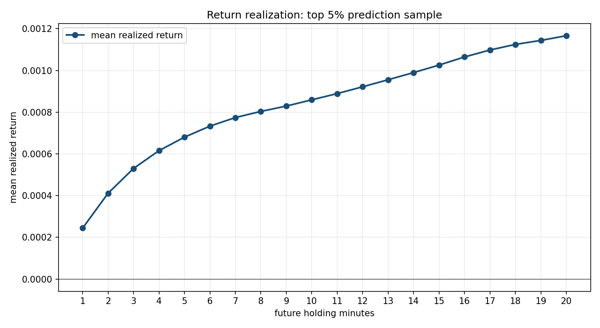

### Return Realization

### 6.6. Top-k% Robustness

Fixed train sample and full test are compared across prediction selection widths.

| split | selection_method | k_pct | universe_count | selected_count | selected_fraction | prediction_threshold | mean_label_bps | median_label_bps | label_std_bps | hit_rate | day_count | timestamp_count |
| --- | --- | --- | --- | --- | --- | --- | --- | --- | --- | --- | --- | --- |
| train | approx_quantile_threshold | 1 | 31875072 | 314708 | 0.009873 | 0.000775 | 17.121088 | 2.116228 | 87.026125 | 0.498179 | 49 | 7746 |
| train | approx_quantile_threshold | 2 | 31875072 | 633519 | 0.019875 | 0.000524 | 12.699179 | 0.158877 | 75.484124 | 0.483551 | 49 | 7746 |
| train | approx_quantile_threshold | 3 | 31875072 | 949632 | 0.029792 | 0.000393 | 10.573283 | 0.014669 | 69.981982 | 0.475099 | 49 | 7746 |
| train | approx_quantile_threshold | 5 | 31875072 | 1595698 | 0.050061 | 0.000266 | 8.112524 | -0.000014 | 63.690377 | 0.463429 | 49 | 7746 |
| train | approx_quantile_threshold | 10 | 31875072 | 3180949 | 0.099794 | 0.000151 | 5.721008 | -0.000014 | 56.653048 | 0.447417 | 49 | 7746 |
| train | approx_quantile_threshold | 15 | 31875072 | 4776874 | 0.149862 | 0.000094 | 4.606188 | -0.000014 | 52.954465 | 0.437346 | 49 | 7746 |
| train | approx_quantile_threshold | 20 | 31875072 | 6369052 | 0.199813 | 0.000051 | 3.932875 | -0.000014 | 50.573914 | 0.429360 | 49 | 7746 |
| test | approx_quantile_threshold | 1 | 176134322 | 1692368 | 0.009608 | 0.000878 | 20.624253 | 5.469001 | 112.959291 | 0.508454 | 205 | 32976 |
| test | approx_quantile_threshold | 2 | 176134322 | 3500539 | 0.019874 | 0.000564 | 13.984806 | 0.343868 | 94.200894 | 0.487231 | 205 | 33003 |
| test | approx_quantile_threshold | 3 | 176134322 | 5263218 | 0.029882 | 0.000415 | 11.271677 | 0.075675 | 85.350527 | 0.478514 | 205 | 33005 |
| test | approx_quantile_threshold | 5 | 176134322 | 8751914 | 0.049689 | 0.000273 | 8.619819 | 0.000368 | 75.746955 | 0.468685 | 205 | 33005 |
| test | approx_quantile_threshold | 10 | 176134322 | 17560361 | 0.099699 | 0.000151 | 5.910120 | -0.000014 | 64.400289 | 0.453613 | 205 | 33005 |
| test | approx_quantile_threshold | 15 | 176134322 | 26382530 | 0.149786 | 0.000095 | 4.657080 | -0.000014 | 58.468811 | 0.443565 | 205 | 33005 |
| test | approx_quantile_threshold | 20 | 176134322 | 35166402 | 0.199657 | 0.000054 | 3.860216 | -0.000014 | 54.778977 | 0.434905 | 205 | 33005 |

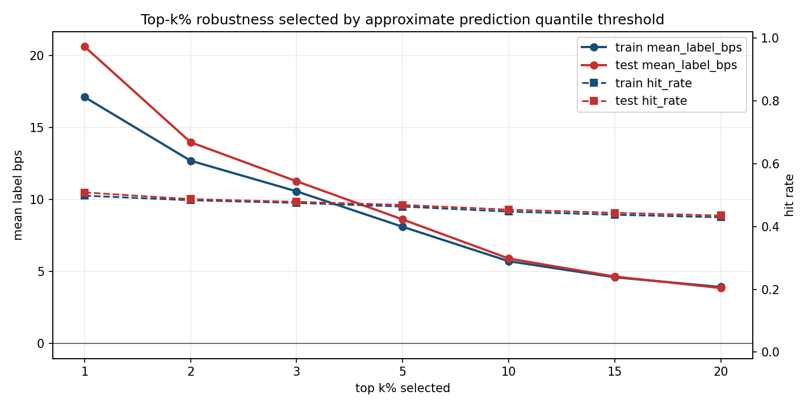

### Top-k% Robustness

07

7. Appendix Diagnostics

## 限制与适用边界

Control/CS rank/latent-z/Deep Sets R2 test IC为0.086462/0.123293/0.127345/0.121030. Induced attention 在test前失败; Deep Sets经历中断后R2成功恢复. 四个完成臂10M净Sharpe均负. 当前artifact可得性只影响复现, 不作为历史成功/失败判据. 只有matched合同内的结果可以直接比较.

## 结论

本次归档保留上述历史事实. 研究结论, 推广门槛和执行限制分别解释, 不把模型无增益或净收益为负改写成实验流程失败.

## 附录

### Appendix Diagnostics

路径和 identity 用于从报告回溯到真实 artifact; 报告不包含外部依赖. 

### 7.1. Artifact Paths

核心 source artifacts 与生成报告路径. 

| artifact | path | status |
| --- | --- | --- |
| run_root | [artifact-root]/nn/0827-market-cs/0829cs-s7-l-control_34d | available |
| npz_meta | [artifact-root]/nn/0827-market-cs/0829cs-s7-l-control_34d/prediction/artifacts/npz/meta.yaml | available |
| data_clean_invalid_stats | [artifact-root]/nn/0827-market-cs/0829cs-s7-l-control_34d/prediction/artifacts/data_clean/invalid_feature_stats.csv | available |
| checkpoint_metadata | [artifact-root]/nn/0827-market-cs/0829cs-s7-l-control_34d/prediction/run/checkpoint_metadata/best_checkpoint.yaml | available |
| test_prediction_manifest | [artifact-root]/nn/0827-market-cs/0829cs-s7-l-control_34d/manifests/evaluate.yaml | available |
| backtest_manifest | [artifact-root]/nn/0827-market-cs/0829cs-s7-l-control_34d/manifests/backtest.yaml | available |
| research_artifact_manifest | [artifact-root]/nn/0827-market-cs/0829cs-s7-l-control_34d/report/research_artifacts/manifest.yaml | available |

### 7.2. Provenance

配置, 代码, 数据, panel, MLflow 和恢复 lineage. 

| field | value |
| --- | --- |
| run_id | 0829cs-s7-l-control_34d |
| MLflow run | 1dd271e6f3bb41e8a665bab18eee4b8b |
| Git commit | 88458306f57ad953b9cc9048a32b19bf7b5c9689 |
| config SHA-256 | 8e92a379bbf407f7c1212b7b7a5b1ca1606866c86c20252d3eb9b961b6e4a5b2 |
| data artifact | 6589947466234739b27e243d253a3c48 |
| dataset cache key | e74adc442d96d5ecfcd932bd39289a25be2366d12c20d78a83d8f9aeda2a3460 |
| panel fingerprint | 28573283d9bba84f03cb51f8855fe97b16e99fba1912860c461e58084518926d |
| recovery source | fresh run |
| recovery checkpoint | none |
