## 摘要

**历史结果: 历史成功, 四臂完成.** Control/CS rank/latent-z/Deep Sets R2 test IC为0.086462/0.123293/0.127345/0.121030. Induced attention 在test前失败; Deep Sets经历中断后R2成功恢复. 四个完成臂10M净Sharpe均负.

历史成功/失败按实验流程是否成功完成判断. 无增益, 成本后亏损, 归档和当前 artifact 缺失不改变历史成功事实. 失败的实验臂保留失败原因, 不填造未产生的 OOS 指标. 本次只整理已有材料, 未启动训练, 推理或回测.

### Executive Summary

模板字段按固定顺序展示; headline 指标均来自本次完整 research artifact bundle. 

benchmark

cs_rank_41d

none

selected_checkpoint

105343

validation-only selection

train_pooled_ic

0.120299

fixed sample: 3,891 batches / 31,875,072 rows

test_pooled_ic

0.123293

176,134,322

top_prediction_return_bps

9.408033

test top prediction bucket

top95_hit

48.88%

test top 5% predictions

etf_top95_hit

57.97%

test ETF proxy top 5%

overfit_variance_ratio

0.019593

test prediction variance / target variance

model_class

MarketContextGruMlpRegressor

1,841,281 parameters

train_range

2021-01-04 to 2023-12-29

train-only normalization fit

val_range

2024-01-02 to 2024-02-29

checkpoint selection only

test_range

2024-03-01 to 2024-12-31

final evaluation only

| field | explanation |
| --- | --- |
| benchmark | 实验标识.  |
| selected_checkpoint | 最终用于 evaluation 的 checkpoint iteration.  |
| train_pooled_ic | core_ic_summary_train.yaml 当前覆盖的 train-report 样本合并后计算的 Pearson IC; 启用 train report sample 时不是 full-train 指标.  |
| test_pooled_ic | test split 上把所有样本合并后计算的 Pearson IC.  |
| top_prediction_return_bps | 最高 prediction 分组的平均 prediction return, 单位 bps.  |
| top95_hit | test split 中按 prediction 从高到低排序后取最高 5% 样本, 即 prediction >= test prediction 的 95% 分位; 该子样本内 target > 0 的比例.  |
| etf_top95_hit | test split 中先按重要股票池合成 ETF minute-level prediction/real return, 再按 etf_prediction 从高到低排序后取最高 5% 样本; 该子样本内 etf_real_return > 0 的比例.  |
| overfit_variance_ratio | test split 中 prediction 样本方差 / target 样本方差, 用作 overfit 系数; 数值越大表示 prediction 方差相对 label 越高.  |
| model_class | 模型类名.  |
| train_range | 训练集交易日范围.  |
| val_range | 验证集交易日范围.  |
| test_range | 测试集交易日范围.  |

02

2. Data Pipeline

## 研究背景与目标

本报告围绕Market CS 五臂研究整理原始研究证据. 当前材料对应 registry report `0827-market-cs-cs-rank-0831`, 来源SHA256为 `7d7ccd9c066e8b3c39d5c8e90285169de241409142401eb97b2726566d1c3a95`. 原报告的实验方法, 图表, 结果和解释保留在下文.

## 数据与方法

实验身份为 `0827-market-cs`. Split, label, sampler, feature与checkpoint定义按原报告记录, 不从其他实验借用缺失字段. 汇总入口见[全实验综述](../../prediction-nn-1min/1103-nn-registry-summary/).

### Data Pipeline

五臂共享同一 41D 物理 artifact, row identity, panel ordering 和 train-only normalization. 

### 2.1. Data Basics

逻辑 active feature 通过 pooled z-score 后的固定投影实现; 物理 GRU 输入宽度始终为 41. 

| field | value |
| --- | --- |
| train_days | 727 |
| val_days | 37 |
| test_days | 205 |
| train_rows | 553,895,223 |
| val_rows | 31,737,447 |
| test_rows | 176,134,322 |
| feature_dim | 41 physical / 41 active |
| features | ret_1m, ret_2m, ret_3m, ret_5m, ret_10m, hl, oc, log_vol, log_amount, log_vol_5m_mean, log_amount_5m_mean, vol_same_minute_60d_pct, vol_trailing_5m_pct, vol_trailing_20m_pct, amount_trailing_60m_pct, minute_norm, vol_10m, state_realized_vol_5m, state_realized_vol_shell_5_20m, state_realized_vol_shell_20_60m, state_realized_vol_shell_60_120m, state_realized_vol_shell_120_240m, state_realized_vol_shell_240_480m, state_range_5m, state_range_20m, state_range_60m, state_range_120m, state_range_240m, state_range_480m, state_return_shell_5_20m, state_return_shell_20_60m, state_return_shell_60_120m, state_return_shell_120_240m, state_return_shell_240_480m, stock_ret_5m_cs_rank, stock_ret_20m_cs_rank, stock_ret_60m_cs_rank, stock_ret_240m_cs_rank, stock_rv_20m_cs_rank, stock_rv_60m_cs_rank, stock_log_amount_cs_rank |
| label_horizon_minutes | 10 |
| label_entry_lag_minutes | 1 |

| field | explanation |
| --- | --- |
| features | 模型输入 feature 列表.  |
| feature_dim | 模型输入 feature 维度.  |
| label_horizon_minutes | entry 到 exit 的实际持有期, 单位 minutes.  |
| label_entry_lag_minutes | label entry lag, 单位 minutes.  |

### 2.2. Data Normalization

清洗统计来自共享 data-clean artifact; rank 和 context 都不改变 split 或标准化 fit scope. 

| field | value |
| --- | --- |
| feature_normalization | pooled_zscore; train_only |
| label_normalization | pooled_zscore; train_only |
| label_horizon_minutes | 10 |
| label_entry_lag_minutes | 1 |
| train_kept_rate | not stored in report summary |
| val_kept_rate | not stored in report summary |
| test_kept_rate | not stored in report summary |
| max_invalid_ratio | 0.041494 |

| field | total_count | finite_count | nan_count | nan_ratio | inf_ratio | invalid_ratio | mean_finite | std_finite | skew_finite | kurtosis_finite | min_finite | max_finite |
| --- | --- | --- | --- | --- | --- | --- | --- | --- | --- | --- | --- | --- |
| ret_1m | 1154507748 | 1149717258 | 4790490 | 0.004149 | 0.000000 | 0.004149 | 0.000001 | 0.002284 | 0.332178 | 524.604788 | -1.672727 | 0.759663 |
| ret_2m | 1154507748 | 1144926768 | 9580980 | 0.008299 | 0.000000 | 0.008299 | 0.000004 | 0.002928 | 0.933046 | 267.199689 | -1.672727 | 0.798906 |
| ret_3m | 1154507748 | 1140136278 | 14371470 | 0.012448 | 0.000000 | 0.012448 | 0.000007 | 0.003416 | 1.220015 | 185.034283 | -1.672727 | 0.798906 |
| ret_5m | 1154507748 | 1130555298 | 23952450 | 0.020747 | 0.000000 | 0.020747 | 0.000011 | 0.004185 | 1.487963 | 125.885503 | -1.672727 | 0.798906 |
| ret_10m | 1154507748 | 1106602848 | 47904900 | 0.041494 | 0.000000 | 0.041494 | 0.000012 | 0.005543 | 1.616300 | 78.308005 | -1.672727 | 0.865563 |
| hl | 1154507748 | 1154507748 | 0 | 0.000000 | 0.000000 | 0.000000 | 0.000622 | 0.000759 | 6.625821 | 384.235154 | 0.000000 | 0.434688 |
| oc | 1154507748 | 1154507748 | 0 | 0.000000 | 0.000000 | 0.000000 | 0.000005 | 0.000716 | 0.807232 | 305.329560 | -0.312980 | 0.353188 |
| log_vol | 1154507748 | 1154507748 | 0 | 0.000000 | 0.000000 | 0.000000 | 9.041346 | 2.868792 | -1.615542 | 3.227835 | 0.000000 | 20.340768 |
| log_amount | 1154507748 | 1154507748 | 0 | 0.000000 | 0.000000 | 0.000000 | 11.435779 | 3.351959 | -2.143654 | 5.130353 | 0.000000 | 22.619835 |
| log_vol_5m_mean | 1154507748 | 1154507748 | 0 | 0.000000 | 0.000000 | 0.000000 | 9.080030 | 2.395991 | -1.178611 | 2.390045 | 0.000000 | 20.127985 |
| log_amount_5m_mean | 1154507748 | 1154507748 | 0 | 0.000000 | 0.000000 | 0.000000 | 11.483564 | 2.737884 | -1.640929 | 4.078448 | 0.000000 | 21.933402 |
| vol_same_minute_60d_pct | 1154507748 | 1147649611 | 6858137 | 0.005940 | 0.000000 | 0.005940 | 0.500503 | 0.297898 | 0.010429 | -1.224365 | 0.000000 | 1.000000 |
| vol_trailing_5m_pct | 1154507748 | 1154498343 | 9405 | 0.000008 | 0.000000 | 0.000008 | 0.493844 | 0.343189 | 0.039355 | -1.280546 | 0.000000 | 1.000000 |
| vol_trailing_20m_pct | 1154507748 | 1154470128 | 37620 | 0.000033 | 0.000000 | 0.000033 | 0.493187 | 0.309097 | 0.038864 | -1.238083 | 0.000000 | 1.000000 |
| amount_trailing_60m_pct | 1154507748 | 1154394888 | 112860 | 0.000098 | 0.000000 | 0.000098 | 0.492823 | 0.304257 | 0.040368 | -1.261618 | 0.000000 | 1.000000 |
| minute_norm | 1154507748 | 1154507748 | 0 | 0.000000 | 0.000000 | 0.000000 | 0.500000 | 0.289875 | -0.000000 | -1.200041 | 0.000000 | 1.000000 |
| vol_10m | 1154507748 | 1144926768 | 9580980 | 0.008299 | 0.000000 | 0.008299 | 0.000570 | 0.000516 | 16.378499 | 9073.355221 | 0.000000 | 0.617598 |
| state_realized_vol_5m | 1154507748 | 1147537841 | 6969907 | 0.006037 | 0.000000 | 0.006037 | 0.003817 | 0.003982 | 11.509101 | 2100.446606 | 0.000000 | 4.326676 |
| state_realized_vol_shell_5_20m | 1154507748 | 1147494311 | 7013437 | 0.006075 | 0.000000 | 0.006075 | 0.007152 | 0.006323 | 8.227069 | 607.709954 | 0.000000 | 4.391918 |
| state_realized_vol_shell_20_60m | 1154507748 | 1147381511 | 7126237 | 0.006173 | 0.000000 | 0.006173 | 0.012313 | 0.009544 | 6.231639 | 255.980016 | 0.000000 | 4.402562 |
| state_realized_vol_shell_60_120m | 1154507748 | 1147246611 | 7261137 | 0.006289 | 0.000000 | 0.006289 | 0.015416 | 0.011229 | 5.616893 | 192.500745 | 0.000000 | 4.403834 |
| state_realized_vol_shell_120_240m | 1154507748 | 1146937611 | 7570137 | 0.006557 | 0.000000 | 0.006557 | 0.022658 | 0.014594 | 4.854178 | 129.653750 | 0.000000 | 4.407839 |
| state_realized_vol_shell_240_480m | 1154507748 | 1146320328 | 8187420 | 0.007092 | 0.000000 | 0.007092 | 0.033107 | 0.018785 | 4.307459 | 90.790637 | 0.000000 | 4.448893 |
| state_range_5m | 1154507748 | 1147541397 | 6966351 | 0.006034 | 0.000000 | 0.006034 | 0.004887 | 0.005185 | 8.152644 | 795.609658 | 0.000000 | 4.326676 |
| state_range_20m | 1154507748 | 1147488066 | 7019682 | 0.006080 | 0.000000 | 0.006080 | 0.010356 | 0.010231 | 5.478281 | 153.551252 | 0.000000 | 4.326676 |
| state_range_60m | 1154507748 | 1147345866 | 7161882 | 0.006203 | 0.000000 | 0.006203 | 0.019035 | 0.016811 | 4.031091 | 66.258543 | 0.000000 | 4.326676 |
| state_range_120m | 1154507748 | 1147132566 | 7375182 | 0.006388 | 0.000000 | 0.006388 | 0.028234 | 0.022304 | 3.360529 | 44.705540 | 0.000000 | 4.326676 |
| state_range_240m | 1154507748 | 1146705966 | 7801782 | 0.006758 | 0.000000 | 0.006758 | 0.041697 | 0.029431 | 2.908754 | 31.236718 | 0.000000 | 4.326676 |
| state_range_480m | 1154507748 | 1145883576 | 8624172 | 0.007470 | 0.000000 | 0.007470 | 0.060320 | 0.041867 | 2.661780 | 18.630342 | 0.000000 | 4.326676 |
| state_return_shell_5_20m | 1154507748 | 1147494311 | 7013437 | 0.006075 | 0.000000 | 0.006075 | -0.000007 | 0.007927 | 1.948638 | 191.038994 | -3.336278 | 1.833443 |
| state_return_shell_20_60m | 1154507748 | 1147381511 | 7126237 | 0.006173 | 0.000000 | 0.006173 | -0.000019 | 0.012654 | 1.546156 | 74.692023 | -3.559421 | 1.834436 |
| state_return_shell_60_120m | 1154507748 | 1147246611 | 7261137 | 0.006289 | 0.000000 | 0.006289 | -0.000026 | 0.015402 | 1.319948 | 50.578430 | -3.524330 | 1.838381 |
| state_return_shell_120_240m | 1154507748 | 1146937611 | 7570137 | 0.006557 | 0.000000 | 0.006557 | -0.000047 | 0.021640 | 0.992915 | 26.801442 | -3.395118 | 1.910637 |
| state_return_shell_240_480m | 1154507748 | 1146320328 | 8187420 | 0.007092 | 0.000000 | 0.007092 | -0.000078 | 0.030894 | 0.802110 | 14.788736 | -3.336278 | 1.891549 |
| stock_ret_5m_cs_rank | 1154507748 | 1147537841 | 6969907 | 0.006037 | 0.000000 | 0.006037 | 0.500102 | 0.287098 | -0.001112 | -1.173250 | 0.000186 | 1.000000 |
| stock_ret_20m_cs_rank | 1154507748 | 1147484511 | 7023237 | 0.006083 | 0.000000 | 0.006083 | 0.500102 | 0.288292 | -0.000264 | -1.194513 | 0.000186 | 1.000000 |
| stock_ret_60m_cs_rank | 1154507748 | 1147342311 | 7165437 | 0.006206 | 0.000000 | 0.006206 | 0.500102 | 0.288583 | -0.000071 | -1.198720 | 0.000186 | 1.000000 |
| stock_ret_240m_cs_rank | 1154507748 | 1146702411 | 7805337 | 0.006761 | 0.000000 | 0.006761 | 0.500102 | 0.288670 | 0.000001 | -1.199923 | 0.000186 | 1.000000 |
| stock_rv_20m_cs_rank | 1154507748 | 1147484511 | 7023237 | 0.006083 | 0.000000 | 0.006083 | 0.500102 | 0.288673 | 0.000063 | -1.200113 | 0.000186 | 1.000000 |
| stock_rv_60m_cs_rank | 1154507748 | 1147342311 | 7165437 | 0.006206 | 0.000000 | 0.006206 | 0.500102 | 0.288675 | 0.000010 | -1.200027 | 0.000186 | 1.000000 |
| stock_log_amount_cs_rank | 1154507748 | 1154507748 | 0 | 0.000000 | 0.000000 | 0.000000 | 0.500101 | 0.287690 | 0.003189 | -1.191131 | 0.000405 | 1.000000 |

| field | explanation |
| --- | --- |
| feature_normalization | feature normalization 方法和 fit scope.  |
| label_normalization | label normalization 方法和 fit scope.  |
| kept_rate | 清洗后保留样本数 / 清洗前样本数.  |
| max_invalid_ratio | 单个字段中 invalid 样本占比的最大值.  |

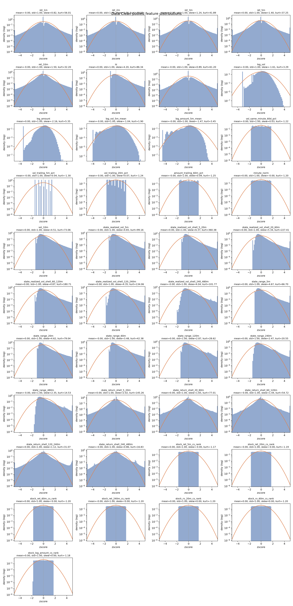

### Data Clean Distribution Overview

### 2.3. Label Distribution

Label 分布按 train/validation/test 展示; normalization 参数只在 train 上拟合. 

| split | count | mean_raw_bps | std_raw_bps | zero_ratio | abs_raw_gt_1pct_ratio |
| --- | --- | --- | --- | --- | --- |
| train | 553895223 | -0.074756 | 42.226774 | 0.186758 | 0.028167 |
| val | 31737447 | -0.863159 | 62.464198 | 0.147426 | 0.076608 |
| test | 176134322 | -0.035505 | 50.207416 | 0.174398 | 0.039702 |

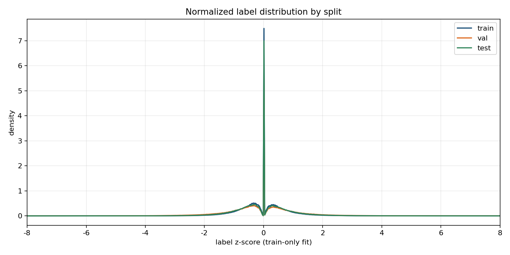

### Label Distribution By Split

03

3. Evaluation

## 主要结果

| 记录项 | 当前解释 |
| --- | --- |
| 实验 | 0827-market-cs |
| 报告类型 | full_report_html |
| 历史状态 | 历史成功, 四臂完成 |
| 证据 | 0827-market-cs-cs-rank-0831 |

Current conclusion

cs_rank_41d: test pooled IC=0.123293, pooled Rank IC=0.092832; 结果仅用于 seed 7 matched screening. 

01

1. Executive Summary

### Evaluation

Test 不参与 checkpoint 选择; 暂停臂的 test 指标保持 not run. 

### 3.1. IC Summary

Train headline 使用固定 3,891 batches / 31,875,072 rows; test 使用完整 split. 

| split | pooled_ic | pooled_rank_ic | count |
| --- | --- | --- | --- |
| train_report_sample | 0.120299 | 0.112091 | 31875072 |
| test | 0.123293 | 0.092832 | 176134322 |

| field | explanation |
| --- | --- |
| pooled_ic | 合并样本后计算的 Pearson IC.  |
| pooled_rank_ic | 合并样本后计算的 Rank IC.  |
| pearson_ic | corr(prediction, target).  |
| rank_ic | corr(rank(prediction), rank(target)).  |

### 3.2. Signal Quality 1: bucket (10)

完整 test prediction 按全局 prediction 十等分, 报告每桶实际 label 与日度 top-minus-bottom spread. 

| signal_bucket | mean_prediction | mean_label_bps | t_stat | hit_rate | row_count | top_bottom_signal_spread_bps |
| --- | --- | --- | --- | --- | --- | --- |
| 1 | -0.001096 | -10.047426 | -581.312693 | 0.322892 | 17613433 | 19.455459 |
| 2 | -0.000325 | -2.665702 | -250.964734 | 0.360474 | 17613433 | 19.455459 |
| 3 | -0.000192 | -1.640533 | -168.671205 | 0.366994 | 17613432 | 19.455459 |
| 4 | -0.000098 | -1.117021 | -118.630092 | 0.366705 | 17613432 | 19.455459 |
| 5 | -0.000014 | -0.639555 | -69.506106 | 0.376654 | 17613432 | 19.455459 |
| 6 | 0.000081 | -0.034392 | -3.520967 | 0.386546 | 17613432 | 19.455459 |
| 7 | 0.000179 | 0.782410 | 77.432226 | 0.396444 | 17613432 | 19.455459 |
| 8 | 0.000288 | 1.938588 | 183.637668 | 0.412977 | 17613432 | 19.455459 |
| 9 | 0.000431 | 3.661196 | 317.284337 | 0.435120 | 17613432 | 19.455459 |
| 10 | 0.001095 | 9.408033 | 545.757806 | 0.472303 | 17613432 | 19.455459 |

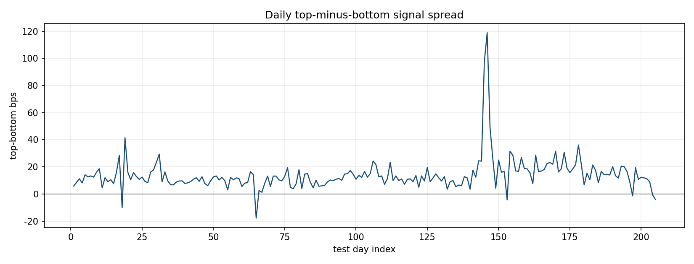

### Daily Top-Minus-Bottom Signal Spread

### 3.3. Signal Quality 2: Important Stock Pool

CSI300/CSI500/CSI1000 成分股按日期 membership 聚合; test 与 validation checkpoint 证据分开保存. 

| pool | display_name | etf_code | index_code | pearson_ic | rank_ic | mean_prediction_return | mean_real_return | real_return_positive_ratio | prediction_positive_ratio | count |
| --- | --- | --- | --- | --- | --- | --- | --- | --- | --- | --- |
| csi1000_etf_sh | 1000 ETF | 512100.SH | 000852.SH | 0.101727 | 0.065461 | 0.000032 | -0.000008 | 0.395829 | 0.526553 | 32955251 |
| csi300_etf_sh | 沪深300 ETF(沪) | 510300.SH | 000300.SH | 0.106972 | 0.055243 | 0.000026 | 0.000014 | 0.413560 | 0.496108 | 9885400 |
| csi500_etf_sh | 中证500 ETF(沪) | 510500.SH | 000905.SH | 0.097006 | 0.057243 | 0.000026 | -0.000013 | 0.393433 | 0.509425 | 16488815 |

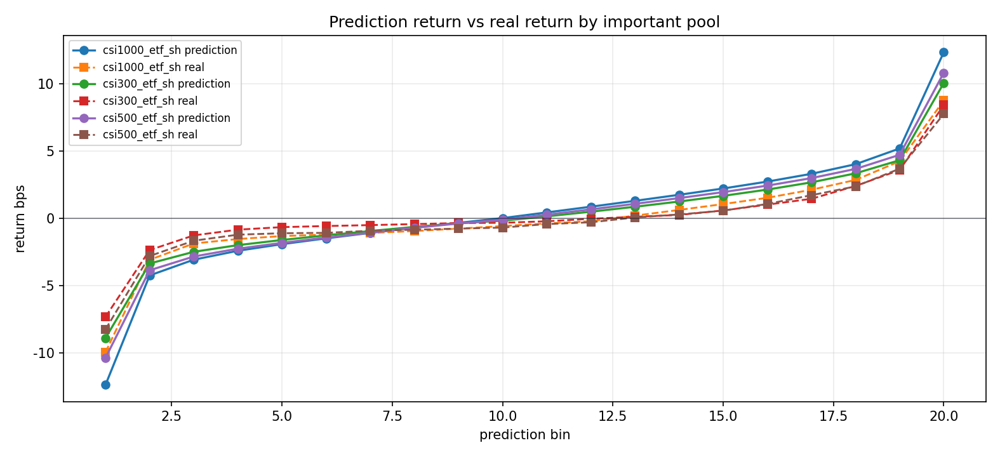

### Prediction Return vs Real Return

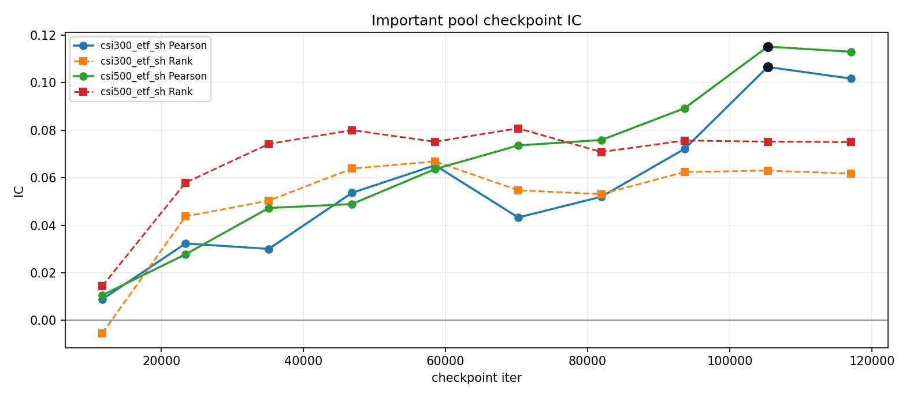

### Important Pool Checkpoint IC

### 3.4. Goodness Of Fit

Train 固定样本与完整 test 使用相同等频校准分箱; 表格仅折叠展示首尾 bins. 

| split | prediction_bin | mean_prediction | mean_label | mean_label_bps | label_std | label_se | label_p05 | label_p95 | label_ci90_low | label_ci90_high | row_count |
| --- | --- | --- | --- | --- | --- | --- | --- | --- | --- | --- | --- |
| train | 1 | -0.002476 | -0.002730 | -27.299696 | 0.009299 | 0.000016 | -0.016247 | 0.010195 | -0.002757 | -0.002703 | 318751 |
| train | 2 | -0.001235 | -0.001403 | -14.026693 | 0.006419 | 0.000011 | -0.010465 | 0.008046 | -0.001421 | -0.001384 | 318751 |
| train | 3 | -0.000963 | -0.001081 | -10.813171 | 0.005959 | 0.000011 | -0.009476 | 0.007679 | -0.001099 | -0.001064 | 318751 |
| train | 4 | -0.000803 | -0.000931 | -9.313019 | 0.005622 | 0.000010 | -0.008906 | 0.007378 | -0.000948 | -0.000915 | 318751 |
| train | 5 | -0.000691 | -0.000810 | -8.096835 | 0.005440 | 0.000010 | -0.008535 | 0.007176 | -0.000826 | -0.000794 | 318751 |
| train | 6 | -0.000605 | -0.000734 | -7.339380 | 0.005281 | 0.000009 | -0.008263 | 0.007069 | -0.000749 | -0.000719 | 318751 |
| train | 7 | -0.000538 | -0.000684 | -6.841200 | 0.005035 | 0.000009 | -0.007884 | 0.006797 | -0.000699 | -0.000669 | 318751 |
| train | 8 | -0.000493 | -0.000626 | -6.260842 | 0.004841 | 0.000009 | -0.007537 | 0.006570 | -0.000640 | -0.000612 | 318751 |
| train | 9 | -0.000459 | -0.000596 | -5.958777 | 0.004743 | 0.000008 | -0.007403 | 0.006543 | -0.000610 | -0.000582 | 318751 |
| train | 10 | -0.000430 | -0.000568 | -5.678060 | 0.004647 | 0.000008 | -0.007265 | 0.006430 | -0.000581 | -0.000554 | 318751 |
| test | 91 | 0.000555 | 0.000526 | 5.257351 | 0.005314 | 0.000004 | -0.006721 | 0.008203 | 0.000519 | 0.000532 | 1761343 |
| test | 92 | 0.000590 | 0.000569 | 5.685506 | 0.005461 | 0.000004 | -0.006878 | 0.008454 | 0.000562 | 0.000575 | 1761343 |
| test | 93 | 0.000633 | 0.000606 | 6.059846 | 0.005637 | 0.000004 | -0.007067 | 0.008718 | 0.000599 | 0.000613 | 1761343 |
| test | 94 | 0.000684 | 0.000647 | 6.470594 | 0.005814 | 0.000004 | -0.007298 | 0.008982 | 0.000640 | 0.000654 | 1761343 |
| test | 95 | 0.000750 | 0.000699 | 6.986292 | 0.006059 | 0.000005 | -0.007566 | 0.009370 | 0.000691 | 0.000706 | 1761343 |
| test | 96 | 0.000837 | 0.000758 | 7.579811 | 0.006338 | 0.000005 | -0.007958 | 0.009848 | 0.000750 | 0.000766 | 1761343 |
| test | 97 | 0.000961 | 0.000843 | 8.432995 | 0.006785 | 0.000005 | -0.008486 | 0.010549 | 0.000835 | 0.000852 | 1761343 |
| test | 98 | 0.001166 | 0.000978 | 9.784730 | 0.007357 | 0.000006 | -0.009294 | 0.011630 | 0.000969 | 0.000988 | 1761343 |
| test | 99 | 0.001546 | 0.001291 | 12.908197 | 0.008408 | 0.000006 | -0.010482 | 0.013667 | 0.001280 | 0.001301 | 1761343 |
| test | 100 | 0.003224 | 0.002491 | 24.914642 | 0.012202 | 0.000009 | -0.014020 | 0.022739 | 0.002476 | 0.002507 | 1761343 |

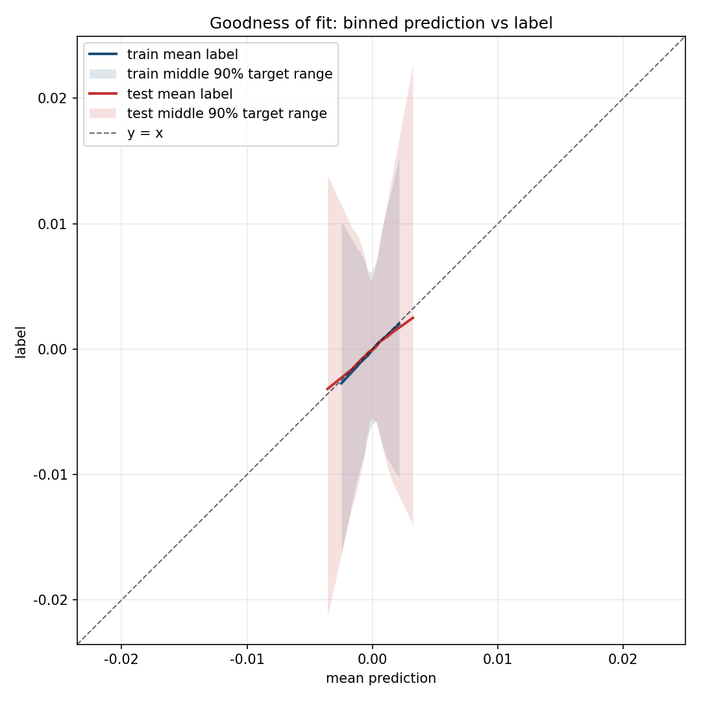

### Train/Test Goodness Of Fit

### 3.5. Liquidity By ADV

ADV 使用 shifted 20-trading-day stock1d amount mean, 并在完整 test date-code universe 上分桶. 

| adv_bucket | bucket_label | row_count | day_count | mean_adv_amount | median_adv_amount | mean_ic | mean_rank_ic | icir | rank_icir | top5_return_bps | top5_hit_rate | top5_row_count |
| --- | --- | --- | --- | --- | --- | --- | --- | --- | --- | --- | --- | --- |
| 1 | Bottom20% | 33579609 | 205 | 22043.429610 | 22557.850150 | 0.112309 | 0.097898 | 4.583706 | 4.534728 | 8.649999 | 0.442678 | 1694847 |
| 2 | 20~40% | 33579609 | 205 | 49378.094708 | 48886.620950 | 0.079705 | 0.068430 | 3.762143 | 3.873013 | 5.586033 | 0.423777 | 1695008 |
| 3 | 40~60% | 33579609 | 205 | 89103.411146 | 87560.379700 | 0.087189 | 0.063184 | 3.717908 | 3.460629 | 5.869506 | 0.434377 | 1694203 |
| 4 | 60~80% | 33579448 | 205 | 170679.829077 | 165081.435150 | 0.097882 | 0.063844 | 4.196513 | 3.075920 | 7.004053 | 0.452242 | 1695008 |
| 5 | Top20% | 33579448 | 205 | 714122.143913 | 442449.002300 | 0.108783 | 0.067637 | 3.517132 | 2.754805 | 7.917372 | 0.466451 | 1695008 |

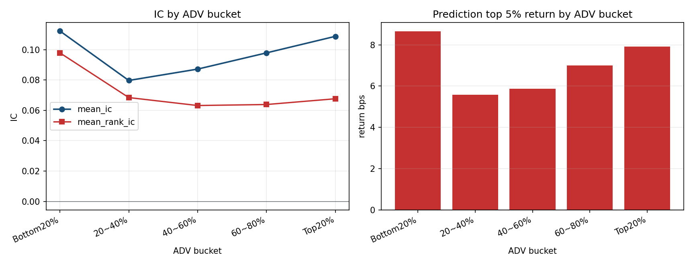

### ADV Liquidity Bucket Metrics

04

4. Train Metrics

### Train Metrics

模型参数, checkpoint selection 和运行身份来自 config, sidecar 与 summary. 

### 4.1. Checkpoint Selection

Checkpoint 只由 validation 选择; 所有候选 checkpoint 的 train headline 使用同一确定性样本. 

| key | value |
| --- | --- |
| best_iter | 105343 |
| selection_metric | checkpoint_selection/score |
| selection_rule | early_top_k |
| candidate_count | 10 |

| iter | selected | val/objective/mse | val/quality/global_ic | val/quality/rank_ic | val/dist/pred_std_over_target_std | decision | metric_rank |
| --- | --- | --- | --- | --- | --- | --- | --- |
| 11705 | False | 2.185886 | 0.037729 | 0.050882 | — | reject | 10.000000 |
| 23410 | False | 2.179600 | 0.067711 | 0.084066 | — | reject | 9.000000 |
| 35115 | False | 2.177212 | 0.078163 | 0.098128 | — | reject | 8.000000 |
| 46819 | False | 2.178007 | 0.079005 | 0.103307 | — | reject | 7.000000 |
| 58524 | False | 2.172761 | 0.095279 | 0.104080 | — | reject | 6.000000 |
| 70229 | False | 2.164882 | 0.106932 | 0.109933 | — | reject | 5.000000 |
| 81933 | False | 2.163204 | 0.117247 | 0.109353 | — | reject | 4.000000 |
| 93638 | False | 2.168324 | 0.122619 | 0.114902 | — | reject | 3.000000 |
| 105343 | True | 2.146839 | 0.141584 | 0.111418 | — | promote | 2.000000 |
| 117047 | False | 2.145711 | 0.143308 | 0.112269 | — | reject | 1.000000 |

| iter | pooled_ic | pooled_rank_ic | count | scope |
| --- | --- | --- | --- | --- |
| 11705 | 0.056204 | 0.061808 | 31875072 | fixed train sample: 3891 batches |
| 23410 | 0.073049 | 0.073625 | 31875072 | fixed train sample: 3891 batches |
| 35115 | 0.084410 | 0.077168 | 31875072 | fixed train sample: 3891 batches |
| 46819 | 0.088082 | 0.090609 | 31875072 | fixed train sample: 3891 batches |
| 58524 | 0.087927 | 0.089329 | 31875072 | fixed train sample: 3891 batches |
| 70229 | 0.088576 | 0.074835 | 31875072 | fixed train sample: 3891 batches |
| 81933 | 0.097520 | 0.087605 | 31875072 | fixed train sample: 3891 batches |
| 93638 | 0.104580 | 0.093276 | 31875072 | fixed train sample: 3891 batches |
| 105343 | 0.107859 | 0.095192 | 31875072 | fixed train sample: 3891 batches |

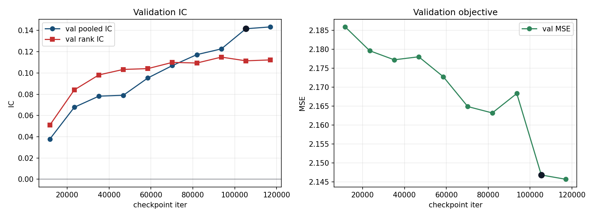

### Checkpoint Selection Metrics

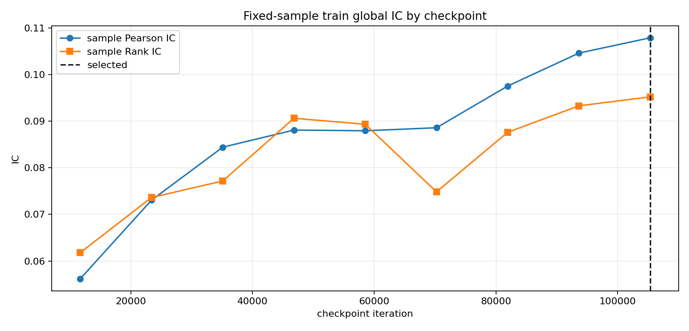

### Fixed-Sample Train Global IC By Checkpoint

### 4.2. Model And Method

本实验仅改变 active feature projection 或 context architecture. 

| experiment | status | research purpose | idea | source | baseline difference | concrete method | formula summary |
| --- | --- | --- | --- | --- | --- | --- | --- |
| cs_rank_41d | complete | 检验显式分钟横截面相对位置能否补充单股票绝对时序状态.  | 把不同尺度收益, 波动率和成交额在同一分钟 panel 内转成 percentile/rank.  | 经典横截面排序因子与 rank normalization; 本项目 7-rank 预登记.  | 唯一开启全部 7 个显式 rank 列; 模型结构, 参数量和训练口径与 control 相同.  | 启用全部 41 列; 7 个 rank 仅使用 point-in-time feature-valid panel 计算, 随后与 34D base 一同进入相同 GRU.  | U_t = {j : features[j,t] are valid}; r[i,t,k] = average_rank_Ut(v[i,t,k]) / \|U_t\|; x_tilde[i,t] = [x_base[i,t], r[i,t,1:7]]; h_i = GRU(x_tilde[i,1:60])_last; y_hat_i = rho(h_i) |

### 4.2.1. GRU

所有臂共享两层单向 GRU 编码器. 

| field | value |
| --- | --- |
| input_tensor | batch, panel, 60, 41 |
| gru_hidden_size | 384 |
| gru_num_layers | 2 |
| gru_bidirectional | False |
| gru_dropout | 0.000000 |

### 4.2.2. MLP

公共预测头使用 Linear-LayerNorm-ReLU block; context 臂将 hidden 与 context 拼接. 

| field | value |
| --- | --- |
| mlp_effective_hidden_width | 512, 512 |
| mlp_dropout | 0.000000 |
| trainable_parameter | 1,841,281 |

### 4.2.3. Method

启用全部 41 列; 7 个 rank 仅使用 point-in-time feature-valid panel 计算, 随后与 34D base 一同进入相同 GRU. 

| field | value |
| --- | --- |
| parameter_initialization | PyTorch default GRU/Linear; Xavier inducing tokens |
| lr_scheduler/type | 200-step LinearWarmup + CosineAnnealing |
| optimizer | AdamW |
| approx_total_epochs | 1 exact sampler epoch |
| final_iter | 117047 |
| checkpoint_selection | early_top_k |

| step | operation |
| --- | --- |
| 1 | 按 date-time 构造只依赖当时 feature validity 的横截面 U_t.  |
| 2 | 对 5/20/60/240m return, 20/60m RV 和 log amount 使用 average-tie percentile rank.  |
| 3 | 将 7 个 rank 与 34D base 拼接, 经共同标准化和相同 GRU/MLP 训练.  |

| symbol | formula | implementation meaning |
| --- | --- | --- |
| Point-in-time universe | U_t = {j : features[j,t] are valid} | 未来 label availability 不进入 U_t.  |
| Percentile rank | r[i,t,k] = average_rank_Ut(v[i,t,k]) / \|U_t\| | 与 pandas rank(method=average, pct=True) 一致.  |
| Active input | x_tilde[i,t] = [x_base[i,t], r[i,t,1:7]] | 该臂启用全部 41 个逻辑输入.  |
| Prediction | h_i = GRU(x_tilde[i,1:60])_last; y_hat_i = rho(h_i) | 预测结构与 control 完全相同.  |

### 4.3. Training Monitoring

TensorBoard event files和资源监控 JSONL 共同提供训练过程证据. 

| samples | host CPU % | process CPU % | RSS GiB | host RAM % | min free RAM GiB | GPU MiB | GPU util % | GPU temp C | min cache GiB |
| --- | --- | --- | --- | --- | --- | --- | --- | --- | --- |
| 756 | 54.100000 | 1158.130503 | 46.974407 | 22.100000 | 392.379112 | 9581.000000 | 100.000000 | 76.000000 | 210.109665 |

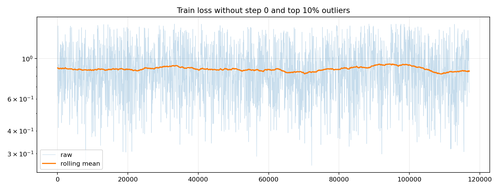

### Train Loss

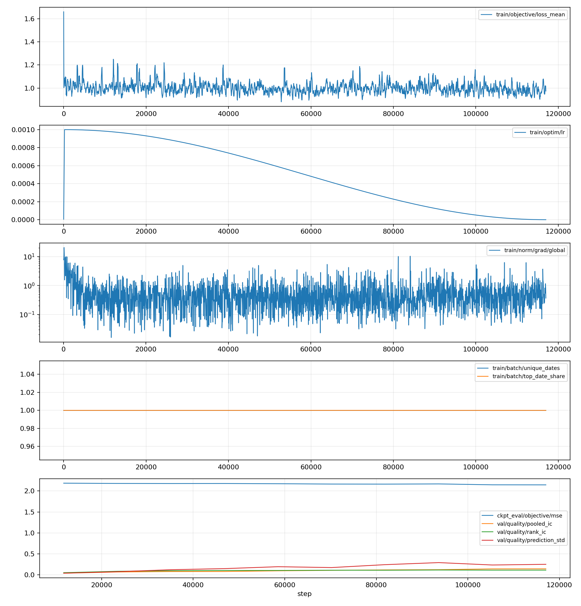

### Train Monitoring Curves

05

5. Trading And Cost

### Trading And Cost

只有完成正式 test 和 backtest 的实验臂报告 execution-aware 摘要. 

### 5.0. Cost Model Status

ETF proxy 使用完整 train-validation-test 时间线; raw forward log return 经 expm1 转为 simple return 后复利. 

| field | value |
| --- | --- |
| status | available |
| available_metric | 10M AUM execution-aware portfolio summary |

| gross daily | gross Sharpe | net daily 10M | net Sharpe 10M | max drawdown | turnover | fill |
| --- | --- | --- | --- | --- | --- | --- |
| 87.19 bps | 45.395270 | -150.01 bps | -39.747621 | -95.44% | 11.556330 | 94.01% |

### 5.1. Cumulative Prediction, Real, And Excess Returns

按 pool 使用 trailing threshold, 5-minute rebalance 与连续 full-hold benchmark. 

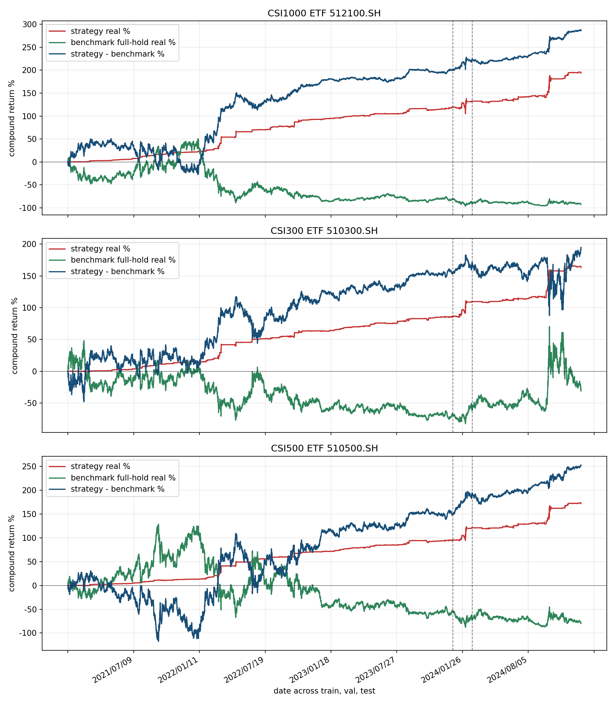

### Train/Val/Test Cumulative Returns

### 5.2. Single-Side Cost Sensitivity

成本扫描同时报告完整 timeline, test-only 以及排除 2024-09/10 的 test. 

| pool | date | test_minute_index | single_side_cost_bps | net_strategy_cumulative_return |
| --- | --- | --- | --- | --- |
| csi1000_etf_sh | 240301 | 1 | 0.000000 | 0.000000 |
| csi1000_etf_sh | 240301 | 2 | 0.000000 | 0.000000 |
| csi1000_etf_sh | 240301 | 3 | 0.000000 | 0.000000 |
| csi1000_etf_sh | 240301 | 4 | 0.000000 | 0.000000 |
| csi1000_etf_sh | 240301 | 5 | 0.000000 | 0.000000 |
| csi1000_etf_sh | 240301 | 6 | 0.000000 | 0.000000 |
| csi1000_etf_sh | 240301 | 7 | 0.000000 | 0.000000 |
| csi1000_etf_sh | 240301 | 8 | 0.000000 | 0.000000 |
| csi1000_etf_sh | 240301 | 9 | 0.000000 | 0.000000 |
| csi1000_etf_sh | 240301 | 10 | 0.000000 | 0.000000 |
| csi1000_etf_sh | 240301 | 11 | 0.000000 | 0.000000 |
| csi1000_etf_sh | 240301 | 12 | 0.000000 | 0.000000 |
| csi1000_etf_sh | 240301 | 13 | 0.000000 | 0.000000 |
| csi1000_etf_sh | 240301 | 14 | 0.000000 | 0.000000 |
| csi1000_etf_sh | 240301 | 15 | 0.000000 | 0.000000 |
| csi1000_etf_sh | 240301 | 16 | 0.000000 | 0.000000 |
| csi1000_etf_sh | 240301 | 17 | 0.000000 | 0.000000 |
| csi1000_etf_sh | 240301 | 18 | 0.000000 | 0.000000 |
| csi1000_etf_sh | 240301 | 19 | 0.000000 | 0.000000 |
| csi1000_etf_sh | 240301 | 20 | 0.000000 | 0.000000 |
| csi1000_etf_sh | 240301 | 21 | 0.000000 | 0.000000 |
| csi1000_etf_sh | 240301 | 22 | 0.000000 | 0.000000 |
| csi1000_etf_sh | 240301 | 23 | 0.000000 | 0.000000 |
| csi1000_etf_sh | 240301 | 24 | 0.000000 | 0.000000 |
| csi1000_etf_sh | 240301 | 25 | 0.000000 | 0.000000 |
| csi1000_etf_sh | 240301 | 26 | 0.000000 | 0.000000 |
| csi1000_etf_sh | 240301 | 27 | 0.000000 | 0.000000 |
| csi1000_etf_sh | 240301 | 28 | 0.000000 | 0.000000 |
| csi1000_etf_sh | 240301 | 29 | 0.000000 | 0.000000 |
| csi1000_etf_sh | 240301 | 30 | 0.000000 | 0.000000 |
| csi1000_etf_sh | 240301 | 31 | 0.000000 | 0.000000 |
| csi1000_etf_sh | 240301 | 32 | 0.000000 | 0.000000 |
| csi1000_etf_sh | 240301 | 33 | 0.000000 | 0.000000 |
| csi1000_etf_sh | 240301 | 34 | 0.000000 | 0.000000 |
| csi1000_etf_sh | 240301 | 35 | 0.000000 | 0.000000 |
| csi1000_etf_sh | 240301 | 36 | 0.000000 | 0.000000 |
| csi1000_etf_sh | 240301 | 37 | 0.000000 | 0.000000 |
| csi1000_etf_sh | 240301 | 38 | 0.000000 | 0.000000 |
| csi1000_etf_sh | 240301 | 39 | 0.000000 | 0.000000 |
| csi1000_etf_sh | 240301 | 40 | 0.000000 | 0.000000 |
| csi1000_etf_sh | 240301 | 41 | 0.000000 | 0.000000 |
| csi1000_etf_sh | 240301 | 42 | 0.000000 | 0.000000 |
| csi1000_etf_sh | 240301 | 43 | 0.000000 | 0.000000 |
| csi1000_etf_sh | 240301 | 44 | 0.000000 | 0.000000 |
| csi1000_etf_sh | 240301 | 45 | 0.000000 | 0.000000 |
| csi1000_etf_sh | 240301 | 46 | 0.000000 | 0.000000 |
| csi1000_etf_sh | 240301 | 47 | 0.000000 | 0.000000 |
| csi1000_etf_sh | 240301 | 48 | 0.000000 | 0.000000 |
| csi1000_etf_sh | 240301 | 49 | 0.000000 | 0.000000 |
| csi1000_etf_sh | 240301 | 50 | 0.000000 | 0.000000 |
| csi1000_etf_sh | 240301 | 51 | 0.000000 | 0.000000 |
| csi1000_etf_sh | 240301 | 52 | 0.000000 | 0.000000 |
| csi1000_etf_sh | 240301 | 53 | 0.000000 | 0.000000 |
| csi1000_etf_sh | 240301 | 54 | 0.000000 | 0.000000 |
| csi1000_etf_sh | 240301 | 55 | 0.000000 | 0.000000 |
| csi1000_etf_sh | 240301 | 56 | 0.000000 | 0.000000 |
| csi1000_etf_sh | 240301 | 57 | 0.000000 | 0.000000 |
| csi1000_etf_sh | 240301 | 58 | 0.000000 | 0.000000 |
| csi1000_etf_sh | 240301 | 59 | 0.000000 | 0.000000 |
| csi1000_etf_sh | 240301 | 60 | 0.000000 | 0.000000 |
| csi500_etf_sh | 241231 | 32946 | 10.000000 | -0.029625 |
| csi500_etf_sh | 241231 | 32947 | 10.000000 | -0.029625 |
| csi500_etf_sh | 241231 | 32948 | 10.000000 | -0.029625 |
| csi500_etf_sh | 241231 | 32949 | 10.000000 | -0.029625 |
| csi500_etf_sh | 241231 | 32950 | 10.000000 | -0.029625 |
| csi500_etf_sh | 241231 | 32951 | 10.000000 | -0.029625 |
| csi500_etf_sh | 241231 | 32952 | 10.000000 | -0.029625 |
| csi500_etf_sh | 241231 | 32953 | 10.000000 | -0.029625 |
| csi500_etf_sh | 241231 | 32954 | 10.000000 | -0.029625 |
| csi500_etf_sh | 241231 | 32955 | 10.000000 | -0.029625 |
| csi500_etf_sh | 241231 | 32956 | 10.000000 | -0.029625 |
| csi500_etf_sh | 241231 | 32957 | 10.000000 | -0.029625 |
| csi500_etf_sh | 241231 | 32958 | 10.000000 | -0.029625 |
| csi500_etf_sh | 241231 | 32959 | 10.000000 | -0.029625 |
| csi500_etf_sh | 241231 | 32960 | 10.000000 | -0.029625 |
| csi500_etf_sh | 241231 | 32961 | 10.000000 | -0.029625 |
| csi500_etf_sh | 241231 | 32962 | 10.000000 | -0.029625 |
| csi500_etf_sh | 241231 | 32963 | 10.000000 | -0.029625 |
| csi500_etf_sh | 241231 | 32964 | 10.000000 | -0.029625 |
| csi500_etf_sh | 241231 | 32965 | 10.000000 | -0.029625 |
| csi500_etf_sh | 241231 | 32966 | 10.000000 | -0.029625 |
| csi500_etf_sh | 241231 | 32967 | 10.000000 | -0.029625 |
| csi500_etf_sh | 241231 | 32968 | 10.000000 | -0.029625 |
| csi500_etf_sh | 241231 | 32969 | 10.000000 | -0.029625 |
| csi500_etf_sh | 241231 | 32970 | 10.000000 | -0.029625 |
| csi500_etf_sh | 241231 | 32971 | 10.000000 | -0.029625 |
| csi500_etf_sh | 241231 | 32972 | 10.000000 | -0.029625 |
| csi500_etf_sh | 241231 | 32973 | 10.000000 | -0.029625 |
| csi500_etf_sh | 241231 | 32974 | 10.000000 | -0.029625 |
| csi500_etf_sh | 241231 | 32975 | 10.000000 | -0.029625 |
| csi500_etf_sh | 241231 | 32976 | 10.000000 | -0.029625 |
| csi500_etf_sh | 241231 | 32977 | 10.000000 | -0.029625 |
| csi500_etf_sh | 241231 | 32978 | 10.000000 | -0.029625 |
| csi500_etf_sh | 241231 | 32979 | 10.000000 | -0.029625 |
| csi500_etf_sh | 241231 | 32980 | 10.000000 | -0.029625 |
| csi500_etf_sh | 241231 | 32981 | 10.000000 | -0.029625 |
| csi500_etf_sh | 241231 | 32982 | 10.000000 | -0.029625 |
| csi500_etf_sh | 241231 | 32983 | 10.000000 | -0.029625 |
| csi500_etf_sh | 241231 | 32984 | 10.000000 | -0.029625 |
| csi500_etf_sh | 241231 | 32985 | 10.000000 | -0.029625 |
| csi500_etf_sh | 241231 | 32986 | 10.000000 | -0.029625 |
| csi500_etf_sh | 241231 | 32987 | 10.000000 | -0.029625 |
| csi500_etf_sh | 241231 | 32988 | 10.000000 | -0.029625 |
| csi500_etf_sh | 241231 | 32989 | 10.000000 | -0.029625 |
| csi500_etf_sh | 241231 | 32990 | 10.000000 | -0.029625 |
| csi500_etf_sh | 241231 | 32991 | 10.000000 | -0.029625 |
| csi500_etf_sh | 241231 | 32992 | 10.000000 | -0.028976 |
| csi500_etf_sh | 241231 | 32993 | 10.000000 | -0.028976 |
| csi500_etf_sh | 241231 | 32994 | 10.000000 | -0.028976 |
| csi500_etf_sh | 241231 | 32995 | 10.000000 | -0.028976 |
| csi500_etf_sh | 241231 | 32996 | 10.000000 | -0.028976 |
| csi500_etf_sh | 241231 | 32997 | 10.000000 | -0.030376 |
| csi500_etf_sh | 241231 | 32998 | 10.000000 | -0.030376 |
| csi500_etf_sh | 241231 | 32999 | 10.000000 | -0.030376 |
| csi500_etf_sh | 241231 | 33000 | 10.000000 | -0.030376 |
| csi500_etf_sh | 241231 | 33001 | 10.000000 | -0.030376 |
| csi500_etf_sh | 241231 | 33002 | 10.000000 | -0.035464 |
| csi500_etf_sh | 241231 | 33003 | 10.000000 | -0.035464 |
| csi500_etf_sh | 241231 | 33004 | 10.000000 | -0.035464 |
| csi500_etf_sh | 241231 | 33005 | 10.000000 | -0.035464 |

| split | pool | date | day_index | single_side_cost_bps | net_strategy_cumulative_return |
| --- | --- | --- | --- | --- | --- |
| train | csi1000_etf_sh | 210104 | 1 | 0.000000 | 0.000000 |
| train | csi1000_etf_sh | 210104 | 2 | 0.000000 | 0.000000 |
| train | csi1000_etf_sh | 210104 | 3 | 0.000000 | 0.000000 |
| train | csi1000_etf_sh | 210104 | 4 | 0.000000 | 0.000000 |
| train | csi1000_etf_sh | 210104 | 5 | 0.000000 | 0.000000 |
| train | csi1000_etf_sh | 210104 | 6 | 0.000000 | 0.000000 |
| train | csi1000_etf_sh | 210104 | 7 | 0.000000 | 0.000000 |
| train | csi1000_etf_sh | 210104 | 8 | 0.000000 | 0.000000 |
| train | csi1000_etf_sh | 210104 | 9 | 0.000000 | 0.000000 |
| train | csi1000_etf_sh | 210104 | 10 | 0.000000 | 0.000000 |
| train | csi1000_etf_sh | 210104 | 11 | 0.000000 | 0.000000 |
| train | csi1000_etf_sh | 210104 | 12 | 0.000000 | 0.000000 |
| train | csi1000_etf_sh | 210104 | 13 | 0.000000 | 0.000000 |
| train | csi1000_etf_sh | 210104 | 14 | 0.000000 | 0.000000 |
| train | csi1000_etf_sh | 210104 | 15 | 0.000000 | 0.000000 |
| train | csi1000_etf_sh | 210104 | 16 | 0.000000 | 0.000000 |
| train | csi1000_etf_sh | 210104 | 17 | 0.000000 | 0.000000 |
| train | csi1000_etf_sh | 210104 | 18 | 0.000000 | 0.000000 |
| train | csi1000_etf_sh | 210104 | 19 | 0.000000 | 0.000000 |
| train | csi1000_etf_sh | 210104 | 20 | 0.000000 | 0.000000 |
| train | csi1000_etf_sh | 210104 | 21 | 0.000000 | 0.000000 |
| train | csi1000_etf_sh | 210104 | 22 | 0.000000 | 0.000000 |
| train | csi1000_etf_sh | 210104 | 23 | 0.000000 | 0.000000 |
| train | csi1000_etf_sh | 210104 | 24 | 0.000000 | 0.000000 |
| train | csi1000_etf_sh | 210104 | 25 | 0.000000 | 0.000000 |
| train | csi1000_etf_sh | 210104 | 26 | 0.000000 | 0.000000 |
| train | csi1000_etf_sh | 210104 | 27 | 0.000000 | 0.000000 |
| train | csi1000_etf_sh | 210104 | 28 | 0.000000 | 0.000000 |
| train | csi1000_etf_sh | 210104 | 29 | 0.000000 | 0.000000 |
| train | csi1000_etf_sh | 210104 | 30 | 0.000000 | 0.000000 |
| train | csi1000_etf_sh | 210104 | 31 | 0.000000 | 0.000000 |
| train | csi1000_etf_sh | 210104 | 32 | 0.000000 | 0.000000 |
| train | csi1000_etf_sh | 210104 | 33 | 0.000000 | 0.000000 |
| train | csi1000_etf_sh | 210104 | 34 | 0.000000 | 0.000000 |
| train | csi1000_etf_sh | 210104 | 35 | 0.000000 | 0.000000 |
| train | csi1000_etf_sh | 210104 | 36 | 0.000000 | 0.000000 |
| train | csi1000_etf_sh | 210104 | 37 | 0.000000 | 0.000000 |
| train | csi1000_etf_sh | 210104 | 38 | 0.000000 | 0.000000 |
| train | csi1000_etf_sh | 210104 | 39 | 0.000000 | 0.000000 |
| train | csi1000_etf_sh | 210104 | 40 | 0.000000 | 0.000000 |
| train | csi1000_etf_sh | 210104 | 41 | 0.000000 | 0.000000 |
| train | csi1000_etf_sh | 210104 | 42 | 0.000000 | 0.000000 |
| train | csi1000_etf_sh | 210104 | 43 | 0.000000 | 0.000000 |
| train | csi1000_etf_sh | 210104 | 44 | 0.000000 | 0.000000 |
| train | csi1000_etf_sh | 210104 | 45 | 0.000000 | 0.000000 |
| train | csi1000_etf_sh | 210104 | 46 | 0.000000 | 0.000000 |
| train | csi1000_etf_sh | 210104 | 47 | 0.000000 | 0.000000 |
| train | csi1000_etf_sh | 210104 | 48 | 0.000000 | 0.000000 |
| train | csi1000_etf_sh | 210104 | 49 | 0.000000 | 0.000000 |
| train | csi1000_etf_sh | 210104 | 50 | 0.000000 | 0.000000 |
| train | csi1000_etf_sh | 210104 | 51 | 0.000000 | 0.000000 |
| train | csi1000_etf_sh | 210104 | 52 | 0.000000 | 0.000000 |
| train | csi1000_etf_sh | 210104 | 53 | 0.000000 | 0.000000 |
| train | csi1000_etf_sh | 210104 | 54 | 0.000000 | 0.000000 |
| train | csi1000_etf_sh | 210104 | 55 | 0.000000 | 0.000000 |
| train | csi1000_etf_sh | 210104 | 56 | 0.000000 | 0.000000 |
| train | csi1000_etf_sh | 210104 | 57 | 0.000000 | 0.000000 |
| train | csi1000_etf_sh | 210104 | 58 | 0.000000 | 0.000000 |
| train | csi1000_etf_sh | 210104 | 59 | 0.000000 | 0.000000 |
| train | csi1000_etf_sh | 210104 | 60 | 0.000000 | 0.000000 |
| test | csi500_etf_sh | 241231 | 155950 | 10.000000 | -0.252354 |
| test | csi500_etf_sh | 241231 | 155951 | 10.000000 | -0.252354 |
| test | csi500_etf_sh | 241231 | 155952 | 10.000000 | -0.252354 |
| test | csi500_etf_sh | 241231 | 155953 | 10.000000 | -0.252354 |
| test | csi500_etf_sh | 241231 | 155954 | 10.000000 | -0.252354 |
| test | csi500_etf_sh | 241231 | 155955 | 10.000000 | -0.252354 |
| test | csi500_etf_sh | 241231 | 155956 | 10.000000 | -0.252354 |
| test | csi500_etf_sh | 241231 | 155957 | 10.000000 | -0.252354 |
| test | csi500_etf_sh | 241231 | 155958 | 10.000000 | -0.252354 |
| test | csi500_etf_sh | 241231 | 155959 | 10.000000 | -0.252354 |
| test | csi500_etf_sh | 241231 | 155960 | 10.000000 | -0.252354 |
| test | csi500_etf_sh | 241231 | 155961 | 10.000000 | -0.252354 |
| test | csi500_etf_sh | 241231 | 155962 | 10.000000 | -0.252354 |
| test | csi500_etf_sh | 241231 | 155963 | 10.000000 | -0.252354 |
| test | csi500_etf_sh | 241231 | 155964 | 10.000000 | -0.252354 |
| test | csi500_etf_sh | 241231 | 155965 | 10.000000 | -0.252354 |
| test | csi500_etf_sh | 241231 | 155966 | 10.000000 | -0.252354 |
| test | csi500_etf_sh | 241231 | 155967 | 10.000000 | -0.252354 |
| test | csi500_etf_sh | 241231 | 155968 | 10.000000 | -0.252354 |
| test | csi500_etf_sh | 241231 | 155969 | 10.000000 | -0.252354 |
| test | csi500_etf_sh | 241231 | 155970 | 10.000000 | -0.252354 |
| test | csi500_etf_sh | 241231 | 155971 | 10.000000 | -0.252354 |
| test | csi500_etf_sh | 241231 | 155972 | 10.000000 | -0.252354 |
| test | csi500_etf_sh | 241231 | 155973 | 10.000000 | -0.252354 |
| test | csi500_etf_sh | 241231 | 155974 | 10.000000 | -0.252354 |
| test | csi500_etf_sh | 241231 | 155975 | 10.000000 | -0.252354 |
| test | csi500_etf_sh | 241231 | 155976 | 10.000000 | -0.252354 |
| test | csi500_etf_sh | 241231 | 155977 | 10.000000 | -0.252354 |
| test | csi500_etf_sh | 241231 | 155978 | 10.000000 | -0.252354 |
| test | csi500_etf_sh | 241231 | 155979 | 10.000000 | -0.252354 |
| test | csi500_etf_sh | 241231 | 155980 | 10.000000 | -0.252354 |
| test | csi500_etf_sh | 241231 | 155981 | 10.000000 | -0.252354 |
| test | csi500_etf_sh | 241231 | 155982 | 10.000000 | -0.252354 |
| test | csi500_etf_sh | 241231 | 155983 | 10.000000 | -0.252354 |
| test | csi500_etf_sh | 241231 | 155984 | 10.000000 | -0.252354 |
| test | csi500_etf_sh | 241231 | 155985 | 10.000000 | -0.252354 |
| test | csi500_etf_sh | 241231 | 155986 | 10.000000 | -0.252354 |
| test | csi500_etf_sh | 241231 | 155987 | 10.000000 | -0.252354 |
| test | csi500_etf_sh | 241231 | 155988 | 10.000000 | -0.252354 |
| test | csi500_etf_sh | 241231 | 155989 | 10.000000 | -0.252354 |
| test | csi500_etf_sh | 241231 | 155990 | 10.000000 | -0.252354 |
| test | csi500_etf_sh | 241231 | 155991 | 10.000000 | -0.252354 |
| test | csi500_etf_sh | 241231 | 155992 | 10.000000 | -0.252354 |
| test | csi500_etf_sh | 241231 | 155993 | 10.000000 | -0.252354 |
| test | csi500_etf_sh | 241231 | 155994 | 10.000000 | -0.252354 |
| test | csi500_etf_sh | 241231 | 155995 | 10.000000 | -0.252354 |
| test | csi500_etf_sh | 241231 | 155996 | 10.000000 | -0.251855 |
| test | csi500_etf_sh | 241231 | 155997 | 10.000000 | -0.251855 |
| test | csi500_etf_sh | 241231 | 155998 | 10.000000 | -0.251855 |
| test | csi500_etf_sh | 241231 | 155999 | 10.000000 | -0.251855 |
| test | csi500_etf_sh | 241231 | 156000 | 10.000000 | -0.251855 |
| test | csi500_etf_sh | 241231 | 156001 | 10.000000 | -0.252933 |
| test | csi500_etf_sh | 241231 | 156002 | 10.000000 | -0.252933 |
| test | csi500_etf_sh | 241231 | 156003 | 10.000000 | -0.252933 |
| test | csi500_etf_sh | 241231 | 156004 | 10.000000 | -0.252933 |
| test | csi500_etf_sh | 241231 | 156005 | 10.000000 | -0.252933 |
| test | csi500_etf_sh | 241231 | 156006 | 10.000000 | -0.256853 |
| test | csi500_etf_sh | 241231 | 156007 | 10.000000 | -0.256853 |
| test | csi500_etf_sh | 241231 | 156008 | 10.000000 | -0.256853 |
| test | csi500_etf_sh | 241231 | 156009 | 10.000000 | -0.256853 |

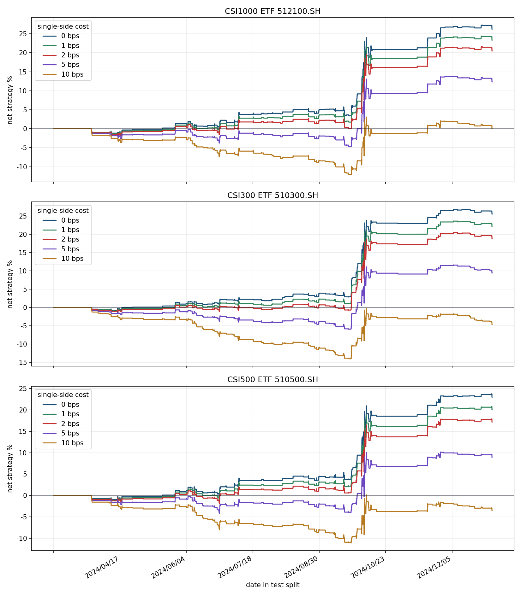

### Test Cost Sensitivity

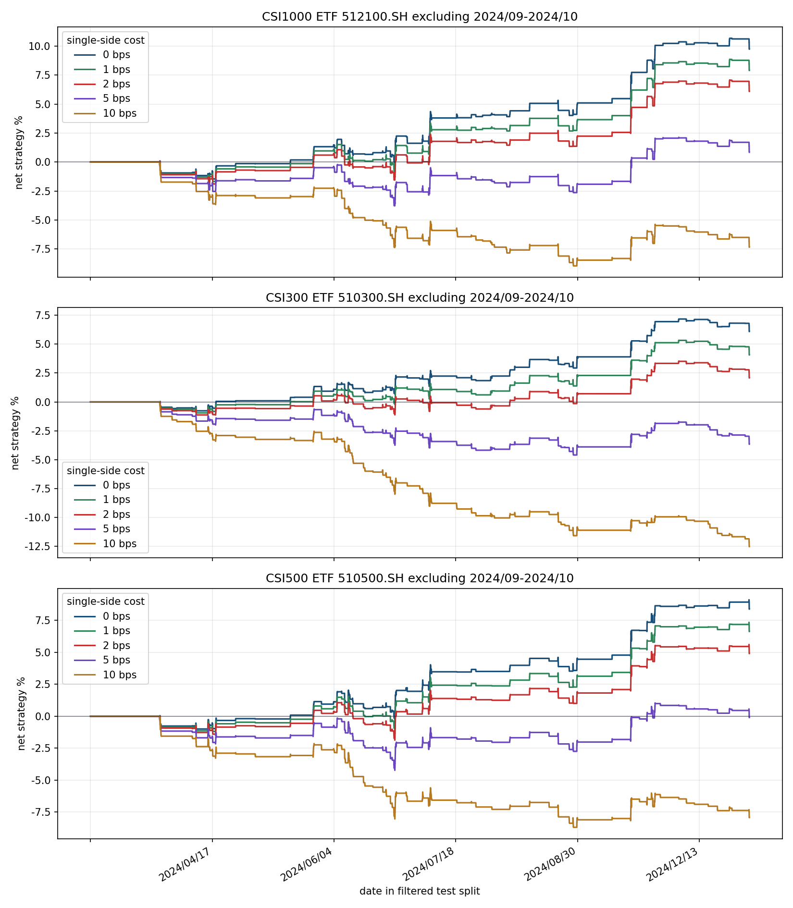

### Test Cost Sensitivity Excluding 2024-09/10

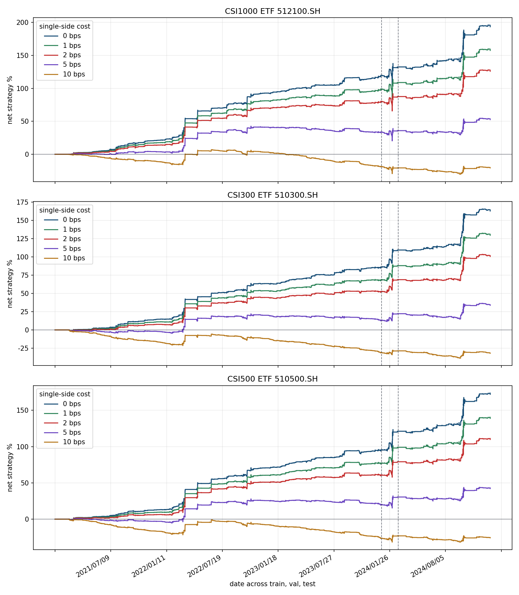

### Full Timeline Cost Sensitivity

### 5.3. ETF Trade Return Distribution

Trade rows are defined by position open/close episodes under the same ETF proxy rule.

| scope | pool | display_name | trade_id | start_date | start_time | end_date | end_time | holding_minutes | trade_return_bps |
| --- | --- | --- | --- | --- | --- | --- | --- | --- | --- |
| train_val_test | csi1000_etf_sh | 1000 ETF | 1 | 210219 | 143000 | 210219 | 143400 | 5 | 0.106912 |
| train_val_test | csi1000_etf_sh | 1000 ETF | 2 | 210219 | 144000 | 210219 | 144900 | 10 | 18.875604 |
| train_val_test | csi1000_etf_sh | 1000 ETF | 3 | 210224 | 143200 | 210225 | 104000 | 20 | 0.303730 |
| train_val_test | csi1000_etf_sh | 1000 ETF | 4 | 210301 | 103900 | 210301 | 104300 | 5 | -8.298179 |
| train_val_test | csi1000_etf_sh | 1000 ETF | 5 | 210301 | 143900 | 210302 | 104200 | 15 | 34.531075 |
| train_val_test | csi1000_etf_sh | 1000 ETF | 6 | 210302 | 143300 | 210302 | 143700 | 5 | 0.119314 |
| train_val_test | csi1000_etf_sh | 1000 ETF | 7 | 210303 | 144200 | 210304 | 104000 | 10 | 15.502612 |
| train_val_test | csi1000_etf_sh | 1000 ETF | 8 | 210305 | 110500 | 210305 | 110900 | 5 | -9.159953 |
| train_val_test | csi1000_etf_sh | 1000 ETF | 9 | 210309 | 105800 | 210309 | 112700 | 30 | 155.968482 |
| train_val_test | csi1000_etf_sh | 1000 ETF | 10 | 210309 | 130300 | 210309 | 132200 | 20 | -12.593671 |
| train_val_test | csi1000_etf_sh | 1000 ETF | 11 | 210310 | 105200 | 210310 | 105600 | 5 | -5.527150 |
| train_val_test | csi1000_etf_sh | 1000 ETF | 12 | 210311 | 104100 | 210311 | 110000 | 20 | 2.941567 |
| train_val_test | csi1000_etf_sh | 1000 ETF | 13 | 210311 | 144600 | 210312 | 103900 | 5 | 19.248751 |
| train_val_test | csi1000_etf_sh | 1000 ETF | 14 | 210315 | 143900 | 210315 | 144300 | 5 | -0.416703 |
| train_val_test | csi1000_etf_sh | 1000 ETF | 15 | 210315 | 144900 | 210316 | 104200 | 5 | 21.417668 |
| train_val_test | csi1000_etf_sh | 1000 ETF | 16 | 210316 | 144300 | 210317 | 104100 | 10 | 8.670176 |
| train_val_test | csi1000_etf_sh | 1000 ETF | 17 | 210322 | 144400 | 210323 | 104200 | 10 | 25.788373 |
| train_val_test | csi1000_etf_sh | 1000 ETF | 18 | 210401 | 143600 | 210402 | 103900 | 15 | -9.969876 |
| train_val_test | csi1000_etf_sh | 1000 ETF | 19 | 210406 | 144400 | 210407 | 104200 | 10 | 3.031593 |
| train_val_test | csi1000_etf_sh | 1000 ETF | 20 | 210407 | 144300 | 210408 | 104100 | 10 | 10.273150 |
| train_val_test | csi1000_etf_sh | 1000 ETF | 21 | 210414 | 144800 | 210415 | 104100 | 5 | 3.934715 |
| train_val_test | csi1000_etf_sh | 1000 ETF | 22 | 210416 | 144600 | 210419 | 104900 | 15 | -1.469772 |
| train_val_test | csi1000_etf_sh | 1000 ETF | 23 | 210422 | 144700 | 210423 | 104000 | 5 | 6.945729 |
| train_val_test | csi1000_etf_sh | 1000 ETF | 24 | 210423 | 144600 | 210426 | 103900 | 5 | 2.660279 |
| train_val_test | csi1000_etf_sh | 1000 ETF | 25 | 210426 | 105500 | 210426 | 105900 | 5 | 0.172790 |
| train_val_test | csi1000_etf_sh | 1000 ETF | 26 | 210427 | 133900 | 210427 | 134300 | 5 | 6.929537 |
| train_val_test | csi1000_etf_sh | 1000 ETF | 27 | 210427 | 135400 | 210427 | 135800 | 5 | -3.433606 |
| train_val_test | csi1000_etf_sh | 1000 ETF | 28 | 210428 | 144300 | 210429 | 104100 | 10 | 9.597564 |
| train_val_test | csi1000_etf_sh | 1000 ETF | 29 | 210430 | 144600 | 210506 | 103900 | 5 | -3.347092 |
| train_val_test | csi1000_etf_sh | 1000 ETF | 30 | 210510 | 144300 | 210511 | 104100 | 10 | 40.266654 |
| train_val_test | csi1000_etf_sh | 1000 ETF | 31 | 210511 | 131700 | 210511 | 132600 | 10 | 10.898183 |
| train_val_test | csi1000_etf_sh | 1000 ETF | 32 | 210511 | 144700 | 210512 | 104000 | 5 | 6.869674 |
| train_val_test | csi1000_etf_sh | 1000 ETF | 33 | 210512 | 142100 | 210513 | 103900 | 30 | 29.580978 |
| train_val_test | csi1000_etf_sh | 1000 ETF | 34 | 210514 | 143900 | 210517 | 104200 | 15 | 20.400074 |
| train_val_test | csi1000_etf_sh | 1000 ETF | 35 | 210518 | 143700 | 210519 | 104000 | 15 | 11.862085 |
| train_val_test | csi1000_etf_sh | 1000 ETF | 36 | 210521 | 144900 | 210524 | 104200 | 5 | 9.016903 |
| train_val_test | csi1000_etf_sh | 1000 ETF | 37 | 210524 | 144300 | 210525 | 104100 | 10 | 16.160504 |
| train_val_test | csi1000_etf_sh | 1000 ETF | 38 | 210525 | 143700 | 210526 | 104000 | 15 | 3.331358 |
| train_val_test | csi1000_etf_sh | 1000 ETF | 39 | 210526 | 144600 | 210527 | 103900 | 5 | 1.135150 |
| train_val_test | csi1000_etf_sh | 1000 ETF | 40 | 210527 | 105500 | 210527 | 105900 | 5 | -0.620757 |
| train_val_test | csi1000_etf_sh | 1000 ETF | 41 | 210527 | 144000 | 210527 | 144900 | 10 | 1.858217 |
| train_val_test | csi1000_etf_sh | 1000 ETF | 42 | 210528 | 144900 | 210531 | 104200 | 5 | 8.315339 |
| train_val_test | csi1000_etf_sh | 1000 ETF | 43 | 210531 | 143800 | 210601 | 104100 | 15 | 18.906899 |
| train_val_test | csi1000_etf_sh | 1000 ETF | 44 | 210601 | 143700 | 210602 | 104000 | 15 | 11.558173 |
| train_val_test | csi1000_etf_sh | 1000 ETF | 45 | 210604 | 103900 | 210604 | 104300 | 5 | -8.188553 |
| train_val_test | csi1000_etf_sh | 1000 ETF | 46 | 210604 | 144900 | 210607 | 104200 | 5 | 4.889529 |
| train_val_test | csi1000_etf_sh | 1000 ETF | 47 | 210607 | 143800 | 210608 | 104100 | 15 | 18.618612 |
| train_val_test | csi1000_etf_sh | 1000 ETF | 48 | 210608 | 144700 | 210609 | 104000 | 5 | 11.536927 |
| train_val_test | csi1000_etf_sh | 1000 ETF | 49 | 210609 | 144600 | 210610 | 103900 | 5 | 11.721922 |
| train_val_test | csi1000_etf_sh | 1000 ETF | 50 | 210610 | 144000 | 210610 | 144900 | 10 | 3.363117 |
| train_val_test | csi1000_etf_sh | 1000 ETF | 51 | 210617 | 144600 | 210618 | 103900 | 5 | 8.605636 |
| train_val_test | csi1000_etf_sh | 1000 ETF | 52 | 210618 | 142500 | 210618 | 144400 | 20 | -20.413051 |
| train_val_test | csi1000_etf_sh | 1000 ETF | 53 | 210621 | 104900 | 210621 | 105300 | 5 | -4.837878 |
| train_val_test | csi1000_etf_sh | 1000 ETF | 54 | 210621 | 143900 | 210622 | 104200 | 15 | 19.815442 |
| train_val_test | csi1000_etf_sh | 1000 ETF | 55 | 210622 | 144800 | 210623 | 104100 | 5 | 7.121016 |
| train_val_test | csi1000_etf_sh | 1000 ETF | 56 | 210625 | 112500 | 210625 | 112900 | 5 | 7.633848 |
| train_val_test | csi1000_etf_sh | 1000 ETF | 57 | 210628 | 144400 | 210629 | 104200 | 10 | 10.096755 |
| train_val_test | csi1000_etf_sh | 1000 ETF | 58 | 210630 | 144200 | 210701 | 104000 | 10 | 20.000600 |
| train_val_test | csi1000_etf_sh | 1000 ETF | 59 | 210705 | 104400 | 210705 | 104800 | 5 | 17.855589 |
| train_val_test | csi1000_etf_sh | 1000 ETF | 60 | 210705 | 105400 | 210705 | 105800 | 5 | -2.366282 |
| test | csi500_etf_sh | 中证500 ETF(沪) | 590 | 240829 | 105200 | 240829 | 110100 | 10 | -50.850704 |
| test | csi500_etf_sh | 中证500 ETF(沪) | 591 | 240830 | 104100 | 240830 | 111000 | 30 | 84.735114 |
| test | csi500_etf_sh | 中证500 ETF(沪) | 592 | 240903 | 144900 | 240904 | 104200 | 5 | -0.480066 |
| test | csi500_etf_sh | 中证500 ETF(沪) | 593 | 240904 | 110300 | 240904 | 110700 | 5 | -20.958964 |
| test | csi500_etf_sh | 中证500 ETF(沪) | 594 | 240905 | 143700 | 240906 | 104000 | 15 | 8.178758 |
| test | csi500_etf_sh | 中证500 ETF(沪) | 595 | 240909 | 144500 | 240909 | 144900 | 5 | -4.956629 |
| test | csi500_etf_sh | 中证500 ETF(沪) | 596 | 240910 | 130900 | 240910 | 131300 | 5 | 40.939194 |
| test | csi500_etf_sh | 中证500 ETF(沪) | 597 | 240910 | 131900 | 240910 | 132300 | 5 | -24.448132 |
| test | csi500_etf_sh | 中证500 ETF(沪) | 598 | 240910 | 140400 | 240910 | 142300 | 20 | -18.284621 |
| test | csi500_etf_sh | 中证500 ETF(沪) | 599 | 240910 | 143400 | 240910 | 144300 | 10 | 0.575240 |
| test | csi500_etf_sh | 中证500 ETF(沪) | 600 | 240910 | 144900 | 240911 | 104200 | 5 | 3.172624 |
| test | csi500_etf_sh | 中证500 ETF(沪) | 601 | 240911 | 144800 | 240912 | 104100 | 5 | -1.375601 |
| test | csi500_etf_sh | 中证500 ETF(沪) | 602 | 240918 | 135000 | 240918 | 141900 | 30 | 38.063991 |
| test | csi500_etf_sh | 中证500 ETF(沪) | 603 | 240919 | 103900 | 240919 | 105300 | 15 | -93.792585 |
| test | csi500_etf_sh | 中证500 ETF(沪) | 604 | 240920 | 143800 | 240923 | 104100 | 15 | 7.320877 |
| test | csi500_etf_sh | 中证500 ETF(沪) | 605 | 240924 | 105100 | 240924 | 105500 | 5 | 9.956557 |
| test | csi500_etf_sh | 中证500 ETF(沪) | 606 | 240924 | 110100 | 240924 | 110500 | 5 | 66.332971 |
| test | csi500_etf_sh | 中证500 ETF(沪) | 607 | 240924 | 112600 | 240924 | 113000 | 5 | 91.228403 |
| test | csi500_etf_sh | 中证500 ETF(沪) | 608 | 240924 | 131600 | 240924 | 135000 | 35 | 61.000586 |
| test | csi500_etf_sh | 中证500 ETF(沪) | 609 | 240924 | 144600 | 240925 | 103900 | 5 | 32.769707 |
| test | csi500_etf_sh | 中证500 ETF(沪) | 610 | 240926 | 131400 | 240926 | 131800 | 5 | 43.312144 |
| test | csi500_etf_sh | 中证500 ETF(沪) | 611 | 240926 | 132900 | 240926 | 133300 | 5 | -22.936549 |
| test | csi500_etf_sh | 中证500 ETF(沪) | 612 | 240926 | 135900 | 240926 | 141800 | 20 | 130.410710 |
| test | csi500_etf_sh | 中证500 ETF(沪) | 613 | 240926 | 142900 | 240927 | 104200 | 25 | 122.967143 |
| test | csi500_etf_sh | 中证500 ETF(沪) | 614 | 241008 | 104100 | 241008 | 111500 | 35 | 356.611902 |
| test | csi500_etf_sh | 中证500 ETF(沪) | 615 | 241008 | 112600 | 241008 | 113000 | 5 | 18.418967 |
| test | csi500_etf_sh | 中证500 ETF(沪) | 616 | 241008 | 130600 | 241008 | 131000 | 5 | -52.041717 |
| test | csi500_etf_sh | 中证500 ETF(沪) | 617 | 241008 | 132100 | 241008 | 133000 | 10 | -59.154564 |
| test | csi500_etf_sh | 中证500 ETF(沪) | 618 | 241008 | 134100 | 241008 | 134500 | 5 | -43.899025 |
| test | csi500_etf_sh | 中证500 ETF(沪) | 619 | 241008 | 135100 | 241008 | 140000 | 10 | 190.042524 |
| test | csi500_etf_sh | 中证500 ETF(沪) | 620 | 241008 | 144100 | 241008 | 144500 | 5 | 16.547601 |
| test | csi500_etf_sh | 中证500 ETF(沪) | 621 | 241009 | 104000 | 241009 | 135900 | 110 | 203.681306 |
| test | csi500_etf_sh | 中证500 ETF(沪) | 622 | 241009 | 144500 | 241010 | 130800 | 65 | 238.241789 |
| test | csi500_etf_sh | 中证500 ETF(沪) | 623 | 241011 | 110300 | 241011 | 111200 | 10 | -32.167852 |
| test | csi500_etf_sh | 中证500 ETF(沪) | 624 | 241011 | 112300 | 241011 | 112700 | 5 | -63.330179 |
| test | csi500_etf_sh | 中证500 ETF(沪) | 625 | 241011 | 132300 | 241011 | 132700 | 5 | -61.150132 |
| test | csi500_etf_sh | 中证500 ETF(沪) | 626 | 241014 | 104200 | 241014 | 104600 | 5 | 54.655046 |
| test | csi500_etf_sh | 中证500 ETF(沪) | 627 | 241014 | 105700 | 241014 | 110100 | 5 | 13.992816 |
| test | csi500_etf_sh | 中证500 ETF(沪) | 628 | 241014 | 112700 | 241014 | 131100 | 15 | 54.084647 |
| test | csi500_etf_sh | 中证500 ETF(沪) | 629 | 241014 | 131700 | 241014 | 133600 | 20 | -13.738354 |
| test | csi500_etf_sh | 中证500 ETF(沪) | 630 | 241014 | 144700 | 241015 | 104000 | 5 | 13.767518 |
| test | csi500_etf_sh | 中证500 ETF(沪) | 631 | 241016 | 144500 | 241016 | 144900 | 5 | -21.166273 |
| test | csi500_etf_sh | 中证500 ETF(沪) | 632 | 241113 | 104000 | 241113 | 104400 | 5 | 30.721774 |
| test | csi500_etf_sh | 中证500 ETF(沪) | 633 | 241119 | 140600 | 241120 | 103900 | 45 | 185.284288 |
| test | csi500_etf_sh | 中证500 ETF(沪) | 634 | 241121 | 144900 | 241122 | 104200 | 5 | -1.650347 |
| test | csi500_etf_sh | 中证500 ETF(沪) | 635 | 241125 | 142700 | 241125 | 143100 | 5 | -6.420042 |
| test | csi500_etf_sh | 中证500 ETF(沪) | 636 | 241125 | 143700 | 241126 | 104000 | 15 | 67.156616 |
| test | csi500_etf_sh | 中证500 ETF(沪) | 637 | 241127 | 104500 | 241127 | 104900 | 5 | 61.814263 |
| test | csi500_etf_sh | 中证500 ETF(沪) | 638 | 241127 | 110000 | 241127 | 110400 | 5 | -13.708257 |
| test | csi500_etf_sh | 中证500 ETF(沪) | 639 | 241127 | 131000 | 241127 | 131400 | 5 | -50.039292 |
| test | csi500_etf_sh | 中证500 ETF(沪) | 640 | 241127 | 142000 | 241127 | 144900 | 30 | 122.386047 |
| test | csi500_etf_sh | 中证500 ETF(沪) | 641 | 241129 | 112800 | 241129 | 130200 | 5 | -4.288923 |
| test | csi500_etf_sh | 中证500 ETF(沪) | 642 | 241205 | 144900 | 241206 | 104200 | 5 | 7.523248 |
| test | csi500_etf_sh | 中证500 ETF(沪) | 643 | 241209 | 144200 | 241210 | 104000 | 10 | -15.113842 |
| test | csi500_etf_sh | 中证500 ETF(沪) | 644 | 241211 | 144500 | 241211 | 144900 | 5 | 10.322373 |
| test | csi500_etf_sh | 中证500 ETF(沪) | 645 | 241217 | 133100 | 241217 | 133500 | 5 | 3.620575 |
| test | csi500_etf_sh | 中证500 ETF(沪) | 646 | 241219 | 142900 | 241219 | 143300 | 5 | -16.824380 |
| test | csi500_etf_sh | 中证500 ETF(沪) | 647 | 241224 | 143600 | 241225 | 103900 | 15 | 41.031611 |
| test | csi500_etf_sh | 中证500 ETF(沪) | 648 | 241225 | 134000 | 241225 | 134400 | 5 | 0.338873 |
| test | csi500_etf_sh | 中证500 ETF(沪) | 649 | 241231 | 143600 | 241231 | 144900 | 14 | -50.244031 |

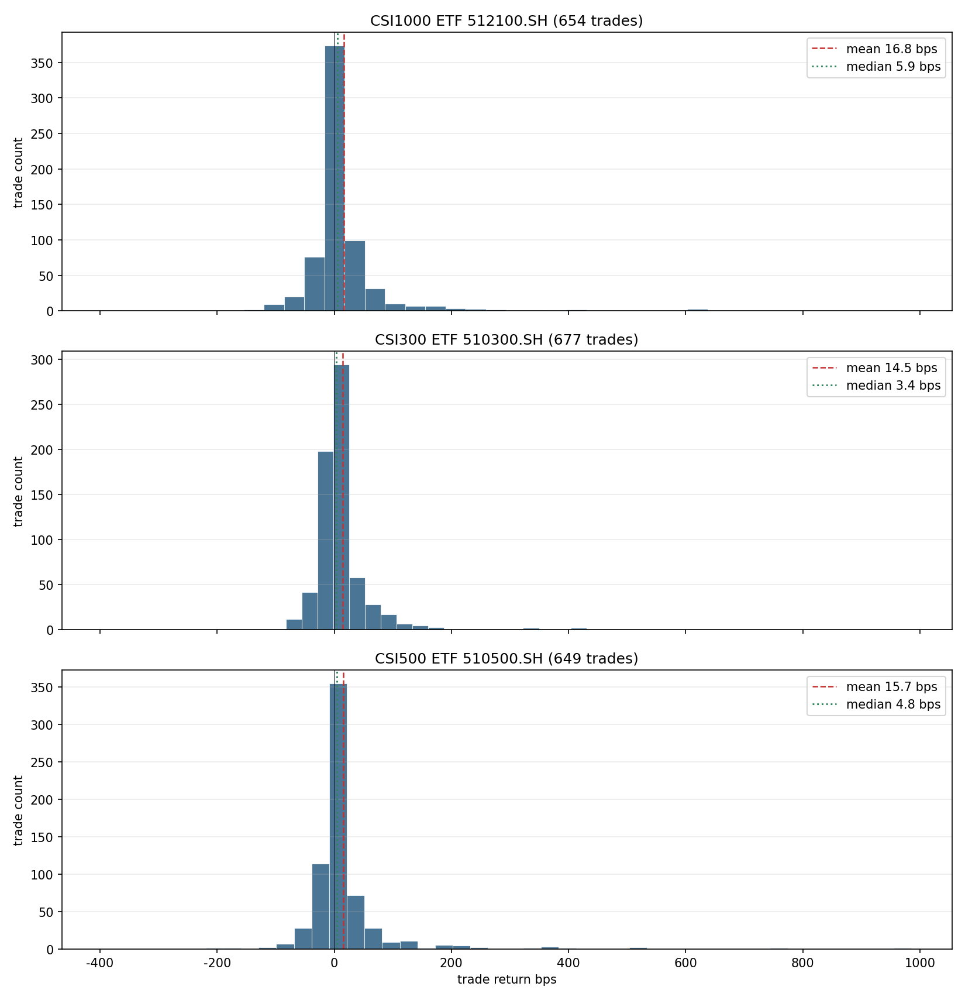

### ETF Trade Return Distribution

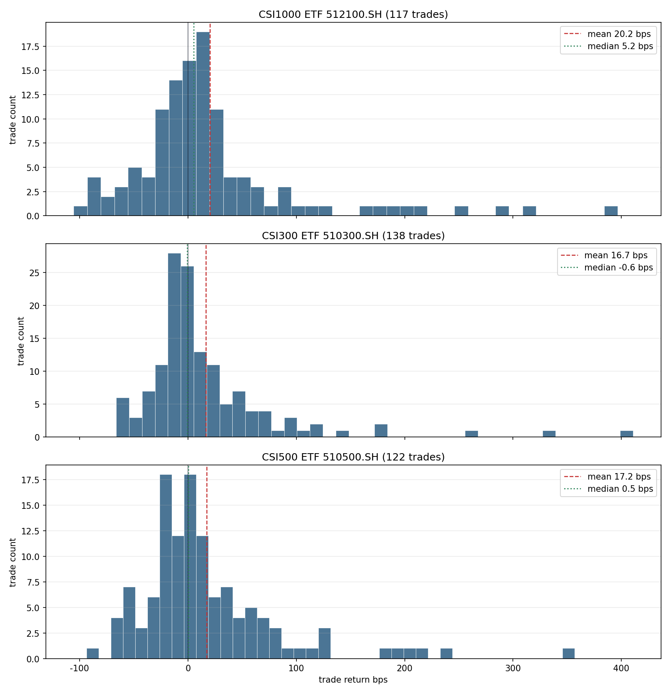

### ETF Test Trade Return Distribution

### 5.4. Entry Delay Decay Experiment

Open signals are delayed while preserving the registered rebalance and holding logic.

| scope | split | pool | display_name | date | x_index | delay_minutes | delayed_strategy_cumulative_return |
| --- | --- | --- | --- | --- | --- | --- | --- |
| train_val_test | train | csi1000_etf_sh | 1000 ETF | 210104 | 1 | 0 | 0.000000 |
| train_val_test | train | csi1000_etf_sh | 1000 ETF | 210104 | 2 | 0 | 0.000000 |
| train_val_test | train | csi1000_etf_sh | 1000 ETF | 210104 | 3 | 0 | 0.000000 |
| train_val_test | train | csi1000_etf_sh | 1000 ETF | 210104 | 4 | 0 | 0.000000 |
| train_val_test | train | csi1000_etf_sh | 1000 ETF | 210104 | 5 | 0 | 0.000000 |
| train_val_test | train | csi1000_etf_sh | 1000 ETF | 210104 | 6 | 0 | 0.000000 |
| train_val_test | train | csi1000_etf_sh | 1000 ETF | 210104 | 7 | 0 | 0.000000 |
| train_val_test | train | csi1000_etf_sh | 1000 ETF | 210104 | 8 | 0 | 0.000000 |
| train_val_test | train | csi1000_etf_sh | 1000 ETF | 210104 | 9 | 0 | 0.000000 |
| train_val_test | train | csi1000_etf_sh | 1000 ETF | 210104 | 10 | 0 | 0.000000 |
| train_val_test | train | csi1000_etf_sh | 1000 ETF | 210104 | 11 | 0 | 0.000000 |
| train_val_test | train | csi1000_etf_sh | 1000 ETF | 210104 | 12 | 0 | 0.000000 |
| train_val_test | train | csi1000_etf_sh | 1000 ETF | 210104 | 13 | 0 | 0.000000 |
| train_val_test | train | csi1000_etf_sh | 1000 ETF | 210104 | 14 | 0 | 0.000000 |
| train_val_test | train | csi1000_etf_sh | 1000 ETF | 210104 | 15 | 0 | 0.000000 |
| train_val_test | train | csi1000_etf_sh | 1000 ETF | 210104 | 16 | 0 | 0.000000 |
| train_val_test | train | csi1000_etf_sh | 1000 ETF | 210104 | 17 | 0 | 0.000000 |
| train_val_test | train | csi1000_etf_sh | 1000 ETF | 210104 | 18 | 0 | 0.000000 |
| train_val_test | train | csi1000_etf_sh | 1000 ETF | 210104 | 19 | 0 | 0.000000 |
| train_val_test | train | csi1000_etf_sh | 1000 ETF | 210104 | 20 | 0 | 0.000000 |
| train_val_test | train | csi1000_etf_sh | 1000 ETF | 210104 | 21 | 0 | 0.000000 |
| train_val_test | train | csi1000_etf_sh | 1000 ETF | 210104 | 22 | 0 | 0.000000 |
| train_val_test | train | csi1000_etf_sh | 1000 ETF | 210104 | 23 | 0 | 0.000000 |
| train_val_test | train | csi1000_etf_sh | 1000 ETF | 210104 | 24 | 0 | 0.000000 |
| train_val_test | train | csi1000_etf_sh | 1000 ETF | 210104 | 25 | 0 | 0.000000 |
| train_val_test | train | csi1000_etf_sh | 1000 ETF | 210104 | 26 | 0 | 0.000000 |
| train_val_test | train | csi1000_etf_sh | 1000 ETF | 210104 | 27 | 0 | 0.000000 |
| train_val_test | train | csi1000_etf_sh | 1000 ETF | 210104 | 28 | 0 | 0.000000 |
| train_val_test | train | csi1000_etf_sh | 1000 ETF | 210104 | 29 | 0 | 0.000000 |
| train_val_test | train | csi1000_etf_sh | 1000 ETF | 210104 | 30 | 0 | 0.000000 |
| train_val_test | train | csi1000_etf_sh | 1000 ETF | 210104 | 31 | 0 | 0.000000 |
| train_val_test | train | csi1000_etf_sh | 1000 ETF | 210104 | 32 | 0 | 0.000000 |
| train_val_test | train | csi1000_etf_sh | 1000 ETF | 210104 | 33 | 0 | 0.000000 |
| train_val_test | train | csi1000_etf_sh | 1000 ETF | 210104 | 34 | 0 | 0.000000 |
| train_val_test | train | csi1000_etf_sh | 1000 ETF | 210104 | 35 | 0 | 0.000000 |
| train_val_test | train | csi1000_etf_sh | 1000 ETF | 210104 | 36 | 0 | 0.000000 |
| train_val_test | train | csi1000_etf_sh | 1000 ETF | 210104 | 37 | 0 | 0.000000 |
| train_val_test | train | csi1000_etf_sh | 1000 ETF | 210104 | 38 | 0 | 0.000000 |
| train_val_test | train | csi1000_etf_sh | 1000 ETF | 210104 | 39 | 0 | 0.000000 |
| train_val_test | train | csi1000_etf_sh | 1000 ETF | 210104 | 40 | 0 | 0.000000 |
| train_val_test | train | csi1000_etf_sh | 1000 ETF | 210104 | 41 | 0 | 0.000000 |
| train_val_test | train | csi1000_etf_sh | 1000 ETF | 210104 | 42 | 0 | 0.000000 |
| train_val_test | train | csi1000_etf_sh | 1000 ETF | 210104 | 43 | 0 | 0.000000 |
| train_val_test | train | csi1000_etf_sh | 1000 ETF | 210104 | 44 | 0 | 0.000000 |
| train_val_test | train | csi1000_etf_sh | 1000 ETF | 210104 | 45 | 0 | 0.000000 |
| train_val_test | train | csi1000_etf_sh | 1000 ETF | 210104 | 46 | 0 | 0.000000 |
| train_val_test | train | csi1000_etf_sh | 1000 ETF | 210104 | 47 | 0 | 0.000000 |
| train_val_test | train | csi1000_etf_sh | 1000 ETF | 210104 | 48 | 0 | 0.000000 |
| train_val_test | train | csi1000_etf_sh | 1000 ETF | 210104 | 49 | 0 | 0.000000 |
| train_val_test | train | csi1000_etf_sh | 1000 ETF | 210104 | 50 | 0 | 0.000000 |
| train_val_test | train | csi1000_etf_sh | 1000 ETF | 210104 | 51 | 0 | 0.000000 |
| train_val_test | train | csi1000_etf_sh | 1000 ETF | 210104 | 52 | 0 | 0.000000 |
| train_val_test | train | csi1000_etf_sh | 1000 ETF | 210104 | 53 | 0 | 0.000000 |
| train_val_test | train | csi1000_etf_sh | 1000 ETF | 210104 | 54 | 0 | 0.000000 |
| train_val_test | train | csi1000_etf_sh | 1000 ETF | 210104 | 55 | 0 | 0.000000 |
| train_val_test | train | csi1000_etf_sh | 1000 ETF | 210104 | 56 | 0 | 0.000000 |
| train_val_test | train | csi1000_etf_sh | 1000 ETF | 210104 | 57 | 0 | 0.000000 |
| train_val_test | train | csi1000_etf_sh | 1000 ETF | 210104 | 58 | 0 | 0.000000 |
| train_val_test | train | csi1000_etf_sh | 1000 ETF | 210104 | 59 | 0 | 0.000000 |
| train_val_test | train | csi1000_etf_sh | 1000 ETF | 210104 | 60 | 0 | 0.000000 |
| test | test | csi500_etf_sh | 中证500 ETF(沪) | 241231 | 32946 | 3 | 0.200637 |
| test | test | csi500_etf_sh | 中证500 ETF(沪) | 241231 | 32947 | 3 | 0.200637 |
| test | test | csi500_etf_sh | 中证500 ETF(沪) | 241231 | 32948 | 3 | 0.200637 |
| test | test | csi500_etf_sh | 中证500 ETF(沪) | 241231 | 32949 | 3 | 0.200637 |
| test | test | csi500_etf_sh | 中证500 ETF(沪) | 241231 | 32950 | 3 | 0.200637 |
| test | test | csi500_etf_sh | 中证500 ETF(沪) | 241231 | 32951 | 3 | 0.200637 |
| test | test | csi500_etf_sh | 中证500 ETF(沪) | 241231 | 32952 | 3 | 0.200637 |
| test | test | csi500_etf_sh | 中证500 ETF(沪) | 241231 | 32953 | 3 | 0.200637 |
| test | test | csi500_etf_sh | 中证500 ETF(沪) | 241231 | 32954 | 3 | 0.200637 |
| test | test | csi500_etf_sh | 中证500 ETF(沪) | 241231 | 32955 | 3 | 0.200637 |
| test | test | csi500_etf_sh | 中证500 ETF(沪) | 241231 | 32956 | 3 | 0.200637 |
| test | test | csi500_etf_sh | 中证500 ETF(沪) | 241231 | 32957 | 3 | 0.200637 |
| test | test | csi500_etf_sh | 中证500 ETF(沪) | 241231 | 32958 | 3 | 0.200637 |
| test | test | csi500_etf_sh | 中证500 ETF(沪) | 241231 | 32959 | 3 | 0.200637 |
| test | test | csi500_etf_sh | 中证500 ETF(沪) | 241231 | 32960 | 3 | 0.200637 |
| test | test | csi500_etf_sh | 中证500 ETF(沪) | 241231 | 32961 | 3 | 0.200637 |
| test | test | csi500_etf_sh | 中证500 ETF(沪) | 241231 | 32962 | 3 | 0.200637 |
| test | test | csi500_etf_sh | 中证500 ETF(沪) | 241231 | 32963 | 3 | 0.200637 |
| test | test | csi500_etf_sh | 中证500 ETF(沪) | 241231 | 32964 | 3 | 0.200637 |
| test | test | csi500_etf_sh | 中证500 ETF(沪) | 241231 | 32965 | 3 | 0.200637 |
| test | test | csi500_etf_sh | 中证500 ETF(沪) | 241231 | 32966 | 3 | 0.200637 |
| test | test | csi500_etf_sh | 中证500 ETF(沪) | 241231 | 32967 | 3 | 0.200637 |
| test | test | csi500_etf_sh | 中证500 ETF(沪) | 241231 | 32968 | 3 | 0.200637 |
| test | test | csi500_etf_sh | 中证500 ETF(沪) | 241231 | 32969 | 3 | 0.200637 |
| test | test | csi500_etf_sh | 中证500 ETF(沪) | 241231 | 32970 | 3 | 0.200637 |
| test | test | csi500_etf_sh | 中证500 ETF(沪) | 241231 | 32971 | 3 | 0.200637 |
| test | test | csi500_etf_sh | 中证500 ETF(沪) | 241231 | 32972 | 3 | 0.200637 |
| test | test | csi500_etf_sh | 中证500 ETF(沪) | 241231 | 32973 | 3 | 0.200637 |
| test | test | csi500_etf_sh | 中证500 ETF(沪) | 241231 | 32974 | 3 | 0.200637 |
| test | test | csi500_etf_sh | 中证500 ETF(沪) | 241231 | 32975 | 3 | 0.200637 |
| test | test | csi500_etf_sh | 中证500 ETF(沪) | 241231 | 32976 | 3 | 0.200637 |
| test | test | csi500_etf_sh | 中证500 ETF(沪) | 241231 | 32977 | 3 | 0.200637 |
| test | test | csi500_etf_sh | 中证500 ETF(沪) | 241231 | 32978 | 3 | 0.200637 |
| test | test | csi500_etf_sh | 中证500 ETF(沪) | 241231 | 32979 | 3 | 0.200637 |
| test | test | csi500_etf_sh | 中证500 ETF(沪) | 241231 | 32980 | 3 | 0.200637 |
| test | test | csi500_etf_sh | 中证500 ETF(沪) | 241231 | 32981 | 3 | 0.200637 |
| test | test | csi500_etf_sh | 中证500 ETF(沪) | 241231 | 32982 | 3 | 0.200637 |
| test | test | csi500_etf_sh | 中证500 ETF(沪) | 241231 | 32983 | 3 | 0.200637 |
| test | test | csi500_etf_sh | 中证500 ETF(沪) | 241231 | 32984 | 3 | 0.200637 |
| test | test | csi500_etf_sh | 中证500 ETF(沪) | 241231 | 32985 | 3 | 0.200637 |
| test | test | csi500_etf_sh | 中证500 ETF(沪) | 241231 | 32986 | 3 | 0.200637 |
| test | test | csi500_etf_sh | 中证500 ETF(沪) | 241231 | 32987 | 3 | 0.200637 |
| test | test | csi500_etf_sh | 中证500 ETF(沪) | 241231 | 32988 | 3 | 0.200637 |
| test | test | csi500_etf_sh | 中证500 ETF(沪) | 241231 | 32989 | 3 | 0.200637 |
| test | test | csi500_etf_sh | 中证500 ETF(沪) | 241231 | 32990 | 3 | 0.200637 |
| test | test | csi500_etf_sh | 中证500 ETF(沪) | 241231 | 32991 | 3 | 0.200637 |
| test | test | csi500_etf_sh | 中证500 ETF(沪) | 241231 | 32992 | 3 | 0.200637 |
| test | test | csi500_etf_sh | 中证500 ETF(沪) | 241231 | 32993 | 3 | 0.200637 |
| test | test | csi500_etf_sh | 中证500 ETF(沪) | 241231 | 32994 | 3 | 0.200637 |
| test | test | csi500_etf_sh | 中证500 ETF(沪) | 241231 | 32995 | 3 | 0.199487 |
| test | test | csi500_etf_sh | 中证500 ETF(沪) | 241231 | 32996 | 3 | 0.199487 |
| test | test | csi500_etf_sh | 中证500 ETF(沪) | 241231 | 32997 | 3 | 0.197757 |
| test | test | csi500_etf_sh | 中证500 ETF(沪) | 241231 | 32998 | 3 | 0.197757 |
| test | test | csi500_etf_sh | 中证500 ETF(沪) | 241231 | 32999 | 3 | 0.197757 |
| test | test | csi500_etf_sh | 中证500 ETF(沪) | 241231 | 33000 | 3 | 0.197757 |
| test | test | csi500_etf_sh | 中证500 ETF(沪) | 241231 | 33001 | 3 | 0.197757 |
| test | test | csi500_etf_sh | 中证500 ETF(沪) | 241231 | 33002 | 3 | 0.191472 |
| test | test | csi500_etf_sh | 中证500 ETF(沪) | 241231 | 33003 | 3 | 0.191472 |
| test | test | csi500_etf_sh | 中证500 ETF(沪) | 241231 | 33004 | 3 | 0.191472 |
| test | test | csi500_etf_sh | 中证500 ETF(沪) | 241231 | 33005 | 3 | 0.191472 |

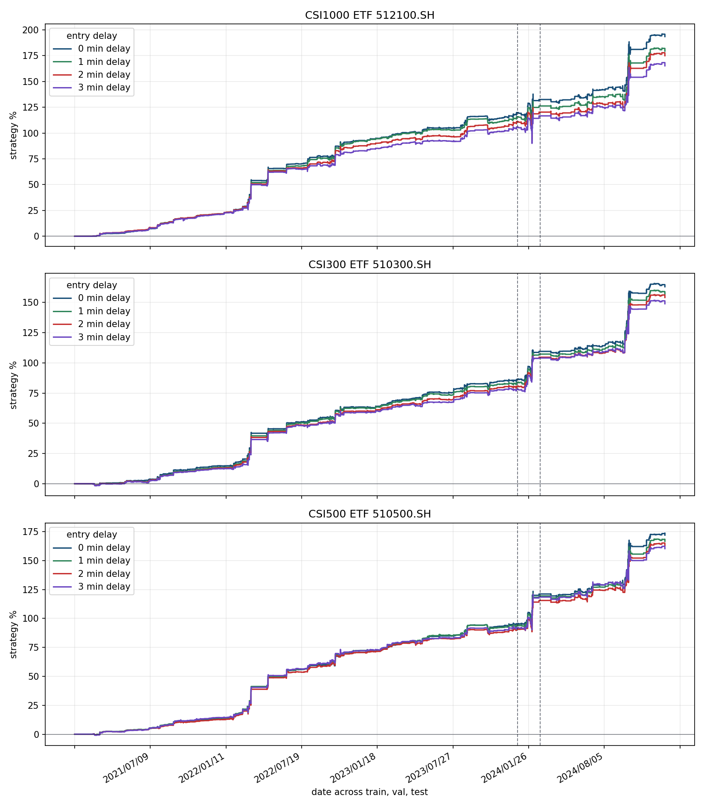

### Entry Delay Decay

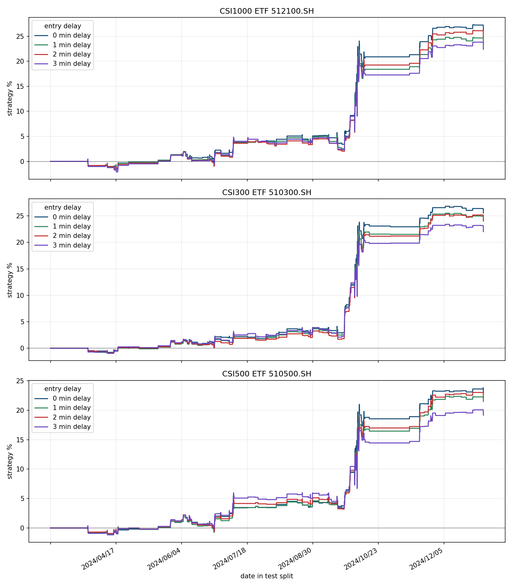

### Test Entry Delay Decay

06

6. Robustness Diagnostics

### Robustness Diagnostics

完成臂使用完整 robustness artifact; 暂停臂不生成 OOS diagnostics. 

### 6.1. IC by volatility rank

Rolling IC conditioned on volatility rank.

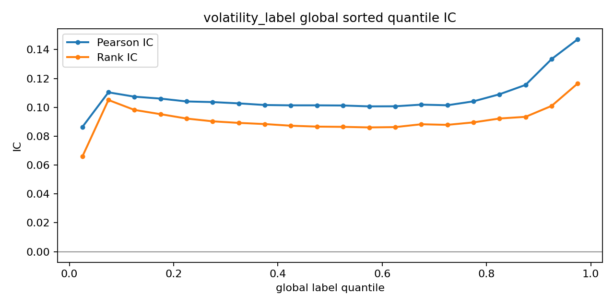

### IC By Volatility Rank

### 6.2. IC by price rank

Rolling IC conditioned on price rank.

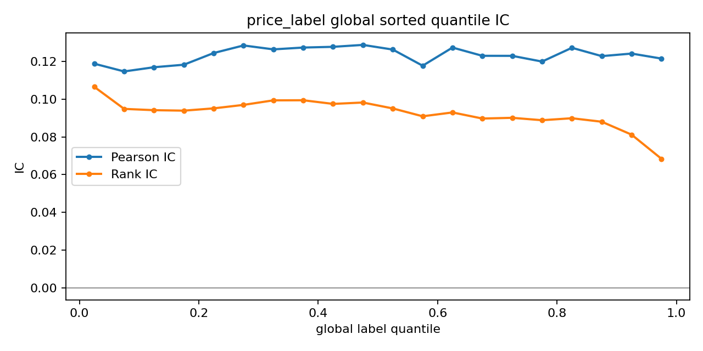

### IC By Price Rank

### 6.3. Train/test intraday IC curve

Same minute-of-session aggregation for fixed train sample and full test.

| time | pooled_ic_train | sample_count_train | pooled_ic_test | sample_count_test |
| --- | --- | --- | --- | --- |
| 103900 | 0.101270 | 201695 | 0.298564 | 1094002 |
| 104000 | 0.074115 | 201695 | 0.233441 | 1094002 |
| 104100 | 0.075459 | 201695 | 0.135496 | 1094002 |
| 104200 | 0.072126 | 201695 | 0.091602 | 1094002 |
| 104300 | 0.065624 | 201695 | 0.083990 | 1094002 |
| 104400 | 0.069422 | 201695 | 0.070794 | 1094002 |
| 104500 | 0.082061 | 201695 | 0.065266 | 1094002 |
| 104600 | 0.097065 | 201695 | 0.043883 | 1094002 |
| 104700 | 0.098700 | 201695 | 0.030595 | 1094002 |
| 104800 | 0.103873 | 201695 | 0.024614 | 1094002 |
| 104900 | 0.092429 | 201695 | 0.023219 | 1094002 |
| 105000 | 0.084341 | 201695 | 0.020668 | 1094002 |
| 105100 | 0.093444 | 201695 | 0.042318 | 1094002 |
| 105200 | 0.098461 | 201695 | 0.054629 | 1094002 |
| 105300 | 0.099011 | 201695 | 0.087412 | 1094002 |
| 105400 | 0.105735 | 201695 | 0.102520 | 1094002 |
| 105500 | 0.103139 | 201695 | 0.124579 | 1094002 |
| 105600 | 0.109905 | 199181 | 0.149782 | 1094002 |
| 105700 | 0.120204 | 197532 | 0.174592 | 1094002 |
| 105800 | 0.125012 | 197532 | 0.176276 | 1094002 |
| 105900 | 0.123502 | 197532 | 0.183513 | 1094002 |
| 110000 | 0.097422 | 197532 | 0.165041 | 1094002 |
| 110100 | 0.077197 | 197532 | 0.172294 | 1094002 |
| 110200 | 0.082239 | 197532 | 0.148320 | 1094002 |
| 110300 | 0.092708 | 197532 | 0.091976 | 1094002 |
| 110400 | 0.097208 | 197532 | 0.067192 | 1094002 |
| 110500 | 0.093044 | 197532 | 0.049029 | 1094002 |
| 110600 | 0.100809 | 197532 | 0.037579 | 1094002 |
| 110700 | 0.107401 | 197532 | 0.027560 | 1094002 |
| 110800 | 0.124194 | 197532 | 0.023068 | 1094002 |
| 110900 | 0.133419 | 197532 | 0.017118 | 1094002 |
| 111000 | 0.123513 | 197532 | -0.002844 | 1094002 |
| 111100 | 0.127486 | 197532 | -0.008157 | 1094002 |
| 111200 | 0.119730 | 197532 | -0.010674 | 1094002 |
| 111300 | 0.113970 | 197532 | 0.055707 | 1094002 |
| 111400 | 0.109975 | 197532 | 0.083954 | 1094002 |
| 111500 | 0.106376 | 197532 | 0.116301 | 1094002 |
| 111600 | 0.107419 | 197532 | 0.138627 | 1094002 |
| 111700 | 0.104308 | 197532 | 0.176548 | 1094002 |
| 111800 | 0.117117 | 197532 | 0.200407 | 1094002 |
| 141000 | 0.152905 | 197532 | 0.128598 | 1094002 |
| 141100 | 0.154120 | 197532 | 0.123199 | 1094002 |
| 141200 | 0.147887 | 197532 | 0.125949 | 1094002 |
| 141300 | 0.143892 | 197532 | 0.115261 | 1094002 |
| 141400 | 0.144072 | 197532 | 0.102338 | 1094002 |
| 141500 | 0.134417 | 197532 | 0.078720 | 1094002 |
| 141600 | 0.128417 | 197532 | 0.067878 | 1094002 |
| 141700 | 0.132198 | 197532 | 0.058949 | 1094002 |
| 141800 | 0.141692 | 197532 | 0.058343 | 1094002 |
| 141900 | 0.138483 | 197532 | 0.080049 | 1094002 |
| 142000 | 0.128936 | 197532 | 0.096422 | 1094002 |
| 142100 | 0.113819 | 197532 | 0.114301 | 1094002 |
| 142200 | 0.118297 | 197532 | 0.126159 | 1094002 |
| 142300 | 0.127843 | 197532 | 0.133312 | 1094002 |
| 142400 | 0.133359 | 197532 | 0.153953 | 1094002 |
| 142500 | 0.131331 | 197532 | 0.163409 | 1094002 |
| 142600 | 0.125893 | 197532 | 0.177634 | 1094002 |
| 142700 | 0.133722 | 197532 | 0.188432 | 1094002 |
| 142800 | 0.138924 | 197532 | 0.180330 | 1094002 |
| 142900 | 0.147142 | 197532 | 0.172419 | 1094002 |
| 143000 | 0.115493 | 197532 | 0.149538 | 1094002 |
| 143100 | 0.114432 | 197532 | 0.169694 | 1094002 |
| 143200 | 0.125741 | 197532 | 0.164078 | 1094002 |
| 143300 | 0.140681 | 197532 | 0.161800 | 1094002 |
| 143400 | 0.148355 | 197532 | 0.163343 | 1094002 |
| 143500 | 0.160021 | 197532 | 0.145582 | 1094002 |
| 143600 | 0.166215 | 197532 | 0.124965 | 1094002 |
| 143700 | 0.163632 | 197532 | 0.116489 | 1094002 |
| 143800 | 0.176083 | 197532 | 0.122374 | 1094002 |
| 143900 | 0.168983 | 197532 | 0.127254 | 1094002 |
| 144000 | 0.151983 | 197532 | 0.139082 | 1094002 |
| 144100 | 0.161495 | 197532 | 0.150104 | 1094002 |
| 144200 | 0.159141 | 197532 | 0.153571 | 1094002 |
| 144300 | 0.149879 | 197532 | 0.147685 | 1094002 |
| 144400 | 0.151619 | 197532 | 0.147187 | 1094002 |
| 144500 | 0.159284 | 197532 | 0.136950 | 1094002 |
| 144600 | 0.166771 | 197532 | 0.148008 | 1094002 |
| 144700 | 0.164117 | 197532 | 0.147487 | 1094002 |
| 144800 | 0.159060 | 197532 | 0.149430 | 1094002 |
| 144900 | 0.156605 | 197532 | 0.168988 | 1094002 |

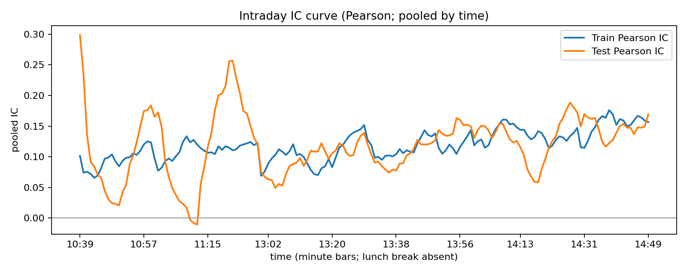

### Train/Test Intraday IC

### 6.4. Monthly signal spread and net efficiency

Monthly IC, Rank IC, signal spread and strategy efficiency expose regime concentration.

| month | top_minus_bottom_bps | strategy_bps_per_turnover |
| --- | --- | --- |
| 2024/03 | 12.680698 | -9.024438 |
| 2024/04 | 12.412814 | 3.335032 |
| 2024/05 | 9.884822 | 13.604307 |
| 2024/06 | 8.656293 | 2.235436 |
| 2024/07 | 10.913673 | 3.512164 |
| 2024/08 | 12.914777 | 5.010669 |
| 2024/09 | 11.433238 | 12.723281 |
| 2024/10 | 29.414021 | 30.425025 |
| 2024/11 | 20.549522 | 23.570875 |
| 2024/12 | 12.044237 | -2.639178 |

| month | pearson_ic | rank_ic | sample_count |
| --- | --- | --- | --- |
| 2024/03 | 0.107121 | 0.073297 | 18060980 |
| 2024/04 | 0.114422 | 0.090443 | 17208163 |
| 2024/05 | 0.091882 | 0.067544 | 17163405 |
| 2024/06 | 0.097527 | 0.088746 | 16320248 |
| 2024/07 | 0.117513 | 0.095332 | 19730550 |
| 2024/08 | 0.111749 | 0.080613 | 18876767 |
| 2024/09 | 0.091397 | 0.110857 | 16298996 |
| 2024/10 | 0.164987 | 0.113012 | 15457127 |
| 2024/11 | 0.130591 | 0.120962 | 18056633 |
| 2024/12 | 0.106342 | 0.066607 | 18961453 |

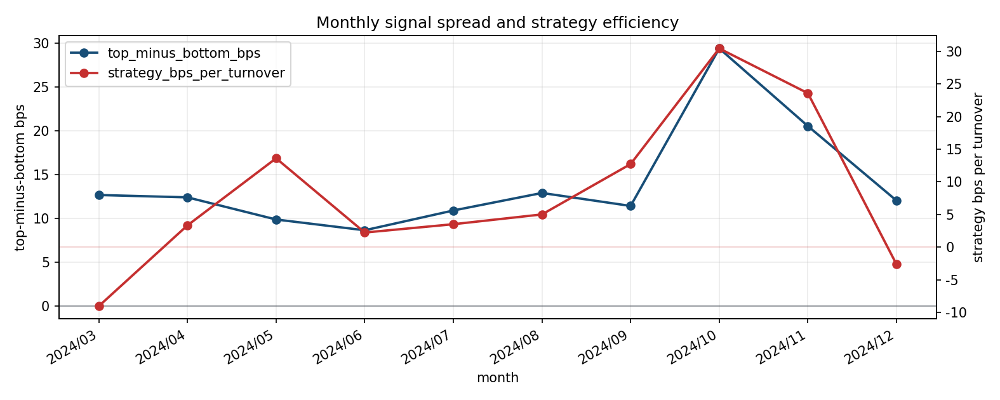

### Monthly Signal Spread And Net Efficiency

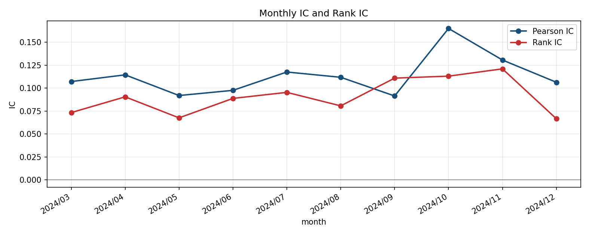

### Monthly IC And Rank IC

### 6.5. Return Realization

Top-5% predictions are remeasured over multiple forward holding horizons.

| holding_minutes | mean_return | mean_return_bps | row_count | prediction_p95 |
| --- | --- | --- | --- | --- |
| 1 | 0.000292 | 2.915075 | 8806717 | 0.000789 |
| 2 | 0.000507 | 5.072397 | 8806717 | 0.000789 |
| 3 | 0.000670 | 6.696826 | 8806717 | 0.000789 |
| 4 | 0.000798 | 7.980970 | 8806717 | 0.000789 |
| 5 | 0.000905 | 9.048951 | 8806717 | 0.000789 |
| 6 | 0.000995 | 9.950387 | 8806717 | 0.000789 |
| 7 | 0.001075 | 10.753316 | 8806717 | 0.000789 |
| 8 | 0.001143 | 11.431147 | 8806717 | 0.000789 |
| 9 | 0.001207 | 12.070455 | 8806717 | 0.000789 |
| 10 | 0.001272 | 12.724035 | 8806717 | 0.000789 |
| 11 | 0.001330 | 13.296406 | 8687284 | 0.000789 |
| 12 | 0.001384 | 13.841471 | 8573406 | 0.000789 |
| 13 | 0.001437 | 14.373813 | 8464517 | 0.000789 |
| 14 | 0.001487 | 14.871385 | 8360648 | 0.000789 |
| 15 | 0.001535 | 15.352776 | 8261733 | 0.000789 |
| 16 | 0.001582 | 15.817129 | 8166158 | 0.000789 |
| 17 | 0.001622 | 16.222941 | 8075317 | 0.000789 |
| 18 | 0.001660 | 16.599908 | 7989423 | 0.000789 |
| 19 | 0.001695 | 16.954771 | 7908219 | 0.000789 |
| 20 | 0.001732 | 17.315218 | 7829710 | 0.000789 |

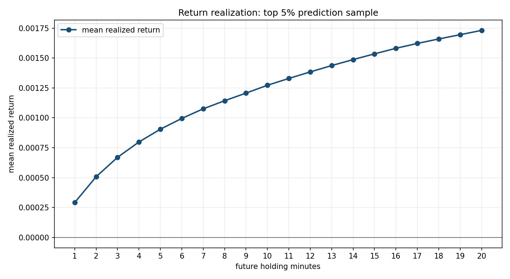

### Return Realization

### 6.6. Top-k% Robustness

Fixed train sample and full test are compared across prediction selection widths.

| split | selection_method | k_pct | universe_count | selected_count | selected_fraction | prediction_threshold | mean_label_bps | median_label_bps | label_std_bps | hit_rate | day_count | timestamp_count |
| --- | --- | --- | --- | --- | --- | --- | --- | --- | --- | --- | --- | --- |
| train | approx_quantile_threshold | 1 | 31875072 | 311919 | 0.009786 | 0.001377 | 20.078238 | 7.568327 | 90.448519 | 0.514909 | 49 | 7746 |
| train | approx_quantile_threshold | 2 | 31875072 | 630860 | 0.019792 | 0.001008 | 15.453768 | 1.850662 | 79.891706 | 0.496953 | 49 | 7746 |
| train | approx_quantile_threshold | 3 | 31875072 | 951152 | 0.029840 | 0.000835 | 13.226135 | 0.283996 | 74.423736 | 0.487352 | 49 | 7746 |
| train | approx_quantile_threshold | 5 | 31875072 | 1588906 | 0.049848 | 0.000660 | 10.831134 | 0.029163 | 68.027035 | 0.476383 | 49 | 7746 |
| train | approx_quantile_threshold | 10 | 31875072 | 3177467 | 0.099685 | 0.000473 | 8.278396 | -0.000014 | 60.283858 | 0.463407 | 49 | 7746 |
| train | approx_quantile_threshold | 15 | 31875072 | 4779701 | 0.149951 | 0.000379 | 6.990606 | -0.000014 | 56.153500 | 0.454823 | 49 | 7746 |
| train | approx_quantile_threshold | 20 | 31875072 | 6376388 | 0.200043 | 0.000312 | 6.139677 | -0.000014 | 53.533899 | 0.447782 | 49 | 7746 |
| test | approx_quantile_threshold | 1 | 176134322 | 1735873 | 0.009855 | 0.001882 | 25.057218 | 10.240027 | 122.395748 | 0.522599 | 205 | 33005 |
| test | approx_quantile_threshold | 2 | 176134322 | 3502009 | 0.019883 | 0.001316 | 18.957026 | 5.873136 | 105.096392 | 0.510498 | 205 | 33005 |
| test | approx_quantile_threshold | 3 | 176134322 | 5266390 | 0.029900 | 0.001048 | 15.894873 | 2.743826 | 95.816929 | 0.500978 | 205 | 33005 |
| test | approx_quantile_threshold | 5 | 176134322 | 8757893 | 0.049723 | 0.000791 | 12.753266 | 0.386621 | 85.194214 | 0.488803 | 205 | 33005 |
| test | approx_quantile_threshold | 10 | 176134322 | 17567942 | 0.099742 | 0.000539 | 9.419176 | 0.002513 | 72.392134 | 0.472370 | 205 | 33005 |
| test | approx_quantile_threshold | 15 | 176134322 | 26466509 | 0.150263 | 0.000425 | 7.676703 | 0.000063 | 65.793987 | 0.461932 | 205 | 33005 |
| test | approx_quantile_threshold | 20 | 176134322 | 35223287 | 0.199980 | 0.000350 | 6.535043 | -0.000014 | 61.628877 | 0.453715 | 205 | 33005 |

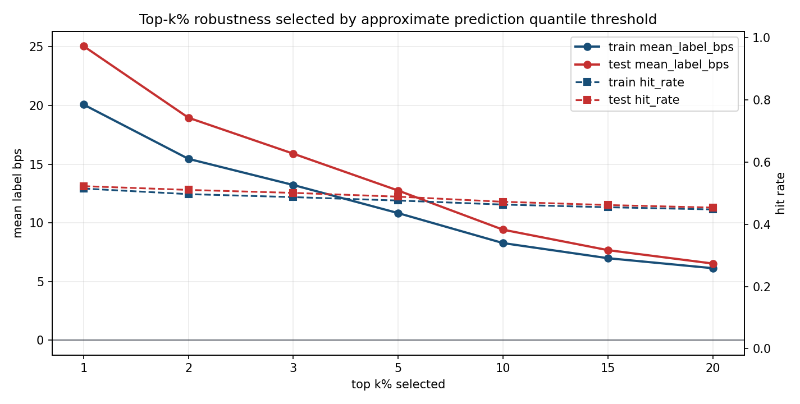

### Top-k% Robustness

07

7. Appendix Diagnostics

## 限制与适用边界

Control/CS rank/latent-z/Deep Sets R2 test IC为0.086462/0.123293/0.127345/0.121030. Induced attention 在test前失败; Deep Sets经历中断后R2成功恢复. 四个完成臂10M净Sharpe均负. 当前artifact可得性只影响复现, 不作为历史成功/失败判据. 只有matched合同内的结果可以直接比较.

## 结论

本次归档保留上述历史事实. 研究结论, 推广门槛和执行限制分别解释, 不把模型无增益或净收益为负改写成实验流程失败.

## 附录

### Appendix Diagnostics

路径和 identity 用于从报告回溯到真实 artifact; 报告不包含外部依赖. 

### 7.1. Artifact Paths

核心 source artifacts 与生成报告路径. 

| artifact | path | status |
| --- | --- | --- |
| run_root | [artifact-root]/nn/0827-market-cs/0829cs-s7-l-cs_rank_41d | available |
| npz_meta | [artifact-root]/nn/0827-market-cs/0829cs-s7-l-cs_rank_41d/prediction/artifacts/npz/meta.yaml | available |
| data_clean_invalid_stats | [artifact-root]/nn/0827-market-cs/0829cs-s7-l-cs_rank_41d/prediction/artifacts/data_clean/invalid_feature_stats.csv | available |
| checkpoint_metadata | [artifact-root]/nn/0827-market-cs/0829cs-s7-l-cs_rank_41d/prediction/run/checkpoint_metadata/best_checkpoint.yaml | available |
| test_prediction_manifest | [artifact-root]/nn/0827-market-cs/0829cs-s7-l-cs_rank_41d/manifests/evaluate.yaml | available |
| backtest_manifest | [artifact-root]/nn/0827-market-cs/0829cs-s7-l-cs_rank_41d/manifests/backtest.yaml | available |
| research_artifact_manifest | [artifact-root]/nn/0827-market-cs/0829cs-s7-l-cs_rank_41d/report/research_artifacts/manifest.yaml | available |

### 7.2. Provenance

配置, 代码, 数据, panel, MLflow 和恢复 lineage. 

| field | value |
| --- | --- |
| run_id | 0829cs-s7-l-cs_rank_41d |
| MLflow run | f54f790158474e368465944eed7eb606 |
| Git commit | 88458306f57ad953b9cc9048a32b19bf7b5c9689 |
| config SHA-256 | 7cc83247740f8a5e775899520970f124b77b454d3e0de7a90a6f9f31cb1b7921 |
| data artifact | 6589947466234739b27e243d253a3c48 |
| dataset cache key | e74adc442d96d5ecfcd932bd39289a25be2366d12c20d78a83d8f9aeda2a3460 |
| panel fingerprint | 28573283d9bba84f03cb51f8855fe97b16e99fba1912860c461e58084518926d |
| recovery source | fresh run |
| recovery checkpoint | none |
