## 摘要

**历史结果: 历史成功, 四臂完成.** Control/CS rank/latent-z/Deep Sets R2 test IC为0.086462/0.123293/0.127345/0.121030. Induced attention 在test前失败; Deep Sets经历中断后R2成功恢复. 四个完成臂10M净Sharpe均负.

历史成功/失败按实验流程是否成功完成判断. 无增益, 成本后亏损, 归档和当前 artifact 缺失不改变历史成功事实. 失败的实验臂保留失败原因, 不填造未产生的 OOS 指标. 本次只整理已有材料, 未启动训练, 推理或回测.

### Executive Summary

模板字段按固定顺序展示; headline 指标均来自本次完整 research artifact bundle. 

benchmark

deep_sets_34d

deep_sets

selected_checkpoint

105343

validation-only selection

train_pooled_ic

0.117796

fixed sample: 3,891 batches / 31,875,072 rows

test_pooled_ic

0.121030

176,134,322

top_prediction_return_bps

8.915607

test top prediction bucket

top95_hit

48.69%

test top 5% predictions

etf_top95_hit

58.65%

test ETF proxy top 5%

overfit_variance_ratio

0.019170

test prediction variance / target variance

model_class

MarketContextGruMlpRegressor

2,335,105 parameters

train_range

2021-01-04 to 2023-12-29

train-only normalization fit

val_range

2024-01-02 to 2024-02-29

checkpoint selection only

test_range

2024-03-01 to 2024-12-31

final evaluation only

| field | explanation |
| --- | --- |
| benchmark | 实验标识.  |
| selected_checkpoint | 最终用于 evaluation 的 checkpoint iteration.  |
| train_pooled_ic | core_ic_summary_train.yaml 当前覆盖的 train-report 样本合并后计算的 Pearson IC; 启用 train report sample 时不是 full-train 指标.  |
| test_pooled_ic | test split 上把所有样本合并后计算的 Pearson IC.  |
| top_prediction_return_bps | 最高 prediction 分组的平均 prediction return, 单位 bps.  |
| top95_hit | test split 中按 prediction 从高到低排序后取最高 5% 样本, 即 prediction >= test prediction 的 95% 分位; 该子样本内 target > 0 的比例.  |
| etf_top95_hit | test split 中先按重要股票池合成 ETF minute-level prediction/real return, 再按 etf_prediction 从高到低排序后取最高 5% 样本; 该子样本内 etf_real_return > 0 的比例.  |
| overfit_variance_ratio | test split 中 prediction 样本方差 / target 样本方差, 用作 overfit 系数; 数值越大表示 prediction 方差相对 label 越高.  |
| model_class | 模型类名.  |
| train_range | 训练集交易日范围.  |
| val_range | 验证集交易日范围.  |
| test_range | 测试集交易日范围.  |

02

2. Data Pipeline

## 研究背景与目标

本报告围绕Market CS 五臂研究整理原始研究证据. 当前材料对应 registry report `0827-market-cs-deep-sets-r2-0831`, 来源SHA256为 `fbec2352b6a919c6adcae6a4d071bae01c10319f073d6d378febad1fd952c0e9`. 原报告的实验方法, 图表, 结果和解释保留在下文.

## 数据与方法

实验身份为 `0827-market-cs`. Split, label, sampler, feature与checkpoint定义按原报告记录, 不从其他实验借用缺失字段. 汇总入口见[全实验综述](../../prediction-nn-1min/1103-nn-registry-summary/).

### Data Pipeline

五臂共享同一 41D 物理 artifact, row identity, panel ordering 和 train-only normalization. 

### 2.1. Data Basics

逻辑 active feature 通过 pooled z-score 后的固定投影实现; 物理 GRU 输入宽度始终为 41. 

| field | value |
| --- | --- |
| train_days | 727 |
| val_days | 37 |
| test_days | 205 |
| train_rows | 553,895,223 |
| val_rows | 31,737,447 |
| test_rows | 176,134,322 |
| feature_dim | 41 physical / 34 active |
| features | ret_1m, ret_2m, ret_3m, ret_5m, ret_10m, hl, oc, log_vol, log_amount, log_vol_5m_mean, log_amount_5m_mean, vol_same_minute_60d_pct, vol_trailing_5m_pct, vol_trailing_20m_pct, amount_trailing_60m_pct, minute_norm, vol_10m, state_realized_vol_5m, state_realized_vol_shell_5_20m, state_realized_vol_shell_20_60m, state_realized_vol_shell_60_120m, state_realized_vol_shell_120_240m, state_realized_vol_shell_240_480m, state_range_5m, state_range_20m, state_range_60m, state_range_120m, state_range_240m, state_range_480m, state_return_shell_5_20m, state_return_shell_20_60m, state_return_shell_60_120m, state_return_shell_120_240m, state_return_shell_240_480m |
| label_horizon_minutes | 10 |
| label_entry_lag_minutes | 1 |

| field | explanation |
| --- | --- |
| features | 模型输入 feature 列表.  |
| feature_dim | 模型输入 feature 维度.  |
| label_horizon_minutes | entry 到 exit 的实际持有期, 单位 minutes.  |
| label_entry_lag_minutes | label entry lag, 单位 minutes.  |

### 2.2. Data Normalization

清洗统计来自共享 data-clean artifact; rank 和 context 都不改变 split 或标准化 fit scope. 

| field | value |
| --- | --- |
| feature_normalization | pooled_zscore; train_only |
| label_normalization | pooled_zscore; train_only |
| label_horizon_minutes | 10 |
| label_entry_lag_minutes | 1 |
| train_kept_rate | not stored in report summary |
| val_kept_rate | not stored in report summary |
| test_kept_rate | not stored in report summary |
| max_invalid_ratio | 0.041494 |

| field | total_count | finite_count | nan_count | nan_ratio | inf_ratio | invalid_ratio | mean_finite | std_finite | skew_finite | kurtosis_finite | min_finite | max_finite |
| --- | --- | --- | --- | --- | --- | --- | --- | --- | --- | --- | --- | --- |
| ret_1m | 1154507748 | 1149717258 | 4790490 | 0.004149 | 0.000000 | 0.004149 | 0.000001 | 0.002284 | 0.332178 | 524.604788 | -1.672727 | 0.759663 |
| ret_2m | 1154507748 | 1144926768 | 9580980 | 0.008299 | 0.000000 | 0.008299 | 0.000004 | 0.002928 | 0.933046 | 267.199689 | -1.672727 | 0.798906 |
| ret_3m | 1154507748 | 1140136278 | 14371470 | 0.012448 | 0.000000 | 0.012448 | 0.000007 | 0.003416 | 1.220015 | 185.034283 | -1.672727 | 0.798906 |
| ret_5m | 1154507748 | 1130555298 | 23952450 | 0.020747 | 0.000000 | 0.020747 | 0.000011 | 0.004185 | 1.487963 | 125.885503 | -1.672727 | 0.798906 |
| ret_10m | 1154507748 | 1106602848 | 47904900 | 0.041494 | 0.000000 | 0.041494 | 0.000012 | 0.005543 | 1.616300 | 78.308005 | -1.672727 | 0.865563 |
| hl | 1154507748 | 1154507748 | 0 | 0.000000 | 0.000000 | 0.000000 | 0.000622 | 0.000759 | 6.625821 | 384.235154 | 0.000000 | 0.434688 |
| oc | 1154507748 | 1154507748 | 0 | 0.000000 | 0.000000 | 0.000000 | 0.000005 | 0.000716 | 0.807232 | 305.329560 | -0.312980 | 0.353188 |
| log_vol | 1154507748 | 1154507748 | 0 | 0.000000 | 0.000000 | 0.000000 | 9.041346 | 2.868792 | -1.615542 | 3.227835 | 0.000000 | 20.340768 |
| log_amount | 1154507748 | 1154507748 | 0 | 0.000000 | 0.000000 | 0.000000 | 11.435779 | 3.351959 | -2.143654 | 5.130353 | 0.000000 | 22.619835 |
| log_vol_5m_mean | 1154507748 | 1154507748 | 0 | 0.000000 | 0.000000 | 0.000000 | 9.080030 | 2.395991 | -1.178611 | 2.390045 | 0.000000 | 20.127985 |
| log_amount_5m_mean | 1154507748 | 1154507748 | 0 | 0.000000 | 0.000000 | 0.000000 | 11.483564 | 2.737884 | -1.640929 | 4.078448 | 0.000000 | 21.933402 |
| vol_same_minute_60d_pct | 1154507748 | 1147649611 | 6858137 | 0.005940 | 0.000000 | 0.005940 | 0.500503 | 0.297898 | 0.010429 | -1.224365 | 0.000000 | 1.000000 |
| vol_trailing_5m_pct | 1154507748 | 1154498343 | 9405 | 0.000008 | 0.000000 | 0.000008 | 0.493844 | 0.343189 | 0.039355 | -1.280546 | 0.000000 | 1.000000 |
| vol_trailing_20m_pct | 1154507748 | 1154470128 | 37620 | 0.000033 | 0.000000 | 0.000033 | 0.493187 | 0.309097 | 0.038864 | -1.238083 | 0.000000 | 1.000000 |
| amount_trailing_60m_pct | 1154507748 | 1154394888 | 112860 | 0.000098 | 0.000000 | 0.000098 | 0.492823 | 0.304257 | 0.040368 | -1.261618 | 0.000000 | 1.000000 |
| minute_norm | 1154507748 | 1154507748 | 0 | 0.000000 | 0.000000 | 0.000000 | 0.500000 | 0.289875 | -0.000000 | -1.200041 | 0.000000 | 1.000000 |
| vol_10m | 1154507748 | 1144926768 | 9580980 | 0.008299 | 0.000000 | 0.008299 | 0.000570 | 0.000516 | 16.378499 | 9073.355221 | 0.000000 | 0.617598 |
| state_realized_vol_5m | 1154507748 | 1147537841 | 6969907 | 0.006037 | 0.000000 | 0.006037 | 0.003817 | 0.003982 | 11.509101 | 2100.446606 | 0.000000 | 4.326676 |
| state_realized_vol_shell_5_20m | 1154507748 | 1147494311 | 7013437 | 0.006075 | 0.000000 | 0.006075 | 0.007152 | 0.006323 | 8.227069 | 607.709954 | 0.000000 | 4.391918 |
| state_realized_vol_shell_20_60m | 1154507748 | 1147381511 | 7126237 | 0.006173 | 0.000000 | 0.006173 | 0.012313 | 0.009544 | 6.231639 | 255.980016 | 0.000000 | 4.402562 |
| state_realized_vol_shell_60_120m | 1154507748 | 1147246611 | 7261137 | 0.006289 | 0.000000 | 0.006289 | 0.015416 | 0.011229 | 5.616893 | 192.500745 | 0.000000 | 4.403834 |
| state_realized_vol_shell_120_240m | 1154507748 | 1146937611 | 7570137 | 0.006557 | 0.000000 | 0.006557 | 0.022658 | 0.014594 | 4.854178 | 129.653750 | 0.000000 | 4.407839 |
| state_realized_vol_shell_240_480m | 1154507748 | 1146320328 | 8187420 | 0.007092 | 0.000000 | 0.007092 | 0.033107 | 0.018785 | 4.307459 | 90.790637 | 0.000000 | 4.448893 |
| state_range_5m | 1154507748 | 1147541397 | 6966351 | 0.006034 | 0.000000 | 0.006034 | 0.004887 | 0.005185 | 8.152644 | 795.609658 | 0.000000 | 4.326676 |
| state_range_20m | 1154507748 | 1147488066 | 7019682 | 0.006080 | 0.000000 | 0.006080 | 0.010356 | 0.010231 | 5.478281 | 153.551252 | 0.000000 | 4.326676 |
| state_range_60m | 1154507748 | 1147345866 | 7161882 | 0.006203 | 0.000000 | 0.006203 | 0.019035 | 0.016811 | 4.031091 | 66.258543 | 0.000000 | 4.326676 |
| state_range_120m | 1154507748 | 1147132566 | 7375182 | 0.006388 | 0.000000 | 0.006388 | 0.028234 | 0.022304 | 3.360529 | 44.705540 | 0.000000 | 4.326676 |
| state_range_240m | 1154507748 | 1146705966 | 7801782 | 0.006758 | 0.000000 | 0.006758 | 0.041697 | 0.029431 | 2.908754 | 31.236718 | 0.000000 | 4.326676 |
| state_range_480m | 1154507748 | 1145883576 | 8624172 | 0.007470 | 0.000000 | 0.007470 | 0.060320 | 0.041867 | 2.661780 | 18.630342 | 0.000000 | 4.326676 |
| state_return_shell_5_20m | 1154507748 | 1147494311 | 7013437 | 0.006075 | 0.000000 | 0.006075 | -0.000007 | 0.007927 | 1.948638 | 191.038994 | -3.336278 | 1.833443 |
| state_return_shell_20_60m | 1154507748 | 1147381511 | 7126237 | 0.006173 | 0.000000 | 0.006173 | -0.000019 | 0.012654 | 1.546156 | 74.692023 | -3.559421 | 1.834436 |
| state_return_shell_60_120m | 1154507748 | 1147246611 | 7261137 | 0.006289 | 0.000000 | 0.006289 | -0.000026 | 0.015402 | 1.319948 | 50.578430 | -3.524330 | 1.838381 |
| state_return_shell_120_240m | 1154507748 | 1146937611 | 7570137 | 0.006557 | 0.000000 | 0.006557 | -0.000047 | 0.021640 | 0.992915 | 26.801442 | -3.395118 | 1.910637 |
| state_return_shell_240_480m | 1154507748 | 1146320328 | 8187420 | 0.007092 | 0.000000 | 0.007092 | -0.000078 | 0.030894 | 0.802110 | 14.788736 | -3.336278 | 1.891549 |
| stock_ret_5m_cs_rank | 1154507748 | 1147537841 | 6969907 | 0.006037 | 0.000000 | 0.006037 | 0.500102 | 0.287098 | -0.001112 | -1.173250 | 0.000186 | 1.000000 |
| stock_ret_20m_cs_rank | 1154507748 | 1147484511 | 7023237 | 0.006083 | 0.000000 | 0.006083 | 0.500102 | 0.288292 | -0.000264 | -1.194513 | 0.000186 | 1.000000 |
| stock_ret_60m_cs_rank | 1154507748 | 1147342311 | 7165437 | 0.006206 | 0.000000 | 0.006206 | 0.500102 | 0.288583 | -0.000071 | -1.198720 | 0.000186 | 1.000000 |
| stock_ret_240m_cs_rank | 1154507748 | 1146702411 | 7805337 | 0.006761 | 0.000000 | 0.006761 | 0.500102 | 0.288670 | 0.000001 | -1.199923 | 0.000186 | 1.000000 |
| stock_rv_20m_cs_rank | 1154507748 | 1147484511 | 7023237 | 0.006083 | 0.000000 | 0.006083 | 0.500102 | 0.288673 | 0.000063 | -1.200113 | 0.000186 | 1.000000 |
| stock_rv_60m_cs_rank | 1154507748 | 1147342311 | 7165437 | 0.006206 | 0.000000 | 0.006206 | 0.500102 | 0.288675 | 0.000010 | -1.200027 | 0.000186 | 1.000000 |
| stock_log_amount_cs_rank | 1154507748 | 1154507748 | 0 | 0.000000 | 0.000000 | 0.000000 | 0.500101 | 0.287690 | 0.003189 | -1.191131 | 0.000405 | 1.000000 |

| field | explanation |
| --- | --- |
| feature_normalization | feature normalization 方法和 fit scope.  |
| label_normalization | label normalization 方法和 fit scope.  |
| kept_rate | 清洗后保留样本数 / 清洗前样本数.  |
| max_invalid_ratio | 单个字段中 invalid 样本占比的最大值.  |

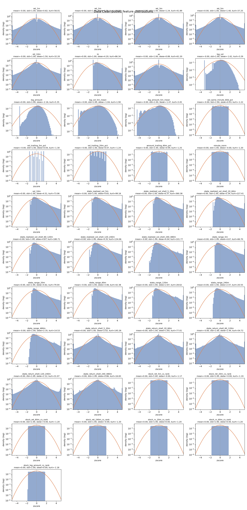

### Data Clean Distribution Overview

### 2.3. Label Distribution

Label 分布按 train/validation/test 展示; normalization 参数只在 train 上拟合. 

| split | count | mean_raw_bps | std_raw_bps | zero_ratio | abs_raw_gt_1pct_ratio |
| --- | --- | --- | --- | --- | --- |
| train | 553895223 | -0.074756 | 42.226774 | 0.186758 | 0.028167 |
| val | 31737447 | -0.863159 | 62.464198 | 0.147426 | 0.076608 |
| test | 176134322 | -0.035505 | 50.207416 | 0.174398 | 0.039702 |

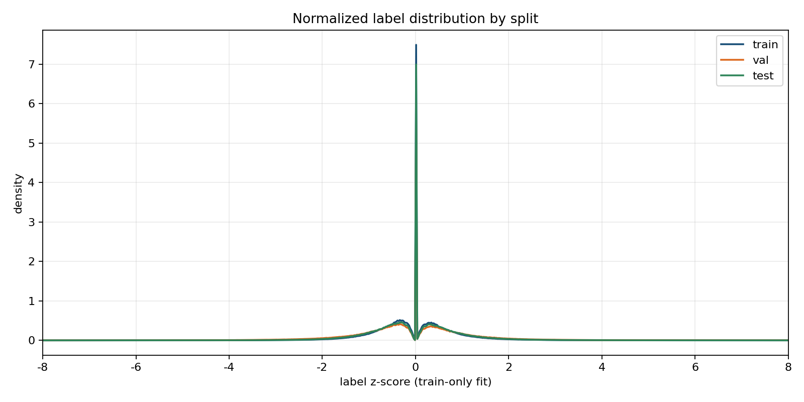

### Label Distribution By Split

03

3. Evaluation

## 主要结果

| 记录项 | 当前解释 |
| --- | --- |
| 实验 | 0827-market-cs |
| 报告类型 | full_report_html |
| 历史状态 | 历史成功, 四臂完成 |
| 证据 | 0827-market-cs-deep-sets-r2-0831 |

Current conclusion

deep_sets_34d: test pooled IC=0.121030, pooled Rank IC=0.090978; 结果仅用于 seed 7 matched screening. 

01

1. Executive Summary

### Evaluation

Test 不参与 checkpoint 选择; 暂停臂的 test 指标保持 not run. 

### 3.1. IC Summary

Train headline 使用固定 3,891 batches / 31,875,072 rows; test 使用完整 split. 

| split | pooled_ic | pooled_rank_ic | count |
| --- | --- | --- | --- |
| train_report_sample | 0.117796 | 0.113272 | 31875072 |
| test | 0.121030 | 0.090978 | 176134322 |

| field | explanation |
| --- | --- |
| pooled_ic | 合并样本后计算的 Pearson IC.  |
| pooled_rank_ic | 合并样本后计算的 Rank IC.  |
| pearson_ic | corr(prediction, target).  |
| rank_ic | corr(rank(prediction), rank(target)).  |

### 3.2. Signal Quality 1: bucket (10)

完整 test prediction 按全局 prediction 十等分, 报告每桶实际 label 与日度 top-minus-bottom spread. 

| signal_bucket | mean_prediction | mean_label_bps | t_stat | hit_rate | row_count | top_bottom_signal_spread_bps |
| --- | --- | --- | --- | --- | --- | --- |
| 1 | -0.001023 | -9.561128 | -547.746247 | 0.315600 | 17613433 | 18.476734 |
| 2 | -0.000305 | -2.823894 | -270.640892 | 0.349771 | 17613433 | 18.476734 |
| 3 | -0.000180 | -1.705025 | -175.855335 | 0.366050 | 17613432 | 18.476734 |
| 4 | -0.000088 | -1.109912 | -116.125350 | 0.375401 | 17613432 | 18.476734 |
| 5 | 0.000007 | -0.502620 | -52.381207 | 0.383844 | 17613432 | 18.476734 |
| 6 | 0.000093 | 0.178059 | 18.413058 | 0.392916 | 17613432 | 18.476734 |
| 7 | 0.000172 | 0.899893 | 90.126687 | 0.400293 | 17613432 | 18.476734 |
| 8 | 0.000267 | 1.850133 | 175.239291 | 0.411146 | 17613432 | 18.476734 |
| 9 | 0.000411 | 3.504484 | 300.741514 | 0.431466 | 17613432 | 18.476734 |
| 10 | 0.001073 | 8.915607 | 525.018920 | 0.470624 | 17613432 | 18.476734 |

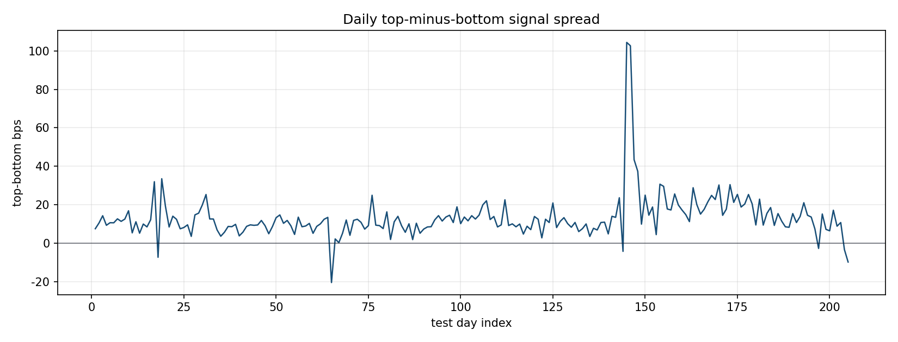

### Daily Top-Minus-Bottom Signal Spread

### 3.3. Signal Quality 2: Important Stock Pool

CSI300/CSI500/CSI1000 成分股按日期 membership 聚合; test 与 validation checkpoint 证据分开保存. 

| pool | display_name | etf_code | index_code | pearson_ic | rank_ic | mean_prediction_return | mean_real_return | real_return_positive_ratio | prediction_positive_ratio | count |
| --- | --- | --- | --- | --- | --- | --- | --- | --- | --- | --- |
| csi1000_etf_sh | 1000 ETF | 512100.SH | 000852.SH | 0.097932 | 0.059751 | 0.000048 | -0.000008 | 0.395829 | 0.560954 | 32955251 |
| csi300_etf_sh | 沪深300 ETF(沪) | 510300.SH | 000300.SH | 0.096245 | 0.046067 | 0.000035 | 0.000014 | 0.413560 | 0.552005 | 9885400 |
| csi500_etf_sh | 中证500 ETF(沪) | 510500.SH | 000905.SH | 0.091488 | 0.051006 | 0.000041 | -0.000013 | 0.393433 | 0.554217 | 16488815 |

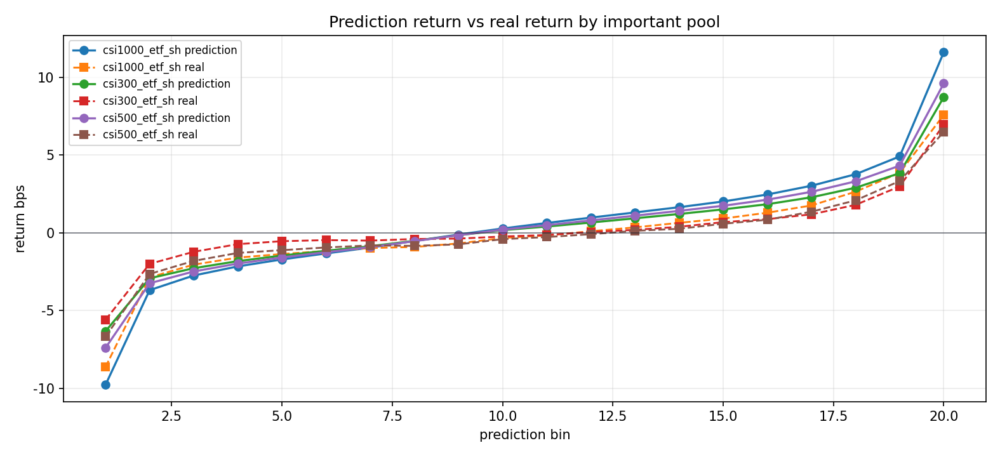

### Prediction Return vs Real Return

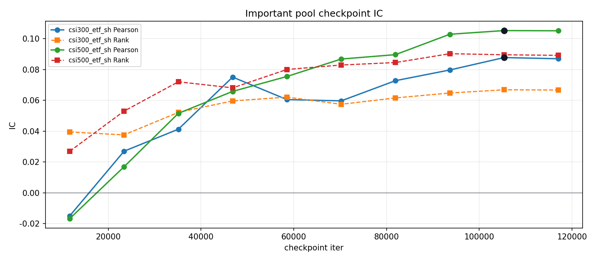

### Important Pool Checkpoint IC

### 3.4. Goodness Of Fit

Train 固定样本与完整 test 使用相同等频校准分箱; 表格仅折叠展示首尾 bins. 

| split | prediction_bin | mean_prediction | mean_label | mean_label_bps | label_std | label_se | label_p05 | label_p95 | label_ci90_low | label_ci90_high | row_count |
| --- | --- | --- | --- | --- | --- | --- | --- | --- | --- | --- | --- |
| train | 1 | -0.002499 | -0.002634 | -26.343550 | 0.009464 | 0.000017 | -0.016321 | 0.010434 | -0.002662 | -0.002607 | 318751 |
| train | 2 | -0.001282 | -0.001283 | -12.831161 | 0.006508 | 0.000012 | -0.010440 | 0.008322 | -0.001302 | -0.001264 | 318751 |
| train | 3 | -0.001005 | -0.001034 | -10.337884 | 0.005965 | 0.000011 | -0.009377 | 0.007663 | -0.001051 | -0.001016 | 318751 |
| train | 4 | -0.000846 | -0.000887 | -8.869860 | 0.005668 | 0.000010 | -0.008857 | 0.007440 | -0.000904 | -0.000870 | 318751 |
| train | 5 | -0.000736 | -0.000789 | -7.886765 | 0.005443 | 0.000010 | -0.008440 | 0.007226 | -0.000805 | -0.000773 | 318751 |
| train | 6 | -0.000652 | -0.000723 | -7.232811 | 0.005277 | 0.000009 | -0.008232 | 0.007127 | -0.000739 | -0.000708 | 318751 |
| train | 7 | -0.000584 | -0.000660 | -6.601115 | 0.005168 | 0.000009 | -0.007921 | 0.007019 | -0.000675 | -0.000645 | 318751 |
| train | 8 | -0.000528 | -0.000634 | -6.337623 | 0.005076 | 0.000009 | -0.007781 | 0.006858 | -0.000649 | -0.000619 | 318751 |
| train | 9 | -0.000483 | -0.000609 | -6.092949 | 0.004906 | 0.000009 | -0.007558 | 0.006689 | -0.000624 | -0.000595 | 318751 |
| train | 10 | -0.000448 | -0.000562 | -5.622155 | 0.004814 | 0.000009 | -0.007381 | 0.006553 | -0.000576 | -0.000548 | 318751 |
| test | 91 | 0.000533 | 0.000490 | 4.899578 | 0.005330 | 0.000004 | -0.006799 | 0.008186 | 0.000483 | 0.000497 | 1761343 |
| test | 92 | 0.000568 | 0.000516 | 5.164801 | 0.005479 | 0.000004 | -0.006981 | 0.008405 | 0.000510 | 0.000523 | 1761343 |
| test | 93 | 0.000610 | 0.000548 | 5.475255 | 0.005579 | 0.000004 | -0.007141 | 0.008595 | 0.000541 | 0.000554 | 1761343 |
| test | 94 | 0.000662 | 0.000593 | 5.930446 | 0.005784 | 0.000004 | -0.007360 | 0.008916 | 0.000586 | 0.000600 | 1761343 |
| test | 95 | 0.000726 | 0.000651 | 6.507010 | 0.005997 | 0.000005 | -0.007624 | 0.009329 | 0.000643 | 0.000658 | 1761343 |
| test | 96 | 0.000809 | 0.000720 | 7.202544 | 0.006277 | 0.000005 | -0.007933 | 0.009766 | 0.000712 | 0.000728 | 1761343 |
| test | 97 | 0.000921 | 0.000803 | 8.027381 | 0.006633 | 0.000005 | -0.008337 | 0.010393 | 0.000795 | 0.000811 | 1761343 |
| test | 98 | 0.001094 | 0.000910 | 9.098806 | 0.007138 | 0.000005 | -0.008972 | 0.011308 | 0.000901 | 0.000919 | 1761343 |
| test | 99 | 0.001426 | 0.001125 | 11.249607 | 0.008012 | 0.000006 | -0.009979 | 0.012883 | 0.001115 | 0.001135 | 1761343 |
| test | 100 | 0.003376 | 0.002560 | 25.600635 | 0.012122 | 0.000009 | -0.014152 | 0.022376 | 0.002545 | 0.002575 | 1761343 |

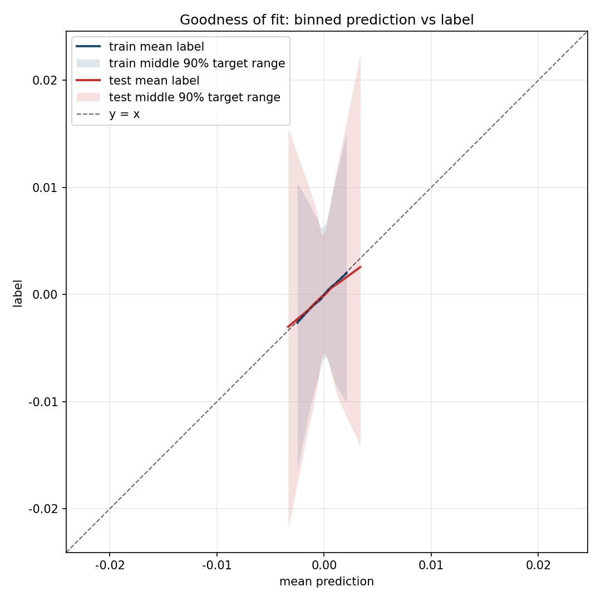

### Train/Test Goodness Of Fit

### 3.5. Liquidity By ADV

ADV 使用 shifted 20-trading-day stock1d amount mean, 并在完整 test date-code universe 上分桶. 

| adv_bucket | bucket_label | row_count | day_count | mean_adv_amount | median_adv_amount | mean_ic | mean_rank_ic | icir | rank_icir | top5_return_bps | top5_hit_rate | top5_row_count |
| --- | --- | --- | --- | --- | --- | --- | --- | --- | --- | --- | --- | --- |
| 1 | Bottom20% | 33579609 | 205 | 22043.429610 | 22557.850150 | 0.111803 | 0.095851 | 4.676311 | 4.581072 | 8.611207 | 0.440131 | 1694847 |
| 2 | 20~40% | 33579609 | 205 | 49378.094708 | 48886.620950 | 0.079926 | 0.066795 | 3.807030 | 4.279120 | 5.677296 | 0.429460 | 1695008 |
| 3 | 40~60% | 33579609 | 205 | 89103.411146 | 87560.379700 | 0.087870 | 0.061429 | 3.918422 | 3.820582 | 5.887241 | 0.440648 | 1694203 |
| 4 | 60~80% | 33579448 | 205 | 170679.829077 | 165081.435150 | 0.099636 | 0.063080 | 4.241456 | 3.311255 | 7.074630 | 0.457708 | 1695008 |
| 5 | Top20% | 33579448 | 205 | 714122.143913 | 442449.002300 | 0.109699 | 0.067357 | 3.511461 | 2.761680 | 7.776007 | 0.469399 | 1695008 |

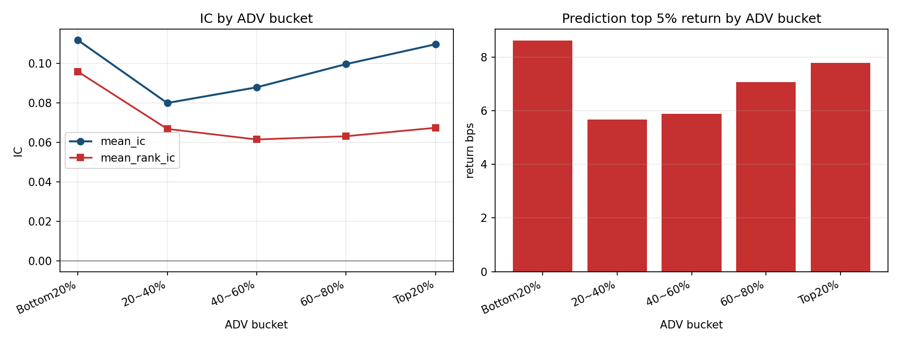

### ADV Liquidity Bucket Metrics

04

4. Train Metrics

### Train Metrics

模型参数, checkpoint selection 和运行身份来自 config, sidecar 与 summary. 

### 4.1. Checkpoint Selection

Checkpoint 只由 validation 选择; 所有候选 checkpoint 的 train headline 使用同一确定性样本. 

| key | value |
| --- | --- |
| best_iter | 105343 |
| selection_metric | checkpoint_selection/score |
| selection_rule | early_top_k |
| candidate_count | 10 |

| iter | selected | val/objective/mse | val/quality/global_ic | val/quality/rank_ic | val/dist/pred_std_over_target_std | decision | metric_rank |
| --- | --- | --- | --- | --- | --- | --- | --- |
| 11705 | False | 2.188577 | 0.005799 | 0.030243 | — | reject | 10.000000 |
| 23410 | False | 2.180569 | 0.071474 | 0.086116 | — | reject | 8.000000 |
| 35115 | False | 2.176148 | 0.081108 | 0.105533 | — | reject | 7.000000 |
| 46819 | False | 2.204706 | 0.051085 | 0.088965 | — | reject | 9.000000 |
| 58524 | False | 2.163830 | 0.106579 | 0.114222 | — | reject | 6.000000 |
| 70229 | False | 2.160849 | 0.119453 | 0.116175 | — | reject | 5.000000 |
| 81933 | False | 2.153311 | 0.127459 | 0.117370 | — | reject | 2.000000 |
| 93638 | False | 2.157951 | 0.121136 | 0.120996 | — | reject | 4.000000 |
| 105343 | True | 2.155810 | 0.123617 | 0.118860 | — | promote | 3.000000 |
| 117047 | False | 2.151833 | 0.129925 | 0.120018 | — | reject | 1.000000 |

| iter | pooled_ic | pooled_rank_ic | count | scope |
| --- | --- | --- | --- | --- |
| 11705 | 0.041164 | 0.068081 | 31875072 | fixed train sample: 3891 batches |
| 23410 | 0.072406 | 0.080047 | 31875072 | fixed train sample: 3891 batches |
| 35115 | 0.086311 | 0.086366 | 31875072 | fixed train sample: 3891 batches |
| 46819 | 0.080836 | 0.089542 | 31875072 | fixed train sample: 3891 batches |
| 58524 | 0.094350 | 0.091483 | 31875072 | fixed train sample: 3891 batches |
| 70229 | 0.089278 | 0.080271 | 31875072 | fixed train sample: 3891 batches |
| 81933 | 0.096149 | 0.090336 | 31875072 | fixed train sample: 3891 batches |
| 93638 | 0.099166 | 0.091388 | 31875072 | fixed train sample: 3891 batches |
| 105343 | 0.103241 | 0.094210 | 31875072 | fixed train sample: 3891 batches |

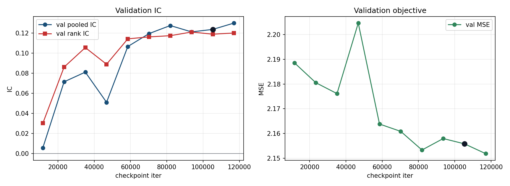

### Checkpoint Selection Metrics

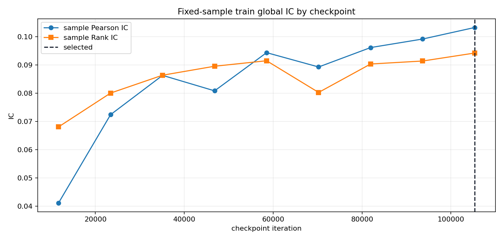

### Fixed-Sample Train Global IC By Checkpoint

### 4.2. Model And Method

本实验仅改变 active feature projection 或 context architecture. 

| experiment | status | research purpose | idea | source | baseline difference | concrete method | formula summary |
| --- | --- | --- | --- | --- | --- | --- | --- |
| deep_sets_34d | complete | 检验可学习的全市场分布摘要是否优于固定 mean/std.  | 用共享 phi 映射每只股票 hidden, 均值聚合得到 permutation-invariant 市场 token.  | Deep Sets, Zaheer et al. (2017), arXiv:1703.06114.  | 输入仍为 34D; 用可学习 phi 和 panel mean 产生一个共享 384D market context.  | 屏蔽 7 个 rank; c = mean_j phi(h_j) 对 panel 聚合, 再把相同 c 广播给每只股票并输入公共预测头.  | u_j = phi(h_j); c = (1/N) * sum_{j=1}^N u_j; c_i = c for i=1,...,N; y_hat_i = rho([h_i, c]) |

### 4.2.1. GRU

所有臂共享两层单向 GRU 编码器. 

| field | value |
| --- | --- |
| input_tensor | batch, panel, 60, 41 |
| gru_hidden_size | 384 |
| gru_num_layers | 2 |
| gru_bidirectional | False |
| gru_dropout | 0.000000 |

### 4.2.2. MLP

公共预测头使用 Linear-LayerNorm-ReLU block; context 臂将 hidden 与 context 拼接. 

| field | value |
| --- | --- |
| mlp_effective_hidden_width | 512, 512 |
| mlp_dropout | 0.000000 |
| trainable_parameter | 2,335,105 |

### 4.2.3. Method

屏蔽 7 个 rank; c = mean_j phi(h_j) 对 panel 聚合, 再把相同 c 广播给每只股票并输入公共预测头. 

| field | value |
| --- | --- |
| parameter_initialization | PyTorch default GRU/Linear; Xavier inducing tokens |
| lr_scheduler/type | 200-step LinearWarmup + CosineAnnealing |
| optimizer | AdamW |
| approx_total_epochs | 1 exact sampler epoch |
| final_iter | 117047 |
| checkpoint_selection | early_top_k |

| step | operation |
| --- | --- |
| 1 | 使用 34D mask 和公共 GRU 得到 panel hidden H.  |
| 2 | 每只股票独立经过共享的两层 Linear-LayerNorm-ReLU 映射 phi.  |
| 3 | 对股票轴取均值得到 permutation-invariant token c, 广播后与 h_i 拼接预测.  |

| symbol | formula | implementation meaning |
| --- | --- | --- |
| Element map | u_j = phi(h_j) | phi 为两层 384D Linear-LayerNorm-ReLU 网络.  |
| Set aggregation | c = (1/N) * sum_{j=1}^N u_j | 均值聚合对股票排列不变.  |
| Broadcast | c_i = c for i=1,...,N | 同一分钟所有股票共享市场摘要.  |
| Prediction | y_hat_i = rho([h_i, c]) | 本地状态与学习到的市场分布摘要共同预测.  |

### 4.3. Training Monitoring

TensorBoard event files和资源监控 JSONL 共同提供训练过程证据. 

| samples | host CPU % | process CPU % | RSS GiB | host RAM % | min free RAM GiB | GPU MiB | GPU util % | GPU temp C | min cache GiB |
| --- | --- | --- | --- | --- | --- | --- | --- | --- | --- |
| 408 | 18.300000 | 1037.503271 | 52.537373 | 11.900000 | 443.951675 | 9363.000000 | 100.000000 | 79.000000 | 191.762020 |

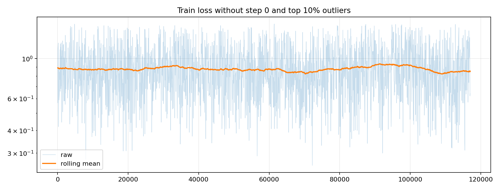

### Train Loss

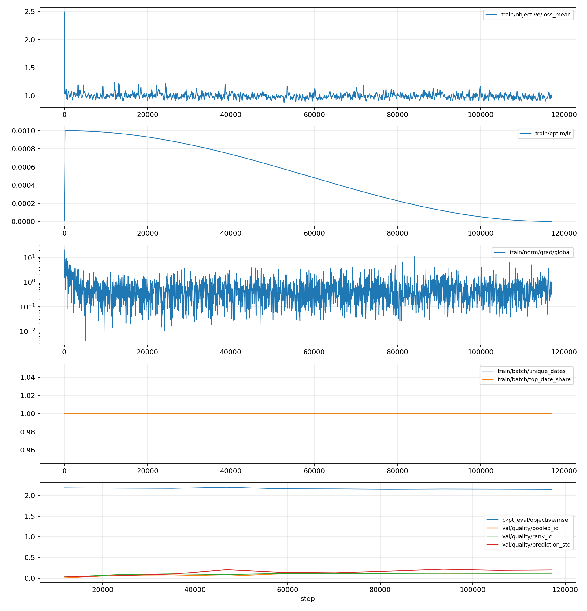

### Train Monitoring Curves

05

5. Trading And Cost

### Trading And Cost

只有完成正式 test 和 backtest 的实验臂报告 execution-aware 摘要. 

### 5.0. Cost Model Status

ETF proxy 使用完整 train-validation-test 时间线; raw forward log return 经 expm1 转为 simple return 后复利. 

| field | value |
| --- | --- |
| status | available |
| available_metric | 10M AUM execution-aware portfolio summary |

| gross daily | gross Sharpe | net daily 10M | net Sharpe 10M | max drawdown | turnover | fill |
| --- | --- | --- | --- | --- | --- | --- |
| 89.09 bps | 40.407814 | -149.02 bps | -39.045298 | -95.34% | 11.807929 | 94.01% |

### 5.1. Cumulative Prediction, Real, And Excess Returns

按 pool 使用 trailing threshold, 5-minute rebalance 与连续 full-hold benchmark. 

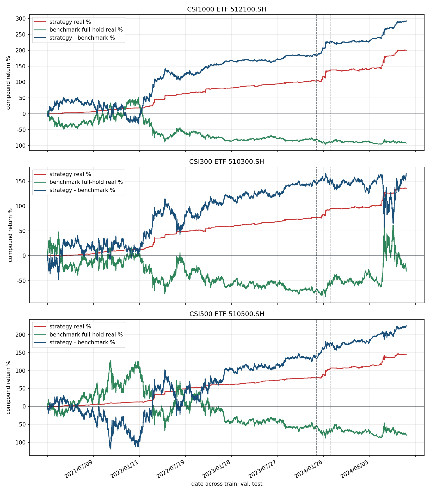

### Train/Val/Test Cumulative Returns

### 5.2. Single-Side Cost Sensitivity

成本扫描同时报告完整 timeline, test-only 以及排除 2024-09/10 的 test. 

| pool | date | test_minute_index | single_side_cost_bps | net_strategy_cumulative_return |
| --- | --- | --- | --- | --- |
| csi1000_etf_sh | 240301 | 1 | 0.000000 | 0.000000 |
| csi1000_etf_sh | 240301 | 2 | 0.000000 | 0.000000 |
| csi1000_etf_sh | 240301 | 3 | 0.000000 | 0.000000 |
| csi1000_etf_sh | 240301 | 4 | 0.000000 | 0.000000 |
| csi1000_etf_sh | 240301 | 5 | 0.000000 | 0.000000 |
| csi1000_etf_sh | 240301 | 6 | 0.000000 | 0.000000 |
| csi1000_etf_sh | 240301 | 7 | 0.000000 | 0.000000 |
| csi1000_etf_sh | 240301 | 8 | 0.000000 | 0.000000 |
| csi1000_etf_sh | 240301 | 9 | 0.000000 | 0.000000 |
| csi1000_etf_sh | 240301 | 10 | 0.000000 | 0.000000 |
| csi1000_etf_sh | 240301 | 11 | 0.000000 | 0.000000 |
| csi1000_etf_sh | 240301 | 12 | 0.000000 | 0.000000 |
| csi1000_etf_sh | 240301 | 13 | 0.000000 | 0.000000 |
| csi1000_etf_sh | 240301 | 14 | 0.000000 | 0.000000 |
| csi1000_etf_sh | 240301 | 15 | 0.000000 | 0.000000 |
| csi1000_etf_sh | 240301 | 16 | 0.000000 | 0.000000 |
| csi1000_etf_sh | 240301 | 17 | 0.000000 | 0.000000 |
| csi1000_etf_sh | 240301 | 18 | 0.000000 | 0.000000 |
| csi1000_etf_sh | 240301 | 19 | 0.000000 | 0.000000 |
| csi1000_etf_sh | 240301 | 20 | 0.000000 | 0.000000 |
| csi1000_etf_sh | 240301 | 21 | 0.000000 | 0.000000 |
| csi1000_etf_sh | 240301 | 22 | 0.000000 | 0.000000 |
| csi1000_etf_sh | 240301 | 23 | 0.000000 | 0.000000 |
| csi1000_etf_sh | 240301 | 24 | 0.000000 | 0.000000 |
| csi1000_etf_sh | 240301 | 25 | 0.000000 | 0.000000 |
| csi1000_etf_sh | 240301 | 26 | 0.000000 | 0.000000 |
| csi1000_etf_sh | 240301 | 27 | 0.000000 | 0.000000 |
| csi1000_etf_sh | 240301 | 28 | 0.000000 | 0.000000 |
| csi1000_etf_sh | 240301 | 29 | 0.000000 | 0.000000 |
| csi1000_etf_sh | 240301 | 30 | 0.000000 | 0.000000 |
| csi1000_etf_sh | 240301 | 31 | 0.000000 | 0.000000 |
| csi1000_etf_sh | 240301 | 32 | 0.000000 | 0.000000 |
| csi1000_etf_sh | 240301 | 33 | 0.000000 | 0.000000 |
| csi1000_etf_sh | 240301 | 34 | 0.000000 | 0.000000 |
| csi1000_etf_sh | 240301 | 35 | 0.000000 | 0.000000 |
| csi1000_etf_sh | 240301 | 36 | 0.000000 | 0.000000 |
| csi1000_etf_sh | 240301 | 37 | 0.000000 | 0.000000 |
| csi1000_etf_sh | 240301 | 38 | 0.000000 | 0.000000 |
| csi1000_etf_sh | 240301 | 39 | 0.000000 | 0.000000 |
| csi1000_etf_sh | 240301 | 40 | 0.000000 | 0.000000 |
| csi1000_etf_sh | 240301 | 41 | 0.000000 | 0.000000 |
| csi1000_etf_sh | 240301 | 42 | 0.000000 | 0.000000 |
| csi1000_etf_sh | 240301 | 43 | 0.000000 | 0.000000 |
| csi1000_etf_sh | 240301 | 44 | 0.000000 | 0.000000 |
| csi1000_etf_sh | 240301 | 45 | 0.000000 | 0.000000 |
| csi1000_etf_sh | 240301 | 46 | 0.000000 | 0.000000 |
| csi1000_etf_sh | 240301 | 47 | 0.000000 | 0.000000 |
| csi1000_etf_sh | 240301 | 48 | 0.000000 | 0.000000 |
| csi1000_etf_sh | 240301 | 49 | 0.000000 | 0.000000 |
| csi1000_etf_sh | 240301 | 50 | 0.000000 | 0.000000 |
| csi1000_etf_sh | 240301 | 51 | 0.000000 | 0.000000 |
| csi1000_etf_sh | 240301 | 52 | 0.000000 | 0.000000 |
| csi1000_etf_sh | 240301 | 53 | 0.000000 | 0.000000 |
| csi1000_etf_sh | 240301 | 54 | 0.000000 | 0.000000 |
| csi1000_etf_sh | 240301 | 55 | 0.000000 | 0.000000 |
| csi1000_etf_sh | 240301 | 56 | 0.000000 | 0.000000 |
| csi1000_etf_sh | 240301 | 57 | 0.000000 | 0.000000 |
| csi1000_etf_sh | 240301 | 58 | 0.000000 | 0.000000 |
| csi1000_etf_sh | 240301 | 59 | 0.000000 | 0.000000 |
| csi1000_etf_sh | 240301 | 60 | 0.000000 | 0.000000 |
| csi500_etf_sh | 241231 | 32946 | 10.000000 | -0.118112 |
| csi500_etf_sh | 241231 | 32947 | 10.000000 | -0.118112 |
| csi500_etf_sh | 241231 | 32948 | 10.000000 | -0.118112 |
| csi500_etf_sh | 241231 | 32949 | 10.000000 | -0.118112 |
| csi500_etf_sh | 241231 | 32950 | 10.000000 | -0.118112 |
| csi500_etf_sh | 241231 | 32951 | 10.000000 | -0.118112 |
| csi500_etf_sh | 241231 | 32952 | 10.000000 | -0.118112 |
| csi500_etf_sh | 241231 | 32953 | 10.000000 | -0.118112 |
| csi500_etf_sh | 241231 | 32954 | 10.000000 | -0.118112 |
| csi500_etf_sh | 241231 | 32955 | 10.000000 | -0.118112 |
| csi500_etf_sh | 241231 | 32956 | 10.000000 | -0.118112 |
| csi500_etf_sh | 241231 | 32957 | 10.000000 | -0.118112 |
| csi500_etf_sh | 241231 | 32958 | 10.000000 | -0.118112 |
| csi500_etf_sh | 241231 | 32959 | 10.000000 | -0.118112 |
| csi500_etf_sh | 241231 | 32960 | 10.000000 | -0.118112 |
| csi500_etf_sh | 241231 | 32961 | 10.000000 | -0.118112 |
| csi500_etf_sh | 241231 | 32962 | 10.000000 | -0.118112 |
| csi500_etf_sh | 241231 | 32963 | 10.000000 | -0.118112 |
| csi500_etf_sh | 241231 | 32964 | 10.000000 | -0.118112 |
| csi500_etf_sh | 241231 | 32965 | 10.000000 | -0.118112 |
| csi500_etf_sh | 241231 | 32966 | 10.000000 | -0.118112 |
| csi500_etf_sh | 241231 | 32967 | 10.000000 | -0.118112 |
| csi500_etf_sh | 241231 | 32968 | 10.000000 | -0.118112 |
| csi500_etf_sh | 241231 | 32969 | 10.000000 | -0.118112 |
| csi500_etf_sh | 241231 | 32970 | 10.000000 | -0.118112 |
| csi500_etf_sh | 241231 | 32971 | 10.000000 | -0.118112 |
| csi500_etf_sh | 241231 | 32972 | 10.000000 | -0.118112 |
| csi500_etf_sh | 241231 | 32973 | 10.000000 | -0.118112 |
| csi500_etf_sh | 241231 | 32974 | 10.000000 | -0.118112 |
| csi500_etf_sh | 241231 | 32975 | 10.000000 | -0.118112 |
| csi500_etf_sh | 241231 | 32976 | 10.000000 | -0.118112 |
| csi500_etf_sh | 241231 | 32977 | 10.000000 | -0.118112 |
| csi500_etf_sh | 241231 | 32978 | 10.000000 | -0.118112 |
| csi500_etf_sh | 241231 | 32979 | 10.000000 | -0.118112 |
| csi500_etf_sh | 241231 | 32980 | 10.000000 | -0.118112 |
| csi500_etf_sh | 241231 | 32981 | 10.000000 | -0.118112 |
| csi500_etf_sh | 241231 | 32982 | 10.000000 | -0.118112 |
| csi500_etf_sh | 241231 | 32983 | 10.000000 | -0.118112 |
| csi500_etf_sh | 241231 | 32984 | 10.000000 | -0.118112 |
| csi500_etf_sh | 241231 | 32985 | 10.000000 | -0.118112 |
| csi500_etf_sh | 241231 | 32986 | 10.000000 | -0.118112 |
| csi500_etf_sh | 241231 | 32987 | 10.000000 | -0.118112 |
| csi500_etf_sh | 241231 | 32988 | 10.000000 | -0.118112 |
| csi500_etf_sh | 241231 | 32989 | 10.000000 | -0.118112 |
| csi500_etf_sh | 241231 | 32990 | 10.000000 | -0.118112 |
| csi500_etf_sh | 241231 | 32991 | 10.000000 | -0.118112 |
| csi500_etf_sh | 241231 | 32992 | 10.000000 | -0.118112 |
| csi500_etf_sh | 241231 | 32993 | 10.000000 | -0.118112 |
| csi500_etf_sh | 241231 | 32994 | 10.000000 | -0.118112 |
| csi500_etf_sh | 241231 | 32995 | 10.000000 | -0.118112 |
| csi500_etf_sh | 241231 | 32996 | 10.000000 | -0.118112 |
| csi500_etf_sh | 241231 | 32997 | 10.000000 | -0.118112 |
| csi500_etf_sh | 241231 | 32998 | 10.000000 | -0.118112 |
| csi500_etf_sh | 241231 | 32999 | 10.000000 | -0.118112 |
| csi500_etf_sh | 241231 | 33000 | 10.000000 | -0.118112 |
| csi500_etf_sh | 241231 | 33001 | 10.000000 | -0.118112 |
| csi500_etf_sh | 241231 | 33002 | 10.000000 | -0.123621 |
| csi500_etf_sh | 241231 | 33003 | 10.000000 | -0.123621 |
| csi500_etf_sh | 241231 | 33004 | 10.000000 | -0.123621 |
| csi500_etf_sh | 241231 | 33005 | 10.000000 | -0.123621 |

| split | pool | date | day_index | single_side_cost_bps | net_strategy_cumulative_return |
| --- | --- | --- | --- | --- | --- |
| train | csi1000_etf_sh | 210104 | 1 | 0.000000 | 0.000000 |
| train | csi1000_etf_sh | 210104 | 2 | 0.000000 | 0.000000 |
| train | csi1000_etf_sh | 210104 | 3 | 0.000000 | 0.000000 |
| train | csi1000_etf_sh | 210104 | 4 | 0.000000 | 0.000000 |
| train | csi1000_etf_sh | 210104 | 5 | 0.000000 | 0.000000 |
| train | csi1000_etf_sh | 210104 | 6 | 0.000000 | 0.000000 |
| train | csi1000_etf_sh | 210104 | 7 | 0.000000 | 0.000000 |
| train | csi1000_etf_sh | 210104 | 8 | 0.000000 | 0.000000 |
| train | csi1000_etf_sh | 210104 | 9 | 0.000000 | 0.000000 |
| train | csi1000_etf_sh | 210104 | 10 | 0.000000 | 0.000000 |
| train | csi1000_etf_sh | 210104 | 11 | 0.000000 | 0.000000 |
| train | csi1000_etf_sh | 210104 | 12 | 0.000000 | 0.000000 |
| train | csi1000_etf_sh | 210104 | 13 | 0.000000 | 0.000000 |
| train | csi1000_etf_sh | 210104 | 14 | 0.000000 | 0.000000 |
| train | csi1000_etf_sh | 210104 | 15 | 0.000000 | 0.000000 |
| train | csi1000_etf_sh | 210104 | 16 | 0.000000 | 0.000000 |
| train | csi1000_etf_sh | 210104 | 17 | 0.000000 | 0.000000 |
| train | csi1000_etf_sh | 210104 | 18 | 0.000000 | 0.000000 |
| train | csi1000_etf_sh | 210104 | 19 | 0.000000 | 0.000000 |
| train | csi1000_etf_sh | 210104 | 20 | 0.000000 | 0.000000 |
| train | csi1000_etf_sh | 210104 | 21 | 0.000000 | 0.000000 |
| train | csi1000_etf_sh | 210104 | 22 | 0.000000 | 0.000000 |
| train | csi1000_etf_sh | 210104 | 23 | 0.000000 | 0.000000 |
| train | csi1000_etf_sh | 210104 | 24 | 0.000000 | 0.000000 |
| train | csi1000_etf_sh | 210104 | 25 | 0.000000 | 0.000000 |
| train | csi1000_etf_sh | 210104 | 26 | 0.000000 | 0.000000 |
| train | csi1000_etf_sh | 210104 | 27 | 0.000000 | 0.000000 |
| train | csi1000_etf_sh | 210104 | 28 | 0.000000 | 0.000000 |
| train | csi1000_etf_sh | 210104 | 29 | 0.000000 | 0.000000 |
| train | csi1000_etf_sh | 210104 | 30 | 0.000000 | 0.000000 |
| train | csi1000_etf_sh | 210104 | 31 | 0.000000 | 0.000000 |
| train | csi1000_etf_sh | 210104 | 32 | 0.000000 | 0.000000 |
| train | csi1000_etf_sh | 210104 | 33 | 0.000000 | 0.000000 |
| train | csi1000_etf_sh | 210104 | 34 | 0.000000 | 0.000000 |
| train | csi1000_etf_sh | 210104 | 35 | 0.000000 | 0.000000 |
| train | csi1000_etf_sh | 210104 | 36 | 0.000000 | 0.000000 |
| train | csi1000_etf_sh | 210104 | 37 | 0.000000 | 0.000000 |
| train | csi1000_etf_sh | 210104 | 38 | 0.000000 | 0.000000 |
| train | csi1000_etf_sh | 210104 | 39 | 0.000000 | 0.000000 |
| train | csi1000_etf_sh | 210104 | 40 | 0.000000 | 0.000000 |
| train | csi1000_etf_sh | 210104 | 41 | 0.000000 | 0.000000 |
| train | csi1000_etf_sh | 210104 | 42 | 0.000000 | 0.000000 |
| train | csi1000_etf_sh | 210104 | 43 | 0.000000 | 0.000000 |
| train | csi1000_etf_sh | 210104 | 44 | 0.000000 | 0.000000 |
| train | csi1000_etf_sh | 210104 | 45 | 0.000000 | 0.000000 |
| train | csi1000_etf_sh | 210104 | 46 | 0.000000 | 0.000000 |
| train | csi1000_etf_sh | 210104 | 47 | 0.000000 | 0.000000 |
| train | csi1000_etf_sh | 210104 | 48 | 0.000000 | 0.000000 |
| train | csi1000_etf_sh | 210104 | 49 | 0.000000 | 0.000000 |
| train | csi1000_etf_sh | 210104 | 50 | 0.000000 | 0.000000 |
| train | csi1000_etf_sh | 210104 | 51 | 0.000000 | 0.000000 |
| train | csi1000_etf_sh | 210104 | 52 | 0.000000 | 0.000000 |
| train | csi1000_etf_sh | 210104 | 53 | 0.000000 | 0.000000 |
| train | csi1000_etf_sh | 210104 | 54 | 0.000000 | 0.000000 |
| train | csi1000_etf_sh | 210104 | 55 | 0.000000 | 0.000000 |
| train | csi1000_etf_sh | 210104 | 56 | 0.000000 | 0.000000 |
| train | csi1000_etf_sh | 210104 | 57 | 0.000000 | 0.000000 |
| train | csi1000_etf_sh | 210104 | 58 | 0.000000 | 0.000000 |
| train | csi1000_etf_sh | 210104 | 59 | 0.000000 | 0.000000 |
| train | csi1000_etf_sh | 210104 | 60 | 0.000000 | 0.000000 |
| test | csi500_etf_sh | 241231 | 155950 | 10.000000 | -0.461248 |
| test | csi500_etf_sh | 241231 | 155951 | 10.000000 | -0.461248 |
| test | csi500_etf_sh | 241231 | 155952 | 10.000000 | -0.461248 |
| test | csi500_etf_sh | 241231 | 155953 | 10.000000 | -0.461248 |
| test | csi500_etf_sh | 241231 | 155954 | 10.000000 | -0.461248 |
| test | csi500_etf_sh | 241231 | 155955 | 10.000000 | -0.461248 |
| test | csi500_etf_sh | 241231 | 155956 | 10.000000 | -0.461248 |
| test | csi500_etf_sh | 241231 | 155957 | 10.000000 | -0.461248 |
| test | csi500_etf_sh | 241231 | 155958 | 10.000000 | -0.461248 |
| test | csi500_etf_sh | 241231 | 155959 | 10.000000 | -0.461248 |
| test | csi500_etf_sh | 241231 | 155960 | 10.000000 | -0.461248 |
| test | csi500_etf_sh | 241231 | 155961 | 10.000000 | -0.461248 |
| test | csi500_etf_sh | 241231 | 155962 | 10.000000 | -0.461248 |
| test | csi500_etf_sh | 241231 | 155963 | 10.000000 | -0.461248 |
| test | csi500_etf_sh | 241231 | 155964 | 10.000000 | -0.461248 |
| test | csi500_etf_sh | 241231 | 155965 | 10.000000 | -0.461248 |
| test | csi500_etf_sh | 241231 | 155966 | 10.000000 | -0.461248 |
| test | csi500_etf_sh | 241231 | 155967 | 10.000000 | -0.461248 |
| test | csi500_etf_sh | 241231 | 155968 | 10.000000 | -0.461248 |
| test | csi500_etf_sh | 241231 | 155969 | 10.000000 | -0.461248 |
| test | csi500_etf_sh | 241231 | 155970 | 10.000000 | -0.461248 |
| test | csi500_etf_sh | 241231 | 155971 | 10.000000 | -0.461248 |
| test | csi500_etf_sh | 241231 | 155972 | 10.000000 | -0.461248 |
| test | csi500_etf_sh | 241231 | 155973 | 10.000000 | -0.461248 |
| test | csi500_etf_sh | 241231 | 155974 | 10.000000 | -0.461248 |
| test | csi500_etf_sh | 241231 | 155975 | 10.000000 | -0.461248 |
| test | csi500_etf_sh | 241231 | 155976 | 10.000000 | -0.461248 |
| test | csi500_etf_sh | 241231 | 155977 | 10.000000 | -0.461248 |
| test | csi500_etf_sh | 241231 | 155978 | 10.000000 | -0.461248 |
| test | csi500_etf_sh | 241231 | 155979 | 10.000000 | -0.461248 |
| test | csi500_etf_sh | 241231 | 155980 | 10.000000 | -0.461248 |
| test | csi500_etf_sh | 241231 | 155981 | 10.000000 | -0.461248 |
| test | csi500_etf_sh | 241231 | 155982 | 10.000000 | -0.461248 |
| test | csi500_etf_sh | 241231 | 155983 | 10.000000 | -0.461248 |
| test | csi500_etf_sh | 241231 | 155984 | 10.000000 | -0.461248 |
| test | csi500_etf_sh | 241231 | 155985 | 10.000000 | -0.461248 |
| test | csi500_etf_sh | 241231 | 155986 | 10.000000 | -0.461248 |
| test | csi500_etf_sh | 241231 | 155987 | 10.000000 | -0.461248 |
| test | csi500_etf_sh | 241231 | 155988 | 10.000000 | -0.461248 |
| test | csi500_etf_sh | 241231 | 155989 | 10.000000 | -0.461248 |
| test | csi500_etf_sh | 241231 | 155990 | 10.000000 | -0.461248 |
| test | csi500_etf_sh | 241231 | 155991 | 10.000000 | -0.461248 |
| test | csi500_etf_sh | 241231 | 155992 | 10.000000 | -0.461248 |
| test | csi500_etf_sh | 241231 | 155993 | 10.000000 | -0.461248 |
| test | csi500_etf_sh | 241231 | 155994 | 10.000000 | -0.461248 |
| test | csi500_etf_sh | 241231 | 155995 | 10.000000 | -0.461248 |
| test | csi500_etf_sh | 241231 | 155996 | 10.000000 | -0.461248 |
| test | csi500_etf_sh | 241231 | 155997 | 10.000000 | -0.461248 |
| test | csi500_etf_sh | 241231 | 155998 | 10.000000 | -0.461248 |
| test | csi500_etf_sh | 241231 | 155999 | 10.000000 | -0.461248 |
| test | csi500_etf_sh | 241231 | 156000 | 10.000000 | -0.461248 |
| test | csi500_etf_sh | 241231 | 156001 | 10.000000 | -0.461248 |
| test | csi500_etf_sh | 241231 | 156002 | 10.000000 | -0.461248 |
| test | csi500_etf_sh | 241231 | 156003 | 10.000000 | -0.461248 |
| test | csi500_etf_sh | 241231 | 156004 | 10.000000 | -0.461248 |
| test | csi500_etf_sh | 241231 | 156005 | 10.000000 | -0.461248 |
| test | csi500_etf_sh | 241231 | 156006 | 10.000000 | -0.464614 |
| test | csi500_etf_sh | 241231 | 156007 | 10.000000 | -0.464614 |
| test | csi500_etf_sh | 241231 | 156008 | 10.000000 | -0.464614 |
| test | csi500_etf_sh | 241231 | 156009 | 10.000000 | -0.464614 |

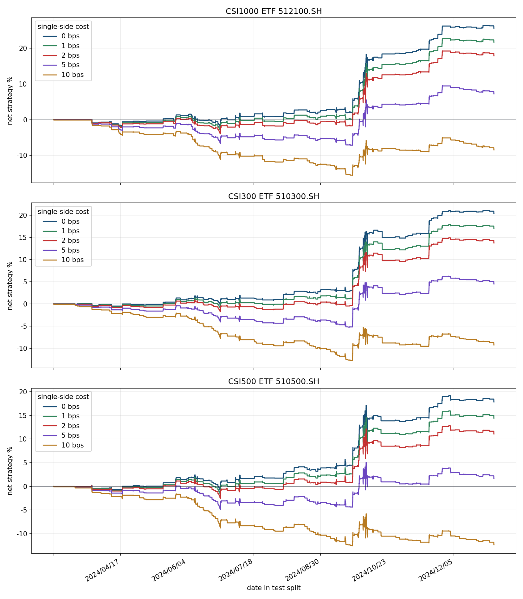

### Test Cost Sensitivity

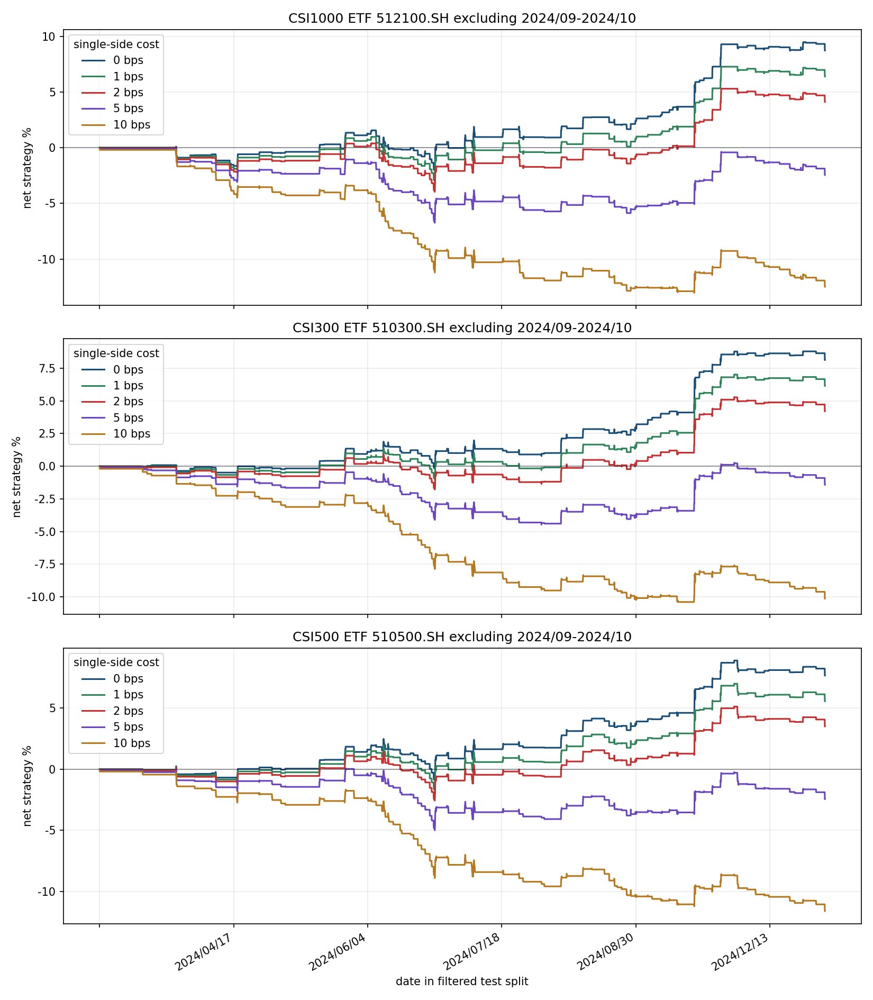

### Test Cost Sensitivity Excluding 2024-09/10

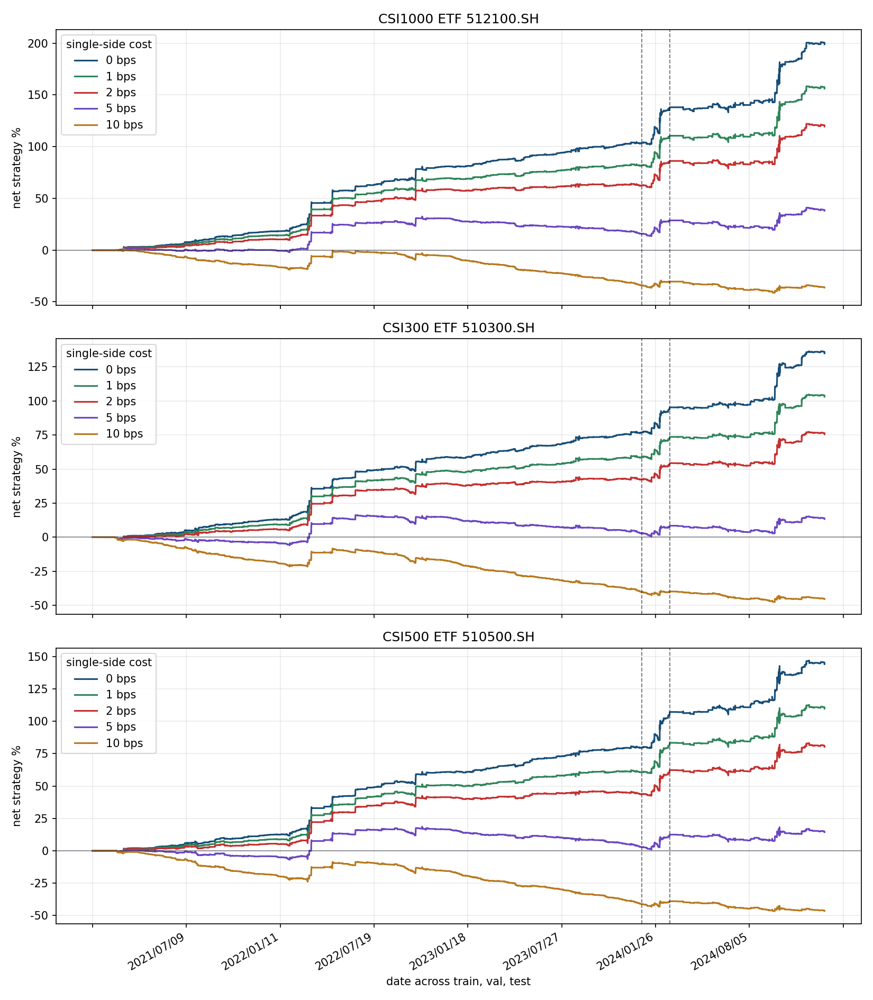

### Full Timeline Cost Sensitivity

### 5.3. ETF Trade Return Distribution

Trade rows are defined by position open/close episodes under the same ETF proxy rule.

| scope | pool | display_name | trade_id | start_date | start_time | end_date | end_time | holding_minutes | trade_return_bps |
| --- | --- | --- | --- | --- | --- | --- | --- | --- | --- |
| train_val_test | csi1000_etf_sh | 1000 ETF | 1 | 210219 | 142000 | 210219 | 144900 | 30 | 13.791428 |
| train_val_test | csi1000_etf_sh | 1000 ETF | 2 | 210224 | 143700 | 210224 | 144100 | 5 | -2.680718 |
| train_val_test | csi1000_etf_sh | 1000 ETF | 3 | 210224 | 144700 | 210225 | 104000 | 5 | 3.100546 |
| train_val_test | csi1000_etf_sh | 1000 ETF | 4 | 210301 | 143900 | 210302 | 104200 | 15 | 34.531075 |
| train_val_test | csi1000_etf_sh | 1000 ETF | 5 | 210302 | 143300 | 210302 | 143700 | 5 | 0.119314 |
| train_val_test | csi1000_etf_sh | 1000 ETF | 6 | 210303 | 144200 | 210304 | 104000 | 10 | 15.502612 |
| train_val_test | csi1000_etf_sh | 1000 ETF | 7 | 210305 | 110000 | 210305 | 110400 | 5 | 6.122375 |
| train_val_test | csi1000_etf_sh | 1000 ETF | 8 | 210305 | 140000 | 210305 | 140900 | 10 | -2.350998 |
| train_val_test | csi1000_etf_sh | 1000 ETF | 9 | 210309 | 105300 | 210309 | 112700 | 35 | 190.715786 |
| train_val_test | csi1000_etf_sh | 1000 ETF | 10 | 210309 | 130300 | 210309 | 132200 | 20 | -12.593671 |
| train_val_test | csi1000_etf_sh | 1000 ETF | 11 | 210310 | 105200 | 210310 | 105600 | 5 | -5.527150 |
| train_val_test | csi1000_etf_sh | 1000 ETF | 12 | 210310 | 140200 | 210310 | 141100 | 10 | -19.917746 |
| train_val_test | csi1000_etf_sh | 1000 ETF | 13 | 210311 | 144100 | 210312 | 103900 | 10 | 33.490731 |
| train_val_test | csi1000_etf_sh | 1000 ETF | 14 | 210312 | 144500 | 210312 | 144900 | 5 | 11.431792 |
| train_val_test | csi1000_etf_sh | 1000 ETF | 15 | 210315 | 144900 | 210316 | 104200 | 5 | 21.417668 |
| train_val_test | csi1000_etf_sh | 1000 ETF | 16 | 210316 | 143800 | 210317 | 104100 | 15 | 24.448133 |
| train_val_test | csi1000_etf_sh | 1000 ETF | 17 | 210317 | 143200 | 210317 | 143600 | 5 | -16.367106 |
| train_val_test | csi1000_etf_sh | 1000 ETF | 18 | 210322 | 144900 | 210323 | 104200 | 5 | 14.010684 |
| train_val_test | csi1000_etf_sh | 1000 ETF | 19 | 210401 | 143600 | 210401 | 144000 | 5 | -1.435182 |
| train_val_test | csi1000_etf_sh | 1000 ETF | 20 | 210401 | 144600 | 210402 | 103900 | 5 | -7.190793 |
| train_val_test | csi1000_etf_sh | 1000 ETF | 21 | 210406 | 144400 | 210407 | 104200 | 10 | 3.031593 |
| train_val_test | csi1000_etf_sh | 1000 ETF | 22 | 210407 | 144300 | 210408 | 104100 | 10 | 10.273150 |
| train_val_test | csi1000_etf_sh | 1000 ETF | 23 | 210409 | 142100 | 210409 | 143000 | 10 | 6.086108 |
| train_val_test | csi1000_etf_sh | 1000 ETF | 24 | 210414 | 144800 | 210415 | 104100 | 5 | 3.934715 |
| train_val_test | csi1000_etf_sh | 1000 ETF | 25 | 210416 | 142100 | 210416 | 142500 | 5 | -14.419295 |
| train_val_test | csi1000_etf_sh | 1000 ETF | 26 | 210416 | 144600 | 210419 | 103900 | 5 | 2.274788 |
| train_val_test | csi1000_etf_sh | 1000 ETF | 27 | 210422 | 144700 | 210423 | 104000 | 5 | 6.945729 |
| train_val_test | csi1000_etf_sh | 1000 ETF | 28 | 210423 | 143100 | 210423 | 143500 | 5 | 1.775269 |
| train_val_test | csi1000_etf_sh | 1000 ETF | 29 | 210423 | 144100 | 210426 | 103900 | 10 | 6.501524 |
| train_val_test | csi1000_etf_sh | 1000 ETF | 30 | 210427 | 135400 | 210427 | 135800 | 5 | -3.433606 |
| train_val_test | csi1000_etf_sh | 1000 ETF | 31 | 210428 | 144800 | 210429 | 104100 | 5 | 3.253965 |
| train_val_test | csi1000_etf_sh | 1000 ETF | 32 | 210430 | 144600 | 210506 | 103900 | 5 | -3.347092 |
| train_val_test | csi1000_etf_sh | 1000 ETF | 33 | 210510 | 144800 | 210511 | 104100 | 5 | 25.447690 |
| train_val_test | csi1000_etf_sh | 1000 ETF | 34 | 210511 | 131200 | 210511 | 132600 | 15 | 26.207909 |
| train_val_test | csi1000_etf_sh | 1000 ETF | 35 | 210511 | 135700 | 210511 | 140100 | 5 | -15.704074 |
| train_val_test | csi1000_etf_sh | 1000 ETF | 36 | 210511 | 144700 | 210512 | 104000 | 5 | 6.869674 |
| train_val_test | csi1000_etf_sh | 1000 ETF | 37 | 210512 | 141600 | 210513 | 103900 | 35 | 36.622722 |
| train_val_test | csi1000_etf_sh | 1000 ETF | 38 | 210514 | 144400 | 210517 | 104200 | 10 | 13.396840 |
| train_val_test | csi1000_etf_sh | 1000 ETF | 39 | 210518 | 143200 | 210519 | 104000 | 20 | 18.048530 |
| train_val_test | csi1000_etf_sh | 1000 ETF | 40 | 210519 | 144600 | 210520 | 103900 | 5 | 4.369270 |
| train_val_test | csi1000_etf_sh | 1000 ETF | 41 | 210521 | 144900 | 210524 | 104200 | 5 | 9.016903 |
| train_val_test | csi1000_etf_sh | 1000 ETF | 42 | 210524 | 144800 | 210525 | 104100 | 5 | 8.467888 |
| train_val_test | csi1000_etf_sh | 1000 ETF | 43 | 210525 | 143700 | 210526 | 104000 | 15 | 3.331358 |
| train_val_test | csi1000_etf_sh | 1000 ETF | 44 | 210526 | 143100 | 210526 | 143500 | 5 | -2.038375 |
| train_val_test | csi1000_etf_sh | 1000 ETF | 45 | 210526 | 144600 | 210527 | 103900 | 5 | 1.135150 |
| train_val_test | csi1000_etf_sh | 1000 ETF | 46 | 210527 | 144000 | 210527 | 144900 | 10 | 1.858217 |
| train_val_test | csi1000_etf_sh | 1000 ETF | 47 | 210528 | 144900 | 210531 | 104200 | 5 | 8.315339 |
| train_val_test | csi1000_etf_sh | 1000 ETF | 48 | 210531 | 143800 | 210601 | 104100 | 15 | 18.906899 |
| train_val_test | csi1000_etf_sh | 1000 ETF | 49 | 210601 | 143200 | 210602 | 104000 | 20 | 17.105028 |
| train_val_test | csi1000_etf_sh | 1000 ETF | 50 | 210604 | 144900 | 210607 | 104200 | 5 | 4.889529 |
| train_val_test | csi1000_etf_sh | 1000 ETF | 51 | 210607 | 144300 | 210608 | 104100 | 10 | 11.546981 |
| train_val_test | csi1000_etf_sh | 1000 ETF | 52 | 210608 | 144700 | 210609 | 104000 | 5 | 11.536927 |
| train_val_test | csi1000_etf_sh | 1000 ETF | 53 | 210609 | 144600 | 210610 | 103900 | 5 | 11.721922 |
| train_val_test | csi1000_etf_sh | 1000 ETF | 54 | 210610 | 143000 | 210610 | 143900 | 10 | -15.696018 |
| train_val_test | csi1000_etf_sh | 1000 ETF | 55 | 210610 | 144500 | 210610 | 144900 | 5 | 3.469238 |
| train_val_test | csi1000_etf_sh | 1000 ETF | 56 | 210617 | 144600 | 210618 | 103900 | 5 | 8.605636 |
| train_val_test | csi1000_etf_sh | 1000 ETF | 57 | 210618 | 142000 | 210618 | 142400 | 5 | -0.872197 |
| train_val_test | csi1000_etf_sh | 1000 ETF | 58 | 210618 | 143000 | 210618 | 143900 | 10 | -15.263219 |
| train_val_test | csi1000_etf_sh | 1000 ETF | 59 | 210618 | 144500 | 210618 | 144900 | 5 | 3.576191 |
| train_val_test | csi1000_etf_sh | 1000 ETF | 60 | 210621 | 142900 | 210621 | 143800 | 10 | -13.611689 |
| test | csi500_etf_sh | 中证500 ETF(沪) | 700 | 240924 | 105100 | 240924 | 105500 | 5 | 9.956557 |
| test | csi500_etf_sh | 中证500 ETF(沪) | 701 | 240924 | 110100 | 240924 | 111500 | 15 | 116.265923 |
| test | csi500_etf_sh | 中证500 ETF(沪) | 702 | 240924 | 112100 | 240924 | 132000 | 30 | 174.775904 |
| test | csi500_etf_sh | 中证500 ETF(沪) | 703 | 240924 | 144100 | 240925 | 103900 | 10 | 43.185197 |
| test | csi500_etf_sh | 中证500 ETF(沪) | 704 | 240926 | 130900 | 240926 | 131300 | 5 | 22.927667 |
| test | csi500_etf_sh | 中证500 ETF(沪) | 705 | 240926 | 132400 | 240926 | 132800 | 5 | 5.941477 |
| test | csi500_etf_sh | 中证500 ETF(沪) | 706 | 240926 | 133400 | 240926 | 133800 | 5 | 5.624120 |
| test | csi500_etf_sh | 中证500 ETF(沪) | 707 | 240926 | 135900 | 240926 | 140300 | 5 | -15.619645 |
| test | csi500_etf_sh | 中证500 ETF(沪) | 708 | 240926 | 141900 | 240927 | 104200 | 35 | 120.333573 |
| test | csi500_etf_sh | 中证500 ETF(沪) | 709 | 240927 | 104800 | 240927 | 105700 | 10 | 8.420211 |
| test | csi500_etf_sh | 中证500 ETF(沪) | 710 | 240927 | 110800 | 240927 | 111700 | 10 | 123.385388 |
| test | csi500_etf_sh | 中证500 ETF(沪) | 711 | 240927 | 112300 | 240927 | 131700 | 25 | 112.683993 |
| test | csi500_etf_sh | 中证500 ETF(沪) | 712 | 240927 | 144800 | 240930 | 104100 | 5 | 21.680627 |
| test | csi500_etf_sh | 中证500 ETF(沪) | 713 | 241008 | 104100 | 241008 | 110500 | 25 | 197.345931 |
| test | csi500_etf_sh | 中证500 ETF(沪) | 714 | 241008 | 112600 | 241008 | 113000 | 5 | 18.418967 |
| test | csi500_etf_sh | 中证500 ETF(沪) | 715 | 241008 | 130600 | 241008 | 131000 | 5 | -52.041717 |
| test | csi500_etf_sh | 中证500 ETF(沪) | 716 | 241008 | 132100 | 241008 | 133000 | 10 | -59.154564 |
| test | csi500_etf_sh | 中证500 ETF(沪) | 717 | 241008 | 133600 | 241008 | 134500 | 10 | -55.411921 |
| test | csi500_etf_sh | 中证500 ETF(沪) | 718 | 241008 | 135100 | 241008 | 140000 | 10 | 190.042524 |
| test | csi500_etf_sh | 中证500 ETF(沪) | 719 | 241009 | 104000 | 241009 | 112400 | 45 | -72.831647 |
| test | csi500_etf_sh | 中证500 ETF(沪) | 720 | 241009 | 130500 | 241009 | 135400 | 50 | -21.399274 |
| test | csi500_etf_sh | 中证500 ETF(沪) | 721 | 241009 | 141000 | 241009 | 141400 | 5 | -48.897980 |
| test | csi500_etf_sh | 中证500 ETF(沪) | 722 | 241009 | 142000 | 241009 | 142400 | 5 | 33.743753 |
| test | csi500_etf_sh | 中证500 ETF(沪) | 723 | 241009 | 144000 | 241010 | 104300 | 15 | -189.031020 |
| test | csi500_etf_sh | 中证500 ETF(沪) | 724 | 241010 | 105900 | 241010 | 112800 | 30 | 227.129789 |
| test | csi500_etf_sh | 中证500 ETF(沪) | 725 | 241010 | 141900 | 241010 | 142300 | 5 | -18.390230 |
| test | csi500_etf_sh | 中证500 ETF(沪) | 726 | 241010 | 142900 | 241010 | 143300 | 5 | 26.322822 |
| test | csi500_etf_sh | 中证500 ETF(沪) | 727 | 241014 | 112700 | 241014 | 130600 | 10 | 18.612027 |
| test | csi500_etf_sh | 中证500 ETF(沪) | 728 | 241014 | 132200 | 241014 | 132600 | 5 | -36.664962 |
| test | csi500_etf_sh | 中证500 ETF(沪) | 729 | 241014 | 143700 | 241015 | 104000 | 15 | 65.670267 |
| test | csi500_etf_sh | 中证500 ETF(沪) | 730 | 241016 | 144000 | 241016 | 144900 | 10 | -20.703629 |
| test | csi500_etf_sh | 中证500 ETF(沪) | 731 | 241018 | 131800 | 241018 | 132200 | 5 | -77.428124 |
| test | csi500_etf_sh | 中证500 ETF(沪) | 732 | 241028 | 144700 | 241029 | 104000 | 5 | 14.989417 |
| test | csi500_etf_sh | 中证500 ETF(沪) | 733 | 241029 | 130100 | 241029 | 130500 | 5 | -5.068310 |
| test | csi500_etf_sh | 中证500 ETF(沪) | 734 | 241030 | 144000 | 241030 | 144900 | 10 | -21.157113 |
| test | csi500_etf_sh | 中证500 ETF(沪) | 735 | 241104 | 144700 | 241105 | 104000 | 5 | 19.651999 |
| test | csi500_etf_sh | 中证500 ETF(沪) | 736 | 241105 | 144100 | 241105 | 144500 | 5 | -2.224807 |
| test | csi500_etf_sh | 中证500 ETF(沪) | 737 | 241107 | 144900 | 241108 | 104200 | 5 | 4.829020 |
| test | csi500_etf_sh | 中证500 ETF(沪) | 738 | 241108 | 112300 | 241108 | 112700 | 5 | 18.578915 |
| test | csi500_etf_sh | 中证500 ETF(沪) | 739 | 241111 | 144200 | 241112 | 104000 | 10 | 25.159000 |
| test | csi500_etf_sh | 中证500 ETF(沪) | 740 | 241113 | 140500 | 241113 | 141400 | 10 | -21.628476 |
| test | csi500_etf_sh | 中证500 ETF(沪) | 741 | 241113 | 144000 | 241113 | 144900 | 10 | 23.451255 |
| test | csi500_etf_sh | 中证500 ETF(沪) | 742 | 241119 | 140600 | 241120 | 103900 | 45 | 185.284288 |
| test | csi500_etf_sh | 中证500 ETF(沪) | 743 | 241120 | 144500 | 241120 | 144900 | 5 | 6.436544 |
| test | csi500_etf_sh | 中证500 ETF(沪) | 744 | 241121 | 144400 | 241122 | 104200 | 10 | 11.585685 |
| test | csi500_etf_sh | 中证500 ETF(沪) | 745 | 241125 | 142700 | 241125 | 143100 | 5 | -6.420042 |
| test | csi500_etf_sh | 中证500 ETF(沪) | 746 | 241125 | 143700 | 241126 | 104000 | 15 | 67.156616 |
| test | csi500_etf_sh | 中证500 ETF(沪) | 747 | 241127 | 142000 | 241127 | 144900 | 30 | 122.386047 |
| test | csi500_etf_sh | 中证500 ETF(沪) | 748 | 241202 | 144700 | 241203 | 104000 | 5 | 16.877650 |
| test | csi500_etf_sh | 中证500 ETF(沪) | 749 | 241203 | 140600 | 241203 | 141500 | 10 | -58.469009 |
| test | csi500_etf_sh | 中证500 ETF(沪) | 750 | 241203 | 143600 | 241204 | 103900 | 15 | -14.069061 |
| test | csi500_etf_sh | 中证500 ETF(沪) | 751 | 241205 | 144900 | 241206 | 104200 | 5 | 7.523248 |
| test | csi500_etf_sh | 中证500 ETF(沪) | 752 | 241209 | 143700 | 241209 | 144600 | 10 | -24.798169 |
| test | csi500_etf_sh | 中证500 ETF(沪) | 753 | 241211 | 144000 | 241211 | 144900 | 10 | 12.283864 |
| test | csi500_etf_sh | 中证500 ETF(沪) | 754 | 241212 | 144900 | 241213 | 104200 | 5 | 5.727342 |
| test | csi500_etf_sh | 中证500 ETF(沪) | 755 | 241219 | 142900 | 241219 | 143300 | 5 | -16.824380 |
| test | csi500_etf_sh | 中证500 ETF(沪) | 756 | 241220 | 144800 | 241223 | 104100 | 5 | 0.868146 |
| test | csi500_etf_sh | 中证500 ETF(沪) | 757 | 241224 | 143600 | 241225 | 103900 | 15 | 41.031611 |
| test | csi500_etf_sh | 中证500 ETF(沪) | 758 | 241227 | 144300 | 241227 | 144700 | 5 | -13.713180 |
| test | csi500_etf_sh | 中证500 ETF(沪) | 759 | 241231 | 144600 | 241231 | 144900 | 4 | -52.471518 |

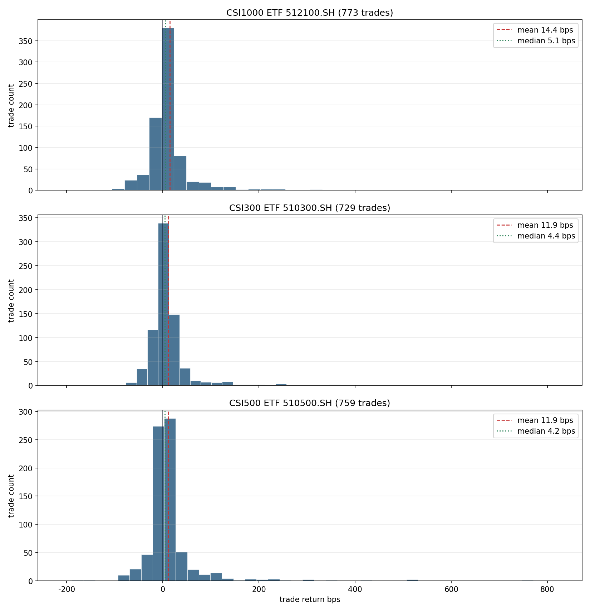

### ETF Trade Return Distribution

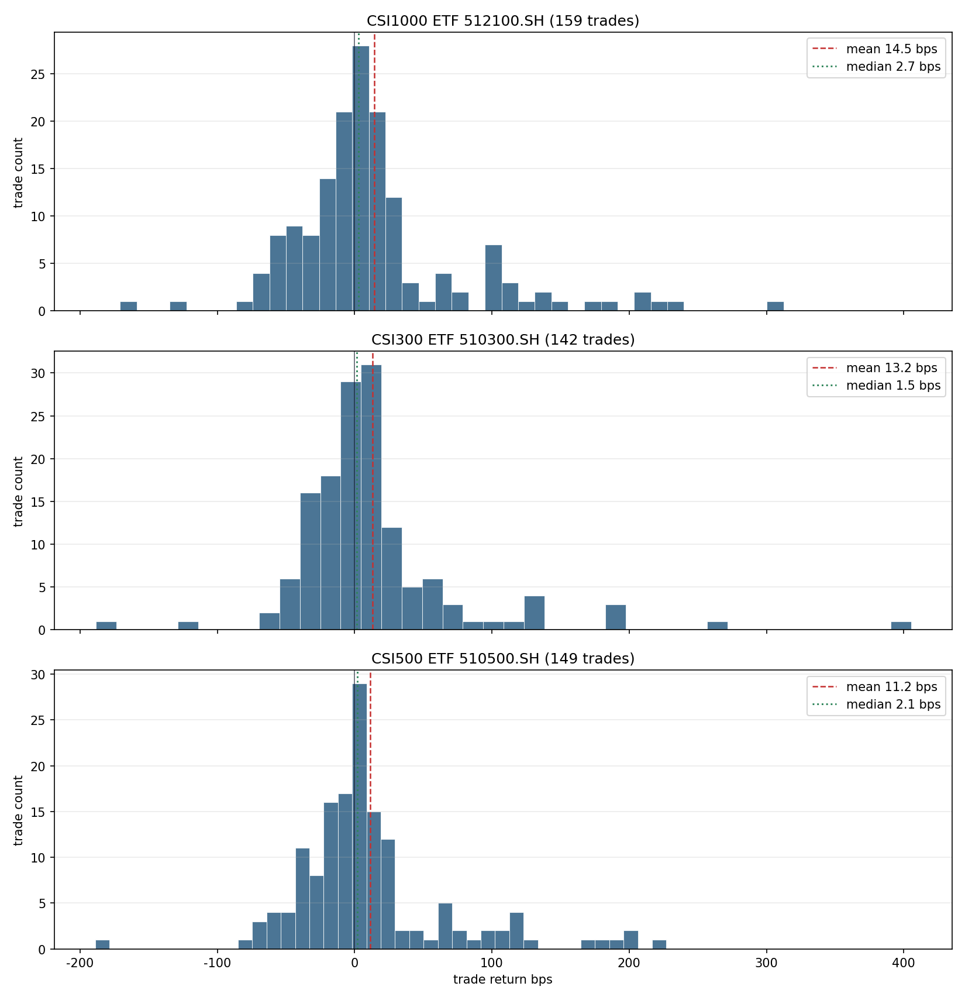

### ETF Test Trade Return Distribution

### 5.4. Entry Delay Decay Experiment

Open signals are delayed while preserving the registered rebalance and holding logic.

| scope | split | pool | display_name | date | x_index | delay_minutes | delayed_strategy_cumulative_return |
| --- | --- | --- | --- | --- | --- | --- | --- |
| train_val_test | train | csi1000_etf_sh | 1000 ETF | 210104 | 1 | 0 | 0.000000 |
| train_val_test | train | csi1000_etf_sh | 1000 ETF | 210104 | 2 | 0 | 0.000000 |
| train_val_test | train | csi1000_etf_sh | 1000 ETF | 210104 | 3 | 0 | 0.000000 |
| train_val_test | train | csi1000_etf_sh | 1000 ETF | 210104 | 4 | 0 | 0.000000 |
| train_val_test | train | csi1000_etf_sh | 1000 ETF | 210104 | 5 | 0 | 0.000000 |
| train_val_test | train | csi1000_etf_sh | 1000 ETF | 210104 | 6 | 0 | 0.000000 |
| train_val_test | train | csi1000_etf_sh | 1000 ETF | 210104 | 7 | 0 | 0.000000 |
| train_val_test | train | csi1000_etf_sh | 1000 ETF | 210104 | 8 | 0 | 0.000000 |
| train_val_test | train | csi1000_etf_sh | 1000 ETF | 210104 | 9 | 0 | 0.000000 |
| train_val_test | train | csi1000_etf_sh | 1000 ETF | 210104 | 10 | 0 | 0.000000 |
| train_val_test | train | csi1000_etf_sh | 1000 ETF | 210104 | 11 | 0 | 0.000000 |
| train_val_test | train | csi1000_etf_sh | 1000 ETF | 210104 | 12 | 0 | 0.000000 |
| train_val_test | train | csi1000_etf_sh | 1000 ETF | 210104 | 13 | 0 | 0.000000 |
| train_val_test | train | csi1000_etf_sh | 1000 ETF | 210104 | 14 | 0 | 0.000000 |
| train_val_test | train | csi1000_etf_sh | 1000 ETF | 210104 | 15 | 0 | 0.000000 |
| train_val_test | train | csi1000_etf_sh | 1000 ETF | 210104 | 16 | 0 | 0.000000 |
| train_val_test | train | csi1000_etf_sh | 1000 ETF | 210104 | 17 | 0 | 0.000000 |
| train_val_test | train | csi1000_etf_sh | 1000 ETF | 210104 | 18 | 0 | 0.000000 |
| train_val_test | train | csi1000_etf_sh | 1000 ETF | 210104 | 19 | 0 | 0.000000 |
| train_val_test | train | csi1000_etf_sh | 1000 ETF | 210104 | 20 | 0 | 0.000000 |
| train_val_test | train | csi1000_etf_sh | 1000 ETF | 210104 | 21 | 0 | 0.000000 |
| train_val_test | train | csi1000_etf_sh | 1000 ETF | 210104 | 22 | 0 | 0.000000 |
| train_val_test | train | csi1000_etf_sh | 1000 ETF | 210104 | 23 | 0 | 0.000000 |
| train_val_test | train | csi1000_etf_sh | 1000 ETF | 210104 | 24 | 0 | 0.000000 |
| train_val_test | train | csi1000_etf_sh | 1000 ETF | 210104 | 25 | 0 | 0.000000 |
| train_val_test | train | csi1000_etf_sh | 1000 ETF | 210104 | 26 | 0 | 0.000000 |
| train_val_test | train | csi1000_etf_sh | 1000 ETF | 210104 | 27 | 0 | 0.000000 |
| train_val_test | train | csi1000_etf_sh | 1000 ETF | 210104 | 28 | 0 | 0.000000 |
| train_val_test | train | csi1000_etf_sh | 1000 ETF | 210104 | 29 | 0 | 0.000000 |
| train_val_test | train | csi1000_etf_sh | 1000 ETF | 210104 | 30 | 0 | 0.000000 |
| train_val_test | train | csi1000_etf_sh | 1000 ETF | 210104 | 31 | 0 | 0.000000 |
| train_val_test | train | csi1000_etf_sh | 1000 ETF | 210104 | 32 | 0 | 0.000000 |
| train_val_test | train | csi1000_etf_sh | 1000 ETF | 210104 | 33 | 0 | 0.000000 |
| train_val_test | train | csi1000_etf_sh | 1000 ETF | 210104 | 34 | 0 | 0.000000 |
| train_val_test | train | csi1000_etf_sh | 1000 ETF | 210104 | 35 | 0 | 0.000000 |
| train_val_test | train | csi1000_etf_sh | 1000 ETF | 210104 | 36 | 0 | 0.000000 |
| train_val_test | train | csi1000_etf_sh | 1000 ETF | 210104 | 37 | 0 | 0.000000 |
| train_val_test | train | csi1000_etf_sh | 1000 ETF | 210104 | 38 | 0 | 0.000000 |
| train_val_test | train | csi1000_etf_sh | 1000 ETF | 210104 | 39 | 0 | 0.000000 |
| train_val_test | train | csi1000_etf_sh | 1000 ETF | 210104 | 40 | 0 | 0.000000 |
| train_val_test | train | csi1000_etf_sh | 1000 ETF | 210104 | 41 | 0 | 0.000000 |
| train_val_test | train | csi1000_etf_sh | 1000 ETF | 210104 | 42 | 0 | 0.000000 |
| train_val_test | train | csi1000_etf_sh | 1000 ETF | 210104 | 43 | 0 | 0.000000 |
| train_val_test | train | csi1000_etf_sh | 1000 ETF | 210104 | 44 | 0 | 0.000000 |
| train_val_test | train | csi1000_etf_sh | 1000 ETF | 210104 | 45 | 0 | 0.000000 |
| train_val_test | train | csi1000_etf_sh | 1000 ETF | 210104 | 46 | 0 | 0.000000 |
| train_val_test | train | csi1000_etf_sh | 1000 ETF | 210104 | 47 | 0 | 0.000000 |
| train_val_test | train | csi1000_etf_sh | 1000 ETF | 210104 | 48 | 0 | 0.000000 |
| train_val_test | train | csi1000_etf_sh | 1000 ETF | 210104 | 49 | 0 | 0.000000 |
| train_val_test | train | csi1000_etf_sh | 1000 ETF | 210104 | 50 | 0 | 0.000000 |
| train_val_test | train | csi1000_etf_sh | 1000 ETF | 210104 | 51 | 0 | 0.000000 |
| train_val_test | train | csi1000_etf_sh | 1000 ETF | 210104 | 52 | 0 | 0.000000 |
| train_val_test | train | csi1000_etf_sh | 1000 ETF | 210104 | 53 | 0 | 0.000000 |
| train_val_test | train | csi1000_etf_sh | 1000 ETF | 210104 | 54 | 0 | 0.000000 |
| train_val_test | train | csi1000_etf_sh | 1000 ETF | 210104 | 55 | 0 | 0.000000 |
| train_val_test | train | csi1000_etf_sh | 1000 ETF | 210104 | 56 | 0 | 0.000000 |
| train_val_test | train | csi1000_etf_sh | 1000 ETF | 210104 | 57 | 0 | 0.000000 |
| train_val_test | train | csi1000_etf_sh | 1000 ETF | 210104 | 58 | 0 | 0.000000 |
| train_val_test | train | csi1000_etf_sh | 1000 ETF | 210104 | 59 | 0 | 0.000000 |
| train_val_test | train | csi1000_etf_sh | 1000 ETF | 210104 | 60 | 0 | 0.000000 |
| test | test | csi500_etf_sh | 中证500 ETF(沪) | 241231 | 32946 | 3 | 0.161969 |
| test | test | csi500_etf_sh | 中证500 ETF(沪) | 241231 | 32947 | 3 | 0.161969 |
| test | test | csi500_etf_sh | 中证500 ETF(沪) | 241231 | 32948 | 3 | 0.161969 |
| test | test | csi500_etf_sh | 中证500 ETF(沪) | 241231 | 32949 | 3 | 0.161969 |
| test | test | csi500_etf_sh | 中证500 ETF(沪) | 241231 | 32950 | 3 | 0.161969 |
| test | test | csi500_etf_sh | 中证500 ETF(沪) | 241231 | 32951 | 3 | 0.161969 |
| test | test | csi500_etf_sh | 中证500 ETF(沪) | 241231 | 32952 | 3 | 0.161969 |
| test | test | csi500_etf_sh | 中证500 ETF(沪) | 241231 | 32953 | 3 | 0.161969 |
| test | test | csi500_etf_sh | 中证500 ETF(沪) | 241231 | 32954 | 3 | 0.161969 |
| test | test | csi500_etf_sh | 中证500 ETF(沪) | 241231 | 32955 | 3 | 0.161969 |
| test | test | csi500_etf_sh | 中证500 ETF(沪) | 241231 | 32956 | 3 | 0.161969 |
| test | test | csi500_etf_sh | 中证500 ETF(沪) | 241231 | 32957 | 3 | 0.161969 |
| test | test | csi500_etf_sh | 中证500 ETF(沪) | 241231 | 32958 | 3 | 0.161969 |
| test | test | csi500_etf_sh | 中证500 ETF(沪) | 241231 | 32959 | 3 | 0.161969 |
| test | test | csi500_etf_sh | 中证500 ETF(沪) | 241231 | 32960 | 3 | 0.161969 |
| test | test | csi500_etf_sh | 中证500 ETF(沪) | 241231 | 32961 | 3 | 0.161969 |
| test | test | csi500_etf_sh | 中证500 ETF(沪) | 241231 | 32962 | 3 | 0.161969 |
| test | test | csi500_etf_sh | 中证500 ETF(沪) | 241231 | 32963 | 3 | 0.161969 |
| test | test | csi500_etf_sh | 中证500 ETF(沪) | 241231 | 32964 | 3 | 0.161969 |
| test | test | csi500_etf_sh | 中证500 ETF(沪) | 241231 | 32965 | 3 | 0.161969 |
| test | test | csi500_etf_sh | 中证500 ETF(沪) | 241231 | 32966 | 3 | 0.161969 |
| test | test | csi500_etf_sh | 中证500 ETF(沪) | 241231 | 32967 | 3 | 0.161969 |
| test | test | csi500_etf_sh | 中证500 ETF(沪) | 241231 | 32968 | 3 | 0.161969 |
| test | test | csi500_etf_sh | 中证500 ETF(沪) | 241231 | 32969 | 3 | 0.161969 |
| test | test | csi500_etf_sh | 中证500 ETF(沪) | 241231 | 32970 | 3 | 0.161969 |
| test | test | csi500_etf_sh | 中证500 ETF(沪) | 241231 | 32971 | 3 | 0.161969 |
| test | test | csi500_etf_sh | 中证500 ETF(沪) | 241231 | 32972 | 3 | 0.161969 |
| test | test | csi500_etf_sh | 中证500 ETF(沪) | 241231 | 32973 | 3 | 0.161969 |
| test | test | csi500_etf_sh | 中证500 ETF(沪) | 241231 | 32974 | 3 | 0.161969 |
| test | test | csi500_etf_sh | 中证500 ETF(沪) | 241231 | 32975 | 3 | 0.161969 |
| test | test | csi500_etf_sh | 中证500 ETF(沪) | 241231 | 32976 | 3 | 0.161969 |
| test | test | csi500_etf_sh | 中证500 ETF(沪) | 241231 | 32977 | 3 | 0.161969 |
| test | test | csi500_etf_sh | 中证500 ETF(沪) | 241231 | 32978 | 3 | 0.161969 |
| test | test | csi500_etf_sh | 中证500 ETF(沪) | 241231 | 32979 | 3 | 0.161969 |
| test | test | csi500_etf_sh | 中证500 ETF(沪) | 241231 | 32980 | 3 | 0.161969 |
| test | test | csi500_etf_sh | 中证500 ETF(沪) | 241231 | 32981 | 3 | 0.161969 |
| test | test | csi500_etf_sh | 中证500 ETF(沪) | 241231 | 32982 | 3 | 0.161969 |
| test | test | csi500_etf_sh | 中证500 ETF(沪) | 241231 | 32983 | 3 | 0.161969 |
| test | test | csi500_etf_sh | 中证500 ETF(沪) | 241231 | 32984 | 3 | 0.161969 |
| test | test | csi500_etf_sh | 中证500 ETF(沪) | 241231 | 32985 | 3 | 0.161969 |
| test | test | csi500_etf_sh | 中证500 ETF(沪) | 241231 | 32986 | 3 | 0.161969 |
| test | test | csi500_etf_sh | 中证500 ETF(沪) | 241231 | 32987 | 3 | 0.161969 |
| test | test | csi500_etf_sh | 中证500 ETF(沪) | 241231 | 32988 | 3 | 0.161969 |
| test | test | csi500_etf_sh | 中证500 ETF(沪) | 241231 | 32989 | 3 | 0.161969 |
| test | test | csi500_etf_sh | 中证500 ETF(沪) | 241231 | 32990 | 3 | 0.161969 |
| test | test | csi500_etf_sh | 中证500 ETF(沪) | 241231 | 32991 | 3 | 0.161969 |
| test | test | csi500_etf_sh | 中证500 ETF(沪) | 241231 | 32992 | 3 | 0.161969 |
| test | test | csi500_etf_sh | 中证500 ETF(沪) | 241231 | 32993 | 3 | 0.161969 |
| test | test | csi500_etf_sh | 中证500 ETF(沪) | 241231 | 32994 | 3 | 0.161969 |
| test | test | csi500_etf_sh | 中证500 ETF(沪) | 241231 | 32995 | 3 | 0.161969 |
| test | test | csi500_etf_sh | 中证500 ETF(沪) | 241231 | 32996 | 3 | 0.161969 |
| test | test | csi500_etf_sh | 中证500 ETF(沪) | 241231 | 32997 | 3 | 0.161969 |
| test | test | csi500_etf_sh | 中证500 ETF(沪) | 241231 | 32998 | 3 | 0.161969 |
| test | test | csi500_etf_sh | 中证500 ETF(沪) | 241231 | 32999 | 3 | 0.161969 |
| test | test | csi500_etf_sh | 中证500 ETF(沪) | 241231 | 33000 | 3 | 0.161969 |
| test | test | csi500_etf_sh | 中证500 ETF(沪) | 241231 | 33001 | 3 | 0.161969 |
| test | test | csi500_etf_sh | 中证500 ETF(沪) | 241231 | 33002 | 3 | 0.161969 |
| test | test | csi500_etf_sh | 中证500 ETF(沪) | 241231 | 33003 | 3 | 0.161969 |
| test | test | csi500_etf_sh | 中证500 ETF(沪) | 241231 | 33004 | 3 | 0.161969 |
| test | test | csi500_etf_sh | 中证500 ETF(沪) | 241231 | 33005 | 3 | 0.156787 |

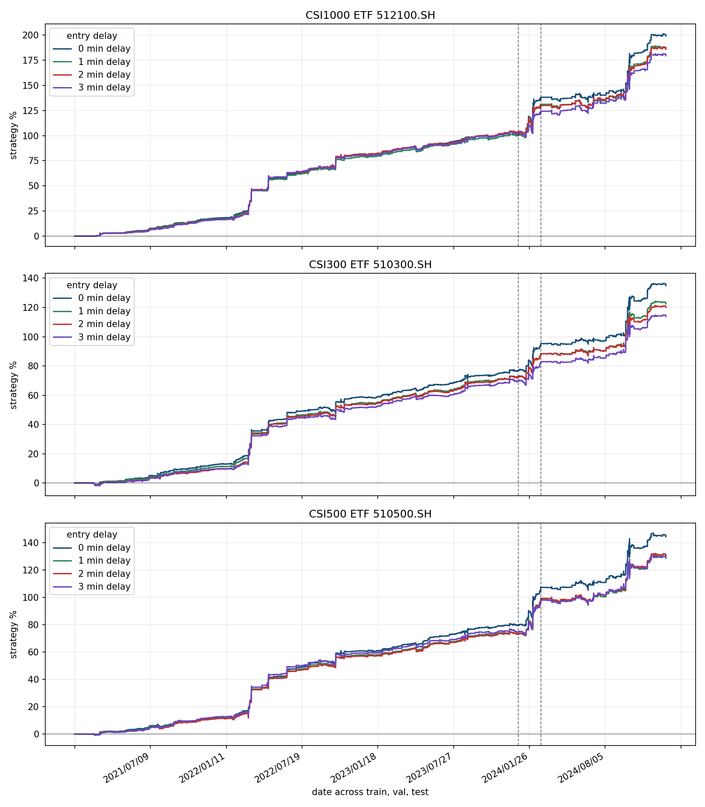

### Entry Delay Decay

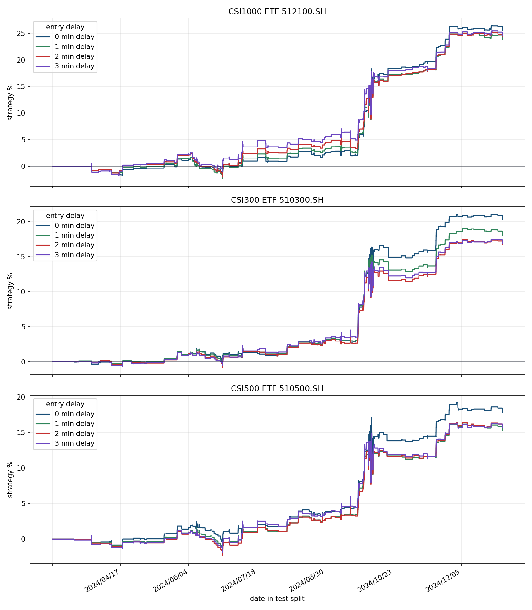

### Test Entry Delay Decay

06

6. Robustness Diagnostics

### Robustness Diagnostics

完成臂使用完整 robustness artifact; 暂停臂不生成 OOS diagnostics. 

### 6.1. IC by volatility rank

Rolling IC conditioned on volatility rank.

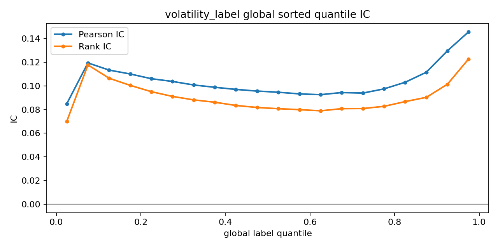

### IC By Volatility Rank

### 6.2. IC by price rank

Rolling IC conditioned on price rank.

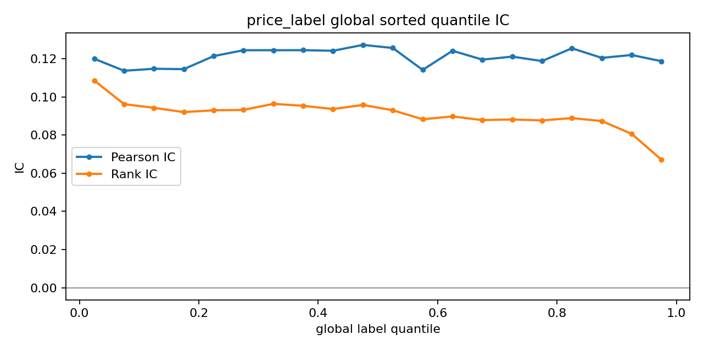

### IC By Price Rank

### 6.3. Train/test intraday IC curve

Same minute-of-session aggregation for fixed train sample and full test.

| time | pooled_ic_train | sample_count_train | pooled_ic_test | sample_count_test |
| --- | --- | --- | --- | --- |
| 103900 | 0.097975 | 201695 | 0.324215 | 1094002 |
| 104000 | 0.071488 | 201695 | 0.244725 | 1094002 |
| 104100 | 0.066063 | 201695 | 0.140214 | 1094002 |
| 104200 | 0.067145 | 201695 | 0.096839 | 1094002 |
| 104300 | 0.063497 | 201695 | 0.104634 | 1094002 |
| 104400 | 0.083990 | 201695 | 0.114906 | 1094002 |
| 104500 | 0.084734 | 201695 | 0.109222 | 1094002 |
| 104600 | 0.088407 | 201695 | 0.083548 | 1094002 |
| 104700 | 0.107372 | 201695 | 0.068083 | 1094002 |
| 104800 | 0.097807 | 201695 | 0.017809 | 1094002 |
| 104900 | 0.084630 | 201695 | -0.006307 | 1094002 |
| 105000 | 0.088527 | 201695 | -0.017637 | 1094002 |
| 105100 | 0.104519 | 201695 | 0.007391 | 1094002 |
| 105200 | 0.107124 | 201695 | 0.024352 | 1094002 |
| 105300 | 0.096066 | 201695 | 0.063283 | 1094002 |
| 105400 | 0.106665 | 201695 | 0.092880 | 1094002 |
| 105500 | 0.111970 | 201695 | 0.131534 | 1094002 |
| 105600 | 0.118330 | 199181 | 0.170860 | 1094002 |
| 105700 | 0.128747 | 197532 | 0.197207 | 1094002 |
| 105800 | 0.127894 | 197532 | 0.199544 | 1094002 |
| 105900 | 0.123610 | 197532 | 0.212972 | 1094002 |
| 110000 | 0.085722 | 197532 | 0.194556 | 1094002 |
| 110100 | 0.068098 | 197532 | 0.213231 | 1094002 |
| 110200 | 0.079567 | 197532 | 0.169979 | 1094002 |
| 110300 | 0.092911 | 197532 | 0.068768 | 1094002 |
| 110400 | 0.098268 | 197532 | 0.041746 | 1094002 |
| 110500 | 0.080359 | 197532 | 0.009870 | 1094002 |
| 110600 | 0.093981 | 197532 | -0.021165 | 1094002 |
| 110700 | 0.111274 | 197532 | -0.024777 | 1094002 |
| 110800 | 0.134086 | 197532 | -0.022135 | 1094002 |
| 110900 | 0.140681 | 197532 | -0.016736 | 1094002 |
| 111000 | 0.111865 | 197532 | -0.041250 | 1094002 |
| 111100 | 0.110055 | 197532 | -0.027166 | 1094002 |
| 111200 | 0.093816 | 197532 | -0.036698 | 1094002 |
| 111300 | 0.095393 | 197532 | 0.047482 | 1094002 |
| 111400 | 0.112136 | 197532 | 0.084266 | 1094002 |
| 111500 | 0.114243 | 197532 | 0.121866 | 1094002 |
| 111600 | 0.116311 | 197532 | 0.143364 | 1094002 |
| 111700 | 0.102899 | 197532 | 0.189770 | 1094002 |
| 111800 | 0.113708 | 197532 | 0.216856 | 1094002 |
| 141000 | 0.143870 | 197532 | 0.116481 | 1094002 |
| 141100 | 0.135086 | 197532 | 0.121094 | 1094002 |
| 141200 | 0.130455 | 197532 | 0.112123 | 1094002 |
| 141300 | 0.126560 | 197532 | 0.104966 | 1094002 |
| 141400 | 0.141509 | 197532 | 0.083081 | 1094002 |
| 141500 | 0.135816 | 197532 | 0.055624 | 1094002 |
| 141600 | 0.129460 | 197532 | 0.060469 | 1094002 |
| 141700 | 0.127306 | 197532 | 0.055537 | 1094002 |
| 141800 | 0.140463 | 197532 | 0.041014 | 1094002 |
| 141900 | 0.135754 | 197532 | 0.065573 | 1094002 |
| 142000 | 0.126252 | 197532 | 0.085967 | 1094002 |
| 142100 | 0.120505 | 197532 | 0.095325 | 1094002 |
| 142200 | 0.117569 | 197532 | 0.104727 | 1094002 |
| 142300 | 0.124747 | 197532 | 0.111281 | 1094002 |
| 142400 | 0.123980 | 197532 | 0.121697 | 1094002 |
| 142500 | 0.119348 | 197532 | 0.119540 | 1094002 |
| 142600 | 0.114249 | 197532 | 0.141337 | 1094002 |
| 142700 | 0.129952 | 197532 | 0.167725 | 1094002 |
| 142800 | 0.145664 | 197532 | 0.161916 | 1094002 |
| 142900 | 0.143975 | 197532 | 0.164347 | 1094002 |
| 143000 | 0.111135 | 197532 | 0.140081 | 1094002 |
| 143100 | 0.098189 | 197532 | 0.149066 | 1094002 |
| 143200 | 0.130465 | 197532 | 0.162521 | 1094002 |
| 143300 | 0.153931 | 197532 | 0.154150 | 1094002 |
| 143400 | 0.167982 | 197532 | 0.161278 | 1094002 |
| 143500 | 0.178498 | 197532 | 0.146704 | 1094002 |
| 143600 | 0.189418 | 197532 | 0.113035 | 1094002 |
| 143700 | 0.178494 | 197532 | 0.115485 | 1094002 |
| 143800 | 0.188753 | 197532 | 0.122409 | 1094002 |
| 143900 | 0.183515 | 197532 | 0.120683 | 1094002 |
| 144000 | 0.168691 | 197532 | 0.132643 | 1094002 |
| 144100 | 0.167316 | 197532 | 0.155688 | 1094002 |
| 144200 | 0.161656 | 197532 | 0.167230 | 1094002 |
| 144300 | 0.147658 | 197532 | 0.146217 | 1094002 |
| 144400 | 0.144323 | 197532 | 0.135804 | 1094002 |
| 144500 | 0.149554 | 197532 | 0.120008 | 1094002 |
| 144600 | 0.159351 | 197532 | 0.122154 | 1094002 |
| 144700 | 0.156019 | 197532 | 0.124064 | 1094002 |
| 144800 | 0.149849 | 197532 | 0.128466 | 1094002 |
| 144900 | 0.147480 | 197532 | 0.162397 | 1094002 |

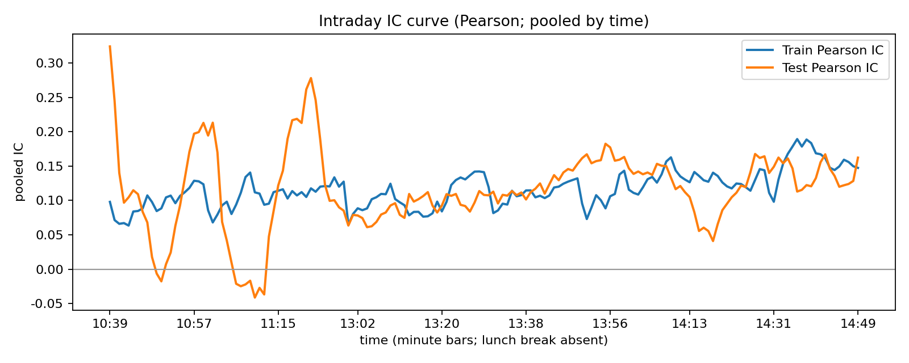

### Train/Test Intraday IC

### 6.4. Monthly signal spread and net efficiency

Monthly IC, Rank IC, signal spread and strategy efficiency expose regime concentration.

| month | top_minus_bottom_bps | strategy_bps_per_turnover |
| --- | --- | --- |
| 2024/03 | 12.157066 | -5.032603 |
| 2024/04 | 10.479598 | 1.274730 |
| 2024/05 | 9.564816 | 10.626047 |
| 2024/06 | 8.372381 | -0.575089 |
| 2024/07 | 10.436367 | 1.088271 |
| 2024/08 | 12.195356 | 7.030114 |
| 2024/09 | 9.359948 | 15.601543 |
| 2024/10 | 30.286204 | 7.237160 |
| 2024/11 | 20.629275 | 21.431656 |
| 2024/12 | 9.938035 | -2.514575 |

| month | pearson_ic | rank_ic | sample_count |
| --- | --- | --- | --- |
| 2024/03 | 0.108073 | 0.076864 | 18060980 |
| 2024/04 | 0.110878 | 0.085687 | 17208163 |
| 2024/05 | 0.094129 | 0.072951 | 17163405 |
| 2024/06 | 0.104544 | 0.091831 | 16320248 |
| 2024/07 | 0.117453 | 0.096348 | 19730550 |
| 2024/08 | 0.112139 | 0.081138 | 18876767 |
| 2024/09 | 0.076983 | 0.108508 | 16298996 |
| 2024/10 | 0.160468 | 0.092042 | 15457127 |
| 2024/11 | 0.131537 | 0.124194 | 18056633 |
| 2024/12 | 0.104932 | 0.068071 | 18961453 |

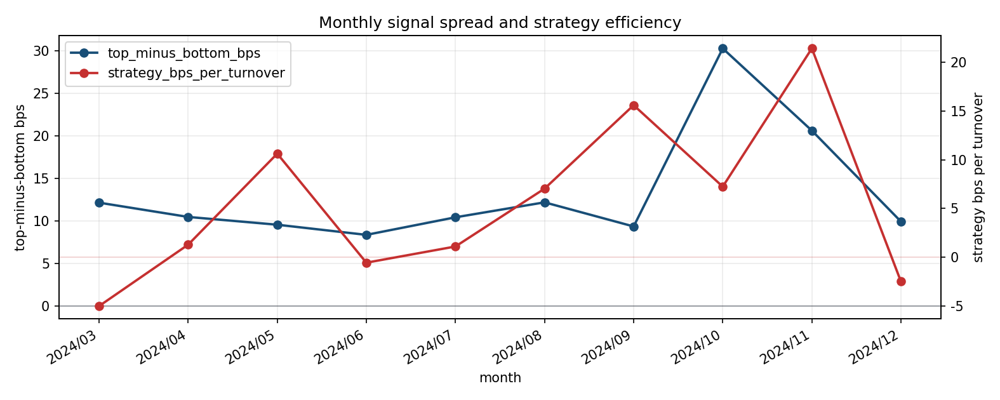

### Monthly Signal Spread And Net Efficiency

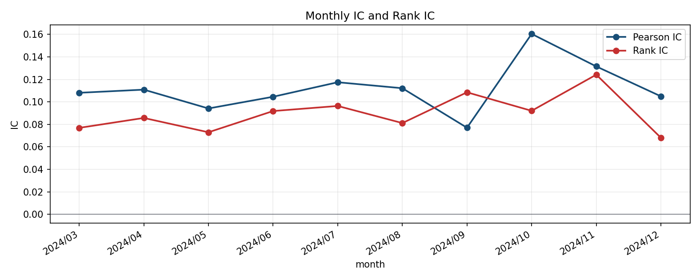

### Monthly IC And Rank IC

### 6.5. Return Realization

Top-5% predictions are remeasured over multiple forward holding horizons.

| holding_minutes | mean_return | mean_return_bps | row_count | prediction_p95 |
| --- | --- | --- | --- | --- |
| 1 | 0.000301 | 3.011073 | 8806717 | 0.000764 |
| 2 | 0.000515 | 5.154636 | 8806717 | 0.000764 |
| 3 | 0.000672 | 6.720937 | 8806717 | 0.000764 |
| 4 | 0.000789 | 7.890016 | 8806717 | 0.000764 |
| 5 | 0.000885 | 8.853775 | 8806717 | 0.000764 |
| 6 | 0.000968 | 9.683259 | 8806717 | 0.000764 |
| 7 | 0.001041 | 10.410000 | 8806717 | 0.000764 |
| 8 | 0.001104 | 11.042519 | 8806717 | 0.000764 |
| 9 | 0.001161 | 11.610835 | 8806717 | 0.000764 |
| 10 | 0.001224 | 12.235747 | 8806717 | 0.000764 |
| 11 | 0.001279 | 12.788708 | 8690550 | 0.000764 |
| 12 | 0.001336 | 13.359707 | 8579635 | 0.000764 |
| 13 | 0.001392 | 13.917126 | 8475554 | 0.000764 |
| 14 | 0.001446 | 14.458057 | 8363160 | 0.000764 |
| 15 | 0.001500 | 14.999364 | 8258298 | 0.000764 |
| 16 | 0.001553 | 15.534876 | 8164441 | 0.000764 |
| 17 | 0.001600 | 16.002912 | 8071575 | 0.000764 |
| 18 | 0.001638 | 16.380224 | 7983860 | 0.000764 |
| 19 | 0.001676 | 16.763584 | 7903396 | 0.000764 |
| 20 | 0.001710 | 17.102849 | 7820520 | 0.000764 |

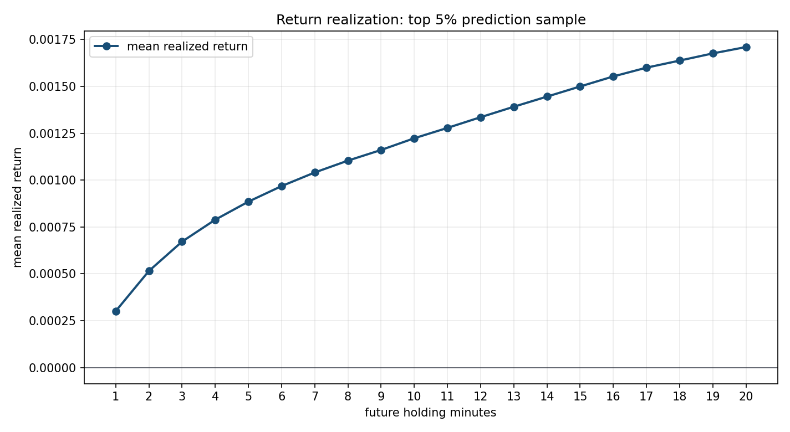

### Return Realization

### 6.6. Top-k% Robustness

Fixed train sample and full test are compared across prediction selection widths.

| split | selection_method | k_pct | universe_count | selected_count | selected_fraction | prediction_threshold | mean_label_bps | median_label_bps | label_std_bps | hit_rate | day_count | timestamp_count |
| --- | --- | --- | --- | --- | --- | --- | --- | --- | --- | --- | --- | --- |
| train | approx_quantile_threshold | 1 | 31875072 | 317579 | 0.009963 | 0.001312 | 19.914935 | 7.895923 | 88.136948 | 0.516268 | 49 | 7746 |
| train | approx_quantile_threshold | 2 | 31875072 | 639164 | 0.020052 | 0.000954 | 15.217887 | 2.089805 | 77.946072 | 0.498755 | 49 | 7746 |
| train | approx_quantile_threshold | 3 | 31875072 | 947716 | 0.029732 | 0.000792 | 13.093978 | 0.425784 | 72.583648 | 0.489585 | 49 | 7746 |
| train | approx_quantile_threshold | 5 | 31875072 | 1593802 | 0.050002 | 0.000612 | 10.710039 | 0.028971 | 66.030445 | 0.478886 | 49 | 7746 |
| train | approx_quantile_threshold | 10 | 31875072 | 3174425 | 0.099590 | 0.000434 | 8.158404 | 0.000393 | 58.464047 | 0.464490 | 49 | 7746 |
| train | approx_quantile_threshold | 15 | 31875072 | 4777675 | 0.149888 | 0.000337 | 6.858051 | -0.000014 | 54.872308 | 0.455110 | 49 | 7746 |
| train | approx_quantile_threshold | 20 | 31875072 | 6368523 | 0.199796 | 0.000269 | 5.957717 | -0.000014 | 52.521012 | 0.447243 | 49 | 7746 |
| test | approx_quantile_threshold | 1 | 176134322 | 1718335 | 0.009756 | 0.001743 | 25.887234 | 12.155381 | 121.918070 | 0.532980 | 205 | 33005 |
| test | approx_quantile_threshold | 2 | 176134322 | 3548111 | 0.020144 | 0.001215 | 18.364081 | 5.382353 | 102.822267 | 0.509202 | 205 | 33005 |
| test | approx_quantile_threshold | 3 | 176134322 | 5231936 | 0.029704 | 0.000997 | 15.383969 | 2.192810 | 93.960837 | 0.498683 | 205 | 33005 |
| test | approx_quantile_threshold | 5 | 176134322 | 8754763 | 0.049705 | 0.000766 | 12.268017 | 0.273345 | 83.514831 | 0.486930 | 205 | 33005 |
| test | approx_quantile_threshold | 10 | 176134322 | 17576301 | 0.099789 | 0.000519 | 8.924377 | 0.002545 | 71.303658 | 0.470668 | 205 | 33005 |
| test | approx_quantile_threshold | 15 | 176134322 | 26389517 | 0.149826 | 0.000406 | 7.303980 | -0.000014 | 65.089732 | 0.459728 | 205 | 33005 |
| test | approx_quantile_threshold | 20 | 176134322 | 35269237 | 0.200241 | 0.000326 | 6.205781 | -0.000014 | 61.161642 | 0.451008 | 205 | 33005 |

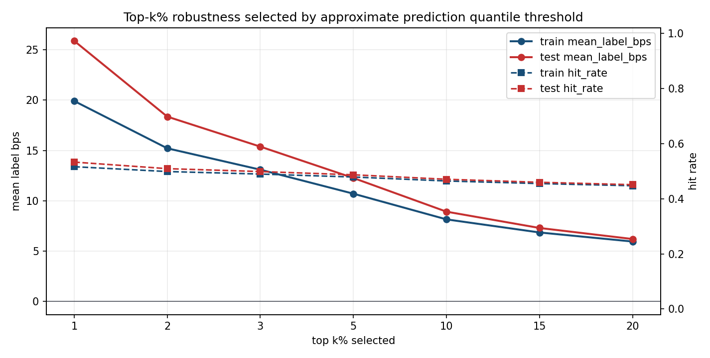

### Top-k% Robustness

07

7. Appendix Diagnostics

## 限制与适用边界

Control/CS rank/latent-z/Deep Sets R2 test IC为0.086462/0.123293/0.127345/0.121030. Induced attention 在test前失败; Deep Sets经历中断后R2成功恢复. 四个完成臂10M净Sharpe均负. 当前artifact可得性只影响复现, 不作为历史成功/失败判据. 只有matched合同内的结果可以直接比较.

## 结论

本次归档保留上述历史事实. 研究结论, 推广门槛和执行限制分别解释, 不把模型无增益或净收益为负改写成实验流程失败.

## 附录

### Appendix Diagnostics

路径和 identity 用于从报告回溯到真实 artifact; 报告不包含外部依赖. 

### 7.1. Artifact Paths

核心 source artifacts 与生成报告路径. 

| artifact | path | status |
| --- | --- | --- |
| run_root | [artifact-root]/nn/0827-market-cs/0829cs-s7-l-deep_sets_34d-r2 | available |
| npz_meta | [artifact-root]/nn/0827-market-cs/0829cs-s7-l-deep_sets_34d-r2/prediction/artifacts/npz/meta.yaml | available |
| data_clean_invalid_stats | [artifact-root]/nn/0827-market-cs/0829cs-s7-l-deep_sets_34d-r2/prediction/artifacts/data_clean/invalid_feature_stats.csv | available |
| checkpoint_metadata | [artifact-root]/nn/0827-market-cs/0829cs-s7-l-deep_sets_34d-r2/prediction/run/checkpoint_metadata/best_checkpoint.yaml | available |
| test_prediction_manifest | [artifact-root]/nn/0827-market-cs/0829cs-s7-l-deep_sets_34d-r2/manifests/evaluate.yaml | available |
| backtest_manifest | [artifact-root]/nn/0827-market-cs/0829cs-s7-l-deep_sets_34d-r2/manifests/backtest.yaml | available |
| research_artifact_manifest | [artifact-root]/nn/0827-market-cs/0829cs-s7-l-deep_sets_34d-r2/report/research_artifacts/manifest.yaml | available |

### 7.2. Provenance

配置, 代码, 数据, panel, MLflow 和恢复 lineage. 

| field | value |
| --- | --- |
| run_id | 0829cs-s7-l-deep_sets_34d-r2 |
| MLflow run | 6e4f36759bdb46cd9ec6bb5357052811 |
| Git commit | a8c25b273fa97bb3f496639e1483d9a5889cbc3a |
| config SHA-256 | 052fc9d2361803437f0ad21c8fe0c06cbca47b180bc13c4a65e273f7bb91c93e |
| data artifact | 6589947466234739b27e243d253a3c48 |
| dataset cache key | e74adc442d96d5ecfcd932bd39289a25be2366d12c20d78a83d8f9aeda2a3460 |
| panel fingerprint | 28573283d9bba84f03cb51f8855fe97b16e99fba1912860c461e58084518926d |
| recovery source | 0829cs-s7-l-deep_sets_34d |
| recovery checkpoint | 52672 |
