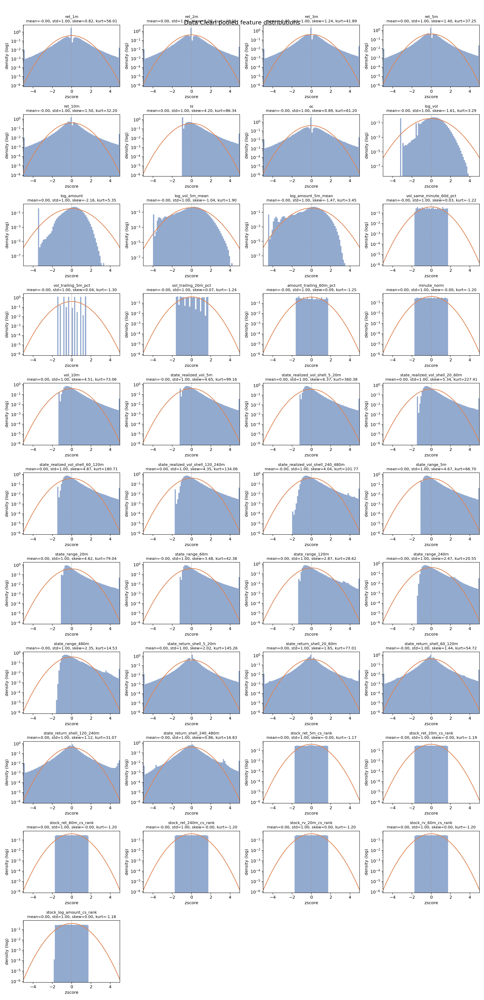
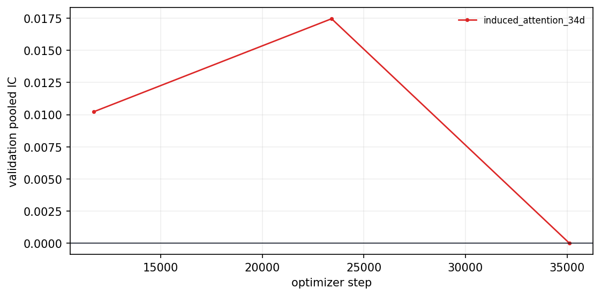

## 摘要

**历史结果: 历史成功, 四臂完成.** Control/CS rank/latent-z/Deep Sets R2 test IC为0.086462/0.123293/0.127345/0.121030. Induced attention 在test前失败; Deep Sets经历中断后R2成功恢复. 四个完成臂10M净Sharpe均负.

历史成功/失败按实验流程是否成功完成判断. 无增益, 成本后亏损, 归档和当前 artifact 缺失不改变历史成功事实. 失败的实验臂保留失败原因, 不填造未产生的 OOS 指标. 本次只整理已有材料, 未启动训练, 推理或回测.

### Executive Summary

模板字段按固定顺序展示; 未生成字段保持 fail-closed. 

benchmark

induced_attention_34d

induced_attention

selected_checkpoint

not selected

validation-only selection

train_pooled_ic

not run

no artifact

test_pooled_ic

not run

not run

top_prediction_return_bps

not run

test top prediction bucket

top95_hit

not run

test top 5% predictions

etf_top95_hit

not run

test ETF proxy top 5%

overfit_variance_ratio

not run

test prediction variance / target variance

model_class

MarketContextGruMlpRegressor

4,417,921 parameters

train_range

2021-01-04 to 2023-12-29

train-only normalization fit

val_range

2024-01-02 to 2024-02-29

checkpoint selection only

test_range

2024-03-01 to 2024-12-31

final evaluation only

| field | explanation |
| --- | --- |
| benchmark | 实验标识.  |
| selected_checkpoint | 最终用于 evaluation 的 checkpoint iteration.  |
| train_pooled_ic | core_ic_summary_train.yaml 当前覆盖的 train-report 样本合并后计算的 Pearson IC; 启用 train report sample 时不是 full-train 指标.  |
| test_pooled_ic | test split 上把所有样本合并后计算的 Pearson IC.  |
| top_prediction_return_bps | 最高 prediction 分组的平均 prediction return, 单位 bps.  |
| top95_hit | test split 中按 prediction 从高到低排序后取最高 5% 样本, 即 prediction >= test prediction 的 95% 分位; 该子样本内 target > 0 的比例.  |
| etf_top95_hit | test split 中先按重要股票池合成 ETF minute-level prediction/real return, 再按 etf_prediction 从高到低排序后取最高 5% 样本; 该子样本内 etf_real_return > 0 的比例.  |
| overfit_variance_ratio | test split 中 prediction 样本方差 / target 样本方差, 用作 overfit 系数; 数值越大表示 prediction 方差相对 label 越高.  |
| model_class | 模型类名.  |
| train_range | 训练集交易日范围.  |
| val_range | 验证集交易日范围.  |
| test_range | 测试集交易日范围.  |

02

2. Data Pipeline

## 研究背景与目标

本报告围绕Market CS 五臂研究整理原始研究证据. 当前材料对应 registry report `0827-market-cs-induced-attention-failed-0831`, 来源SHA256为 `a6d99eba93d365cbe34de5df17a3f2f6930d141691fd5080ff585839e89df48e`. 原报告的实验方法, 图表, 结果和解释保留在下文.

## 数据与方法

实验身份为 `0827-market-cs`. Split, label, sampler, feature与checkpoint定义按原报告记录, 不从其他实验借用缺失字段. 汇总入口见[全实验综述](../../prediction-nn-1min/1103-nn-registry-summary/).

### Data Pipeline

五臂共享同一 41D 物理 artifact, row identity, panel ordering 和 train-only normalization. 

### 2.1. Data Basics

逻辑 active feature 通过 pooled z-score 后的固定投影实现; 物理 GRU 输入宽度始终为 41. 

| field | value |
| --- | --- |
| train_days | 727 |
| val_days | 37 |
| test_days | 205 |
| train_rows | 553,895,223 |
| val_rows | 31,737,447 |
| test_rows | 176,134,322 |
| feature_dim | 41 physical / 34 active |
| features | ret_1m, ret_2m, ret_3m, ret_5m, ret_10m, hl, oc, log_vol, log_amount, log_vol_5m_mean, log_amount_5m_mean, vol_same_minute_60d_pct, vol_trailing_5m_pct, vol_trailing_20m_pct, amount_trailing_60m_pct, minute_norm, vol_10m, state_realized_vol_5m, state_realized_vol_shell_5_20m, state_realized_vol_shell_20_60m, state_realized_vol_shell_60_120m, state_realized_vol_shell_120_240m, state_realized_vol_shell_240_480m, state_range_5m, state_range_20m, state_range_60m, state_range_120m, state_range_240m, state_range_480m, state_return_shell_5_20m, state_return_shell_20_60m, state_return_shell_60_120m, state_return_shell_120_240m, state_return_shell_240_480m |
| label_horizon_minutes | 10 |
| label_entry_lag_minutes | 1 |

| field | explanation |
| --- | --- |
| features | 模型输入 feature 列表.  |
| feature_dim | 模型输入 feature 维度.  |
| label_horizon_minutes | entry 到 exit 的实际持有期, 单位 minutes.  |
| label_entry_lag_minutes | label entry lag, 单位 minutes.  |

### 2.2. Data Normalization

清洗统计来自共享 data-clean artifact; rank 和 context 都不改变 split 或标准化 fit scope. 

| field | value |
| --- | --- |
| feature_normalization | pooled_zscore; train_only |
| label_normalization | pooled_zscore; train_only |
| label_horizon_minutes | 10 |
| label_entry_lag_minutes | 1 |
| train_kept_rate | not stored in report summary |
| val_kept_rate | not stored in report summary |
| test_kept_rate | not stored in report summary |
| max_invalid_ratio | 0.041494 |

| field | total_count | finite_count | nan_count | nan_ratio | inf_ratio | invalid_ratio | mean_finite | std_finite | skew_finite | kurtosis_finite | min_finite | max_finite |
| --- | --- | --- | --- | --- | --- | --- | --- | --- | --- | --- | --- | --- |
| ret_1m | 1154507748 | 1149717258 | 4790490 | 0.004149 | 0.000000 | 0.004149 | 0.000001 | 0.002284 | 0.332178 | 524.604788 | -1.672727 | 0.759663 |
| ret_2m | 1154507748 | 1144926768 | 9580980 | 0.008299 | 0.000000 | 0.008299 | 0.000004 | 0.002928 | 0.933046 | 267.199689 | -1.672727 | 0.798906 |
| ret_3m | 1154507748 | 1140136278 | 14371470 | 0.012448 | 0.000000 | 0.012448 | 0.000007 | 0.003416 | 1.220015 | 185.034283 | -1.672727 | 0.798906 |
| ret_5m | 1154507748 | 1130555298 | 23952450 | 0.020747 | 0.000000 | 0.020747 | 0.000011 | 0.004185 | 1.487963 | 125.885503 | -1.672727 | 0.798906 |
| ret_10m | 1154507748 | 1106602848 | 47904900 | 0.041494 | 0.000000 | 0.041494 | 0.000012 | 0.005543 | 1.616300 | 78.308005 | -1.672727 | 0.865563 |
| hl | 1154507748 | 1154507748 | 0 | 0.000000 | 0.000000 | 0.000000 | 0.000622 | 0.000759 | 6.625821 | 384.235154 | 0.000000 | 0.434688 |
| oc | 1154507748 | 1154507748 | 0 | 0.000000 | 0.000000 | 0.000000 | 0.000005 | 0.000716 | 0.807232 | 305.329560 | -0.312980 | 0.353188 |
| log_vol | 1154507748 | 1154507748 | 0 | 0.000000 | 0.000000 | 0.000000 | 9.041346 | 2.868792 | -1.615542 | 3.227835 | 0.000000 | 20.340768 |
| log_amount | 1154507748 | 1154507748 | 0 | 0.000000 | 0.000000 | 0.000000 | 11.435779 | 3.351959 | -2.143654 | 5.130353 | 0.000000 | 22.619835 |
| log_vol_5m_mean | 1154507748 | 1154507748 | 0 | 0.000000 | 0.000000 | 0.000000 | 9.080030 | 2.395991 | -1.178611 | 2.390045 | 0.000000 | 20.127985 |
| log_amount_5m_mean | 1154507748 | 1154507748 | 0 | 0.000000 | 0.000000 | 0.000000 | 11.483564 | 2.737884 | -1.640929 | 4.078448 | 0.000000 | 21.933402 |
| vol_same_minute_60d_pct | 1154507748 | 1147649611 | 6858137 | 0.005940 | 0.000000 | 0.005940 | 0.500503 | 0.297898 | 0.010429 | -1.224365 | 0.000000 | 1.000000 |
| vol_trailing_5m_pct | 1154507748 | 1154498343 | 9405 | 0.000008 | 0.000000 | 0.000008 | 0.493844 | 0.343189 | 0.039355 | -1.280546 | 0.000000 | 1.000000 |
| vol_trailing_20m_pct | 1154507748 | 1154470128 | 37620 | 0.000033 | 0.000000 | 0.000033 | 0.493187 | 0.309097 | 0.038864 | -1.238083 | 0.000000 | 1.000000 |
| amount_trailing_60m_pct | 1154507748 | 1154394888 | 112860 | 0.000098 | 0.000000 | 0.000098 | 0.492823 | 0.304257 | 0.040368 | -1.261618 | 0.000000 | 1.000000 |
| minute_norm | 1154507748 | 1154507748 | 0 | 0.000000 | 0.000000 | 0.000000 | 0.500000 | 0.289875 | -0.000000 | -1.200041 | 0.000000 | 1.000000 |
| vol_10m | 1154507748 | 1144926768 | 9580980 | 0.008299 | 0.000000 | 0.008299 | 0.000570 | 0.000516 | 16.378499 | 9073.355221 | 0.000000 | 0.617598 |
| state_realized_vol_5m | 1154507748 | 1147537841 | 6969907 | 0.006037 | 0.000000 | 0.006037 | 0.003817 | 0.003982 | 11.509101 | 2100.446606 | 0.000000 | 4.326676 |
| state_realized_vol_shell_5_20m | 1154507748 | 1147494311 | 7013437 | 0.006075 | 0.000000 | 0.006075 | 0.007152 | 0.006323 | 8.227069 | 607.709954 | 0.000000 | 4.391918 |
| state_realized_vol_shell_20_60m | 1154507748 | 1147381511 | 7126237 | 0.006173 | 0.000000 | 0.006173 | 0.012313 | 0.009544 | 6.231639 | 255.980016 | 0.000000 | 4.402562 |
| state_realized_vol_shell_60_120m | 1154507748 | 1147246611 | 7261137 | 0.006289 | 0.000000 | 0.006289 | 0.015416 | 0.011229 | 5.616893 | 192.500745 | 0.000000 | 4.403834 |
| state_realized_vol_shell_120_240m | 1154507748 | 1146937611 | 7570137 | 0.006557 | 0.000000 | 0.006557 | 0.022658 | 0.014594 | 4.854178 | 129.653750 | 0.000000 | 4.407839 |
| state_realized_vol_shell_240_480m | 1154507748 | 1146320328 | 8187420 | 0.007092 | 0.000000 | 0.007092 | 0.033107 | 0.018785 | 4.307459 | 90.790637 | 0.000000 | 4.448893 |
| state_range_5m | 1154507748 | 1147541397 | 6966351 | 0.006034 | 0.000000 | 0.006034 | 0.004887 | 0.005185 | 8.152644 | 795.609658 | 0.000000 | 4.326676 |
| state_range_20m | 1154507748 | 1147488066 | 7019682 | 0.006080 | 0.000000 | 0.006080 | 0.010356 | 0.010231 | 5.478281 | 153.551252 | 0.000000 | 4.326676 |
| state_range_60m | 1154507748 | 1147345866 | 7161882 | 0.006203 | 0.000000 | 0.006203 | 0.019035 | 0.016811 | 4.031091 | 66.258543 | 0.000000 | 4.326676 |
| state_range_120m | 1154507748 | 1147132566 | 7375182 | 0.006388 | 0.000000 | 0.006388 | 0.028234 | 0.022304 | 3.360529 | 44.705540 | 0.000000 | 4.326676 |
| state_range_240m | 1154507748 | 1146705966 | 7801782 | 0.006758 | 0.000000 | 0.006758 | 0.041697 | 0.029431 | 2.908754 | 31.236718 | 0.000000 | 4.326676 |
| state_range_480m | 1154507748 | 1145883576 | 8624172 | 0.007470 | 0.000000 | 0.007470 | 0.060320 | 0.041867 | 2.661780 | 18.630342 | 0.000000 | 4.326676 |
| state_return_shell_5_20m | 1154507748 | 1147494311 | 7013437 | 0.006075 | 0.000000 | 0.006075 | -0.000007 | 0.007927 | 1.948638 | 191.038994 | -3.336278 | 1.833443 |
| state_return_shell_20_60m | 1154507748 | 1147381511 | 7126237 | 0.006173 | 0.000000 | 0.006173 | -0.000019 | 0.012654 | 1.546156 | 74.692023 | -3.559421 | 1.834436 |
| state_return_shell_60_120m | 1154507748 | 1147246611 | 7261137 | 0.006289 | 0.000000 | 0.006289 | -0.000026 | 0.015402 | 1.319948 | 50.578430 | -3.524330 | 1.838381 |
| state_return_shell_120_240m | 1154507748 | 1146937611 | 7570137 | 0.006557 | 0.000000 | 0.006557 | -0.000047 | 0.021640 | 0.992915 | 26.801442 | -3.395118 | 1.910637 |
| state_return_shell_240_480m | 1154507748 | 1146320328 | 8187420 | 0.007092 | 0.000000 | 0.007092 | -0.000078 | 0.030894 | 0.802110 | 14.788736 | -3.336278 | 1.891549 |
| stock_ret_5m_cs_rank | 1154507748 | 1147537841 | 6969907 | 0.006037 | 0.000000 | 0.006037 | 0.500102 | 0.287098 | -0.001112 | -1.173250 | 0.000186 | 1.000000 |
| stock_ret_20m_cs_rank | 1154507748 | 1147484511 | 7023237 | 0.006083 | 0.000000 | 0.006083 | 0.500102 | 0.288292 | -0.000264 | -1.194513 | 0.000186 | 1.000000 |
| stock_ret_60m_cs_rank | 1154507748 | 1147342311 | 7165437 | 0.006206 | 0.000000 | 0.006206 | 0.500102 | 0.288583 | -0.000071 | -1.198720 | 0.000186 | 1.000000 |
| stock_ret_240m_cs_rank | 1154507748 | 1146702411 | 7805337 | 0.006761 | 0.000000 | 0.006761 | 0.500102 | 0.288670 | 0.000001 | -1.199923 | 0.000186 | 1.000000 |
| stock_rv_20m_cs_rank | 1154507748 | 1147484511 | 7023237 | 0.006083 | 0.000000 | 0.006083 | 0.500102 | 0.288673 | 0.000063 | -1.200113 | 0.000186 | 1.000000 |
| stock_rv_60m_cs_rank | 1154507748 | 1147342311 | 7165437 | 0.006206 | 0.000000 | 0.006206 | 0.500102 | 0.288675 | 0.000010 | -1.200027 | 0.000186 | 1.000000 |
| stock_log_amount_cs_rank | 1154507748 | 1154507748 | 0 | 0.000000 | 0.000000 | 0.000000 | 0.500101 | 0.287690 | 0.003189 | -1.191131 | 0.000405 | 1.000000 |

| field | explanation |
| --- | --- |
| feature_normalization | feature normalization 方法和 fit scope.  |
| label_normalization | label normalization 方法和 fit scope.  |
| kept_rate | 清洗后保留样本数 / 清洗前样本数.  |
| max_invalid_ratio | 单个字段中 invalid 样本占比的最大值.  |

### Data Clean Distribution Overview

### 2.3. Label Distribution

该实验臂在 final evaluation 前停止, 因此本节不适用. 

| artifact | status | reason |
| --- | --- | --- |
| 2.3. Label Distribution | not run | arm stopped before the final research artifact stage |

03

3. Evaluation

## 主要结果

| 记录项 | 当前解释 |
| --- | --- |
| 实验 | 0827-market-cs |
| 报告类型 | diagnostic_report_html |
| 历史状态 | 历史成功, 四臂完成 |
| 证据 | 0827-market-cs-induced-attention-failed-0831 |

Current conclusion

induced_attention_34d 在 checkpoint 46819 前后暂停: validation predictions became constant; pooled Rank IC was undefined. test 与 backtest 未运行. 

01

1. Executive Summary

### Evaluation

Test 不参与 checkpoint 选择; 暂停臂的 test 指标保持 not run. 

### 3.1. IC Summary

暂停臂没有正式 train/test research bundle. 

| split | pooled_ic | pooled_rank_ic | count |
| --- | --- | --- | --- |
| train | not run | not run | not run |
| test | not run | not run | not run |

| field | explanation |
| --- | --- |
| pooled_ic | 合并样本后计算的 Pearson IC.  |
| pooled_rank_ic | 合并样本后计算的 Rank IC.  |
| pearson_ic | corr(prediction, target).  |
| rank_ic | corr(rank(prediction), rank(target)).  |

### Checkpoint validation IC

### 3.2. Signal Quality 1: bucket (10)

该实验臂在 final evaluation 前停止, 因此本节不适用. 

| artifact | status | reason |
| --- | --- | --- |
| 3.2. Signal Quality 1: bucket (10) | not run | arm stopped before final evaluation |

### 3.3. Signal Quality 2: Important Stock Pool

该实验臂在 final evaluation 前停止, 因此本节不适用. 

| artifact | status | reason |
| --- | --- | --- |
| 3.3. Signal Quality 2: Important Stock Pool | not run | arm stopped before checkpoint selection |

### 3.4. Goodness Of Fit

该实验臂在 final evaluation 前停止, 因此本节不适用. 

| artifact | status | reason |
| --- | --- | --- |
| 3.4. Goodness Of Fit | not run | arm stopped before final evaluation |

### 3.5. Liquidity By ADV

该实验臂在 final evaluation 前停止, 因此本节不适用. 

| artifact | status | reason |
| --- | --- | --- |
| 3.5. Liquidity By ADV | not run | arm stopped before final evaluation |

04

4. Train Metrics

### Train Metrics

模型参数, checkpoint selection 和运行身份来自 config, sidecar 与 summary. 

### 4.1. Checkpoint Selection

early_top_k 只使用 validation; 暂停臂不存在最终 selected checkpoint. 

| key | value |
| --- | --- |
| best_iter | not selected |
| selection_metric | not selected |
| selection_rule | not selected |
| selection_value | — |
| candidate_count | 3 |

| iter | selected | val pooled IC | val Rank IC |
| --- | --- | --- | --- |
| 11705 | False | 0.010226 | 0.003966 |
| 23410 | False | 0.017465 | -0.004187 |
| 35115 | False | -0.000009 | 0.000004 |

### Checkpoint Selection Metrics

### 4.2. Model And Method

本实验仅改变 active feature projection 或 context architecture. 

| experiment | status | research purpose | idea | source | baseline difference | concrete method | formula summary |
| --- | --- | --- | --- | --- | --- | --- | --- |
| induced_attention_34d | paused | 检验少量 inducing token 能否表达均值和标准差无法描述的多峰市场结构.  | 先由 32 个 token cross-attend 全市场, 再由每只股票反向读取 token.  | Set Transformer ISAB, Lee et al. (2019), PMLR 97.  | 输入仍为 34D; 增加 32 个 inducing token, 两次 8-head post-norm MAB 和 context 拼接.  | 屏蔽 7 个 rank; 8-head post-norm MAB 依次执行 I->H 和 H->I, context 与股票 hidden 拼接后进入公共预测头.  | Att(Q,K,V) = softmax(QK^T/sqrt(d_head))V; R = LN(Q + Att(Q,K,K)); MAB(Q,K) = LN(R + FFN(R)); Z = MAB(I, H), I in R^(32 x 384); C = MAB(H, Z); y_hat_i = rho([h_i, C_i]) |

### 4.2.1. GRU

所有臂共享两层单向 GRU 编码器. 

| field | value |
| --- | --- |
| input_tensor | batch, panel, 60, 41 |
| gru_hidden_size | 384 |
| gru_num_layers | 2 |
| gru_bidirectional | False |
| gru_dropout | 0.000000 |

### 4.2.2. MLP

公共预测头使用 Linear-LayerNorm-ReLU block; context 臂将 hidden 与 context 拼接. 

| field | value |
| --- | --- |
| mlp_effective_hidden_width | 512, 512 |
| mlp_dropout | 0.000000 |
| trainable_parameter | 4,417,921 |

### 4.2.3. Method

屏蔽 7 个 rank; 8-head post-norm MAB 依次执行 I->H 和 H->I, context 与股票 hidden 拼接后进入公共预测头. 

| field | value |
| --- | --- |
| parameter_initialization | PyTorch default GRU/Linear; Xavier inducing tokens |
| lr_scheduler/type | 200-step LinearWarmup + CosineAnnealing |
| optimizer | AdamW |
| approx_total_epochs | 1 exact sampler epoch |
| final_iter | 35115 |
| checkpoint_selection | not selected |

| step | operation |
| --- | --- |
| 1 | 使用 34D mask 和公共 GRU 得到股票 hidden 集合 H.  |
| 2 | 32 个可学习 inducing token I 以 H 为 key/value 聚合市场信息.  |
| 3 | 每只股票 hidden 再以 induced token Z 为 key/value 解码股票特定 context C_i.  |
| 4 | 将 [h_i, C_i] 输入公共预测头; 训练中常数预测门禁可 fail closed.  |

| symbol | formula | implementation meaning |
| --- | --- | --- |
| Scaled attention | Att(Q,K,V) = softmax(QK^T/sqrt(d_head))V | 每个 head 独立投影后再拼接.  |
| MAB residual | R = LN(Q + Att(Q,K,K)); MAB(Q,K) = LN(R + FFN(R)) | 与实现的 post-norm residual block 一致.  |
| Induce | Z = MAB(I, H), I in R^(32 x 384) | token 数 32, attention heads=8.  |
| Decode | C = MAB(H, Z) | 得到每只股票对应的 context C_i.  |
| Prediction | y_hat_i = rho([h_i, C_i]) | 该臂最终因 validation prediction collapse 被暂停.  |

### 4.3. Training Monitoring

TensorBoard event files和资源监控 JSONL 共同提供训练过程证据. 

| samples | host CPU % | process CPU % | RSS GiB | host RAM % | min free RAM GiB | GPU MiB | GPU util % | GPU temp C | min cache GiB |
| --- | --- | --- | --- | --- | --- | --- | --- | --- | --- |
| 207 | 24.300000 | 998.872523 | 44.843616 | 15.200000 | 427.065128 | 6379.000000 | 100.000000 | 77.000000 | 207.609577 |

### Available validation metrics

05

5. Trading And Cost

### Trading And Cost

只有完成正式 test 和 backtest 的实验臂报告 execution-aware 摘要. 

### 5.0. Cost Model Status

暂停臂没有正式 test/backtest. 

| field | value |
| --- | --- |
| status | not run |
| available_metric | none |

### 5.1. Cumulative Prediction, Real, And Excess Returns

该实验臂在 final evaluation 前停止, 因此本节不适用. 

| artifact | status | reason |
| --- | --- | --- |
| 5.1. Cumulative Prediction, Real, And Excess Returns | not run | arm stopped before test/backtest |

### 5.2. Single-Side Cost Sensitivity

该实验臂在 final evaluation 前停止, 因此本节不适用. 

| artifact | status | reason |
| --- | --- | --- |
| 5.2. Single-Side Cost Sensitivity | not run | arm stopped before test/backtest |

### 5.3. ETF Trade Return Distribution

该实验臂在 final evaluation 前停止, 因此本节不适用. 

| artifact | status | reason |
| --- | --- | --- |
| 5.3. ETF Trade Return Distribution | not run | arm stopped before test/backtest |

### 5.4. Entry Delay Decay Experiment

该实验臂在 final evaluation 前停止, 因此本节不适用. 

| artifact | status | reason |
| --- | --- | --- |
| 5.4. Entry Delay Decay Experiment | not run | arm stopped before test/backtest |

06

6. Robustness Diagnostics

### Robustness Diagnostics

完成臂使用完整 robustness artifact; 暂停臂不生成 OOS diagnostics. 

### 6.1. IC by volatility rank

该实验臂在 final evaluation 前停止, 因此本节不适用. 

| artifact | status | reason |
| --- | --- | --- |
| 6.1. IC by volatility rank | not run | arm stopped before final evaluation |

### 6.2. IC by price rank

该实验臂在 final evaluation 前停止, 因此本节不适用. 

| artifact | status | reason |
| --- | --- | --- |
| 6.2. IC by price rank | not run | arm stopped before final evaluation |

### 6.3. Train/test intraday IC curve

该实验臂在 final evaluation 前停止, 因此本节不适用. 

| artifact | status | reason |
| --- | --- | --- |
| 6.3. Train/test intraday IC curve | not run | arm stopped before final evaluation |

### 6.4. Monthly signal spread and net efficiency

该实验臂在 final evaluation 前停止, 因此本节不适用. 

| artifact | status | reason |
| --- | --- | --- |
| 6.4. Monthly signal spread and net efficiency | not run | arm stopped before final evaluation |

### 6.5. Return Realization

该实验臂在 final evaluation 前停止, 因此本节不适用. 

| artifact | status | reason |
| --- | --- | --- |
| 6.5. Return Realization | not run | arm stopped before final evaluation |

### 6.6. Top-k% Robustness

该实验臂在 final evaluation 前停止, 因此本节不适用. 

| artifact | status | reason |
| --- | --- | --- |
| 6.6. Top-k% Robustness | not run | arm stopped before final evaluation |

07

7. Appendix Diagnostics

## 限制与适用边界

Control/CS rank/latent-z/Deep Sets R2 test IC为0.086462/0.123293/0.127345/0.121030. Induced attention 在test前失败; Deep Sets经历中断后R2成功恢复. 四个完成臂10M净Sharpe均负. 当前artifact可得性只影响复现, 不作为历史成功/失败判据. 只有matched合同内的结果可以直接比较.

## 结论

本次归档保留上述历史事实. 研究结论, 推广门槛和执行限制分别解释, 不把模型无增益或净收益为负改写成实验流程失败.

## 附录

### Appendix Diagnostics

路径和 identity 用于从报告回溯到真实 artifact; 报告不包含外部依赖. 

### 7.1. Artifact Paths

核心 source artifacts 与生成报告路径. 

| artifact | path | status |
| --- | --- | --- |
| run_root | [artifact-root]/nn/0827-market-cs/0829cs-s7-l-induced_attention_34d | available |
| npz_meta | [artifact-root]/nn/0827-market-cs/0829cs-s7-l-induced_attention_34d/prediction/artifacts/npz/meta.yaml | available |
| data_clean_invalid_stats | [artifact-root]/nn/0827-market-cs/0829cs-s7-l-induced_attention_34d/prediction/artifacts/data_clean/invalid_feature_stats.csv | available |
| checkpoint_metadata | [artifact-root]/nn/0827-market-cs/0829cs-s7-l-induced_attention_34d/prediction/run/checkpoint_metadata/best_checkpoint.yaml | not applicable |
| test_prediction_manifest | [artifact-root]/nn/0827-market-cs/0829cs-s7-l-induced_attention_34d/manifests/evaluate.yaml | not applicable |
| backtest_manifest | [artifact-root]/nn/0827-market-cs/0829cs-s7-l-induced_attention_34d/manifests/backtest.yaml | not applicable |
| research_artifact_manifest | [artifact-root]/nn/0827-market-cs/0829cs-s7-l-induced_attention_34d/report/research_artifacts/manifest.yaml | not applicable |

### 7.2. Provenance

配置, 代码, 数据, panel, MLflow 和恢复 lineage. 

| field | value |
| --- | --- |
| run_id | 0829cs-s7-l-induced_attention_34d |
| MLflow run | 1cf190091e484613897cbbf946a7928c |
| Git commit | 88458306f57ad953b9cc9048a32b19bf7b5c9689 |
| config SHA-256 | 43119f9d651e3253169a0fb3840f650a54430ad44f251384f59ec4ff731175c1 |
| data artifact | 6589947466234739b27e243d253a3c48 |
| dataset cache key | e74adc442d96d5ecfcd932bd39289a25be2366d12c20d78a83d8f9aeda2a3460 |
| panel fingerprint | 28573283d9bba84f03cb51f8855fe97b16e99fba1912860c461e58084518926d |
| recovery source | fresh run |
| recovery checkpoint | none |
