## 摘要

**历史结果: 历史成功, 四臂完成.** Control/CS rank/latent-z/Deep Sets R2 test IC为0.086462/0.123293/0.127345/0.121030. Induced attention 在test前失败; Deep Sets经历中断后R2成功恢复. 四个完成臂10M净Sharpe均负.

历史成功/失败按实验流程是否成功完成判断. 无增益, 成本后亏损, 归档和当前 artifact 缺失不改变历史成功事实. 失败的实验臂保留失败原因, 不填造未产生的 OOS 指标. 本次只整理已有材料, 未启动训练, 推理或回测.

### Executive Summary

模板字段按固定顺序展示; headline 指标均来自本次完整 research artifact bundle. 

benchmark

latent_z_34d

latent_z

selected_checkpoint

105343

validation-only selection

train_pooled_ic

0.134393

fixed sample: 3,891 batches / 31,875,072 rows

test_pooled_ic

0.127345

176,134,322

top_prediction_return_bps

9.971652

test top prediction bucket

top95_hit

50.13%

test top 5% predictions

etf_top95_hit

59.58%

test ETF proxy top 5%

overfit_variance_ratio

0.020070

test prediction variance / target variance

model_class

MarketContextGruMlpRegressor

2,037,889 parameters

train_range

2021-01-04 to 2023-12-29

train-only normalization fit

val_range

2024-01-02 to 2024-02-29

checkpoint selection only

test_range

2024-03-01 to 2024-12-31

final evaluation only

| field | explanation |
| --- | --- |
| benchmark | 实验标识.  |
| selected_checkpoint | 最终用于 evaluation 的 checkpoint iteration.  |
| train_pooled_ic | core_ic_summary_train.yaml 当前覆盖的 train-report 样本合并后计算的 Pearson IC; 启用 train report sample 时不是 full-train 指标.  |
| test_pooled_ic | test split 上把所有样本合并后计算的 Pearson IC.  |
| top_prediction_return_bps | 最高 prediction 分组的平均 prediction return, 单位 bps.  |
| top95_hit | test split 中按 prediction 从高到低排序后取最高 5% 样本, 即 prediction >= test prediction 的 95% 分位; 该子样本内 target > 0 的比例.  |
| etf_top95_hit | test split 中先按重要股票池合成 ETF minute-level prediction/real return, 再按 etf_prediction 从高到低排序后取最高 5% 样本; 该子样本内 etf_real_return > 0 的比例.  |
| overfit_variance_ratio | test split 中 prediction 样本方差 / target 样本方差, 用作 overfit 系数; 数值越大表示 prediction 方差相对 label 越高.  |
| model_class | 模型类名.  |
| train_range | 训练集交易日范围.  |
| val_range | 验证集交易日范围.  |
| test_range | 测试集交易日范围.  |

02

2. Data Pipeline

## 研究背景与目标

本报告围绕Market CS 五臂研究整理原始研究证据. 当前材料对应 registry report `0827-market-cs-latent-z-0831`, 来源SHA256为 `f1468f38c8ab47d3f739642302d46f6e0b184d56a9aa6756961ea78791307973`. 原报告的实验方法, 图表, 结果和解释保留在下文.

## 数据与方法

实验身份为 `0827-market-cs`. Split, label, sampler, feature与checkpoint定义按原报告记录, 不从其他实验借用缺失字段. 汇总入口见[全实验综述](../../prediction-nn-1min/1103-nn-registry-summary/).

### Data Pipeline

五臂共享同一 41D 物理 artifact, row identity, panel ordering 和 train-only normalization. 

### 2.1. Data Basics

逻辑 active feature 通过 pooled z-score 后的固定投影实现; 物理 GRU 输入宽度始终为 41. 

| field | value |
| --- | --- |
| train_days | 727 |
| val_days | 37 |
| test_days | 205 |
| train_rows | 553,895,223 |
| val_rows | 31,737,447 |
| test_rows | 176,134,322 |
| feature_dim | 41 physical / 34 active |
| features | ret_1m, ret_2m, ret_3m, ret_5m, ret_10m, hl, oc, log_vol, log_amount, log_vol_5m_mean, log_amount_5m_mean, vol_same_minute_60d_pct, vol_trailing_5m_pct, vol_trailing_20m_pct, amount_trailing_60m_pct, minute_norm, vol_10m, state_realized_vol_5m, state_realized_vol_shell_5_20m, state_realized_vol_shell_20_60m, state_realized_vol_shell_60_120m, state_realized_vol_shell_120_240m, state_realized_vol_shell_240_480m, state_range_5m, state_range_20m, state_range_60m, state_range_120m, state_range_240m, state_range_480m, state_return_shell_5_20m, state_return_shell_20_60m, state_return_shell_60_120m, state_return_shell_120_240m, state_return_shell_240_480m |
| label_horizon_minutes | 10 |
| label_entry_lag_minutes | 1 |

| field | explanation |
| --- | --- |
| features | 模型输入 feature 列表.  |
| feature_dim | 模型输入 feature 维度.  |
| label_horizon_minutes | entry 到 exit 的实际持有期, 单位 minutes.  |
| label_entry_lag_minutes | label entry lag, 单位 minutes.  |

### 2.2. Data Normalization

清洗统计来自共享 data-clean artifact; rank 和 context 都不改变 split 或标准化 fit scope. 

| field | value |
| --- | --- |
| feature_normalization | pooled_zscore; train_only |
| label_normalization | pooled_zscore; train_only |
| label_horizon_minutes | 10 |
| label_entry_lag_minutes | 1 |
| train_kept_rate | not stored in report summary |
| val_kept_rate | not stored in report summary |
| test_kept_rate | not stored in report summary |
| max_invalid_ratio | 0.041494 |

| field | total_count | finite_count | nan_count | nan_ratio | inf_ratio | invalid_ratio | mean_finite | std_finite | skew_finite | kurtosis_finite | min_finite | max_finite |
| --- | --- | --- | --- | --- | --- | --- | --- | --- | --- | --- | --- | --- |
| ret_1m | 1154507748 | 1149717258 | 4790490 | 0.004149 | 0.000000 | 0.004149 | 0.000001 | 0.002284 | 0.332178 | 524.604788 | -1.672727 | 0.759663 |
| ret_2m | 1154507748 | 1144926768 | 9580980 | 0.008299 | 0.000000 | 0.008299 | 0.000004 | 0.002928 | 0.933046 | 267.199689 | -1.672727 | 0.798906 |
| ret_3m | 1154507748 | 1140136278 | 14371470 | 0.012448 | 0.000000 | 0.012448 | 0.000007 | 0.003416 | 1.220015 | 185.034283 | -1.672727 | 0.798906 |
| ret_5m | 1154507748 | 1130555298 | 23952450 | 0.020747 | 0.000000 | 0.020747 | 0.000011 | 0.004185 | 1.487963 | 125.885503 | -1.672727 | 0.798906 |
| ret_10m | 1154507748 | 1106602848 | 47904900 | 0.041494 | 0.000000 | 0.041494 | 0.000012 | 0.005543 | 1.616300 | 78.308005 | -1.672727 | 0.865563 |
| hl | 1154507748 | 1154507748 | 0 | 0.000000 | 0.000000 | 0.000000 | 0.000622 | 0.000759 | 6.625821 | 384.235154 | 0.000000 | 0.434688 |
| oc | 1154507748 | 1154507748 | 0 | 0.000000 | 0.000000 | 0.000000 | 0.000005 | 0.000716 | 0.807232 | 305.329560 | -0.312980 | 0.353188 |
| log_vol | 1154507748 | 1154507748 | 0 | 0.000000 | 0.000000 | 0.000000 | 9.041346 | 2.868792 | -1.615542 | 3.227835 | 0.000000 | 20.340768 |
| log_amount | 1154507748 | 1154507748 | 0 | 0.000000 | 0.000000 | 0.000000 | 11.435779 | 3.351959 | -2.143654 | 5.130353 | 0.000000 | 22.619835 |
| log_vol_5m_mean | 1154507748 | 1154507748 | 0 | 0.000000 | 0.000000 | 0.000000 | 9.080030 | 2.395991 | -1.178611 | 2.390045 | 0.000000 | 20.127985 |
| log_amount_5m_mean | 1154507748 | 1154507748 | 0 | 0.000000 | 0.000000 | 0.000000 | 11.483564 | 2.737884 | -1.640929 | 4.078448 | 0.000000 | 21.933402 |
| vol_same_minute_60d_pct | 1154507748 | 1147649611 | 6858137 | 0.005940 | 0.000000 | 0.005940 | 0.500503 | 0.297898 | 0.010429 | -1.224365 | 0.000000 | 1.000000 |
| vol_trailing_5m_pct | 1154507748 | 1154498343 | 9405 | 0.000008 | 0.000000 | 0.000008 | 0.493844 | 0.343189 | 0.039355 | -1.280546 | 0.000000 | 1.000000 |
| vol_trailing_20m_pct | 1154507748 | 1154470128 | 37620 | 0.000033 | 0.000000 | 0.000033 | 0.493187 | 0.309097 | 0.038864 | -1.238083 | 0.000000 | 1.000000 |
| amount_trailing_60m_pct | 1154507748 | 1154394888 | 112860 | 0.000098 | 0.000000 | 0.000098 | 0.492823 | 0.304257 | 0.040368 | -1.261618 | 0.000000 | 1.000000 |
| minute_norm | 1154507748 | 1154507748 | 0 | 0.000000 | 0.000000 | 0.000000 | 0.500000 | 0.289875 | -0.000000 | -1.200041 | 0.000000 | 1.000000 |
| vol_10m | 1154507748 | 1144926768 | 9580980 | 0.008299 | 0.000000 | 0.008299 | 0.000570 | 0.000516 | 16.378499 | 9073.355221 | 0.000000 | 0.617598 |
| state_realized_vol_5m | 1154507748 | 1147537841 | 6969907 | 0.006037 | 0.000000 | 0.006037 | 0.003817 | 0.003982 | 11.509101 | 2100.446606 | 0.000000 | 4.326676 |
| state_realized_vol_shell_5_20m | 1154507748 | 1147494311 | 7013437 | 0.006075 | 0.000000 | 0.006075 | 0.007152 | 0.006323 | 8.227069 | 607.709954 | 0.000000 | 4.391918 |
| state_realized_vol_shell_20_60m | 1154507748 | 1147381511 | 7126237 | 0.006173 | 0.000000 | 0.006173 | 0.012313 | 0.009544 | 6.231639 | 255.980016 | 0.000000 | 4.402562 |
| state_realized_vol_shell_60_120m | 1154507748 | 1147246611 | 7261137 | 0.006289 | 0.000000 | 0.006289 | 0.015416 | 0.011229 | 5.616893 | 192.500745 | 0.000000 | 4.403834 |
| state_realized_vol_shell_120_240m | 1154507748 | 1146937611 | 7570137 | 0.006557 | 0.000000 | 0.006557 | 0.022658 | 0.014594 | 4.854178 | 129.653750 | 0.000000 | 4.407839 |
| state_realized_vol_shell_240_480m | 1154507748 | 1146320328 | 8187420 | 0.007092 | 0.000000 | 0.007092 | 0.033107 | 0.018785 | 4.307459 | 90.790637 | 0.000000 | 4.448893 |
| state_range_5m | 1154507748 | 1147541397 | 6966351 | 0.006034 | 0.000000 | 0.006034 | 0.004887 | 0.005185 | 8.152644 | 795.609658 | 0.000000 | 4.326676 |
| state_range_20m | 1154507748 | 1147488066 | 7019682 | 0.006080 | 0.000000 | 0.006080 | 0.010356 | 0.010231 | 5.478281 | 153.551252 | 0.000000 | 4.326676 |
| state_range_60m | 1154507748 | 1147345866 | 7161882 | 0.006203 | 0.000000 | 0.006203 | 0.019035 | 0.016811 | 4.031091 | 66.258543 | 0.000000 | 4.326676 |
| state_range_120m | 1154507748 | 1147132566 | 7375182 | 0.006388 | 0.000000 | 0.006388 | 0.028234 | 0.022304 | 3.360529 | 44.705540 | 0.000000 | 4.326676 |
| state_range_240m | 1154507748 | 1146705966 | 7801782 | 0.006758 | 0.000000 | 0.006758 | 0.041697 | 0.029431 | 2.908754 | 31.236718 | 0.000000 | 4.326676 |
| state_range_480m | 1154507748 | 1145883576 | 8624172 | 0.007470 | 0.000000 | 0.007470 | 0.060320 | 0.041867 | 2.661780 | 18.630342 | 0.000000 | 4.326676 |
| state_return_shell_5_20m | 1154507748 | 1147494311 | 7013437 | 0.006075 | 0.000000 | 0.006075 | -0.000007 | 0.007927 | 1.948638 | 191.038994 | -3.336278 | 1.833443 |
| state_return_shell_20_60m | 1154507748 | 1147381511 | 7126237 | 0.006173 | 0.000000 | 0.006173 | -0.000019 | 0.012654 | 1.546156 | 74.692023 | -3.559421 | 1.834436 |
| state_return_shell_60_120m | 1154507748 | 1147246611 | 7261137 | 0.006289 | 0.000000 | 0.006289 | -0.000026 | 0.015402 | 1.319948 | 50.578430 | -3.524330 | 1.838381 |
| state_return_shell_120_240m | 1154507748 | 1146937611 | 7570137 | 0.006557 | 0.000000 | 0.006557 | -0.000047 | 0.021640 | 0.992915 | 26.801442 | -3.395118 | 1.910637 |
| state_return_shell_240_480m | 1154507748 | 1146320328 | 8187420 | 0.007092 | 0.000000 | 0.007092 | -0.000078 | 0.030894 | 0.802110 | 14.788736 | -3.336278 | 1.891549 |
| stock_ret_5m_cs_rank | 1154507748 | 1147537841 | 6969907 | 0.006037 | 0.000000 | 0.006037 | 0.500102 | 0.287098 | -0.001112 | -1.173250 | 0.000186 | 1.000000 |
| stock_ret_20m_cs_rank | 1154507748 | 1147484511 | 7023237 | 0.006083 | 0.000000 | 0.006083 | 0.500102 | 0.288292 | -0.000264 | -1.194513 | 0.000186 | 1.000000 |
| stock_ret_60m_cs_rank | 1154507748 | 1147342311 | 7165437 | 0.006206 | 0.000000 | 0.006206 | 0.500102 | 0.288583 | -0.000071 | -1.198720 | 0.000186 | 1.000000 |
| stock_ret_240m_cs_rank | 1154507748 | 1146702411 | 7805337 | 0.006761 | 0.000000 | 0.006761 | 0.500102 | 0.288670 | 0.000001 | -1.199923 | 0.000186 | 1.000000 |
| stock_rv_20m_cs_rank | 1154507748 | 1147484511 | 7023237 | 0.006083 | 0.000000 | 0.006083 | 0.500102 | 0.288673 | 0.000063 | -1.200113 | 0.000186 | 1.000000 |
| stock_rv_60m_cs_rank | 1154507748 | 1147342311 | 7165437 | 0.006206 | 0.000000 | 0.006206 | 0.500102 | 0.288675 | 0.000010 | -1.200027 | 0.000186 | 1.000000 |
| stock_log_amount_cs_rank | 1154507748 | 1154507748 | 0 | 0.000000 | 0.000000 | 0.000000 | 0.500101 | 0.287690 | 0.003189 | -1.191131 | 0.000405 | 1.000000 |

| field | explanation |
| --- | --- |
| feature_normalization | feature normalization 方法和 fit scope.  |
| label_normalization | label normalization 方法和 fit scope.  |
| kept_rate | 清洗后保留样本数 / 清洗前样本数.  |
| max_invalid_ratio | 单个字段中 invalid 样本占比的最大值.  |

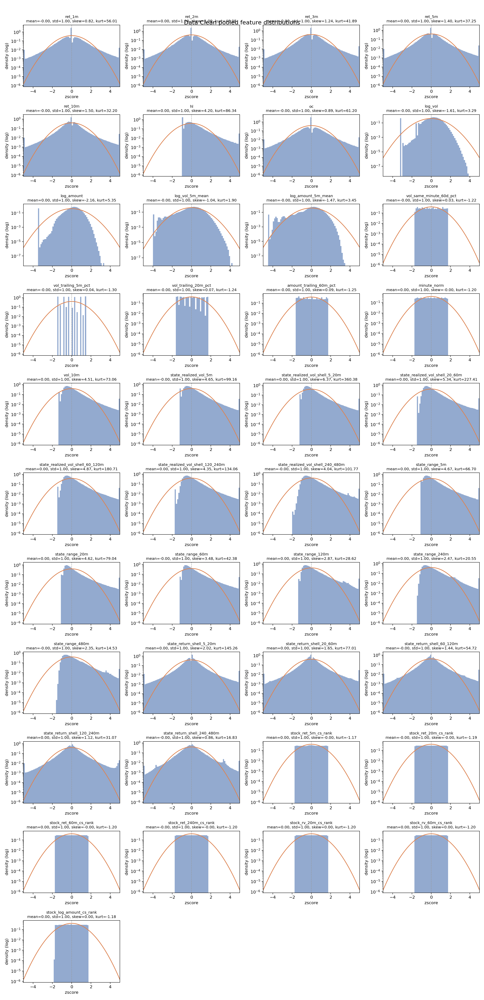

### Data Clean Distribution Overview

### 2.3. Label Distribution

Label 分布按 train/validation/test 展示; normalization 参数只在 train 上拟合. 

| split | count | mean_raw_bps | std_raw_bps | zero_ratio | abs_raw_gt_1pct_ratio |
| --- | --- | --- | --- | --- | --- |
| train | 553895223 | -0.074756 | 42.226774 | 0.186758 | 0.028167 |
| val | 31737447 | -0.863159 | 62.464198 | 0.147426 | 0.076608 |
| test | 176134322 | -0.035505 | 50.207416 | 0.174398 | 0.039702 |

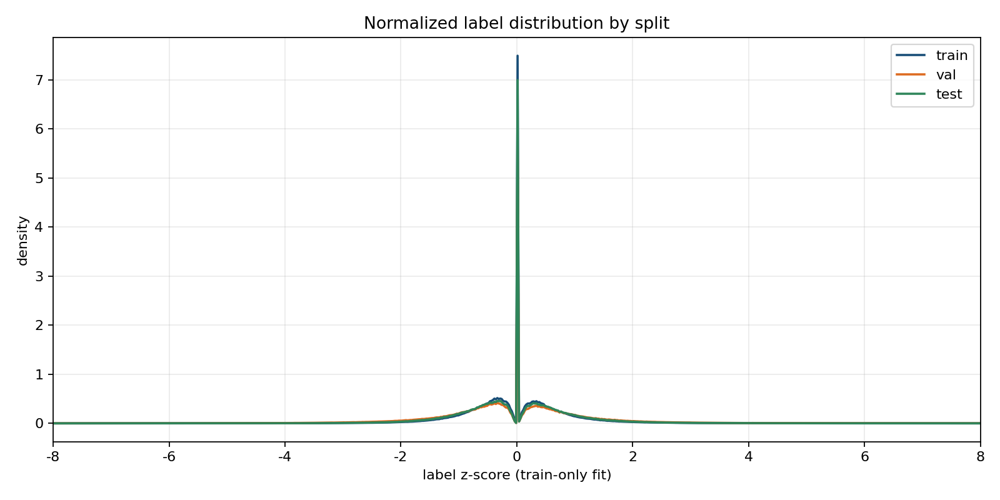

### Label Distribution By Split

03

3. Evaluation

## 主要结果

| 记录项 | 当前解释 |
| --- | --- |
| 实验 | 0827-market-cs |
| 报告类型 | full_report_html |
| 历史状态 | 历史成功, 四臂完成 |
| 证据 | 0827-market-cs-latent-z-0831 |

Current conclusion

latent_z_34d: test pooled IC=0.127345, pooled Rank IC=0.102452; 结果仅用于 seed 7 matched screening. 

01

1. Executive Summary

### Evaluation

Test 不参与 checkpoint 选择; 暂停臂的 test 指标保持 not run. 

### 3.1. IC Summary

Train headline 使用固定 3,891 batches / 31,875,072 rows; test 使用完整 split. 

| split | pooled_ic | pooled_rank_ic | count |
| --- | --- | --- | --- |
| train_report_sample | 0.134393 | 0.126724 | 31875072 |
| test | 0.127345 | 0.102452 | 176134322 |

| field | explanation |
| --- | --- |
| pooled_ic | 合并样本后计算的 Pearson IC.  |
| pooled_rank_ic | 合并样本后计算的 Rank IC.  |
| pearson_ic | corr(prediction, target).  |
| rank_ic | corr(rank(prediction), rank(target)).  |

### 3.2. Signal Quality 1: bucket (10)

完整 test prediction 按全局 prediction 十等分, 报告每桶实际 label 与日度 top-minus-bottom spread. 

| signal_bucket | mean_prediction | mean_label_bps | t_stat | hit_rate | row_count | top_bottom_signal_spread_bps |
| --- | --- | --- | --- | --- | --- | --- |
| 1 | -0.001152 | -10.552278 | -611.243452 | 0.317277 | 17613433 | 20.523930 |
| 2 | -0.000344 | -3.124703 | -290.478778 | 0.353982 | 17613433 | 20.523930 |
| 3 | -0.000195 | -1.969661 | -200.457539 | 0.364745 | 17613432 | 20.523930 |
| 4 | -0.000097 | -1.261290 | -133.367008 | 0.371347 | 17613432 | 20.523930 |
| 5 | -0.000015 | -0.585217 | -62.074347 | 0.380122 | 17613432 | 20.523930 |
| 6 | 0.000078 | 0.053410 | 5.537811 | 0.381969 | 17613432 | 20.523930 |
| 7 | 0.000181 | 0.967396 | 98.158911 | 0.397768 | 17613432 | 20.523930 |
| 8 | 0.000301 | 2.202359 | 210.540670 | 0.413610 | 17613432 | 20.523930 |
| 9 | 0.000477 | 3.943929 | 339.669795 | 0.434880 | 17613432 | 20.523930 |
| 10 | 0.001150 | 9.971652 | 581.455257 | 0.481409 | 17613432 | 20.523930 |

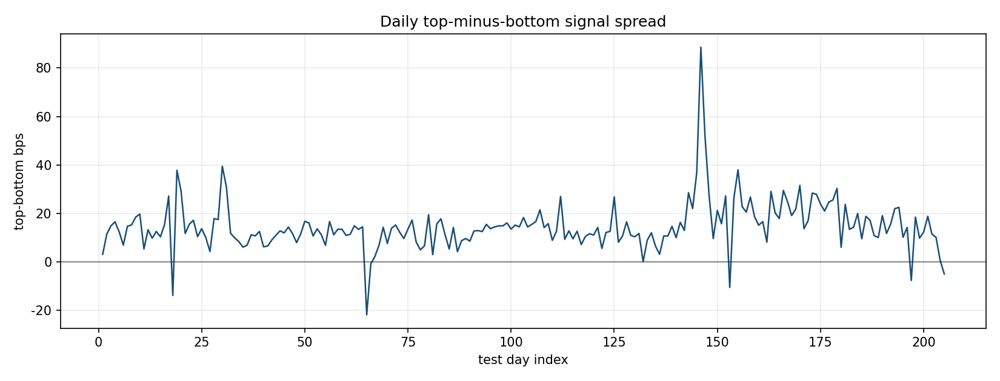

### Daily Top-Minus-Bottom Signal Spread

### 3.3. Signal Quality 2: Important Stock Pool

CSI300/CSI500/CSI1000 成分股按日期 membership 聚合; test 与 validation checkpoint 证据分开保存. 

| pool | display_name | etf_code | index_code | pearson_ic | rank_ic | mean_prediction_return | mean_real_return | real_return_positive_ratio | prediction_positive_ratio | count |
| --- | --- | --- | --- | --- | --- | --- | --- | --- | --- | --- |
| csi1000_etf_sh | 1000 ETF | 512100.SH | 000852.SH | 0.095067 | 0.072091 | 0.000043 | -0.000008 | 0.395829 | 0.530719 | 32955251 |
| csi300_etf_sh | 沪深300 ETF(沪) | 510300.SH | 000300.SH | 0.080280 | 0.055599 | 0.000045 | 0.000014 | 0.413560 | 0.528815 | 9885400 |
| csi500_etf_sh | 中证500 ETF(沪) | 510500.SH | 000905.SH | 0.080950 | 0.062742 | 0.000044 | -0.000013 | 0.393433 | 0.529105 | 16488815 |

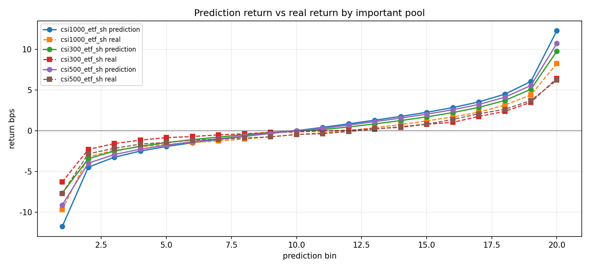

### Prediction Return vs Real Return

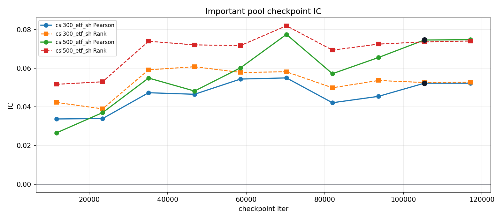

### Important Pool Checkpoint IC

### 3.4. Goodness Of Fit

Train 固定样本与完整 test 使用相同等频校准分箱; 表格仅折叠展示首尾 bins. 

| split | prediction_bin | mean_prediction | mean_label | mean_label_bps | label_std | label_se | label_p05 | label_p95 | label_ci90_low | label_ci90_high | row_count |
| --- | --- | --- | --- | --- | --- | --- | --- | --- | --- | --- | --- |
| train | 1 | -0.002713 | -0.002943 | -29.427019 | 0.009472 | 0.000017 | -0.016717 | 0.010277 | -0.002970 | -0.002915 | 318751 |
| train | 2 | -0.001399 | -0.001496 | -14.961542 | 0.006469 | 0.000011 | -0.010581 | 0.007968 | -0.001515 | -0.001477 | 318751 |
| train | 3 | -0.001108 | -0.001184 | -11.838314 | 0.005799 | 0.000010 | -0.009401 | 0.007357 | -0.001201 | -0.001167 | 318751 |
| train | 4 | -0.000938 | -0.001033 | -10.325794 | 0.005483 | 0.000010 | -0.008865 | 0.007019 | -0.001049 | -0.001017 | 318751 |
| train | 5 | -0.000817 | -0.000929 | -9.286883 | 0.005314 | 0.000009 | -0.008502 | 0.006871 | -0.000944 | -0.000913 | 318751 |
| train | 6 | -0.000724 | -0.000862 | -8.624189 | 0.005122 | 0.000009 | -0.008210 | 0.006722 | -0.000877 | -0.000847 | 318751 |
| train | 7 | -0.000649 | -0.000780 | -7.798134 | 0.005029 | 0.000009 | -0.007970 | 0.006689 | -0.000794 | -0.000765 | 318751 |
| train | 8 | -0.000587 | -0.000743 | -7.426673 | 0.004856 | 0.000009 | -0.007752 | 0.006500 | -0.000757 | -0.000729 | 318751 |
| train | 9 | -0.000542 | -0.000685 | -6.851295 | 0.004636 | 0.000008 | -0.007381 | 0.006215 | -0.000699 | -0.000672 | 318751 |
| train | 10 | -0.000507 | -0.000649 | -6.488116 | 0.004575 | 0.000008 | -0.007273 | 0.006176 | -0.000662 | -0.000635 | 318751 |
| test | 91 | 0.000627 | 0.000542 | 5.420240 | 0.005375 | 0.000004 | -0.006688 | 0.008265 | 0.000535 | 0.000549 | 1761343 |
| test | 92 | 0.000668 | 0.000584 | 5.843627 | 0.005534 | 0.000004 | -0.006865 | 0.008487 | 0.000578 | 0.000591 | 1761343 |
| test | 93 | 0.000713 | 0.000630 | 6.297368 | 0.005696 | 0.000004 | -0.007059 | 0.008809 | 0.000623 | 0.000637 | 1761343 |
| test | 94 | 0.000766 | 0.000685 | 6.851383 | 0.005892 | 0.000004 | -0.007273 | 0.009172 | 0.000678 | 0.000692 | 1761343 |
| test | 95 | 0.000830 | 0.000761 | 7.607128 | 0.006155 | 0.000005 | -0.007521 | 0.009658 | 0.000753 | 0.000768 | 1761343 |
| test | 96 | 0.000918 | 0.000848 | 8.481540 | 0.006570 | 0.000005 | -0.008016 | 0.010475 | 0.000840 | 0.000856 | 1761343 |
| test | 97 | 0.001066 | 0.000951 | 9.513001 | 0.006875 | 0.000005 | -0.008391 | 0.011077 | 0.000943 | 0.000960 | 1761343 |
| test | 98 | 0.001283 | 0.001116 | 11.161994 | 0.007395 | 0.000006 | -0.008997 | 0.012091 | 0.001107 | 0.001125 | 1761343 |
| test | 99 | 0.001645 | 0.001409 | 14.085776 | 0.008237 | 0.000006 | -0.009937 | 0.013724 | 0.001398 | 0.001419 | 1761343 |
| test | 100 | 0.002987 | 0.002445 | 24.454472 | 0.011726 | 0.000009 | -0.013170 | 0.021056 | 0.002431 | 0.002460 | 1761343 |

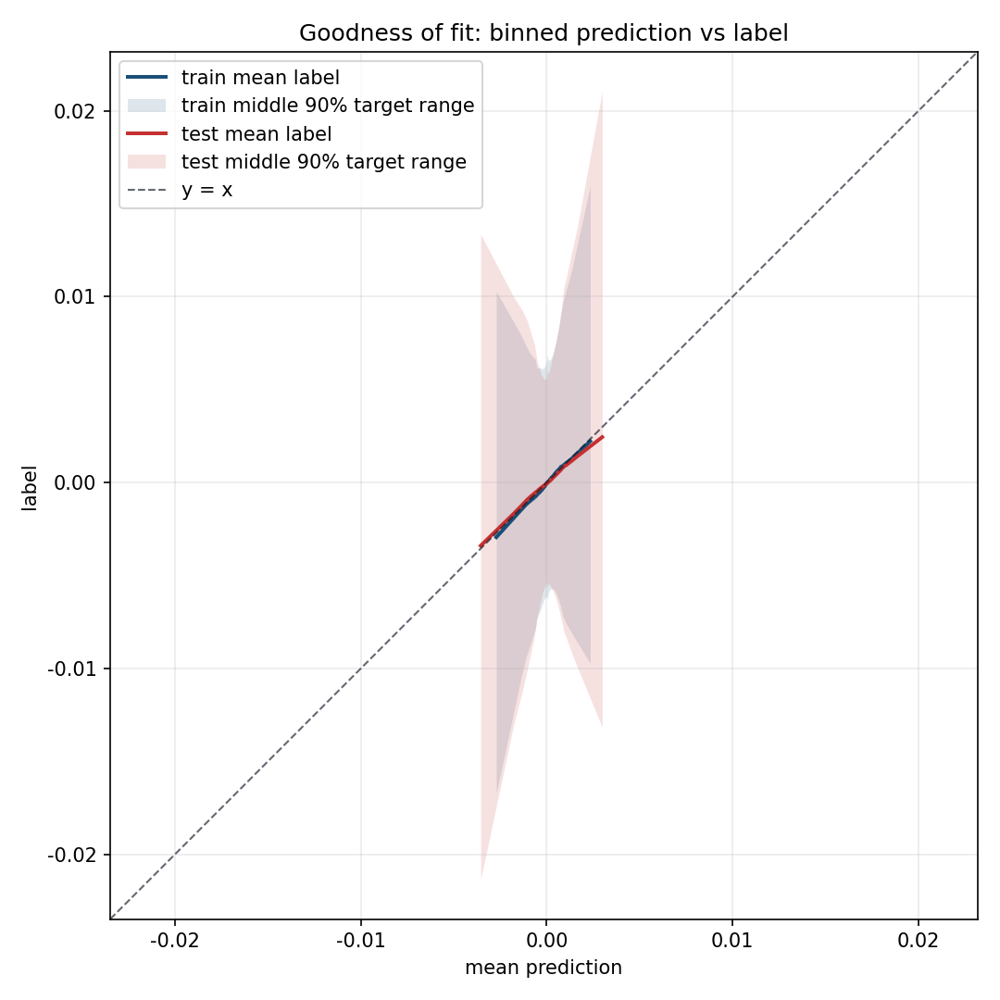

### Train/Test Goodness Of Fit

### 3.5. Liquidity By ADV

ADV 使用 shifted 20-trading-day stock1d amount mean, 并在完整 test date-code universe 上分桶. 

| adv_bucket | bucket_label | row_count | day_count | mean_adv_amount | median_adv_amount | mean_ic | mean_rank_ic | icir | rank_icir | top5_return_bps | top5_hit_rate | top5_row_count |
| --- | --- | --- | --- | --- | --- | --- | --- | --- | --- | --- | --- | --- |
| 1 | Bottom20% | 33579609 | 205 | 22043.429610 | 22557.850150 | 0.119206 | 0.104109 | 5.376967 | 5.305845 | 9.222165 | 0.445174 | 1694847 |
| 2 | 20~40% | 33579609 | 205 | 49378.094708 | 48886.620950 | 0.089503 | 0.075906 | 4.202106 | 4.595124 | 6.485936 | 0.434402 | 1695008 |
| 3 | 40~60% | 33579609 | 205 | 89103.411146 | 87560.379700 | 0.097576 | 0.071683 | 4.181518 | 4.039028 | 6.809934 | 0.444249 | 1694203 |
| 4 | 60~80% | 33579448 | 205 | 170679.829077 | 165081.435150 | 0.110530 | 0.074510 | 4.560401 | 3.574421 | 8.291651 | 0.461178 | 1695008 |
| 5 | Top20% | 33579448 | 205 | 714122.143913 | 442449.002300 | 0.121884 | 0.078372 | 4.016689 | 3.114037 | 9.221447 | 0.471858 | 1695008 |

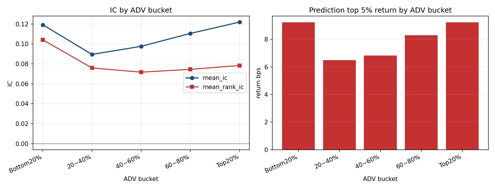

### ADV Liquidity Bucket Metrics

04

4. Train Metrics

### Train Metrics

模型参数, checkpoint selection 和运行身份来自 config, sidecar 与 summary. 

### 4.1. Checkpoint Selection

Checkpoint 只由 validation 选择; 所有候选 checkpoint 的 train headline 使用同一确定性样本. 

| key | value |
| --- | --- |
| best_iter | 105343 |
| selection_metric | checkpoint_selection/score |
| selection_rule | early_top_k |
| candidate_count | 10 |

| iter | selected | val/objective/mse | val/quality/global_ic | val/quality/rank_ic | val/dist/pred_std_over_target_std | decision | metric_rank |
| --- | --- | --- | --- | --- | --- | --- | --- |
| 11705 | False | 2.181498 | 0.065796 | 0.081432 | — | reject | 10.000000 |
| 23410 | False | 2.173834 | 0.095078 | 0.097480 | — | reject | 9.000000 |
| 35115 | False | 2.167190 | 0.112640 | 0.119689 | — | reject | 7.000000 |
| 46819 | False | 2.164687 | 0.111478 | 0.124757 | — | reject | 8.000000 |
| 58524 | False | 2.158472 | 0.118049 | 0.121708 | — | reject | 6.000000 |
| 70229 | False | 2.154826 | 0.128137 | 0.120665 | — | reject | 4.000000 |
| 81933 | False | 2.155461 | 0.125778 | 0.119946 | — | reject | 5.000000 |
| 93638 | False | 2.159030 | 0.129849 | 0.124603 | — | reject | 3.000000 |
| 105343 | True | 2.147173 | 0.140156 | 0.125761 | — | promote | 2.000000 |
| 117047 | False | 2.148085 | 0.140451 | 0.125416 | — | reject | 1.000000 |

| iter | pooled_ic | pooled_rank_ic | count | scope |
| --- | --- | --- | --- | --- |
| 11705 | 0.078202 | 0.083281 | 31875072 | fixed train sample: 3891 batches |
| 23410 | 0.083281 | 0.088893 | 31875072 | fixed train sample: 3891 batches |
| 35115 | 0.091244 | 0.094601 | 31875072 | fixed train sample: 3891 batches |
| 46819 | 0.100942 | 0.105278 | 31875072 | fixed train sample: 3891 batches |
| 58524 | 0.102411 | 0.101564 | 31875072 | fixed train sample: 3891 batches |
| 70229 | 0.096411 | 0.086346 | 31875072 | fixed train sample: 3891 batches |
| 81933 | 0.106945 | 0.099975 | 31875072 | fixed train sample: 3891 batches |
| 93638 | 0.113300 | 0.101932 | 31875072 | fixed train sample: 3891 batches |
| 105343 | 0.117815 | 0.105268 | 31875072 | fixed train sample: 3891 batches |

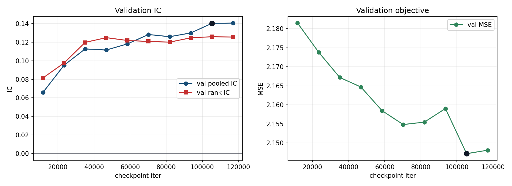

### Checkpoint Selection Metrics

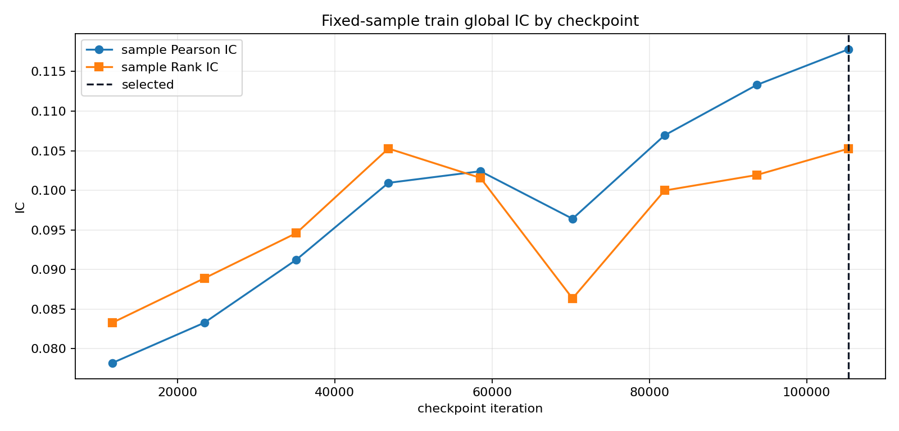

### Fixed-Sample Train Global IC By Checkpoint

### 4.2. Model And Method

本实验仅改变 active feature projection 或 context architecture. 

| experiment | status | research purpose | idea | source | baseline difference | concrete method | formula summary |
| --- | --- | --- | --- | --- | --- | --- | --- |
| latent_z_34d | complete | 检验股票 hidden 相对同分钟其余股票分布的位置是否提供增量.  | 对每只股票构造 leave-one-out 均值和标准差, 避免自身同时进入参照分布.  | 横截面 z-score 与 leave-one-out moment estimator.  | 输入仍为 34D; 仅在 GRU hidden 后增加无参数 LOO z-position context, 并扩展 MLP 输入.  | 屏蔽 7 个 rank; 在 GRU hidden 上计算 LOO z-position, 并把 [h_i, z_i] 输入公共预测头.  | mu[-i] = (1/(N-1)) * sum_{j!=i} h_j; sigma[-i]^2 = (1/(N-1)) * sum_{j!=i}(h_j-mu[-i])^2; z_i = (h_i-mu[-i])/(sigma[-i]+epsilon); y_hat_i = rho([h_i, z_i]) |

### 4.2.1. GRU

所有臂共享两层单向 GRU 编码器. 

| field | value |
| --- | --- |
| input_tensor | batch, panel, 60, 41 |
| gru_hidden_size | 384 |
| gru_num_layers | 2 |
| gru_bidirectional | False |
| gru_dropout | 0.000000 |

### 4.2.2. MLP

公共预测头使用 Linear-LayerNorm-ReLU block; context 臂将 hidden 与 context 拼接. 

| field | value |
| --- | --- |
| mlp_effective_hidden_width | 512, 512 |
| mlp_dropout | 0.000000 |
| trainable_parameter | 2,037,889 |

### 4.2.3. Method

屏蔽 7 个 rank; 在 GRU hidden 上计算 LOO z-position, 并把 [h_i, z_i] 输入公共预测头. 

| field | value |
| --- | --- |
| parameter_initialization | PyTorch default GRU/Linear; Xavier inducing tokens |
| lr_scheduler/type | 200-step LinearWarmup + CosineAnnealing |
| optimizer | AdamW |
| approx_total_epochs | 1 exact sampler epoch |
| final_iter | 117047 |
| checkpoint_selection | early_top_k |

| step | operation |
| --- | --- |
| 1 | 使用与 control 相同的 34D mask 和 GRU 得到每只股票 hidden.  |
| 2 | 在同一分钟 panel 内逐 hidden 维计算排除股票 i 的均值与总体标准差.  |
| 3 | 拼接本地 hidden 与 LOO z-position, 再通过公共两层预测头输出.  |

| symbol | formula | implementation meaning |
| --- | --- | --- |
| LOO mean | mu[-i] = (1/(N-1)) * sum_{j!=i} h_j | 每只股票使用不含自身的市场均值.  |
| LOO variance | sigma[-i]^2 = (1/(N-1)) * sum_{j!=i}(h_j-mu[-i])^2 | 实现以 centered sum-of-squares 恒等式稳定计算.  |
| Relative position | z_i = (h_i-mu[-i])/(sigma[-i]+epsilon) | epsilon=1e-5, 单股票 panel 返回零 context.  |
| Prediction | y_hat_i = rho([h_i, z_i]) | rho 接收 768D hidden-context 拼接.  |

### 4.3. Training Monitoring

TensorBoard event files和资源监控 JSONL 共同提供训练过程证据. 

| samples | host CPU % | process CPU % | RSS GiB | host RAM % | min free RAM GiB | GPU MiB | GPU util % | GPU temp C | min cache GiB |
| --- | --- | --- | --- | --- | --- | --- | --- | --- | --- |
| 781 | 54.100000 | 1152.180189 | 57.487206 | 22.100000 | 392.345032 | 9123.000000 | 100.000000 | 78.000000 | 210.056179 |

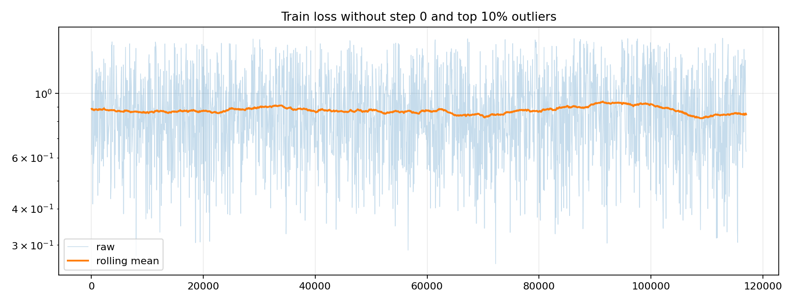

### Train Loss

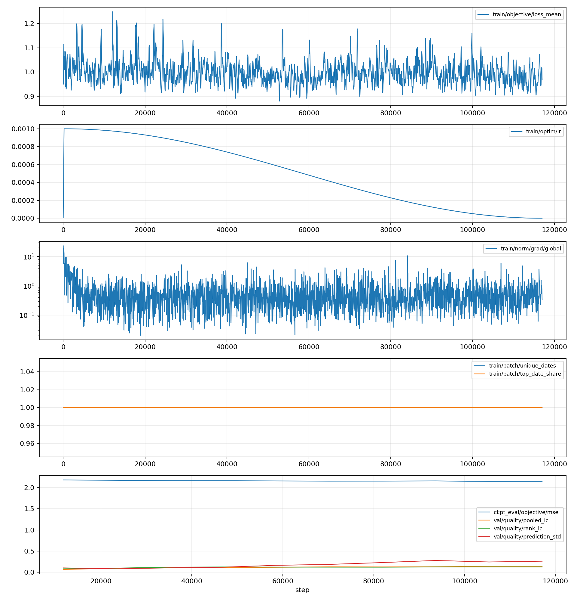

### Train Monitoring Curves

05

5. Trading And Cost

### Trading And Cost

只有完成正式 test 和 backtest 的实验臂报告 execution-aware 摘要. 

### 5.0. Cost Model Status

ETF proxy 使用完整 train-validation-test 时间线; raw forward log return 经 expm1 转为 simple return 后复利. 

| field | value |
| --- | --- |
| status | available |
| available_metric | 10M AUM execution-aware portfolio summary |

| gross daily | gross Sharpe | net daily 10M | net Sharpe 10M | max drawdown | turnover | fill |
| --- | --- | --- | --- | --- | --- | --- |
| 100.19 bps | 42.554951 | -135.70 bps | -39.213925 | -93.86% | 11.809049 | 94.02% |

### 5.1. Cumulative Prediction, Real, And Excess Returns

按 pool 使用 trailing threshold, 5-minute rebalance 与连续 full-hold benchmark. 

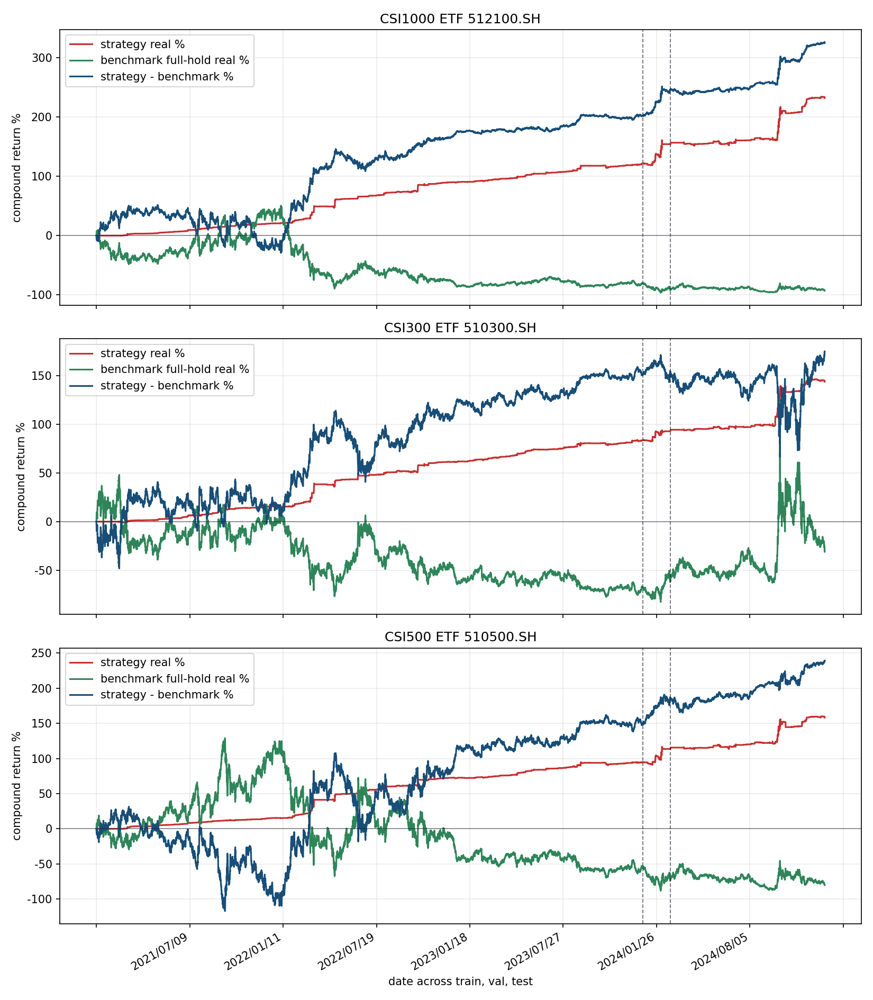

### Train/Val/Test Cumulative Returns

### 5.2. Single-Side Cost Sensitivity

成本扫描同时报告完整 timeline, test-only 以及排除 2024-09/10 的 test. 

| pool | date | test_minute_index | single_side_cost_bps | net_strategy_cumulative_return |
| --- | --- | --- | --- | --- |
| csi1000_etf_sh | 240301 | 1 | 0.000000 | 0.000000 |
| csi1000_etf_sh | 240301 | 2 | 0.000000 | 0.000000 |
| csi1000_etf_sh | 240301 | 3 | 0.000000 | 0.000000 |
| csi1000_etf_sh | 240301 | 4 | 0.000000 | 0.000000 |
| csi1000_etf_sh | 240301 | 5 | 0.000000 | 0.000000 |
| csi1000_etf_sh | 240301 | 6 | 0.000000 | 0.000000 |
| csi1000_etf_sh | 240301 | 7 | 0.000000 | 0.000000 |
| csi1000_etf_sh | 240301 | 8 | 0.000000 | 0.000000 |
| csi1000_etf_sh | 240301 | 9 | 0.000000 | 0.000000 |
| csi1000_etf_sh | 240301 | 10 | 0.000000 | 0.000000 |
| csi1000_etf_sh | 240301 | 11 | 0.000000 | 0.000000 |
| csi1000_etf_sh | 240301 | 12 | 0.000000 | 0.000000 |
| csi1000_etf_sh | 240301 | 13 | 0.000000 | 0.000000 |
| csi1000_etf_sh | 240301 | 14 | 0.000000 | 0.000000 |
| csi1000_etf_sh | 240301 | 15 | 0.000000 | 0.000000 |
| csi1000_etf_sh | 240301 | 16 | 0.000000 | 0.000000 |
| csi1000_etf_sh | 240301 | 17 | 0.000000 | 0.000000 |
| csi1000_etf_sh | 240301 | 18 | 0.000000 | 0.000000 |
| csi1000_etf_sh | 240301 | 19 | 0.000000 | 0.000000 |
| csi1000_etf_sh | 240301 | 20 | 0.000000 | 0.000000 |
| csi1000_etf_sh | 240301 | 21 | 0.000000 | 0.000000 |
| csi1000_etf_sh | 240301 | 22 | 0.000000 | 0.000000 |
| csi1000_etf_sh | 240301 | 23 | 0.000000 | 0.000000 |
| csi1000_etf_sh | 240301 | 24 | 0.000000 | 0.000000 |
| csi1000_etf_sh | 240301 | 25 | 0.000000 | 0.000000 |
| csi1000_etf_sh | 240301 | 26 | 0.000000 | 0.000000 |
| csi1000_etf_sh | 240301 | 27 | 0.000000 | 0.000000 |
| csi1000_etf_sh | 240301 | 28 | 0.000000 | 0.000000 |
| csi1000_etf_sh | 240301 | 29 | 0.000000 | 0.000000 |
| csi1000_etf_sh | 240301 | 30 | 0.000000 | 0.000000 |
| csi1000_etf_sh | 240301 | 31 | 0.000000 | 0.000000 |
| csi1000_etf_sh | 240301 | 32 | 0.000000 | 0.000000 |
| csi1000_etf_sh | 240301 | 33 | 0.000000 | 0.000000 |
| csi1000_etf_sh | 240301 | 34 | 0.000000 | 0.000000 |
| csi1000_etf_sh | 240301 | 35 | 0.000000 | 0.000000 |
| csi1000_etf_sh | 240301 | 36 | 0.000000 | 0.000000 |
| csi1000_etf_sh | 240301 | 37 | 0.000000 | 0.000000 |
| csi1000_etf_sh | 240301 | 38 | 0.000000 | 0.000000 |
| csi1000_etf_sh | 240301 | 39 | 0.000000 | 0.000000 |
| csi1000_etf_sh | 240301 | 40 | 0.000000 | 0.000000 |
| csi1000_etf_sh | 240301 | 41 | 0.000000 | 0.000000 |
| csi1000_etf_sh | 240301 | 42 | 0.000000 | 0.000000 |
| csi1000_etf_sh | 240301 | 43 | 0.000000 | 0.000000 |
| csi1000_etf_sh | 240301 | 44 | 0.000000 | 0.000000 |
| csi1000_etf_sh | 240301 | 45 | 0.000000 | 0.000000 |
| csi1000_etf_sh | 240301 | 46 | 0.000000 | 0.000000 |
| csi1000_etf_sh | 240301 | 47 | 0.000000 | 0.000000 |
| csi1000_etf_sh | 240301 | 48 | 0.000000 | 0.000000 |
| csi1000_etf_sh | 240301 | 49 | 0.000000 | 0.000000 |
| csi1000_etf_sh | 240301 | 50 | 0.000000 | 0.000000 |
| csi1000_etf_sh | 240301 | 51 | 0.000000 | 0.000000 |
| csi1000_etf_sh | 240301 | 52 | 0.000000 | 0.000000 |
| csi1000_etf_sh | 240301 | 53 | 0.000000 | 0.000000 |
| csi1000_etf_sh | 240301 | 54 | 0.000000 | 0.000000 |
| csi1000_etf_sh | 240301 | 55 | 0.000000 | 0.000000 |
| csi1000_etf_sh | 240301 | 56 | 0.000000 | 0.000000 |
| csi1000_etf_sh | 240301 | 57 | 0.000000 | 0.000000 |
| csi1000_etf_sh | 240301 | 58 | 0.000000 | 0.000000 |
| csi1000_etf_sh | 240301 | 59 | 0.000000 | 0.000000 |
| csi1000_etf_sh | 240301 | 60 | 0.000000 | 0.000000 |
| csi500_etf_sh | 241231 | 32946 | 10.000000 | -0.087224 |
| csi500_etf_sh | 241231 | 32947 | 10.000000 | -0.087224 |
| csi500_etf_sh | 241231 | 32948 | 10.000000 | -0.087224 |
| csi500_etf_sh | 241231 | 32949 | 10.000000 | -0.087224 |
| csi500_etf_sh | 241231 | 32950 | 10.000000 | -0.087224 |
| csi500_etf_sh | 241231 | 32951 | 10.000000 | -0.087224 |
| csi500_etf_sh | 241231 | 32952 | 10.000000 | -0.087224 |
| csi500_etf_sh | 241231 | 32953 | 10.000000 | -0.087224 |
| csi500_etf_sh | 241231 | 32954 | 10.000000 | -0.087224 |
| csi500_etf_sh | 241231 | 32955 | 10.000000 | -0.087224 |
| csi500_etf_sh | 241231 | 32956 | 10.000000 | -0.087224 |
| csi500_etf_sh | 241231 | 32957 | 10.000000 | -0.087224 |
| csi500_etf_sh | 241231 | 32958 | 10.000000 | -0.087224 |
| csi500_etf_sh | 241231 | 32959 | 10.000000 | -0.087224 |
| csi500_etf_sh | 241231 | 32960 | 10.000000 | -0.087224 |
| csi500_etf_sh | 241231 | 32961 | 10.000000 | -0.087224 |
| csi500_etf_sh | 241231 | 32962 | 10.000000 | -0.087224 |
| csi500_etf_sh | 241231 | 32963 | 10.000000 | -0.087224 |
| csi500_etf_sh | 241231 | 32964 | 10.000000 | -0.087224 |
| csi500_etf_sh | 241231 | 32965 | 10.000000 | -0.087224 |
| csi500_etf_sh | 241231 | 32966 | 10.000000 | -0.087224 |
| csi500_etf_sh | 241231 | 32967 | 10.000000 | -0.087224 |
| csi500_etf_sh | 241231 | 32968 | 10.000000 | -0.087224 |
| csi500_etf_sh | 241231 | 32969 | 10.000000 | -0.087224 |
| csi500_etf_sh | 241231 | 32970 | 10.000000 | -0.087224 |
| csi500_etf_sh | 241231 | 32971 | 10.000000 | -0.087224 |
| csi500_etf_sh | 241231 | 32972 | 10.000000 | -0.087224 |
| csi500_etf_sh | 241231 | 32973 | 10.000000 | -0.087224 |
| csi500_etf_sh | 241231 | 32974 | 10.000000 | -0.087224 |
| csi500_etf_sh | 241231 | 32975 | 10.000000 | -0.087224 |
| csi500_etf_sh | 241231 | 32976 | 10.000000 | -0.087224 |
| csi500_etf_sh | 241231 | 32977 | 10.000000 | -0.087224 |
| csi500_etf_sh | 241231 | 32978 | 10.000000 | -0.087224 |
| csi500_etf_sh | 241231 | 32979 | 10.000000 | -0.087224 |
| csi500_etf_sh | 241231 | 32980 | 10.000000 | -0.087224 |
| csi500_etf_sh | 241231 | 32981 | 10.000000 | -0.087224 |
| csi500_etf_sh | 241231 | 32982 | 10.000000 | -0.087224 |
| csi500_etf_sh | 241231 | 32983 | 10.000000 | -0.087224 |
| csi500_etf_sh | 241231 | 32984 | 10.000000 | -0.087224 |
| csi500_etf_sh | 241231 | 32985 | 10.000000 | -0.087224 |
| csi500_etf_sh | 241231 | 32986 | 10.000000 | -0.087224 |
| csi500_etf_sh | 241231 | 32987 | 10.000000 | -0.087224 |
| csi500_etf_sh | 241231 | 32988 | 10.000000 | -0.087224 |
| csi500_etf_sh | 241231 | 32989 | 10.000000 | -0.087224 |
| csi500_etf_sh | 241231 | 32990 | 10.000000 | -0.087224 |
| csi500_etf_sh | 241231 | 32991 | 10.000000 | -0.087224 |
| csi500_etf_sh | 241231 | 32992 | 10.000000 | -0.087224 |
| csi500_etf_sh | 241231 | 32993 | 10.000000 | -0.087224 |
| csi500_etf_sh | 241231 | 32994 | 10.000000 | -0.087224 |
| csi500_etf_sh | 241231 | 32995 | 10.000000 | -0.087224 |
| csi500_etf_sh | 241231 | 32996 | 10.000000 | -0.087224 |
| csi500_etf_sh | 241231 | 32997 | 10.000000 | -0.087224 |
| csi500_etf_sh | 241231 | 32998 | 10.000000 | -0.087224 |
| csi500_etf_sh | 241231 | 32999 | 10.000000 | -0.087224 |
| csi500_etf_sh | 241231 | 33000 | 10.000000 | -0.087224 |
| csi500_etf_sh | 241231 | 33001 | 10.000000 | -0.087224 |
| csi500_etf_sh | 241231 | 33002 | 10.000000 | -0.092927 |
| csi500_etf_sh | 241231 | 33003 | 10.000000 | -0.092927 |
| csi500_etf_sh | 241231 | 33004 | 10.000000 | -0.092927 |
| csi500_etf_sh | 241231 | 33005 | 10.000000 | -0.092927 |

| split | pool | date | day_index | single_side_cost_bps | net_strategy_cumulative_return |
| --- | --- | --- | --- | --- | --- |
| train | csi1000_etf_sh | 210104 | 1 | 0.000000 | 0.000000 |
| train | csi1000_etf_sh | 210104 | 2 | 0.000000 | 0.000000 |
| train | csi1000_etf_sh | 210104 | 3 | 0.000000 | 0.000000 |
| train | csi1000_etf_sh | 210104 | 4 | 0.000000 | 0.000000 |
| train | csi1000_etf_sh | 210104 | 5 | 0.000000 | 0.000000 |
| train | csi1000_etf_sh | 210104 | 6 | 0.000000 | 0.000000 |
| train | csi1000_etf_sh | 210104 | 7 | 0.000000 | 0.000000 |
| train | csi1000_etf_sh | 210104 | 8 | 0.000000 | 0.000000 |
| train | csi1000_etf_sh | 210104 | 9 | 0.000000 | 0.000000 |
| train | csi1000_etf_sh | 210104 | 10 | 0.000000 | 0.000000 |
| train | csi1000_etf_sh | 210104 | 11 | 0.000000 | 0.000000 |
| train | csi1000_etf_sh | 210104 | 12 | 0.000000 | 0.000000 |
| train | csi1000_etf_sh | 210104 | 13 | 0.000000 | 0.000000 |
| train | csi1000_etf_sh | 210104 | 14 | 0.000000 | 0.000000 |
| train | csi1000_etf_sh | 210104 | 15 | 0.000000 | 0.000000 |
| train | csi1000_etf_sh | 210104 | 16 | 0.000000 | 0.000000 |
| train | csi1000_etf_sh | 210104 | 17 | 0.000000 | 0.000000 |
| train | csi1000_etf_sh | 210104 | 18 | 0.000000 | 0.000000 |
| train | csi1000_etf_sh | 210104 | 19 | 0.000000 | 0.000000 |
| train | csi1000_etf_sh | 210104 | 20 | 0.000000 | 0.000000 |
| train | csi1000_etf_sh | 210104 | 21 | 0.000000 | 0.000000 |
| train | csi1000_etf_sh | 210104 | 22 | 0.000000 | 0.000000 |
| train | csi1000_etf_sh | 210104 | 23 | 0.000000 | 0.000000 |
| train | csi1000_etf_sh | 210104 | 24 | 0.000000 | 0.000000 |
| train | csi1000_etf_sh | 210104 | 25 | 0.000000 | 0.000000 |
| train | csi1000_etf_sh | 210104 | 26 | 0.000000 | 0.000000 |
| train | csi1000_etf_sh | 210104 | 27 | 0.000000 | 0.000000 |
| train | csi1000_etf_sh | 210104 | 28 | 0.000000 | 0.000000 |
| train | csi1000_etf_sh | 210104 | 29 | 0.000000 | 0.000000 |
| train | csi1000_etf_sh | 210104 | 30 | 0.000000 | 0.000000 |
| train | csi1000_etf_sh | 210104 | 31 | 0.000000 | 0.000000 |
| train | csi1000_etf_sh | 210104 | 32 | 0.000000 | 0.000000 |
| train | csi1000_etf_sh | 210104 | 33 | 0.000000 | 0.000000 |
| train | csi1000_etf_sh | 210104 | 34 | 0.000000 | 0.000000 |
| train | csi1000_etf_sh | 210104 | 35 | 0.000000 | 0.000000 |
| train | csi1000_etf_sh | 210104 | 36 | 0.000000 | 0.000000 |
| train | csi1000_etf_sh | 210104 | 37 | 0.000000 | 0.000000 |
| train | csi1000_etf_sh | 210104 | 38 | 0.000000 | 0.000000 |
| train | csi1000_etf_sh | 210104 | 39 | 0.000000 | 0.000000 |
| train | csi1000_etf_sh | 210104 | 40 | 0.000000 | 0.000000 |
| train | csi1000_etf_sh | 210104 | 41 | 0.000000 | 0.000000 |
| train | csi1000_etf_sh | 210104 | 42 | 0.000000 | 0.000000 |
| train | csi1000_etf_sh | 210104 | 43 | 0.000000 | 0.000000 |
| train | csi1000_etf_sh | 210104 | 44 | 0.000000 | 0.000000 |
| train | csi1000_etf_sh | 210104 | 45 | 0.000000 | 0.000000 |
| train | csi1000_etf_sh | 210104 | 46 | 0.000000 | 0.000000 |
| train | csi1000_etf_sh | 210104 | 47 | 0.000000 | 0.000000 |
| train | csi1000_etf_sh | 210104 | 48 | 0.000000 | 0.000000 |
| train | csi1000_etf_sh | 210104 | 49 | 0.000000 | 0.000000 |
| train | csi1000_etf_sh | 210104 | 50 | 0.000000 | 0.000000 |
| train | csi1000_etf_sh | 210104 | 51 | 0.000000 | 0.000000 |
| train | csi1000_etf_sh | 210104 | 52 | 0.000000 | 0.000000 |
| train | csi1000_etf_sh | 210104 | 53 | 0.000000 | 0.000000 |
| train | csi1000_etf_sh | 210104 | 54 | 0.000000 | 0.000000 |
| train | csi1000_etf_sh | 210104 | 55 | 0.000000 | 0.000000 |
| train | csi1000_etf_sh | 210104 | 56 | 0.000000 | 0.000000 |
| train | csi1000_etf_sh | 210104 | 57 | 0.000000 | 0.000000 |
| train | csi1000_etf_sh | 210104 | 58 | 0.000000 | 0.000000 |
| train | csi1000_etf_sh | 210104 | 59 | 0.000000 | 0.000000 |
| train | csi1000_etf_sh | 210104 | 60 | 0.000000 | 0.000000 |
| test | csi500_etf_sh | 241231 | 155950 | 10.000000 | -0.393942 |
| test | csi500_etf_sh | 241231 | 155951 | 10.000000 | -0.393942 |
| test | csi500_etf_sh | 241231 | 155952 | 10.000000 | -0.393942 |
| test | csi500_etf_sh | 241231 | 155953 | 10.000000 | -0.393942 |
| test | csi500_etf_sh | 241231 | 155954 | 10.000000 | -0.393942 |
| test | csi500_etf_sh | 241231 | 155955 | 10.000000 | -0.393942 |
| test | csi500_etf_sh | 241231 | 155956 | 10.000000 | -0.393942 |
| test | csi500_etf_sh | 241231 | 155957 | 10.000000 | -0.393942 |
| test | csi500_etf_sh | 241231 | 155958 | 10.000000 | -0.393942 |
| test | csi500_etf_sh | 241231 | 155959 | 10.000000 | -0.393942 |
| test | csi500_etf_sh | 241231 | 155960 | 10.000000 | -0.393942 |
| test | csi500_etf_sh | 241231 | 155961 | 10.000000 | -0.393942 |
| test | csi500_etf_sh | 241231 | 155962 | 10.000000 | -0.393942 |
| test | csi500_etf_sh | 241231 | 155963 | 10.000000 | -0.393942 |
| test | csi500_etf_sh | 241231 | 155964 | 10.000000 | -0.393942 |
| test | csi500_etf_sh | 241231 | 155965 | 10.000000 | -0.393942 |
| test | csi500_etf_sh | 241231 | 155966 | 10.000000 | -0.393942 |
| test | csi500_etf_sh | 241231 | 155967 | 10.000000 | -0.393942 |
| test | csi500_etf_sh | 241231 | 155968 | 10.000000 | -0.393942 |
| test | csi500_etf_sh | 241231 | 155969 | 10.000000 | -0.393942 |
| test | csi500_etf_sh | 241231 | 155970 | 10.000000 | -0.393942 |
| test | csi500_etf_sh | 241231 | 155971 | 10.000000 | -0.393942 |
| test | csi500_etf_sh | 241231 | 155972 | 10.000000 | -0.393942 |
| test | csi500_etf_sh | 241231 | 155973 | 10.000000 | -0.393942 |
| test | csi500_etf_sh | 241231 | 155974 | 10.000000 | -0.393942 |
| test | csi500_etf_sh | 241231 | 155975 | 10.000000 | -0.393942 |
| test | csi500_etf_sh | 241231 | 155976 | 10.000000 | -0.393942 |
| test | csi500_etf_sh | 241231 | 155977 | 10.000000 | -0.393942 |
| test | csi500_etf_sh | 241231 | 155978 | 10.000000 | -0.393942 |
| test | csi500_etf_sh | 241231 | 155979 | 10.000000 | -0.393942 |
| test | csi500_etf_sh | 241231 | 155980 | 10.000000 | -0.393942 |
| test | csi500_etf_sh | 241231 | 155981 | 10.000000 | -0.393942 |
| test | csi500_etf_sh | 241231 | 155982 | 10.000000 | -0.393942 |
| test | csi500_etf_sh | 241231 | 155983 | 10.000000 | -0.393942 |
| test | csi500_etf_sh | 241231 | 155984 | 10.000000 | -0.393942 |
| test | csi500_etf_sh | 241231 | 155985 | 10.000000 | -0.393942 |
| test | csi500_etf_sh | 241231 | 155986 | 10.000000 | -0.393942 |
| test | csi500_etf_sh | 241231 | 155987 | 10.000000 | -0.393942 |
| test | csi500_etf_sh | 241231 | 155988 | 10.000000 | -0.393942 |
| test | csi500_etf_sh | 241231 | 155989 | 10.000000 | -0.393942 |
| test | csi500_etf_sh | 241231 | 155990 | 10.000000 | -0.393942 |
| test | csi500_etf_sh | 241231 | 155991 | 10.000000 | -0.393942 |
| test | csi500_etf_sh | 241231 | 155992 | 10.000000 | -0.393942 |
| test | csi500_etf_sh | 241231 | 155993 | 10.000000 | -0.393942 |
| test | csi500_etf_sh | 241231 | 155994 | 10.000000 | -0.393942 |
| test | csi500_etf_sh | 241231 | 155995 | 10.000000 | -0.393942 |
| test | csi500_etf_sh | 241231 | 155996 | 10.000000 | -0.393942 |
| test | csi500_etf_sh | 241231 | 155997 | 10.000000 | -0.393942 |
| test | csi500_etf_sh | 241231 | 155998 | 10.000000 | -0.393942 |
| test | csi500_etf_sh | 241231 | 155999 | 10.000000 | -0.393942 |
| test | csi500_etf_sh | 241231 | 156000 | 10.000000 | -0.393942 |
| test | csi500_etf_sh | 241231 | 156001 | 10.000000 | -0.393942 |
| test | csi500_etf_sh | 241231 | 156002 | 10.000000 | -0.393942 |
| test | csi500_etf_sh | 241231 | 156003 | 10.000000 | -0.393942 |
| test | csi500_etf_sh | 241231 | 156004 | 10.000000 | -0.393942 |
| test | csi500_etf_sh | 241231 | 156005 | 10.000000 | -0.393942 |
| test | csi500_etf_sh | 241231 | 156006 | 10.000000 | -0.397728 |
| test | csi500_etf_sh | 241231 | 156007 | 10.000000 | -0.397728 |
| test | csi500_etf_sh | 241231 | 156008 | 10.000000 | -0.397728 |
| test | csi500_etf_sh | 241231 | 156009 | 10.000000 | -0.397728 |

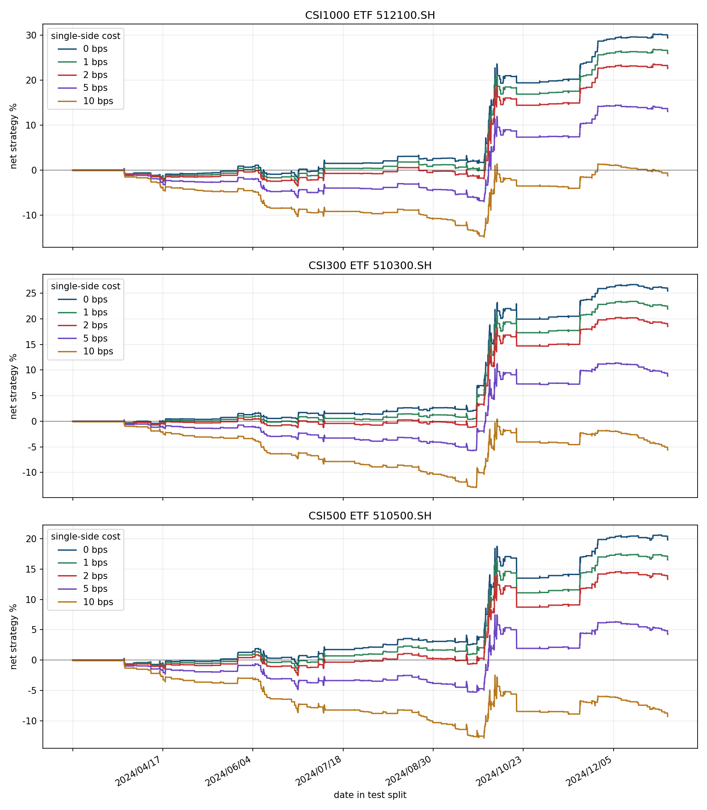

### Test Cost Sensitivity

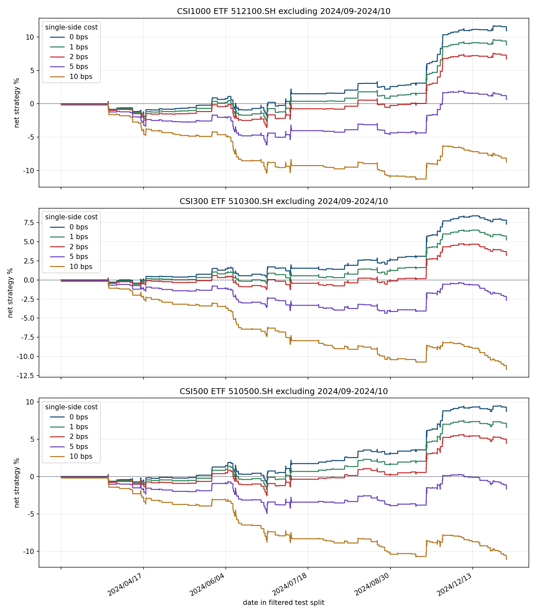

### Test Cost Sensitivity Excluding 2024-09/10

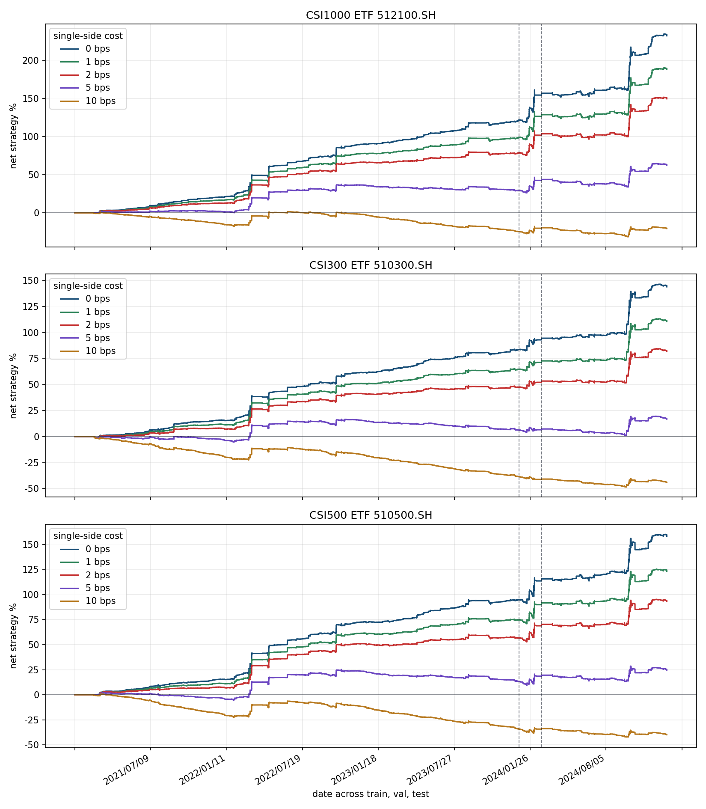

### Full Timeline Cost Sensitivity

### 5.3. ETF Trade Return Distribution

Trade rows are defined by position open/close episodes under the same ETF proxy rule.

| scope | pool | display_name | trade_id | start_date | start_time | end_date | end_time | holding_minutes | trade_return_bps |
| --- | --- | --- | --- | --- | --- | --- | --- | --- | --- |
| train_val_test | csi1000_etf_sh | 1000 ETF | 1 | 210219 | 142500 | 210219 | 142900 | 5 | -7.011814 |
| train_val_test | csi1000_etf_sh | 1000 ETF | 2 | 210219 | 143500 | 210219 | 143900 | 5 | 0.913390 |
| train_val_test | csi1000_etf_sh | 1000 ETF | 3 | 210219 | 144500 | 210219 | 144900 | 5 | 10.504249 |
| train_val_test | csi1000_etf_sh | 1000 ETF | 4 | 210224 | 143200 | 210225 | 104000 | 20 | 0.303730 |
| train_val_test | csi1000_etf_sh | 1000 ETF | 5 | 210301 | 143900 | 210302 | 104200 | 15 | 34.531075 |
| train_val_test | csi1000_etf_sh | 1000 ETF | 6 | 210302 | 144300 | 210303 | 104100 | 10 | 6.161350 |
| train_val_test | csi1000_etf_sh | 1000 ETF | 7 | 210303 | 144200 | 210304 | 104000 | 10 | 15.502612 |
| train_val_test | csi1000_etf_sh | 1000 ETF | 8 | 210309 | 105300 | 210309 | 112700 | 35 | 190.715786 |
| train_val_test | csi1000_etf_sh | 1000 ETF | 9 | 210309 | 130300 | 210309 | 132200 | 20 | -12.593671 |
| train_val_test | csi1000_etf_sh | 1000 ETF | 10 | 210310 | 140700 | 210310 | 141100 | 5 | -11.161698 |
| train_val_test | csi1000_etf_sh | 1000 ETF | 11 | 210311 | 144100 | 210312 | 103900 | 10 | 33.490731 |
| train_val_test | csi1000_etf_sh | 1000 ETF | 12 | 210312 | 144500 | 210312 | 144900 | 5 | 11.431792 |
| train_val_test | csi1000_etf_sh | 1000 ETF | 13 | 210315 | 143900 | 210315 | 144300 | 5 | -0.416703 |
| train_val_test | csi1000_etf_sh | 1000 ETF | 14 | 210315 | 144900 | 210316 | 104200 | 5 | 21.417668 |
| train_val_test | csi1000_etf_sh | 1000 ETF | 15 | 210316 | 144300 | 210317 | 104100 | 10 | 8.670176 |
| train_val_test | csi1000_etf_sh | 1000 ETF | 16 | 210317 | 144700 | 210318 | 104000 | 5 | 6.387923 |
| train_val_test | csi1000_etf_sh | 1000 ETF | 17 | 210319 | 144500 | 210319 | 144900 | 5 | 3.133774 |
| train_val_test | csi1000_etf_sh | 1000 ETF | 18 | 210322 | 144400 | 210323 | 104200 | 10 | 25.788373 |
| train_val_test | csi1000_etf_sh | 1000 ETF | 19 | 210331 | 144700 | 210401 | 104000 | 5 | -0.732598 |
| train_val_test | csi1000_etf_sh | 1000 ETF | 20 | 210401 | 144600 | 210402 | 103900 | 5 | -7.190793 |
| train_val_test | csi1000_etf_sh | 1000 ETF | 21 | 210406 | 144400 | 210407 | 104200 | 10 | 3.031593 |
| train_val_test | csi1000_etf_sh | 1000 ETF | 22 | 210407 | 144800 | 210408 | 104100 | 5 | 5.683775 |
| train_val_test | csi1000_etf_sh | 1000 ETF | 23 | 210409 | 144600 | 210412 | 103900 | 5 | 2.983145 |
| train_val_test | csi1000_etf_sh | 1000 ETF | 24 | 210414 | 144800 | 210415 | 104100 | 5 | 3.934715 |
| train_val_test | csi1000_etf_sh | 1000 ETF | 25 | 210416 | 144600 | 210419 | 103900 | 5 | 2.274788 |
| train_val_test | csi1000_etf_sh | 1000 ETF | 26 | 210421 | 144800 | 210422 | 104100 | 5 | 6.477641 |
| train_val_test | csi1000_etf_sh | 1000 ETF | 27 | 210422 | 144700 | 210423 | 104000 | 5 | 6.945729 |
| train_val_test | csi1000_etf_sh | 1000 ETF | 28 | 210423 | 144100 | 210426 | 103900 | 10 | 6.501524 |
| train_val_test | csi1000_etf_sh | 1000 ETF | 29 | 210427 | 144900 | 210428 | 104200 | 5 | 9.091613 |
| train_val_test | csi1000_etf_sh | 1000 ETF | 30 | 210428 | 144300 | 210429 | 104100 | 10 | 9.597564 |
| train_val_test | csi1000_etf_sh | 1000 ETF | 31 | 210430 | 143600 | 210506 | 103900 | 15 | 9.825159 |
| train_val_test | csi1000_etf_sh | 1000 ETF | 32 | 210506 | 111500 | 210506 | 111900 | 5 | 3.267592 |
| train_val_test | csi1000_etf_sh | 1000 ETF | 33 | 210506 | 144500 | 210506 | 144900 | 5 | -4.886072 |
| train_val_test | csi1000_etf_sh | 1000 ETF | 34 | 210510 | 143800 | 210511 | 105600 | 30 | 54.604263 |
| train_val_test | csi1000_etf_sh | 1000 ETF | 35 | 210511 | 131700 | 210511 | 132100 | 5 | 1.521878 |
| train_val_test | csi1000_etf_sh | 1000 ETF | 36 | 210511 | 144700 | 210512 | 104000 | 5 | 6.869674 |
| train_val_test | csi1000_etf_sh | 1000 ETF | 37 | 210512 | 142100 | 210513 | 103900 | 30 | 29.580978 |
| train_val_test | csi1000_etf_sh | 1000 ETF | 38 | 210514 | 144400 | 210517 | 104200 | 10 | 13.396840 |
| train_val_test | csi1000_etf_sh | 1000 ETF | 39 | 210518 | 143700 | 210519 | 104000 | 15 | 11.862085 |
| train_val_test | csi1000_etf_sh | 1000 ETF | 40 | 210519 | 144600 | 210520 | 103900 | 5 | 4.369270 |
| train_val_test | csi1000_etf_sh | 1000 ETF | 41 | 210521 | 144900 | 210524 | 104200 | 5 | 9.016903 |
| train_val_test | csi1000_etf_sh | 1000 ETF | 42 | 210524 | 144300 | 210525 | 104100 | 10 | 16.160504 |
| train_val_test | csi1000_etf_sh | 1000 ETF | 43 | 210525 | 144200 | 210526 | 104000 | 10 | 1.335638 |
| train_val_test | csi1000_etf_sh | 1000 ETF | 44 | 210526 | 144600 | 210527 | 103900 | 5 | 1.135150 |
| train_val_test | csi1000_etf_sh | 1000 ETF | 45 | 210527 | 144500 | 210527 | 144900 | 5 | 3.775973 |
| train_val_test | csi1000_etf_sh | 1000 ETF | 46 | 210528 | 144400 | 210531 | 104200 | 10 | 17.578607 |
| train_val_test | csi1000_etf_sh | 1000 ETF | 47 | 210531 | 144300 | 210601 | 104100 | 10 | 15.511287 |
| train_val_test | csi1000_etf_sh | 1000 ETF | 48 | 210601 | 144200 | 210602 | 104000 | 10 | 6.937181 |
| train_val_test | csi1000_etf_sh | 1000 ETF | 49 | 210604 | 144400 | 210607 | 104200 | 10 | 8.870108 |
| train_val_test | csi1000_etf_sh | 1000 ETF | 50 | 210607 | 143800 | 210608 | 104100 | 15 | 18.618612 |
| train_val_test | csi1000_etf_sh | 1000 ETF | 51 | 210608 | 144200 | 210609 | 104000 | 10 | 16.868725 |
| train_val_test | csi1000_etf_sh | 1000 ETF | 52 | 210609 | 144600 | 210610 | 103900 | 5 | 11.721922 |
| train_val_test | csi1000_etf_sh | 1000 ETF | 53 | 210610 | 144500 | 210610 | 144900 | 5 | 3.469238 |
| train_val_test | csi1000_etf_sh | 1000 ETF | 54 | 210616 | 144700 | 210617 | 104000 | 5 | 7.530776 |
| train_val_test | csi1000_etf_sh | 1000 ETF | 55 | 210617 | 110100 | 210617 | 110500 | 5 | -3.570437 |
| train_val_test | csi1000_etf_sh | 1000 ETF | 56 | 210617 | 144100 | 210618 | 103900 | 10 | 18.851762 |
| train_val_test | csi1000_etf_sh | 1000 ETF | 57 | 210618 | 143000 | 210618 | 144900 | 20 | -12.172909 |
| train_val_test | csi1000_etf_sh | 1000 ETF | 58 | 210621 | 144400 | 210622 | 104200 | 10 | 19.780102 |
| train_val_test | csi1000_etf_sh | 1000 ETF | 59 | 210622 | 144300 | 210623 | 104100 | 10 | 12.840050 |
| train_val_test | csi1000_etf_sh | 1000 ETF | 60 | 210625 | 112500 | 210625 | 112900 | 5 | 7.633848 |
| test | csi500_etf_sh | 中证500 ETF(沪) | 669 | 240920 | 143800 | 240923 | 104100 | 15 | 7.320877 |
| test | csi500_etf_sh | 中证500 ETF(沪) | 670 | 240924 | 112600 | 240924 | 130500 | 10 | 124.499686 |
| test | csi500_etf_sh | 中证500 ETF(沪) | 671 | 240924 | 131100 | 240924 | 132000 | 10 | -55.018061 |
| test | csi500_etf_sh | 中证500 ETF(沪) | 672 | 240924 | 132600 | 240924 | 135000 | 25 | 43.810829 |
| test | csi500_etf_sh | 中证500 ETF(沪) | 673 | 240924 | 135600 | 240924 | 140000 | 5 | -46.751315 |
| test | csi500_etf_sh | 中证500 ETF(沪) | 674 | 240924 | 144100 | 240925 | 103900 | 10 | 43.185197 |
| test | csi500_etf_sh | 中证500 ETF(沪) | 675 | 240926 | 135900 | 240926 | 140300 | 5 | -15.619645 |
| test | csi500_etf_sh | 中证500 ETF(沪) | 676 | 240926 | 140900 | 240927 | 105700 | 60 | 246.456274 |
| test | csi500_etf_sh | 中证500 ETF(沪) | 677 | 240927 | 110300 | 240927 | 111200 | 10 | 50.176045 |
| test | csi500_etf_sh | 中证500 ETF(沪) | 678 | 240927 | 112300 | 240927 | 132200 | 30 | 75.769094 |
| test | csi500_etf_sh | 中证500 ETF(沪) | 679 | 240930 | 104200 | 240930 | 110600 | 25 | 68.352646 |
| test | csi500_etf_sh | 中证500 ETF(沪) | 680 | 240930 | 111200 | 240930 | 142100 | 100 | 264.483491 |
| test | csi500_etf_sh | 中证500 ETF(沪) | 681 | 240930 | 144200 | 241008 | 104000 | 10 | 77.205685 |
| test | csi500_etf_sh | 中证500 ETF(沪) | 682 | 241008 | 104600 | 241008 | 105000 | 5 | -112.479965 |
| test | csi500_etf_sh | 中证500 ETF(沪) | 683 | 241008 | 110600 | 241008 | 113000 | 25 | 122.969497 |
| test | csi500_etf_sh | 中证500 ETF(沪) | 684 | 241008 | 143100 | 241009 | 103900 | 20 | 54.501010 |
| test | csi500_etf_sh | 中证500 ETF(沪) | 685 | 241009 | 104500 | 241009 | 104900 | 5 | -59.127349 |
| test | csi500_etf_sh | 中证500 ETF(沪) | 686 | 241009 | 112500 | 241009 | 135900 | 65 | 278.541618 |
| test | csi500_etf_sh | 中证500 ETF(沪) | 687 | 241009 | 140500 | 241009 | 140900 | 5 | -41.761404 |
| test | csi500_etf_sh | 中证500 ETF(沪) | 688 | 241010 | 103900 | 241010 | 104300 | 5 | -33.813050 |
| test | csi500_etf_sh | 中证500 ETF(沪) | 689 | 241010 | 104900 | 241010 | 130800 | 50 | 237.069877 |
| test | csi500_etf_sh | 中证500 ETF(沪) | 690 | 241011 | 105800 | 241011 | 110700 | 10 | -65.077280 |
| test | csi500_etf_sh | 中证500 ETF(沪) | 691 | 241011 | 132300 | 241011 | 132700 | 5 | -61.150132 |
| test | csi500_etf_sh | 中证500 ETF(沪) | 692 | 241014 | 112700 | 241014 | 130600 | 10 | 18.612027 |
| test | csi500_etf_sh | 中证500 ETF(沪) | 693 | 241014 | 131700 | 241014 | 132600 | 10 | 48.188918 |
| test | csi500_etf_sh | 中证500 ETF(沪) | 694 | 241014 | 143700 | 241015 | 104000 | 15 | 65.670267 |
| test | csi500_etf_sh | 中证500 ETF(沪) | 695 | 241016 | 144000 | 241016 | 144900 | 10 | -20.703629 |
| test | csi500_etf_sh | 中证500 ETF(沪) | 696 | 241018 | 143800 | 241018 | 144700 | 10 | -283.444909 |
| test | csi500_etf_sh | 中证500 ETF(沪) | 697 | 241030 | 143500 | 241030 | 144900 | 15 | 6.943286 |
| test | csi500_etf_sh | 中证500 ETF(沪) | 698 | 241104 | 144200 | 241105 | 104000 | 10 | 30.634868 |
| test | csi500_etf_sh | 中证500 ETF(沪) | 699 | 241111 | 144700 | 241112 | 104000 | 5 | 14.718119 |
| test | csi500_etf_sh | 中证500 ETF(沪) | 700 | 241113 | 140500 | 241113 | 141400 | 10 | -21.628476 |
| test | csi500_etf_sh | 中证500 ETF(沪) | 701 | 241113 | 144000 | 241113 | 144900 | 10 | 23.451255 |
| test | csi500_etf_sh | 中证500 ETF(沪) | 702 | 241119 | 140100 | 241120 | 103900 | 50 | 251.379446 |
| test | csi500_etf_sh | 中证500 ETF(沪) | 703 | 241120 | 144500 | 241120 | 144900 | 5 | 6.436544 |
| test | csi500_etf_sh | 中证500 ETF(沪) | 704 | 241121 | 144400 | 241122 | 104200 | 10 | 11.585685 |
| test | csi500_etf_sh | 中证500 ETF(沪) | 705 | 241125 | 142700 | 241125 | 143100 | 5 | -6.420042 |
| test | csi500_etf_sh | 中证500 ETF(沪) | 706 | 241125 | 143700 | 241126 | 104000 | 15 | 67.156616 |
| test | csi500_etf_sh | 中证500 ETF(沪) | 707 | 241126 | 141600 | 241126 | 142000 | 5 | -10.807441 |
| test | csi500_etf_sh | 中证500 ETF(沪) | 708 | 241126 | 144100 | 241126 | 144500 | 5 | -26.464129 |
| test | csi500_etf_sh | 中证500 ETF(沪) | 709 | 241127 | 104500 | 241127 | 105400 | 10 | 80.816131 |
| test | csi500_etf_sh | 中证500 ETF(沪) | 710 | 241127 | 142000 | 241127 | 144900 | 30 | 122.386047 |
| test | csi500_etf_sh | 中证500 ETF(沪) | 711 | 241202 | 144700 | 241203 | 104000 | 5 | 16.877650 |
| test | csi500_etf_sh | 中证500 ETF(沪) | 712 | 241203 | 144600 | 241204 | 103900 | 5 | 12.222431 |
| test | csi500_etf_sh | 中证500 ETF(沪) | 713 | 241205 | 144400 | 241206 | 104200 | 10 | 14.480396 |
| test | csi500_etf_sh | 中证500 ETF(沪) | 714 | 241206 | 144800 | 241209 | 104100 | 5 | 4.040443 |
| test | csi500_etf_sh | 中证500 ETF(沪) | 715 | 241209 | 143200 | 241210 | 104000 | 20 | -12.096852 |
| test | csi500_etf_sh | 中证500 ETF(沪) | 716 | 241211 | 143500 | 241211 | 144900 | 15 | 5.785682 |
| test | csi500_etf_sh | 中证500 ETF(沪) | 717 | 241212 | 144900 | 241213 | 104200 | 5 | 5.727342 |
| test | csi500_etf_sh | 中证500 ETF(沪) | 718 | 241217 | 133100 | 241217 | 133500 | 5 | 3.620575 |
| test | csi500_etf_sh | 中证500 ETF(沪) | 719 | 241217 | 144100 | 241217 | 144500 | 5 | -23.990095 |
| test | csi500_etf_sh | 中证500 ETF(沪) | 720 | 241220 | 144300 | 241223 | 104100 | 10 | -7.989974 |
| test | csi500_etf_sh | 中证500 ETF(沪) | 721 | 241223 | 143200 | 241223 | 143600 | 5 | -26.155125 |
| test | csi500_etf_sh | 中证500 ETF(沪) | 722 | 241224 | 131600 | 241224 | 132000 | 5 | 23.958519 |
| test | csi500_etf_sh | 中证500 ETF(沪) | 723 | 241224 | 143600 | 241225 | 103900 | 15 | 41.031611 |
| test | csi500_etf_sh | 中证500 ETF(沪) | 724 | 241225 | 134000 | 241225 | 134400 | 5 | 0.338873 |
| test | csi500_etf_sh | 中证500 ETF(沪) | 725 | 241226 | 144900 | 241227 | 104200 | 5 | 3.967076 |
| test | csi500_etf_sh | 中证500 ETF(沪) | 726 | 241227 | 144300 | 241227 | 144700 | 5 | -13.713180 |
| test | csi500_etf_sh | 中证500 ETF(沪) | 727 | 241230 | 144700 | 241231 | 104000 | 5 | -1.643973 |
| test | csi500_etf_sh | 中证500 ETF(沪) | 728 | 241231 | 144600 | 241231 | 144900 | 4 | -52.471518 |

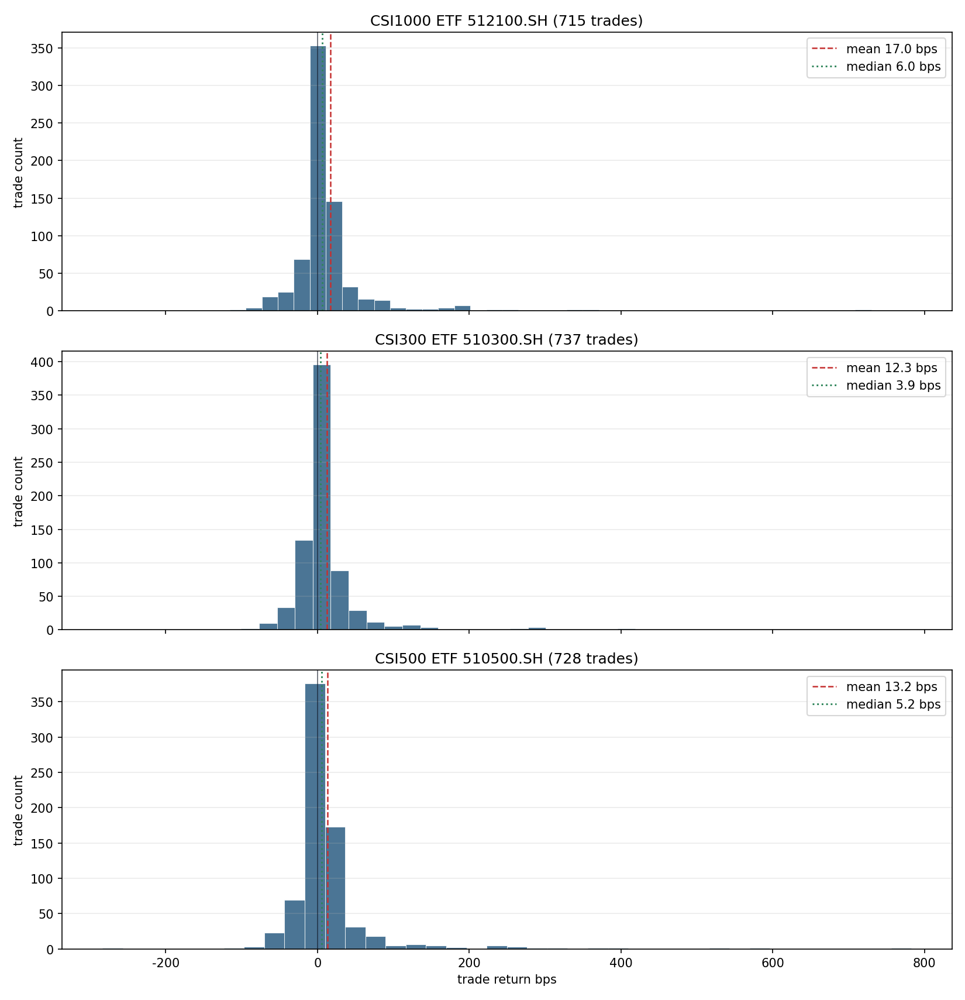

### ETF Trade Return Distribution

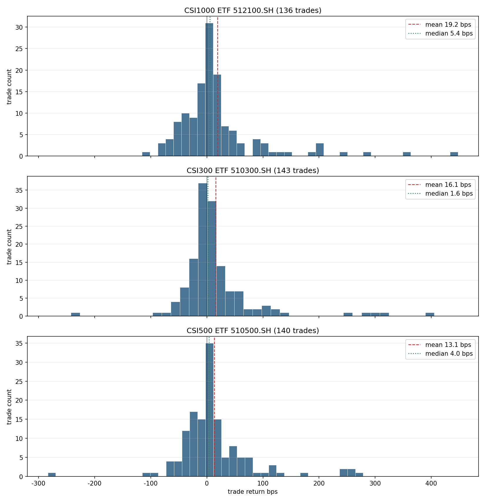

### ETF Test Trade Return Distribution

### 5.4. Entry Delay Decay Experiment

Open signals are delayed while preserving the registered rebalance and holding logic.

| scope | split | pool | display_name | date | x_index | delay_minutes | delayed_strategy_cumulative_return |
| --- | --- | --- | --- | --- | --- | --- | --- |
| train_val_test | train | csi1000_etf_sh | 1000 ETF | 210104 | 1 | 0 | 0.000000 |
| train_val_test | train | csi1000_etf_sh | 1000 ETF | 210104 | 2 | 0 | 0.000000 |
| train_val_test | train | csi1000_etf_sh | 1000 ETF | 210104 | 3 | 0 | 0.000000 |
| train_val_test | train | csi1000_etf_sh | 1000 ETF | 210104 | 4 | 0 | 0.000000 |
| train_val_test | train | csi1000_etf_sh | 1000 ETF | 210104 | 5 | 0 | 0.000000 |
| train_val_test | train | csi1000_etf_sh | 1000 ETF | 210104 | 6 | 0 | 0.000000 |
| train_val_test | train | csi1000_etf_sh | 1000 ETF | 210104 | 7 | 0 | 0.000000 |
| train_val_test | train | csi1000_etf_sh | 1000 ETF | 210104 | 8 | 0 | 0.000000 |
| train_val_test | train | csi1000_etf_sh | 1000 ETF | 210104 | 9 | 0 | 0.000000 |
| train_val_test | train | csi1000_etf_sh | 1000 ETF | 210104 | 10 | 0 | 0.000000 |
| train_val_test | train | csi1000_etf_sh | 1000 ETF | 210104 | 11 | 0 | 0.000000 |
| train_val_test | train | csi1000_etf_sh | 1000 ETF | 210104 | 12 | 0 | 0.000000 |
| train_val_test | train | csi1000_etf_sh | 1000 ETF | 210104 | 13 | 0 | 0.000000 |
| train_val_test | train | csi1000_etf_sh | 1000 ETF | 210104 | 14 | 0 | 0.000000 |
| train_val_test | train | csi1000_etf_sh | 1000 ETF | 210104 | 15 | 0 | 0.000000 |
| train_val_test | train | csi1000_etf_sh | 1000 ETF | 210104 | 16 | 0 | 0.000000 |
| train_val_test | train | csi1000_etf_sh | 1000 ETF | 210104 | 17 | 0 | 0.000000 |
| train_val_test | train | csi1000_etf_sh | 1000 ETF | 210104 | 18 | 0 | 0.000000 |
| train_val_test | train | csi1000_etf_sh | 1000 ETF | 210104 | 19 | 0 | 0.000000 |
| train_val_test | train | csi1000_etf_sh | 1000 ETF | 210104 | 20 | 0 | 0.000000 |
| train_val_test | train | csi1000_etf_sh | 1000 ETF | 210104 | 21 | 0 | 0.000000 |
| train_val_test | train | csi1000_etf_sh | 1000 ETF | 210104 | 22 | 0 | 0.000000 |
| train_val_test | train | csi1000_etf_sh | 1000 ETF | 210104 | 23 | 0 | 0.000000 |
| train_val_test | train | csi1000_etf_sh | 1000 ETF | 210104 | 24 | 0 | 0.000000 |
| train_val_test | train | csi1000_etf_sh | 1000 ETF | 210104 | 25 | 0 | 0.000000 |
| train_val_test | train | csi1000_etf_sh | 1000 ETF | 210104 | 26 | 0 | 0.000000 |
| train_val_test | train | csi1000_etf_sh | 1000 ETF | 210104 | 27 | 0 | 0.000000 |
| train_val_test | train | csi1000_etf_sh | 1000 ETF | 210104 | 28 | 0 | 0.000000 |
| train_val_test | train | csi1000_etf_sh | 1000 ETF | 210104 | 29 | 0 | 0.000000 |
| train_val_test | train | csi1000_etf_sh | 1000 ETF | 210104 | 30 | 0 | 0.000000 |
| train_val_test | train | csi1000_etf_sh | 1000 ETF | 210104 | 31 | 0 | 0.000000 |
| train_val_test | train | csi1000_etf_sh | 1000 ETF | 210104 | 32 | 0 | 0.000000 |
| train_val_test | train | csi1000_etf_sh | 1000 ETF | 210104 | 33 | 0 | 0.000000 |
| train_val_test | train | csi1000_etf_sh | 1000 ETF | 210104 | 34 | 0 | 0.000000 |
| train_val_test | train | csi1000_etf_sh | 1000 ETF | 210104 | 35 | 0 | 0.000000 |
| train_val_test | train | csi1000_etf_sh | 1000 ETF | 210104 | 36 | 0 | 0.000000 |
| train_val_test | train | csi1000_etf_sh | 1000 ETF | 210104 | 37 | 0 | 0.000000 |
| train_val_test | train | csi1000_etf_sh | 1000 ETF | 210104 | 38 | 0 | 0.000000 |
| train_val_test | train | csi1000_etf_sh | 1000 ETF | 210104 | 39 | 0 | 0.000000 |
| train_val_test | train | csi1000_etf_sh | 1000 ETF | 210104 | 40 | 0 | 0.000000 |
| train_val_test | train | csi1000_etf_sh | 1000 ETF | 210104 | 41 | 0 | 0.000000 |
| train_val_test | train | csi1000_etf_sh | 1000 ETF | 210104 | 42 | 0 | 0.000000 |
| train_val_test | train | csi1000_etf_sh | 1000 ETF | 210104 | 43 | 0 | 0.000000 |
| train_val_test | train | csi1000_etf_sh | 1000 ETF | 210104 | 44 | 0 | 0.000000 |
| train_val_test | train | csi1000_etf_sh | 1000 ETF | 210104 | 45 | 0 | 0.000000 |
| train_val_test | train | csi1000_etf_sh | 1000 ETF | 210104 | 46 | 0 | 0.000000 |
| train_val_test | train | csi1000_etf_sh | 1000 ETF | 210104 | 47 | 0 | 0.000000 |
| train_val_test | train | csi1000_etf_sh | 1000 ETF | 210104 | 48 | 0 | 0.000000 |
| train_val_test | train | csi1000_etf_sh | 1000 ETF | 210104 | 49 | 0 | 0.000000 |
| train_val_test | train | csi1000_etf_sh | 1000 ETF | 210104 | 50 | 0 | 0.000000 |
| train_val_test | train | csi1000_etf_sh | 1000 ETF | 210104 | 51 | 0 | 0.000000 |
| train_val_test | train | csi1000_etf_sh | 1000 ETF | 210104 | 52 | 0 | 0.000000 |
| train_val_test | train | csi1000_etf_sh | 1000 ETF | 210104 | 53 | 0 | 0.000000 |
| train_val_test | train | csi1000_etf_sh | 1000 ETF | 210104 | 54 | 0 | 0.000000 |
| train_val_test | train | csi1000_etf_sh | 1000 ETF | 210104 | 55 | 0 | 0.000000 |
| train_val_test | train | csi1000_etf_sh | 1000 ETF | 210104 | 56 | 0 | 0.000000 |
| train_val_test | train | csi1000_etf_sh | 1000 ETF | 210104 | 57 | 0 | 0.000000 |
| train_val_test | train | csi1000_etf_sh | 1000 ETF | 210104 | 58 | 0 | 0.000000 |
| train_val_test | train | csi1000_etf_sh | 1000 ETF | 210104 | 59 | 0 | 0.000000 |
| train_val_test | train | csi1000_etf_sh | 1000 ETF | 210104 | 60 | 0 | 0.000000 |
| test | test | csi500_etf_sh | 中证500 ETF(沪) | 241231 | 32946 | 3 | 0.182125 |
| test | test | csi500_etf_sh | 中证500 ETF(沪) | 241231 | 32947 | 3 | 0.182125 |
| test | test | csi500_etf_sh | 中证500 ETF(沪) | 241231 | 32948 | 3 | 0.182125 |
| test | test | csi500_etf_sh | 中证500 ETF(沪) | 241231 | 32949 | 3 | 0.182125 |
| test | test | csi500_etf_sh | 中证500 ETF(沪) | 241231 | 32950 | 3 | 0.182125 |
| test | test | csi500_etf_sh | 中证500 ETF(沪) | 241231 | 32951 | 3 | 0.182125 |
| test | test | csi500_etf_sh | 中证500 ETF(沪) | 241231 | 32952 | 3 | 0.182125 |
| test | test | csi500_etf_sh | 中证500 ETF(沪) | 241231 | 32953 | 3 | 0.182125 |
| test | test | csi500_etf_sh | 中证500 ETF(沪) | 241231 | 32954 | 3 | 0.182125 |
| test | test | csi500_etf_sh | 中证500 ETF(沪) | 241231 | 32955 | 3 | 0.182125 |
| test | test | csi500_etf_sh | 中证500 ETF(沪) | 241231 | 32956 | 3 | 0.182125 |
| test | test | csi500_etf_sh | 中证500 ETF(沪) | 241231 | 32957 | 3 | 0.182125 |
| test | test | csi500_etf_sh | 中证500 ETF(沪) | 241231 | 32958 | 3 | 0.182125 |
| test | test | csi500_etf_sh | 中证500 ETF(沪) | 241231 | 32959 | 3 | 0.182125 |
| test | test | csi500_etf_sh | 中证500 ETF(沪) | 241231 | 32960 | 3 | 0.182125 |
| test | test | csi500_etf_sh | 中证500 ETF(沪) | 241231 | 32961 | 3 | 0.182125 |
| test | test | csi500_etf_sh | 中证500 ETF(沪) | 241231 | 32962 | 3 | 0.182125 |
| test | test | csi500_etf_sh | 中证500 ETF(沪) | 241231 | 32963 | 3 | 0.182125 |
| test | test | csi500_etf_sh | 中证500 ETF(沪) | 241231 | 32964 | 3 | 0.182125 |
| test | test | csi500_etf_sh | 中证500 ETF(沪) | 241231 | 32965 | 3 | 0.182125 |
| test | test | csi500_etf_sh | 中证500 ETF(沪) | 241231 | 32966 | 3 | 0.182125 |
| test | test | csi500_etf_sh | 中证500 ETF(沪) | 241231 | 32967 | 3 | 0.182125 |
| test | test | csi500_etf_sh | 中证500 ETF(沪) | 241231 | 32968 | 3 | 0.182125 |
| test | test | csi500_etf_sh | 中证500 ETF(沪) | 241231 | 32969 | 3 | 0.182125 |
| test | test | csi500_etf_sh | 中证500 ETF(沪) | 241231 | 32970 | 3 | 0.182125 |
| test | test | csi500_etf_sh | 中证500 ETF(沪) | 241231 | 32971 | 3 | 0.182125 |
| test | test | csi500_etf_sh | 中证500 ETF(沪) | 241231 | 32972 | 3 | 0.182125 |
| test | test | csi500_etf_sh | 中证500 ETF(沪) | 241231 | 32973 | 3 | 0.182125 |
| test | test | csi500_etf_sh | 中证500 ETF(沪) | 241231 | 32974 | 3 | 0.182125 |
| test | test | csi500_etf_sh | 中证500 ETF(沪) | 241231 | 32975 | 3 | 0.182125 |
| test | test | csi500_etf_sh | 中证500 ETF(沪) | 241231 | 32976 | 3 | 0.182125 |
| test | test | csi500_etf_sh | 中证500 ETF(沪) | 241231 | 32977 | 3 | 0.182125 |
| test | test | csi500_etf_sh | 中证500 ETF(沪) | 241231 | 32978 | 3 | 0.182125 |
| test | test | csi500_etf_sh | 中证500 ETF(沪) | 241231 | 32979 | 3 | 0.182125 |
| test | test | csi500_etf_sh | 中证500 ETF(沪) | 241231 | 32980 | 3 | 0.182125 |
| test | test | csi500_etf_sh | 中证500 ETF(沪) | 241231 | 32981 | 3 | 0.182125 |
| test | test | csi500_etf_sh | 中证500 ETF(沪) | 241231 | 32982 | 3 | 0.182125 |
| test | test | csi500_etf_sh | 中证500 ETF(沪) | 241231 | 32983 | 3 | 0.182125 |
| test | test | csi500_etf_sh | 中证500 ETF(沪) | 241231 | 32984 | 3 | 0.182125 |
| test | test | csi500_etf_sh | 中证500 ETF(沪) | 241231 | 32985 | 3 | 0.182125 |
| test | test | csi500_etf_sh | 中证500 ETF(沪) | 241231 | 32986 | 3 | 0.182125 |
| test | test | csi500_etf_sh | 中证500 ETF(沪) | 241231 | 32987 | 3 | 0.182125 |
| test | test | csi500_etf_sh | 中证500 ETF(沪) | 241231 | 32988 | 3 | 0.182125 |
| test | test | csi500_etf_sh | 中证500 ETF(沪) | 241231 | 32989 | 3 | 0.182125 |
| test | test | csi500_etf_sh | 中证500 ETF(沪) | 241231 | 32990 | 3 | 0.182125 |
| test | test | csi500_etf_sh | 中证500 ETF(沪) | 241231 | 32991 | 3 | 0.182125 |
| test | test | csi500_etf_sh | 中证500 ETF(沪) | 241231 | 32992 | 3 | 0.182125 |
| test | test | csi500_etf_sh | 中证500 ETF(沪) | 241231 | 32993 | 3 | 0.182125 |
| test | test | csi500_etf_sh | 中证500 ETF(沪) | 241231 | 32994 | 3 | 0.182125 |
| test | test | csi500_etf_sh | 中证500 ETF(沪) | 241231 | 32995 | 3 | 0.182125 |
| test | test | csi500_etf_sh | 中证500 ETF(沪) | 241231 | 32996 | 3 | 0.182125 |
| test | test | csi500_etf_sh | 中证500 ETF(沪) | 241231 | 32997 | 3 | 0.182125 |
| test | test | csi500_etf_sh | 中证500 ETF(沪) | 241231 | 32998 | 3 | 0.182125 |
| test | test | csi500_etf_sh | 中证500 ETF(沪) | 241231 | 32999 | 3 | 0.182125 |
| test | test | csi500_etf_sh | 中证500 ETF(沪) | 241231 | 33000 | 3 | 0.182125 |
| test | test | csi500_etf_sh | 中证500 ETF(沪) | 241231 | 33001 | 3 | 0.182125 |
| test | test | csi500_etf_sh | 中证500 ETF(沪) | 241231 | 33002 | 3 | 0.182125 |
| test | test | csi500_etf_sh | 中证500 ETF(沪) | 241231 | 33003 | 3 | 0.182125 |
| test | test | csi500_etf_sh | 中证500 ETF(沪) | 241231 | 33004 | 3 | 0.182125 |
| test | test | csi500_etf_sh | 中证500 ETF(沪) | 241231 | 33005 | 3 | 0.176853 |

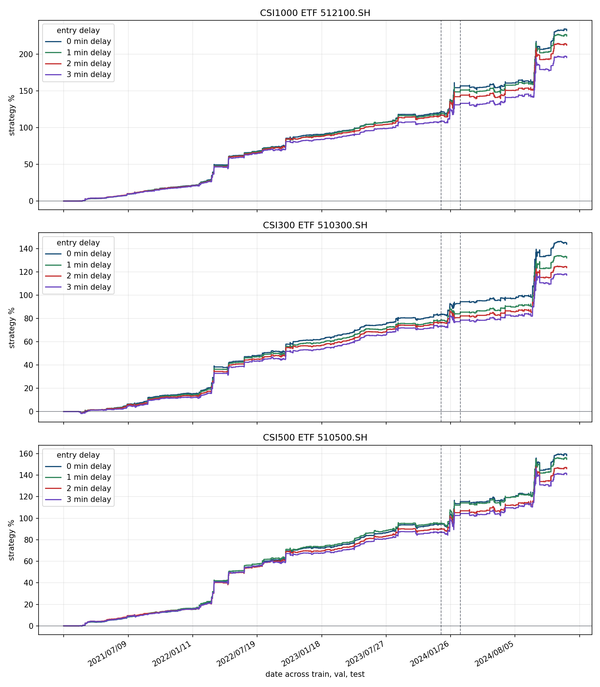

### Entry Delay Decay

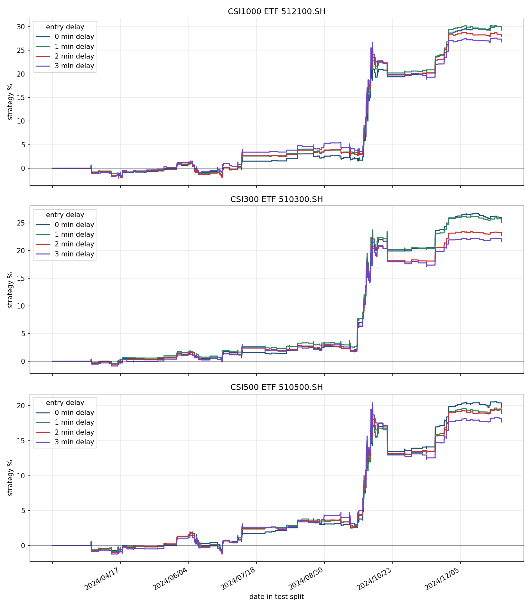

### Test Entry Delay Decay

06

6. Robustness Diagnostics

### Robustness Diagnostics

完成臂使用完整 robustness artifact; 暂停臂不生成 OOS diagnostics. 

### 6.1. IC by volatility rank

Rolling IC conditioned on volatility rank.

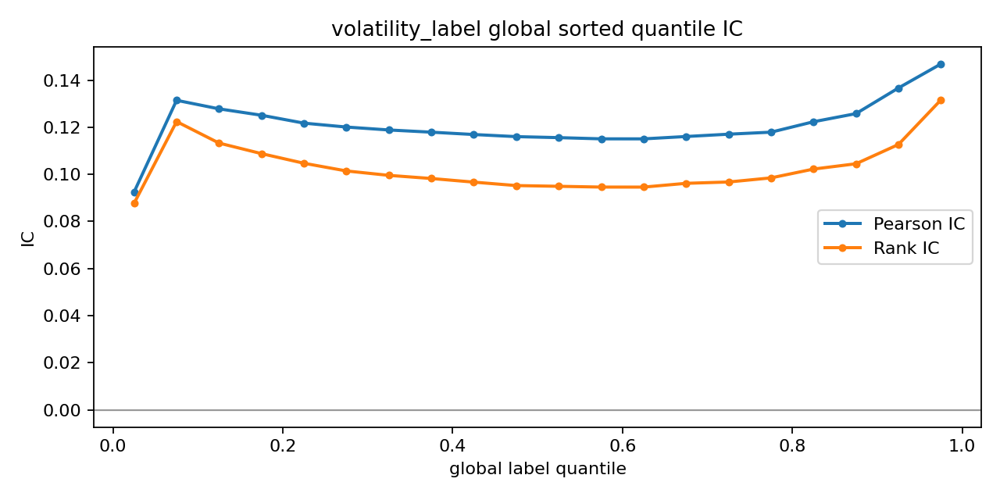

### IC By Volatility Rank

### 6.2. IC by price rank

Rolling IC conditioned on price rank.

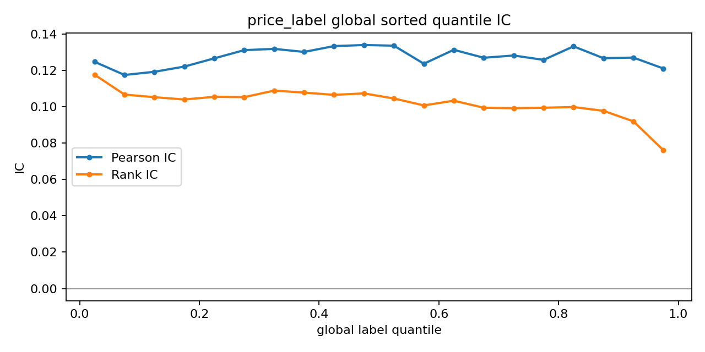

### IC By Price Rank

### 6.3. Train/test intraday IC curve

Same minute-of-session aggregation for fixed train sample and full test.

| time | pooled_ic_train | sample_count_train | pooled_ic_test | sample_count_test |
| --- | --- | --- | --- | --- |
| 103900 | 0.111367 | 201695 | 0.140780 | 1094002 |
| 104000 | 0.089722 | 201695 | 0.142463 | 1094002 |
| 104100 | 0.082275 | 201695 | 0.140367 | 1094002 |
| 104200 | 0.081401 | 201695 | 0.113019 | 1094002 |
| 104300 | 0.081968 | 201695 | 0.076976 | 1094002 |
| 104400 | 0.102153 | 201695 | 0.057036 | 1094002 |
| 104500 | 0.112206 | 201695 | 0.050110 | 1094002 |
| 104600 | 0.113315 | 201695 | 0.062652 | 1094002 |
| 104700 | 0.125684 | 201695 | 0.081109 | 1094002 |
| 104800 | 0.116536 | 201695 | 0.095007 | 1094002 |
| 104900 | 0.105810 | 201695 | 0.104528 | 1094002 |
| 105000 | 0.115543 | 201695 | 0.093471 | 1094002 |
| 105100 | 0.126566 | 201695 | 0.095297 | 1094002 |
| 105200 | 0.126526 | 201695 | 0.090329 | 1094002 |
| 105300 | 0.115020 | 201695 | 0.102835 | 1094002 |
| 105400 | 0.118135 | 201695 | 0.098645 | 1094002 |
| 105500 | 0.121445 | 201695 | 0.104423 | 1094002 |
| 105600 | 0.124455 | 199181 | 0.110535 | 1094002 |
| 105700 | 0.126294 | 197532 | 0.113755 | 1094002 |
| 105800 | 0.120273 | 197532 | 0.109291 | 1094002 |
| 105900 | 0.112952 | 197532 | 0.109621 | 1094002 |
| 110000 | 0.082337 | 197532 | 0.100280 | 1094002 |
| 110100 | 0.066596 | 197532 | 0.084439 | 1094002 |
| 110200 | 0.085205 | 197532 | 0.110800 | 1094002 |
| 110300 | 0.099787 | 197532 | 0.096213 | 1094002 |
| 110400 | 0.106775 | 197532 | 0.105354 | 1094002 |
| 110500 | 0.086550 | 197532 | 0.108995 | 1094002 |
| 110600 | 0.104082 | 197532 | 0.115401 | 1094002 |
| 110700 | 0.125603 | 197532 | 0.134681 | 1094002 |
| 110800 | 0.150681 | 197532 | 0.147097 | 1094002 |
| 110900 | 0.153243 | 197532 | 0.150911 | 1094002 |
| 111000 | 0.132508 | 197532 | 0.134332 | 1094002 |
| 111100 | 0.132387 | 197532 | 0.123709 | 1094002 |
| 111200 | 0.116505 | 197532 | 0.107878 | 1094002 |
| 111300 | 0.111209 | 197532 | 0.108032 | 1094002 |
| 111400 | 0.122644 | 197532 | 0.114578 | 1094002 |
| 111500 | 0.129490 | 197532 | 0.101837 | 1094002 |
| 111600 | 0.132479 | 197532 | 0.083825 | 1094002 |
| 111700 | 0.115719 | 197532 | 0.091793 | 1094002 |
| 111800 | 0.125705 | 197532 | 0.083268 | 1094002 |
| 141000 | 0.166117 | 197532 | 0.129358 | 1094002 |
| 141100 | 0.160493 | 197532 | 0.114039 | 1094002 |
| 141200 | 0.139905 | 197532 | 0.098668 | 1094002 |
| 141300 | 0.133063 | 197532 | 0.087228 | 1094002 |
| 141400 | 0.146027 | 197532 | 0.062996 | 1094002 |
| 141500 | 0.150093 | 197532 | 0.041601 | 1094002 |
| 141600 | 0.152762 | 197532 | 0.047788 | 1094002 |
| 141700 | 0.158223 | 197532 | 0.060271 | 1094002 |
| 141800 | 0.170004 | 197532 | 0.058339 | 1094002 |
| 141900 | 0.164198 | 197532 | 0.086626 | 1094002 |
| 142000 | 0.155227 | 197532 | 0.108426 | 1094002 |
| 142100 | 0.145295 | 197532 | 0.133416 | 1094002 |
| 142200 | 0.140213 | 197532 | 0.131636 | 1094002 |
| 142300 | 0.144717 | 197532 | 0.135726 | 1094002 |
| 142400 | 0.142866 | 197532 | 0.152477 | 1094002 |
| 142500 | 0.143084 | 197532 | 0.144982 | 1094002 |
| 142600 | 0.128898 | 197532 | 0.149873 | 1094002 |
| 142700 | 0.134228 | 197532 | 0.156720 | 1094002 |
| 142800 | 0.150225 | 197532 | 0.157255 | 1094002 |
| 142900 | 0.147010 | 197532 | 0.178225 | 1094002 |
| 143000 | 0.103547 | 197532 | 0.156215 | 1094002 |
| 143100 | 0.093850 | 197532 | 0.148822 | 1094002 |
| 143200 | 0.121591 | 197532 | 0.166335 | 1094002 |
| 143300 | 0.147488 | 197532 | 0.174668 | 1094002 |
| 143400 | 0.166447 | 197532 | 0.186783 | 1094002 |
| 143500 | 0.180219 | 197532 | 0.175115 | 1094002 |
| 143600 | 0.191601 | 197532 | 0.152169 | 1094002 |
| 143700 | 0.186647 | 197532 | 0.152714 | 1094002 |
| 143800 | 0.186635 | 197532 | 0.160314 | 1094002 |
| 143900 | 0.176976 | 197532 | 0.173278 | 1094002 |
| 144000 | 0.170762 | 197532 | 0.177797 | 1094002 |
| 144100 | 0.171940 | 197532 | 0.183111 | 1094002 |
| 144200 | 0.171076 | 197532 | 0.200537 | 1094002 |
| 144300 | 0.163126 | 197532 | 0.200297 | 1094002 |
| 144400 | 0.164110 | 197532 | 0.199559 | 1094002 |
| 144500 | 0.174042 | 197532 | 0.190247 | 1094002 |
| 144600 | 0.192086 | 197532 | 0.201198 | 1094002 |
| 144700 | 0.190806 | 197532 | 0.212732 | 1094002 |
| 144800 | 0.187617 | 197532 | 0.206448 | 1094002 |
| 144900 | 0.181342 | 197532 | 0.230421 | 1094002 |

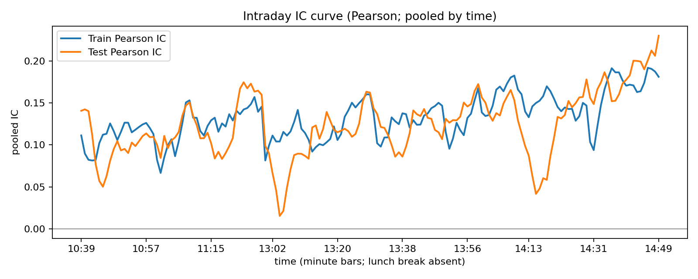

### Train/Test Intraday IC

### 6.4. Monthly signal spread and net efficiency

Monthly IC, Rank IC, signal spread and strategy efficiency expose regime concentration.

| month | top_minus_bottom_bps | strategy_bps_per_turnover |
| --- | --- | --- |
| 2024/03 | 13.843530 | -4.930816 |
| 2024/04 | 13.281850 | 0.952206 |
| 2024/05 | 12.063694 | 9.364408 |
| 2024/06 | 8.990117 | -0.398377 |
| 2024/07 | 12.422467 | 3.136607 |
| 2024/08 | 13.674347 | 3.993757 |
| 2024/09 | 11.764266 | 20.968396 |
| 2024/10 | 25.539258 | 12.267738 |
| 2024/11 | 22.024630 | 24.309753 |
| 2024/12 | 12.224657 | -0.009138 |

| month | pearson_ic | rank_ic | sample_count |
| --- | --- | --- | --- |
| 2024/03 | 0.112720 | 0.083288 | 18060980 |
| 2024/04 | 0.126437 | 0.098713 | 17208163 |
| 2024/05 | 0.108993 | 0.090235 | 17163405 |
| 2024/06 | 0.105338 | 0.095355 | 16320248 |
| 2024/07 | 0.127072 | 0.106981 | 19730550 |
| 2024/08 | 0.121645 | 0.088329 | 18876767 |
| 2024/09 | 0.125944 | 0.130954 | 16298996 |
| 2024/10 | 0.138075 | 0.103148 | 15457127 |
| 2024/11 | 0.149885 | 0.135675 | 18056633 |
| 2024/12 | 0.112268 | 0.083345 | 18961453 |

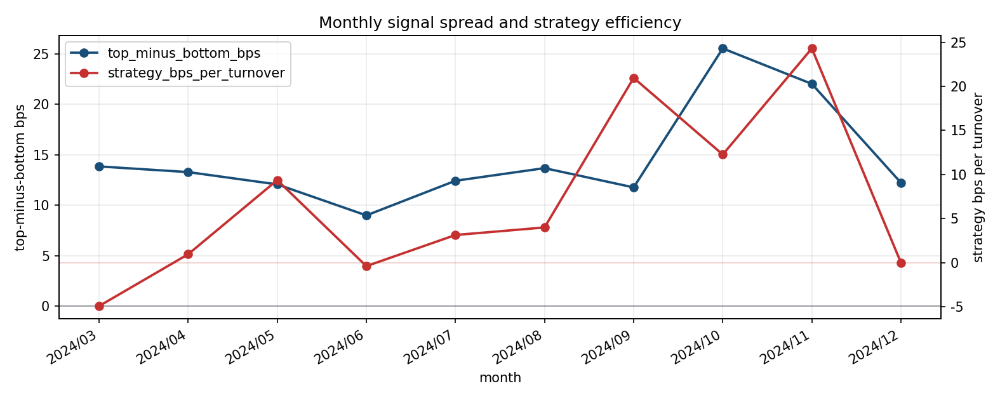

### Monthly Signal Spread And Net Efficiency

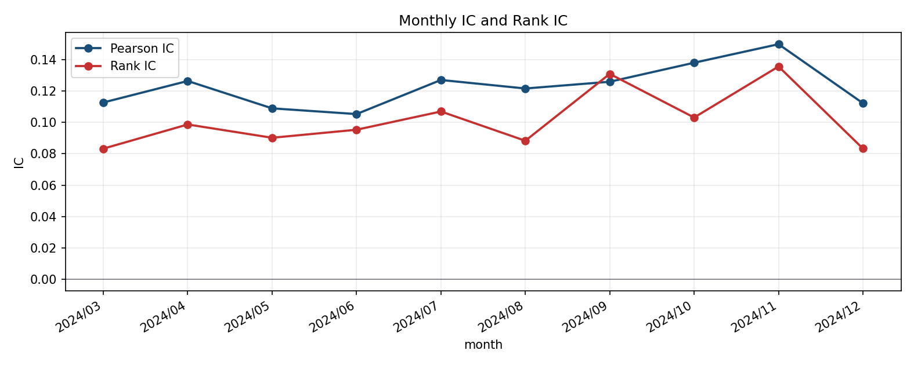

### Monthly IC And Rank IC

### 6.5. Return Realization

Top-5% predictions are remeasured over multiple forward holding horizons.

| holding_minutes | mean_return | mean_return_bps | row_count | prediction_p95 |
| --- | --- | --- | --- | --- |
| 1 | 0.000333 | 3.327913 | 8806718 | 0.000867 |
| 2 | 0.000569 | 5.691901 | 8806718 | 0.000867 |
| 3 | 0.000739 | 7.393351 | 8806718 | 0.000867 |
| 4 | 0.000868 | 8.682976 | 8806718 | 0.000867 |
| 5 | 0.000979 | 9.794104 | 8806718 | 0.000867 |
| 6 | 0.001074 | 10.736198 | 8806718 | 0.000867 |
| 7 | 0.001156 | 11.561296 | 8806718 | 0.000867 |
| 8 | 0.001228 | 12.282581 | 8806718 | 0.000867 |
| 9 | 0.001290 | 12.897486 | 8806718 | 0.000867 |
| 10 | 0.001354 | 13.539320 | 8806718 | 0.000867 |
| 11 | 0.001405 | 14.050551 | 8592134 | 0.000867 |
| 12 | 0.001459 | 14.593201 | 8396277 | 0.000867 |
| 13 | 0.001508 | 15.078219 | 8216065 | 0.000867 |
| 14 | 0.001555 | 15.547566 | 8040910 | 0.000867 |
| 15 | 0.001599 | 15.987910 | 7883862 | 0.000867 |
| 16 | 0.001634 | 16.339445 | 7738677 | 0.000867 |
| 17 | 0.001667 | 16.673772 | 7601884 | 0.000867 |
| 18 | 0.001702 | 17.017683 | 7476808 | 0.000867 |
| 19 | 0.001738 | 17.380736 | 7362360 | 0.000867 |
| 20 | 0.001776 | 17.764040 | 7251465 | 0.000867 |

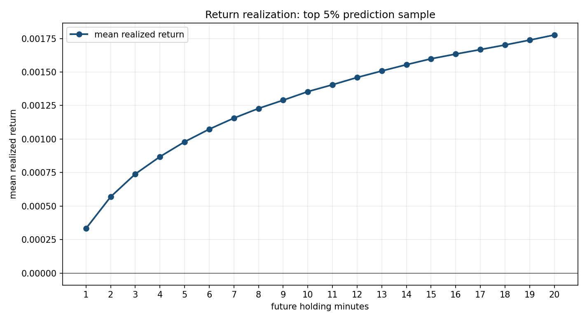

### Return Realization

### 6.6. Top-k% Robustness

Fixed train sample and full test are compared across prediction selection widths.

| split | selection_method | k_pct | universe_count | selected_count | selected_fraction | prediction_threshold | mean_label_bps | median_label_bps | label_std_bps | hit_rate | day_count | timestamp_count |
| --- | --- | --- | --- | --- | --- | --- | --- | --- | --- | --- | --- | --- |
| train | approx_quantile_threshold | 1 | 31875072 | 316163 | 0.009919 | 0.001525 | 22.322846 | 9.140817 | 91.851394 | 0.522240 | 49 | 7746 |
| train | approx_quantile_threshold | 2 | 31875072 | 634190 | 0.019896 | 0.001129 | 17.364908 | 4.203798 | 80.475923 | 0.506405 | 49 | 7746 |
| train | approx_quantile_threshold | 3 | 31875072 | 945641 | 0.029667 | 0.000921 | 15.044827 | 1.970199 | 74.806317 | 0.498278 | 49 | 7746 |
| train | approx_quantile_threshold | 5 | 31875072 | 1593518 | 0.049993 | 0.000740 | 12.485518 | 0.290447 | 67.769670 | 0.488079 | 49 | 7746 |
| train | approx_quantile_threshold | 10 | 31875072 | 3201138 | 0.100428 | 0.000539 | 9.650827 | 0.000557 | 59.323832 | 0.473585 | 49 | 7746 |
| train | approx_quantile_threshold | 15 | 31875072 | 4783934 | 0.150084 | 0.000427 | 8.177731 | -0.000014 | 55.229805 | 0.463254 | 49 | 7746 |
| train | approx_quantile_threshold | 20 | 31875072 | 6375860 | 0.200027 | 0.000345 | 7.125264 | -0.000014 | 52.636142 | 0.454588 | 49 | 7746 |
| test | approx_quantile_threshold | 1 | 176134322 | 1735712 | 0.009854 | 0.001948 | 24.584904 | 12.208919 | 117.608988 | 0.535979 | 205 | 33005 |
| test | approx_quantile_threshold | 2 | 176134322 | 3506935 | 0.019911 | 0.001429 | 19.305858 | 8.618395 | 101.558161 | 0.523097 | 205 | 33005 |
| test | approx_quantile_threshold | 3 | 176134322 | 5235762 | 0.029726 | 0.001166 | 16.629110 | 6.206120 | 93.457442 | 0.513938 | 205 | 33005 |
| test | approx_quantile_threshold | 5 | 176134322 | 8714020 | 0.049474 | 0.000871 | 13.600091 | 2.595420 | 84.115282 | 0.501291 | 205 | 33005 |
| test | approx_quantile_threshold | 10 | 176134322 | 17611217 | 0.099987 | 0.000609 | 9.972468 | 0.027526 | 71.976018 | 0.481414 | 205 | 33005 |
| test | approx_quantile_threshold | 15 | 176134322 | 26361153 | 0.149665 | 0.000470 | 8.159343 | 0.000323 | 65.662865 | 0.468159 | 205 | 33005 |
| test | approx_quantile_threshold | 20 | 176134322 | 35174202 | 0.199701 | 0.000374 | 6.964048 | -0.000014 | 61.555712 | 0.458198 | 205 | 33005 |

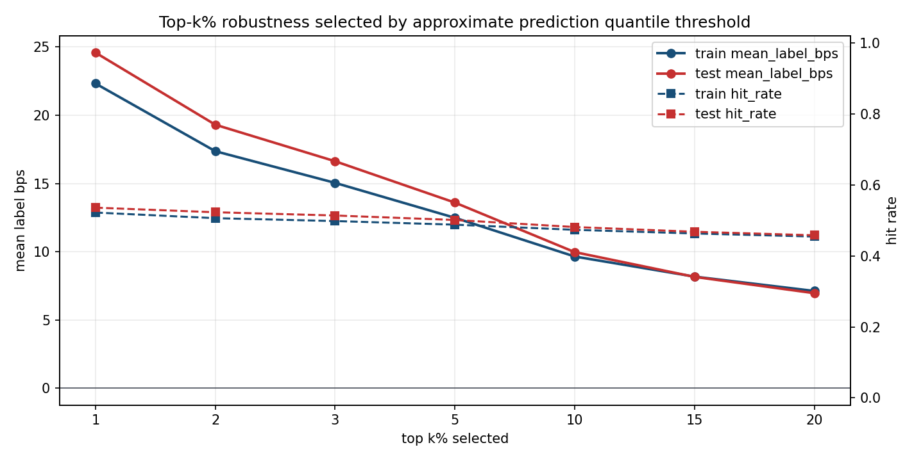

### Top-k% Robustness

07

7. Appendix Diagnostics

## 限制与适用边界

Control/CS rank/latent-z/Deep Sets R2 test IC为0.086462/0.123293/0.127345/0.121030. Induced attention 在test前失败; Deep Sets经历中断后R2成功恢复. 四个完成臂10M净Sharpe均负. 当前artifact可得性只影响复现, 不作为历史成功/失败判据. 只有matched合同内的结果可以直接比较.

## 结论

本次归档保留上述历史事实. 研究结论, 推广门槛和执行限制分别解释, 不把模型无增益或净收益为负改写成实验流程失败.

## 附录

### Appendix Diagnostics

路径和 identity 用于从报告回溯到真实 artifact; 报告不包含外部依赖. 

### 7.1. Artifact Paths

核心 source artifacts 与生成报告路径. 

| artifact | path | status |
| --- | --- | --- |
| run_root | [artifact-root]/nn/0827-market-cs/0829cs-s7-l-latent_z_34d | available |
| npz_meta | [artifact-root]/nn/0827-market-cs/0829cs-s7-l-latent_z_34d/prediction/artifacts/npz/meta.yaml | available |
| data_clean_invalid_stats | [artifact-root]/nn/0827-market-cs/0829cs-s7-l-latent_z_34d/prediction/artifacts/data_clean/invalid_feature_stats.csv | available |
| checkpoint_metadata | [artifact-root]/nn/0827-market-cs/0829cs-s7-l-latent_z_34d/prediction/run/checkpoint_metadata/best_checkpoint.yaml | available |
| test_prediction_manifest | [artifact-root]/nn/0827-market-cs/0829cs-s7-l-latent_z_34d/manifests/evaluate.yaml | available |
| backtest_manifest | [artifact-root]/nn/0827-market-cs/0829cs-s7-l-latent_z_34d/manifests/backtest.yaml | available |
| research_artifact_manifest | [artifact-root]/nn/0827-market-cs/0829cs-s7-l-latent_z_34d/report/research_artifacts/manifest.yaml | available |

### 7.2. Provenance

配置, 代码, 数据, panel, MLflow 和恢复 lineage. 

| field | value |
| --- | --- |
| run_id | 0829cs-s7-l-latent_z_34d |
| MLflow run | 640bb3b2abba4c228a29e27722eae20d |
| Git commit | 88458306f57ad953b9cc9048a32b19bf7b5c9689 |
| config SHA-256 | d36fe22783eb4558fe1138dfeb38df5039c0fd589264734f659a4619eebe3762 |
| data artifact | 6589947466234739b27e243d253a3c48 |
| dataset cache key | e74adc442d96d5ecfcd932bd39289a25be2366d12c20d78a83d8f9aeda2a3460 |
| panel fingerprint | 28573283d9bba84f03cb51f8855fe97b16e99fba1912860c461e58084518926d |
| recovery source | fresh run |
| recovery checkpoint | none |
