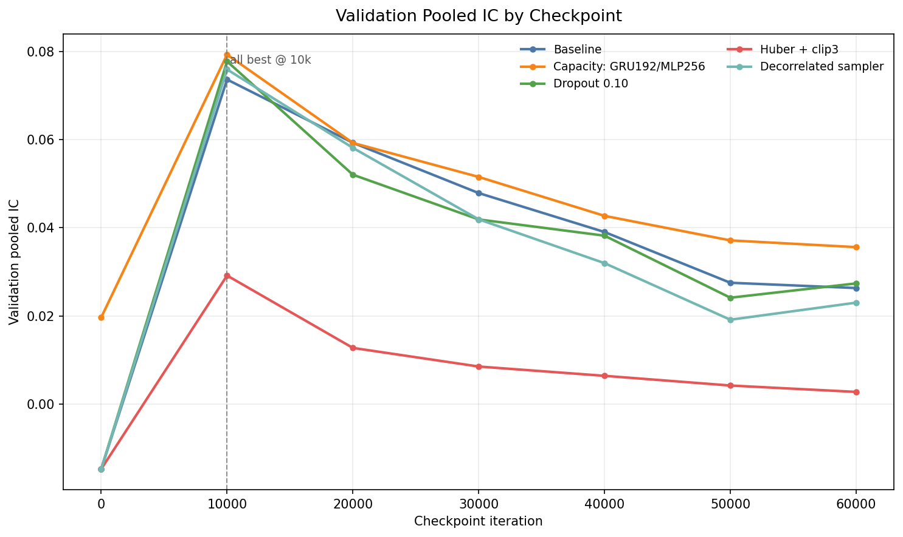
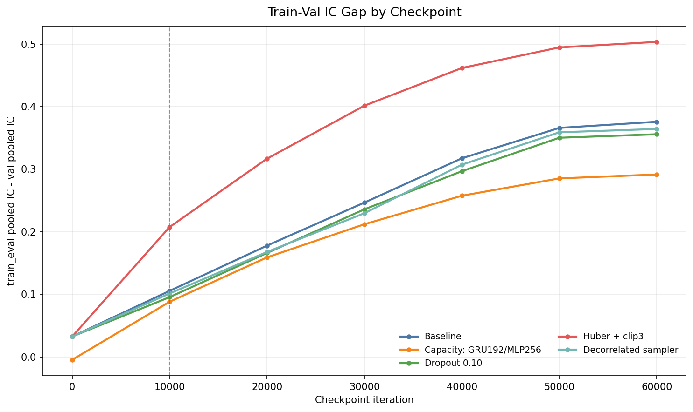
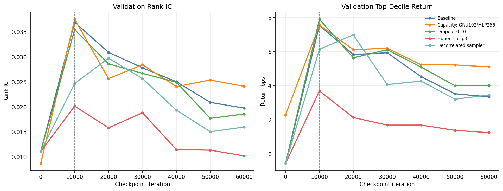
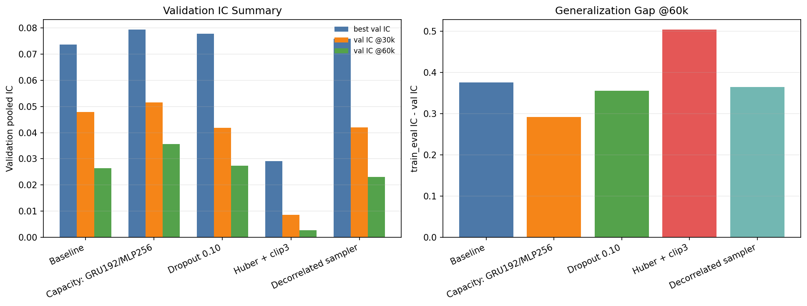

## 摘要

**历史结果: 历史成功.** 五臂 validation 矩阵已完成. 所有臂均在10k达到峰值, 降低容量改善后期保持率但未推迟峰值. 当前 run artifact 缺失只限制复现.

历史成功/失败按实验流程是否成功完成判断. 无增益, 成本后亏损, 归档和当前 artifact 缺失不改变历史成功事实. 失败的实验臂保留失败原因, 不填造未产生的 OOS 指标. 本次只整理已有材料, 未启动训练, 推理或回测.

## 研究背景与目标

本报告围绕容量与过拟合机制整理原始研究证据. 当前材料对应 registry report `capacity-robust-sampling-self-constrained-html`, 来源SHA256为 `c6b1a173f2cc795243818777bcc8497e801f03ac075f7b805e4faece3bb6bba9`. 原报告的实验方法, 图表, 结果和解释保留在下文.

## 数据与方法

实验身份为 `capacity-robust-sampling`. Split, label, sampler, feature与checkpoint定义按原报告记录, 不从其他实验借用缺失字段. 汇总入口见[全实验综述](../../prediction-nn-1min/1103-nn-registry-summary/).

## 主要结果

| 记录项 | 当前解释 |
| --- | --- |
| 实验 | capacity-robust-sampling |
| 报告类型 | self_constrained_html |
| 历史状态 | 历史成功 |
| 证据 | capacity-robust-sampling-self-constrained-html |

Self-constrained single-file HTML report. All figures are embedded inline; no external assets are required.

Source

[artifact-root]/nn/capacity-robust-sampling

Scope

capacity / dropout / Huber+clip / decorrelated sampler

Checkpoint Range

0 to 60k iterations, 10k eval cadence

生成时间: 2026-06-28 实验目录:  `[artifact-root]/nn/capacity-robust-sampling` 代码目录:  `[local-workspace]/exp-nn/capacity-robust-sampling`

### 1. 摘要

本实验针对 exp-nn 中"约 0.1 epoch 附近 validation 指标见顶, 但训练 loss mean 仍继续下降"的现象, 设计了一组短/中程机制验证实验. 目标不是寻找最终生产模型, 而是判断过拟合是否可以被以下机制延后或缓解: 

1. 降低模型容量; 
2. 增加 dropout 正则; 
3. 使用 robust loss 和 label clipping; 
4. 改变训练采样方式, 降低相邻样本相关性. 

结论如下: 

- 所有 variant 的最佳 validation pooled IC 都出现在 10k checkpoint; 没有任何机制把最佳点明显延后到 20k/30k/60k . 
- 降低容量是唯一明确"缓解"过拟合的方向:  cap_gru192_mlp256 的 30k/60k validation IC 和 train-val gap 都优于 baseline. 
- dropout=0.10 没有带来有效改善, 30k/60k validation IC 接近或低于 baseline. 
- Huber + label clip(3 sigma) 明显失败: train IC 快速升高, 但 validation IC 接近坍塌, gap 最大. 
- decorrelated_stride sampling 没有证明可以延后过拟合; 20k top-decile 有短暂改善, 但 30k/60k IC 退化到 baseline 附近甚至更低. 

本实验支持的下一步方向是: 优先继续做 rolling / purged validation 和多 validation period 验证; 若要扩展机制实验, 应围绕"小容量 + 正则/weight decay/early stop"做更小矩阵, 而不是继续扩展 Huber/clip 或 decorrelated sampler. 

> 2026-08-24 artifact 审计: 下文登记的 5 个历史 run root 当前均已缺失; 本目录保留了报告正文, 数值表, 图和自包含 HTML, 但无法从原始 checkpoint/metric artifact 独立重算这些结果. 因此本报告可用于研究追溯, 不构成可直接复用的训练 artifact, 正式复用需要按已保留代码重新运行. 

2026-08-24 artifact 审计: 下文登记的 5 个历史 run root 当前均已缺失; 本目录保留了报告正文, 数值表, 图和自包含 HTML, 但无法从原始 checkpoint/metric artifact 独立重算这些结果. 因此本报告可用于研究追溯, 不构成可直接复用的训练 artifact, 正式复用需要按已保留代码重新运行. 

### 2. 背景与假设

观察到的问题是: 训练过程中 `loss_mean(train)` 继续下降, 但 validation IC 在很早阶段已经开始回落. 这说明 loss mean 对 checkpoint selection 可能有误导性. 因为训练目标是点预测误差, 而实际模型选择更关心横截面排序和交易相关指标, 例如 pooled IC, rank IC, top-decile return. 

同时, validation IC 自身也可能有误导性. 如果当前 validation period 具有特殊行情结构, 流动性状态或标签分布, 那么单一 validation period 的最佳 checkpoint 不一定代表泛化最优. 因此, 本实验只回答一个局部问题: 在当前 date_ranges validation 设置下, 几类常见过拟合缓解机制是否能延后或缓解早期过拟合. validation period 特异性需要通过 rolling / purged validation 和多个 validation period 继续验证. 

### 3. 实验设置

所有 variant 共享同一数据根目录和训练/验证切分, 除指定实验因子外保持一致. 

关键设置: 

- 数据根目录:  [artifact-root]/nn/baseline-main-20260622/date_ranges
- 输出目录:  [artifact-root]/nn/capacity-robust-sampling
- split policy:  date_ranges
- 训练结束日:  20231229
- validation 结束日:  20240229
- seed:  7
- horizon:  10 minutes
- batch size:  8192
- learning rate:  0.001
- weight decay:  0.01
- 训练长度:  60001 iterations
- checkpoint/eval 间隔: 每 10000 iterations
- checkpoint selection metric:  val/quality/pooled_ic
- train_eval 子集大小:  3891 eval iterations

评估 checkpoint: 

`0` , `10k` , `20k` , `30k` , `40k` , `50k` , `60k`

主要指标: 

- val/quality/pooled_ic : 主 checkpoint selection 指标; 
- val/quality/pooled_rank_ic : 排序稳健性指标; 
- val/top_decile/return_bps : 头部组合收益 proxy; 
- train_eval/quality/pooled_ic : 训练子集上的拟合程度; 
- train_eval pooled IC - val pooled IC : 过拟合 gap proxy. 

注意:  `train_eval` 是固定训练评估子集, 不是完整训练集指标. 它适合用来比较趋势和 gap, 但不能等同完整训练集泛化误差. 

### 4. 实验设计与选择理由

### 4.1 Baseline

baseline 使用原始架构和 MSE loss: 

- GRU hidden size:  384
- MLP hidden dims:  512, 512
- dropout:  0.0
- loss:  mse
- sampler:  permute

选择 baseline 的目的是建立同一 schedule 下的参考曲线, 确认早期 validation 见顶是否复现, 并提供所有干预的对照. 

### 4.2 降低容量:  cap_gru192_mlp256

改动: 

- GRU hidden size:  384 -> 192
- MLP hidden dims:  512,512 -> 256

选择理由: 如果 0.1 epoch 附近的过拟合主要来自模型容量过大, 可以快速记住训练集局部结构, 那么降低容量应该降低 train_eval IC 增速, 缩小 train-val gap, 并在 20k/30k/60k 上保留更多 validation IC. 

### 4.3 Dropout 正则:  reg_dropout010

改动: 

- dropout:  0.0 -> 0.1

选择理由: dropout 是直接正则化 MLP 表达的低成本实验. 如果过拟合来自 dense layers 对训练噪声或局部模式的 co-adaptation, dropout 应该降低 gap 或延后 validation peak. 

### 4.4 Robust loss 与 label clipping:  loss_huber_clip3

改动: 

- loss:  mse -> huber
- Huber delta:  1.0
- label clip abs:  3.0

选择理由: 金融分钟级标签通常重尾, MSE 可能被极端标签主导. 如果早期过拟合主要来自模型追逐极端 label 或 outlier, Huber loss 与 label clipping 应该让训练目标更稳健, 减少对异常点的拟合. 

### 4.5 去相关采样:  sampler_decorrelated_stride

改动: 

- sampler:  permute -> decorrelated_stride

选择理由: 分钟级样本在时间, 股票池和相邻窗口上高度相关. 如果 batch 中相邻样本相关性过强, 模型可能过快学习局部连续结构, 表现为 train loss 继续下降但 validation IC 回落. stride-based sampling 用于测试是否能通过降低 batch 内相邻相关性来延缓过拟合. 

### 5. 实验结果

### 5.1 Validation IC 曲线

主要观察: 

- 所有 variant 的 best validation pooled IC 都在 10k . 
- baseline 从 10k 的 0.073689 下降到 60k 的 0.026326 . 
- capacity variant 在 10k 最好, 并且 30k/60k 保持得最好. 
- Huber/clip 在 10k 已显著低于其他方法, 之后继续恶化. 
- decorrelated sampler 在 10k/20k 看起来接近 baseline, 但 30k/60k 没有优势. 

### 5.2 Train-Val IC Gap

主要观察: 

- 所有 variant 的 gap 都随训练推进扩大, 说明 validation 回落不是单点噪声, 而是与训练拟合增强同步发生. 
- capacity 的 60k gap 为 0.291538 , 小于 baseline 的 0.375808 , 是最明确的缓解信号. 
- Huber/clip 的 60k gap 为 0.503376 , 最大, 说明它显著放大了训练集拟合但没有转化为 validation 表现. 
- decorrelated sampler 的 60k gap 为 0.364269 , 略小于 baseline, 但 validation IC 更低, 因此不能视为有效改善. 

### 5.3 Rank IC 与 Top-Decile Return

主要观察: 

- rank IC 的趋势与 pooled IC 基本一致: capacity 后期最好, Huber/clip 最差. 
- top-decile return 上, decorrelated sampler 在 20k 有一个局部较好点, 但无法延续到 30k/60k . 
- capacity 在 60k 的 top-decile return 为 5.112 bps , 明显高于 baseline 的 3.350 bps . 

### 5.4 汇总图

汇总图展示了 best validation IC, 30k validation IC, 60k validation IC, 以及 60k generalization gap. 它强调两个事实: 

- 最佳点没有延后, 全部仍在 10k; 
- 后期保留能力和 gap 控制上, capacity 是唯一稳定优于 baseline 的方法. 

### 6. 数值结果

### 6.1 Variant 汇总

| Variant | Best iter | Best val IC | 30k val IC | 60k val IC | 60k train IC | 60k gap | 60k rank IC | 60k top decile bps |
| --- | --- | --- | --- | --- | --- | --- | --- | --- |
| Baseline | 10000 | 0.073689 | 0.047898 | 0.026326 | 0.402134 | 0.375808 | 0.019780 | 3.350 |
| Capacity: GRU192/MLP256 | 10000 | 0.079346 | 0.051562 | 0.035616 | 0.327154 | 0.291538 | 0.024135 | 5.112 |
| Dropout 0.10 | 10000 | 0.077812 | 0.041910 | 0.027380 | 0.383171 | 0.355791 | 0.018604 | 4.023 |
| Huber + clip3 | 10000 | 0.029169 | 0.008501 | 0.002736 | 0.506112 | 0.503376 | 0.010231 | 1.256 |
| Decorrelated sampler | 10000 | 0.075976 | 0.041927 | 0.023009 | 0.387278 | 0.364269 | 0.015993 | 3.461 |

### 6.2 关键 checkpoint 明细

| Variant | Iter | Val IC | Train IC | Gap | Val rank IC | Val top decile bps |
| --- | --- | --- | --- | --- | --- | --- |
| Baseline | 10000 | 0.073689 | 0.179278 | 0.105588 | 0.036966 | 7.543 |
| Baseline | 20000 | 0.059318 | 0.237234 | 0.177915 | 0.030938 | 5.834 |
| Baseline | 30000 | 0.047898 | 0.294613 | 0.246715 | 0.027846 | 5.939 |
| Baseline | 60000 | 0.026326 | 0.402134 | 0.375808 | 0.019780 | 3.350 |
| Capacity: GRU192/MLP256 | 10000 | 0.079346 | 0.167556 | 0.088210 | 0.037555 | 7.563 |
| Capacity: GRU192/MLP256 | 20000 | 0.059289 | 0.218437 | 0.159147 | 0.025685 | 6.120 |
| Capacity: GRU192/MLP256 | 30000 | 0.051562 | 0.263658 | 0.212096 | 0.028463 | 6.201 |
| Capacity: GRU192/MLP256 | 60000 | 0.035616 | 0.327154 | 0.291538 | 0.024135 | 5.112 |
| Dropout 0.10 | 10000 | 0.077812 | 0.173424 | 0.095612 | 0.035479 | 7.901 |
| Dropout 0.10 | 20000 | 0.052069 | 0.218221 | 0.166152 | 0.028639 | 5.642 |
| Dropout 0.10 | 30000 | 0.041910 | 0.277832 | 0.235922 | 0.026735 | 6.116 |
| Dropout 0.10 | 60000 | 0.027380 | 0.383171 | 0.355791 | 0.018604 | 4.023 |
| Huber + clip3 | 10000 | 0.029169 | 0.236753 | 0.207584 | 0.020181 | 3.704 |
| Huber + clip3 | 20000 | 0.012730 | 0.329565 | 0.316835 | 0.015841 | 2.141 |
| Huber + clip3 | 30000 | 0.008501 | 0.410022 | 0.401520 | 0.018850 | 1.698 |
| Huber + clip3 | 60000 | 0.002736 | 0.506112 | 0.503376 | 0.010231 | 1.256 |
| Decorrelated sampler | 10000 | 0.075976 | 0.177403 | 0.101427 | 0.024714 | 6.144 |
| Decorrelated sampler | 20000 | 0.058167 | 0.225946 | 0.167779 | 0.029773 | 6.985 |
| Decorrelated sampler | 30000 | 0.041927 | 0.271637 | 0.229710 | 0.025687 | 4.074 |
| Decorrelated sampler | 60000 | 0.023009 | 0.387278 | 0.364269 | 0.015993 | 3.461 |

### 7. 解读

### 7.1 checkpoint selection 不应依赖 train loss mean

本实验再次确认: 训练继续推进时, train_eval IC 持续上升, 但 validation IC 下降, gap 扩大. 即使 train loss mean 继续下降, 也不能说明模型泛化继续变好. 当前任务的 checkpoint selection 应继续以 validation signal quality 指标为主, 至少包括 pooled IC, rank IC, top-decile return 和 train-val gap, 而不应使用 train loss mean 做主要选择依据. 

### 7.2 validation IC 也可能存在 period 特异性

当前实验的所有结论都基于同一 validation period. 它足以比较不同机制在相同条件下的相对效果, 但不能证明 `10k` 是跨时期稳定最优点. 尤其是: 

- 10k 最优可能是真实早停点; 
- 也可能是当前 validation period 对早期 checkpoint 更友好; 
- 也可能不同市场阶段对 capacity/dropout/sampling 的偏好不同. 

因此, rolling / purged validation 和多个 validation period 仍是必要后续实验. 

### 7.3 降低容量比 dropout 更有效

capacity variant 同时改善了 30k/60k validation IC, rank IC, top-decile return 和 gap, 说明原 baseline 可能存在过高容量或过快记忆训练模式的问题. 相比之下,  `dropout=0.10` 只轻微影响 gap, 未改善 validation IC 曲线. 这说明简单加入 dropout 并没有命中主要过拟合机制, 或者 dropout 位置/强度不是当前瓶颈. 

### 7.4 Huber/clip 不是当前方向

Huber/clip 的结果非常差. 它没有缓解过拟合, 反而让 train_eval IC 更快升高, validation IC 大幅下降. 这可能意味着: 

- 当前 MSE 对极端标签的利用不是主要问题; 
- clipping 改变了目标分布, 损害了与 validation IC 相关的排序信号; 
- Huber 在当前归一化标签上降低了有用尾部样本的梯度贡献. 

该方向不建议继续扩展, 除非后续 label diagnostics 明确显示尾部标签在 validation period 上导致不稳定. 

### 7.5 decorrelated sampling 没有带来稳定收益

decorrelated sampler 的 20k top-decile return 较好, 但 pooled IC, rank IC 和 30k/60k 后续表现不支持它是稳定解法. 它没有延后最佳点, 也没有在 60k 保住 validation IC. 该方向暂时不建议作为主线扩展. 

### 8. 结论与下一步

本实验回答了原始问题: 在当前 validation period 和短/中程 schedule 下, 早期过拟合没有被这些机制明显延后. 最好的 checkpoint 仍在 `10k` , 说明应该高度重视 early stopping, 并避免使用 train loss mean 作为 checkpoint selection 依据. 

建议下一步: 

1. 继续完成 rolling / purged validation, 验证 10k 最优是否跨时间稳定. 
2. 做多个 validation period:  - 当前 period;  - 往后移动的 validation period;  - 60-day validation;  - train 内小子集 sanity validation. 
3. 若继续跑机制矩阵, 优先围绕 capacity 方向:  - GRU hidden size:  128/192/256 - MLP hidden dims:  128/256/384 - weight decay:  0.01/0.03/0.1 - early stop candidate:  5k/10k/15k/20k
4. 暂停扩展 Huber/clip 和 decorrelated sampler, 除非多 validation period 给出相反证据. 
5. 长跑不是当前优先级. 已有 60k 结果显示 validation IC 持续退化, 长跑更可能只扩大 train-val gap. 只有在更稳健 validation 证明后期 checkpoint 有跨期价值时, 才值得长跑. 

### 9. 复现信息

主要结果文件: 

- baseline:  [artifact-root]/nn/capacity-robust-sampling/baseline_short/date_ranges/run
- capacity:  [artifact-root]/nn/capacity-robust-sampling/cap_gru192_mlp256/date_ranges/run
- dropout:  [artifact-root]/nn/capacity-robust-sampling/reg_dropout010/date_ranges/run
- Huber/clip:  [artifact-root]/nn/capacity-robust-sampling/loss_huber_clip3/date_ranges/run
- decorrelated sampler:  [artifact-root]/nn/capacity-robust-sampling/sampler_decorrelated_stride/date_ranges/run

配置文件: 

- variant_config.yaml
- manifests/train.yaml

指标文件: 

- eval_val/iter_*/metrics.json
- eval_train/iter_*/metrics.json

图表文件: 

- figures/val_ic_curves.png
- figures/train_val_ic_gap.png
- figures/rank_ic_top_decile.png
- figures/summary_bars.png

## 限制与适用边界

五臂 validation 矩阵已完成. 所有臂均在10k达到峰值, 降低容量改善后期保持率但未推迟峰值. 当前 run artifact 缺失只限制复现. 当前artifact可得性只影响复现, 不作为历史成功/失败判据. 只有matched合同内的结果可以直接比较.

## 结论

本次归档保留上述历史事实. 研究结论, 推广门槛和执行限制分别解释, 不把模型无增益或净收益为负改写成实验流程失败.
