## 摘要

**历史结果: 历史成功.** F15 feature-cleaning full report 保留了历史训练与评估结果. 精确 launch overrides 和当前 run artifact 不齐, 该版本不作为当前 baseline.

历史成功/失败按实验流程是否成功完成判断. 无增益, 成本后亏损, 归档和当前 artifact 缺失不改变历史成功事实. 失败的实验臂保留失败原因, 不填造未产生的 OOS 指标. 本次只整理已有材料, 未启动训练, 推理或回测.

### 1. Executive Summary

benchmark

0609-04_iter90000

current experiment

selected_checkpoint

90,000

checkpoint used for evaluation

train_pooled_ic

0.154640

corr(all train prediction, all train target)

test_pooled_ic

0.073889

corr(all test prediction, all test target)

top_prediction_return_bps

13.8748

mean top-bin prediction return

top95_hit

47.60%

test top 5% prediction label > 0

etf_top95_hit

55.03%

test ETF top 5% prediction label > 0

overfit_variance_ratio

0.023516

test prediction var / label var

model_class

GruMlpRegressor

prediction model

train_range

20210104 -> 20231229 (727 days)

npz split

val_range

20240102 -> 20240229 (37 days)

npz split

test_range

20240301 -> 20241231 (205 days)

npz split

字段解释

| field | explanation |
| --- | --- |
| benchmark | 实验标识.  |
| selected_checkpoint | 最终用于 evaluation 的 checkpoint iteration.  |
| train_pooled_ic | train split 上把所有样本合并后计算的 Pearson IC.  |
| test_pooled_ic | test split 上把所有样本合并后计算的 Pearson IC.  |
| top_prediction_return_bps | 最高 prediction 分组的平均 prediction return, 单位 bps.  |
| top95_hit | test split 中按 prediction 从高到低排序后取最高 5% 样本, 即 prediction >= test prediction 的 95% 分位; 该子样本内 target > 0 的比例.  |
| etf_top95_hit | test split 中先按重要股票池合成 ETF minute-level prediction/real return, 再按 etf_prediction 从高到低排序后取最高 5% 样本; 该子样本内 etf_real_return > 0 的比例.  |
| overfit_variance_ratio | test split 中 prediction 样本方差 / target 样本方差, 用作 overfit 系数; 数值越大表示 prediction 方差相对 label 越高.  |
| model_class | 模型类名.  |
| train_range | 训练集交易日范围.  |
| val_range | 验证集交易日范围.  |
| test_range | 测试集交易日范围.  |

## 研究背景与目标

本报告围绕历史 F15 feature cleaning整理原始研究证据. 当前材料对应 registry report `feature-cleaning-0609-04-061018`, 来源SHA256为 `ec1957ff55d3a35bf361a7cbd3b16a73da50487da79c40373b34d3065fdf82bb`. 原报告的实验方法, 图表, 结果和解释保留在下文.

## 数据与方法

实验身份为 `feature-cleaning-bundle-0609`. Split, label, sampler, feature与checkpoint定义按原报告记录, 不从其他实验借用缺失字段. 汇总入口见[全实验综述](../../prediction-nn-1min/1103-nn-registry-summary/).

### 2. Data Pipeline

### 2.1. Data Basics

train_days

727 days

val_days

37 days

test_days

205 days

feature_dim

15

features

ret_1m, ret_2m, ret_3m, ret_5m, ret_10m, hl, oc, log_vol_resid_10m, log_amount_resid_10m, rv_10m, log_vol_surprise_5m, log_amount_surprise_5m, minute_norm, session_minute_sin, session_minute_cos

label_horizon_minutes

10

label_entry_lag_minutes

1

字段解释

| field | explanation |
| --- | --- |
| features | 模型输入 feature 列表.  |
| feature_dim | 模型输入 feature 维度.  |
| label_horizon_minutes | label forward horizon, 单位 minutes.  |
| label_entry_lag_minutes | label entry lag, 单位 minutes.  |

### 2.2. Data Normalization

feature_normalization

pooled_zscore / scope=train_only

label_normalization

pooled_zscore / scope=train_only

label_horizon_minutes

10

label_entry_lag_minutes

1

train_kept_rate

99.5086%

val_kept_rate

99.5832%

test_kept_rate

99.5860%

max_invalid_ratio

0.4135%

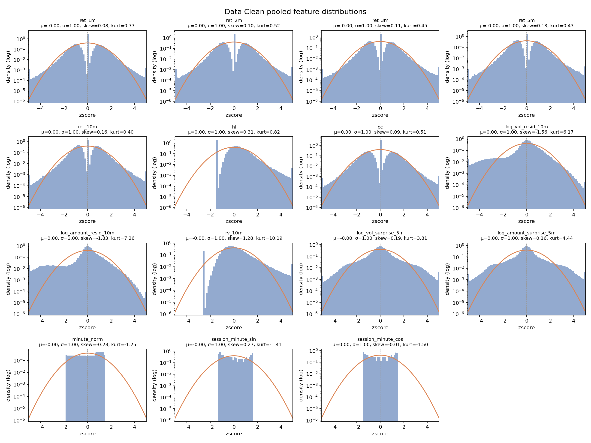

Data clean stage pooled feature distribution overview.

Invalid Feature Stats

| field | total_count | finite_count | nan_count | nan_ratio | inf_ratio | invalid_ratio | mean_finite | std_finite | skew_finite | kurtosis_finite | min_finite | max_finite |
| --- | --- | --- | --- | --- | --- | --- | --- | --- | --- | --- | --- | --- |
| label_ret | 1,158,482,986 | 1,153,692,496 | 4,790,490 | 0.004135 | 0.000e+00 | 0.004135 | 2.010e-05 | 0.005217 | 1.8547 | 165.4634 | -1.0953 | 1.3763 |
| ret_10m | 1,158,482,986 | 1,158,464,066 | 18,920 | 1.633e-05 | 0.000e+00 | 1.633e-05 | -0.001898 | 0.060248 | 0.168569 | 0.557293 | -2.0801 | 2.0003 |
| ret_5m | 1,158,482,986 | 1,158,473,526 | 9,460 | 8.166e-06 | 0.000e+00 | 8.166e-06 | -0.001308 | 0.051202 | 0.141175 | 0.627840 | -2.0801 | 2.0003 |
| ret_3m | 1,158,482,986 | 1,158,477,310 | 5,676 | 4.900e-06 | 0.000e+00 | 4.900e-06 | -0.001010 | 0.045613 | 0.123841 | 0.659136 | -2.0801 | 2.0003 |
| ret_2m | 1,158,482,986 | 1,158,479,202 | 3,784 | 3.266e-06 | 0.000e+00 | 3.266e-06 | -8.275e-04 | 0.041710 | 0.111952 | 0.706253 | -2.0801 | 1.9959 |
| rv_10m | 1,158,482,986 | 1,158,479,202 | 3,784 | 3.266e-06 | 0.000e+00 | 3.266e-06 | 0.038578 | 0.015429 | 1.3656 | 11.5198 | 0.000e+00 | 1.1393 |
| ret_1m | 1,158,482,986 | 1,158,481,094 | 1,892 | 1.633e-06 | 0.000e+00 | 1.633e-06 | -5.775e-04 | 0.035832 | 0.092848 | 0.886056 | -2.0801 | 1.9850 |
| hl | 1,158,482,986 | 1,158,482,986 | 0 | 0.000e+00 | 0.000e+00 | 0.000e+00 | 0.035412 | 0.024593 | 0.416447 | 1.4740 | 0.000e+00 | 1.1819 |
| log_amount_resid_10m | 1,158,482,986 | 1,158,482,986 | 0 | 0.000e+00 | 0.000e+00 | 0.000e+00 | -3.673e-05 | 2.1494 | -1.8559 | 9.2373 | -17.9464 | 19.6421 |
| log_amount_surprise_5m | 1,158,482,986 | 1,158,482,986 | 0 | 0.000e+00 | 0.000e+00 | 0.000e+00 | -1.383e-05 | 0.822585 | 0.307177 | 5.6893 | -9.4497 | 10.2983 |
| log_vol_resid_10m | 1,158,482,986 | 1,158,482,986 | 0 | 0.000e+00 | 0.000e+00 | 0.000e+00 | -2.600e-05 | 1.7681 | -1.5236 | 7.5946 | -15.7846 | 16.8678 |
| log_vol_surprise_5m | 1,158,482,986 | 1,158,482,986 | 0 | 0.000e+00 | 0.000e+00 | 0.000e+00 | -9.057e-06 | 0.680394 | 0.360929 | 4.8409 | -8.6626 | 9.1302 |
| minute_norm | 1,158,482,986 | 1,158,482,986 | 0 | 0.000e+00 | 0.000e+00 | 0.000e+00 | 0.501937 | 0.291263 | 0.005343 | -1.1909 | 0.000e+00 | 1.1250 |
| oc | 1,158,482,986 | 1,158,482,986 | 0 | 0.000e+00 | 0.000e+00 | 0.000e+00 | -2.438e-04 | 0.033552 | 0.097227 | 0.631033 | -0.985665 | 1.0523 |
| session_minute_cos | 1,158,482,986 | 1,158,482,986 | 0 | 0.000e+00 | 0.000e+00 | 0.000e+00 | 0.006262 | 0.708499 | -0.010955 | -1.5018 | -1.0000 | 1.0000 |
| session_minute_sin | 1,158,482,986 | 1,158,482,986 | 0 | 0.000e+00 | 0.000e+00 | 0.000e+00 | 0.002241 | 0.705680 | -0.005221 | -1.4939 | -1.0000 | 1.0000 |

字段解释

| field | explanation |
| --- | --- |
| feature_normalization | feature normalization 方法和 fit scope.  |
| label_normalization | label normalization 方法和 fit scope.  |
| kept_rate | 清洗后保留样本数 / 清洗前样本数.  |
| max_invalid_ratio | 单个字段中 invalid 样本占比的最大值.  |

## 主要结果

| 记录项 | 当前解释 |
| --- | --- |
| 实验 | feature-cleaning-bundle-0609 |
| 报告类型 | full_report_html |
| 历史状态 | 历史成功 |
| 证据 | feature-cleaning-0609-04-061018 |

训练监控, 信号质量, 交易成本与稳健性评估. 

生成日期: 2026-06-10

### 3. Evaluation

### 3.1. IC Summary

| split | pooled_ic | pooled_rank_ic | count |
| --- | --- | --- | --- |
| train | 0.154640 | 0.097675 | 31,875,072 |
| test | 0.073889 | 0.054200 | 265,311,246 |

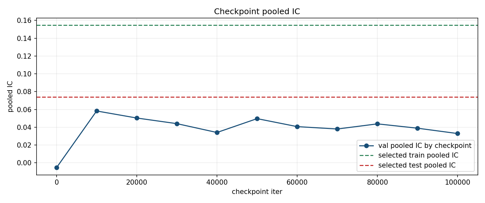

Validation checkpoint pooled IC with selected train/test pooled IC references.

### core_ic_metrics.csv

| split | pooled_ic | pooled_rank_ic | count |
| --- | --- | --- | --- |
| train | 0.154640 | 0.097675 | 31,875,072 |
| test | 0.073889 | 0.054200 | 265,311,246 |

字段解释

| field | explanation |
| --- | --- |
| pooled_ic | 合并样本后计算的 Pearson IC.  |
| pooled_rank_ic | 合并样本后计算的 Rank IC.  |
| pearson_ic | corr(prediction, target).  |
| rank_ic | corr(rank(prediction), rank(target)).  |

### 3.2. Signal Quality 1: bucket (10)

字段解释

| field | explanation |
| --- | --- |
| signal_bucket | 按 prediction 从低到高切分的分组编号.  |
| mean_prediction | 分组内 prediction 均值.  |
| mean_label_bps | 分组内 target 均值, 单位 bps.  |
| t_stat | 分组 mean_label_bps 相对 0 的 t-stat.  |
| hit_rate | 分组内 target > 0 的比例.  |
| top_bottom_signal_spread_bps | Top bucket 平均 target return 减 bottom bucket 平均 target return, 单位 bps.  |
| Daily top-minus-bottom signal spread | 每天内部按 prediction 排序, 用 ntile(10) 分 bucket. 对每天的 top decile 和 bottom decile 计算 realized return.  |

| signal_bucket | mean_prediction | mean_label_bps | t_stat | hit_rate | row_count | top_bottom_signal_spread_bps |
| --- | --- | --- | --- | --- | --- | --- |
| 1.0000 | -0.001185 | -6.4599 | -406.6419 | 0.368012 | 26,531,125 | 13.2109 |
| 2.0000 | -3.388e-04 | -1.4591 | -151.8083 | 0.379101 | 26,531,125 | 13.2109 |
| 3.0000 | -1.853e-04 | -0.892654 | -106.3509 | 0.375529 | 26,531,125 | 13.2109 |
| 4.0000 | -9.746e-05 | -0.550929 | -70.3512 | 0.359723 | 26,531,125 | 13.2109 |
| 5.0000 | -2.674e-05 | -0.225972 | -29.1622 | 0.362485 | 26,531,125 | 13.2109 |
| 6.0000 | 4.252e-05 | 0.143875 | 17.9938 | 0.371916 | 26,531,125 | 13.2109 |
| 7.0000 | 1.267e-04 | 0.649764 | 75.1294 | 0.393338 | 26,531,124 | 13.2109 |
| 8.0000 | 2.464e-04 | 1.4265 | 149.6768 | 0.414854 | 26,531,124 | 13.2109 |
| 9.0000 | 4.436e-04 | 2.6891 | 247.9014 | 0.435927 | 26,531,124 | 13.2109 |
| 10.0000 | 0.001445 | 6.7510 | 375.8353 | 0.463529 | 26,531,124 | 13.2109 |

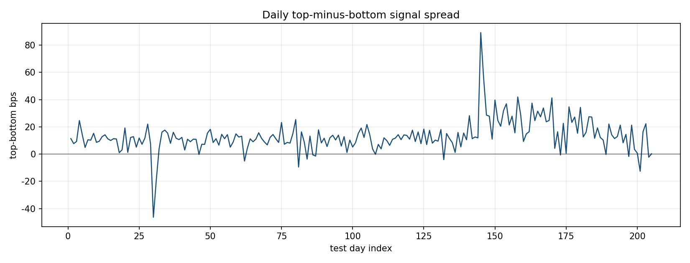

Daily top decile target return minus bottom decile target return on the test split.

### 3.3. Signal Quality 2: Important Stock Pool

prediction != 0 metrics dataset

test split, [artifact-root]/nn/0609-04/date_ranges/run/eval_test/iter_90000/predict_manifest.yaml

checkpoint IC dataset

val split checkpoints, [artifact-root]/nn/0609-04/date_ranges/run/eval_val

cumulative return dataset

train + val + test, shown in 5. Trading And Cost

### prediction != 0 metrics

| pool | etf_code | pearson_ic | rank_ic | mean_prediction_return | mean_real_return | prediction_positive_ratio | real_return_positive_ratio | count |
| --- | --- | --- | --- | --- | --- | --- | --- | --- |
| 1000 ETF | 512100.SH | 0.053903 | 0.033750 | 3.372e-05 | -2.848e-06 | 0.497454 | 0.399389 | 49,183,326 |
| 沪深300 ETF(沪) | 510300.SH | 0.062148 | 0.034674 | 2.511e-05 | 3.312e-06 | 0.488036 | 0.414330 | 14,755,031 |
| 中证500 ETF(沪) | 510500.SH | 0.051393 | 0.032145 | 2.960e-05 | -1.314e-05 | 0.494156 | 0.396043 | 24,592,758 |

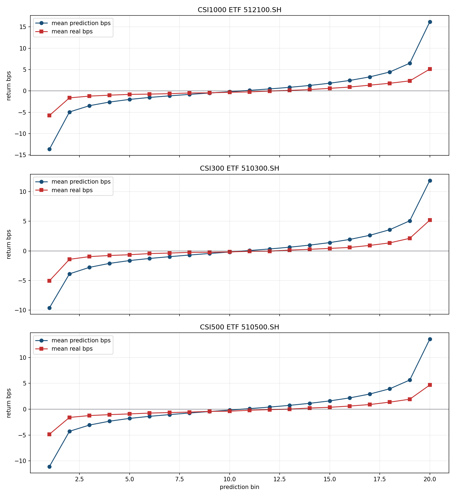

Important-pool mean prediction return and real return by prediction rank bin.

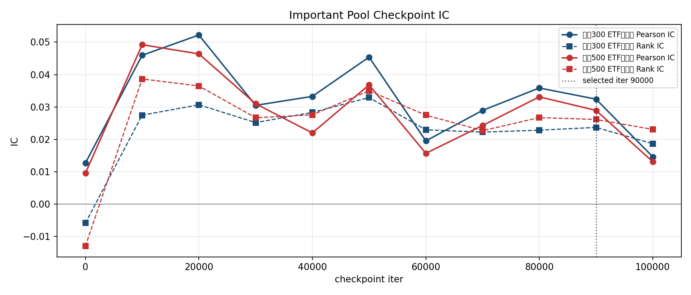

Checkpoint IC for CSI500 and CSI300 important pools.

字段解释

| field | explanation |
| --- | --- |
| prediction != 0 metrics | 按 date, code join prediction rows, 过滤 isfinite(prediction), isfinite(target), prediction != 0. 按 pool 聚合各项指标.  |
| Prediction Return vs Real Return 图 | 每个 pool 内按 prediction 排序, 用 ntile(20) 分 prediction_bin, 单位显示为 bps.  |
| pearson_ic | corr(prediction, target).  |
| rank_ic | corr(rank(prediction), rank(target)).  |
| mean_prediction_return | prediction 的样本均值.  |
| mean_real_return | target 的样本均值.  |
| real_return_positive_ratio | target > 0 的样本占比.  |
| prediction_positive_ratio | prediction > 0 的样本占比.  |

### 3.4. Goodness Of Fit

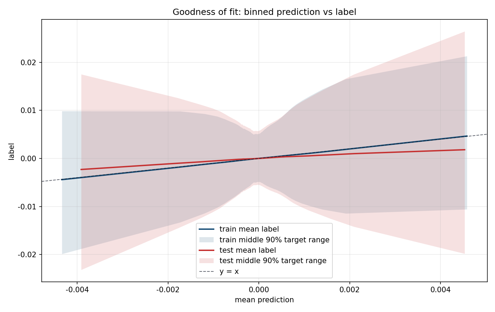

Train/test are separately sorted by prediction and cut into 100 equal-frequency bins; x is bin mean prediction, y is label, and transparent bands show the p5-p95 target range within each prediction bin.

### goodness_of_fit_metrics.csv edge bins

| split | prediction_bin | mean_prediction | mean_label | label_p05 | label_p95 | row_count |
| --- | --- | --- | --- | --- | --- | --- |
| train | 1 | -0.004339 | -0.004418 | -0.019867 | 0.009857 | 8,404,634 |
| train | 2 | -0.001733 | -0.001800 | -0.013283 | 0.009819 | 8,404,634 |
| train | 3 | -0.001192 | -0.001230 | -0.011391 | 0.009270 | 8,404,634 |
| train | 4 | -9.193e-04 | -9.585e-04 | -0.010223 | 0.008751 | 8,404,634 |
| train | 5 | -7.550e-04 | -7.950e-04 | -0.009331 | 0.008194 | 8,404,634 |
| train | 96 | 9.405e-04 | 8.952e-04 | -0.009331 | 0.012009 | 8,404,633 |
| train | 97 | 0.001122 | 0.001061 | -0.009880 | 0.012993 | 8,404,633 |
| train | 98 | 0.001396 | 0.001334 | -0.010597 | 0.014381 | 8,404,633 |
| train | 99 | 0.001917 | 0.001877 | -0.011444 | 0.016525 | 8,404,633 |
| train | 100 | 0.004583 | 0.004648 | -0.010582 | 0.021286 | 8,404,633 |
| test | 1 | -0.003914 | -0.002302 | -0.023163 | 0.017502 | 2,653,113 |
| test | 2 | -0.001779 | -0.001006 | -0.014481 | 0.012566 | 2,653,113 |
| test | 3 | -0.001296 | -7.281e-04 | -0.012451 | 0.011230 | 2,653,113 |
| test | 4 | -0.001029 | -5.508e-04 | -0.011215 | 0.010445 | 2,653,113 |
| test | 5 | -8.543e-04 | -4.447e-04 | -0.010300 | 0.009789 | 2,653,113 |
| test | 96 | 0.001097 | 5.290e-04 | -0.010803 | 0.012642 | 2,653,112 |
| test | 97 | 0.001290 | 6.258e-04 | -0.011490 | 0.013652 | 2,653,112 |
| test | 98 | 0.001573 | 7.473e-04 | -0.012512 | 0.015030 | 2,653,112 |
| test | 99 | 0.002088 | 9.877e-04 | -0.014183 | 0.017471 | 2,653,112 |
| test | 100 | 0.004532 | 0.001806 | -0.019806 | 0.026428 | 2,653,112 |

字段解释

| field | explanation |
| --- | --- |
| Goodness Of Fit | 按 split 全局对 prediction 从低到高排序并切成 100 个等频分段, 检查每段 mean_prediction 与 mean_label 是否接近.  |
| prediction_bin | 按 prediction 从低到高排序后的等频分段编号, 1 为最低 prediction 段.  |
| mean_prediction | 分组内 prediction 均值.  |
| mean_label | 分组内 target 均值, 保持原始 target 单位.  |
| label_std | 分组内 target 的样本标准差.  |
| label_se | 分组 mean_label 的标准误, 计算为 label_std / sqrt(row_count).  |
| label_p05 | 分组内 target 的 5% 分位, 用作中间 90% 散点位置阴影下界.  |
| label_p95 | 分组内 target 的 95% 分位, 用作中间 90% 散点位置阴影上界.  |
| label_ci90_low | mean_label 的 90% 正态近似置信区间下界, mean_label - 1.64485 * label_se.  |
| label_ci90_high | mean_label 的 90% 正态近似置信区间上界, mean_label + 1.64485 * label_se.  |
| row_count | 分组内有限 prediction/target 样本数.  |

### 3.5. Liquidity By ADV

ADV uses a shifted 20-trading-day mean of stock1d amount. Buckets are formed globally over the full test-universe date-code pool, not within each date. The current day's full daily_amount is not used to bucket current-day predictions.

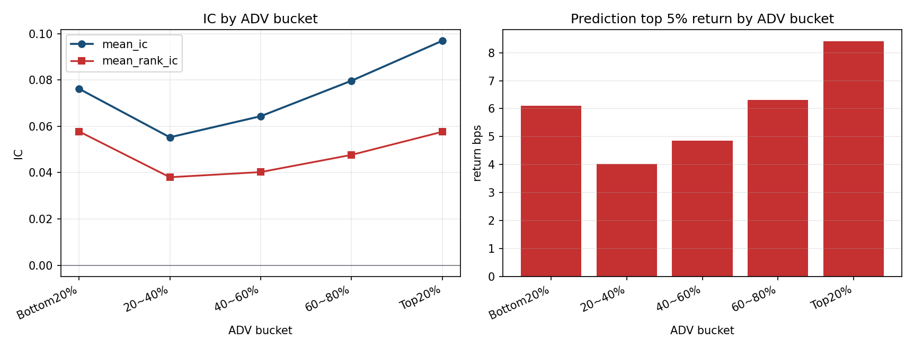

Left: Pearson IC and Rank IC by date-level ADV bucket. Right: prediction top 5% target return by ADV bucket.

### adv_liquidity_bucket_metrics.csv

| adv_bucket | bucket_label | row_count | day_count | mean_adv_amount | median_adv_amount | mean_ic | mean_rank_ic | icir | rank_icir | top5_return_bps | top5_hit_rate | top5_row_count |
| --- | --- | --- | --- | --- | --- | --- | --- | --- | --- | --- | --- | --- |
| 1 | Bottom20% | 50,154,240 | 205 | 22,056 | 22,569 | 0.076221 | 0.057776 | 3.7952 | 4.3188 | 6.1037 | 0.415282 | 2,532,810 |
| 2 | 20~40% | 50,156,520 | 205 | 49,434 | 48,941 | 0.055251 | 0.038003 | 3.5490 | 2.9984 | 4.0209 | 0.406697 | 2,534,850 |
| 3 | 40~60% | 50,156,760 | 205 | 89,270 | 87,710 | 0.064352 | 0.040223 | 3.4729 | 2.8864 | 4.8635 | 0.425759 | 2,532,630 |
| 4 | 60~80% | 50,158,590 | 205 | 171,228 | 165,610 | 0.079670 | 0.047648 | 4.0784 | 3.0609 | 6.3079 | 0.435465 | 2,535,480 |
| 5 | Top20% | 50,156,760 | 205 | 716,887 | 445,113 | 0.096927 | 0.057619 | 3.8449 | 2.8595 | 8.4064 | 0.458143 | 2,535,180 |

字段解释

| field | explanation |
| --- | --- |
| Liquidity By ADV | 按完整 test universe 的 date-code 样本池, 用 shifted/trailing ADV 全局分五桶, 检查不同流动性股票上的 IC 与 prediction top 5% return.  |
| adv_bucket | 按完整 test universe date-code 样本池的 adv_amount 排序后的全局五分桶编号; 1 为 Bottom20%, 5 为 Top20%.  |
| bucket_label | ADV 五分桶可读标签.  |
| row_count | 分组内有限 prediction/target 样本数.  |
| day_count | 入选样本覆盖的交易日数量.  |
| mean_adv_amount | 当前 ADV 桶内 date-code 层面的平均 shifted/trailing ADV.  |
| median_adv_amount | 当前 ADV 桶内 date-code 层面的中位 shifted/trailing ADV.  |
| mean_ic | 当前 ADV 桶内先按 date,time 横截面计算 Pearson IC, 再按 date 聚合后的均值.  |
| mean_rank_ic | 当前 ADV 桶内先按 date,time 横截面计算 Rank IC, 再按 date 聚合后的均值.  |
| icir | 当前 ADV 桶 daily IC 的 mean/std.  |
| rank_icir | 当前 ADV 桶 daily Rank IC 的 mean/std.  |
| top5_return_bps | 当前 ADV 桶内每个 date,time 截面 prediction 最高 5% 样本的平均 target return, 单位 bps.  |
| top5_hit_rate | 当前 ADV 桶内 prediction 最高 5% 样本 target > 0 的比例.  |
| top5_row_count | 当前 ADV 桶内进入 prediction top 5% return 统计的样本数.  |

### 4. Train Metrics

### 4.1. Checkpoint Selection

| key | value |
| --- | --- |
| best_iter | 90,000 |
| selection_metric | val/quality/pooled_ic |
| selection_rule | manual_override_to_iter_90000 |
| selection_value | 0.038891 |
| candidate_count | 11 |

checkpoint_selector_table.csv

| iter | selected | val/objective/mse | val/quality/global_ic | val/quality/rank_ic | val/dist/pred_std_over_target_std | decision | metric_rank |
| --- | --- | --- | --- | --- | --- | --- | --- |
| 0 | False | 4.396e-05 | -0.005489 | -0.030368 | nan | reject | 11.0000 |
| 10,000 | False | 4.407e-05 | 0.058245 | 0.048854 | nan | reject | 1.0000 |
| 20,000 | False | 4.412e-05 | 0.050338 | 0.045636 | nan | reject | 2.0000 |
| 30,000 | False | 4.436e-05 | 0.044015 | 0.039071 | nan | reject | 4.0000 |
| 40,000 | False | 4.469e-05 | 0.034072 | 0.041680 | nan | reject | 9.0000 |
| 50,000 | False | 4.413e-05 | 0.049640 | 0.050682 | nan | reject | 3.0000 |
| 60,000 | False | 4.449e-05 | 0.040663 | 0.048218 | nan | reject | 6.0000 |
| 70,000 | False | 4.471e-05 | 0.038001 | 0.039440 | nan | reject | 8.0000 |
| 80,000 | False | 4.452e-05 | 0.043764 | 0.041316 | nan | reject | 5.0000 |
| 90,000 | True | 4.457e-05 | 0.038891 | 0.039506 | nan | promote | 7.0000 |
| 100,000 | False | 4.482e-05 | 0.032877 | 0.040748 | nan | reject | 10.0000 |

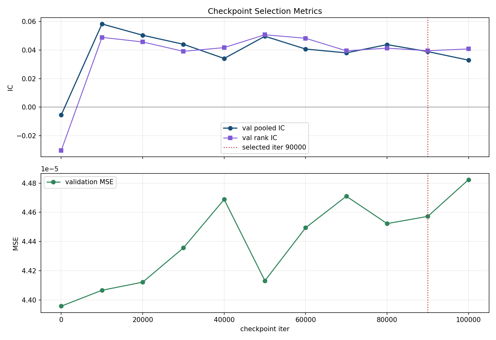

Validation objective and IC metrics by checkpoint iteration.

### 4.2. Model And Method

### Model

model_class

GruMlpRegressor

model class

trainable_parameter

1,808,129

trainable parameter count

input_tensor

batch, window, 14

GRU input

prediction_target

future log close return

raw target

label_horizon_minutes

10

requested report horizon

label_entry_lag_minutes

1

entry lag

gru_hidden_size

384

GRU hidden size

gru_num_layers

2

GRU layers

gru_bidirectional

False

GRU direction

gru_dropout

0.0

GRU dropout

mlp_effective_hidden_width

512

MLP effective hidden width

mlp_dropout

0.0

MLP dropout

optimizer

AdamW

optimizer

learning_rate

0.0003

base LR

lr_scheduler/type

LinearWarmup + CosineAnnealing

qmodel scheduler

approx_total_epochs

0.877240

through selected checkpoint

### 4.2.1. GRU

| field | value |
| --- | --- |
| input_tensor | batch, window, 14 |
| gru_hidden_size | 384 |
| gru_num_layers | 2 |
| gru_bidirectional | False |
| gru_dropout | 0.0 |

### 4.2.2. MLP

| field | value |
| --- | --- |
| mlp_effective_hidden_width | 512 |
| mlp_dropout | 0.0 |

### 4.2.3. Method

| field | value |
| --- | --- |
| parameter_initialization | PyTorch default GRU and Linear initialization |
| lr_scheduler/type | LinearWarmup + CosineAnnealing |
| optimizer | AdamW |
| approx_total_epochs | 0.877240 |
| final_iter | 100,000 |
| checkpoint_selection | manual_override_to_iter_90000 val/quality/pooled_ic |

字段解释

| field | explanation |
| --- | --- |
| model_class | 模型类名.  |
| trainable_parameter | 可训练参数数量.  |
| gru_bidirectional | GRU 是否使用 bidirectional 结构.  |
| parameter_initialization | 模型参数初始化方式.  |
| selected_checkpoint | 最终用于 evaluation 的 checkpoint iteration.  |

### 4.3. Training Monitoring

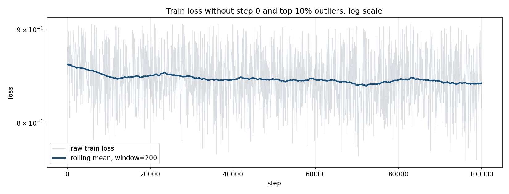

Train loss with step=0 and the top 10% loss outliers removed, log y-axis, and a rolling mean smoothing curve.

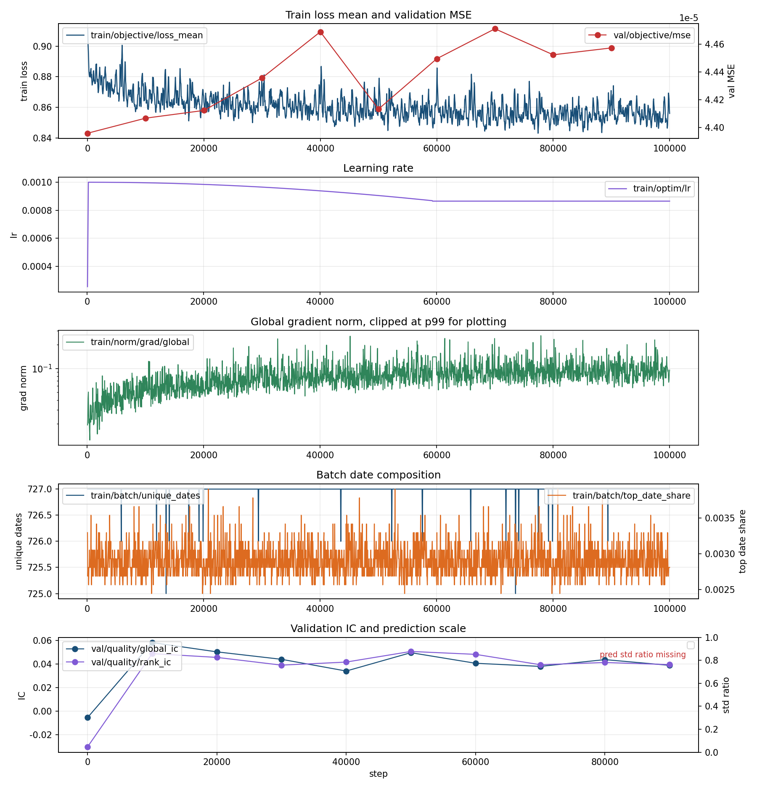

MLflow-backed train diagnostics plus local validation scalar curves for loss, LR, grad norm, batch composition, IC, and prediction scale.

字段解释

| field | explanation |
| --- | --- |
| Train loss | 读取 TensorBoard scalar parquet, 过滤 step > 0, 删除最高 10% loss outlier, 用 rolling(window=200, min_periods=20, center=True) 计算 smoothed_loss, y-axis 使用 log scale.  |
| train/objective/loss_mean | MLflow 中记录的 train objective loss rolling mean.  |
| train/optim/lr | MLflow 中记录的 optimizer learning rate.  |
| train/norm/grad/global | MLflow 中记录的所有可训练参数梯度拼接后的 L2 norm.  |
| train/batch/unique_dates | MLflow 中记录的一个 batch 内覆盖的不同交易日数量.  |
| train/batch/top_date_share | MLflow 中记录的一个 batch 内样本最多交易日的样本占比.  |
| val/objective/mse | validation split 上的 objective MSE.  |
| val/quality/global_ic | validation split 上的 global Pearson IC.  |
| val/quality/rank_ic | validation split 上的 rank IC.  |
| val/dist/pred_std_over_target_std | validation prediction std / target std.  |

### 5. Trading And Cost

### 5.0. Cost Model Status

Cost model artifact status

status

pending real cost artifact

available_metric

simple ETF prediction-threshold long/flat compound backtest by important stock pool

### 5.1. Cumulative Prediction, Real, And Excess Returns

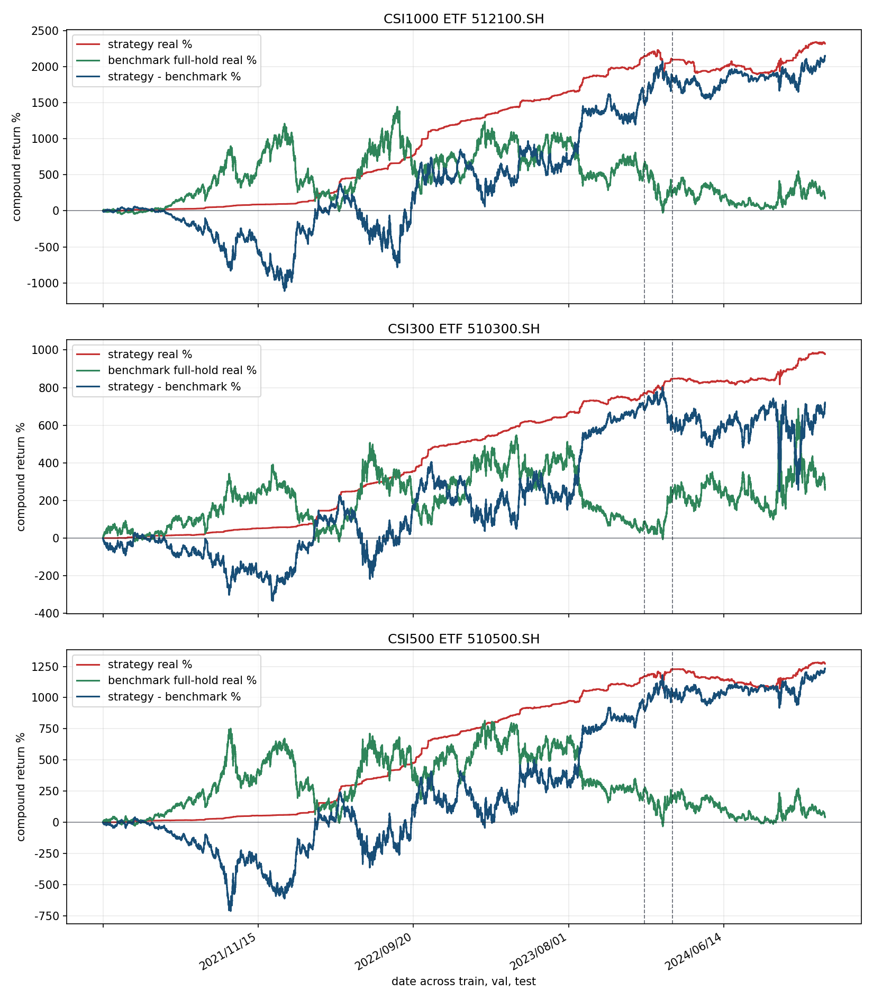

Benchmark is continuous full-hold ETF real return; strategy uses the 4800-minute trailing 95% ETF prediction threshold and 5-minute trading rule; excess line is strategy real % minus benchmark full-hold real %.

| pool | days | final_cum_prediction_bps | final_cum_real_bps | final_benchmark_real_bps | final_cum_excess_bps | 平均每天开仓次数 | 平均每天return_bps | 平均每次开仓return_bps |
| --- | --- | --- | --- | --- | --- | --- | --- | --- |
| 1000 ETF | 969 | 93,816 | 231,669 | 17,031 | 79,406 | 1.8194 | 33.5789 | 18.2724 |
| 沪深300 ETF(沪) | 969 | 55,873 | 97,756 | 25,663 | 20,215 | 1.8906 | 24.9325 | 13.0845 |
| 中证500 ETF(沪) | 969 | 77,545 | 127,220 | 3,943 | 88,418 | 1.8968 | 27.5569 | 14.3892 |

### Backtest risk/trading metrics

| pool | max_drawdown_pct | exposure_ratio | win_rate_by_trade | avg_holding_minutes |
| --- | --- | --- | --- | --- |
| 1000 ETF | -17.0432 | 0.052610 | 0.702779 | 6.9399 |
| 沪深300 ETF(沪) | -6.8655 | 0.053836 | 0.652293 | 6.8341 |
| 中证500 ETF(沪) | -11.7649 | 0.054502 | 0.650163 | 6.8961 |

### Test-only backtest metrics

| pool | test_days | test_cum_strategy_bps | test_cum_benchmark_bps | test_excess_bps | max_drawdown_pct | exposure_ratio | win_rate_by_trade | avg_holding_minutes |
| --- | --- | --- | --- | --- | --- | --- | --- | --- |
| 1000 ETF | 205 | 1,007 | -2,787 | 5,258 | -9.2712 | 0.048577 | 0.532764 | 6.8091 |
| 沪深300 ETF(沪) | 205 | 1,378 | 587.4223 | 746.7918 | -6.8655 | 0.050915 | 0.531915 | 6.6622 |
| 中证500 ETF(沪) | 205 | 332.1387 | -5,460 | 12,757 | -11.7649 | 0.050508 | 0.472149 | 6.5915 |

字段解释

| field | explanation |
| --- | --- |
| model | benchmark 为 ETF 每分钟一直满仓持有得到 real return; strategy 按 pool 合成分钟级 ETF prediction, 用过去 4800 分钟的 95% 分位做开仓阈值, 每 5 分钟开平仓并复利交易.  |
| strategy real % | 按 5 分钟开平仓规则, 用真实 etf_real_return 复利得到的策略实际收益.  |
| benchmark full-hold real % | 不做择时, ETF/pool 每分钟一直满仓持有, 用 etf_real_return 连续复利得到的 benchmark 收益.  |
| strategy - benchmark % | strategy real % - benchmark full-hold real %.  |
| max_drawdown_pct | strategy_nav 相对历史高点的最大回撤, 单位 %.  |
| exposure_ratio | position > 0 的分钟数 / 总分钟数.  |
| win_rate_by_trade | 按 trade_id 聚合每次开仓复利收益, 收益大于 0 的比例.  |
| avg_holding_minutes | 每个 trade_id 覆盖的分钟数均值.  |
| test_cum_strategy_bps | test split 内 strategy_minute_return 从 1 重新复利后的累计收益, 单位 bps.  |
| test_cum_benchmark_bps | test split 内 benchmark_minute_return 从 1 重新复利后的累计收益, 单位 bps.  |
| test_excess_bps | (1 + test_cum_strategy_return) / (1 + test_cum_benchmark_return) - 1, 单位 bps.  |

### 5.2. Single-Side Cost Sensitivity

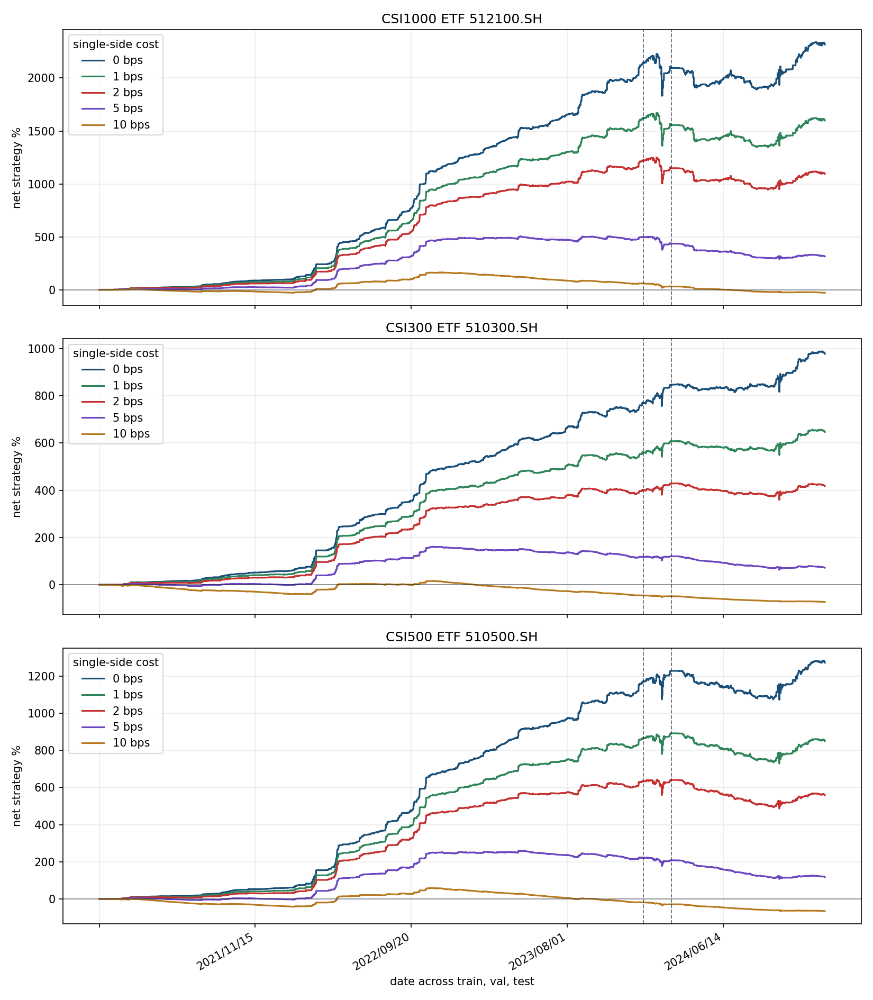

train, val, and test shown on the same axis as 5.1; trading rule is the same as 5.1; cost is deducted as abs(position - prev_position) * single-side cost bps / 10000.

### Test-only cost model metrics

| pool | single_side_cost_bps | test_days | test_cum_net_strategy_bps | test_cum_benchmark_bps | test_net_excess_bps | total_turnover | total_cost_bps | max_drawdown_pct | exposure_ratio | win_rate_by_trade | avg_holding_minutes |
| --- | --- | --- | --- | --- | --- | --- | --- | --- | --- | --- | --- |
| 1000 ETF | 0.000e+00 | 205 | 1,007 | -2,787 | 5,258 | 702.0000 | 0.000e+00 | -9.2712 | 0.048577 | 0.532764 | 6.8091 |
| 1000 ETF | 1.0000 | 205 | 260.3553 | -2,787 | 4,224 | 702.0000 | 702.0000 | -12.8135 | 0.048577 | 0.495726 | 6.8091 |
| 1000 ETF | 2.0000 | 205 | -435.3558 | -2,787 | 3,259 | 702.0000 | 1,404 | -16.4175 | 0.048577 | 0.461538 | 6.8091 |
| 1000 ETF | 5.0000 | 205 | -2,252 | -2,787 | 740.5711 | 702.0000 | 3,510 | -27.5170 | 0.048577 | 0.356125 | 6.8091 |
| 1000 ETF | 10.0000 | 205 | -4,547 | -2,787 | -2,441 | 702.0000 | 7,020 | -45.4732 | 0.048577 | 0.264957 | 6.8091 |
| 沪深300 ETF(沪) | 0.000e+00 | 205 | 1,378 | 587.4223 | 746.7918 | 752.0000 | 0.000e+00 | -6.8655 | 0.050915 | 0.531915 | 6.6622 |
| 沪深300 ETF(沪) | 1.0000 | 205 | 553.8030 | 587.4223 | -31.7541 | 752.0000 | 752.0000 | -8.4996 | 0.050915 | 0.465426 | 6.6622 |
| 沪深300 ETF(沪) | 2.0000 | 205 | -210.8355 | 587.4223 | -753.9681 | 752.0000 | 1,504 | -13.2934 | 0.050915 | 0.417553 | 6.6622 |
| 沪深300 ETF(沪) | 5.0000 | 205 | -2,188 | 587.4223 | -2,622 | 752.0000 | 3,760 | -26.2564 | 0.050915 | 0.297872 | 6.6622 |
| 沪深300 ETF(沪) | 10.0000 | 205 | -4,638 | 587.4223 | -4,936 | 752.0000 | 7,520 | -46.3807 | 0.050915 | 0.183511 | 6.6622 |
| 中证500 ETF(沪) | 0.000e+00 | 205 | 332.1387 | -5,460 | 12,757 | 754.0000 | 0.000e+00 | -11.7649 | 0.050508 | 0.472149 | 6.5915 |
| 中证500 ETF(沪) | 1.0000 | 205 | -418.3294 | -5,460 | 11,104 | 754.0000 | 754.0000 | -16.3987 | 0.050508 | 0.440318 | 6.5915 |
| 中证500 ETF(沪) | 2.0000 | 205 | -1,114 | -5,460 | 9,571 | 754.0000 | 1,508 | -20.7948 | 0.050508 | 0.405836 | 6.5915 |
| 中证500 ETF(沪) | 5.0000 | 205 | -2,914 | -5,460 | 5,608 | 754.0000 | 3,770 | -32.6552 | 0.050508 | 0.299735 | 6.5915 |
| 中证500 ETF(沪) | 10.0000 | 205 | -5,141 | -5,460 | 702.3206 | 754.0000 | 7,540 | -51.4093 | 0.050508 | 0.201592 | 6.5915 |

Test date range: 2024/03/01 -> 2024/12/31 (205 trading days), including 2024/09 and 2024/10.

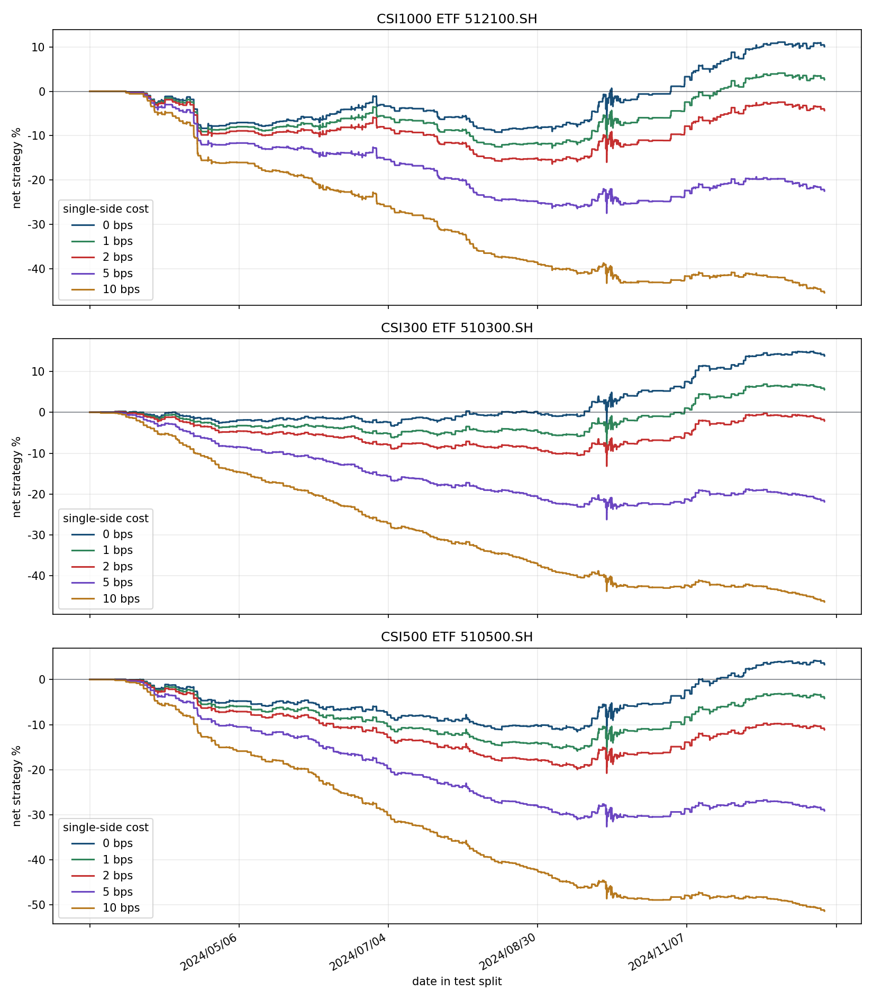

test split only; trading rule is the same as 5.1; cost is deducted as abs(position - prev_position) * single-side cost bps / 10000.

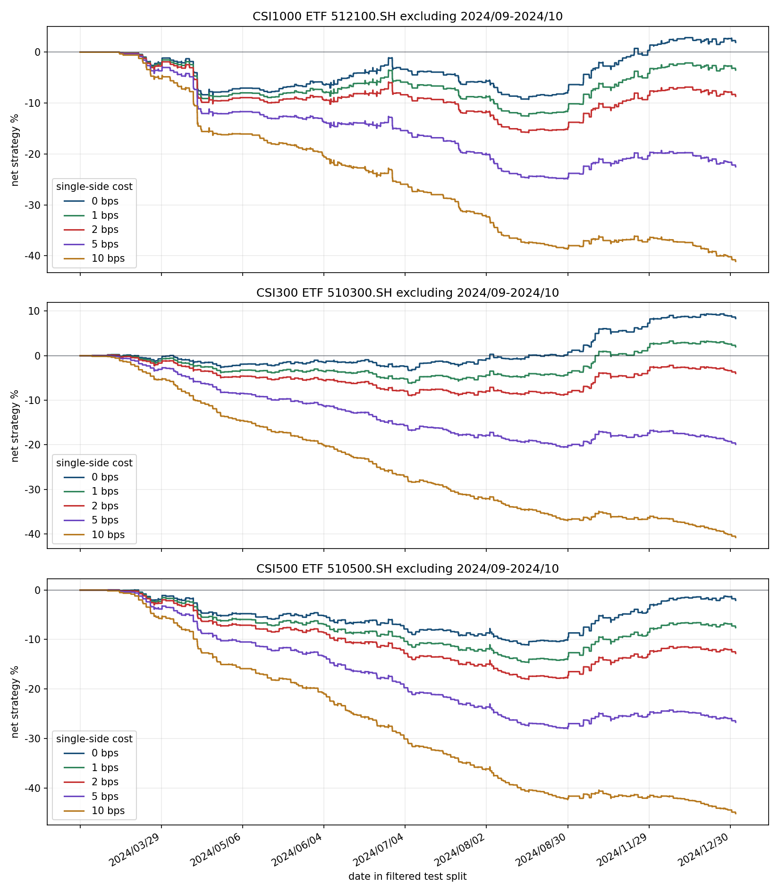

test split only with 2024/09 and 2024/10 removed before recompounding; trading rule and single-side cost deduction match the other 5.2 figures.

字段解释

| field | explanation |
| --- | --- |
| single_side_cost_bps | 单边交易成本, 按 abs(position - prev_position) * cost_bps / 10000 从 strategy_minute_return 中扣减.  |
| test_cum_net_strategy_bps | test split 内扣除单边交易成本后的 strategy_minute_return 从 1 重新复利后的累计收益, 单位 bps.  |
| test_cum_benchmark_bps | test split 内 benchmark_minute_return 从 1 重新复利后的累计收益, 单位 bps.  |
| test_net_excess_bps | (1 + test_cum_net_strategy_return) / (1 + test_cum_benchmark_return) - 1, 单位 bps.  |
| total_turnover | test split 内 abs(position - prev_position) 的合计.  |
| total_cost_bps | test split 内累计扣除的交易成本, 近似为 sum(turnover_event * single_side_cost_bps).  |
| max_drawdown_pct | strategy_nav 相对历史高点的最大回撤, 单位 %.  |
| exposure_ratio | position > 0 的分钟数 / 总分钟数.  |
| win_rate_by_trade | 按 trade_id 聚合每次开仓复利收益, 收益大于 0 的比例.  |
| avg_holding_minutes | 每个 trade_id 覆盖的分钟数均值.  |
| net_strategy_cumulative_return | test split 内扣除单边交易成本后的 strategy return 从 1 重新复利得到的累计收益.  |
| position | 调仓分钟 ETF prediction > baseline_threshold 时为 1, 否则为 0; 非调仓分钟沿用上一分钟持仓.  |
| prev_position | 同一个 pool 上一分钟的 position, 成本分析中用于计算 abs(position - prev_position).  |
| strategy_minute_return | return_event 为 true 时等于 position * etf_real_return, 否则为 0.  |

### 5.3. ETF Trade Return Distribution

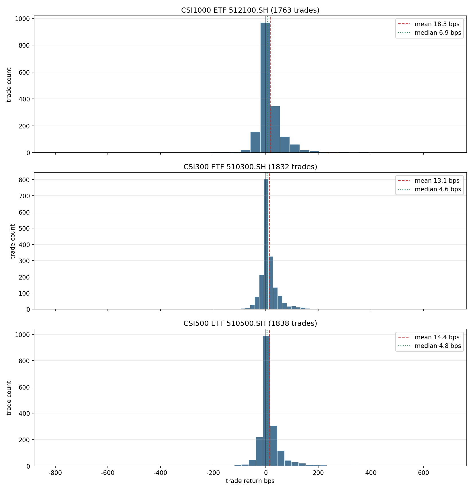

Each observation is one pool + trade_id from the 5.1 ETF long/flat strategy. For each trade_id, trade return is compounded across the rebalance return events while the position is active, using strategy_minute_return.

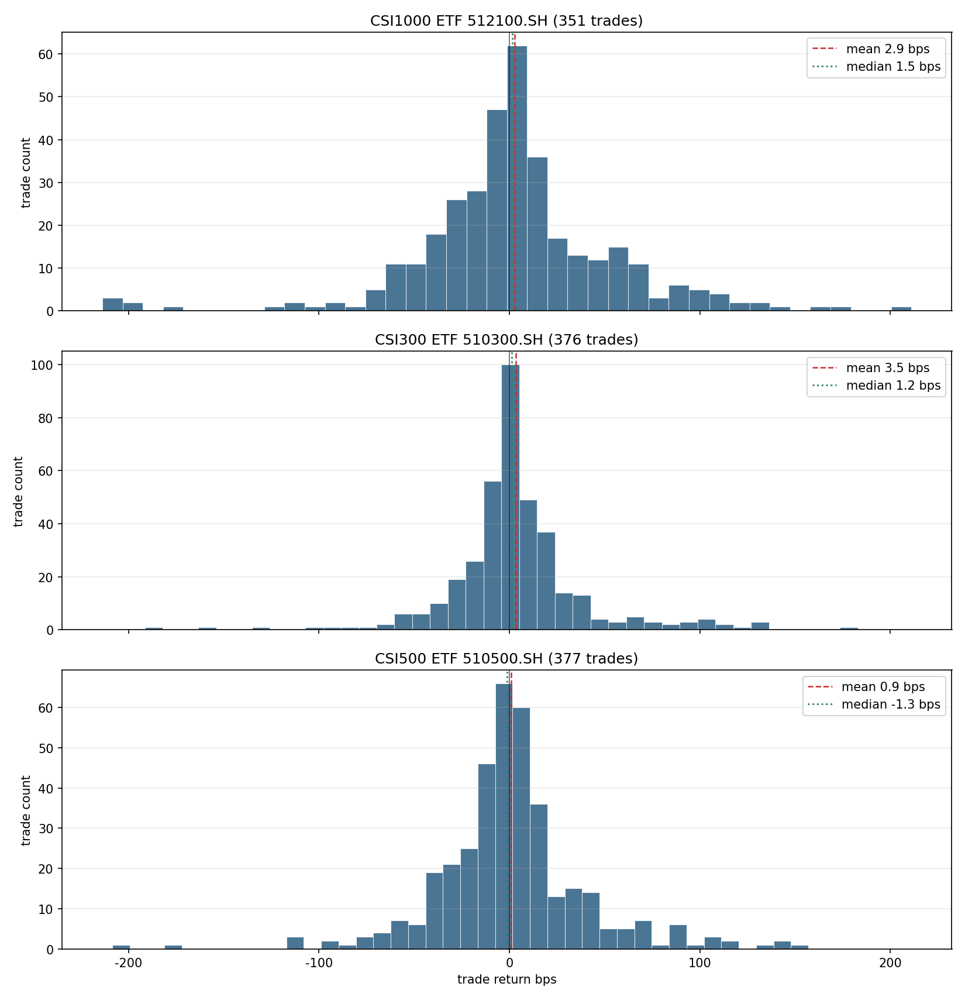

Test split only; each observation is one pool + trade_id observed inside test. For each trade_id, trade return is compounded across the rebalance return events while the position is active, using strategy_minute_return.

字段解释

| field | explanation |
| --- | --- |
| trade_return_bps | 按 pool + trade_id 聚合 strategy_minute_return 复利后的单笔交易收益, 单位 bps.  |
| trade_id | 每次开仓生成一个 trade id, 持仓期间沿用该 id, 空仓时为 0.  |
| holding_minutes | 持仓分钟数; 交易分布中表示同一个 trade_id 覆盖的分钟行数, 6.5 中表示 future holding horizon.  |
| strategy_minute_return | return_event 为 true 时等于 position * etf_real_return, 否则为 0.  |

### 5.4. Entry Delay Decay Experiment

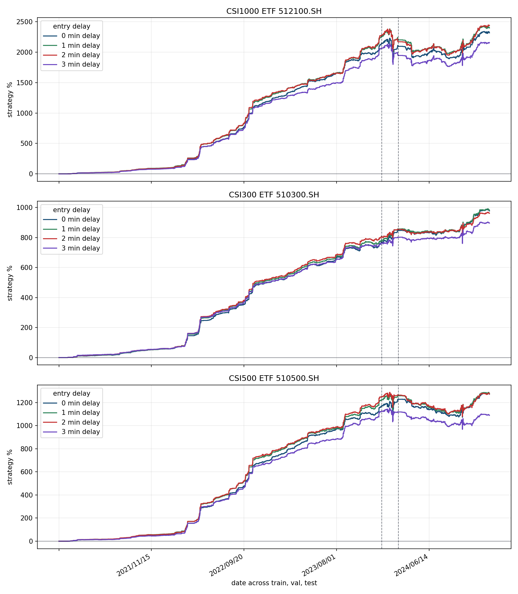

Delay levels are 0, 1, 2, and 3 minutes; only the entry timestamp is delayed, while the original exit timestamp and 5.1 trading rule stay unchanged.

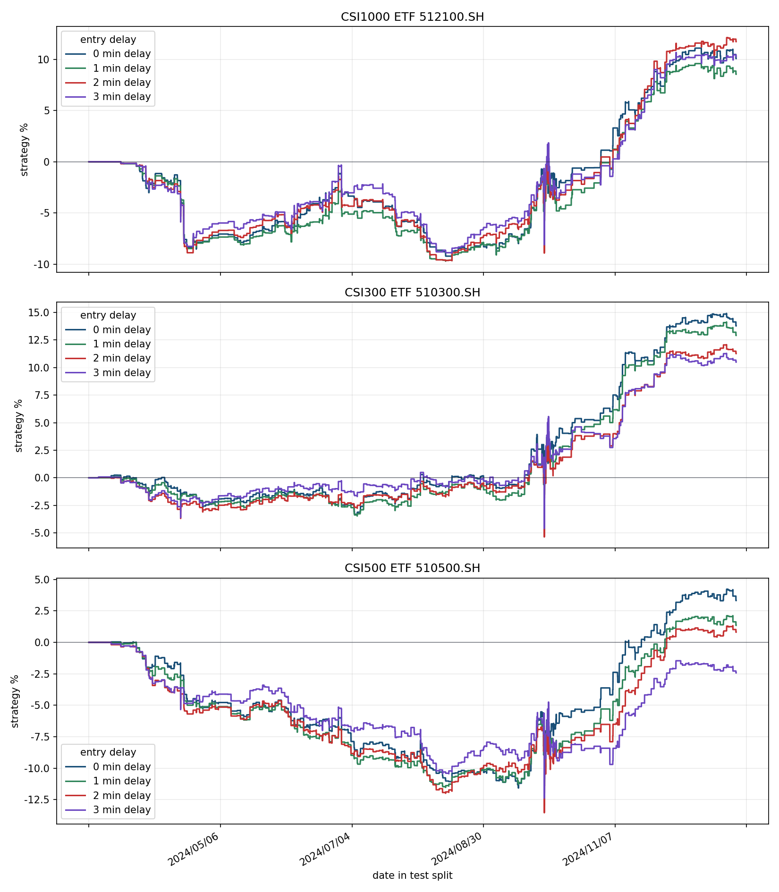

Test split only; delay levels are 0, 1, 2, and 3 minutes; trades shorter than the delay are skipped for that delayed path.

字段解释

| field | explanation |
| --- | --- |
| delay_minutes | entry delay decay 实验中相对原始开仓时间延后的分钟数.  |
| delayed_strategy_cumulative_return | 只延后开仓, 不延后平仓后, strategy return 从 1 重新复利得到的累计收益.  |
| open_event | 调仓分钟 position 从 0 切换到 1 时记为一次开仓.  |
| return_event | 只有调仓分钟入账一次 realized/expected return, 非调仓分钟为 0, 避免 forward label 每分钟重叠复利.  |
| position | 调仓分钟 ETF prediction > baseline_threshold 时为 1, 否则为 0; 非调仓分钟沿用上一分钟持仓.  |
| strategy_minute_return | return_event 为 true 时等于 position * etf_real_return, 否则为 0.  |

### 6. Robustness Diagnostics

### 6.1. IC by volatility rank

 和 corr(rank(prediction), rank(target)). ")

全 test 数据池按 volatility_label 排序切成 20 个等样本量分组, 每组计算 corr(prediction, target) 和 corr(rank(prediction), rank(target)). 

### 6.2. IC by price rank

 和 corr(rank(prediction), rank(target)). ")

全 test 数据池按 price_label 排序切成 20 个等样本量分组, 每组计算 corr(prediction, target) 和 corr(rank(prediction), rank(target)). 

### 6.3. Train/test intraday IC curve

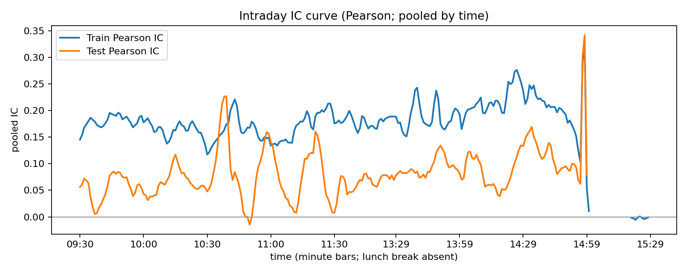

对 train/test 分别按 intraday time 分组, 将所有日期同一分钟的样本合并后计算一次 Pearson IC. 

### 6.4. Monthly signal spread and net efficiency

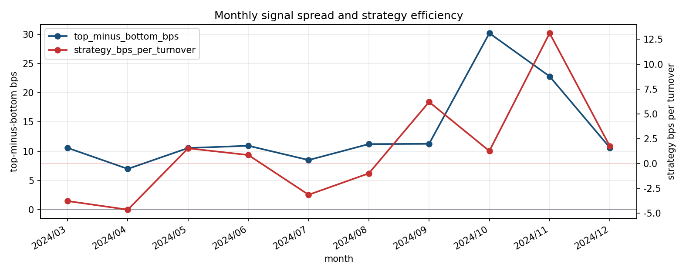

按月展示 test top-minus-bottom signal spread, 以及 5.1 strategy proxy 的三 pool 等权平均 bps per turnover. 

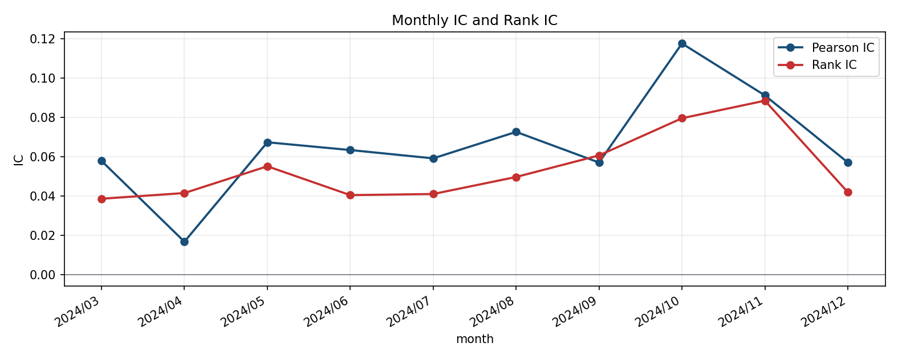

按月合并当前 test manifest 的所有样本, 分别计算 Pearson IC 和 Rank IC. 

### 6.5. Return Realization

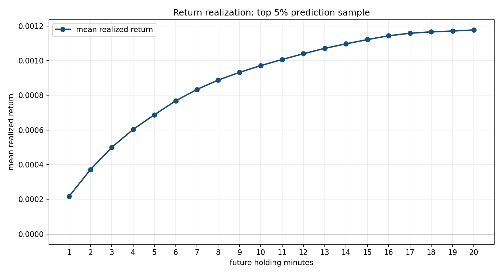

Selected test rows use prediction >= p95(prediction). For holding n minutes, realized return is log_close[t + 1 + n] - log_close[t + 1].

| holding_minutes | mean_return | mean_return_bps | row_count | prediction_p95 |
| --- | --- | --- | --- | --- |
| 1.0000 | 2.173e-04 | 2.1734 | 13,278,393 | 0.001019 |
| 2.0000 | 3.714e-04 | 3.7138 | 13,221,873 | 0.001019 |
| 3.0000 | 4.996e-04 | 4.9965 | 13,197,650 | 0.001019 |
| 4.0000 | 6.027e-04 | 6.0267 | 13,185,616 | 0.001019 |
| 5.0000 | 6.877e-04 | 6.8771 | 13,173,758 | 0.001019 |
| 6.0000 | 7.678e-04 | 7.6785 | 13,155,580 | 0.001019 |
| 7.0000 | 8.340e-04 | 8.3398 | 13,125,937 | 0.001019 |
| 8.0000 | 8.881e-04 | 8.8811 | 13,080,517 | 0.001019 |
| 9.0000 | 9.325e-04 | 9.3254 | 13,017,845 | 0.001019 |
| 10.0000 | 9.715e-04 | 9.7153 | 12,939,258 | 0.001019 |
| 11.0000 | 0.001007 | 10.0668 | 12,848,198 | 0.001019 |
| 12.0000 | 0.001040 | 10.3996 | 12,756,380 | 0.001019 |
| 13.0000 | 0.001071 | 10.7093 | 12,673,790 | 0.001019 |
| 14.0000 | 0.001097 | 10.9708 | 12,604,405 | 0.001019 |
| 15.0000 | 0.001121 | 11.2126 | 12,548,496 | 0.001019 |
| 16.0000 | 0.001144 | 11.4356 | 12,503,660 | 0.001019 |
| 17.0000 | 0.001158 | 11.5801 | 12,466,426 | 0.001019 |
| 18.0000 | 0.001166 | 11.6601 | 12,435,080 | 0.001019 |
| 19.0000 | 0.001171 | 11.7073 | 12,407,639 | 0.001019 |
| 20.0000 | 0.001177 | 11.7710 | 12,381,389 | 0.001019 |

字段解释

| field | explanation |
| --- | --- |
| Return Realization | 当前 selected test prediction 最高 5% 样本的未来持仓收益实现曲线.  |
| holding_minutes | 持仓分钟数; 交易分布中表示同一个 trade_id 覆盖的分钟行数, 6.5 中表示 future holding horizon.  |
| mean_return | 分组内 realized raw log return 的均值.  |
| mean_return_bps | 分组内 realized return 均值, 单位 bps.  |
| prediction_p95 | test split finite prediction 的 95% 分位阈值; 6.5 只保留 prediction >= prediction_p95 的样本.  |
| row_count | 该 holding horizon 下成功对齐 entry/exit close 且 realized raw log return finite 的样本数.  |

### 6.6. Top-k% Robustness

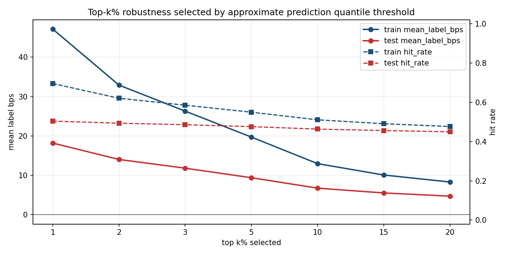

Top k% selected by approximate prediction quantile threshold within each split; k = 1, 2, 3, 5, 10, 15, 20.

| split | selection_method | k_pct | universe_count | selected_count | selected_fraction | prediction_threshold | mean_label_bps | median_label_bps | label_std_bps | hit_rate | day_count | timestamp_count |
| --- | --- | --- | --- | --- | --- | --- | --- | --- | --- | --- | --- | --- |
| train | approx_quantile_threshold | 1 | 840,463,395 | 8,176,369 | 0.009728 | 0.002431 | 47.1189 | 40.5511 | 115.3546 | 0.695434 | 727 | 173,703 |
| train | approx_quantile_threshold | 2 | 840,463,395 | 16,536,794 | 0.019676 | 0.001605 | 32.9123 | 26.1341 | 106.8926 | 0.620611 | 727 | 175,141 |
| train | approx_quantile_threshold | 3 | 840,463,395 | 25,032,672 | 0.029784 | 0.001243 | 26.3038 | 19.2411 | 100.5912 | 0.585362 | 727 | 175,519 |
| train | approx_quantile_threshold | 5 | 840,463,395 | 41,693,861 | 0.049608 | 8.742e-04 | 19.7214 | 12.3225 | 91.9673 | 0.549678 | 727 | 176,040 |
| train | approx_quantile_threshold | 10 | 840,463,395 | 84,251,062 | 0.100244 | 5.214e-04 | 12.9790 | 4.2854 | 78.7407 | 0.510757 | 727 | 178,215 |
| train | approx_quantile_threshold | 15 | 840,463,395 | 125,705,837 | 0.149567 | 3.765e-04 | 10.0890 | 0.596189 | 71.1836 | 0.490915 | 727 | 180,802 |
| train | approx_quantile_threshold | 20 | 840,463,395 | 168,133,831 | 0.200049 | 2.785e-04 | 8.3172 | 0.020488 | 66.1469 | 0.476588 | 727 | 182,825 |
| test | approx_quantile_threshold | 1 | 265,311,246 | 2,606,774 | 0.009825 | 0.002560 | 18.1961 | 4.4263 | 157.9422 | 0.504259 | 205 | 49,209 |
| test | approx_quantile_threshold | 2 | 265,311,246 | 5,247,709 | 0.019779 | 0.001778 | 14.0335 | 1.3249 | 135.9064 | 0.493477 | 205 | 49,699 |
| test | approx_quantile_threshold | 3 | 265,311,246 | 7,930,610 | 0.029892 | 0.001414 | 11.8223 | 0.223699 | 123.8950 | 0.485967 | 205 | 49,928 |
| test | approx_quantile_threshold | 5 | 265,311,246 | 13,242,891 | 0.049915 | 0.001020 | 9.3997 | 0.045126 | 110.0840 | 0.476039 | 205 | 50,253 |
| test | approx_quantile_threshold | 10 | 265,311,246 | 26,480,171 | 0.099808 | 6.055e-04 | 6.7563 | 2.112e-04 | 92.5731 | 0.463555 | 205 | 51,181 |
| test | approx_quantile_threshold | 15 | 265,311,246 | 39,685,229 | 0.149580 | 4.345e-04 | 5.5356 | 5.636e-05 | 82.8186 | 0.456282 | 205 | 52,751 |
| test | approx_quantile_threshold | 20 | 265,311,246 | 52,974,201 | 0.199668 | 3.258e-04 | 4.7246 | 0.000e+00 | 76.4914 | 0.449770 | 205 | 54,451 |

字段解释

| field | explanation |
| --- | --- |
| Top-k Robustness | train/test 各自样本池内用近似 prediction 分位阈值选择最高 k% 样本, 检查集中高 prediction 样本的 realized return.  |
| split | 样本池名称, 6.6 中为 train 或 test.  |
| selection_method | Top-k% 选择方法; 6.6 使用 approx_quantile_threshold, 即 DuckDB approx_quantile 给出的近似 prediction 分位阈值.  |
| k_pct | 按 prediction 全局降序选择的样本池顶部百分比.  |
| universe_count | 该 split 中 finite prediction/target 样本总数.  |
| selected_count | 该 split,k_pct 下 prediction >= prediction_threshold 的实际入选样本数.  |
| selected_fraction | selected_count / universe_count; 近似阈值口径下可能略偏离 k_pct / 100.  |
| prediction_threshold | DuckDB approx_quantile(prediction, 1 - k_pct / 100) 得到的近似入选阈值.  |
| mean_label_bps | 分组内 target 均值, 单位 bps.  |
| median_label_bps | Top-k% 样本 target 近似中位数, 使用 DuckDB approx_quantile(target, 0.5), 单位 bps.  |
| label_std_bps | Top-k% 样本 target 样本标准差, 单位 bps.  |
| hit_rate | 分组内 target > 0 的比例.  |
| day_count | 入选样本覆盖的交易日数量.  |
| timestamp_count | 入选样本覆盖的 date,time 截面数量.  |

## 限制与适用边界

F15 feature-cleaning full report 保留了历史训练与评估结果. 精确 launch overrides 和当前 run artifact 不齐, 该版本不作为当前 baseline. 当前artifact可得性只影响复现, 不作为历史成功/失败判据. 只有matched合同内的结果可以直接比较.

## 结论

本次归档保留上述历史事实. 研究结论, 推广门槛和执行限制分别解释, 不把模型无增益或净收益为负改写成实验流程失败.

## 附录

### 7. Appendix Diagnostics

Artifact Paths

run_root

[artifact-root]/nn/0609-04/date_ranges

research_report_root

[artifact-root]/nn/0609-04/research_report

npz_meta

[artifact-root]/nn/0609-04/date_ranges/artifacts/npz/meta.yaml

data_clean_invalid_stats

[artifact-root]/nn/0609-04/date_ranges/artifacts/data_clean/invalid_feature_stats.csv

core_ic_metrics

[artifact-root]/nn/0609-04/research_report/core_ic_metrics.csv

signal_bucket_metrics

[artifact-root]/nn/0609-04/research_report/signal_quality/signal_bucket_metrics.csv

daily_top_bottom_signal_spread

[artifact-root]/nn/0609-04/research_report/signal_quality/daily_top_bottom_signal_spread.csv

goodness_of_fit_metrics

[artifact-root]/nn/0609-04/research_report/signal_quality/goodness_of_fit_metrics.csv

goodness_of_fit_png

[artifact-root]/nn/0609-04/research_report/signal_quality/goodness_of_fit.png

important_pool_pooled_ic

[artifact-root]/nn/0609-04/research_report/important_pool/important_pool_pooled_ic.csv

important_pool_nonzero_metrics

[artifact-root]/nn/0609-04/research_report/important_pool/important_pool_nonzero_metrics.csv

important_pool_cumulative_returns

[artifact-root]/nn/0609-04/research_report/important_pool/important_pool_train_val_test_cumulative_returns.csv

train_test_intraday_ic

[artifact-root]/nn/0609-04/research_report/robustness/train_test_intraday_ic.csv

monthly_signal_spread_strategy_efficiency

[artifact-root]/nn/0609-04/research_report/robustness/monthly_signal_spread_strategy_efficiency.csv

monthly_ic_rank_ic

[artifact-root]/nn/0609-04/research_report/robustness/monthly_ic_rank_ic.csv

topk_robustness

[artifact-root]/nn/0609-04/research_report/robustness/topk_robustness.csv

topk_robustness_png

[artifact-root]/nn/0609-04/research_report/robustness/topk_robustness.png

train_loss_log_png

[artifact-root]/nn/0609-04/research_report/figures/train_loss_no_step0_smoothed_log.png

Extreme Value Metrics

| metric | value |
| --- | --- |
| val/dist/mean/pred | NA |
| val/dist/mean/target | NA |
| val/dist/abs_mean/pred | NA |
| val/dist/abs_mean/target | NA |
| val/dist/std/pred | NA |
| val/dist/std/target | NA |
| val/dist/pred_std_over_target_std | NA |
| val/dist/p01/pred | NA |
| val/dist/p01/target | NA |
| val/dist/p50/pred | NA |
| val/dist/p50/target | NA |
| val/dist/p99/pred | NA |
| val/dist/p99/target | NA |

Label Availability Coverage

| split | raw_rows | kept_rows | sampled_rows | out_rows | kept_rate |
| --- | --- | --- | --- | --- | --- |
| train | 844,720,556 | 840,569,656 | 840,569,656 | 1,046,578,567 | 0.995086 |
| val | 47,988,219 | 47,788,190 | 47,788,190 | 59,467,594 | 0.995832 |
| test | 266,418,782 | 265,315,730 | 265,315,730 | 330,154,606 | 0.995860 |
| inference_train | 844,720,556 | 844,063,134 | 844,063,134 | 1,050,072,045 | 0.999222 |
| inference_val | 47,988,219 | 47,986,162 | 47,986,162 | 59,665,566 | 0.999957 |
| inference_test | 266,418,782 | 266,414,770 | 266,414,770 | 331,253,646 | 0.999985 |

Pending Diagnostics

| diagnostic | status |
| --- | --- |
| turnover_decomposition | pending backtest/trading artifact |
| capacity_sensitivity | pending capacity artifact |
| short_side_diagnostics | pending long/short-side artifact |
