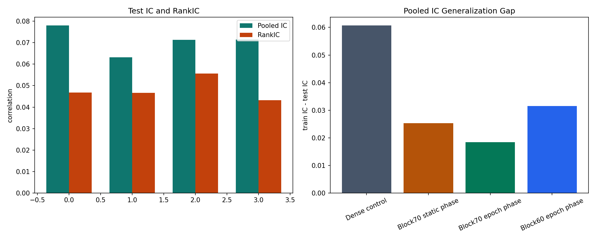
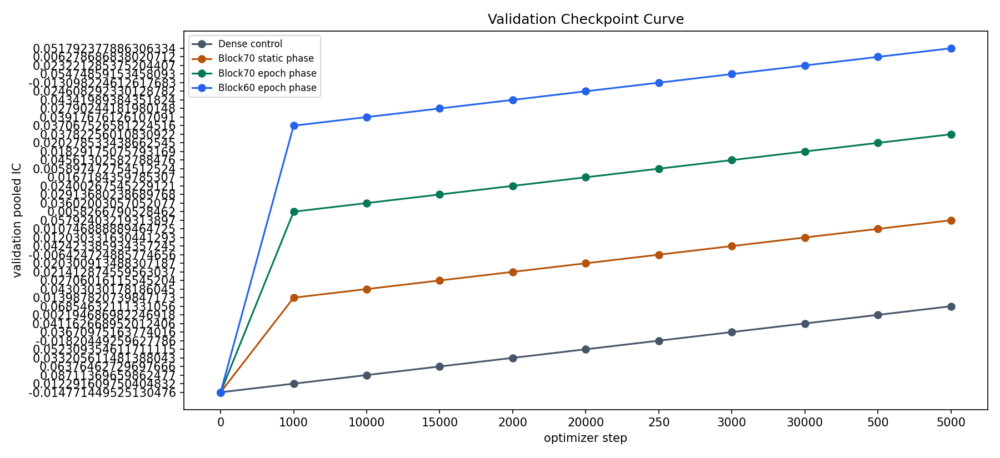
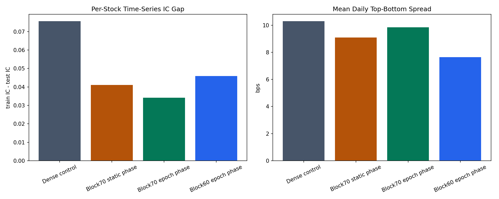

## 摘要

**历史结果: 历史成功.** 单 seed 比较中 dense 的 pooled IC 最高, block70 epoch 的 block 方法 RankIC 和 gap 较好. Test 只覆盖至2024-07-26, 不与全年参考直接比较.

历史成功/失败按实验流程是否成功完成判断. 无增益, 成本后亏损, 归档和当前 artifact 缺失不改变历史成功事实. 失败的实验臂保留失败原因, 不填造未产生的 OOS 指标. 本次只整理已有材料, 未启动训练, 推理或回测.

### 1. Executive Summary

本报告比较 dense control, block70 static phase, block70 epoch phase 和 block60 epoch phase. 四组实验使用相同模型, 特征, 日期切分, 60 分钟输入窗口, checkpoint 候选集合和 checkpoint 选择规则; 主要差异是训练 endpoint 的采样方式. 结论同时区分 pooled IC, 每分钟 cross-sectional IC, 每只股票 time-series IC, 并报告 prediction scale, 分组 spread 与 test endpoint de-overlap. Dense 的 test pooled IC 最高(0.07799), 但 pooled IC gap 为 0.06068, per-stock time-series IC gap 为 0.07561. Block70 epoch 将这两个 gap 分别降至 0.01843 和 0.03414, 同时取得最高 test RankIC(0.05563)和较高日均 spread(9.85 bps). Block60 epoch 的 pooled Pearson IC 与 block70 epoch 接近(0.07152), 但 RankIC, time-series gap 和日均 spread 均较弱, 因此当前证据更支持 block70 epoch 作为去相邻记忆的主候选. 

| display | best_iter | effective_epochs | val_pooled_ic | test_pooled_ic | test_rank_ic | pooled_gap | test_top_bottom_spread | collapse |
| --- | --- | --- | --- | --- | --- | --- | --- | --- |
| Dense control | 5,000 | 0.07282 | 0.06855 | 0.07799 | 0.04678 | 0.06068 | 9.83425 | False |
| Block70 static phase | 2,000 | 2.34666 | 0.02141 | 0.06317 | 0.04658 | 0.02531 | 8.14177 | False |
| Block70 epoch phase | 2,000 | 2.34666 | 0.02400 | 0.07139 | 0.05563 | 0.01843 | 8.90469 | False |
| Block60 epoch phase | 3,000 | 3.51999 | 0.05475 | 0.07152 | 0.04321 | 0.03156 | 9.15131 | False |

Test IC/RankIC and pooled Generalization Gap.

### Interpretation Boundary

训练样本与 test 预测均使用固定日期协议; 本报告的 train gap 使用 sampled train manifest, test 使用完整 test manifest. 结果来自单 fold, 单 seed, 不能替代 rolling folds 或多 seed 证据. 

## 研究背景与目标

本报告围绕Adjacent-window 单 seed整理原始研究证据. 当前材料对应 registry report `generalization-adjacent-window-comparison`, 来源SHA256为 `481c2bea61f46e17b837cef9386d6c4b8c606b82bfec0a62cb3149ba2be7e016`. 原报告的实验方法, 图表, 结果和解释保留在下文.

## 数据与方法

实验身份为 `generalization-adjacent-window`. Split, label, sampler, feature与checkpoint定义按原报告记录, 不从其他实验借用缺失字段. 汇总入口见[全实验综述](../../prediction-nn-1min/1103-nn-registry-summary/).

## 主要结果

| 记录项 | 当前解释 |
| --- | --- |
| 实验 | generalization-adjacent-window |
| 报告类型 | comparison_report_html |
| 历史状态 | 历史成功 |
| 证据 | generalization-adjacent-window-comparison |

Four experiments for Generalization Gap and adjacent-window memory

Generated on 2026-07-10 19:06:56 CST

### 3. Checkpoint Audit

All 11 configured checkpoint candidates and selected points.

| display | iter | val_pooled_ic | val_rank_ic | selected |
| --- | --- | --- | --- | --- |
| Dense control | 0 | -0.01477 | 0.01110 | False |
| Dense control | 250 | -0.01820 | -0.00763 | False |
| Dense control | 500 | 0.00219 | -0.00716 | False |
| Dense control | 1,000 | 0.01229 | -0.00053 | False |
| Dense control | 2,000 | 0.03321 | 0.01582 | False |
| Dense control | 3,000 | 0.03671 | 0.02075 | False |
| Dense control | 5,000 | 0.06855 | 0.02688 | True |
| Dense control | 10,000 | 0.08711 | 0.03776 | False |
| Dense control | 15,000 | 0.06376 | 0.03344 | False |
| Dense control | 20,000 | 0.05231 | 0.03043 | False |
| Dense control | 30,000 | 0.04116 | 0.02849 | False |
| Block70 static phase | 0 | -0.01477 | 0.01110 | False |
| Block70 static phase | 250 | -0.00642 | 0.00509 | False |
| Block70 static phase | 500 | 0.01075 | -0.00069 | False |
| Block70 static phase | 1,000 | 0.01399 | 0.01696 | False |
| Block70 static phase | 2,000 | 0.02141 | 0.02500 | True |
| Block70 static phase | 3,000 | 0.04242 | 0.00958 | False |
| Block70 static phase | 5,000 | 0.05792 | 0.01590 | False |
| Block70 static phase | 10,000 | 0.04303 | 0.00877 | False |
| Block70 static phase | 15,000 | 0.02706 | 0.01047 | False |
| Block70 static phase | 20,000 | 0.02030 | 0.00831 | False |
| Block70 static phase | 30,000 | 0.01203 | 0.00642 | False |
| Block70 epoch phase | 0 | -0.01477 | 0.01110 | False |
| Block70 epoch phase | 250 | 0.00590 | 0.00650 | False |
| Block70 epoch phase | 500 | 0.02028 | 0.00408 | False |
| Block70 epoch phase | 1,000 | 0.00583 | 0.01179 | False |
| Block70 epoch phase | 2,000 | 0.02400 | 0.03043 | True |
| Block70 epoch phase | 3,000 | 0.04561 | 0.02413 | False |
| Block70 epoch phase | 5,000 | 0.03782 | 0.01408 | False |
| Block70 epoch phase | 10,000 | 0.03602 | 0.01361 | False |
| Block70 epoch phase | 15,000 | 0.02914 | 0.01143 | False |
| Block70 epoch phase | 20,000 | 0.01672 | 0.01003 | False |
| Block70 epoch phase | 30,000 | 0.01829 | 0.01052 | False |
| Block60 epoch phase | 0 | -0.01477 | 0.01110 | False |
| Block60 epoch phase | 250 | -0.01310 | -0.00337 | False |
| Block60 epoch phase | 500 | 0.00628 | -0.00888 | False |
| Block60 epoch phase | 1,000 | 0.03707 | 0.02631 | False |
| Block60 epoch phase | 2,000 | 0.04342 | 0.03768 | False |
| Block60 epoch phase | 3,000 | 0.05475 | 0.05965 | True |
| Block60 epoch phase | 5,000 | 0.05179 | 0.04465 | False |
| Block60 epoch phase | 10,000 | 0.03918 | 0.04580 | False |
| Block60 epoch phase | 15,000 | 0.02790 | 0.03959 | False |
| Block60 epoch phase | 20,000 | 0.02461 | 0.03352 | False |
| Block60 epoch phase | 30,000 | 0.02322 | 0.03364 | False |

### Selection Rule

所有实验均使用 11 个候选 checkpoint, 按 validation pooled IC 的 early-top-k 稳定性分数选择, 包含 20 个 validation days 的波动惩罚; 最终选择 dense=5000, block70 static=2000, block70 epoch=2000, block60 epoch=3000. 

### 4. Target Regime And Prediction Scale

| display | train_target_std | test_target_std | train_target_p99 | test_target_p99 | train_prediction_std | test_prediction_std | collapse |
| --- | --- | --- | --- | --- | --- | --- | --- |
| Dense control | 0.004616 | 0.004266 | 0.013452 | 0.012020 | 0.000523 | 0.000476 | False |
| Block70 static phase | 0.004616 | 0.004266 | 0.013469 | 0.012031 | 0.000488 | 0.000466 | False |
| Block70 epoch phase | 0.004616 | 0.004266 | 0.013521 | 0.011994 | 0.000597 | 0.000582 | False |
| Block60 epoch phase | 0.004616 | 0.004266 | 0.013558 | 0.012054 | 0.000525 | 0.000513 | False |

Per-stock time-series IC gap and mean daily top-bottom spread.

### Prediction Collapse

四组 test prediction 均未触发 collapse flag. block70 epoch 的 prediction scale ratio 为约 0.137, dense 为约 0.111; 因此 gap 缩小不是通过把 prediction 压到接近零实现的. 

### 5. IC Decomposition

| display | train_pooled_ic | test_pooled_ic | train_rank_ic | test_rank_ic | train_cs_ic | test_cs_ic | train_cs_rank_ic | test_cs_rank_ic | train_ts_ic | test_ts_ic | ts_gap |
| --- | --- | --- | --- | --- | --- | --- | --- | --- | --- | --- | --- |
| Dense control | 0.13866 | 0.07799 | 0.12147 | 0.04678 | 0.11499 | 0.09071 | 0.08924 | 0.05649 | 0.13133 | 0.05572 | 0.07561 |
| Block70 static phase | 0.08848 | 0.06317 | 0.08447 | 0.04658 | 0.09258 | 0.08698 | 0.08281 | 0.06455 | 0.08354 | 0.04240 | 0.04114 |
| Block70 epoch phase | 0.08982 | 0.07139 | 0.08991 | 0.05563 | 0.09140 | 0.08766 | 0.08757 | 0.06827 | 0.08527 | 0.05113 | 0.03414 |
| Block60 epoch phase | 0.10308 | 0.07152 | 0.08700 | 0.04321 | 0.09495 | 0.08572 | 0.06794 | 0.04964 | 0.09578 | 0.04989 | 0.04589 |

### Gap Table

| display | pooled_gap | rank_gap | cs_gap | cs_rank_gap | ts_gap | ts_rank_gap | prediction_scale_ratio |
| --- | --- | --- | --- | --- | --- | --- | --- |
| Dense control | 0.06068 | 0.07469 | 0.02428 | 0.03275 | 0.07561 | 0.07869 | 0.11149 |
| Block70 static phase | 0.02531 | 0.03789 | 0.00560 | 0.01827 | 0.04114 | 0.04196 | 0.10928 |
| Block70 epoch phase | 0.01843 | 0.03429 | 0.00374 | 0.01930 | 0.03414 | 0.03806 | 0.13652 |
| Block60 epoch phase | 0.03156 | 0.04379 | 0.00923 | 0.01830 | 0.04589 | 0.04926 | 0.12017 |

Dense 的 pooled Pearson IC 最高, 但其 pooled, cross-sectional 和 per-stock time-series gap 也最大. Block70 epoch 的 test RankIC 和 CS RankIC 最高, 且 time-series gap 显著低于 dense. 其 CS Pearson IC 比 dense 略低, 说明提升主要体现在排序质量和跨股票稳定性, 而不是所有 Pearson 指标同时提升. 

### 6. Group Spread And De-Overlap

| display | test_top_bottom_spread | daily_spread_mean | daily_spread_std | daily_spread_p10 | daily_spread_positive_ratio |
| --- | --- | --- | --- | --- | --- |
| Dense control | 9.834 | 10.292 | 8.608 | 0.553 | 0.920 |
| Block70 static phase | 8.142 | 9.095 | 7.644 | 1.441 | 0.940 |
| Block70 epoch phase | 8.905 | 9.854 | 6.557 | 3.078 | 0.940 |
| Block60 epoch phase | 9.151 | 7.636 | 6.357 | -0.137 | 0.890 |

### De-Overlap Test

对 test 内每个 stock-time series 保留 stride=1/5/10/20 的 endpoint 后, 四组 pooled IC 均保持相近, 说明 test 结果不是由相邻重复行单独制造. Block70 epoch 的 stride 1/5/10/20 pooled IC 约为 0.07139/0.07076/0.07190/0.07311. 

| display | stride_minutes | row_fraction_vs_stride1 | pooled_ic | cross_sectional_ic_mean | per_stock_ic_mean |
| --- | --- | --- | --- | --- | --- |
| Dense control | 1.00000 | 1.00000 | 0.07799 | 0.09071 | 0.05572 |
| Dense control | 5.00000 | 0.20179 | 0.07721 | 0.09037 | 0.05462 |
| Dense control | 10.00000 | 0.10241 | 0.07580 | 0.09096 | 0.05293 |
| Dense control | 20.00000 | 0.05272 | 0.07451 | 0.09061 | 0.05173 |
| Block70 static phase | 1.00000 | 1.00000 | 0.06317 | 0.08698 | 0.04240 |
| Block70 static phase | 5.00000 | 0.20179 | 0.06192 | 0.08711 | 0.04040 |
| Block70 static phase | 10.00000 | 0.10241 | 0.06290 | 0.08808 | 0.04211 |
| Block70 static phase | 20.00000 | 0.05272 | 0.06571 | 0.08835 | 0.04632 |
| Block70 epoch phase | 1.00000 | 1.00000 | 0.07139 | 0.08766 | 0.05113 |
| Block70 epoch phase | 5.00000 | 0.20179 | 0.07076 | 0.08819 | 0.04921 |
| Block70 epoch phase | 10.00000 | 0.10241 | 0.07190 | 0.08899 | 0.05110 |
| Block70 epoch phase | 20.00000 | 0.05272 | 0.07311 | 0.08907 | 0.05279 |
| Block60 epoch phase | 1.00000 | 1.00000 | 0.07152 | 0.08572 | 0.04989 |
| Block60 epoch phase | 5.00000 | 0.20179 | 0.07093 | 0.08559 | 0.04872 |
| Block60 epoch phase | 10.00000 | 0.10241 | 0.07126 | 0.08592 | 0.04953 |
| Block60 epoch phase | 20.00000 | 0.05272 | 0.06980 | 0.08492 | 0.04832 |

### 7. Evidence, Limitations And Source Reports

每个实验的 full report, checkpoint manifest, train/test manifest 和固定协议 diagnostics 均已存在. 实际 test 预测覆盖 2024-03-01 至 2024-07-26, 并非完整 2024 自然年; 该限制必须在后续 rolling folds 中补足. 

| display | full_report_path | test_date_range |
| --- | --- | --- |
| Dense control | [artifact-root]/nn/generalization-experiments/adjacent-window/dense-control-30k/research_report/071017_dense-control-30k_full_evaluation_report.html | 240301-240726 |
| Block70 static phase | [artifact-root]/nn/generalization-experiments/adjacent-window/block70-static-phase/research_report/071015_block70-static-phase_full_evaluation_report.html | 240301-240726 |
| Block70 epoch phase | [artifact-root]/nn/generalization-experiments/adjacent-window/block70-epoch-phase/research_report/071015_block70-epoch-phase_full_evaluation_report.html | 240301-240726 |
| Block60 epoch phase | [artifact-root]/nn/generalization-experiments/adjacent-window/block60-epoch-phase/research_report/071018_block60-epoch-phase_full_evaluation_report.html | 240301-240726 |

### Artifact Audit

| experiment | missing artifacts |
| --- | --- |
| dense-control-30k | none |
| block70-static-phase | none |
| block70-epoch-phase | none |
| block60-epoch-phase | none |

### Recommended Follow-up

下一步应以 dense control 和 block70 epoch 为双基线, 在相同 checkpoint 规则下开展多 seed, 自然年 rolling folds 和 matched effective-epoch 对照; block60 可保留为 touch-without-overlap 的边界实验, 不应直接作为当前主方案. 

## 限制与适用边界

单 seed 比较中 dense 的 pooled IC 最高, block70 epoch 的 block 方法 RankIC 和 gap 较好. Test 只覆盖至2024-07-26, 不与全年参考直接比较. 当前artifact可得性只影响复现, 不作为历史成功/失败判据. 只有matched合同内的结果可以直接比较.

### 2. Experiment Design And Comparability

四个实验只改变 endpoint sampling; 模型容量, 输入窗口, 日期范围, 股票池, label, evaluator 和 checkpoint schedule 保持一致. 

| experiment | sampling | block_size_endpoints | phase_mode | window | train | validation | test_predictions | checkpoint_candidates |
| --- | --- | --- | --- | --- | --- | --- | --- | --- |
| Dense control | dense | all eligible endpoints | n/a | 60 minutes | 2021-01-04 to 2023-12-29 | after train to 2024-02-29 | 240301-240726 | 11 |
| Block70 static phase | block | 70 | static | 60 minutes | 2021-01-04 to 2023-12-29 | after train to 2024-02-29 | 240301-240726 | 11 |
| Block70 epoch phase | block | 70 | epoch | 60 minutes | 2021-01-04 to 2023-12-29 | after train to 2024-02-29 | 240301-240726 | 11 |
| Block60 epoch phase | block | 60 | epoch | 60 minutes | 2021-01-04 to 2023-12-29 | after train to 2024-02-29 | 240301-240726 | 11 |

### Sampling Semantics

Dense 使用 stride=1, 60 分钟窗口高度重叠. Block60 每个 stock-day 约每 60 个 endpoint 选择一个, 窗口相接但不重叠. Block70 每 70 个 endpoint 选择一个, 窗口间保留约 10 分钟 gap. epoch phase 每轮为 stock-day 随机化 phase, static phase 固定 phase. 

### Exposure Matching

Optimizer steps 不能直接等价为 effective epochs: dense 的 5k checkpoint 约为 0.073 effective epochs, 而 block70 的 2k checkpoint 约为 2.347, block60 的 3k checkpoint 约为 3.520. 因此报告同时保留 step 和 effective epochs. 

## 结论

本次归档保留上述历史事实. 研究结论, 推广门槛和执行限制分别解释, 不把模型无增益或净收益为负改写成实验流程失败.
