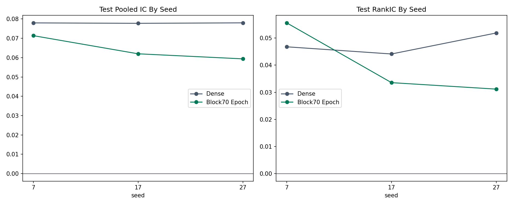
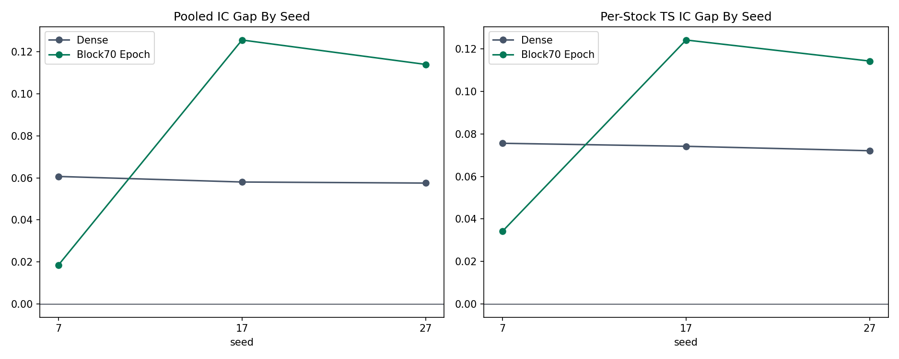
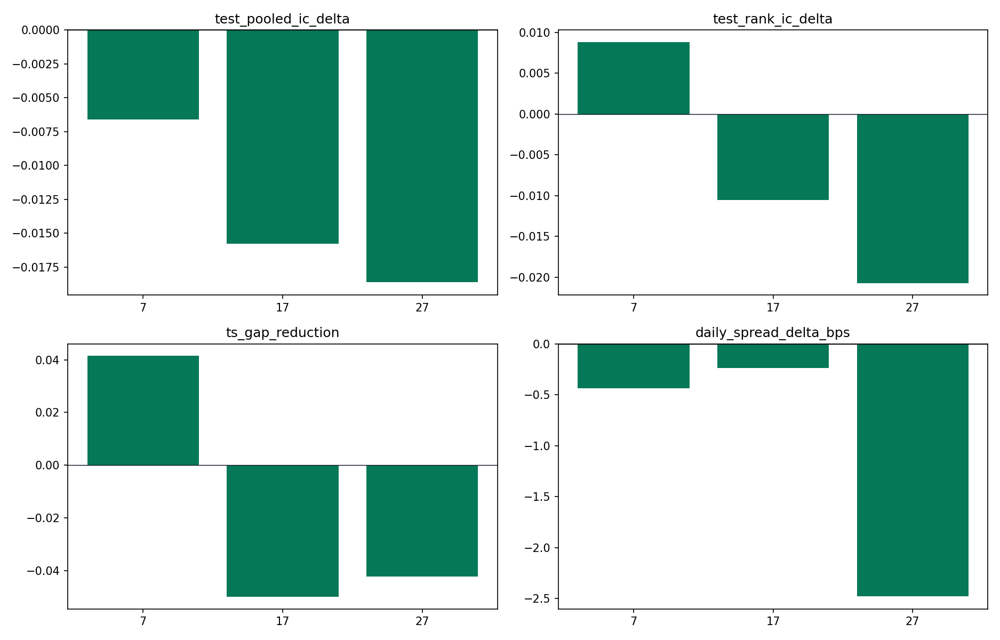

## 摘要

**历史结果: 历史成功.** Seeds 7/17/27 中 Dense 的平均 test IC 为 0.0779182, Block70 epoch 为 0.0642507; Block70 pooled-IC win rate 为0/3. 负增益不构成流程失败.

历史成功/失败按实验流程是否成功完成判断. 无增益, 成本后亏损, 归档和当前 artifact 缺失不改变历史成功事实. 失败的实验臂保留失败原因, 不填造未产生的 OOS 指标. 本次只整理已有材料, 未启动训练, 推理或回测.

### 1. Executive Summary

Observed result: over seeds 7, 17, and 27, Dense mean test pooled IC is 0.07792, while Block70 epoch is 0.06425. Block70 wins test pooled IC in 0/3 seeds, reduces per-stock time-series IC Gap in 1/3, matches or improves test RankIC in 1/3, and wins daily spread in 0/3. Decision: under the current optimizer-step and checkpoint-selection protocol, Block70 epoch is not supported as a replacement for Dense. It should only continue through an exposure-matched follow-up, not promotion of this configuration.

| display_name | seed_count | test_pooled_ic_mean | test_pooled_ic_std | test_rank_ic_mean | test_rank_ic_std | ts_gap_mean | ts_gap_std | daily_spread_mean_bps_mean | prediction_std_over_target_std_mean |
| --- | --- | --- | --- | --- | --- | --- | --- | --- | --- |
| Dense | 3 | 0.07792 | 0.00014 | 0.04760 | 0.00394 | 0.07397 | 0.00177 | 9.64899 | 0.11966 |
| Block70 Epoch | 3 | 0.06425 | 0.00632 | 0.04012 | 0.01348 | 0.09088 | 0.04939 | 8.59746 | 0.16502 |

Seed-level test pooled IC and RankIC.

## 研究背景与目标

本报告围绕Adjacent-window 多 seed整理原始研究证据. 当前材料对应 registry report `generalization-adjacent-window-multiseed-comparison`, 来源SHA256为 `7bb638d0461c5bfd5144a2c8bcf02ca5697f085cf943eaef9d65280569169a7b`. 原报告的实验方法, 图表, 结果和解释保留在下文.

## 数据与方法

实验身份为 `generalization-adjacent-window-multiseed`. Split, label, sampler, feature与checkpoint定义按原报告记录, 不从其他实验借用缺失字段. 汇总入口见[全实验综述](../../prediction-nn-1min/1103-nn-registry-summary/).

## 主要结果

| 记录项 | 当前解释 |
| --- | --- |
| 实验 | generalization-adjacent-window-multiseed |
| 报告类型 | comparison_report_html |
| 历史状态 | 历史成功 |
| 证据 | generalization-adjacent-window-multiseed-comparison |

Seeds 7, 17, and 27 under the fixed adjacent-window evaluation protocol.

Generated on 2026-07-11 16:24:08 CST

### 2. Fixed Protocol And Checkpoint Audit

train

2021-01-04 to 2023-12-29

validation

2024-01-02 to 2024-02-29

actual test predictions

2024-03-01 to 2024-07-26

checkpoint candidates

0,250,500,1000,2000,3000,5000,10000,15000,20000,30000

selection

early_top_k, top_k=2, last-20-validation-day mean minus 0.5 std

gap convention

sampled train minus full test

| display_name | seed | best_iter | effective_epochs | selection_score | test_date_min | test_date_max |
| --- | --- | --- | --- | --- | --- | --- |
| Dense | 7 | 5,000 | 0.07282 | 0.05399 | 240,301 | 240,726 |
| Block70 Epoch | 7 | 2,000 | 2.34666 | 0.03890 | 240,301 | 240,726 |
| Dense | 17 | 5,000 | 0.07282 | 0.05441 | 240,301 | 240,726 |
| Block70 Epoch | 17 | 10,000 | 11.73329 | 0.05102 | 240,301 | 240,726 |
| Dense | 27 | 5,000 | 0.07282 | 0.05069 | 240,301 | 240,726 |
| Block70 Epoch | 27 | 10,000 | 11.73329 | 0.04300 | 240,301 | 240,726 |

### 3. Seed-Level OOS Performance

| display_name | seed | test_pooled_ic | test_rank_ic | test_cs_ic | test_cs_rank_ic | test_ts_ic | test_ts_rank_ic |
| --- | --- | --- | --- | --- | --- | --- | --- |
| Dense | 7 | 0.07799 | 0.04678 | 0.09071 | 0.05649 | 0.05572 | 0.04274 |
| Block70 Epoch | 7 | 0.07139 | 0.05563 | 0.08766 | 0.06827 | 0.05113 | 0.05010 |
| Dense | 17 | 0.07776 | 0.04414 | 0.09265 | 0.05577 | 0.05282 | 0.03931 |
| Block70 Epoch | 17 | 0.06199 | 0.03356 | 0.08222 | 0.05805 | 0.03863 | 0.02830 |
| Dense | 27 | 0.07801 | 0.05189 | 0.09064 | 0.06187 | 0.05509 | 0.04710 |
| Block70 Epoch | 27 | 0.05937 | 0.03117 | 0.07823 | 0.05224 | 0.03611 | 0.02642 |

### Paired Block70 Effects

| seed | test_pooled_ic_delta | test_rank_ic_delta | test_cs_ic_delta | test_cs_rank_ic_delta | test_ts_ic_delta | test_ts_rank_ic_delta |
| --- | --- | --- | --- | --- | --- | --- |
| 7 | -0.00660 | 0.00884 | -0.00305 | 0.01178 | -0.00459 | 0.00736 |
| 17 | -0.01577 | -0.01058 | -0.01044 | 0.00228 | -0.01420 | -0.01101 |
| 27 | -0.01864 | -0.02072 | -0.01241 | -0.00963 | -0.01898 | -0.02068 |

### 4. Generalization Gap Decomposition

Pooled and per-stock time-series train-test gaps by seed.

| display_name | seed | pooled_gap | rank_gap | cs_gap | cs_rank_gap | ts_gap | ts_rank_gap |
| --- | --- | --- | --- | --- | --- | --- | --- |
| Dense | 7 | 0.06068 | 0.07469 | 0.02428 | 0.03275 | 0.07561 | 0.07869 |
| Block70 Epoch | 7 | 0.01843 | 0.03429 | 0.00374 | 0.01930 | 0.03414 | 0.03806 |
| Dense | 17 | 0.05803 | 0.07403 | 0.02189 | 0.03177 | 0.07419 | 0.07751 |
| Block70 Epoch | 17 | 0.12561 | 0.10606 | 0.06742 | 0.04606 | 0.12421 | 0.11104 |
| Dense | 27 | 0.05753 | 0.06765 | 0.02348 | 0.03317 | 0.07210 | 0.07251 |
| Block70 Epoch | 27 | 0.11399 | 0.09904 | 0.06496 | 0.04457 | 0.11430 | 0.10278 |

### Paired Gap Reduction

| seed | pooled_gap_reduction | rank_gap_reduction | cs_gap_reduction | ts_gap_reduction | ts_rank_gap_reduction |
| --- | --- | --- | --- | --- | --- |
| 7 | 0.04225 | 0.04040 | 0.02055 | 0.04147 | 0.04063 |
| 17 | -0.06758 | -0.03203 | -0.04553 | -0.05002 | -0.03352 |
| 27 | -0.05646 | -0.03139 | -0.04148 | -0.04220 | -0.03027 |

### 5. Spread And Prediction Scale

| display_name | seed | daily_spread_mean_bps | daily_spread_std_bps | daily_spread_p10_bps | daily_spread_positive_ratio | prediction_std_over_target_std | collapse_flag |
| --- | --- | --- | --- | --- | --- | --- | --- |
| Dense | 7 | 10.29209 | 8.60768 | 0.55257 | 0.92000 | 0.11149 | False |
| Block70 Epoch | 7 | 9.85447 | 6.55701 | 3.07767 | 0.94000 | 0.13652 | False |
| Dense | 17 | 8.61200 | 9.00410 | -2.54374 | 0.85000 | 0.12022 | False |
| Block70 Epoch | 17 | 8.37568 | 7.80629 | -0.46176 | 0.89000 | 0.18355 | False |
| Dense | 27 | 10.04287 | 8.85597 | -0.03446 | 0.90000 | 0.12728 | False |
| Block70 Epoch | 27 | 7.56223 | 7.20350 | -0.17238 | 0.89000 | 0.17497 | False |

Block70 minus Dense for performance metrics; positive gap reduction favors Block70.

### 6. De-Overlap Robustness

| display_name | seed | test_pooled_ic | deoverlap_stride20_pooled_ic |
| --- | --- | --- | --- |
| Dense | 7 | 0.07799 | 0.07451 |
| Block70 Epoch | 7 | 0.07139 | 0.07311 |
| Dense | 17 | 0.07776 | 0.07766 |
| Block70 Epoch | 17 | 0.06199 | 0.06033 |
| Dense | 27 | 0.07801 | 0.07557 |
| Block70 Epoch | 27 | 0.05937 | 0.05547 |

Stride-20 retains roughly 5.27% of test rows. Stability relative to stride-1 is evidence that OOS metrics are not created solely by adjacent test endpoints.

## 限制与适用边界

Seeds 7/17/27 中 Dense 的平均 test IC 为 0.0779182, Block70 epoch 为 0.0642507; Block70 pooled-IC win rate 为0/3. 负增益不构成流程失败. 当前artifact可得性只影响复现, 不作为历史成功/失败判据. 只有matched合同内的结果可以直接比较.

## 结论

本次归档保留上述历史事实. 研究结论, 推广门槛和执行限制分别解释, 不把模型无增益或净收益为负改写成实验流程失败.

## 附录

### 7. Artifacts And Limitations

| display_name | seed | run_root | diagnostics_root | full_report_path |
| --- | --- | --- | --- | --- |
| Dense | 7 | [artifact-root]/nn/generalization-experiments/adjacent-window/dense-control-30k/date_ranges | [artifact-root]/nn/generalization-experiments/adjacent-window/diagnostics/dense-control-30k | [artifact-root]/nn/generalization-experiments/adjacent-window/dense-control-30k/research_report/071017_dense-control-30k_full_evaluation_report.html |
| Block70 Epoch | 7 | [artifact-root]/nn/generalization-experiments/adjacent-window/block70-epoch-phase/date_ranges | [artifact-root]/nn/generalization-experiments/adjacent-window/diagnostics/block70-epoch-phase | [artifact-root]/nn/generalization-experiments/adjacent-window/block70-epoch-phase/research_report/071015_block70-epoch-phase_full_evaluation_report.html |
| Dense | 17 | [artifact-root]/nn/generalization-experiments/adjacent-window/multi-seed/seed17/dense-control-30k/date_ranges | [artifact-root]/nn/generalization-experiments/adjacent-window/multi-seed/diagnostics/seed17/dense-control-30k | [artifact-root]/nn/generalization-experiments/adjacent-window/multi-seed/seed17/dense-control-30k/research_report/071112_dense-control-30k_full_evaluation_report.html |
| Block70 Epoch | 17 | [artifact-root]/nn/generalization-experiments/adjacent-window/multi-seed/seed17/block70-epoch-phase/date_ranges | [artifact-root]/nn/generalization-experiments/adjacent-window/multi-seed/diagnostics/seed17/block70-epoch-phase | [artifact-root]/nn/generalization-experiments/adjacent-window/multi-seed/seed17/block70-epoch-phase/research_report/071112_block70-epoch-phase_full_evaluation_report.html |
| Dense | 27 | [artifact-root]/nn/generalization-experiments/adjacent-window/multi-seed/seed27/dense-control-30k/date_ranges | [artifact-root]/nn/generalization-experiments/adjacent-window/multi-seed/diagnostics/seed27/dense-control-30k | [artifact-root]/nn/generalization-experiments/adjacent-window/multi-seed/seed27/dense-control-30k/research_report/071116_dense-control-30k_full_evaluation_report.html |
| Block70 Epoch | 27 | [artifact-root]/nn/generalization-experiments/adjacent-window/multi-seed/seed27/block70-epoch-phase/date_ranges | [artifact-root]/nn/generalization-experiments/adjacent-window/multi-seed/diagnostics/seed27/block70-epoch-phase | [artifact-root]/nn/generalization-experiments/adjacent-window/multi-seed/seed27/block70-epoch-phase/research_report/071116_block70-epoch-phase_full_evaluation_report.html |

### Decision-Rule Win Rates

| rule | paired_seed_count | win_count | win_rate |
| --- | --- | --- | --- |
| test_pooled_ic_win | 3 | 0 | 0.000 |
| test_rank_ic_win | 3 | 1 | 0.333 |
| ts_gap_reduction_win | 3 | 1 | 0.333 |
| spread_win | 3 | 0 | 0.000 |
| cs_ic_tolerance_pass | 3 | 1 | 0.333 |
| no_prediction_collapse | 3 | 3 | 1.000 |

Limitations: this is one date fold with three seeds. It measures optimization/sampling variance, not regime stability across calendar folds. Effective epochs differ structurally between Dense and Block70 and are reported rather than treated as matched exposure.
