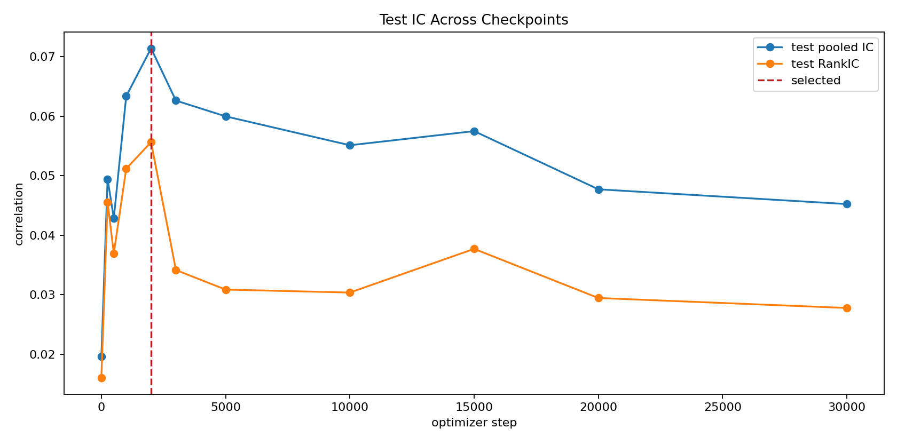
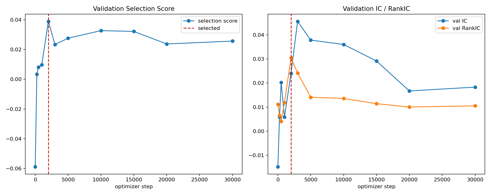
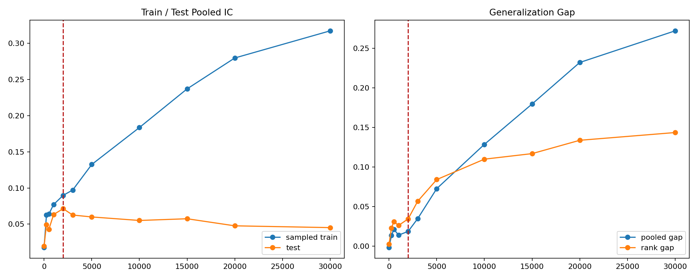
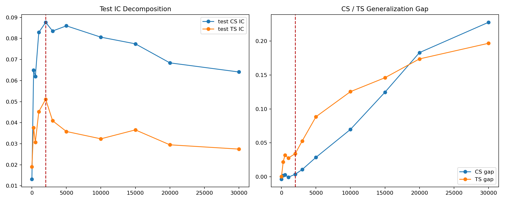
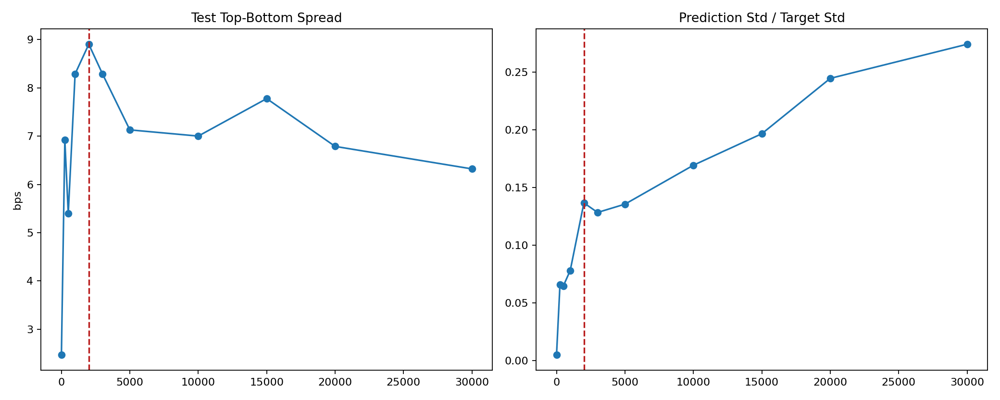
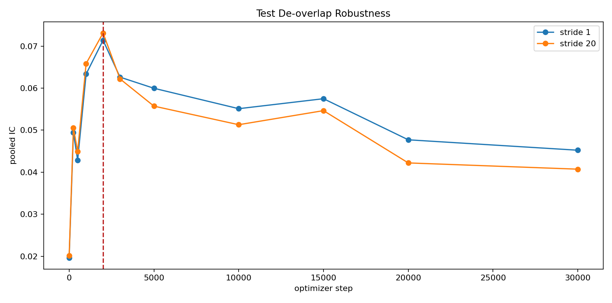

## 摘要

**历史结果: 历史成功.** 11个 checkpoint 的诊断已完成. Block70 epoch 早期达峰, 后期 test IC 下降且 gap 扩大. 全曲线 test exposure 使其不能作为 blind checkpoint selection.

历史成功/失败按实验流程是否成功完成判断. 无增益, 成本后亏损, 归档和当前 artifact 缺失不改变历史成功事实. 失败的实验臂保留失败原因, 不填造未产生的 OOS 指标. 本次只整理已有材料, 未启动训练, 推理或回测.

### 1. Executive Summary

Validation early-top-k selected iter_2000. Its test pooled IC is 0.07139, test RankIC is 0.05563, pooled gap is 0.01843, and per-stock TS gap is 0.03414. Post-hoc test pooled IC peaks at iter_2000 (0.07139); test RankIC peaks at iter_2000 (0.05563). These post-hoc peaks are diagnostic evidence, not a replacement checkpoint selector.

From iter_2000 to iter_30000, sampled-train pooled IC rises from 0.08982 to 0.31714, while test pooled IC falls from 0.07139 to 0.04523 and test RankIC falls from 0.05563 to 0.02777. The pooled gap expands from 0.01843 to 0.27191. This is a clear late-training generalization failure, not evidence that Block70 merely needed more optimizer steps.

| iter | effective_epochs | selected | selection_score | val_pooled_ic | test_pooled_ic | test_rank_ic | pooled_gap | ts_gap | test_top_bottom_spread_bps | test_prediction_scale_ratio |
| --- | --- | --- | --- | --- | --- | --- | --- | --- | --- | --- |
| 0 | 0.000 | False | -0.05886 | -0.01477 | 0.01963 | 0.01604 | -0.00175 | 0.00041 | 2.472 | 0.00490 |
| 250 | 0.293 | False | 0.00342 | 0.00590 | 0.04943 | 0.04557 | 0.01337 | 0.02195 | 6.919 | 0.06554 |
| 500 | 0.587 | False | 0.00811 | 0.02028 | 0.04285 | 0.03692 | 0.02109 | 0.03185 | 5.396 | 0.06461 |
| 1,000 | 1.173 | False | 0.00973 | 0.00583 | 0.06335 | 0.05117 | 0.01381 | 0.02761 | 8.289 | 0.07793 |
| 2,000 | 2.347 | True | 0.03890 | 0.02400 | 0.07139 | 0.05563 | 0.01843 | 0.03414 | 8.904 | 0.13652 |
| 3,000 | 3.520 | False | 0.02332 | 0.04561 | 0.06261 | 0.03414 | 0.03455 | 0.05273 | 8.290 | 0.12826 |
| 5,000 | 5.867 | False | 0.02756 | 0.03782 | 0.05996 | 0.03086 | 0.07252 | 0.08850 | 7.129 | 0.13545 |
| 10,000 | 11.733 | False | 0.03264 | 0.03602 | 0.05511 | 0.03036 | 0.12846 | 0.12549 | 7.001 | 0.16920 |
| 15,000 | 17.600 | False | 0.03214 | 0.02914 | 0.05748 | 0.03770 | 0.17947 | 0.14601 | 7.777 | 0.19654 |
| 20,000 | 23.467 | False | 0.02369 | 0.01672 | 0.04770 | 0.02944 | 0.23195 | 0.17375 | 6.787 | 0.24454 |
| 30,000 | 35.200 | False | 0.02563 | 0.01829 | 0.04523 | 0.02777 | 0.27191 | 0.19676 | 6.321 | 0.27413 |

Full-test pooled IC and RankIC across checkpoints; red line marks the validation-selected checkpoint.

## 研究背景与目标

本报告围绕Block70 checkpoint 曲线整理原始研究证据. 当前材料对应 registry report `generalization-block70-checkpoint-curve-report`, 来源SHA256为 `3ca43bed067a04f72273ac05135d4a95a4f9d742f44ac789fbbf104449f51204`. 原报告的实验方法, 图表, 结果和解释保留在下文.

## 数据与方法

实验身份为 `generalization-block70-checkpoint-curve`. Split, label, sampler, feature与checkpoint定义按原报告记录, 不从其他实验借用缺失字段. 汇总入口见[全实验综述](../../prediction-nn-1min/1103-nn-registry-summary/).

## 主要结果

| 记录项 | 当前解释 |
| --- | --- |
| 实验 | generalization-block70-checkpoint-curve |
| 报告类型 | diagnostic_report_html |
| 历史状态 | 历史成功 |
| 证据 | generalization-block70-checkpoint-curve-report |

Validation, test performance, IC decomposition, Generalization Gap, spread, and prediction-scale evolution across 11 checkpoints.

Generated on 2026-07-10 23:07:13 CST

### 2. Experiment And Checkpoint Audit

source_root

[artifact-root]/nn/generalization-experiments/adjacent-window/block70-epoch-phase/date_ranges

sampling

block70, epoch-randomized phase

checkpoint_count

11

selected_checkpoint

2000

train_metric_scope

fixed sampled train: 31,875,072 rows

test_metric_scope

full test: 176,945,440 rows, 2024-03-01 to 2024-07-26

All 11 configured checkpoint files, validation metrics, full-test manifests, sampled-train manifests, fixed-protocol diagnostics, and per-checkpoint exact pooled RankIC audits are required before rendering.

### 3. Validation Versus Test Curve

Validation stability score, pooled IC, and RankIC across optimizer steps.

Post-hoc test metrics are shown only to audit selector behavior.

### 4. IC Decomposition And Generalization Gap

| iter | train_pooled_ic | test_pooled_ic | pooled_gap | train_rank_ic | test_rank_ic | rank_gap | test_cs_ic | cs_gap | test_ts_ic | ts_gap |
| --- | --- | --- | --- | --- | --- | --- | --- | --- | --- | --- |
| 0 | 0.01789 | 0.01963 | -0.00175 | 0.01832 | 0.01604 | 0.00228 | 0.01318 | -0.00351 | 0.01905 | 0.00041 |
| 250 | 0.06280 | 0.04943 | 0.01337 | 0.06811 | 0.04557 | 0.02254 | 0.06494 | 0.00182 | 0.03759 | 0.02195 |
| 500 | 0.06394 | 0.04285 | 0.02109 | 0.06781 | 0.03692 | 0.03089 | 0.06194 | 0.00275 | 0.03065 | 0.03185 |
| 1,000 | 0.07717 | 0.06335 | 0.01381 | 0.07715 | 0.05117 | 0.02598 | 0.08288 | -0.00070 | 0.04522 | 0.02761 |
| 2,000 | 0.08982 | 0.07139 | 0.01843 | 0.08991 | 0.05563 | 0.03429 | 0.08766 | 0.00374 | 0.05113 | 0.03414 |
| 3,000 | 0.09716 | 0.06261 | 0.03455 | 0.09066 | 0.03414 | 0.05653 | 0.08354 | 0.01059 | 0.04091 | 0.05273 |
| 5,000 | 0.13248 | 0.05996 | 0.07252 | 0.11483 | 0.03086 | 0.08397 | 0.08600 | 0.02861 | 0.03581 | 0.08850 |
| 10,000 | 0.18357 | 0.05511 | 0.12846 | 0.14012 | 0.03036 | 0.10976 | 0.08062 | 0.06981 | 0.03232 | 0.12549 |
| 15,000 | 0.23695 | 0.05748 | 0.17947 | 0.15447 | 0.03770 | 0.11677 | 0.07745 | 0.12464 | 0.03657 | 0.14601 |
| 20,000 | 0.27966 | 0.04770 | 0.23195 | 0.16306 | 0.02944 | 0.13361 | 0.06841 | 0.18304 | 0.02947 | 0.17375 |
| 30,000 | 0.31714 | 0.04523 | 0.27191 | 0.17117 | 0.02777 | 0.14340 | 0.06408 | 0.22769 | 0.02744 | 0.19676 |

### Rank IC decomposition

| iter | train_cs_rank_ic | test_cs_rank_ic | cs_rank_gap | train_ts_rank_ic | test_ts_rank_ic | ts_rank_gap |
| --- | --- | --- | --- | --- | --- | --- |
| 0 | 0.00892 | 0.01397 | -0.00506 | 0.01592 | 0.01223 | 0.00369 |
| 250 | 0.07374 | 0.06192 | 0.01182 | 0.06767 | 0.04245 | 0.02522 |
| 500 | 0.06958 | 0.05692 | 0.01266 | 0.06747 | 0.03495 | 0.03252 |
| 1,000 | 0.08154 | 0.06907 | 0.01247 | 0.07672 | 0.04673 | 0.02999 |
| 2,000 | 0.08757 | 0.06827 | 0.01930 | 0.08816 | 0.05010 | 0.03806 |
| 3,000 | 0.07543 | 0.05122 | 0.02421 | 0.09162 | 0.03017 | 0.06144 |
| 5,000 | 0.09595 | 0.05896 | 0.03698 | 0.11468 | 0.02595 | 0.08874 |
| 10,000 | 0.10165 | 0.05353 | 0.04813 | 0.13971 | 0.02558 | 0.11413 |
| 15,000 | 0.11260 | 0.05624 | 0.05636 | 0.15370 | 0.03266 | 0.12104 |
| 20,000 | 0.12464 | 0.05506 | 0.06957 | 0.16117 | 0.02452 | 0.13665 |
| 30,000 | 0.13251 | 0.05358 | 0.07893 | 0.16813 | 0.02285 | 0.14527 |

From iter_2000 to iter_30000, sampled-train pooled IC rises from 0.08982 to 0.31714, while test pooled IC falls from 0.07139 to 0.04523 and test RankIC falls from 0.05563 to 0.02777. The pooled gap expands from 0.01843 to 0.27191. This is a clear late-training generalization failure, not evidence that Block70 merely needed more optimizer steps.

Sampled-train versus full-test pooled IC and Generalization Gap.

Test IC and train-test Gap separated by metric family.

### 5. Spread, Prediction Scale And De-overlap

| iter | test_top_bottom_spread_bps | test_prediction_std | test_prediction_scale_ratio | test_collapse_flag | test_stride20_pooled_ic | test_stride20_cs_ic | test_stride20_ts_ic |
| --- | --- | --- | --- | --- | --- | --- | --- |
| 0 | 2.472 | 0.00002 | 0.00490 | False | 0.02017 | 0.01178 | 0.01966 |
| 250 | 6.919 | 0.00028 | 0.06554 | False | 0.05055 | 0.06594 | 0.03930 |
| 500 | 5.396 | 0.00028 | 0.06461 | False | 0.04496 | 0.06227 | 0.03394 |
| 1,000 | 8.289 | 0.00033 | 0.07793 | False | 0.06584 | 0.08451 | 0.04822 |
| 2,000 | 8.904 | 0.00058 | 0.13652 | False | 0.07311 | 0.08907 | 0.05279 |
| 3,000 | 8.290 | 0.00055 | 0.12826 | False | 0.06219 | 0.08496 | 0.04006 |
| 5,000 | 7.129 | 0.00058 | 0.13545 | False | 0.05571 | 0.08691 | 0.03143 |
| 10,000 | 7.001 | 0.00072 | 0.16920 | False | 0.05130 | 0.07990 | 0.02910 |
| 15,000 | 7.777 | 0.00084 | 0.19654 | False | 0.05464 | 0.07694 | 0.03544 |
| 20,000 | 6.787 | 0.00104 | 0.24454 | False | 0.04221 | 0.06796 | 0.02381 |
| 30,000 | 6.321 | 0.00117 | 0.27413 | False | 0.04072 | 0.06398 | 0.02260 |

No checkpoint is flagged for prediction collapse. Instead, test prediction std / target std grows from 0.13652 at iter_2000 to 0.27413 at iter_30000, while test spread declines from 8.904 to 6.321 bps. At iter_2000, stride-20 pooled IC is 0.07311 versus 0.07139 on the full endpoint set, so the selected checkpoint's signal is not explained only by adjacent test endpoints.

Top-bottom target spread and prediction amplitude across checkpoints.

Full test pooled IC versus stride-20 de-overlapped pooled IC.

### 6. Selection Diagnostics

The table reports post-hoc objective optima and regret of the fixed validation-selected iter_2000 checkpoint. It is an audit of the selector, not a rule for selecting on test.

| objective | mode | best_iter_posthoc | best_value_posthoc | selected_iter | selected_value | selected_regret |
| --- | --- | --- | --- | --- | --- | --- |
| test_pooled_ic | max | 2000.00000 | 0.07139 | 2000.00000 | 0.07139 | 0.00000 |
| test_rank_ic | max | 2000.00000 | 0.05563 | 2000.00000 | 0.05563 | 0.00000 |
| test_cs_ic | max | 2000.00000 | 0.08766 | 2000.00000 | 0.08766 | 0.00000 |
| test_ts_ic | max | 2000.00000 | 0.05113 | 2000.00000 | 0.05113 | 0.00000 |
| test_top_bottom_spread_bps | max | 2000.00000 | 8.90362 | 2000.00000 | 8.90362 | 0.00000 |
| pooled_gap | min | 250.00000 | 0.01337 | 2000.00000 | 0.01843 | 0.00506 |
| ts_gap | min | 250.00000 | 0.02195 | 2000.00000 | 0.03414 | 0.01219 |

Across trained checkpoints, validation pooled IC versus test pooled IC correlation is 0.321, and validation RankIC versus test RankIC correlation is 0.359. The selector found the test peak in this run, but checkpoint-level validation ordering is only moderately aligned with test ordering and needs multi-seed or rolling-fold confirmation.

### Validation/Test Correlations

all_corr_val_ic_test_ic

0.6778

all_corr_val_rank_test_rank

0.3493

all_corr_selection_score_test_ic

0.8340

all_corr_selection_score_test_rank

0.4759

trained_corr_val_ic_test_ic

0.3211

trained_corr_val_rank_test_rank

0.3587

trained_corr_selection_score_test_ic

0.4774

trained_corr_selection_score_test_rank

-0.1663

## 限制与适用边界

11个 checkpoint 的诊断已完成. Block70 epoch 早期达峰, 后期 test IC 下降且 gap 扩大. 全曲线 test exposure 使其不能作为 blind checkpoint selection. 当前artifact可得性只影响复现, 不作为历史成功/失败判据. 只有matched合同内的结果可以直接比较.

## 结论

本次归档保留上述历史事实. 研究结论, 推广门槛和执行限制分别解释, 不把模型无增益或净收益为负改写成实验流程失败.

## 附录

### 7. Artifacts And Limitations

The test set has now been inspected across all checkpoints and must be treated as development evidence. A later-date blind holdout remains necessary for an unbiased final claim. This study is one fold and one seed; multi-seed and rolling-fold confirmation remain outside this report.

metrics_csv

[artifact-root]/nn/generalization-experiments/adjacent-window/block70-epoch-phase/checkpoint-curve/report/artifacts/checkpoint_curve_metrics.csv

objective_summary_csv

[artifact-root]/nn/generalization-experiments/adjacent-window/block70-epoch-phase/checkpoint-curve/report/artifacts/checkpoint_objective_summary.csv

diagnostics_root

[artifact-root]/nn/generalization-experiments/adjacent-window/block70-epoch-phase/checkpoint-curve/diagnostics

outline

docs/reports/block70-epoch-checkpoint-curve-report-outline.md
