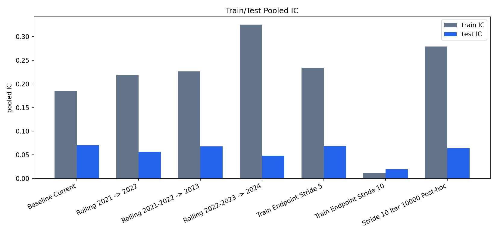
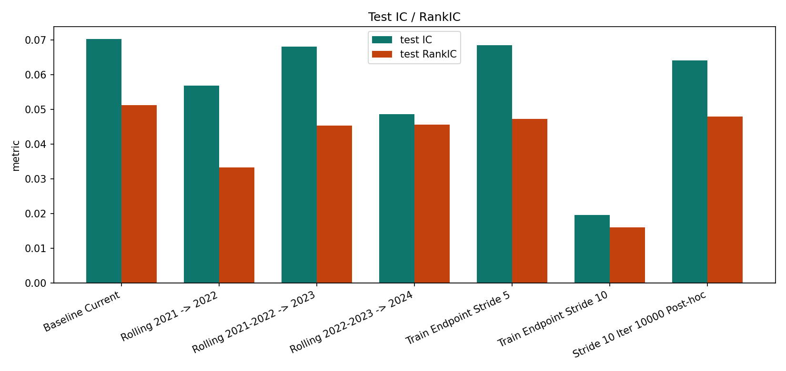
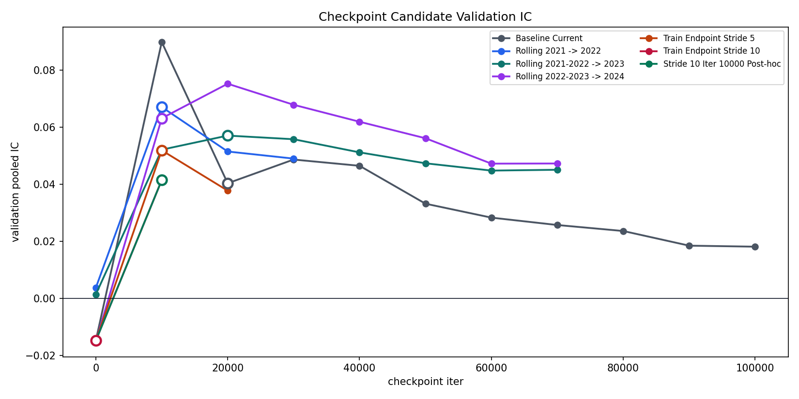
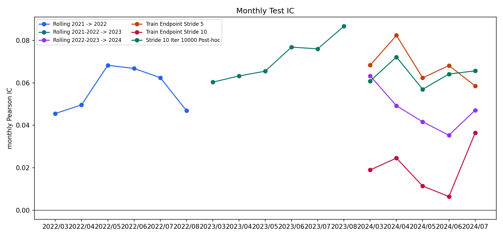
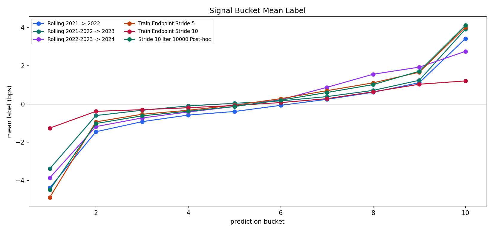

## 摘要

**历史结果: 历史成功.** Rolling/stride 比较已完成. stride5 接近 reference, 原 stride10 selector 选择 iter0; 10k recovery 属于 post hoc 诊断. 不同年份的 fold 不直接排名.

历史成功/失败按实验流程是否成功完成判断. 无增益, 成本后亏损, 归档和当前 artifact 缺失不改变历史成功事实. 失败的实验臂保留失败原因, 不填造未产生的 OOS 指标. 本次只整理已有材料, 未启动训练, 推理或回测.

### 1. Executive Summary

primary_experiments

5

best_primary_test_ic

0.06858

median_primary_test_ic

0.05688

largest_primary_train_test_gap

0.27666

This report compares the five completed requested experiments: three natural-year rolling retrains and two train endpoint-stride ablations. The baseline row is included only as a reference scale. The stride10 iter_10000 row is a checkpoint diagnostic, not a sixth primary experiment.

- Primary experiments: best test pooled IC is Train Endpoint Stride 5 at 0.06858; weakest is Train Endpoint Stride 10 at 0.01963.
- Largest train-test IC gap is Rolling 2022-2023 -> 2024: train IC 0.32532 vs test IC 0.04866.
- Stride10 selected checkpoint is iter 0 with test IC 0.01963; the post-hoc iter 10,000 diagnostic has test IC 0.06415.
- Baseline reference test IC is 0.07034 and test RankIC is 0.05124.

Pooled Pearson IC for train and test splits across reference, primary, and diagnostic rows.

Test pooled Pearson IC and RankIC.

### Headline Metrics

| display_name | role | family | best_iter | final_iter | val_pooled_ic | train_pooled_ic | test_pooled_ic | test_pooled_rank_ic | train_test_ic_gap | baseline_test_ic_delta |
| --- | --- | --- | --- | --- | --- | --- | --- | --- | --- | --- |
| Baseline Current | reference | baseline_reference | 20000 | 100000 | 0.04037 | 0.1847 | 0.07034 | 0.05124 | 0.1144 | 0.00000 |
| Rolling 2021 -&gt; 2022 | primary | rolling_retrain | 10000 | 30000 | 0.06710 | 0.2187 | 0.05688 | 0.03332 | 0.1619 | -0.01347 |
| Rolling 2021-2022 -&gt; 2023 | primary | rolling_retrain | 20000 | 70000 | 0.05709 | 0.2264 | 0.06811 | 0.04537 | 0.1583 | -0.00223 |
| Rolling 2022-2023 -&gt; 2024 | primary | rolling_retrain | 10000 | 70000 | 0.06316 | 0.3253 | 0.04866 | 0.04559 | 0.2767 | -0.02168 |
| Train Endpoint Stride 5 | primary | train_stride | 10000 | 20000 | 0.05192 | 0.2337 | 0.06858 | 0.04733 | 0.1652 | -0.00176 |
| Train Endpoint Stride 10 | primary | train_stride | 0 | 10000 | -0.01477 | 0.01203 | 0.01963 | 0.01604 | -0.00760 | -0.05071 |
| Stride 10 Iter 10000 Post-hoc | diagnostic | checkpoint_diagnostic | 10000 | 10000 | 0.04149 | 0.2788 | 0.06415 | 0.04800 | 0.2147 | -0.00620 |

## 研究背景与目标

本报告围绕Rolling 与 endpoint stride整理原始研究证据. 当前材料对应 registry report `generalization-rolling-stride-comparison-070913`, 来源SHA256为 `d01252d66adb527149798221dc7265a513b22ada87675204d620aa51672ef489`. 原报告的实验方法, 图表, 结果和解释保留在下文.

## 数据与方法

实验身份为 `generalization-rolling-stride`. Split, label, sampler, feature与checkpoint定义按原报告记录, 不从其他实验借用缺失字段. 汇总入口见[全实验综述](../../prediction-nn-1min/1103-nn-registry-summary/).

## 主要结果

| 记录项 | 当前解释 |
| --- | --- |
| 实验 | generalization-rolling-stride |
| 报告类型 | comparison_report_html |
| 历史状态 | 历史成功 |
| 证据 | generalization-rolling-stride-comparison-070913 |

Three natural-year rolling retrains and two train endpoint-stride experiments, with checkpoint audit.

Generated on 2026-07-09 13:06:39 CST

### 2. Experiment Matrix

Date ranges and sample sizes come from the persisted experiment summary and prediction manifests. Feature and label fields come from NPZ metadata.

| display_name | role | family | train_range | val_range | test_range | date_train_count | date_val_count | date_test_count | train_eval_date_range | test_eval_date_range | train_rows | test_rows | feature_dim | label_horizon_minutes | label_entry_lag_minutes | train_endpoint_stride |
| --- | --- | --- | --- | --- | --- | --- | --- | --- | --- | --- | --- | --- | --- | --- | --- | --- |
| Baseline Current | reference | baseline_reference | 20210104-20231229 | &lt;= 20240229 | &lt;= 20240726 | 727 | 37 | 205 | 210104-210709 | 240301-240726 | 562449686 | 176945440 | 14 | 10 | 1 | 1 |
| Rolling 2021 -&gt; 2022 | primary | rolling_retrain | 20210104-20211231 | &lt;= 20220228 | &lt;= 20221230 | 243 | 35 | 207 | 210104-210610 | 220301-220804 | 170789122 | 163286250 | 14 | 10 | 1 | 1 |
| Rolling 2021-2022 -&gt; 2023 | primary | rolling_retrain | 20210104-20221230 | &lt;= 20230228 | &lt;= 20231229 | 485 | 36 | 206 | 210104-210624 | 230301-230801 | 360134671 | 172761533 | 14 | 10 | 1 | 1 |
| Rolling 2022-2023 -&gt; 2024 | primary | rolling_retrain | 20220104-20231229 | &lt;= 20240229 | &lt;= 20241231 | 484 | 37 | 205 | 220104-220622 | 240301-240726 | 391660564 | 176945440 | 14 | 10 | 1 | 1 |
| Train Endpoint Stride 5 | primary | train_stride | 20210104-20231229 | &lt;= 20240229 | &lt;= 20241231 | 727 | 37 | 205 | 210104-210709 | 240301-240726 | 115284718 | 176945440 | 14 | 10 | 1 | 5 |
| Train Endpoint Stride 10 | primary | train_stride | 20210104-20231229 | &lt;= 20240229 | &lt;= 20241231 | 727 | 37 | 205 | 210104-210709 | 240301-240726 | 59389097 | 176945440 | 14 | 10 | 1 | 10 |
| Stride 10 Iter 10000 Post-hoc | diagnostic | checkpoint_diagnostic | 20210104-20231229 | &lt;= 20240229 | &lt;= 20241231 | 727 | 37 | 205 | 210104-210709 | 240301-240726 | 59389097 | 176945440 | 14 | 10 | 1 | 10 |

### 3. Natural-Year Rolling Retrain

Rolling retrains isolate whether generalization decay is stable across natural-year validation periods or specific to the 2024 regime.

| display_name | train_range | val_range | test_range | best_iter | final_iter | val_pooled_ic | val_rank_ic | train_pooled_ic | test_pooled_ic | test_pooled_rank_ic | train_test_ic_gap | val_top_decile_return_bps |
| --- | --- | --- | --- | --- | --- | --- | --- | --- | --- | --- | --- | --- |
| Rolling 2021 -&gt; 2022 | 20210104-20211231 | &lt;= 20220228 | &lt;= 20221230 | 10000 | 30000 | 0.06710 | 0.03160 | 0.2187 | 0.05688 | 0.03332 | 0.1619 | 1.3240 |
| Rolling 2021-2022 -&gt; 2023 | 20210104-20221230 | &lt;= 20230228 | &lt;= 20231229 | 20000 | 70000 | 0.05709 | 0.04238 | 0.2264 | 0.06811 | 0.04537 | 0.1583 | 2.3772 |
| Rolling 2022-2023 -&gt; 2024 | 20220104-20231229 | &lt;= 20240229 | &lt;= 20241231 | 10000 | 70000 | 0.06316 | 0.06290 | 0.3253 | 0.04866 | 0.04559 | 0.2767 | 6.7429 |

### Monthly Test IC

| display_name | month | pearson_ic | rank_ic | sample_count |
| --- | --- | --- | --- | --- |
| Rolling 2021 -&gt; 2022 | 2022/03 | 0.04558 | 0.01521 | 40298402 |
| Rolling 2021 -&gt; 2022 | 2022/04 | 0.04964 | 0.02576 | 28725298 |
| Rolling 2021 -&gt; 2022 | 2022/05 | 0.06831 | 0.05536 | 28864402 |
| Rolling 2021 -&gt; 2022 | 2022/06 | 0.06682 | 0.04001 | 31965584 |
| Rolling 2021 -&gt; 2022 | 2022/07 | 0.06247 | 0.03702 | 30403884 |
| Rolling 2021 -&gt; 2022 | 2022/08 | 0.04689 | -0.00332 | 3028680 |
| Rolling 2021-2022 -&gt; 2023 | 2023/03 | 0.06035 | 0.04716 | 41728624 |
| Rolling 2021-2022 -&gt; 2023 | 2023/04 | 0.06328 | 0.04100 | 30368786 |
| Rolling 2021-2022 -&gt; 2023 | 2023/05 | 0.06553 | 0.04157 | 33109328 |
| Rolling 2021-2022 -&gt; 2023 | 2023/06 | 0.07687 | 0.04834 | 33797120 |
| Rolling 2021-2022 -&gt; 2023 | 2023/07 | 0.07606 | 0.04839 | 33034624 |
| Rolling 2021-2022 -&gt; 2023 | 2023/08 | 0.08673 | 0.08409 | 723051 |
| Rolling 2022-2023 -&gt; 2024 | 2024/03 | 0.06332 | 0.04852 | 40561535 |
| Rolling 2022-2023 -&gt; 2024 | 2024/04 | 0.04924 | 0.05111 | 34533212 |
| Rolling 2022-2023 -&gt; 2024 | 2024/05 | 0.04165 | 0.04378 | 34535788 |
| Rolling 2022-2023 -&gt; 2024 | 2024/06 | 0.03532 | 0.03031 | 32818884 |
| Rolling 2022-2023 -&gt; 2024 | 2024/07 | 0.04715 | 0.05321 | 34496021 |

### 4. Train Endpoint Stride

Endpoint stride thins adjacent within-stock/day endpoints in training. The post-hoc stride10 row reuses the same trained run but forces evaluation of iter_10000 to separate sample thinning from checkpoint selection.

| display_name | role | train_endpoint_stride | best_iter | final_iter | val_pooled_ic | train_pooled_ic | test_pooled_ic | test_pooled_rank_ic | train_test_ic_gap | baseline_test_ic_delta |
| --- | --- | --- | --- | --- | --- | --- | --- | --- | --- | --- |
| Baseline Current | reference | 1 | 20000 | 100000 | 0.04037 | 0.1847 | 0.07034 | 0.05124 | 0.1144 | 0.00000 |
| Train Endpoint Stride 5 | primary | 5 | 10000 | 20000 | 0.05192 | 0.2337 | 0.06858 | 0.04733 | 0.1652 | -0.00176 |
| Train Endpoint Stride 10 | primary | 10 | 0 | 10000 | -0.01477 | 0.01203 | 0.01963 | 0.01604 | -0.00760 | -0.05071 |
| Stride 10 Iter 10000 Post-hoc | diagnostic | 10 | 10000 | 10000 | 0.04149 | 0.2788 | 0.06415 | 0.04800 | 0.2147 | -0.00620 |

Stride rows should be interpreted with the checkpoint audit because stride10 selected iter_0 in the original report.

### 5. Checkpoint Audit

Checkpoint rows are loaded from best_checkpoint.yaml and checkpoint_brief_index.csv. Selected checkpoint markers are circled in the figure.

Validation pooled IC by checkpoint candidate; selected checkpoint is marked with an open circle.

### Selected Checkpoints

| display_name | role | best_iter | final_iter | candidate_count | candidate_iters | selection_rule | selection_metric | selection_value | selection_score_rank | val_pooled_ic | val_rank_ic | val_top_decile_return_bps | checkpoint_sha256 |
| --- | --- | --- | --- | --- | --- | --- | --- | --- | --- | --- | --- | --- | --- |
| Baseline Current | reference | 20000 | 100000 | 11 | 0,10000,20000,30000,40000,50000,60000,70000,80000,90000,100000 | early_top_k | checkpoint_selection/score | 0.04804 | 1 | 0.04037 | 0.02096 | 4.6475 | 4e77b3b6b999 |
| Rolling 2021 -&gt; 2022 | primary | 10000 | 30000 | 4 | 0,10000,20000,30000 | early_top_k | checkpoint_selection/score | 0.04134 | 1 | 0.06710 | 0.03160 | 1.3240 | 1e9f2b256d82 |
| Rolling 2021-2022 -&gt; 2023 | primary | 20000 | 70000 | 8 | 0,10000,20000,30000,40000,50000,60000,70000 | early_top_k | checkpoint_selection/score | 0.04110 | 2 | 0.05709 | 0.04238 | 2.3772 | 460ccfd72093 |
| Rolling 2022-2023 -&gt; 2024 | primary | 10000 | 70000 | 8 | 0,10000,20000,30000,40000,50000,60000,70000 | early_top_k | checkpoint_selection/score | 0.03310 | 1 | 0.06316 | 0.06290 | 6.7429 | 1778c89764b9 |
| Train Endpoint Stride 5 | primary | 10000 | 20000 | 3 | 0,10000,20000 | early_top_k | checkpoint_selection/score | 0.04602 | 1 | 0.05192 | 0.04302 | 7.6710 | e290d03ce1f9 |
| Train Endpoint Stride 10 | primary | 0 | 10000 | 2 | 0,10000 | early_top_k | checkpoint_selection/score | -0.05886 | 2 | -0.01477 | 0.01110 | -0.5565 | e028e4277129 |
| Stride 10 Iter 10000 Post-hoc | diagnostic | 10000 | 10000 | 2 | 0,10000 | forced_iter_for_stride10_posthoc_eval | checkpoint_selection/score | 0.04180 | 1 | 0.04149 | 0.02689 | -0.5565 | 229acc03af3f |

### Checkpoint Candidate Details

| display_name | iter | selected | epoch_approx | selection_metric | selection_value | val_pooled_ic | val_rank_ic | val_top_decile_return_bps | val_mse |
| --- | --- | --- | --- | --- | --- | --- | --- | --- | --- |
| Baseline Current | 0 | False | 0.00000 | checkpoint_selection/score | -0.05886 | -0.01477 | 0.01110 | -0.5565 | 0.00004 |
| Baseline Current | 10000 | False | 0.1066 | checkpoint_selection/score | 0.04180 | 0.08986 | 0.03691 | 8.9335 | 0.00004 |
| Baseline Current | 20000 | True | 0.2132 | checkpoint_selection/score | 0.04804 | 0.04037 | 0.02096 | 4.6475 | 0.00004 |
| Baseline Current | 30000 | False | 0.3198 | checkpoint_selection/score | 0.04006 | 0.04869 | 0.02477 | 4.6399 | 0.00004 |
| Baseline Current | 40000 | False | 0.4264 | checkpoint_selection/score | 0.04365 | 0.04650 | 0.02690 | 5.5109 | 0.00004 |
| Baseline Current | 50000 | False | 0.5329 | checkpoint_selection/score | 0.04055 | 0.03322 | 0.02477 | 4.6617 | 0.00004 |
| Baseline Current | 60000 | False | 0.6395 | checkpoint_selection/score | 0.03628 | 0.02834 | 0.01679 | 3.9791 | 0.00004 |
| Baseline Current | 70000 | False | 0.7461 | checkpoint_selection/score | 0.03444 | 0.02575 | 0.01974 | 4.0967 | 0.00004 |
| Baseline Current | 80000 | False | 0.8527 | checkpoint_selection/score | 0.03360 | 0.02365 | 0.01981 | 3.8759 | 0.00004 |
| Baseline Current | 90000 | False | 0.9593 | checkpoint_selection/score | 0.03091 | 0.01851 | 0.01798 | 3.2825 | 0.00004 |
| Baseline Current | 100000 | False | 1.0659 | checkpoint_selection/score | 0.03048 | 0.01816 | 0.01756 | 3.2353 | 0.00004 |
| Rolling 2021 -&gt; 2022 | 0 | False | 0.00000 | checkpoint_selection/score | -0.05178 | 0.00375 | 0.00727 | 0.06769 | 0.00002 |
| Rolling 2021 -&gt; 2022 | 10000 | True | 0.3510 | checkpoint_selection/score | 0.04134 | 0.06710 | 0.03160 | 1.3240 | 0.00002 |
| Rolling 2021 -&gt; 2022 | 20000 | False | 0.7020 | checkpoint_selection/score | 0.03496 | 0.05151 | 0.03074 | 1.0420 | 0.00002 |
| Rolling 2021 -&gt; 2022 | 30000 | False | 1.0531 | checkpoint_selection/score | 0.03513 | 0.04902 | 0.03258 | 1.1557 | 0.00002 |
| Rolling 2021-2022 -&gt; 2023 | 0 | False | 0.00000 | checkpoint_selection/score | -0.05276 | 0.00143 | -0.01286 | -0.3264 | 0.00001 |
| Rolling 2021-2022 -&gt; 2023 | 10000 | False | 0.1665 | checkpoint_selection/score | 0.02835 | 0.05214 | 0.03599 | 2.0554 | 0.00001 |
| Rolling 2021-2022 -&gt; 2023 | 20000 | True | 0.3329 | checkpoint_selection/score | 0.04110 | 0.05709 | 0.04238 | 2.3772 | 0.00001 |
| Rolling 2021-2022 -&gt; 2023 | 30000 | False | 0.4994 | checkpoint_selection/score | 0.04123 | 0.05581 | 0.03755 | 2.3816 | 0.00001 |
| Rolling 2021-2022 -&gt; 2023 | 40000 | False | 0.6659 | checkpoint_selection/score | 0.03823 | 0.05120 | 0.03697 | 2.2053 | 0.00001 |
| Rolling 2021-2022 -&gt; 2023 | 50000 | False | 0.8323 | checkpoint_selection/score | 0.03521 | 0.04738 | 0.03840 | 2.1772 | 0.00001 |
| Rolling 2021-2022 -&gt; 2023 | 60000 | False | 0.9988 | checkpoint_selection/score | 0.03548 | 0.04482 | 0.03934 | 2.2087 | 0.00001 |
| Rolling 2021-2022 -&gt; 2023 | 70000 | False | 1.1653 | checkpoint_selection/score | 0.03550 | 0.04511 | 0.03931 | 2.2109 | 0.00001 |
| Rolling 2022-2023 -&gt; 2024 | 0 | False | 0.00000 | checkpoint_selection/score | -0.05894 | -0.01515 | 0.01137 | -0.5684 | 0.00004 |
| Rolling 2022-2023 -&gt; 2024 | 10000 | True | 0.1531 | checkpoint_selection/score | 0.03310 | 0.06316 | 0.06290 | 6.7429 | 0.00004 |
| Rolling 2022-2023 -&gt; 2024 | 20000 | False | 0.3061 | checkpoint_selection/score | 0.03272 | 0.07526 | 0.07265 | 9.2097 | 0.00004 |
| Rolling 2022-2023 -&gt; 2024 | 30000 | False | 0.4592 | checkpoint_selection/score | 0.03037 | 0.06788 | 0.06596 | 7.2508 | 0.00004 |
| Rolling 2022-2023 -&gt; 2024 | 40000 | False | 0.6123 | checkpoint_selection/score | 0.02886 | 0.06193 | 0.05871 | 7.0038 | 0.00004 |
| Rolling 2022-2023 -&gt; 2024 | 50000 | False | 0.7653 | checkpoint_selection/score | 0.02968 | 0.05615 | 0.06044 | 6.4160 | 0.00004 |
| Rolling 2022-2023 -&gt; 2024 | 60000 | False | 0.9184 | checkpoint_selection/score | 0.02521 | 0.04726 | 0.05820 | 5.6050 | 0.00004 |
| Rolling 2022-2023 -&gt; 2024 | 70000 | False | 1.0715 | checkpoint_selection/score | 0.02713 | 0.04731 | 0.05734 | 5.6781 | 0.00004 |
| Train Endpoint Stride 5 | 0 | False | 0.00000 | checkpoint_selection/score | -0.05886 | -0.01477 | 0.01110 | -0.5565 | 0.00004 |
| Train Endpoint Stride 5 | 10000 | True | 0.7106 | checkpoint_selection/score | 0.04602 | 0.05192 | 0.04302 | 7.6710 | 0.00004 |
| Train Endpoint Stride 5 | 20000 | False | 1.4212 | checkpoint_selection/score | 0.03838 | 0.03779 | 0.02569 | 5.8076 | 0.00004 |
| Train Endpoint Stride 10 | 0 | True | 0.00000 | checkpoint_selection/score | -0.05886 | -0.01477 | 0.01110 | -0.5565 | 0.00004 |
| Train Endpoint Stride 10 | 10000 | False | 1.3794 | checkpoint_selection/score | 0.04180 | 0.04149 | 0.02689 | 4.8751 | 0.00004 |
| Stride 10 Iter 10000 Post-hoc | 0 | False | 0.00000 | val/quality/pooled_ic | -0.01477 | -0.01477 | 0.01110 | -0.5565 | 0.00004 |
| Stride 10 Iter 10000 Post-hoc | 10000 | True | 1.3794 | val/quality/pooled_ic | 0.04149 | 0.04149 | 0.02689 | 4.8751 | 0.00004 |

### Stride10 Checkpoint Diagnostic

- Original stride10 full report selected iter 0: val IC -0.01477, test IC 0.01963.
- Post-hoc iter 10,000 uses the same trained stride10 run: val IC 0.04149, test IC 0.06415, test RankIC 0.04800.
- Observed result: the poor original stride10 test IC is primarily a checkpoint-selection artifact; it is not evidence that stride=10 cannot fit.

### 6. Signal And Robustness

Monthly Pearson IC for primary experiments and the stride10 post-hoc diagnostic.

Mean target return by prediction bucket.

### Signal Bucket Top-Bottom Spread

| display_name | role | top_bottom_signal_spread_bps | mean_label_bps | hit_rate | row_count |
| --- | --- | --- | --- | --- | --- |
| Baseline Current | reference | 9.5627 | 4.2548 | 0.4318 | 17694544 |
| Rolling 2021-2022 -&gt; 2023 | primary | 7.3093 | 3.9259 | 0.4294 | 17276153 |
| Rolling 2021 -&gt; 2022 | primary | 7.8143 | 3.4307 | 0.4393 | 16328625 |
| Rolling 2022-2023 -&gt; 2024 | primary | 6.6172 | 2.7600 | 0.4247 | 17694544 |
| Train Endpoint Stride 10 | primary | 2.4684 | 1.2106 | 0.3817 | 17694544 |
| Stride 10 Iter 10000 Post-hoc | diagnostic | 8.6124 | 4.1246 | 0.4317 | 17694544 |
| Train Endpoint Stride 5 | primary | 8.9074 | 4.0219 | 0.4269 | 17694544 |

### Monthly IC Table

| display_name | role | month | pearson_ic | rank_ic | sample_count |
| --- | --- | --- | --- | --- | --- |
| Baseline Current | reference | 2024/03 | 0.07090 | 0.04994 | 40561535 |
| Baseline Current | reference | 2024/04 | 0.07946 | 0.06994 | 34533212 |
| Baseline Current | reference | 2024/05 | 0.06997 | 0.05636 | 34535788 |
| Baseline Current | reference | 2024/06 | 0.06867 | 0.03690 | 32818884 |
| Baseline Current | reference | 2024/07 | 0.06065 | 0.04220 | 34496021 |
| Rolling 2021 -&gt; 2022 | primary | 2022/03 | 0.04558 | 0.01521 | 40298402 |
| Rolling 2021 -&gt; 2022 | primary | 2022/04 | 0.04964 | 0.02576 | 28725298 |
| Rolling 2021 -&gt; 2022 | primary | 2022/05 | 0.06831 | 0.05536 | 28864402 |
| Rolling 2021 -&gt; 2022 | primary | 2022/06 | 0.06682 | 0.04001 | 31965584 |
| Rolling 2021 -&gt; 2022 | primary | 2022/07 | 0.06247 | 0.03702 | 30403884 |
| Rolling 2021 -&gt; 2022 | primary | 2022/08 | 0.04689 | -0.00332 | 3028680 |
| Rolling 2021-2022 -&gt; 2023 | primary | 2023/03 | 0.06035 | 0.04716 | 41728624 |
| Rolling 2021-2022 -&gt; 2023 | primary | 2023/04 | 0.06328 | 0.04100 | 30368786 |
| Rolling 2021-2022 -&gt; 2023 | primary | 2023/05 | 0.06553 | 0.04157 | 33109328 |
| Rolling 2021-2022 -&gt; 2023 | primary | 2023/06 | 0.07687 | 0.04834 | 33797120 |
| Rolling 2021-2022 -&gt; 2023 | primary | 2023/07 | 0.07606 | 0.04839 | 33034624 |
| Rolling 2021-2022 -&gt; 2023 | primary | 2023/08 | 0.08673 | 0.08409 | 723051 |
| Rolling 2022-2023 -&gt; 2024 | primary | 2024/03 | 0.06332 | 0.04852 | 40561535 |
| Rolling 2022-2023 -&gt; 2024 | primary | 2024/04 | 0.04924 | 0.05111 | 34533212 |
| Rolling 2022-2023 -&gt; 2024 | primary | 2024/05 | 0.04165 | 0.04378 | 34535788 |
| Rolling 2022-2023 -&gt; 2024 | primary | 2024/06 | 0.03532 | 0.03031 | 32818884 |
| Rolling 2022-2023 -&gt; 2024 | primary | 2024/07 | 0.04715 | 0.05321 | 34496021 |
| Train Endpoint Stride 5 | primary | 2024/03 | 0.06837 | 0.04255 | 40561535 |
| Train Endpoint Stride 5 | primary | 2024/04 | 0.08241 | 0.07350 | 34533212 |
| Train Endpoint Stride 5 | primary | 2024/05 | 0.06239 | 0.04485 | 34535788 |
| Train Endpoint Stride 5 | primary | 2024/06 | 0.06820 | 0.03654 | 32818884 |
| Train Endpoint Stride 5 | primary | 2024/07 | 0.05856 | 0.03634 | 34496021 |
| Train Endpoint Stride 10 | primary | 2024/03 | 0.01896 | 0.01139 | 40561535 |
| Train Endpoint Stride 10 | primary | 2024/04 | 0.02455 | 0.02225 | 34533212 |
| Train Endpoint Stride 10 | primary | 2024/05 | 0.01135 | 0.00713 | 34535788 |
| Train Endpoint Stride 10 | primary | 2024/06 | 0.00643 | 0.00471 | 32818884 |
| Train Endpoint Stride 10 | primary | 2024/07 | 0.03641 | 0.03477 | 34496021 |
| Stride 10 Iter 10000 Post-hoc | diagnostic | 2024/03 | 0.06091 | 0.04250 | 40561535 |
| Stride 10 Iter 10000 Post-hoc | diagnostic | 2024/04 | 0.07222 | 0.06133 | 34533212 |
| Stride 10 Iter 10000 Post-hoc | diagnostic | 2024/05 | 0.05698 | 0.04864 | 34535788 |
| Stride 10 Iter 10000 Post-hoc | diagnostic | 2024/06 | 0.06418 | 0.04021 | 32818884 |
| Stride 10 Iter 10000 Post-hoc | diagnostic | 2024/07 | 0.06567 | 0.04670 | 34496021 |

### Important Pool IC

| display_name | role | pool | pearson_ic | rank_ic | count |
| --- | --- | --- | --- | --- | --- |
| Baseline Current | reference | csi1000_etf_sh | 0.03526 | 0.02230 | 33009991 |
| Baseline Current | reference | csi300_etf_sh | 0.02115 | 0.01495 | 9903593 |
| Baseline Current | reference | csi500_etf_sh | 0.02021 | 0.01554 | 16505559 |
| Rolling 2021 -&gt; 2022 | primary | csi1000_etf_sh | 0.04042 | 0.02347 | 34560743 |
| Rolling 2021 -&gt; 2022 | primary | csi300_etf_sh | 0.02929 | 0.01981 | 10365341 |
| Rolling 2021 -&gt; 2022 | primary | csi500_etf_sh | 0.02824 | 0.01772 | 17288450 |
| Rolling 2021-2022 -&gt; 2023 | primary | csi1000_etf_sh | 0.04276 | 0.02703 | 33879391 |
| Rolling 2021-2022 -&gt; 2023 | primary | csi300_etf_sh | 0.03748 | 0.02338 | 10159905 |
| Rolling 2021-2022 -&gt; 2023 | primary | csi500_etf_sh | 0.03742 | 0.02315 | 16936234 |
| Rolling 2022-2023 -&gt; 2024 | primary | csi1000_etf_sh | 0.03252 | 0.03436 | 33009991 |
| Rolling 2022-2023 -&gt; 2024 | primary | csi300_etf_sh | 0.02533 | 0.02507 | 9903593 |
| Rolling 2022-2023 -&gt; 2024 | primary | csi500_etf_sh | 0.02670 | 0.02899 | 16505559 |
| Train Endpoint Stride 5 | primary | csi1000_etf_sh | 0.03038 | 0.01885 | 33009991 |
| Train Endpoint Stride 5 | primary | csi300_etf_sh | 0.01987 | 0.01200 | 9903593 |
| Train Endpoint Stride 5 | primary | csi500_etf_sh | 0.02009 | 0.01341 | 16505559 |
| Train Endpoint Stride 10 | primary | csi1000_etf_sh | 0.01724 | 0.01297 | 33009991 |
| Train Endpoint Stride 10 | primary | csi300_etf_sh | 0.00575 | -0.00182 | 9903593 |
| Train Endpoint Stride 10 | primary | csi500_etf_sh | 0.01431 | 0.00956 | 16505559 |
| Stride 10 Iter 10000 Post-hoc | diagnostic | csi1000_etf_sh | 0.03184 | 0.02201 | 33009991 |
| Stride 10 Iter 10000 Post-hoc | diagnostic | csi300_etf_sh | 0.02480 | 0.01697 | 9903593 |
| Stride 10 Iter 10000 Post-hoc | diagnostic | csi500_etf_sh | 0.02318 | 0.01755 | 16505559 |

## 限制与适用边界

Rolling/stride 比较已完成. stride5 接近 reference, 原 stride10 selector 选择 iter0; 10k recovery 属于 post hoc 诊断. 不同年份的 fold 不直接排名. 当前artifact可得性只影响复现, 不作为历史成功/失败判据. 只有matched合同内的结果可以直接比较.

## 结论

本次归档保留上述历史事实. 研究结论, 推广门槛和执行限制分别解释, 不把模型无增益或净收益为负改写成实验流程失败.

## 附录

### 7. Artifacts And Reproducibility

stable_html

[artifact-root]/nn/generalization-experiments/comparison_report/generalization_rolling_stride_report.html

timestamped_html

[artifact-root]/nn/generalization-experiments/comparison_report/070913_generalization_rolling_stride_report.html

repo_html

[local-workspace]/exp-nn/generalization/report/generalization_rolling_stride_report.html

manifest

[artifact-root]/nn/generalization-experiments/comparison_report/manifests/generalization_rolling_stride_report.yaml

### Source Report Paths

| display_name | role | run_root | report_root | full_report_path | repo_report_path |
| --- | --- | --- | --- | --- | --- |
| Baseline Current | reference | [artifact-root]/nn/baseline-current-b7fda87-testfull/date_ranges | [artifact-root]/nn/baseline-current-b7fda87-testfull/research_report | [artifact-root]/nn/baseline-current-b7fda87-testfull/research_report/070110_baseline-current-b7fda87-testfull_full_evaluation_report.html | [local-workspace]/exp-nn/ckpt-baseline/report/070110_full_evaluation_report.html |
| Rolling 2021 -> 2022 | primary | [artifact-root]/nn/generalization-experiments/rolling-retrain/train2021_val2022/date_ranges | [artifact-root]/nn/generalization-experiments/rolling-retrain/train2021_val2022/research_report | [artifact-root]/nn/generalization-experiments/rolling-retrain/train2021_val2022/research_report/070901_train2021_val2022_full_evaluation_report.html | [local-workspace]/exp-nn/generalization/report/070901_full_evaluation_report.html |
| Rolling 2021-2022 -> 2023 | primary | [artifact-root]/nn/generalization-experiments/rolling-retrain/train2021-2022_val2023/date_ranges | [artifact-root]/nn/generalization-experiments/rolling-retrain/train2021-2022_val2023/research_report | [artifact-root]/nn/generalization-experiments/rolling-retrain/train2021-2022_val2023/research_report/070904_train2021-2022_val2023_full_evaluation_report.html | [local-workspace]/exp-nn/generalization/report/070904_full_evaluation_report.html |
| Rolling 2022-2023 -> 2024 | primary | [artifact-root]/nn/generalization-experiments/rolling-retrain/train2022-2023_val2024/date_ranges | [artifact-root]/nn/generalization-experiments/rolling-retrain/train2022-2023_val2024/research_report | [artifact-root]/nn/generalization-experiments/rolling-retrain/train2022-2023_val2024/research_report/070906_train2022-2023_val2024_full_evaluation_report.html | [local-workspace]/exp-nn/generalization/report/070906_full_evaluation_report.html |
| Train Endpoint Stride 5 | primary | [artifact-root]/nn/generalization-experiments/train-stride/stride5/date_ranges | [artifact-root]/nn/generalization-experiments/train-stride/stride5/research_report | [artifact-root]/nn/generalization-experiments/train-stride/stride5/research_report/070900_stride5_full_evaluation_report.html | [local-workspace]/exp-nn/generalization/report/070900_full_evaluation_report.html |
| Train Endpoint Stride 10 | primary | [artifact-root]/nn/generalization-experiments/train-stride/stride10/date_ranges | [artifact-root]/nn/generalization-experiments/train-stride/stride10/research_report | [artifact-root]/nn/generalization-experiments/train-stride/stride10/research_report/070823_stride10_full_evaluation_report.html | [local-workspace]/exp-nn/generalization/report/070823_full_evaluation_report.html |
| Stride 10 Iter 10000 Post-hoc | diagnostic | [artifact-root]/nn/generalization-experiments/train-stride/stride10_iter10000/date_ranges | [artifact-root]/nn/generalization-experiments/train-stride/stride10_iter10000/research_report | [artifact-root]/nn/generalization-experiments/train-stride/stride10_iter10000/research_report/070911_stride10_iter10000_full_evaluation_report.html | [local-workspace]/exp-nn/generalization/report/070823_full_evaluation_report.html |

### Derived CSV Artifacts

| artifact | path |
| --- | --- |
| experiment_metrics | [artifact-root]/nn/generalization-experiments/comparison_report/artifacts/experiment_metrics.csv |
| checkpoint_summary | [artifact-root]/nn/generalization-experiments/comparison_report/artifacts/checkpoint_summary.csv |
| checkpoint_candidates | [artifact-root]/nn/generalization-experiments/comparison_report/artifacts/checkpoint_candidates.csv |
| rolling_summary | [artifact-root]/nn/generalization-experiments/comparison_report/artifacts/rolling_summary.csv |
| stride_summary | [artifact-root]/nn/generalization-experiments/comparison_report/artifacts/stride_summary.csv |
| monthly_ic | [artifact-root]/nn/generalization-experiments/comparison_report/artifacts/monthly_ic.csv |
| signal_bucket | [artifact-root]/nn/generalization-experiments/comparison_report/artifacts/signal_bucket_metrics.csv |
| important_pool_ic | [artifact-root]/nn/generalization-experiments/comparison_report/artifacts/important_pool_ic.csv |
| artifact_status | [artifact-root]/nn/generalization-experiments/comparison_report/artifacts/artifact_status.csv |

### Missing Artifact Audit

| name | missing_count | missing_artifacts |
| --- | --- | --- |
| baseline_current_b7fda87_testfull | 0 | nan |
| rolling_train2021_val2022 | 0 | nan |
| rolling_train2021_2022_val2023 | 0 | nan |
| rolling_train2022_2023_val2024 | 0 | nan |
| train_endpoint_stride5 | 0 | nan |
| train_endpoint_stride10 | 0 | nan |
| train_endpoint_stride10_iter10000_posthoc | 0 | nan |

All configured required artifacts were present at render time.
