## 摘要

**历史结果: 历史成功.** all/touch/limit 主矩阵已完成. touch 的 test pooled IC 为 0.0691368, all 为 0.0686563. 改变总体的 touch-test-all 单列解释.

历史成功/失败按实验流程是否成功完成判断. 无增益, 成本后亏损, 归档和当前 artifact 缺失不改变历史成功事实. 失败的实验臂保留失败原因, 不填造未产生的 OOS 指标. 本次只整理已有材料, 未启动训练, 推理或回测.

### 1. Executive Summary

model_class

GruMlpRegressor

common across all experiments

train_range

20210104 -> 20231229 (727 days)

common across all experiments

val_range

20240102 -> 20240229 (37 days)

common across all experiments

test_range

20240301 -> 20241231 (205 days)

common across all experiments

### Executive Summary

| experiment | selected_checkpoint | train_pooled_ic | test_pooled_ic | top_prediction_return_bps | top95_hit | etf_top95_hit | overfit_variance_ratio |
| --- | --- | --- | --- | --- | --- | --- | --- |
| all | 10,000 | 0.180381 | 0.068656 | 8.6922 | 0.425599 | 0.503106 | 0.014318 |
| touch | 10,000 | 0.158490 | 0.069137 | 9.2415 | 0.444306 | 0.547273 | 0.016779 |
| limit | 10,000 | 0.162831 | 0.065275 | 8.1642 | 0.443946 | 0.530909 | 0.015114 |

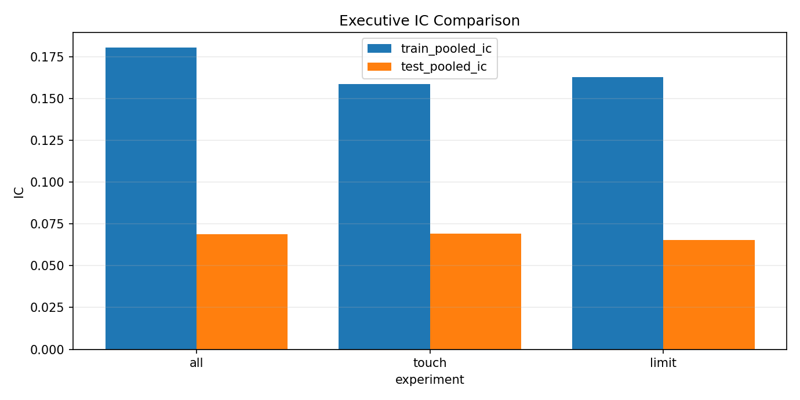

train_pooled_ic and test_pooled_ic.

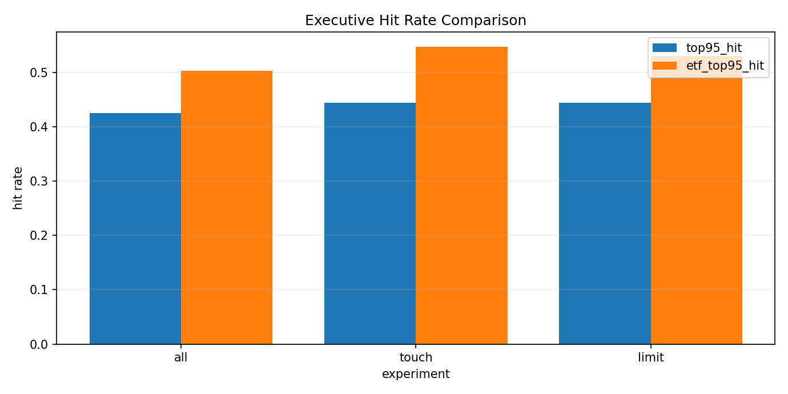

top95_hit and etf_top95_hit.

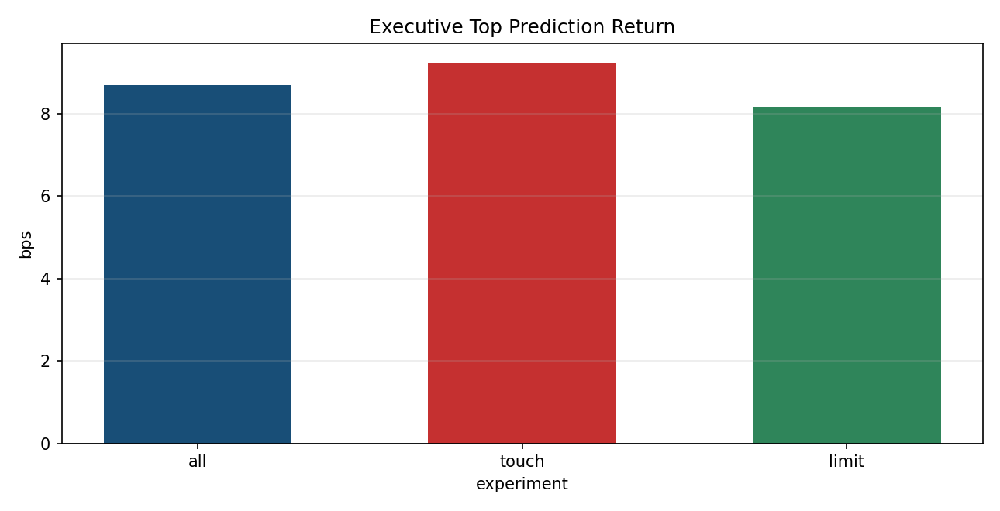

top_prediction_return_bps.

字段解释

| field | explanation |
| --- | --- |
| experiment | 对比实验名称.  |
| selected_checkpoint | 最终用于 evaluation 的 checkpoint iteration.  |
| train_pooled_ic | train split 上把所有样本合并后计算的 Pearson IC.  |
| test_pooled_ic | test split 上把所有样本合并后计算的 Pearson IC.  |
| top_prediction_return_bps | 最高 prediction 分组的平均 prediction return, 单位 bps.  |
| top95_hit | test split 中 prediction 最高 5% 样本内 target > 0 的比例.  |
| etf_top95_hit | test split 重要股票池合成 ETF prediction 最高 5% 样本内 etf_real_return > 0 的比例.  |
| overfit_variance_ratio | test split 中 prediction 样本方差 / target 样本方差.  |
| model_class | 模型类名.  |
| train_range | 训练集交易日范围.  |
| val_range | 验证集交易日范围.  |
| test_range | 测试集交易日范围.  |

## 研究背景与目标

本报告围绕Limit-state 股票池整理原始研究证据. 当前材料对应 registry report `limit-pool-comparison-061513`, 来源SHA256为 `ec00dbba03dfd3c62487bfc119c230db779eb85835260c2206b759c8e126d7f0`. 原报告的实验方法, 图表, 结果和解释保留在下文.

## 数据与方法

实验身份为 `limit-pool`. Split, label, sampler, feature与checkpoint定义按原报告记录, 不从其他实验借用缺失字段. 汇总入口见[全实验综述](../../prediction-nn-1min/1103-nn-registry-summary/).

### 2. Experiment Setup And Data Pipeline

### 2.1. Experiment Setup

selection_metric

val/quality/pooled_ic

common across all experiments

selection_rule

max

common across all experiments

### Experiment Setup

| experiment | selected_checkpoint | selection_value | checkpoint_sha256 | candidate_count |
| --- | --- | --- | --- | --- |
| all | 10,000 | 0.089859 | 93a5aa3ddbb26b6626b42415ce6e879d9a879fdf6c8d05ec4855428dbeb87e71 | 11 |
| touch | 10,000 | 0.076412 | fe78453718b56187aaa90d4fbfa15ae44a3cc1dc1300c85accd1e88517cebff1 | 11 |
| limit | 10,000 | 0.069676 | 3e15add769f18a7bbafb1f0b8201a27121e33868c3eb6300ceb44280efa60695 | 11 |

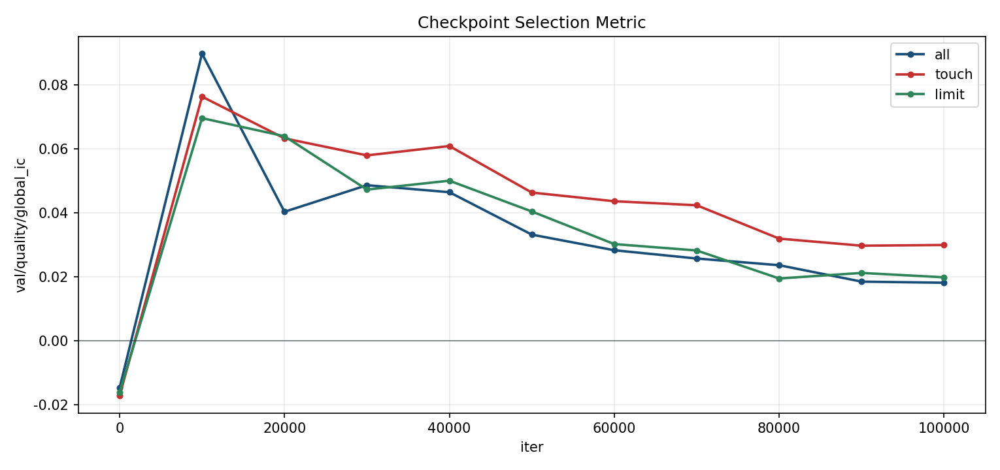

val/quality/global_ic by checkpoint.

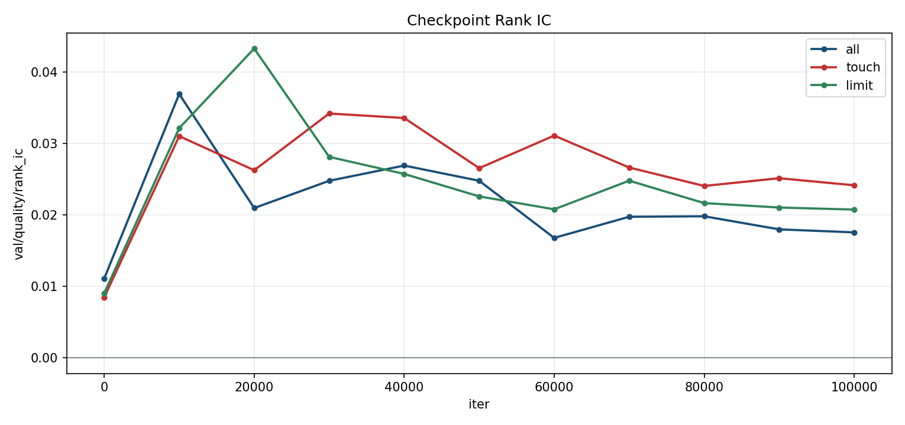

val/quality/rank_ic by checkpoint.

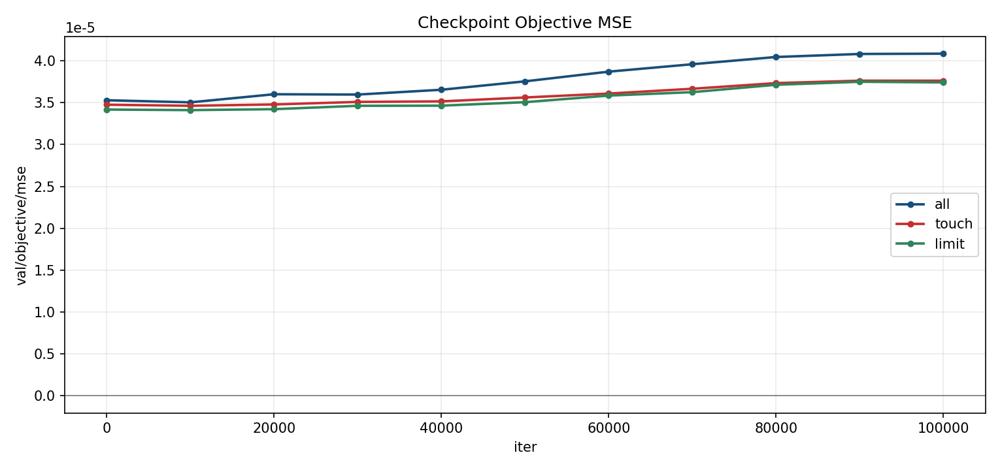

val/objective/mse by checkpoint.

字段解释

| field | explanation |
| --- | --- |
| experiment | 对比实验名称.  |
| selected_checkpoint | 最终用于 evaluation 的 checkpoint iteration.  |
| selection_value | 被选中 checkpoint 的 selection metric 数值.  |
| checkpoint_sha256 | checkpoint 文件 SHA256.  |
| candidate_count | 参与选择的 checkpoint 数量.  |
| selection_metric | checkpoint 选择使用的 validation metric.  |
| selection_rule | checkpoint 选择规则.  |

### 2.2. Data Basics

train_days

727

common across all experiments

val_days

37

common across all experiments

test_days

205

common across all experiments

### Data Basics

| experiment | train_rows | val_rows | test_rows | feature_dim | features | label_horizon_minutes | label_entry_lag_minutes |
| --- | --- | --- | --- | --- | --- | --- | --- |
| all | 768,564,829 | 43,553,840 | 241,788,800 | 14 | ret_1m, ret_5m, ret_2m, ret_3m, ret_10m, hl, oc, log_vol, log_amount, vol_10m, log_vol_5m_mean, log_amount_5m_mean, minute_norm, session_minute_norm | 10 | 1 |
| touch | 757,236,968 | 42,461,158 | 237,388,504 | 14 | ret_1m, ret_5m, ret_2m, ret_3m, ret_10m, hl, oc, log_vol, log_amount, vol_10m, log_vol_5m_mean, log_amount_5m_mean, minute_norm, session_minute_norm | 10 | 1 |
| limit | 755,315,486 | 42,210,644 | 236,627,223 | 14 | ret_1m, ret_5m, ret_2m, ret_3m, ret_10m, hl, oc, log_vol, log_amount, vol_10m, log_vol_5m_mean, log_amount_5m_mean, minute_norm, session_minute_norm | 10 | 1 |

字段解释

| field | explanation |
| --- | --- |
| train_rows | train split 样本数量.  |
| val_rows | validation split 样本数量.  |
| test_rows | test split 样本数量.  |
| feature_dim | 模型输入 feature 维度.  |
| features | 模型输入 feature 列表.  |
| label_horizon_minutes | label forward horizon, 单位 minutes.  |
| label_entry_lag_minutes | label entry lag, 单位 minutes.  |
| train_days | train split 交易日数量.  |
| val_days | validation split 交易日数量.  |
| test_days | test split 交易日数量.  |

### 2.3. Data Normalization And Cleaning

### Data Normalization And Cleaning

| experiment | feature_normalization | label_normalization | train_kept_rate | val_kept_rate | test_kept_rate | max_invalid_ratio |
| --- | --- | --- | --- | --- | --- | --- |
| all | pooled_zscore / scope=train_only | pooled_zscore / scope=train_only | 0.909845 | 0.907594 | 0.907552 | 0.043478 |
| touch | pooled_zscore / scope=train_only | pooled_zscore / scope=train_only | 0.896435 | 0.884825 | 0.891035 | 0.043478 |
| limit | pooled_zscore / scope=train_only | pooled_zscore / scope=train_only | 0.894160 | 0.879604 | 0.888178 | 0.043478 |

字段解释

| field | explanation |
| --- | --- |
| feature_normalization | feature normalization 方法和 fit scope.  |
| label_normalization | label normalization 方法和 fit scope.  |
| train_kept_rate | train split 清洗后保留比例.  |
| val_kept_rate | validation split 清洗后保留比例.  |
| test_kept_rate | test split 清洗后保留比例.  |
| max_invalid_ratio | 单个字段中 invalid 样本占比的最大值.  |

## 主要结果

| 记录项 | 当前解释 |
| --- | --- |
| 实验 | limit-pool |
| 报告类型 | comparison_report_html |
| 历史状态 | 历史成功 |
| 证据 | limit-pool-comparison-061513 |

all, touch, limit 横向对比; 数据来自 run artifacts, 缓存数据和 comparison-only 派生 artifacts. 

生成日期: 2026-06-15

### 3. Signal Quality Comparison

### 3.1. IC Summary

### IC Summary

| experiment | split | pooled_ic | pooled_rank_ic | count |
| --- | --- | --- | --- | --- |
| all | train | 0.180381 | 0.133838 | 31,875,072 |
| all | test | 0.068656 | 0.044050 | 176,945,440 |
| touch | train | 0.158490 | 0.134060 | 31,875,072 |
| touch | test | 0.069137 | 0.046165 | 173,181,678 |
| limit | train | 0.162831 | 0.135829 | 31,875,072 |
| limit | test | 0.065275 | 0.045800 | 172,431,790 |

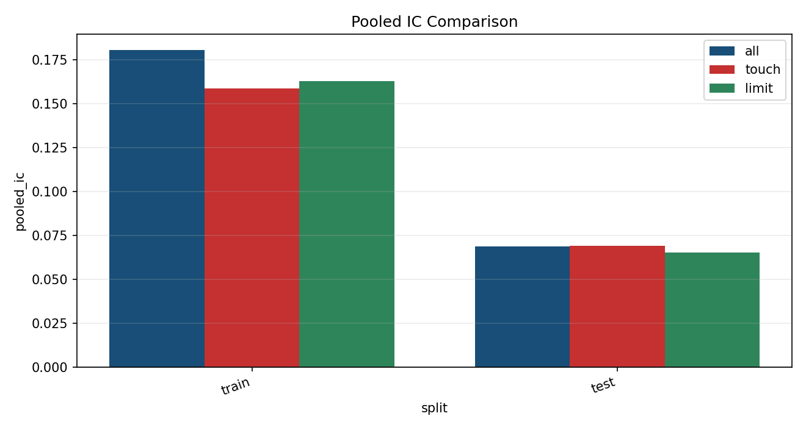

train/test pooled_ic.

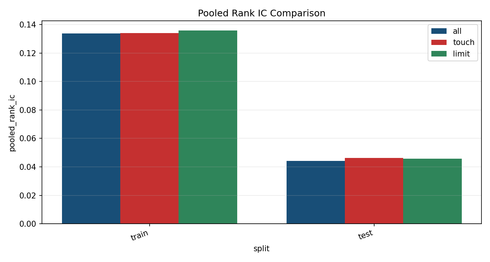

train/test pooled_rank_ic.

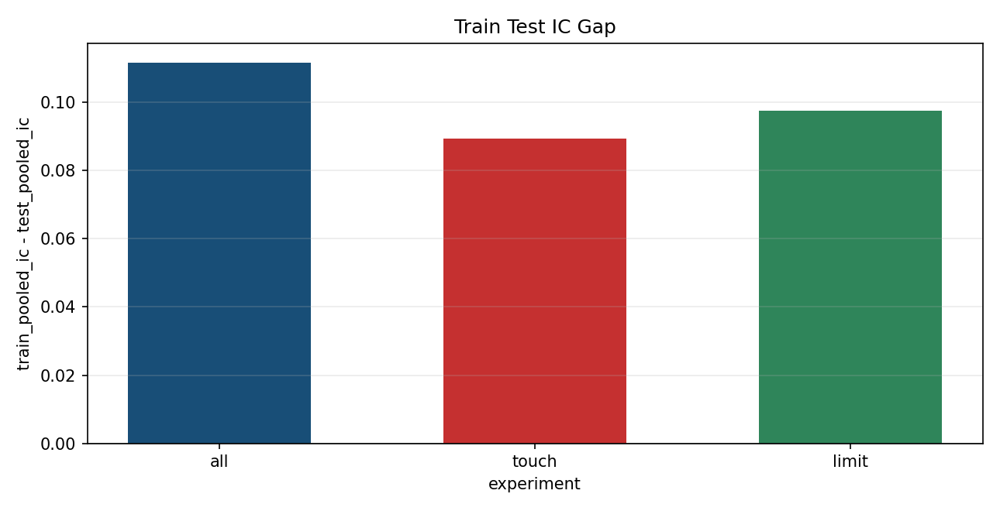

train_pooled_ic - test_pooled_ic.

字段解释

| field | explanation |
| --- | --- |
| split | 数据 split.  |
| pooled_ic | 合并样本后计算的 Pearson IC.  |
| pooled_rank_ic | 合并样本后计算的 Rank IC.  |
| count | 样本数.  |

### 3.2. Prediction Bucket Quality

### Prediction Bucket Quality

| experiment | signal_bucket | mean_prediction | mean_label_bps | t_stat | hit_rate | row_count | top_bottom_signal_spread_bps |
| --- | --- | --- | --- | --- | --- | --- | --- |
| all | 1 | -7.719e-04 | -4.7264 | -349.7378 | 0.366932 | 17,694,544 | 8.6359 |
| all | 2 | -2.761e-04 | -0.921261 | -96.2898 | 0.386594 | 17,694,544 | 8.6359 |
| all | 3 | -1.479e-04 | -0.833934 | -95.6153 | 0.374129 | 17,694,544 | 8.6359 |
| all | 4 | -5.881e-05 | -0.474930 | -57.3661 | 0.363189 | 17,694,544 | 8.6359 |
| all | 5 | 1.051e-05 | -0.099850 | -12.3423 | 0.363359 | 17,694,544 | 8.6359 |
| all | 6 | 8.041e-05 | 0.363141 | 43.1057 | 0.381418 | 17,694,544 | 8.6359 |
| all | 7 | 1.576e-04 | 0.794668 | 91.4358 | 0.392964 | 17,694,544 | 8.6359 |
| all | 8 | 2.522e-04 | 1.2089 | 131.6801 | 0.401876 | 17,694,544 | 8.6359 |
| all | 9 | 4.034e-04 | 1.8294 | 178.3370 | 0.412664 | 17,694,544 | 8.6359 |
| all | 10 | 9.530e-04 | 3.9095 | 272.6607 | 0.421372 | 17,694,544 | 8.6359 |
| touch | 1 | -0.001033 | -5.6279 | -367.4757 | 0.367320 | 17,318,168 | 9.9172 |
| touch | 2 | -3.455e-04 | -1.2328 | -121.7997 | 0.383539 | 17,318,168 | 9.9172 |
| touch | 3 | -2.066e-04 | -0.810246 | -87.1842 | 0.381176 | 17,318,168 | 9.9172 |
| touch | 4 | -1.144e-04 | -0.470964 | -51.8660 | 0.379544 | 17,318,168 | 9.9172 |
| touch | 5 | -3.757e-05 | -0.129225 | -14.2323 | 0.384999 | 17,318,168 | 9.9172 |
| touch | 6 | 3.586e-05 | 0.230270 | 25.1191 | 0.390883 | 17,318,168 | 9.9172 |
| touch | 7 | 1.133e-04 | 0.570614 | 60.7060 | 0.397150 | 17,318,168 | 9.9172 |
| touch | 8 | 2.048e-04 | 0.988853 | 101.5271 | 0.403989 | 17,318,168 | 9.9172 |
| touch | 9 | 3.405e-04 | 1.6989 | 159.0106 | 0.413738 | 17,318,167 | 9.9172 |
| touch | 10 | 8.847e-04 | 4.2893 | 279.7716 | 0.434500 | 17,318,167 | 9.9172 |
| limit | 1 | -0.001054 | -4.8796 | -328.8227 | 0.380565 | 17,243,179 | 9.1798 |
| limit | 2 | -4.202e-04 | -1.2244 | -114.8056 | 0.394532 | 17,243,179 | 9.1798 |
| limit | 3 | -2.531e-04 | -0.941273 | -97.9387 | 0.384864 | 17,243,179 | 9.1798 |
| limit | 4 | -1.554e-04 | -0.647799 | -71.3272 | 0.381066 | 17,243,179 | 9.1798 |
| limit | 5 | -7.807e-05 | -0.245979 | -27.7306 | 0.380798 | 17,243,179 | 9.1798 |
| limit | 6 | -6.015e-06 | 0.140995 | 15.8321 | 0.384397 | 17,243,179 | 9.1798 |
| limit | 7 | 7.221e-05 | 0.449060 | 48.9591 | 0.389948 | 17,243,179 | 9.1798 |
| limit | 8 | 1.717e-04 | 0.867214 | 88.2111 | 0.396782 | 17,243,179 | 9.1798 |
| limit | 9 | 3.288e-04 | 1.6592 | 150.6273 | 0.412139 | 17,243,179 | 9.1798 |
| limit | 10 | 8.526e-04 | 4.3002 | 283.9182 | 0.432361 | 17,243,179 | 9.1798 |

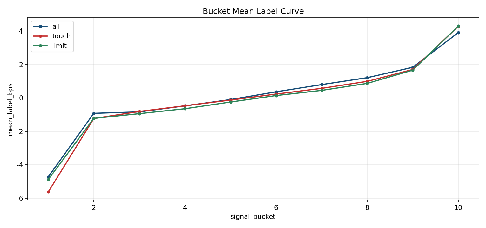

signal_bucket vs mean_label_bps.

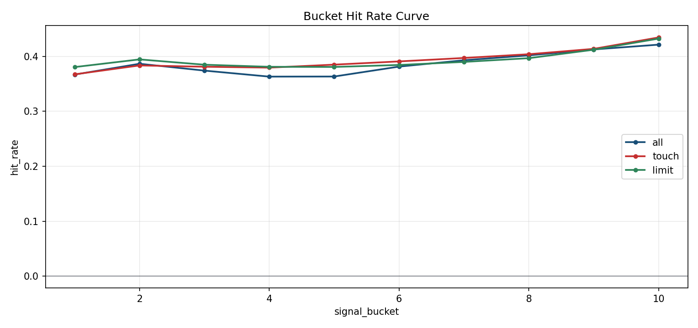

signal_bucket vs hit_rate.

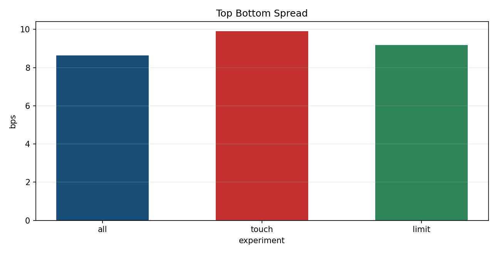

top_bottom_signal_spread_bps.

字段解释

| field | explanation |
| --- | --- |
| signal_bucket | 按 prediction 排序后的分桶编号.  |
| mean_prediction | 分组内 prediction 均值.  |
| mean_label_bps | 分组内 target 均值, 单位 bps.  |
| t_stat | 分组 mean label 的 t-stat.  |
| hit_rate | 分组内 target > 0 的比例.  |
| row_count | 分组样本数.  |
| top_bottom_signal_spread_bps | top bucket mean label bps - bottom bucket mean label bps.  |

### 3.3. Goodness Of Fit

Goodness Of Fit

| experiment | split | prediction_bin | mean_prediction | mean_label | label_p05 | label_p95 | row_count |
| --- | --- | --- | --- | --- | --- | --- | --- |
| all | train | 1 | -0.002298 | -0.003101 | -0.016556 | 0.009735 | 5,624,497 |
| all | train | 2 | -0.001136 | -0.001485 | -0.010422 | 0.007851 | 5,624,497 |
| all | train | 3 | -8.559e-04 | -0.001121 | -0.009102 | 0.007217 | 5,624,497 |
| all | train | 4 | -7.048e-04 | -9.509e-04 | -0.008362 | 0.006809 | 5,624,497 |
| all | train | 5 | -6.102e-04 | -8.076e-04 | -0.007721 | 0.006401 | 5,624,497 |
| all | train | 6 | -5.516e-04 | -7.043e-04 | -0.007187 | 0.006058 | 5,624,497 |
| all | train | 7 | -5.076e-04 | -6.507e-04 | -0.007008 | 0.005947 | 5,624,497 |
| all | train | 8 | -4.698e-04 | -5.938e-04 | -0.006859 | 0.005909 | 5,624,497 |
| all | train | 9 | -4.367e-04 | -5.552e-04 | -0.006744 | 0.005852 | 5,624,497 |
| all | train | 10 | -4.071e-04 | -5.153e-04 | -0.006615 | 0.005825 | 5,624,497 |
| all | train | 11 | -3.803e-04 | -4.835e-04 | -0.006508 | 0.005764 | 5,624,497 |
| all | train | 12 | -3.557e-04 | -4.682e-04 | -0.006413 | 0.005695 | 5,624,497 |
| all | train | 13 | -3.330e-04 | -4.370e-04 | -0.006317 | 0.005669 | 5,624,497 |
| all | train | 14 | -3.120e-04 | -4.002e-04 | -0.006214 | 0.005650 | 5,624,497 |
| all | train | 15 | -2.926e-04 | -3.905e-04 | -0.006126 | 0.005554 | 5,624,497 |
| all | train | 16 | -2.747e-04 | -3.710e-04 | -0.006042 | 0.005466 | 5,624,497 |
| all | train | 17 | -2.581e-04 | -3.506e-04 | -0.005936 | 0.005409 | 5,624,497 |
| all | train | 18 | -2.429e-04 | -3.194e-04 | -0.005829 | 0.005344 | 5,624,497 |
| all | train | 19 | -2.289e-04 | -3.077e-04 | -0.005760 | 0.005283 | 5,624,497 |
| all | train | 20 | -2.155e-04 | -2.970e-04 | -0.005695 | 0.005238 | 5,624,497 |
| all | train | 21 | -2.028e-04 | -2.762e-04 | -0.005608 | 0.005222 | 5,624,497 |
| all | train | 22 | -1.906e-04 | -2.581e-04 | -0.005539 | 0.005169 | 5,624,497 |
| all | train | 23 | -1.791e-04 | -2.491e-04 | -0.005493 | 0.005138 | 5,624,497 |
| all | train | 24 | -1.682e-04 | -2.247e-04 | -0.005394 | 0.005093 | 5,624,497 |
| all | train | 25 | -1.577e-04 | -2.236e-04 | -0.005348 | 0.005039 | 5,624,497 |
| all | train | 26 | -1.477e-04 | -2.133e-04 | -0.005306 | 0.005016 | 5,624,497 |
| all | train | 27 | -1.379e-04 | -1.965e-04 | -0.005253 | 0.004978 | 5,624,497 |
| all | train | 28 | -1.284e-04 | -1.960e-04 | -0.005219 | 0.004974 | 5,624,497 |
| all | train | 29 | -1.191e-04 | -1.706e-04 | -0.005169 | 0.004974 | 5,624,497 |
| all | train | 30 | -1.101e-04 | -1.603e-04 | -0.005127 | 0.004978 | 5,624,497 |
| all | train | 31 | -1.013e-04 | -1.506e-04 | -0.005089 | 0.004948 | 5,624,497 |
| all | train | 32 | -9.274e-05 | -1.441e-04 | -0.005054 | 0.004921 | 5,624,497 |
| all | train | 33 | -8.437e-05 | -1.369e-04 | -0.005005 | 0.004913 | 5,624,497 |
| all | train | 34 | -7.622e-05 | -1.368e-04 | -0.004990 | 0.004890 | 5,624,497 |
| all | train | 35 | -6.830e-05 | -1.293e-04 | -0.004951 | 0.004860 | 5,624,497 |
| all | train | 36 | -6.061e-05 | -1.156e-04 | -0.004925 | 0.004883 | 5,624,497 |
| all | train | 37 | -5.318e-05 | -1.068e-04 | -0.004868 | 0.004841 | 5,624,497 |
| all | train | 38 | -4.616e-05 | -9.778e-05 | -0.004795 | 0.004795 | 5,624,497 |
| all | train | 39 | -3.924e-05 | -8.900e-05 | -0.004814 | 0.004841 | 5,624,497 |
| all | train | 40 | -3.245e-05 | -7.951e-05 | -0.004795 | 0.004841 | 5,624,497 |
| all | train | 41 | -2.580e-05 | -6.765e-05 | -0.004749 | 0.004833 | 5,624,497 |
| all | train | 42 | -1.926e-05 | -6.499e-05 | -0.004742 | 0.004818 | 5,624,497 |
| all | train | 43 | -1.286e-05 | -5.665e-05 | -0.004704 | 0.004810 | 5,624,497 |
| all | train | 44 | -6.511e-06 | -4.676e-05 | -0.004704 | 0.004818 | 5,624,497 |
| all | train | 45 | -1.843e-07 | -4.059e-05 | -0.004692 | 0.004826 | 5,624,497 |
| all | train | 46 | 6.029e-06 | -2.944e-05 | -0.004620 | 0.004749 | 5,624,497 |
| all | train | 47 | 1.228e-05 | -2.629e-05 | -0.004704 | 0.004864 | 5,624,497 |
| all | train | 48 | 1.872e-05 | -3.162e-05 | -0.004742 | 0.004887 | 5,624,497 |
| all | train | 49 | 2.527e-05 | -1.939e-05 | -0.004761 | 0.004961 | 5,624,497 |
| all | train | 50 | 3.192e-05 | -1.624e-05 | -0.004772 | 0.004978 | 5,624,497 |
| all | train | 51 | 3.867e-05 | -6.087e-06 | -0.004803 | 0.005024 | 5,624,497 |
| all | train | 52 | 4.549e-05 | 2.189e-08 | -0.004814 | 0.005070 | 5,624,497 |
| all | train | 53 | 5.240e-05 | 1.730e-06 | -0.004841 | 0.005093 | 5,624,497 |
| all | train | 54 | 5.937e-05 | 1.690e-05 | -0.004841 | 0.005150 | 5,624,497 |
| all | train | 55 | 6.642e-05 | 1.990e-05 | -0.004868 | 0.005169 | 5,624,497 |
| all | train | 56 | 7.355e-05 | 2.169e-05 | -0.004883 | 0.005199 | 5,624,497 |
| all | train | 57 | 8.075e-05 | 2.946e-05 | -0.004879 | 0.005238 | 5,624,497 |
| all | train | 58 | 8.804e-05 | 4.801e-05 | -0.004890 | 0.005306 | 5,624,497 |
| all | train | 59 | 9.539e-05 | 4.728e-05 | -0.004902 | 0.005295 | 5,624,497 |
| all | train | 60 | 1.028e-04 | 6.546e-05 | -0.004906 | 0.005360 | 5,624,497 |
| all | train | 61 | 1.103e-04 | 7.366e-05 | -0.004906 | 0.005383 | 5,624,497 |
| all | train | 62 | 1.180e-04 | 8.099e-05 | -0.004917 | 0.005402 | 5,624,497 |
| all | train | 63 | 1.257e-04 | 8.400e-05 | -0.004940 | 0.005436 | 5,624,497 |
| all | train | 64 | 1.335e-04 | 9.404e-05 | -0.004925 | 0.005463 | 5,624,497 |
| all | train | 65 | 1.414e-04 | 1.027e-04 | -0.004948 | 0.005489 | 5,624,497 |
| all | train | 66 | 1.495e-04 | 1.170e-04 | -0.004940 | 0.005554 | 5,624,497 |
| all | train | 67 | 1.577e-04 | 1.198e-04 | -0.004974 | 0.005569 | 5,624,497 |
| all | train | 68 | 1.661e-04 | 1.319e-04 | -0.004967 | 0.005627 | 5,624,497 |
| all | train | 69 | 1.747e-04 | 1.324e-04 | -0.005009 | 0.005630 | 5,624,497 |
| all | train | 70 | 1.834e-04 | 1.585e-04 | -0.005005 | 0.005714 | 5,624,497 |
| all | train | 71 | 1.924e-04 | 1.509e-04 | -0.005051 | 0.005722 | 5,624,497 |
| all | train | 72 | 2.017e-04 | 1.696e-04 | -0.005051 | 0.005764 | 5,624,497 |
| all | train | 73 | 2.113e-04 | 1.759e-04 | -0.005081 | 0.005810 | 5,624,497 |
| all | train | 74 | 2.212e-04 | 1.954e-04 | -0.005089 | 0.005894 | 5,624,497 |
| all | train | 75 | 2.315e-04 | 2.024e-04 | -0.005138 | 0.005924 | 5,624,497 |
| all | train | 76 | 2.422e-04 | 2.138e-04 | -0.005146 | 0.006001 | 5,624,497 |
| all | train | 77 | 2.534e-04 | 2.297e-04 | -0.005196 | 0.006073 | 5,624,497 |
| all | train | 78 | 2.650e-04 | 2.377e-04 | -0.005230 | 0.006142 | 5,624,497 |
| all | train | 79 | 2.773e-04 | 2.474e-04 | -0.005257 | 0.006226 | 5,624,497 |
| all | train | 80 | 2.902e-04 | 2.645e-04 | -0.005322 | 0.006325 | 5,624,497 |
| all | train | 81 | 3.039e-04 | 2.720e-04 | -0.005371 | 0.006382 | 5,624,497 |
| all | train | 82 | 3.185e-04 | 2.932e-04 | -0.005402 | 0.006481 | 5,624,497 |
| all | train | 83 | 3.341e-04 | 3.067e-04 | -0.005482 | 0.006584 | 5,624,497 |
| all | train | 84 | 3.507e-04 | 3.255e-04 | -0.005535 | 0.006714 | 5,624,497 |
| all | train | 85 | 3.687e-04 | 3.477e-04 | -0.005604 | 0.006798 | 5,624,497 |
| all | train | 86 | 3.883e-04 | 3.723e-04 | -0.005661 | 0.006935 | 5,624,497 |
| all | train | 87 | 4.096e-04 | 3.885e-04 | -0.005733 | 0.007069 | 5,624,496 |
| all | train | 88 | 4.330e-04 | 4.155e-04 | -0.005829 | 0.007214 | 5,624,496 |
| all | train | 89 | 4.589e-04 | 4.414e-04 | -0.005898 | 0.007362 | 5,624,496 |
| all | train | 90 | 4.877e-04 | 4.619e-04 | -0.006001 | 0.007511 | 5,624,496 |
| all | train | 91 | 5.198e-04 | 5.102e-04 | -0.006081 | 0.007725 | 5,624,496 |
| all | train | 92 | 5.564e-04 | 5.339e-04 | -0.006218 | 0.007881 | 5,624,496 |
| all | train | 93 | 5.983e-04 | 5.873e-04 | -0.006329 | 0.008171 | 5,624,496 |
| all | train | 94 | 6.470e-04 | 6.257e-04 | -0.006474 | 0.008400 | 5,624,496 |
| all | train | 95 | 7.056e-04 | 6.871e-04 | -0.006687 | 0.008781 | 5,624,496 |
| all | train | 96 | 7.787e-04 | 7.775e-04 | -0.006924 | 0.009285 | 5,624,496 |
| all | train | 97 | 8.765e-04 | 8.851e-04 | -0.007286 | 0.009979 | 5,624,496 |
| all | train | 98 | 0.001021 | 0.001048 | -0.007786 | 0.010864 | 5,624,496 |
| all | train | 99 | 0.001275 | 0.001350 | -0.008484 | 0.012238 | 5,624,496 |
| all | train | 100 | 0.002426 | 0.002724 | -0.010254 | 0.017746 | 5,624,496 |
| all | test | 1 | -0.002207 | -0.001964 | -0.014580 | 0.010117 | 1,769,455 |
| all | test | 2 | -0.001129 | -8.026e-04 | -0.009705 | 0.008347 | 1,769,455 |
| all | test | 3 | -8.374e-04 | -5.063e-04 | -0.008484 | 0.007719 | 1,769,455 |
| all | test | 4 | -6.820e-04 | -3.709e-04 | -0.007790 | 0.007324 | 1,769,455 |
| all | test | 5 | -5.889e-04 | -2.625e-04 | -0.007107 | 0.006821 | 1,769,455 |
| all | test | 6 | -5.320e-04 | -1.936e-04 | -0.006756 | 0.006584 | 1,769,455 |
| all | test | 7 | -4.875e-04 | -1.764e-04 | -0.006599 | 0.006439 | 1,769,455 |
| all | test | 8 | -4.498e-04 | -1.632e-04 | -0.006496 | 0.006374 | 1,769,455 |
| all | test | 9 | -4.171e-04 | -1.533e-04 | -0.006382 | 0.006310 | 1,769,455 |
| all | test | 10 | -3.880e-04 | -1.341e-04 | -0.006271 | 0.006237 | 1,769,455 |
| all | test | 11 | -3.619e-04 | -1.297e-04 | -0.006191 | 0.006142 | 1,769,455 |
| all | test | 12 | -3.382e-04 | -1.263e-04 | -0.006096 | 0.006073 | 1,769,455 |
| all | test | 13 | -3.165e-04 | -1.080e-04 | -0.006001 | 0.006008 | 1,769,455 |
| all | test | 14 | -2.966e-04 | -1.129e-04 | -0.005913 | 0.005924 | 1,769,455 |
| all | test | 15 | -2.786e-04 | -1.075e-04 | -0.005817 | 0.005852 | 1,769,455 |
| all | test | 16 | -2.621e-04 | -8.181e-05 | -0.005711 | 0.005768 | 1,769,455 |
| all | test | 17 | -2.470e-04 | -6.626e-05 | -0.005581 | 0.005676 | 1,769,455 |
| all | test | 18 | -2.330e-04 | -5.711e-05 | -0.005508 | 0.005611 | 1,769,455 |
| all | test | 19 | -2.199e-04 | -6.310e-05 | -0.005459 | 0.005581 | 1,769,455 |
| all | test | 20 | -2.073e-04 | -6.818e-05 | -0.005417 | 0.005508 | 1,769,455 |
| all | test | 21 | -1.952e-04 | -7.363e-05 | -0.005394 | 0.005489 | 1,769,455 |
| all | test | 22 | -1.837e-04 | -8.394e-05 | -0.005360 | 0.005421 | 1,769,455 |
| all | test | 23 | -1.727e-04 | -8.638e-05 | -0.005314 | 0.005390 | 1,769,455 |
| all | test | 24 | -1.621e-04 | -8.715e-05 | -0.005302 | 0.005352 | 1,769,455 |
| all | test | 25 | -1.518e-04 | -8.979e-05 | -0.005280 | 0.005356 | 1,769,455 |
| all | test | 26 | -1.418e-04 | -9.189e-05 | -0.005264 | 0.005322 | 1,769,455 |
| all | test | 27 | -1.320e-04 | -8.325e-05 | -0.005234 | 0.005333 | 1,769,455 |
| all | test | 28 | -1.224e-04 | -8.111e-05 | -0.005196 | 0.005306 | 1,769,455 |
| all | test | 29 | -1.131e-04 | -8.402e-05 | -0.005196 | 0.005299 | 1,769,455 |
| all | test | 30 | -1.039e-04 | -7.334e-05 | -0.005173 | 0.005276 | 1,769,455 |
| all | test | 31 | -9.501e-05 | -7.177e-05 | -0.005131 | 0.005264 | 1,769,455 |
| all | test | 32 | -8.630e-05 | -5.974e-05 | -0.005108 | 0.005260 | 1,769,455 |
| all | test | 33 | -7.780e-05 | -6.396e-05 | -0.005066 | 0.005222 | 1,769,455 |
| all | test | 34 | -6.953e-05 | -5.125e-05 | -0.005054 | 0.005222 | 1,769,455 |
| all | test | 35 | -6.151e-05 | -4.645e-05 | -0.005020 | 0.005219 | 1,769,455 |
| all | test | 36 | -5.378e-05 | -5.252e-05 | -0.004990 | 0.005138 | 1,769,455 |
| all | test | 37 | -4.655e-05 | -3.973e-05 | -0.004898 | 0.005047 | 1,769,455 |
| all | test | 38 | -3.946e-05 | -3.552e-05 | -0.004921 | 0.005112 | 1,769,455 |
| all | test | 39 | -3.249e-05 | -2.747e-05 | -0.004906 | 0.005116 | 1,769,455 |
| all | test | 40 | -2.566e-05 | -2.607e-05 | -0.004879 | 0.005089 | 1,769,455 |
| all | test | 41 | -1.894e-05 | -2.330e-05 | -0.004848 | 0.005085 | 1,769,454 |
| all | test | 42 | -1.239e-05 | -2.983e-05 | -0.004841 | 0.005062 | 1,769,454 |
| all | test | 43 | -5.851e-06 | -2.242e-05 | -0.004835 | 0.005070 | 1,769,454 |
| all | test | 44 | 6.589e-07 | -1.703e-05 | -0.004818 | 0.005047 | 1,769,454 |
| all | test | 45 | 6.964e-06 | -7.157e-06 | -0.004734 | 0.004974 | 1,769,454 |
| all | test | 46 | 1.343e-05 | -1.000e-05 | -0.004856 | 0.005116 | 1,769,454 |
| all | test | 47 | 2.006e-05 | -7.308e-06 | -0.004841 | 0.005116 | 1,769,454 |
| all | test | 48 | 2.682e-05 | -3.139e-06 | -0.004890 | 0.005161 | 1,769,454 |
| all | test | 49 | 3.370e-05 | 3.552e-06 | -0.004925 | 0.005219 | 1,769,454 |
| all | test | 50 | 4.068e-05 | 1.641e-05 | -0.004902 | 0.005253 | 1,769,454 |
| all | test | 51 | 4.774e-05 | 1.650e-05 | -0.004936 | 0.005264 | 1,769,454 |
| all | test | 52 | 5.486e-05 | 2.132e-05 | -0.004963 | 0.005306 | 1,769,454 |
| all | test | 53 | 6.203e-05 | 2.046e-05 | -0.004963 | 0.005306 | 1,769,454 |
| all | test | 54 | 6.926e-05 | 3.305e-05 | -0.004974 | 0.005344 | 1,769,454 |
| all | test | 55 | 7.654e-05 | 3.958e-05 | -0.004963 | 0.005352 | 1,769,454 |
| all | test | 56 | 8.386e-05 | 3.255e-05 | -0.004990 | 0.005360 | 1,769,454 |
| all | test | 57 | 9.124e-05 | 4.655e-05 | -0.004971 | 0.005379 | 1,769,454 |
| all | test | 58 | 9.868e-05 | 4.898e-05 | -0.004990 | 0.005421 | 1,769,454 |
| all | test | 59 | 1.062e-04 | 5.018e-05 | -0.004986 | 0.005432 | 1,769,454 |
| all | test | 60 | 1.137e-04 | 5.401e-05 | -0.005009 | 0.005432 | 1,769,454 |
| all | test | 61 | 1.214e-04 | 5.907e-05 | -0.005013 | 0.005455 | 1,769,454 |
| all | test | 62 | 1.291e-04 | 6.211e-05 | -0.005013 | 0.005470 | 1,769,454 |
| all | test | 63 | 1.369e-04 | 7.242e-05 | -0.005032 | 0.005508 | 1,769,454 |
| all | test | 64 | 1.448e-04 | 7.210e-05 | -0.005035 | 0.005520 | 1,769,454 |
| all | test | 65 | 1.529e-04 | 7.880e-05 | -0.005039 | 0.005547 | 1,769,454 |
| all | test | 66 | 1.611e-04 | 8.013e-05 | -0.005077 | 0.005577 | 1,769,454 |
| all | test | 67 | 1.695e-04 | 9.056e-05 | -0.005081 | 0.005604 | 1,769,454 |
| all | test | 68 | 1.780e-04 | 8.200e-05 | -0.005096 | 0.005615 | 1,769,454 |
| all | test | 69 | 1.867e-04 | 9.434e-05 | -0.005112 | 0.005638 | 1,769,454 |
| all | test | 70 | 1.956e-04 | 1.031e-04 | -0.005123 | 0.005714 | 1,769,454 |
| all | test | 71 | 2.049e-04 | 1.004e-04 | -0.005154 | 0.005733 | 1,769,454 |
| all | test | 72 | 2.143e-04 | 9.934e-05 | -0.005177 | 0.005737 | 1,769,454 |
| all | test | 73 | 2.241e-04 | 1.104e-04 | -0.005196 | 0.005795 | 1,769,454 |
| all | test | 74 | 2.343e-04 | 1.144e-04 | -0.005207 | 0.005840 | 1,769,454 |
| all | test | 75 | 2.448e-04 | 1.211e-04 | -0.005257 | 0.005875 | 1,769,454 |
| all | test | 76 | 2.558e-04 | 1.241e-04 | -0.005268 | 0.005898 | 1,769,454 |
| all | test | 77 | 2.673e-04 | 1.378e-04 | -0.005325 | 0.005997 | 1,769,454 |
| all | test | 78 | 2.793e-04 | 1.302e-04 | -0.005356 | 0.006016 | 1,769,454 |
| all | test | 79 | 2.920e-04 | 1.379e-04 | -0.005398 | 0.006088 | 1,769,454 |
| all | test | 80 | 3.053e-04 | 1.332e-04 | -0.005466 | 0.006126 | 1,769,454 |
| all | test | 81 | 3.194e-04 | 1.464e-04 | -0.005508 | 0.006210 | 1,769,454 |
| all | test | 82 | 3.344e-04 | 1.571e-04 | -0.005550 | 0.006283 | 1,769,454 |
| all | test | 83 | 3.505e-04 | 1.592e-04 | -0.005604 | 0.006336 | 1,769,454 |
| all | test | 84 | 3.677e-04 | 1.705e-04 | -0.005676 | 0.006443 | 1,769,454 |
| all | test | 85 | 3.863e-04 | 1.855e-04 | -0.005718 | 0.006535 | 1,769,454 |
| all | test | 86 | 4.065e-04 | 1.855e-04 | -0.005810 | 0.006622 | 1,769,454 |
| all | test | 87 | 4.286e-04 | 1.981e-04 | -0.005890 | 0.006752 | 1,769,454 |
| all | test | 88 | 4.528e-04 | 2.018e-04 | -0.005970 | 0.006824 | 1,769,454 |
| all | test | 89 | 4.795e-04 | 2.185e-04 | -0.006065 | 0.006981 | 1,769,454 |
| all | test | 90 | 5.089e-04 | 2.070e-04 | -0.006180 | 0.007050 | 1,769,454 |
| all | test | 91 | 5.419e-04 | 2.309e-04 | -0.006271 | 0.007217 | 1,769,454 |
| all | test | 92 | 5.793e-04 | 2.436e-04 | -0.006390 | 0.007366 | 1,769,454 |
| all | test | 93 | 6.220e-04 | 2.583e-04 | -0.006527 | 0.007519 | 1,769,454 |
| all | test | 94 | 6.719e-04 | 2.609e-04 | -0.006687 | 0.007729 | 1,769,454 |
| all | test | 95 | 7.320e-04 | 2.947e-04 | -0.006924 | 0.008064 | 1,769,454 |
| all | test | 96 | 8.073e-04 | 3.034e-04 | -0.007187 | 0.008400 | 1,769,454 |
| all | test | 97 | 9.081e-04 | 3.284e-04 | -0.007614 | 0.008949 | 1,769,454 |
| all | test | 98 | 0.001057 | 3.830e-04 | -0.008125 | 0.009666 | 1,769,454 |
| all | test | 99 | 0.001315 | 4.561e-04 | -0.008926 | 0.010658 | 1,769,454 |
| all | test | 100 | 0.002296 | 0.001150 | -0.010696 | 0.014572 | 1,769,454 |
| touch | train | 1 | -0.003626 | -0.003384 | -0.019363 | 0.011879 | 5,526,497 |
| touch | train | 2 | -0.001626 | -0.001492 | -0.012032 | 0.009804 | 5,526,497 |
| touch | train | 3 | -0.001202 | -0.001132 | -0.010612 | 0.009033 | 5,526,497 |
| touch | train | 4 | -9.684e-04 | -9.300e-04 | -0.009850 | 0.008675 | 5,526,497 |
| touch | train | 5 | -8.220e-04 | -8.173e-04 | -0.009209 | 0.008179 | 5,526,497 |
| touch | train | 6 | -7.192e-04 | -7.133e-04 | -0.008781 | 0.007957 | 5,526,497 |
| touch | train | 7 | -6.408e-04 | -6.461e-04 | -0.008430 | 0.007732 | 5,526,497 |
| touch | train | 8 | -5.772e-04 | -5.896e-04 | -0.008095 | 0.007500 | 5,526,497 |
| touch | train | 9 | -5.229e-04 | -5.532e-04 | -0.007820 | 0.007217 | 5,526,497 |
| touch | train | 10 | -4.752e-04 | -5.087e-04 | -0.007557 | 0.007015 | 5,526,497 |
| touch | train | 11 | -4.387e-04 | -4.897e-04 | -0.007065 | 0.006485 | 5,526,497 |
| touch | train | 12 | -4.127e-04 | -4.378e-04 | -0.006767 | 0.006214 | 5,526,497 |
| touch | train | 13 | -3.892e-04 | -4.053e-04 | -0.006870 | 0.006382 | 5,526,497 |
| touch | train | 14 | -3.662e-04 | -3.829e-04 | -0.006840 | 0.006405 | 5,526,497 |
| touch | train | 15 | -3.453e-04 | -3.513e-04 | -0.006676 | 0.006268 | 5,526,497 |
| touch | train | 16 | -3.261e-04 | -3.318e-04 | -0.006531 | 0.006176 | 5,526,497 |
| touch | train | 17 | -3.080e-04 | -3.053e-04 | -0.006371 | 0.006054 | 5,526,497 |
| touch | train | 18 | -2.913e-04 | -2.926e-04 | -0.006310 | 0.005959 | 5,526,497 |
| touch | train | 19 | -2.757e-04 | -2.781e-04 | -0.006138 | 0.005840 | 5,526,497 |
| touch | train | 20 | -2.612e-04 | -2.699e-04 | -0.006054 | 0.005764 | 5,526,497 |
| touch | train | 21 | -2.476e-04 | -2.493e-04 | -0.005966 | 0.005730 | 5,526,497 |
| touch | train | 22 | -2.348e-04 | -2.328e-04 | -0.005909 | 0.005707 | 5,526,496 |
| touch | train | 23 | -2.225e-04 | -2.172e-04 | -0.005844 | 0.005672 | 5,526,496 |
| touch | train | 24 | -2.109e-04 | -2.125e-04 | -0.005795 | 0.005642 | 5,526,496 |
| touch | train | 25 | -1.998e-04 | -1.989e-04 | -0.005753 | 0.005627 | 5,526,496 |
| touch | train | 26 | -1.891e-04 | -1.904e-04 | -0.005726 | 0.005608 | 5,526,496 |
| touch | train | 27 | -1.789e-04 | -1.757e-04 | -0.005684 | 0.005608 | 5,526,496 |
| touch | train | 28 | -1.689e-04 | -1.731e-04 | -0.005669 | 0.005604 | 5,526,496 |
| touch | train | 29 | -1.593e-04 | -1.576e-04 | -0.005615 | 0.005604 | 5,526,496 |
| touch | train | 30 | -1.500e-04 | -1.469e-04 | -0.005600 | 0.005592 | 5,526,496 |
| touch | train | 31 | -1.409e-04 | -1.332e-04 | -0.005573 | 0.005615 | 5,526,496 |
| touch | train | 32 | -1.321e-04 | -1.349e-04 | -0.005566 | 0.005589 | 5,526,496 |
| touch | train | 33 | -1.234e-04 | -1.203e-04 | -0.005535 | 0.005611 | 5,526,496 |
| touch | train | 34 | -1.150e-04 | -1.079e-04 | -0.005505 | 0.005608 | 5,526,496 |
| touch | train | 35 | -1.067e-04 | -9.446e-05 | -0.005474 | 0.005604 | 5,526,496 |
| touch | train | 36 | -9.869e-05 | -9.313e-05 | -0.005436 | 0.005569 | 5,526,496 |
| touch | train | 37 | -9.079e-05 | -8.334e-05 | -0.005432 | 0.005589 | 5,526,496 |
| touch | train | 38 | -8.300e-05 | -7.157e-05 | -0.005424 | 0.005596 | 5,526,496 |
| touch | train | 39 | -7.528e-05 | -6.506e-05 | -0.005417 | 0.005627 | 5,526,496 |
| touch | train | 40 | -6.769e-05 | -5.515e-05 | -0.005379 | 0.005604 | 5,526,496 |
| touch | train | 41 | -6.017e-05 | -5.305e-05 | -0.005421 | 0.005672 | 5,526,496 |
| touch | train | 42 | -5.264e-05 | -4.434e-05 | -0.005417 | 0.005695 | 5,526,496 |
| touch | train | 43 | -4.518e-05 | -3.307e-05 | -0.005409 | 0.005711 | 5,526,496 |
| touch | train | 44 | -3.778e-05 | -2.608e-05 | -0.005402 | 0.005722 | 5,526,496 |
| touch | train | 45 | -3.044e-05 | -1.723e-05 | -0.005371 | 0.005730 | 5,526,496 |
| touch | train | 46 | -2.315e-05 | -1.111e-05 | -0.005375 | 0.005749 | 5,526,496 |
| touch | train | 47 | -1.590e-05 | 6.007e-07 | -0.005371 | 0.005783 | 5,526,496 |
| touch | train | 48 | -8.667e-06 | 1.898e-06 | -0.005371 | 0.005772 | 5,526,496 |
| touch | train | 49 | -1.448e-06 | 1.288e-05 | -0.005352 | 0.005775 | 5,526,496 |
| touch | train | 50 | 5.720e-06 | 3.098e-05 | -0.005329 | 0.005817 | 5,526,496 |
| touch | train | 51 | 1.283e-05 | 2.872e-05 | -0.005344 | 0.005833 | 5,526,496 |
| touch | train | 52 | 2.004e-05 | 3.880e-05 | -0.005371 | 0.005859 | 5,526,496 |
| touch | train | 53 | 2.726e-05 | 4.828e-05 | -0.005363 | 0.005901 | 5,526,496 |
| touch | train | 54 | 3.450e-05 | 5.506e-05 | -0.005363 | 0.005920 | 5,526,496 |
| touch | train | 55 | 4.176e-05 | 5.377e-05 | -0.005379 | 0.005932 | 5,526,496 |
| touch | train | 56 | 4.905e-05 | 6.823e-05 | -0.005363 | 0.005947 | 5,526,496 |
| touch | train | 57 | 5.637e-05 | 6.955e-05 | -0.005371 | 0.005970 | 5,526,496 |
| touch | train | 58 | 6.374e-05 | 8.652e-05 | -0.005367 | 0.006023 | 5,526,496 |
| touch | train | 59 | 7.118e-05 | 9.350e-05 | -0.005363 | 0.006035 | 5,526,496 |
| touch | train | 60 | 7.869e-05 | 9.924e-05 | -0.005363 | 0.006042 | 5,526,496 |
| touch | train | 61 | 8.627e-05 | 1.082e-04 | -0.005367 | 0.006100 | 5,526,496 |
| touch | train | 62 | 9.393e-05 | 1.217e-04 | -0.005352 | 0.006115 | 5,526,496 |
| touch | train | 63 | 1.017e-04 | 1.260e-04 | -0.005390 | 0.006153 | 5,526,496 |
| touch | train | 64 | 1.095e-04 | 1.357e-04 | -0.005386 | 0.006199 | 5,526,496 |
| touch | train | 65 | 1.175e-04 | 1.437e-04 | -0.005394 | 0.006226 | 5,526,496 |
| touch | train | 66 | 1.256e-04 | 1.498e-04 | -0.005413 | 0.006252 | 5,526,496 |
| touch | train | 67 | 1.339e-04 | 1.601e-04 | -0.005424 | 0.006310 | 5,526,496 |
| touch | train | 68 | 1.423e-04 | 1.683e-04 | -0.005436 | 0.006336 | 5,526,496 |
| touch | train | 69 | 1.508e-04 | 1.839e-04 | -0.005424 | 0.006393 | 5,526,496 |
| touch | train | 70 | 1.596e-04 | 1.910e-04 | -0.005459 | 0.006409 | 5,526,496 |
| touch | train | 71 | 1.686e-04 | 2.063e-04 | -0.005474 | 0.006477 | 5,526,496 |
| touch | train | 72 | 1.778e-04 | 2.184e-04 | -0.005482 | 0.006557 | 5,526,496 |
| touch | train | 73 | 1.873e-04 | 2.199e-04 | -0.005531 | 0.006569 | 5,526,496 |
| touch | train | 74 | 1.971e-04 | 2.366e-04 | -0.005527 | 0.006634 | 5,526,496 |
| touch | train | 75 | 2.072e-04 | 2.485e-04 | -0.005535 | 0.006714 | 5,526,496 |
| touch | train | 76 | 2.177e-04 | 2.599e-04 | -0.005577 | 0.006737 | 5,526,496 |
| touch | train | 77 | 2.286e-04 | 2.648e-04 | -0.005619 | 0.006836 | 5,526,496 |
| touch | train | 78 | 2.400e-04 | 2.875e-04 | -0.005642 | 0.006916 | 5,526,496 |
| touch | train | 79 | 2.518e-04 | 3.032e-04 | -0.005692 | 0.006992 | 5,526,496 |
| touch | train | 80 | 2.644e-04 | 3.138e-04 | -0.005730 | 0.007065 | 5,526,496 |
| touch | train | 81 | 2.776e-04 | 3.337e-04 | -0.005806 | 0.007175 | 5,526,496 |
| touch | train | 82 | 2.917e-04 | 3.495e-04 | -0.005844 | 0.007278 | 5,526,496 |
| touch | train | 83 | 3.067e-04 | 3.641e-04 | -0.005898 | 0.007404 | 5,526,496 |
| touch | train | 84 | 3.229e-04 | 3.926e-04 | -0.005966 | 0.007526 | 5,526,496 |
| touch | train | 85 | 3.404e-04 | 4.110e-04 | -0.006096 | 0.007683 | 5,526,496 |
| touch | train | 86 | 3.594e-04 | 4.296e-04 | -0.006180 | 0.007828 | 5,526,496 |
| touch | train | 87 | 3.804e-04 | 4.444e-04 | -0.006317 | 0.007973 | 5,526,496 |
| touch | train | 88 | 4.036e-04 | 4.734e-04 | -0.006428 | 0.008194 | 5,526,496 |
| touch | train | 89 | 4.296e-04 | 4.981e-04 | -0.006584 | 0.008400 | 5,526,496 |
| touch | train | 90 | 4.590e-04 | 5.281e-04 | -0.006748 | 0.008629 | 5,526,496 |
| touch | train | 91 | 4.926e-04 | 5.565e-04 | -0.006966 | 0.008904 | 5,526,496 |
| touch | train | 92 | 5.315e-04 | 5.982e-04 | -0.007175 | 0.009216 | 5,526,496 |
| touch | train | 93 | 5.774e-04 | 6.541e-04 | -0.007427 | 0.009636 | 5,526,496 |
| touch | train | 94 | 6.327e-04 | 7.082e-04 | -0.007721 | 0.010094 | 5,526,496 |
| touch | train | 95 | 7.011e-04 | 7.775e-04 | -0.008064 | 0.010635 | 5,526,496 |
| touch | train | 96 | 7.888e-04 | 8.644e-04 | -0.008492 | 0.011276 | 5,526,496 |
| touch | train | 97 | 9.080e-04 | 9.641e-04 | -0.008965 | 0.012077 | 5,526,496 |
| touch | train | 98 | 0.001088 | 0.001147 | -0.009529 | 0.013069 | 5,526,496 |
| touch | train | 99 | 0.001431 | 0.001458 | -0.010399 | 0.014839 | 5,526,496 |
| touch | train | 100 | 0.002988 | 0.003110 | -0.011978 | 0.020844 | 5,526,496 |
| touch | test | 1 | -0.003084 | -0.001958 | -0.016144 | 0.012169 | 1,731,817 |
| touch | test | 2 | -0.001524 | -9.114e-04 | -0.010628 | 0.009232 | 1,731,817 |
| touch | test | 3 | -0.001141 | -6.289e-04 | -0.009529 | 0.008667 | 1,731,817 |
| touch | test | 4 | -9.270e-04 | -4.894e-04 | -0.008865 | 0.008232 | 1,731,817 |
| touch | test | 5 | -7.925e-04 | -3.946e-04 | -0.008331 | 0.007820 | 1,731,817 |
| touch | test | 6 | -6.973e-04 | -3.321e-04 | -0.007996 | 0.007622 | 1,731,817 |
| touch | test | 7 | -6.231e-04 | -2.852e-04 | -0.007713 | 0.007420 | 1,731,817 |
| touch | test | 8 | -5.626e-04 | -2.445e-04 | -0.007420 | 0.007156 | 1,731,817 |
| touch | test | 9 | -5.115e-04 | -2.106e-04 | -0.007133 | 0.006939 | 1,731,817 |
| touch | test | 10 | -4.670e-04 | -1.728e-04 | -0.006882 | 0.006721 | 1,731,817 |
| touch | test | 11 | -4.349e-04 | -1.309e-04 | -0.006371 | 0.006287 | 1,731,817 |
| touch | test | 12 | -4.121e-04 | -1.374e-04 | -0.006161 | 0.006012 | 1,731,817 |
| touch | test | 13 | -3.909e-04 | -1.510e-04 | -0.006298 | 0.006161 | 1,731,817 |
| touch | test | 14 | -3.694e-04 | -1.415e-04 | -0.006252 | 0.006161 | 1,731,817 |
| touch | test | 15 | -3.496e-04 | -1.245e-04 | -0.006115 | 0.006046 | 1,731,817 |
| touch | test | 16 | -3.316e-04 | -1.211e-04 | -0.006004 | 0.005932 | 1,731,817 |
| touch | test | 17 | -3.145e-04 | -1.172e-04 | -0.005936 | 0.005878 | 1,731,817 |
| touch | test | 18 | -2.986e-04 | -1.089e-04 | -0.005848 | 0.005810 | 1,731,817 |
| touch | test | 19 | -2.838e-04 | -1.053e-04 | -0.005768 | 0.005764 | 1,731,817 |
| touch | test | 20 | -2.699e-04 | -9.546e-05 | -0.005714 | 0.005753 | 1,731,817 |
| touch | test | 21 | -2.568e-04 | -9.227e-05 | -0.005672 | 0.005711 | 1,731,817 |
| touch | test | 22 | -2.444e-04 | -9.244e-05 | -0.005634 | 0.005680 | 1,731,817 |
| touch | test | 23 | -2.326e-04 | -8.420e-05 | -0.005600 | 0.005665 | 1,731,817 |
| touch | test | 24 | -2.212e-04 | -8.943e-05 | -0.005581 | 0.005657 | 1,731,817 |
| touch | test | 25 | -2.103e-04 | -8.566e-05 | -0.005569 | 0.005634 | 1,731,817 |
| touch | test | 26 | -1.998e-04 | -7.307e-05 | -0.005554 | 0.005634 | 1,731,817 |
| touch | test | 27 | -1.897e-04 | -7.724e-05 | -0.005527 | 0.005634 | 1,731,817 |
| touch | test | 28 | -1.799e-04 | -7.748e-05 | -0.005524 | 0.005619 | 1,731,817 |
| touch | test | 29 | -1.703e-04 | -6.862e-05 | -0.005501 | 0.005608 | 1,731,817 |
| touch | test | 30 | -1.611e-04 | -7.060e-05 | -0.005489 | 0.005608 | 1,731,817 |
| touch | test | 31 | -1.520e-04 | -5.948e-05 | -0.005474 | 0.005627 | 1,731,817 |
| touch | test | 32 | -1.432e-04 | -6.090e-05 | -0.005440 | 0.005596 | 1,731,817 |
| touch | test | 33 | -1.346e-04 | -5.400e-05 | -0.005451 | 0.005604 | 1,731,817 |
| touch | test | 34 | -1.261e-04 | -5.543e-05 | -0.005432 | 0.005596 | 1,731,817 |
| touch | test | 35 | -1.178e-04 | -4.936e-05 | -0.005436 | 0.005589 | 1,731,817 |
| touch | test | 36 | -1.096e-04 | -4.998e-05 | -0.005417 | 0.005592 | 1,731,817 |
| touch | test | 37 | -1.017e-04 | -4.034e-05 | -0.005371 | 0.005539 | 1,731,817 |
| touch | test | 38 | -9.395e-05 | -3.779e-05 | -0.005371 | 0.005566 | 1,731,817 |
| touch | test | 39 | -8.624e-05 | -2.919e-05 | -0.005344 | 0.005569 | 1,731,817 |
| touch | test | 40 | -7.860e-05 | -3.383e-05 | -0.005379 | 0.005592 | 1,731,817 |
| touch | test | 41 | -7.102e-05 | -2.865e-05 | -0.005367 | 0.005589 | 1,731,817 |
| touch | test | 42 | -6.358e-05 | -2.663e-05 | -0.005363 | 0.005619 | 1,731,817 |
| touch | test | 43 | -5.605e-05 | -2.381e-05 | -0.005402 | 0.005661 | 1,731,817 |
| touch | test | 44 | -4.857e-05 | -1.434e-05 | -0.005390 | 0.005650 | 1,731,817 |
| touch | test | 45 | -4.112e-05 | -1.273e-05 | -0.005390 | 0.005665 | 1,731,817 |
| touch | test | 46 | -3.371e-05 | -1.051e-05 | -0.005375 | 0.005653 | 1,731,817 |
| touch | test | 47 | -2.638e-05 | -7.988e-06 | -0.005371 | 0.005657 | 1,731,817 |
| touch | test | 48 | -1.905e-05 | 3.312e-06 | -0.005367 | 0.005699 | 1,731,817 |
| touch | test | 49 | -1.175e-05 | -6.360e-06 | -0.005394 | 0.005699 | 1,731,817 |
| touch | test | 50 | -4.445e-06 | -1.240e-06 | -0.005390 | 0.005688 | 1,731,817 |
| touch | test | 51 | 2.829e-06 | 9.806e-06 | -0.005363 | 0.005699 | 1,731,817 |
| touch | test | 52 | 1.003e-05 | 8.874e-06 | -0.005322 | 0.005665 | 1,731,817 |
| touch | test | 53 | 1.728e-05 | 1.369e-05 | -0.005386 | 0.005749 | 1,731,817 |
| touch | test | 54 | 2.462e-05 | 2.574e-05 | -0.005375 | 0.005775 | 1,731,817 |
| touch | test | 55 | 3.200e-05 | 1.989e-05 | -0.005390 | 0.005787 | 1,731,817 |
| touch | test | 56 | 3.939e-05 | 2.487e-05 | -0.005379 | 0.005787 | 1,731,817 |
| touch | test | 57 | 4.683e-05 | 2.409e-05 | -0.005386 | 0.005787 | 1,731,817 |
| touch | test | 58 | 5.433e-05 | 2.798e-05 | -0.005390 | 0.005795 | 1,731,817 |
| touch | test | 59 | 6.186e-05 | 3.640e-05 | -0.005390 | 0.005829 | 1,731,817 |
| touch | test | 60 | 6.947e-05 | 3.896e-05 | -0.005413 | 0.005856 | 1,731,817 |
| touch | test | 61 | 7.713e-05 | 3.754e-05 | -0.005409 | 0.005836 | 1,731,817 |
| touch | test | 62 | 8.488e-05 | 4.755e-05 | -0.005402 | 0.005882 | 1,731,817 |
| touch | test | 63 | 9.273e-05 | 5.111e-05 | -0.005402 | 0.005890 | 1,731,817 |
| touch | test | 64 | 1.007e-04 | 5.180e-05 | -0.005424 | 0.005905 | 1,731,817 |
| touch | test | 65 | 1.087e-04 | 5.782e-05 | -0.005424 | 0.005943 | 1,731,817 |
| touch | test | 66 | 1.169e-04 | 5.504e-05 | -0.005451 | 0.005947 | 1,731,817 |
| touch | test | 67 | 1.252e-04 | 6.730e-05 | -0.005440 | 0.005966 | 1,731,817 |
| touch | test | 68 | 1.336e-04 | 6.911e-05 | -0.005459 | 0.005993 | 1,731,817 |
| touch | test | 69 | 1.422e-04 | 6.628e-05 | -0.005474 | 0.006020 | 1,731,817 |
| touch | test | 70 | 1.510e-04 | 6.713e-05 | -0.005489 | 0.006035 | 1,731,817 |
| touch | test | 71 | 1.600e-04 | 7.930e-05 | -0.005501 | 0.006081 | 1,731,817 |
| touch | test | 72 | 1.692e-04 | 7.594e-05 | -0.005524 | 0.006081 | 1,731,817 |
| touch | test | 73 | 1.786e-04 | 8.822e-05 | -0.005524 | 0.006115 | 1,731,817 |
| touch | test | 74 | 1.883e-04 | 9.432e-05 | -0.005535 | 0.006161 | 1,731,817 |
| touch | test | 75 | 1.983e-04 | 8.948e-05 | -0.005554 | 0.006176 | 1,731,817 |
| touch | test | 76 | 2.085e-04 | 1.020e-04 | -0.005573 | 0.006222 | 1,731,817 |
| touch | test | 77 | 2.192e-04 | 1.037e-04 | -0.005611 | 0.006264 | 1,731,817 |
| touch | test | 78 | 2.303e-04 | 1.084e-04 | -0.005634 | 0.006283 | 1,731,817 |
| touch | test | 79 | 2.418e-04 | 1.211e-04 | -0.005646 | 0.006363 | 1,731,816 |
| touch | test | 80 | 2.539e-04 | 1.262e-04 | -0.005680 | 0.006409 | 1,731,816 |
| touch | test | 81 | 2.665e-04 | 1.316e-04 | -0.005730 | 0.006462 | 1,731,816 |
| touch | test | 82 | 2.799e-04 | 1.316e-04 | -0.005775 | 0.006516 | 1,731,816 |
| touch | test | 83 | 2.941e-04 | 1.401e-04 | -0.005817 | 0.006577 | 1,731,816 |
| touch | test | 84 | 3.093e-04 | 1.495e-04 | -0.005871 | 0.006653 | 1,731,816 |
| touch | test | 85 | 3.256e-04 | 1.624e-04 | -0.005932 | 0.006748 | 1,731,816 |
| touch | test | 86 | 3.432e-04 | 1.784e-04 | -0.005985 | 0.006874 | 1,731,816 |
| touch | test | 87 | 3.624e-04 | 1.814e-04 | -0.006077 | 0.006943 | 1,731,816 |
| touch | test | 88 | 3.835e-04 | 1.867e-04 | -0.006161 | 0.007065 | 1,731,816 |
| touch | test | 89 | 4.071e-04 | 2.079e-04 | -0.006260 | 0.007217 | 1,731,816 |
| touch | test | 90 | 4.334e-04 | 2.290e-04 | -0.006363 | 0.007389 | 1,731,816 |
| touch | test | 91 | 4.634e-04 | 2.400e-04 | -0.006500 | 0.007549 | 1,731,816 |
| touch | test | 92 | 4.980e-04 | 2.609e-04 | -0.006641 | 0.007732 | 1,731,816 |
| touch | test | 93 | 5.384e-04 | 2.777e-04 | -0.006821 | 0.007965 | 1,731,816 |
| touch | test | 94 | 5.866e-04 | 2.933e-04 | -0.007042 | 0.008232 | 1,731,816 |
| touch | test | 95 | 6.459e-04 | 3.259e-04 | -0.007313 | 0.008560 | 1,731,816 |
| touch | test | 96 | 7.214e-04 | 3.496e-04 | -0.007603 | 0.008888 | 1,731,816 |
| touch | test | 97 | 8.238e-04 | 4.095e-04 | -0.008011 | 0.009491 | 1,731,816 |
| touch | test | 98 | 9.756e-04 | 4.697e-04 | -0.008553 | 0.010254 | 1,731,816 |
| touch | test | 99 | 0.001249 | 5.990e-04 | -0.009377 | 0.011620 | 1,731,816 |
| touch | test | 100 | 0.002345 | 0.001064 | -0.011833 | 0.016190 | 1,731,816 |
| limit | train | 1 | -0.003062 | -0.003348 | -0.018433 | 0.010757 | 5,507,658 |
| limit | train | 2 | -0.001630 | -0.001456 | -0.011650 | 0.009308 | 5,507,658 |
| limit | train | 3 | -0.001264 | -0.001102 | -0.010384 | 0.008774 | 5,507,658 |
| limit | train | 4 | -0.001054 | -9.302e-04 | -0.009666 | 0.008331 | 5,507,658 |
| limit | train | 5 | -9.133e-04 | -7.882e-04 | -0.009102 | 0.008034 | 5,507,658 |
| limit | train | 6 | -8.186e-04 | -7.047e-04 | -0.008621 | 0.007740 | 5,507,658 |
| limit | train | 7 | -7.519e-04 | -6.215e-04 | -0.008217 | 0.007484 | 5,507,658 |
| limit | train | 8 | -6.999e-04 | -5.833e-04 | -0.007950 | 0.007259 | 5,507,658 |
| limit | train | 9 | -6.548e-04 | -5.382e-04 | -0.007729 | 0.007107 | 5,507,658 |
| limit | train | 10 | -6.133e-04 | -5.079e-04 | -0.007607 | 0.007034 | 5,507,658 |
| limit | train | 11 | -5.726e-04 | -4.554e-04 | -0.007538 | 0.007080 | 5,507,658 |
| limit | train | 12 | -5.332e-04 | -4.313e-04 | -0.007446 | 0.007084 | 5,507,658 |
| limit | train | 13 | -4.968e-04 | -4.061e-04 | -0.007324 | 0.007015 | 5,507,658 |
| limit | train | 14 | -4.645e-04 | -3.694e-04 | -0.007198 | 0.006920 | 5,507,658 |
| limit | train | 15 | -4.345e-04 | -3.497e-04 | -0.007069 | 0.006874 | 5,507,658 |
| limit | train | 16 | -4.061e-04 | -3.290e-04 | -0.006989 | 0.006828 | 5,507,658 |
| limit | train | 17 | -3.806e-04 | -3.121e-04 | -0.006790 | 0.006615 | 5,507,658 |
| limit | train | 18 | -3.593e-04 | -2.996e-04 | -0.006603 | 0.006466 | 5,507,658 |
| limit | train | 19 | -3.404e-04 | -2.902e-04 | -0.006535 | 0.006390 | 5,507,658 |
| limit | train | 20 | -3.231e-04 | -2.722e-04 | -0.006443 | 0.006359 | 5,507,658 |
| limit | train | 21 | -3.071e-04 | -2.622e-04 | -0.006359 | 0.006279 | 5,507,658 |
| limit | train | 22 | -2.922e-04 | -2.439e-04 | -0.006256 | 0.006229 | 5,507,658 |
| limit | train | 23 | -2.783e-04 | -2.331e-04 | -0.006191 | 0.006161 | 5,507,658 |
| limit | train | 24 | -2.652e-04 | -2.187e-04 | -0.006100 | 0.006096 | 5,507,658 |
| limit | train | 25 | -2.528e-04 | -2.088e-04 | -0.006046 | 0.006050 | 5,507,658 |
| limit | train | 26 | -2.409e-04 | -1.952e-04 | -0.005981 | 0.006023 | 5,507,658 |
| limit | train | 27 | -2.293e-04 | -1.878e-04 | -0.005936 | 0.005985 | 5,507,658 |
| limit | train | 28 | -2.182e-04 | -1.675e-04 | -0.005875 | 0.005962 | 5,507,658 |
| limit | train | 29 | -2.074e-04 | -1.603e-04 | -0.005829 | 0.005917 | 5,507,658 |
| limit | train | 30 | -1.969e-04 | -1.530e-04 | -0.005753 | 0.005863 | 5,507,658 |
| limit | train | 31 | -1.868e-04 | -1.374e-04 | -0.005714 | 0.005856 | 5,507,658 |
| limit | train | 32 | -1.771e-04 | -1.314e-04 | -0.005634 | 0.005791 | 5,507,658 |
| limit | train | 33 | -1.677e-04 | -1.210e-04 | -0.005589 | 0.005772 | 5,507,658 |
| limit | train | 34 | -1.588e-04 | -1.087e-04 | -0.005527 | 0.005722 | 5,507,658 |
| limit | train | 35 | -1.501e-04 | -9.897e-05 | -0.005497 | 0.005711 | 5,507,658 |
| limit | train | 36 | -1.417e-04 | -8.698e-05 | -0.005466 | 0.005718 | 5,507,658 |
| limit | train | 37 | -1.334e-04 | -8.056e-05 | -0.005432 | 0.005695 | 5,507,658 |
| limit | train | 38 | -1.252e-04 | -7.424e-05 | -0.005413 | 0.005676 | 5,507,658 |
| limit | train | 39 | -1.172e-04 | -5.927e-05 | -0.005390 | 0.005680 | 5,507,658 |
| limit | train | 40 | -1.093e-04 | -5.441e-05 | -0.005318 | 0.005650 | 5,507,658 |
| limit | train | 41 | -1.015e-04 | -5.375e-05 | -0.005337 | 0.005634 | 5,507,658 |
| limit | train | 42 | -9.386e-05 | -3.968e-05 | -0.005302 | 0.005634 | 5,507,658 |
| limit | train | 43 | -8.629e-05 | -4.566e-05 | -0.005280 | 0.005604 | 5,507,658 |
| limit | train | 44 | -7.880e-05 | -2.772e-05 | -0.005264 | 0.005619 | 5,507,658 |
| limit | train | 45 | -7.141e-05 | -2.106e-05 | -0.005234 | 0.005611 | 5,507,658 |
| limit | train | 46 | -6.415e-05 | -1.448e-05 | -0.005180 | 0.005543 | 5,507,658 |
| limit | train | 47 | -5.699e-05 | -3.734e-07 | -0.005184 | 0.005592 | 5,507,658 |
| limit | train | 48 | -4.980e-05 | 1.505e-06 | -0.005180 | 0.005604 | 5,507,658 |
| limit | train | 49 | -4.262e-05 | 1.774e-05 | -0.005154 | 0.005634 | 5,507,658 |
| limit | train | 50 | -3.549e-05 | 2.194e-05 | -0.005096 | 0.005566 | 5,507,658 |
| limit | train | 51 | -2.851e-05 | 2.313e-05 | -0.005157 | 0.005634 | 5,507,658 |
| limit | train | 52 | -2.135e-05 | 3.238e-05 | -0.005165 | 0.005665 | 5,507,658 |
| limit | train | 53 | -1.419e-05 | 4.111e-05 | -0.005154 | 0.005665 | 5,507,658 |
| limit | train | 54 | -7.014e-06 | 5.610e-05 | -0.005127 | 0.005699 | 5,507,658 |
| limit | train | 55 | 1.936e-07 | 5.994e-05 | -0.005131 | 0.005703 | 5,507,658 |
| limit | train | 56 | 7.431e-06 | 6.698e-05 | -0.005116 | 0.005722 | 5,507,658 |
| limit | train | 57 | 1.472e-05 | 6.866e-05 | -0.005142 | 0.005718 | 5,507,658 |
| limit | train | 58 | 2.206e-05 | 8.013e-05 | -0.005135 | 0.005756 | 5,507,658 |
| limit | train | 59 | 2.949e-05 | 9.159e-05 | -0.005142 | 0.005787 | 5,507,658 |
| limit | train | 60 | 3.698e-05 | 9.789e-05 | -0.005135 | 0.005798 | 5,507,658 |
| limit | train | 61 | 4.456e-05 | 1.114e-04 | -0.005150 | 0.005833 | 5,507,658 |
| limit | train | 62 | 5.227e-05 | 1.147e-04 | -0.005177 | 0.005878 | 5,507,658 |
| limit | train | 63 | 6.007e-05 | 1.304e-04 | -0.005165 | 0.005901 | 5,507,658 |
| limit | train | 64 | 6.802e-05 | 1.370e-04 | -0.005173 | 0.005924 | 5,507,658 |
| limit | train | 65 | 7.612e-05 | 1.426e-04 | -0.005180 | 0.005962 | 5,507,658 |
| limit | train | 66 | 8.435e-05 | 1.527e-04 | -0.005188 | 0.006004 | 5,507,658 |
| limit | train | 67 | 9.277e-05 | 1.643e-04 | -0.005211 | 0.006062 | 5,507,658 |
| limit | train | 68 | 1.014e-04 | 1.669e-04 | -0.005245 | 0.006088 | 5,507,657 |
| limit | train | 69 | 1.103e-04 | 1.791e-04 | -0.005268 | 0.006157 | 5,507,657 |
| limit | train | 70 | 1.194e-04 | 1.894e-04 | -0.005295 | 0.006207 | 5,507,657 |
| limit | train | 71 | 1.289e-04 | 1.962e-04 | -0.005341 | 0.006252 | 5,507,657 |
| limit | train | 72 | 1.387e-04 | 2.065e-04 | -0.005363 | 0.006317 | 5,507,657 |
| limit | train | 73 | 1.488e-04 | 2.249e-04 | -0.005405 | 0.006390 | 5,507,657 |
| limit | train | 74 | 1.593e-04 | 2.350e-04 | -0.005451 | 0.006481 | 5,507,657 |
| limit | train | 75 | 1.703e-04 | 2.423e-04 | -0.005497 | 0.006538 | 5,507,657 |
| limit | train | 76 | 1.818e-04 | 2.530e-04 | -0.005573 | 0.006645 | 5,507,657 |
| limit | train | 77 | 1.939e-04 | 2.707e-04 | -0.005634 | 0.006767 | 5,507,657 |
| limit | train | 78 | 2.066e-04 | 2.734e-04 | -0.005707 | 0.006870 | 5,507,657 |
| limit | train | 79 | 2.200e-04 | 2.897e-04 | -0.005772 | 0.006966 | 5,507,657 |
| limit | train | 80 | 2.342e-04 | 3.197e-04 | -0.005821 | 0.007107 | 5,507,657 |
| limit | train | 81 | 2.492e-04 | 3.309e-04 | -0.005913 | 0.007221 | 5,507,657 |
| limit | train | 82 | 2.651e-04 | 3.514e-04 | -0.006001 | 0.007370 | 5,507,657 |
| limit | train | 83 | 2.820e-04 | 3.662e-04 | -0.006077 | 0.007492 | 5,507,657 |
| limit | train | 84 | 3.001e-04 | 3.797e-04 | -0.006184 | 0.007607 | 5,507,657 |
| limit | train | 85 | 3.193e-04 | 4.041e-04 | -0.006268 | 0.007751 | 5,507,657 |
| limit | train | 86 | 3.399e-04 | 4.242e-04 | -0.006310 | 0.007896 | 5,507,657 |
| limit | train | 87 | 3.620e-04 | 4.480e-04 | -0.006416 | 0.008072 | 5,507,657 |
| limit | train | 88 | 3.857e-04 | 4.783e-04 | -0.006493 | 0.008247 | 5,507,657 |
| limit | train | 89 | 4.115e-04 | 5.076e-04 | -0.006588 | 0.008377 | 5,507,657 |
| limit | train | 90 | 4.396e-04 | 5.415e-04 | -0.006718 | 0.008583 | 5,507,657 |
| limit | train | 91 | 4.707e-04 | 5.788e-04 | -0.006828 | 0.008835 | 5,507,657 |
| limit | train | 92 | 5.058e-04 | 6.145e-04 | -0.006977 | 0.009087 | 5,507,657 |
| limit | train | 93 | 5.459e-04 | 6.662e-04 | -0.007198 | 0.009422 | 5,507,657 |
| limit | train | 94 | 5.933e-04 | 7.095e-04 | -0.007408 | 0.009758 | 5,507,657 |
| limit | train | 95 | 6.514e-04 | 7.920e-04 | -0.007690 | 0.010239 | 5,507,657 |
| limit | train | 96 | 7.265e-04 | 8.691e-04 | -0.008034 | 0.010788 | 5,507,657 |
| limit | train | 97 | 8.311e-04 | 9.795e-04 | -0.008492 | 0.011475 | 5,507,657 |
| limit | train | 98 | 9.967e-04 | 0.001171 | -0.009048 | 0.012512 | 5,507,657 |
| limit | train | 99 | 0.001327 | 0.001499 | -0.010086 | 0.014290 | 5,507,657 |
| limit | train | 100 | 0.002874 | 0.003209 | -0.011795 | 0.020660 | 5,507,657 |
| limit | test | 1 | -0.002665 | -0.001845 | -0.015320 | 0.011635 | 1,724,318 |
| limit | test | 2 | -0.001507 | -7.991e-04 | -0.010445 | 0.009193 | 1,724,318 |
| limit | test | 3 | -0.001168 | -5.410e-04 | -0.009262 | 0.008484 | 1,724,318 |
| limit | test | 4 | -9.751e-04 | -4.009e-04 | -0.008530 | 0.008003 | 1,724,318 |
| limit | test | 5 | -8.520e-04 | -3.133e-04 | -0.007988 | 0.007587 | 1,724,318 |
| limit | test | 6 | -7.727e-04 | -2.591e-04 | -0.007526 | 0.007244 | 1,724,318 |
| limit | test | 7 | -7.162e-04 | -2.154e-04 | -0.007217 | 0.006996 | 1,724,318 |
| limit | test | 8 | -6.695e-04 | -1.875e-04 | -0.006992 | 0.006828 | 1,724,318 |
| limit | test | 9 | -6.280e-04 | -1.674e-04 | -0.006828 | 0.006691 | 1,724,318 |
| limit | test | 10 | -5.883e-04 | -1.504e-04 | -0.006763 | 0.006660 | 1,724,318 |
| limit | test | 11 | -5.493e-04 | -1.503e-04 | -0.006737 | 0.006630 | 1,724,318 |
| limit | test | 12 | -5.127e-04 | -1.456e-04 | -0.006657 | 0.006561 | 1,724,318 |
| limit | test | 13 | -4.800e-04 | -1.293e-04 | -0.006512 | 0.006470 | 1,724,318 |
| limit | test | 14 | -4.506e-04 | -1.242e-04 | -0.006439 | 0.006416 | 1,724,318 |
| limit | test | 15 | -4.228e-04 | -1.198e-04 | -0.006374 | 0.006348 | 1,724,318 |
| limit | test | 16 | -3.968e-04 | -1.269e-04 | -0.006310 | 0.006271 | 1,724,318 |
| limit | test | 17 | -3.744e-04 | -1.082e-04 | -0.006115 | 0.006138 | 1,724,318 |
| limit | test | 18 | -3.554e-04 | -1.011e-04 | -0.006008 | 0.006042 | 1,724,318 |
| limit | test | 19 | -3.382e-04 | -1.126e-04 | -0.005981 | 0.006016 | 1,724,318 |
| limit | test | 20 | -3.223e-04 | -1.062e-04 | -0.005920 | 0.005970 | 1,724,318 |
| limit | test | 21 | -3.076e-04 | -1.068e-04 | -0.005886 | 0.005936 | 1,724,318 |
| limit | test | 22 | -2.937e-04 | -1.050e-04 | -0.005840 | 0.005917 | 1,724,318 |
| limit | test | 23 | -2.808e-04 | -1.046e-04 | -0.005798 | 0.005890 | 1,724,318 |
| limit | test | 24 | -2.686e-04 | -1.055e-04 | -0.005753 | 0.005840 | 1,724,318 |
| limit | test | 25 | -2.570e-04 | -9.617e-05 | -0.005718 | 0.005825 | 1,724,318 |
| limit | test | 26 | -2.458e-04 | -9.479e-05 | -0.005672 | 0.005779 | 1,724,318 |
| limit | test | 27 | -2.349e-04 | -8.646e-05 | -0.005642 | 0.005764 | 1,724,318 |
| limit | test | 28 | -2.244e-04 | -8.131e-05 | -0.005600 | 0.005745 | 1,724,318 |
| limit | test | 29 | -2.141e-04 | -8.364e-05 | -0.005589 | 0.005722 | 1,724,318 |
| limit | test | 30 | -2.041e-04 | -7.744e-05 | -0.005550 | 0.005680 | 1,724,318 |
| limit | test | 31 | -1.944e-04 | -8.047e-05 | -0.005535 | 0.005661 | 1,724,318 |
| limit | test | 32 | -1.850e-04 | -8.075e-05 | -0.005486 | 0.005634 | 1,724,318 |
| limit | test | 33 | -1.759e-04 | -7.586e-05 | -0.005451 | 0.005592 | 1,724,318 |
| limit | test | 34 | -1.672e-04 | -6.770e-05 | -0.005421 | 0.005581 | 1,724,318 |
| limit | test | 35 | -1.587e-04 | -7.187e-05 | -0.005409 | 0.005524 | 1,724,318 |
| limit | test | 36 | -1.505e-04 | -6.018e-05 | -0.005375 | 0.005535 | 1,724,318 |
| limit | test | 37 | -1.424e-04 | -5.728e-05 | -0.005348 | 0.005524 | 1,724,318 |
| limit | test | 38 | -1.345e-04 | -5.478e-05 | -0.005337 | 0.005516 | 1,724,318 |
| limit | test | 39 | -1.267e-04 | -4.981e-05 | -0.005322 | 0.005524 | 1,724,318 |
| limit | test | 40 | -1.189e-04 | -4.927e-05 | -0.005302 | 0.005505 | 1,724,318 |
| limit | test | 41 | -1.113e-04 | -3.943e-05 | -0.005291 | 0.005520 | 1,724,318 |
| limit | test | 42 | -1.037e-04 | -3.551e-05 | -0.005283 | 0.005493 | 1,724,318 |
| limit | test | 43 | -9.621e-05 | -3.393e-05 | -0.005268 | 0.005493 | 1,724,318 |
| limit | test | 44 | -8.879e-05 | -3.588e-05 | -0.005264 | 0.005470 | 1,724,318 |
| limit | test | 45 | -8.142e-05 | -3.065e-05 | -0.005257 | 0.005497 | 1,724,318 |
| limit | test | 46 | -7.411e-05 | -2.576e-05 | -0.005234 | 0.005478 | 1,724,318 |
| limit | test | 47 | -6.691e-05 | -1.971e-05 | -0.005184 | 0.005421 | 1,724,318 |
| limit | test | 48 | -5.987e-05 | -1.333e-05 | -0.005196 | 0.005451 | 1,724,318 |
| limit | test | 49 | -5.277e-05 | -5.308e-06 | -0.005219 | 0.005493 | 1,724,318 |
| limit | test | 50 | -4.564e-05 | -6.501e-06 | -0.005219 | 0.005512 | 1,724,318 |
| limit | test | 51 | -3.848e-05 | -6.102e-07 | -0.005211 | 0.005501 | 1,724,318 |
| limit | test | 52 | -3.152e-05 | 4.522e-06 | -0.005142 | 0.005444 | 1,724,318 |
| limit | test | 53 | -2.441e-05 | 2.061e-06 | -0.005241 | 0.005524 | 1,724,318 |
| limit | test | 54 | -1.718e-05 | 1.810e-05 | -0.005211 | 0.005566 | 1,724,318 |
| limit | test | 55 | -9.927e-06 | 8.004e-06 | -0.005219 | 0.005535 | 1,724,318 |
| limit | test | 56 | -2.623e-06 | 1.890e-05 | -0.005230 | 0.005558 | 1,724,318 |
| limit | test | 57 | 4.752e-06 | 1.647e-05 | -0.005249 | 0.005581 | 1,724,318 |
| limit | test | 58 | 1.219e-05 | 1.413e-05 | -0.005245 | 0.005589 | 1,724,318 |
| limit | test | 59 | 1.972e-05 | 3.114e-05 | -0.005222 | 0.005608 | 1,724,318 |
| limit | test | 60 | 2.733e-05 | 2.834e-05 | -0.005264 | 0.005630 | 1,724,318 |
| limit | test | 61 | 3.504e-05 | 2.904e-05 | -0.005276 | 0.005634 | 1,724,318 |
| limit | test | 62 | 4.287e-05 | 3.917e-05 | -0.005276 | 0.005695 | 1,724,318 |
| limit | test | 63 | 5.084e-05 | 3.384e-05 | -0.005299 | 0.005672 | 1,724,318 |
| limit | test | 64 | 5.896e-05 | 3.114e-05 | -0.005337 | 0.005711 | 1,724,318 |
| limit | test | 65 | 6.725e-05 | 4.291e-05 | -0.005344 | 0.005730 | 1,724,318 |
| limit | test | 66 | 7.571e-05 | 5.040e-05 | -0.005348 | 0.005795 | 1,724,318 |
| limit | test | 67 | 8.433e-05 | 4.760e-05 | -0.005344 | 0.005764 | 1,724,318 |
| limit | test | 68 | 9.317e-05 | 5.221e-05 | -0.005371 | 0.005798 | 1,724,318 |
| limit | test | 69 | 1.023e-04 | 5.865e-05 | -0.005421 | 0.005856 | 1,724,318 |
| limit | test | 70 | 1.116e-04 | 6.418e-05 | -0.005428 | 0.005901 | 1,724,318 |
| limit | test | 71 | 1.213e-04 | 7.044e-05 | -0.005459 | 0.005955 | 1,724,318 |
| limit | test | 72 | 1.313e-04 | 6.523e-05 | -0.005505 | 0.005985 | 1,724,318 |
| limit | test | 73 | 1.417e-04 | 7.179e-05 | -0.005547 | 0.006023 | 1,724,318 |
| limit | test | 74 | 1.525e-04 | 6.576e-05 | -0.005592 | 0.006062 | 1,724,318 |
| limit | test | 75 | 1.637e-04 | 8.252e-05 | -0.005604 | 0.006165 | 1,724,318 |
| limit | test | 76 | 1.754e-04 | 8.378e-05 | -0.005642 | 0.006203 | 1,724,318 |
| limit | test | 77 | 1.877e-04 | 9.606e-05 | -0.005730 | 0.006313 | 1,724,318 |
| limit | test | 78 | 2.006e-04 | 1.021e-04 | -0.005764 | 0.006382 | 1,724,318 |
| limit | test | 79 | 2.142e-04 | 1.103e-04 | -0.005821 | 0.006439 | 1,724,318 |
| limit | test | 80 | 2.285e-04 | 1.191e-04 | -0.005886 | 0.006535 | 1,724,318 |
| limit | test | 81 | 2.436e-04 | 1.275e-04 | -0.005936 | 0.006618 | 1,724,318 |
| limit | test | 82 | 2.595e-04 | 1.370e-04 | -0.006004 | 0.006718 | 1,724,318 |
| limit | test | 83 | 2.764e-04 | 1.299e-04 | -0.006081 | 0.006767 | 1,724,318 |
| limit | test | 84 | 2.944e-04 | 1.470e-04 | -0.006142 | 0.006851 | 1,724,318 |
| limit | test | 85 | 3.135e-04 | 1.640e-04 | -0.006191 | 0.006958 | 1,724,318 |
| limit | test | 86 | 3.337e-04 | 1.663e-04 | -0.006256 | 0.007042 | 1,724,318 |
| limit | test | 87 | 3.552e-04 | 1.805e-04 | -0.006310 | 0.007145 | 1,724,318 |
| limit | test | 88 | 3.783e-04 | 1.899e-04 | -0.006371 | 0.007244 | 1,724,318 |
| limit | test | 89 | 4.032e-04 | 2.040e-04 | -0.006447 | 0.007347 | 1,724,318 |
| limit | test | 90 | 4.302e-04 | 2.127e-04 | -0.006546 | 0.007465 | 1,724,318 |
| limit | test | 91 | 4.598e-04 | 2.238e-04 | -0.006645 | 0.007591 | 1,724,317 |
| limit | test | 92 | 4.930e-04 | 2.353e-04 | -0.006741 | 0.007721 | 1,724,317 |
| limit | test | 93 | 5.307e-04 | 2.482e-04 | -0.006908 | 0.007912 | 1,724,317 |
| limit | test | 94 | 5.746e-04 | 2.630e-04 | -0.007069 | 0.008163 | 1,724,317 |
| limit | test | 95 | 6.277e-04 | 3.034e-04 | -0.007275 | 0.008430 | 1,724,317 |
| limit | test | 96 | 6.948e-04 | 3.254e-04 | -0.007542 | 0.008759 | 1,724,317 |
| limit | test | 97 | 7.860e-04 | 3.873e-04 | -0.007881 | 0.009254 | 1,724,317 |
| limit | test | 98 | 9.246e-04 | 4.608e-04 | -0.008430 | 0.009956 | 1,724,317 |
| limit | test | 99 | 0.001185 | 6.214e-04 | -0.009300 | 0.011230 | 1,724,317 |
| limit | test | 100 | 0.002249 | 0.001232 | -0.011765 | 0.015732 | 1,724,317 |

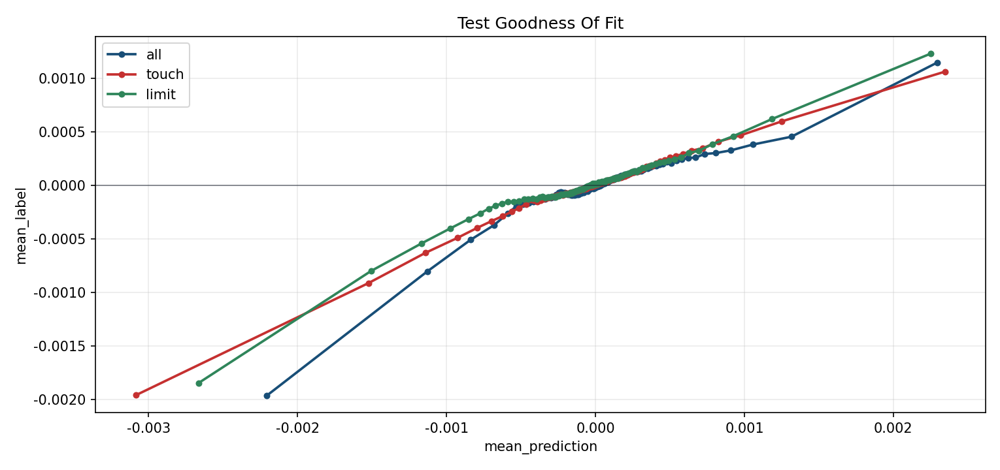

test split mean_prediction vs mean_label.

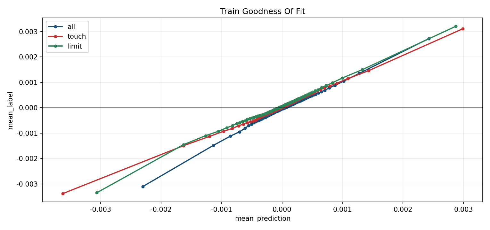

train split mean_prediction vs mean_label.

字段解释

| field | explanation |
| --- | --- |
| split | 数据 split.  |
| prediction_bin | 按 prediction 排序后的等频分箱编号.  |
| mean_prediction | 分组内 prediction 均值.  |
| mean_label | bin 内 label 均值.  |
| label_p05 | bin 内 label 5% 分位数.  |
| label_p95 | bin 内 label 95% 分位数.  |
| row_count | 分组样本数.  |

### 3.4. Top-k Robustness

### Top-k Robustness

| experiment | split | selection_method | k_pct | universe_count | selected_count | selected_fraction | prediction_threshold | mean_label_bps | median_label_bps | label_std_bps | hit_rate | day_count | timestamp_count |
| --- | --- | --- | --- | --- | --- | --- | --- | --- | --- | --- | --- | --- | --- |
| all | train | approx_quantile_threshold | 1 | 562,449,686 | 5,514,819 | 0.009805 | 0.001499 | 27.4694 | 17.6950 | 106.1671 | 0.564373 | 125 | 20,242 |
| all | train | approx_quantile_threshold | 2 | 562,449,686 | 11,080,694 | 0.019701 | 0.001127 | 20.4972 | 10.5172 | 91.0312 | 0.532522 | 125 | 20,243 |
| all | train | approx_quantile_threshold | 3 | 562,449,686 | 16,825,030 | 0.029914 | 9.393e-04 | 17.0979 | 6.5796 | 83.1659 | 0.515805 | 125 | 20,243 |
| all | train | approx_quantile_threshold | 5 | 562,449,686 | 28,138,800 | 0.050029 | 7.390e-04 | 13.5671 | 1.3901 | 74.2022 | 0.497335 | 125 | 20,243 |
| all | train | approx_quantile_threshold | 10 | 562,449,686 | 56,112,718 | 0.099765 | 5.037e-04 | 9.7410 | 0.008097 | 63.6679 | 0.474607 | 125 | 20,243 |
| all | train | approx_quantile_threshold | 15 | 562,449,686 | 84,308,138 | 0.149895 | 3.784e-04 | 7.8753 | 2.488e-04 | 58.2208 | 0.461457 | 125 | 20,243 |
| all | train | approx_quantile_threshold | 20 | 562,449,686 | 112,385,202 | 0.199814 | 2.971e-04 | 6.6807 | 0.000e+00 | 54.6266 | 0.451334 | 125 | 20,243 |
| all | test | approx_quantile_threshold | 1 | 176,945,440 | 1,726,674 | 0.009758 | 0.001542 | 11.6493 | 0.000e+00 | 93.3999 | 0.452912 | 100 | 16,100 |
| all | test | approx_quantile_threshold | 2 | 176,945,440 | 3,506,711 | 0.019818 | 0.001162 | 8.0617 | 0.000e+00 | 82.2565 | 0.437711 | 100 | 16,100 |
| all | test | approx_quantile_threshold | 3 | 176,945,440 | 5,305,205 | 0.029982 | 9.722e-04 | 6.6343 | 0.000e+00 | 76.3079 | 0.431680 | 100 | 16,100 |
| all | test | approx_quantile_threshold | 5 | 176,945,440 | 8,807,625 | 0.049776 | 7.683e-04 | 5.2506 | 0.000e+00 | 69.3459 | 0.425635 | 100 | 16,100 |
| all | test | approx_quantile_threshold | 10 | 176,945,440 | 17,693,456 | 0.099994 | 5.249e-04 | 3.9096 | 0.000e+00 | 60.3156 | 0.421372 | 100 | 16,100 |
| all | test | approx_quantile_threshold | 15 | 176,945,440 | 26,505,889 | 0.149797 | 3.964e-04 | 3.2825 | 0.000e+00 | 55.6289 | 0.419254 | 100 | 16,100 |
| all | test | approx_quantile_threshold | 20 | 176,945,440 | 35,319,548 | 0.199607 | 3.126e-04 | 2.8723 | 0.000e+00 | 52.4729 | 0.417039 | 100 | 16,100 |
| touch | train | approx_quantile_threshold | 1 | 552,649,621 | 5,475,850 | 0.009908 | 0.001742 | 31.2148 | 22.4382 | 117.2635 | 0.589632 | 127 | 27,848 |
| touch | train | approx_quantile_threshold | 2 | 552,649,621 | 10,973,053 | 0.019855 | 0.001220 | 22.9111 | 14.2767 | 103.3240 | 0.552188 | 127 | 27,934 |
| touch | train | approx_quantile_threshold | 3 | 552,649,621 | 16,544,473 | 0.029937 | 9.851e-04 | 19.0708 | 10.3853 | 95.4285 | 0.533888 | 127 | 27,939 |
| touch | train | approx_quantile_threshold | 5 | 552,649,621 | 27,470,707 | 0.049707 | 7.438e-04 | 15.1266 | 5.4992 | 86.1865 | 0.513582 | 127 | 27,940 |
| touch | train | approx_quantile_threshold | 10 | 552,649,621 | 55,039,150 | 0.099591 | 4.765e-04 | 10.8614 | 0.269065 | 73.9255 | 0.487581 | 127 | 27,940 |
| touch | train | approx_quantile_threshold | 15 | 552,649,621 | 82,653,735 | 0.149559 | 3.504e-04 | 8.8210 | 1.226e-04 | 67.0862 | 0.472167 | 127 | 27,940 |
| touch | train | approx_quantile_threshold | 20 | 552,649,621 | 110,493,230 | 0.199934 | 2.710e-04 | 7.5331 | 4.321e-05 | 62.5132 | 0.460905 | 127 | 27,940 |
| touch | test | approx_quantile_threshold | 1 | 173,181,678 | 1,721,133 | 0.009938 | 0.001485 | 10.6605 | 1.094e-04 | 100.5979 | 0.463939 | 100 | 21,985 |
| touch | test | approx_quantile_threshold | 2 | 173,181,678 | 3,426,380 | 0.019785 | 0.001086 | 8.3395 | 7.618e-07 | 88.5588 | 0.455056 | 100 | 22,000 |
| touch | test | approx_quantile_threshold | 3 | 173,181,678 | 5,164,223 | 0.029820 | 8.908e-04 | 7.1225 | 0.000e+00 | 81.7400 | 0.450695 | 100 | 22,000 |
| touch | test | approx_quantile_threshold | 5 | 173,181,678 | 8,668,667 | 0.050055 | 6.799e-04 | 5.7797 | 0.000e+00 | 73.7134 | 0.444306 | 100 | 22,000 |
| touch | test | approx_quantile_threshold | 10 | 173,181,678 | 17,302,749 | 0.099911 | 4.480e-04 | 4.2910 | 0.000e+00 | 63.8144 | 0.434504 | 100 | 22,000 |
| touch | test | approx_quantile_threshold | 15 | 173,181,678 | 25,979,186 | 0.150011 | 3.342e-04 | 3.5149 | 0.000e+00 | 58.4722 | 0.428560 | 100 | 22,000 |
| touch | test | approx_quantile_threshold | 20 | 173,181,678 | 34,621,035 | 0.199912 | 2.602e-04 | 2.9946 | 0.000e+00 | 55.0093 | 0.424123 | 100 | 22,000 |
| limit | train | approx_quantile_threshold | 1 | 550,765,767 | 5,419,993 | 0.009841 | 0.001637 | 32.3023 | 23.6417 | 115.2791 | 0.598331 | 127 | 27,924 |
| limit | train | approx_quantile_threshold | 2 | 550,765,767 | 10,942,201 | 0.019867 | 0.001121 | 23.6054 | 15.4608 | 101.1924 | 0.558216 | 127 | 27,940 |
| limit | train | approx_quantile_threshold | 3 | 550,765,767 | 16,400,393 | 0.029777 | 9.029e-04 | 19.6692 | 11.4261 | 93.3708 | 0.538662 | 127 | 27,940 |
| limit | train | approx_quantile_threshold | 5 | 550,765,767 | 27,568,970 | 0.050056 | 6.849e-04 | 15.4480 | 6.1345 | 83.6617 | 0.515811 | 127 | 27,940 |
| limit | train | approx_quantile_threshold | 10 | 550,765,767 | 55,002,261 | 0.099865 | 4.551e-04 | 11.0961 | 0.299014 | 71.9124 | 0.488133 | 127 | 27,940 |
| limit | train | approx_quantile_threshold | 15 | 550,765,767 | 82,589,136 | 0.149953 | 3.294e-04 | 8.9935 | 0.001608 | 65.7450 | 0.472440 | 127 | 27,940 |
| limit | train | approx_quantile_threshold | 20 | 550,765,767 | 110,205,791 | 0.200096 | 2.413e-04 | 7.6579 | 9.138e-07 | 61.6715 | 0.460767 | 127 | 27,940 |
| limit | test | approx_quantile_threshold | 1 | 172,431,790 | 1,711,904 | 0.009928 | 0.001415 | 12.3557 | 0.011276 | 98.4002 | 0.477941 | 100 | 22,000 |
| limit | test | approx_quantile_threshold | 2 | 172,431,790 | 3,392,452 | 0.019674 | 0.001030 | 9.3458 | 0.000e+00 | 86.8426 | 0.462883 | 100 | 22,000 |
| limit | test | approx_quantile_threshold | 3 | 172,431,790 | 5,146,028 | 0.029844 | 8.460e-04 | 7.7343 | 0.000e+00 | 80.0828 | 0.454280 | 100 | 22,000 |
| limit | test | approx_quantile_threshold | 5 | 172,431,790 | 8,582,496 | 0.049773 | 6.595e-04 | 6.0708 | 0.000e+00 | 72.2979 | 0.444085 | 100 | 22,000 |
| limit | test | approx_quantile_threshold | 10 | 172,431,790 | 17,217,019 | 0.099848 | 4.451e-04 | 4.3033 | 0.000e+00 | 62.9125 | 0.432382 | 100 | 22,000 |
| limit | test | approx_quantile_threshold | 15 | 172,431,790 | 25,854,153 | 0.149938 | 3.234e-04 | 3.5037 | 0.000e+00 | 58.1241 | 0.426722 | 100 | 22,000 |
| limit | test | approx_quantile_threshold | 20 | 172,431,790 | 34,464,923 | 0.199876 | 2.362e-04 | 2.9808 | 0.000e+00 | 55.0123 | 0.422263 | 100 | 22,000 |

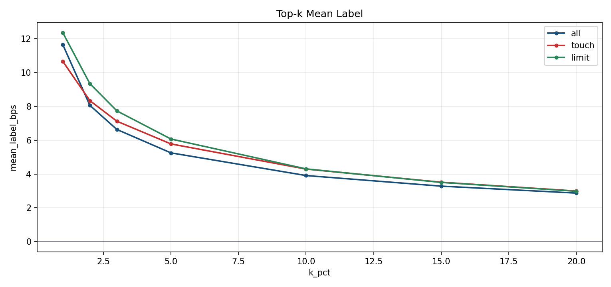

test split k_pct vs mean_label_bps.

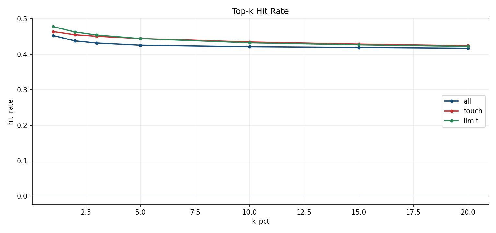

test split k_pct vs hit_rate.

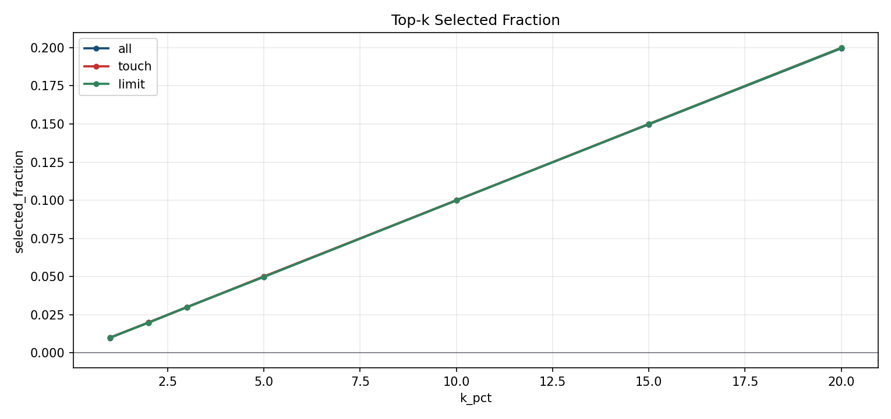

test split k_pct vs selected_fraction.

字段解释

| field | explanation |
| --- | --- |
| split | 数据 split.  |
| selection_method | Top-k 样本选择方法.  |
| k_pct | 选择 prediction 最高的百分比.  |
| universe_count | 可选样本总数.  |
| selected_count | 被选中样本数.  |
| selected_fraction | 实际选中比例.  |
| prediction_threshold | selection threshold.  |
| mean_label_bps | 分组内 target 均值, 单位 bps.  |
| median_label_bps | 选中样本 median label, 单位 bps.  |
| label_std_bps | 选中样本 label 标准差, 单位 bps.  |
| hit_rate | 分组内 target > 0 的比例.  |
| day_count | 覆盖交易日数量.  |
| timestamp_count | 覆盖时间戳数量.  |

### 4. Important Stock Pool And Liquidity

### 4.1. Important Stock Pool

### Important Stock Pool

| experiment | pool | display_name | etf_code | index_code | pearson_ic | rank_ic | mean_prediction_return | mean_real_return | real_return_positive_ratio | prediction_positive_ratio | count |
| --- | --- | --- | --- | --- | --- | --- | --- | --- | --- | --- | --- |
| all | csi1000_etf_sh | 1000 ETF | 512100.SH | 000852.SH | 0.032791 | 0.020373 | 6.127e-05 | 1.144e-05 | 0.395210 | 0.571059 | 33,006,836 |
| all | csi300_etf_sh | 沪深300 ETF(沪) | 510300.SH | 000300.SH | 0.025507 | 0.015645 | 5.651e-05 | 2.275e-05 | 0.413862 | 0.585574 | 9,902,626 |
| all | csi500_etf_sh | 中证500 ETF(沪) | 510500.SH | 000905.SH | 0.026002 | 0.017748 | 6.257e-05 | -1.420e-06 | 0.391603 | 0.582501 | 16,503,970 |
| touch | csi1000_etf_sh | 1000 ETF | 512100.SH | 000852.SH | 0.040599 | 0.021703 | 3.713e-06 | -7.316e-06 | 0.398781 | 0.506885 | 32,616,481 |
| touch | csi300_etf_sh | 沪深300 ETF(沪) | 510300.SH | 000300.SH | 0.030160 | 0.018760 | 3.339e-05 | 1.773e-05 | 0.415971 | 0.541275 | 9,834,324 |
| touch | csi500_etf_sh | 中证500 ETF(沪) | 510500.SH | 000905.SH | 0.029024 | 0.018460 | 2.109e-05 | -1.340e-05 | 0.394017 | 0.525644 | 16,371,808 |
| limit | csi1000_etf_sh | 1000 ETF | 512100.SH | 000852.SH | 0.036037 | 0.022571 | -6.307e-05 | -7.031e-06 | 0.398877 | 0.416068 | 32,530,293 |
| limit | csi300_etf_sh | 沪深300 ETF(沪) | 510300.SH | 000300.SH | 0.028447 | 0.019771 | -1.132e-04 | 1.612e-05 | 0.415830 | 0.354227 | 9,818,660 |
| limit | csi500_etf_sh | 中证500 ETF(沪) | 510500.SH | 000905.SH | 0.026838 | 0.018272 | -7.586e-05 | -1.433e-05 | 0.393948 | 0.393895 | 16,344,996 |

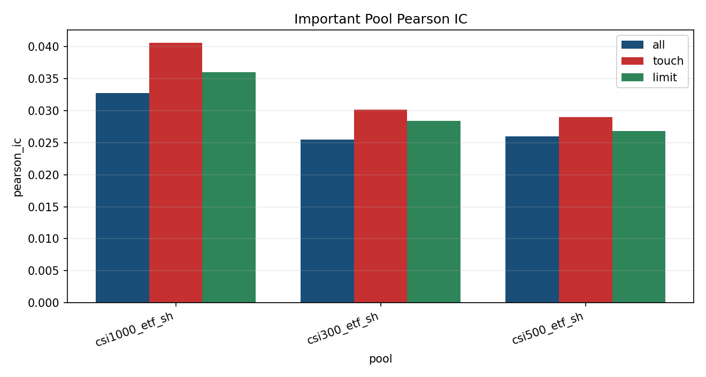

pool-level pearson_ic.

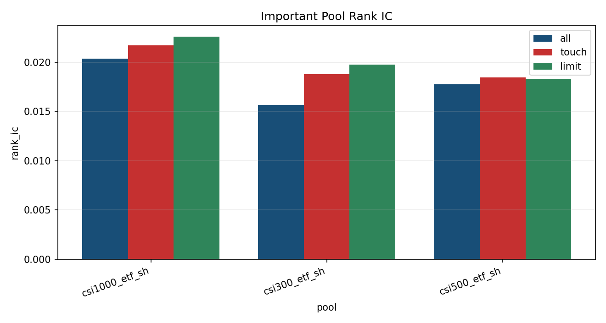

pool-level rank_ic.

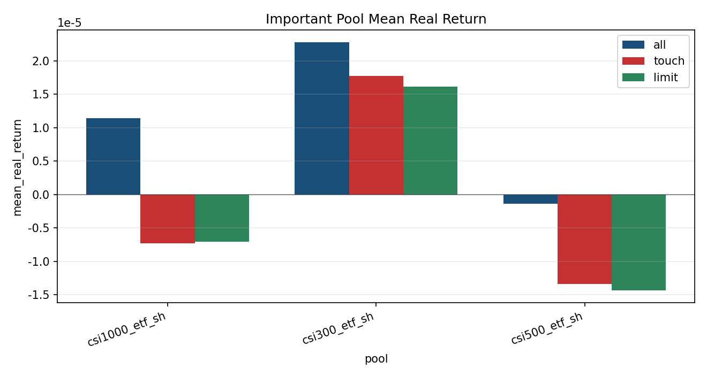

pool-level mean_real_return.

字段解释

| field | explanation |
| --- | --- |
| pool | important stock pool 标识.  |
| display_name | pool 展示名称.  |
| etf_code | pool 对应 ETF code.  |
| index_code | pool 对应指数 code.  |
| pearson_ic | corr(prediction, target).  |
| rank_ic | corr(rank(prediction), rank(target)).  |
| mean_prediction_return | prediction 的样本均值.  |
| mean_real_return | target 的样本均值.  |
| real_return_positive_ratio | target > 0 的样本比例.  |
| prediction_positive_ratio | prediction > 0 的样本比例.  |
| count | 样本数.  |

### 4.2. Important Pool Prediction Curve

Important Pool Prediction Curve

| experiment | pool | prediction_bin | mean_prediction_return | mean_real_return | real_return_positive_ratio | count |
| --- | --- | --- | --- | --- | --- | --- |
| all | csi1000_etf_sh | 1 | -7.527e-04 | -2.534e-04 | 0.401466 | 1,650,342 |
| all | csi1000_etf_sh | 2 | -3.713e-04 | -8.323e-05 | 0.401228 | 1,650,342 |
| all | csi1000_etf_sh | 3 | -2.657e-04 | -5.842e-05 | 0.394573 | 1,650,342 |
| all | csi1000_etf_sh | 4 | -2.012e-04 | -5.618e-05 | 0.388273 | 1,650,342 |
| all | csi1000_etf_sh | 5 | -1.515e-04 | -9.475e-05 | 0.377042 | 1,650,342 |
| all | csi1000_etf_sh | 6 | -1.077e-04 | -8.076e-05 | 0.376724 | 1,650,342 |
| all | csi1000_etf_sh | 7 | -6.754e-05 | -5.612e-05 | 0.377462 | 1,650,342 |
| all | csi1000_etf_sh | 8 | -3.323e-05 | -3.770e-05 | 0.377003 | 1,650,342 |
| all | csi1000_etf_sh | 9 | -2.380e-06 | -2.765e-05 | 0.374704 | 1,650,342 |
| all | csi1000_etf_sh | 10 | 2.888e-05 | -3.055e-06 | 0.382293 | 1,650,342 |
| all | csi1000_etf_sh | 11 | 6.197e-05 | 2.452e-05 | 0.389840 | 1,650,342 |
| all | csi1000_etf_sh | 12 | 9.605e-05 | 5.133e-05 | 0.395376 | 1,650,342 |
| all | csi1000_etf_sh | 13 | 1.312e-04 | 6.925e-05 | 0.399237 | 1,650,342 |
| all | csi1000_etf_sh | 14 | 1.683e-04 | 8.767e-05 | 0.403962 | 1,650,342 |
| all | csi1000_etf_sh | 15 | 2.093e-04 | 9.854e-05 | 0.405489 | 1,650,342 |
| all | csi1000_etf_sh | 16 | 2.571e-04 | 1.078e-04 | 0.408526 | 1,650,342 |
| all | csi1000_etf_sh | 17 | 3.170e-04 | 1.167e-04 | 0.412001 | 1,650,341 |
| all | csi1000_etf_sh | 18 | 4.005e-04 | 1.359e-04 | 0.415090 | 1,650,341 |
| all | csi1000_etf_sh | 19 | 5.378e-04 | 1.387e-04 | 0.414740 | 1,650,341 |
| all | csi1000_etf_sh | 20 | 9.706e-04 | 1.496e-04 | 0.409161 | 1,650,341 |
| all | csi300_etf_sh | 1 | -6.260e-04 | -1.580e-04 | 0.416780 | 495,132 |
| all | csi300_etf_sh | 2 | -3.415e-04 | -5.852e-05 | 0.413496 | 495,132 |
| all | csi300_etf_sh | 3 | -2.474e-04 | -2.472e-05 | 0.409553 | 495,132 |
| all | csi300_etf_sh | 4 | -1.913e-04 | -1.767e-05 | 0.406090 | 495,132 |
| all | csi300_etf_sh | 5 | -1.432e-04 | -2.457e-05 | 0.404951 | 495,132 |
| all | csi300_etf_sh | 6 | -9.795e-05 | -1.184e-05 | 0.405403 | 495,132 |
| all | csi300_etf_sh | 7 | -5.819e-05 | -1.802e-06 | 0.402829 | 495,131 |
| all | csi300_etf_sh | 8 | -2.455e-05 | 1.498e-05 | 0.403671 | 495,131 |
| all | csi300_etf_sh | 9 | 6.551e-06 | 1.763e-05 | 0.406604 | 495,131 |
| all | csi300_etf_sh | 10 | 3.786e-05 | 1.405e-05 | 0.406783 | 495,131 |
| all | csi300_etf_sh | 11 | 6.947e-05 | 3.401e-05 | 0.409063 | 495,131 |
| all | csi300_etf_sh | 12 | 1.011e-04 | 4.233e-05 | 0.409158 | 495,131 |
| all | csi300_etf_sh | 13 | 1.331e-04 | 5.126e-05 | 0.411683 | 495,131 |
| all | csi300_etf_sh | 14 | 1.663e-04 | 5.018e-05 | 0.413998 | 495,131 |
| all | csi300_etf_sh | 15 | 2.021e-04 | 5.194e-05 | 0.416876 | 495,131 |
| all | csi300_etf_sh | 16 | 2.427e-04 | 6.467e-05 | 0.420618 | 495,131 |
| all | csi300_etf_sh | 17 | 2.920e-04 | 6.312e-05 | 0.424134 | 495,131 |
| all | csi300_etf_sh | 18 | 3.585e-04 | 8.154e-05 | 0.429240 | 495,131 |
| all | csi300_etf_sh | 19 | 4.671e-04 | 1.217e-04 | 0.434723 | 495,131 |
| all | csi300_etf_sh | 20 | 7.835e-04 | 1.447e-04 | 0.431593 | 495,131 |
| all | csi500_etf_sh | 1 | -6.484e-04 | -1.798e-04 | 0.405850 | 825,199 |
| all | csi500_etf_sh | 2 | -3.424e-04 | -7.569e-05 | 0.398810 | 825,199 |
| all | csi500_etf_sh | 3 | -2.459e-04 | -4.851e-05 | 0.391195 | 825,199 |
| all | csi500_etf_sh | 4 | -1.880e-04 | -6.015e-05 | 0.381325 | 825,199 |
| all | csi500_etf_sh | 5 | -1.408e-04 | -8.318e-05 | 0.372121 | 825,199 |
| all | csi500_etf_sh | 6 | -9.734e-05 | -6.585e-05 | 0.373667 | 825,199 |
| all | csi500_etf_sh | 7 | -5.841e-05 | -5.672e-05 | 0.373740 | 825,199 |
| all | csi500_etf_sh | 8 | -2.583e-05 | -4.094e-05 | 0.374528 | 825,199 |
| all | csi500_etf_sh | 9 | 4.625e-06 | -4.121e-05 | 0.374824 | 825,199 |
| all | csi500_etf_sh | 10 | 3.610e-05 | -1.532e-05 | 0.381596 | 825,199 |
| all | csi500_etf_sh | 11 | 6.857e-05 | 1.437e-08 | 0.385745 | 825,198 |
| all | csi500_etf_sh | 12 | 1.011e-04 | 2.250e-05 | 0.388455 | 825,198 |
| all | csi500_etf_sh | 13 | 1.342e-04 | 2.415e-05 | 0.391771 | 825,198 |
| all | csi500_etf_sh | 14 | 1.687e-04 | 5.362e-05 | 0.396545 | 825,198 |
| all | csi500_etf_sh | 15 | 2.062e-04 | 6.165e-05 | 0.400023 | 825,198 |
| all | csi500_etf_sh | 16 | 2.493e-04 | 7.338e-05 | 0.403931 | 825,198 |
| all | csi500_etf_sh | 17 | 3.027e-04 | 7.975e-05 | 0.407892 | 825,198 |
| all | csi500_etf_sh | 18 | 3.764e-04 | 9.542e-05 | 0.411731 | 825,198 |
| all | csi500_etf_sh | 19 | 4.971e-04 | 1.040e-04 | 0.412144 | 825,198 |
| all | csi500_etf_sh | 20 | 8.536e-04 | 1.245e-04 | 0.406174 | 825,198 |
| touch | csi1000_etf_sh | 1 | -0.001088 | -3.926e-04 | 0.394774 | 1,630,825 |
| touch | csi1000_etf_sh | 2 | -4.510e-04 | -9.516e-05 | 0.398292 | 1,630,824 |
| touch | csi1000_etf_sh | 3 | -3.338e-04 | -8.256e-05 | 0.390391 | 1,630,824 |
| touch | csi1000_etf_sh | 4 | -2.605e-04 | -7.224e-05 | 0.388608 | 1,630,824 |
| touch | csi1000_etf_sh | 5 | -2.055e-04 | -7.528e-05 | 0.386734 | 1,630,824 |
| touch | csi1000_etf_sh | 6 | -1.597e-04 | -6.382e-05 | 0.387567 | 1,630,824 |
| touch | csi1000_etf_sh | 7 | -1.192e-04 | -5.843e-05 | 0.387564 | 1,630,824 |
| touch | csi1000_etf_sh | 8 | -8.200e-05 | -4.200e-05 | 0.386893 | 1,630,824 |
| touch | csi1000_etf_sh | 9 | -4.671e-05 | -3.117e-05 | 0.391606 | 1,630,824 |
| touch | csi1000_etf_sh | 10 | -1.236e-05 | -1.951e-05 | 0.392092 | 1,630,824 |
| touch | csi1000_etf_sh | 11 | 2.176e-05 | 1.302e-06 | 0.394425 | 1,630,824 |
| touch | csi1000_etf_sh | 12 | 5.639e-05 | 1.255e-05 | 0.396912 | 1,630,824 |
| touch | csi1000_etf_sh | 13 | 9.233e-05 | 1.749e-05 | 0.397652 | 1,630,824 |
| touch | csi1000_etf_sh | 14 | 1.305e-04 | 3.066e-05 | 0.399879 | 1,630,824 |
| touch | csi1000_etf_sh | 15 | 1.723e-04 | 4.180e-05 | 0.402262 | 1,630,824 |
| touch | csi1000_etf_sh | 16 | 2.198e-04 | 6.700e-05 | 0.405626 | 1,630,824 |
| touch | csi1000_etf_sh | 17 | 2.773e-04 | 9.034e-05 | 0.409176 | 1,630,824 |
| touch | csi1000_etf_sh | 18 | 3.558e-04 | 1.138e-04 | 0.412951 | 1,630,824 |
| touch | csi1000_etf_sh | 19 | 4.886e-04 | 1.446e-04 | 0.418324 | 1,630,824 |
| touch | csi1000_etf_sh | 20 | 0.001018 | 2.669e-04 | 0.433890 | 1,630,824 |
| touch | csi300_etf_sh | 1 | -7.317e-04 | -2.282e-04 | 0.414529 | 491,717 |
| touch | csi300_etf_sh | 2 | -3.427e-04 | -5.869e-05 | 0.412550 | 491,717 |
| touch | csi300_etf_sh | 3 | -2.561e-04 | -2.739e-05 | 0.409628 | 491,717 |
| touch | csi300_etf_sh | 4 | -1.992e-04 | -2.446e-05 | 0.407533 | 491,717 |
| touch | csi300_etf_sh | 5 | -1.545e-04 | -1.752e-05 | 0.405712 | 491,716 |
| touch | csi300_etf_sh | 6 | -1.164e-04 | -9.593e-06 | 0.405903 | 491,716 |
| touch | csi300_etf_sh | 7 | -8.219e-05 | -1.243e-05 | 0.404311 | 491,716 |
| touch | csi300_etf_sh | 8 | -5.043e-05 | 7.276e-07 | 0.405106 | 491,716 |
| touch | csi300_etf_sh | 9 | -2.010e-05 | 7.067e-06 | 0.405029 | 491,716 |
| touch | csi300_etf_sh | 10 | 9.542e-06 | 1.937e-05 | 0.410300 | 491,716 |
| touch | csi300_etf_sh | 11 | 3.896e-05 | 1.630e-05 | 0.409726 | 491,716 |
| touch | csi300_etf_sh | 12 | 6.911e-05 | 2.402e-05 | 0.412750 | 491,716 |
| touch | csi300_etf_sh | 13 | 1.005e-04 | 2.826e-05 | 0.413716 | 491,716 |
| touch | csi300_etf_sh | 14 | 1.338e-04 | 3.316e-05 | 0.414461 | 491,716 |
| touch | csi300_etf_sh | 15 | 1.700e-04 | 3.438e-05 | 0.416769 | 491,716 |
| touch | csi300_etf_sh | 16 | 2.105e-04 | 4.072e-05 | 0.418878 | 491,716 |
| touch | csi300_etf_sh | 17 | 2.589e-04 | 6.478e-05 | 0.425658 | 491,716 |
| touch | csi300_etf_sh | 18 | 3.248e-04 | 7.779e-05 | 0.429417 | 491,716 |
| touch | csi300_etf_sh | 19 | 4.408e-04 | 1.368e-04 | 0.439740 | 491,716 |
| touch | csi300_etf_sh | 20 | 8.640e-04 | 2.495e-04 | 0.457711 | 491,716 |
| touch | csi500_etf_sh | 1 | -8.533e-04 | -2.570e-04 | 0.400182 | 818,591 |
| touch | csi500_etf_sh | 2 | -3.836e-04 | -8.521e-05 | 0.390340 | 818,591 |
| touch | csi500_etf_sh | 3 | -2.854e-04 | -7.854e-05 | 0.382596 | 818,591 |
| touch | csi500_etf_sh | 4 | -2.230e-04 | -7.462e-05 | 0.382136 | 818,591 |
| touch | csi500_etf_sh | 5 | -1.749e-04 | -6.266e-05 | 0.383358 | 818,591 |
| touch | csi500_etf_sh | 6 | -1.340e-04 | -6.486e-05 | 0.382747 | 818,591 |
| touch | csi500_etf_sh | 7 | -9.748e-05 | -5.138e-05 | 0.382725 | 818,591 |
| touch | csi500_etf_sh | 8 | -6.360e-05 | -4.367e-05 | 0.384222 | 818,591 |
| touch | csi500_etf_sh | 9 | -3.118e-05 | -2.610e-05 | 0.386865 | 818,590 |
| touch | csi500_etf_sh | 10 | 3.951e-07 | -2.714e-05 | 0.387354 | 818,590 |
| touch | csi500_etf_sh | 11 | 3.187e-05 | -1.555e-05 | 0.388679 | 818,590 |
| touch | csi500_etf_sh | 12 | 6.387e-05 | -1.384e-05 | 0.387376 | 818,590 |
| touch | csi500_etf_sh | 13 | 9.728e-05 | 6.555e-06 | 0.392836 | 818,590 |
| touch | csi500_etf_sh | 14 | 1.328e-04 | 7.123e-06 | 0.392686 | 818,590 |
| touch | csi500_etf_sh | 15 | 1.717e-04 | 3.216e-05 | 0.396774 | 818,590 |
| touch | csi500_etf_sh | 16 | 2.154e-04 | 4.646e-05 | 0.400586 | 818,590 |
| touch | csi500_etf_sh | 17 | 2.680e-04 | 6.859e-05 | 0.405337 | 818,590 |
| touch | csi500_etf_sh | 18 | 3.387e-04 | 8.660e-05 | 0.408755 | 818,590 |
| touch | csi500_etf_sh | 19 | 4.576e-04 | 1.221e-04 | 0.416357 | 818,590 |
| touch | csi500_etf_sh | 20 | 8.907e-04 | 1.631e-04 | 0.428420 | 818,590 |
| limit | csi1000_etf_sh | 1 | -0.001157 | -3.175e-04 | 0.405814 | 1,626,515 |
| limit | csi1000_etf_sh | 2 | -6.041e-04 | -8.730e-05 | 0.412304 | 1,626,515 |
| limit | csi1000_etf_sh | 3 | -4.350e-04 | -7.959e-05 | 0.404513 | 1,626,515 |
| limit | csi1000_etf_sh | 4 | -3.341e-04 | -8.034e-05 | 0.397565 | 1,626,515 |
| limit | csi1000_etf_sh | 5 | -2.713e-04 | -8.080e-05 | 0.390784 | 1,626,515 |
| limit | csi1000_etf_sh | 6 | -2.221e-04 | -7.347e-05 | 0.389318 | 1,626,515 |
| limit | csi1000_etf_sh | 7 | -1.790e-04 | -6.461e-05 | 0.387705 | 1,626,515 |
| limit | csi1000_etf_sh | 8 | -1.411e-04 | -5.070e-05 | 0.386419 | 1,626,515 |
| limit | csi1000_etf_sh | 9 | -1.061e-04 | -3.437e-05 | 0.388691 | 1,626,515 |
| limit | csi1000_etf_sh | 10 | -7.247e-05 | -1.949e-05 | 0.386704 | 1,626,515 |
| limit | csi1000_etf_sh | 11 | -3.958e-05 | 3.948e-06 | 0.389132 | 1,626,515 |
| limit | csi1000_etf_sh | 12 | -6.070e-06 | 1.345e-05 | 0.391576 | 1,626,515 |
| limit | csi1000_etf_sh | 13 | 2.915e-05 | 3.213e-05 | 0.393861 | 1,626,515 |
| limit | csi1000_etf_sh | 14 | 6.729e-05 | 3.420e-05 | 0.394086 | 1,626,514 |
| limit | csi1000_etf_sh | 15 | 1.106e-04 | 4.129e-05 | 0.396546 | 1,626,514 |
| limit | csi1000_etf_sh | 16 | 1.625e-04 | 5.090e-05 | 0.399047 | 1,626,514 |
| limit | csi1000_etf_sh | 17 | 2.290e-04 | 8.105e-05 | 0.405831 | 1,626,514 |
| limit | csi1000_etf_sh | 18 | 3.198e-04 | 1.040e-04 | 0.412655 | 1,626,514 |
| limit | csi1000_etf_sh | 19 | 4.559e-04 | 1.283e-04 | 0.415559 | 1,626,514 |
| limit | csi1000_etf_sh | 20 | 9.320e-04 | 2.583e-04 | 0.429435 | 1,626,514 |
| limit | csi300_etf_sh | 1 | -0.001073 | -2.021e-04 | 0.423121 | 490,933 |
| limit | csi300_etf_sh | 2 | -6.416e-04 | -6.262e-05 | 0.429694 | 490,933 |
| limit | csi300_etf_sh | 3 | -4.923e-04 | -1.395e-05 | 0.428559 | 490,933 |
| limit | csi300_etf_sh | 4 | -3.851e-04 | -1.400e-05 | 0.421785 | 490,933 |
| limit | csi300_etf_sh | 5 | -3.146e-04 | -9.131e-06 | 0.413523 | 490,933 |
| limit | csi300_etf_sh | 6 | -2.628e-04 | -1.905e-05 | 0.405120 | 490,933 |
| limit | csi300_etf_sh | 7 | -2.197e-04 | -1.148e-05 | 0.403947 | 490,933 |
| limit | csi300_etf_sh | 8 | -1.807e-04 | -1.068e-05 | 0.399602 | 490,933 |
| limit | csi300_etf_sh | 9 | -1.458e-04 | -6.714e-06 | 0.399376 | 490,933 |
| limit | csi300_etf_sh | 10 | -1.131e-04 | 9.493e-06 | 0.401440 | 490,933 |
| limit | csi300_etf_sh | 11 | -8.078e-05 | 8.695e-06 | 0.401845 | 490,933 |
| limit | csi300_etf_sh | 12 | -4.833e-05 | 1.175e-05 | 0.403526 | 490,933 |
| limit | csi300_etf_sh | 13 | -1.461e-05 | 2.759e-05 | 0.409147 | 490,933 |
| limit | csi300_etf_sh | 14 | 2.188e-05 | 3.657e-05 | 0.411720 | 490,933 |
| limit | csi300_etf_sh | 15 | 6.294e-05 | 3.727e-05 | 0.413012 | 490,933 |
| limit | csi300_etf_sh | 16 | 1.111e-04 | 6.074e-05 | 0.417173 | 490,933 |
| limit | csi300_etf_sh | 17 | 1.706e-04 | 5.614e-05 | 0.421502 | 490,933 |
| limit | csi300_etf_sh | 18 | 2.494e-04 | 8.011e-05 | 0.426594 | 490,933 |
| limit | csi300_etf_sh | 19 | 3.673e-04 | 1.209e-04 | 0.434389 | 490,933 |
| limit | csi300_etf_sh | 20 | 7.260e-04 | 2.229e-04 | 0.451528 | 490,933 |
| limit | csi500_etf_sh | 1 | -0.001045 | -2.192e-04 | 0.413366 | 817,250 |
| limit | csi500_etf_sh | 2 | -5.855e-04 | -5.611e-05 | 0.415315 | 817,250 |
| limit | csi500_etf_sh | 3 | -4.255e-04 | -6.210e-05 | 0.406368 | 817,250 |
| limit | csi500_etf_sh | 4 | -3.305e-04 | -7.043e-05 | 0.395566 | 817,250 |
| limit | csi500_etf_sh | 5 | -2.710e-04 | -6.530e-05 | 0.386455 | 817,250 |
| limit | csi500_etf_sh | 6 | -2.245e-04 | -6.796e-05 | 0.383978 | 817,250 |
| limit | csi500_etf_sh | 7 | -1.836e-04 | -6.399e-05 | 0.381993 | 817,250 |
| limit | csi500_etf_sh | 8 | -1.477e-04 | -4.930e-05 | 0.380975 | 817,250 |
| limit | csi500_etf_sh | 9 | -1.147e-04 | -4.539e-05 | 0.379990 | 817,250 |
| limit | csi500_etf_sh | 10 | -8.307e-05 | -2.567e-05 | 0.382052 | 817,250 |
| limit | csi500_etf_sh | 11 | -5.189e-05 | -1.686e-05 | 0.381434 | 817,250 |
| limit | csi500_etf_sh | 12 | -2.027e-05 | -3.244e-06 | 0.382626 | 817,250 |
| limit | csi500_etf_sh | 13 | 1.288e-05 | 3.052e-06 | 0.384606 | 817,250 |
| limit | csi500_etf_sh | 14 | 4.888e-05 | 5.777e-06 | 0.386102 | 817,250 |
| limit | csi500_etf_sh | 15 | 8.953e-05 | 1.880e-05 | 0.388641 | 817,250 |
| limit | csi500_etf_sh | 16 | 1.377e-04 | 3.443e-05 | 0.392655 | 817,250 |
| limit | csi500_etf_sh | 17 | 1.986e-04 | 3.929e-05 | 0.397251 | 817,249 |
| limit | csi500_etf_sh | 18 | 2.815e-04 | 8.383e-05 | 0.406948 | 817,249 |
| limit | csi500_etf_sh | 19 | 4.053e-04 | 9.743e-05 | 0.411517 | 817,249 |
| limit | csi500_etf_sh | 20 | 7.912e-04 | 1.764e-04 | 0.421114 | 817,249 |

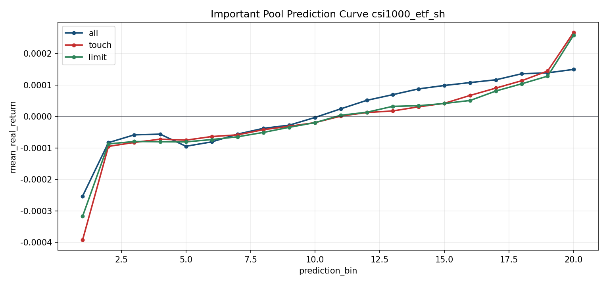

csi1000_etf_sh: prediction_bin vs mean_real_return.

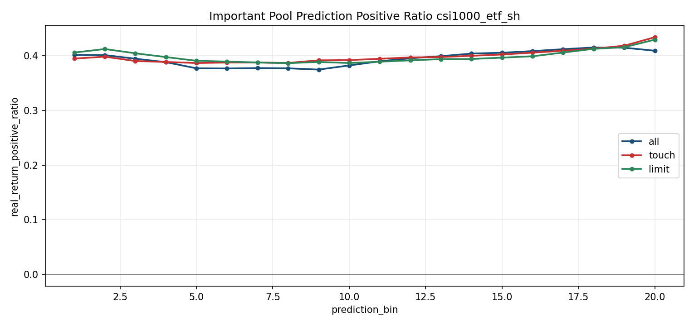

csi1000_etf_sh: prediction_bin vs real_return_positive_ratio.

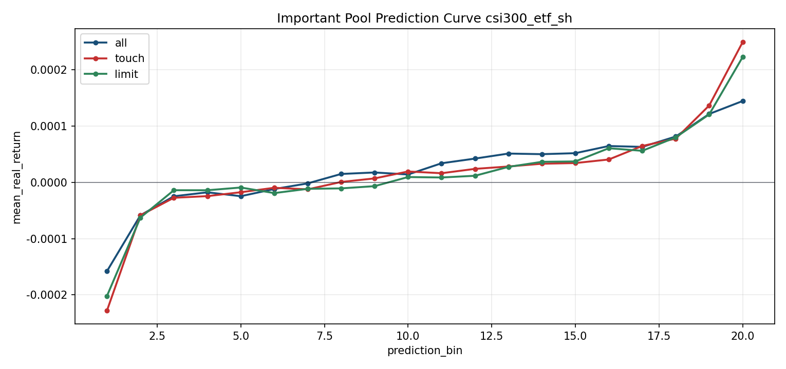

csi300_etf_sh: prediction_bin vs mean_real_return.

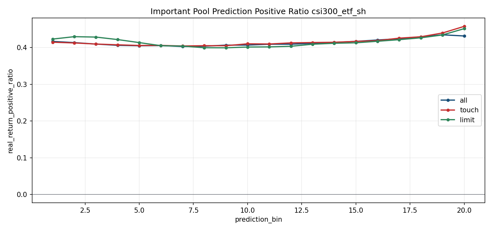

csi300_etf_sh: prediction_bin vs real_return_positive_ratio.

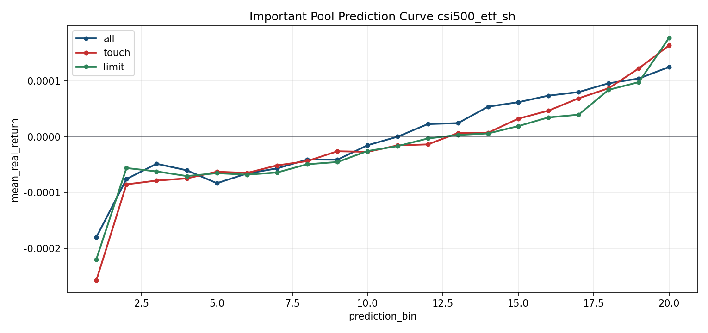

csi500_etf_sh: prediction_bin vs mean_real_return.

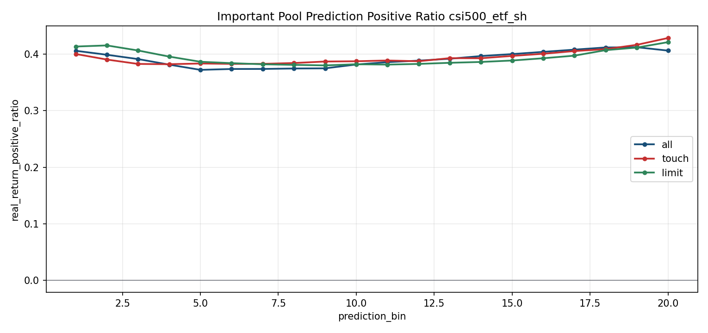

csi500_etf_sh: prediction_bin vs real_return_positive_ratio.

字段解释

| field | explanation |
| --- | --- |
| pool | important stock pool 标识.  |
| prediction_bin | 按 prediction 排序后的等频分箱编号.  |
| mean_prediction_return | prediction 的样本均值.  |
| mean_real_return | target 的样本均值.  |
| real_return_positive_ratio | target > 0 的样本比例.  |
| count | 样本数.  |

### 4.3. Liquidity By ADV

### Liquidity By ADV

| experiment | adv_bucket | bucket_label | row_count | day_count | mean_adv_amount | median_adv_amount | mean_ic | mean_rank_ic | icir | rank_icir | top5_return_bps | top5_hit_rate | top5_row_count |
| --- | --- | --- | --- | --- | --- | --- | --- | --- | --- | --- | --- | --- | --- |
| all | 1 | Bottom20% | 33,213,495 | 100 | 22,436 | 23,206 | 0.095650 | 0.067021 | 3.3948 | 4.0082 | 7.4367 | 0.413504 | 1,667,316 |
| all | 2 | 20~40% | 33,714,849 | 100 | 46,291 | 45,971 | 0.052107 | 0.034156 | 2.9280 | 2.1800 | 3.4576 | 0.402213 | 1,693,237 |
| all | 3 | 40~60% | 33,822,880 | 100 | 78,908 | 77,696 | 0.057151 | 0.033136 | 2.8976 | 1.8549 | 3.7728 | 0.417579 | 1,698,228 |
| all | 4 | 60~80% | 33,743,507 | 100 | 145,624 | 141,033 | 0.068894 | 0.037424 | 3.7384 | 2.0647 | 4.5517 | 0.433365 | 1,694,364 |
| all | 5 | Top20% | 33,697,783 | 100 | 553,370 | 359,597 | 0.076360 | 0.045474 | 3.0234 | 2.1179 | 4.8492 | 0.454273 | 1,692,110 |
| touch | 1 | Bottom20% | 32,293,658 | 100 | 22,595 | 23,373 | 0.079873 | 0.057254 | 4.1978 | 4.5507 | 5.7229 | 0.419356 | 1,625,149 |
| touch | 2 | 20~40% | 32,990,103 | 100 | 46,491 | 46,182 | 0.048366 | 0.032193 | 2.7910 | 2.6542 | 2.9683 | 0.410516 | 1,659,846 |
| touch | 3 | 40~60% | 33,130,370 | 100 | 79,259 | 78,042 | 0.055311 | 0.033903 | 3.2558 | 2.5584 | 3.5209 | 0.424286 | 1,666,972 |
| touch | 4 | 60~80% | 33,051,172 | 100 | 146,312 | 141,695 | 0.065959 | 0.038034 | 3.6183 | 2.4431 | 4.6431 | 0.438785 | 1,663,018 |
| touch | 5 | Top20% | 33,014,021 | 100 | 555,387 | 361,144 | 0.075073 | 0.043571 | 3.2576 | 2.2773 | 5.4766 | 0.459051 | 1,661,136 |
| limit | 1 | Bottom20% | 32,131,541 | 100 | 22,611 | 23,388 | 0.079389 | 0.059938 | 4.1391 | 4.9066 | 5.8970 | 0.422187 | 1,617,039 |
| limit | 2 | 20~40% | 32,842,732 | 100 | 46,511 | 46,207 | 0.046148 | 0.034050 | 3.0949 | 2.8543 | 2.9773 | 0.404895 | 1,652,597 |
| limit | 3 | 40~60% | 32,984,712 | 100 | 79,293 | 78,080 | 0.052814 | 0.036504 | 3.0419 | 2.8032 | 3.3889 | 0.417521 | 1,659,725 |
| limit | 4 | 60~80% | 32,892,384 | 100 | 146,370 | 141,760 | 0.065258 | 0.041780 | 3.8192 | 2.8515 | 4.8919 | 0.436376 | 1,655,143 |
| limit | 5 | Top20% | 32,883,160 | 100 | 555,602 | 361,391 | 0.073112 | 0.048922 | 3.3807 | 2.6736 | 5.3389 | 0.458729 | 1,654,631 |

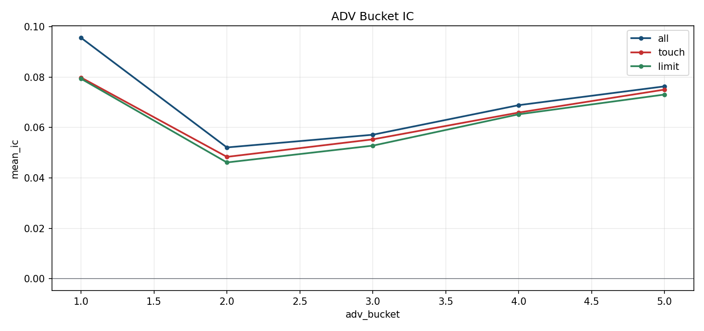

adv_bucket vs mean_ic.

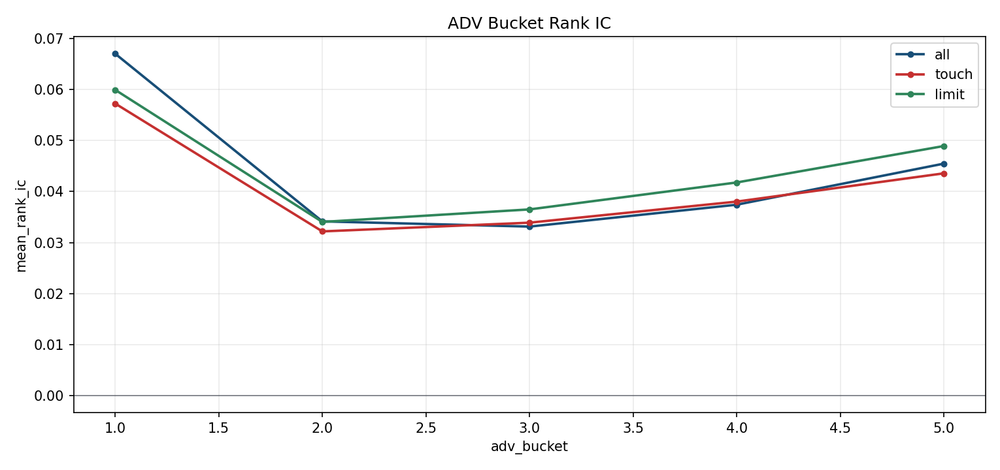

adv_bucket vs mean_rank_ic.

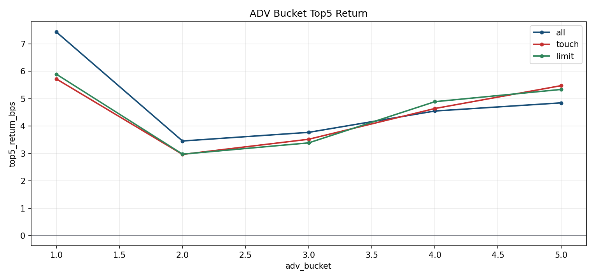

adv_bucket vs top5_return_bps.

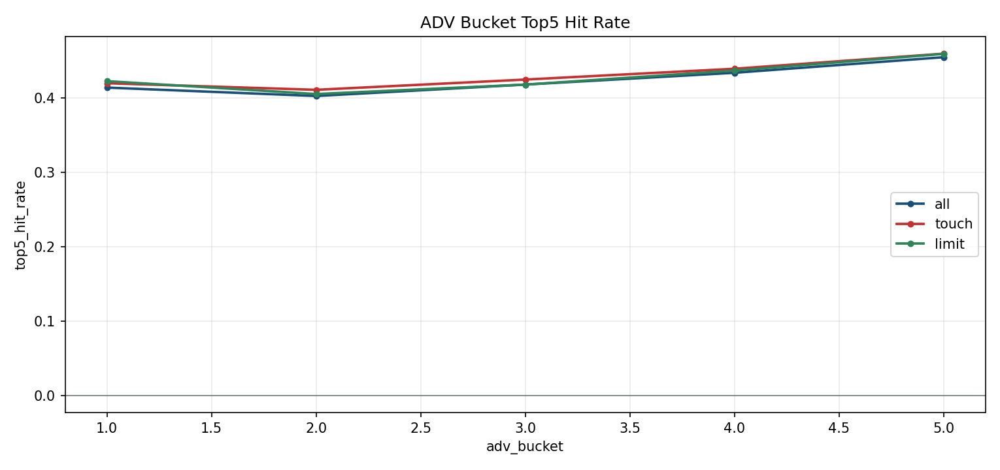

adv_bucket vs top5_hit_rate.

字段解释

| field | explanation |
| --- | --- |
| adv_bucket | shifted ADV bucket 编号.  |
| bucket_label | ADV bucket 展示名称.  |
| row_count | 分组样本数.  |
| day_count | 覆盖交易日数量.  |
| mean_adv_amount | bucket 内平均 ADV amount.  |
| median_adv_amount | bucket 内 median ADV amount.  |
| mean_ic | bucket 内 mean IC.  |
| mean_rank_ic | bucket 内 mean Rank IC.  |
| icir | bucket 内 ICIR.  |
| rank_icir | bucket 内 Rank ICIR.  |
| top5_return_bps | bucket 内 prediction top 5% return, 单位 bps.  |
| top5_hit_rate | bucket 内 prediction top 5% target > 0 比例.  |
| top5_row_count | bucket 内 top 5% 样本数.  |

### 5. Trading And Cost Proxy

### 5.1. Strategy And Benchmark Summary

### Strategy And Benchmark Summary

| experiment | pool | strategy_return_bps | benchmark_return_bps | excess_return_bps | expected_return_bps | position_rate | open_count | open_per_day |
| --- | --- | --- | --- | --- | --- | --- | --- | --- |
| all | csi1000_etf_sh | -346.9907 | 1,627 | -1,698 | 842.0225 | 0.042857 | 105 | 1.0500 |
| all | csi300_etf_sh | -17.0044 | 4,342 | -3,039 | 826.1819 | 0.052174 | 146 | 1.4600 |
| all | csi500_etf_sh | -162.3923 | -326.8983 | 170.0654 | 797.5518 | 0.045342 | 120 | 1.2000 |
| touch | csi1000_etf_sh | 484.2717 | -4,247 | 8,223 | 1,183 | 0.048727 | 151 | 1.5100 |
| touch | csi300_etf_sh | 306.1486 | 2,576 | -1,805 | 1,266 | 0.053273 | 172 | 1.7200 |
| touch | csi500_etf_sh | 386.5206 | -3,902 | 7,032 | 1,141 | 0.049182 | 160 | 1.6000 |
| limit | csi1000_etf_sh | 398.3282 | -4,200 | 7,929 | 1,131 | 0.051000 | 158 | 1.5800 |
| limit | csi300_etf_sh | 502.9400 | 2,468 | -1,576 | 878.8249 | 0.050773 | 186 | 1.8600 |
| limit | csi500_etf_sh | 484.9742 | -4,035 | 7,578 | 993.8493 | 0.052364 | 173 | 1.7300 |

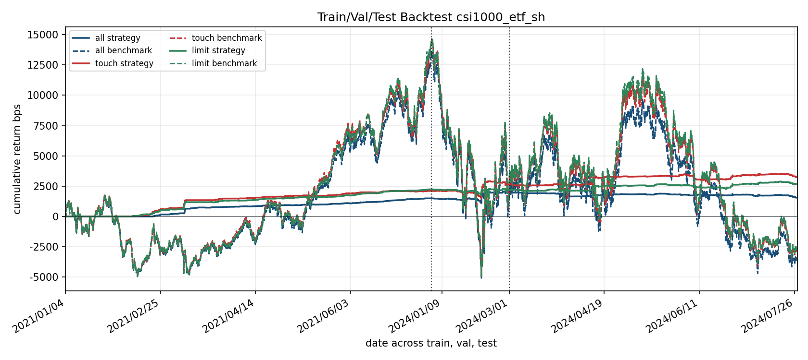

csi1000_etf_sh: strategy and benchmark cumulative returns across train, val, and test.

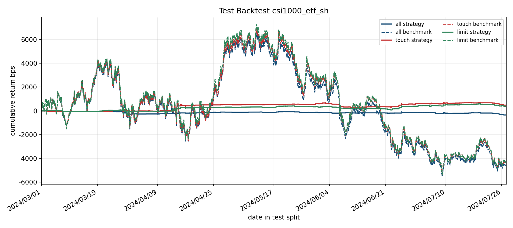

csi1000_etf_sh: strategy and benchmark cumulative returns on test split.

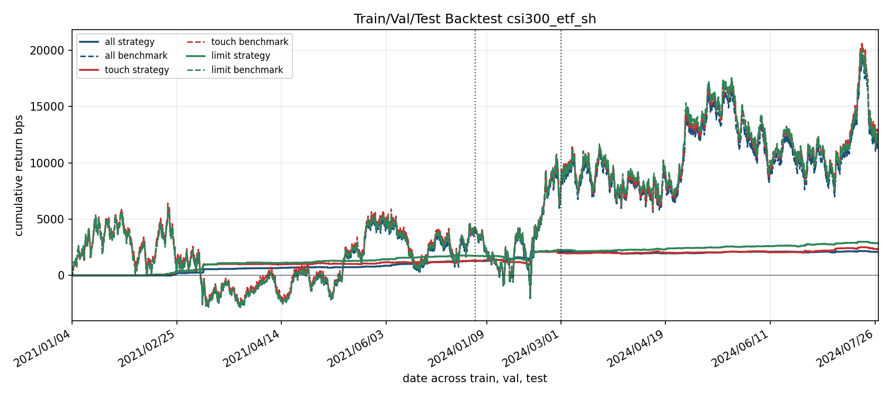

csi300_etf_sh: strategy and benchmark cumulative returns across train, val, and test.

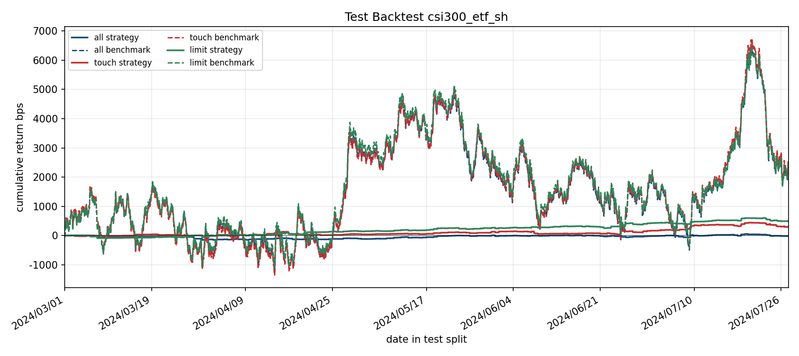

csi300_etf_sh: strategy and benchmark cumulative returns on test split.

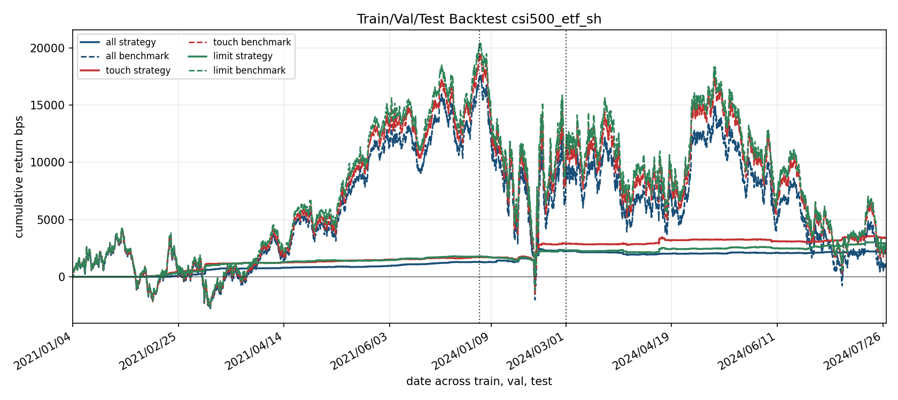

csi500_etf_sh: strategy and benchmark cumulative returns across train, val, and test.

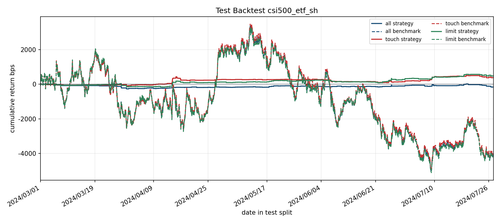

csi500_etf_sh: strategy and benchmark cumulative returns on test split.

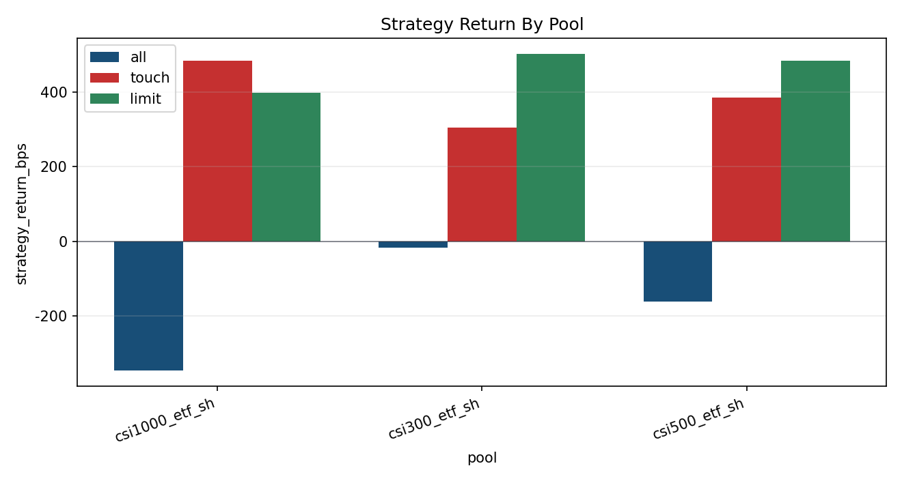

pool-level strategy_return_bps.

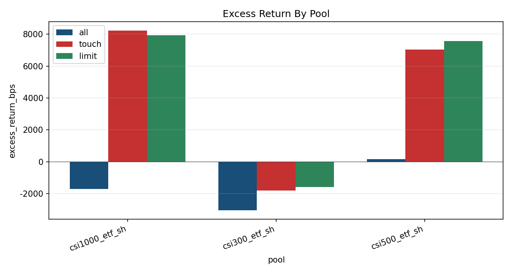

pool-level excess_return_bps.

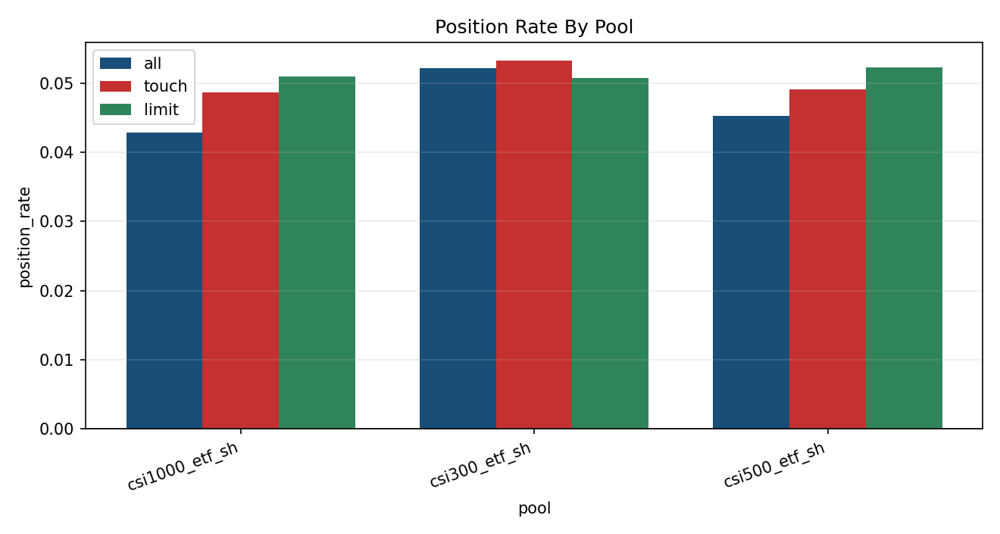

pool-level position_rate.

字段解释

| field | explanation |
| --- | --- |
| strategy_return_bps | test split 上 strategy minute return 复利收益, 单位 bps.  |
| benchmark_return_bps | test split 上 benchmark minute return 复利收益, 单位 bps.  |
| excess_return_bps | strategy 相对 benchmark 的复利 excess return, 单位 bps.  |
| expected_return_bps | expected minute return 复利收益, 单位 bps.  |
| position_rate | position > 0 的分钟比例.  |
| open_count | 开仓次数.  |
| open_per_day | 平均每日开仓次数.  |

### 5.2. Cost Sensitivity

### Cost Sensitivity

| experiment | pool | single_side_cost_bps | net_strategy_cumulative_return_bps |
| --- | --- | --- | --- |
| all | csi1000_etf_sh | 0.000e+00 | -346.9907 |
| all | csi1000_etf_sh | 1.0000 | -547.6002 |
| all | csi1000_etf_sh | 2.0000 | -744.0601 |
| all | csi1000_etf_sh | 5.0000 | -1,309 |
| all | csi1000_etf_sh | 10.0000 | -2,176 |
| all | csi300_etf_sh | 0.000e+00 | -17.0044 |
| all | csi300_etf_sh | 1.0000 | -304.3055 |
| all | csi300_etf_sh | 2.0000 | -583.3659 |
| all | csi300_etf_sh | 5.0000 | -1,373 |
| all | csi300_etf_sh | 10.0000 | -2,546 |
| all | csi500_etf_sh | 0.000e+00 | -162.3923 |
| all | csi500_etf_sh | 1.0000 | -395.6985 |
| all | csi500_etf_sh | 2.0000 | -623.4943 |
| all | csi500_etf_sh | 5.0000 | -1,275 |
| all | csi500_etf_sh | 10.0000 | -2,262 |
| touch | csi1000_etf_sh | 0.000e+00 | 484.2717 |
| touch | csi1000_etf_sh | 1.0000 | 173.4214 |
| touch | csi1000_etf_sh | 2.0000 | -128.2420 |
| touch | csi1000_etf_sh | 5.0000 | -980.7787 |
| touch | csi1000_etf_sh | 10.0000 | -2,242 |
| touch | csi300_etf_sh | 0.000e+00 | 306.1486 |
| touch | csi300_etf_sh | 1.0000 | -41.3588 |
| touch | csi300_etf_sh | 2.0000 | -377.1818 |
| touch | csi300_etf_sh | 5.0000 | -1,318 |
| touch | csi300_etf_sh | 10.0000 | -2,687 |
| touch | csi500_etf_sh | 0.000e+00 | 386.5206 |
| touch | csi500_etf_sh | 1.0000 | 60.4202 |
| touch | csi500_etf_sh | 2.0000 | -255.4728 |
| touch | csi500_etf_sh | 5.0000 | -1,145 |
| touch | csi500_etf_sh | 10.0000 | -2,451 |
| limit | csi1000_etf_sh | 0.000e+00 | 398.3282 |
| limit | csi1000_etf_sh | 1.0000 | 75.8922 |
| limit | csi1000_etf_sh | 2.0000 | -236.5763 |
| limit | csi1000_etf_sh | 5.0000 | -1,117 |
| limit | csi1000_etf_sh | 10.0000 | -2,412 |
| limit | csi300_etf_sh | 0.000e+00 | 502.9400 |
| limit | csi300_etf_sh | 1.0000 | 120.4435 |
| limit | csi300_etf_sh | 2.0000 | -248.1594 |
| limit | csi300_etf_sh | 5.0000 | -1,276 |
| limit | csi300_etf_sh | 10.0000 | -2,754 |
| limit | csi500_etf_sh | 0.000e+00 | 484.9742 |
| limit | csi500_etf_sh | 1.0000 | 129.4172 |
| limit | csi500_etf_sh | 2.0000 | -214.1161 |
| limit | csi500_etf_sh | 5.0000 | -1,177 |
| limit | csi500_etf_sh | 10.0000 | -2,575 |

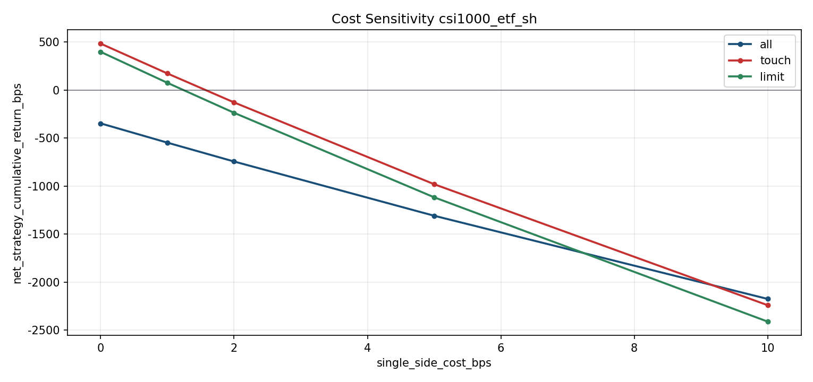

csi1000_etf_sh: single_side_cost_bps vs net_strategy_cumulative_return_bps.

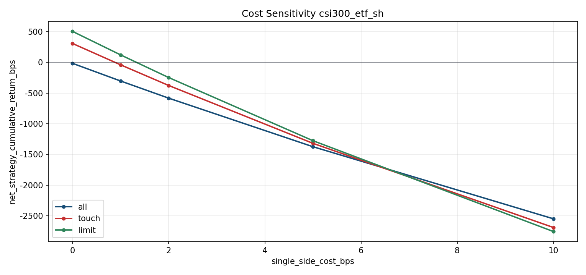

csi300_etf_sh: single_side_cost_bps vs net_strategy_cumulative_return_bps.

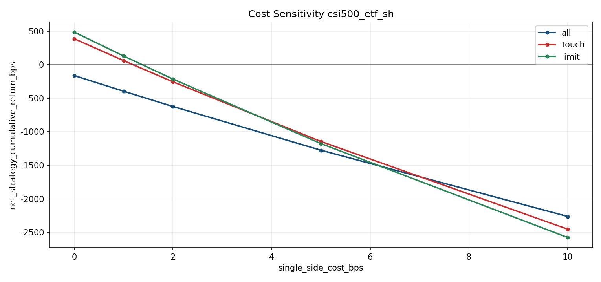

csi500_etf_sh: single_side_cost_bps vs net_strategy_cumulative_return_bps.

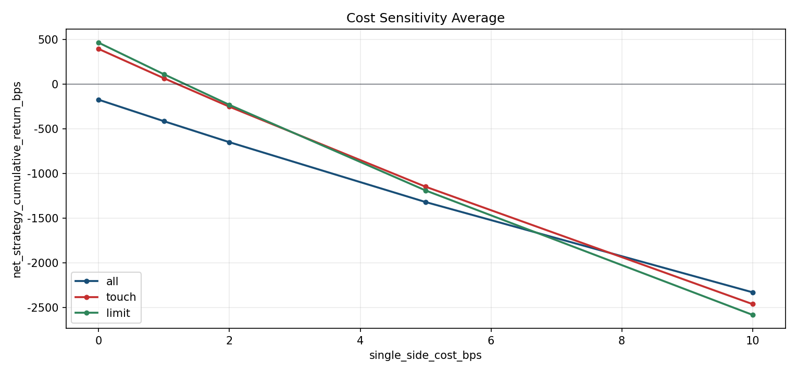

pool-average cost sensitivity.

字段解释

| field | explanation |
| --- | --- |
| single_side_cost_bps | 单边交易成本, 单位 bps.  |
| net_strategy_cumulative_return_bps | 扣成本后的 strategy cumulative return, 单位 bps.  |

### 5.3. Trade Return Distribution

### Trade Return Distribution

| experiment | pool | split | trade_count | mean_trade_return_bps | median_trade_return_bps | hit_rate | p05_trade_return_bps | p95_trade_return_bps |
| --- | --- | --- | --- | --- | --- | --- | --- | --- |
| all | csi1000_etf_sh | train_val_test | 281 | 5.2792 | 4.8314 | 0.619217 | -49.7126 | 48.3092 |
| all | csi300_etf_sh | train_val_test | 322 | 5.9621 | 3.9915 | 0.636646 | -27.3116 | 44.6848 |
| all | csi500_etf_sh | train_val_test | 314 | 6.0199 | 3.9562 | 0.630573 | -39.9470 | 54.9903 |
| all | csi1000_etf_sh | test | 105 | -3.3246 | 0.687631 | 0.514286 | -55.2379 | 28.1132 |
| all | csi300_etf_sh | test | 146 | -0.105496 | 2.7660 | 0.575342 | -25.4534 | 15.3169 |
| all | csi500_etf_sh | test | 120 | -1.3374 | 1.2877 | 0.533333 | -46.5282 | 24.5371 |
| touch | csi1000_etf_sh | train_val_test | 328 | 8.7312 | 4.6232 | 0.594512 | -48.2325 | 71.0602 |
| touch | csi300_etf_sh | train_val_test | 344 | 6.2159 | 2.8147 | 0.569767 | -27.7026 | 44.5683 |
| touch | csi500_etf_sh | train_val_test | 346 | 8.5497 | 3.2498 | 0.580925 | -34.8358 | 56.2784 |
| touch | csi1000_etf_sh | test | 151 | 3.1995 | 3.8004 | 0.569536 | -50.8033 | 54.1796 |
| touch | csi300_etf_sh | test | 172 | 1.7749 | 2.7018 | 0.563953 | -27.9934 | 28.4698 |
| touch | csi500_etf_sh | test | 160 | 2.4133 | 2.3136 | 0.568750 | -36.2045 | 37.8260 |
| limit | csi1000_etf_sh | train_val_test | 342 | 6.9676 | 6.0147 | 0.625731 | -44.0984 | 60.5656 |
| limit | csi300_etf_sh | train_val_test | 380 | 6.7161 | 4.1769 | 0.589474 | -28.5229 | 47.1958 |
| limit | csi500_etf_sh | train_val_test | 379 | 6.8006 | 3.2944 | 0.593668 | -36.8587 | 55.1127 |
| limit | csi1000_etf_sh | test | 158 | 2.5235 | 3.4291 | 0.563291 | -43.0604 | 45.7342 |
| limit | csi300_etf_sh | test | 186 | 2.6523 | 3.4586 | 0.602151 | -24.3472 | 22.8603 |
| limit | csi500_etf_sh | test | 173 | 2.7786 | 2.9387 | 0.583815 | -37.1859 | 40.0638 |

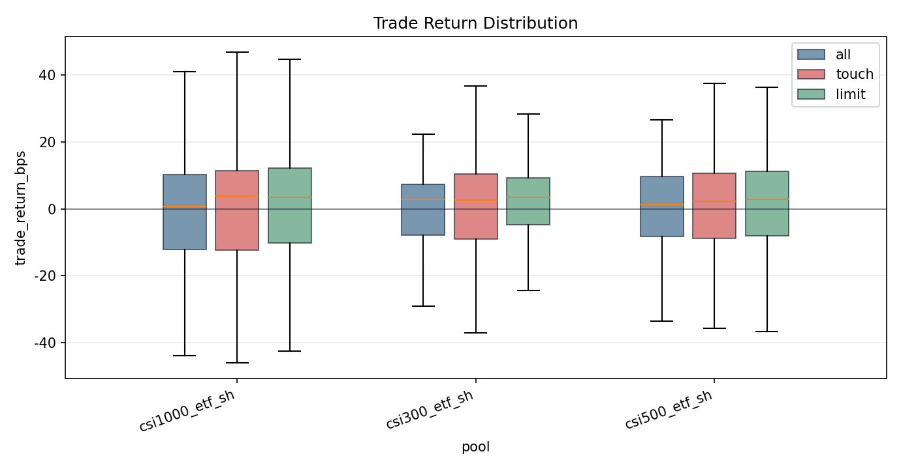

test split trade_return_bps distribution.

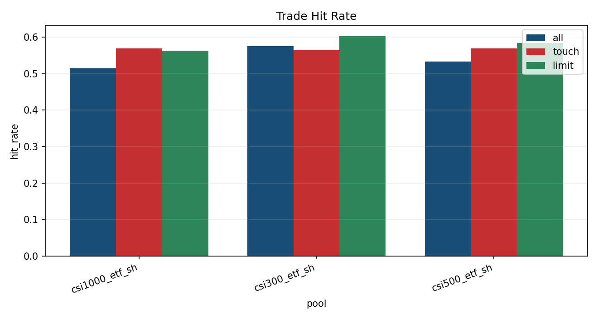

test split trade hit rate.

字段解释

| field | explanation |
| --- | --- |
| trade_count | trade id 数量.  |
| mean_trade_return_bps | 单笔 trade 平均收益, 单位 bps.  |
| median_trade_return_bps | 单笔 trade 中位数收益, 单位 bps.  |
| hit_rate | 分组内 target > 0 的比例.  |
| p05_trade_return_bps | 单笔 trade return 5% 分位数, 单位 bps.  |
| p95_trade_return_bps | 单笔 trade return 95% 分位数, 单位 bps.  |

### 6. Robustness Diagnostics

### 6.1. Return Realization

### Return Realization

| experiment | holding_minutes | mean_return | mean_return_bps | row_count | prediction_p95 |
| --- | --- | --- | --- | --- | --- |
| all | 1 | 1.945e-04 | 1.9449 | 8,848,339 | 7.668e-04 |
| all | 2 | 3.128e-04 | 3.1283 | 8,848,339 | 7.668e-04 |
| all | 3 | 3.874e-04 | 3.8737 | 8,848,339 | 7.668e-04 |
| all | 4 | 4.347e-04 | 4.3474 | 8,848,339 | 7.668e-04 |
| all | 5 | 4.664e-04 | 4.6642 | 8,848,339 | 7.668e-04 |
| all | 6 | 4.873e-04 | 4.8726 | 8,848,339 | 7.668e-04 |
| all | 7 | 5.076e-04 | 5.0758 | 8,848,339 | 7.668e-04 |
| all | 8 | 5.195e-04 | 5.1948 | 8,848,339 | 7.668e-04 |
| all | 9 | 5.242e-04 | 5.2420 | 8,848,339 | 7.668e-04 |
| all | 10 | 5.238e-04 | 5.2382 | 8,848,339 | 7.668e-04 |
| all | 11 | 5.220e-04 | 5.2203 | 8,590,385 | 7.668e-04 |
| all | 12 | 5.101e-04 | 5.1011 | 8,414,175 | 7.668e-04 |
| all | 13 | 5.048e-04 | 5.0481 | 8,295,257 | 7.668e-04 |
| all | 14 | 5.011e-04 | 5.0105 | 8,214,372 | 7.668e-04 |
| all | 15 | 5.025e-04 | 5.0254 | 8,158,162 | 7.668e-04 |
| all | 16 | 5.011e-04 | 5.0113 | 8,116,037 | 7.668e-04 |
| all | 17 | 4.922e-04 | 4.9221 | 8,084,844 | 7.668e-04 |
| all | 18 | 4.766e-04 | 4.7657 | 8,060,410 | 7.668e-04 |
| all | 19 | 4.576e-04 | 4.5761 | 8,040,694 | 7.668e-04 |
| all | 20 | 4.396e-04 | 4.3958 | 8,023,569 | 7.668e-04 |
| touch | 1 | 1.797e-04 | 1.7975 | 8,668,667 | 6.800e-04 |
| touch | 2 | 2.967e-04 | 2.9671 | 8,668,667 | 6.800e-04 |
| touch | 3 | 3.765e-04 | 3.7648 | 8,668,667 | 6.800e-04 |
| touch | 4 | 4.300e-04 | 4.3003 | 8,668,667 | 6.800e-04 |
| touch | 5 | 4.702e-04 | 4.7024 | 8,668,667 | 6.800e-04 |
| touch | 6 | 5.067e-04 | 5.0671 | 8,668,667 | 6.800e-04 |
| touch | 7 | 5.403e-04 | 5.4026 | 8,668,667 | 6.800e-04 |
| touch | 8 | 5.638e-04 | 5.6382 | 8,668,667 | 6.800e-04 |
| touch | 9 | 5.777e-04 | 5.7775 | 8,668,667 | 6.800e-04 |
| touch | 10 | 5.893e-04 | 5.8933 | 8,668,667 | 6.800e-04 |
| touch | 11 | 6.034e-04 | 6.0342 | 8,387,914 | 6.800e-04 |
| touch | 12 | 6.077e-04 | 6.0771 | 8,176,635 | 6.800e-04 |
| touch | 13 | 6.161e-04 | 6.1608 | 8,020,868 | 6.800e-04 |
| touch | 14 | 6.231e-04 | 6.2305 | 7,909,760 | 6.800e-04 |
| touch | 15 | 6.293e-04 | 6.2930 | 7,832,633 | 6.800e-04 |
| touch | 16 | 6.303e-04 | 6.3027 | 7,781,065 | 6.800e-04 |
| touch | 17 | 6.197e-04 | 6.1971 | 7,749,134 | 6.800e-04 |
| touch | 18 | 6.045e-04 | 6.0453 | 7,728,436 | 6.800e-04 |
| touch | 19 | 5.855e-04 | 5.8548 | 7,714,055 | 6.800e-04 |
| touch | 20 | 5.680e-04 | 5.6804 | 7,703,332 | 6.800e-04 |
| limit | 1 | 1.928e-04 | 1.9278 | 8,626,876 | 6.585e-04 |
| limit | 2 | 3.110e-04 | 3.1103 | 8,626,876 | 6.585e-04 |
| limit | 3 | 3.888e-04 | 3.8880 | 8,626,876 | 6.585e-04 |
| limit | 4 | 4.412e-04 | 4.4116 | 8,626,876 | 6.585e-04 |
| limit | 5 | 4.812e-04 | 4.8116 | 8,626,876 | 6.585e-04 |
| limit | 6 | 5.169e-04 | 5.1687 | 8,626,876 | 6.585e-04 |
| limit | 7 | 5.549e-04 | 5.5486 | 8,626,876 | 6.585e-04 |
| limit | 8 | 5.843e-04 | 5.8428 | 8,626,876 | 6.585e-04 |
| limit | 9 | 6.053e-04 | 6.0531 | 8,626,876 | 6.585e-04 |
| limit | 10 | 6.220e-04 | 6.2204 | 8,626,876 | 6.585e-04 |
| limit | 11 | 6.352e-04 | 6.3523 | 8,418,145 | 6.585e-04 |
| limit | 12 | 6.403e-04 | 6.4030 | 8,276,797 | 6.585e-04 |
| limit | 13 | 6.489e-04 | 6.4886 | 8,183,704 | 6.585e-04 |
| limit | 14 | 6.540e-04 | 6.5397 | 8,122,887 | 6.585e-04 |
| limit | 15 | 6.597e-04 | 6.5971 | 8,082,547 | 6.585e-04 |
| limit | 16 | 6.608e-04 | 6.6083 | 8,054,386 | 6.585e-04 |
| limit | 17 | 6.516e-04 | 6.5159 | 8,035,135 | 6.585e-04 |
| limit | 18 | 6.363e-04 | 6.3633 | 8,021,782 | 6.585e-04 |
| limit | 19 | 6.175e-04 | 6.1754 | 8,011,876 | 6.585e-04 |
| limit | 20 | 6.002e-04 | 6.0022 | 8,003,612 | 6.585e-04 |

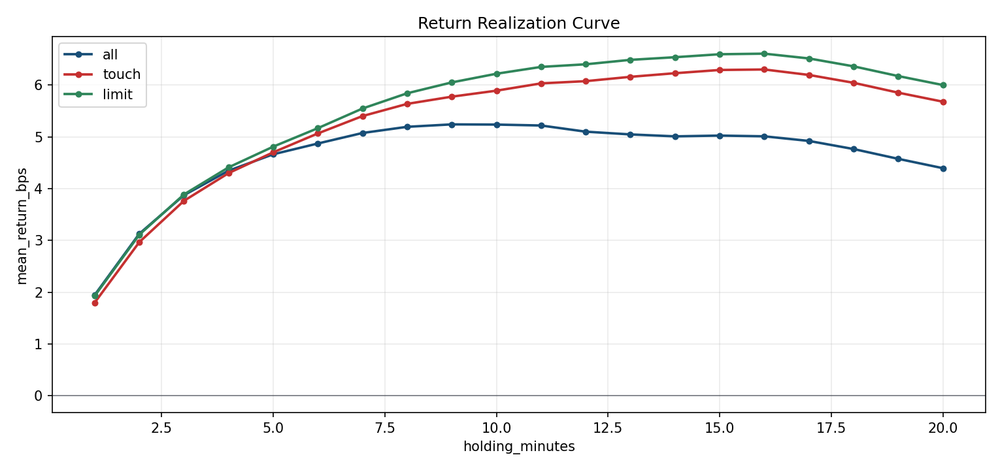

holding_minutes vs mean_return_bps.

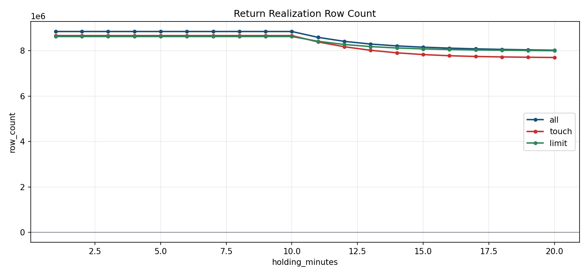

holding_minutes vs row_count.

字段解释

| field | explanation |
| --- | --- |
| holding_minutes | forward holding horizon, 单位 minutes.  |
| mean_return | 该 holding horizon 的平均 realized return.  |
| mean_return_bps | 该 holding horizon 的平均 realized return, 单位 bps.  |
| row_count | 分组样本数.  |
| prediction_p95 | prediction 95% 分位 threshold.  |

### 6.2. Monthly IC

### Monthly IC

| experiment | month | pearson_ic | rank_ic | sample_count |
| --- | --- | --- | --- | --- |
| all | 2024/03 | 0.061283 | 0.034556 | 40,561,535 |
| all | 2024/04 | 0.080781 | 0.062127 | 34,533,212 |
| all | 2024/05 | 0.070428 | 0.050540 | 34,535,788 |
| all | 2024/06 | 0.072685 | 0.033108 | 32,818,884 |
| all | 2024/07 | 0.059504 | 0.040388 | 34,496,021 |
| touch | 2024/03 | 0.067752 | 0.040822 | 39,942,245 |
| touch | 2024/04 | 0.081540 | 0.071218 | 33,659,955 |
| touch | 2024/05 | 0.063285 | 0.046345 | 33,784,300 |
| touch | 2024/06 | 0.063541 | 0.030083 | 32,192,530 |
| touch | 2024/07 | 0.066091 | 0.040526 | 33,602,648 |
| limit | 2024/03 | 0.062837 | 0.039219 | 39,831,825 |
| limit | 2024/04 | 0.070169 | 0.063915 | 33,491,266 |
| limit | 2024/05 | 0.064411 | 0.048111 | 33,638,071 |
| limit | 2024/06 | 0.066335 | 0.038413 | 32,085,201 |
| limit | 2024/07 | 0.062762 | 0.040077 | 33,385,427 |

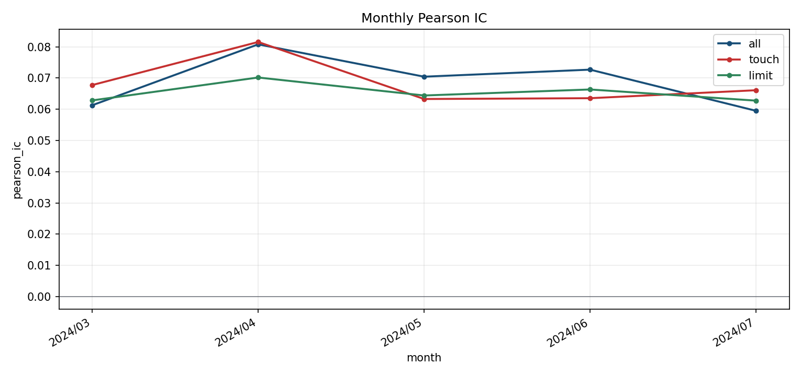

month vs pearson_ic.

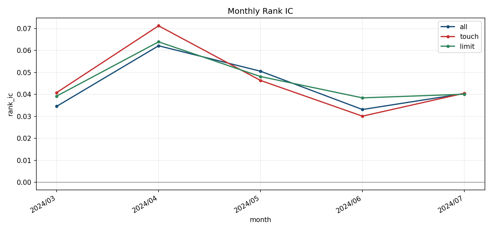

month vs rank_ic.

字段解释

| field | explanation |
| --- | --- |
| month | 月份.  |
| pearson_ic | corr(prediction, target).  |
| rank_ic | corr(rank(prediction), rank(target)).  |
| sample_count | 样本数.  |

### 6.3. Intraday IC

Intraday IC

| experiment | time_bucket | pearson_ic | rank_ic | sample_count |
| --- | --- | --- | --- | --- |
| all | 103,900 | 0.087787 | 0.064605 | 294 |
| all | 104,000 | 0.085330 | 0.060780 | 294 |
| all | 104,100 | 0.088493 | 0.065382 | 294 |
| all | 104,200 | 0.093613 | 0.070127 | 294 |
| all | 104,300 | 0.092221 | 0.067452 | 294 |
| all | 104,400 | 0.087486 | 0.068204 | 294 |
| all | 104,500 | 0.079569 | 0.057058 | 290 |
| all | 104,600 | 0.087694 | 0.061279 | 294 |
| all | 104,700 | 0.085233 | 0.057588 | 294 |
| all | 104,800 | 0.086972 | 0.060722 | 294 |
| all | 104,900 | 0.084054 | 0.055387 | 294 |
| all | 105,000 | 0.082366 | 0.049114 | 294 |
| all | 105,100 | 0.084061 | 0.053801 | 294 |
| all | 105,200 | 0.080850 | 0.052007 | 290 |
| all | 105,300 | 0.086814 | 0.058835 | 294 |
| all | 105,400 | 0.091426 | 0.061893 | 294 |
| all | 105,500 | 0.082246 | 0.052911 | 294 |
| all | 105,600 | 0.075724 | 0.049453 | 294 |
| all | 105,700 | 0.079475 | 0.053168 | 294 |
| all | 105,800 | 0.079830 | 0.058701 | 294 |
| all | 105,900 | 0.079047 | 0.056593 | 290 |
| all | 110,000 | 0.071488 | 0.050791 | 294 |
| all | 110,100 | 0.071008 | 0.043795 | 294 |
| all | 110,200 | 0.070587 | 0.041299 | 294 |
| all | 110,300 | 0.068436 | 0.043214 | 294 |
| all | 110,400 | 0.072467 | 0.048397 | 294 |
| all | 110,500 | 0.075156 | 0.046335 | 294 |
| all | 110,600 | 0.073072 | 0.048723 | 290 |
| all | 110,700 | 0.073137 | 0.052491 | 294 |
| all | 110,800 | 0.071134 | 0.056708 | 294 |
| all | 110,900 | 0.080010 | 0.057751 | 294 |
| all | 111,000 | 0.084628 | 0.065308 | 294 |
| all | 111,100 | 0.078787 | 0.062765 | 294 |
| all | 111,200 | 0.086522 | 0.063480 | 294 |
| all | 111,300 | 0.087878 | 0.062027 | 290 |
| all | 111,400 | 0.087279 | 0.060635 | 294 |
| all | 111,500 | 0.087326 | 0.054242 | 294 |
| all | 111,600 | 0.086321 | 0.054472 | 294 |
| all | 111,700 | 0.088303 | 0.054961 | 294 |
| all | 111,800 | 0.091410 | 0.058689 | 294 |
| all | 111,900 | 0.095118 | 0.058613 | 294 |
| all | 112,000 | 0.095411 | 0.057189 | 290 |
| all | 112,100 | 0.085522 | 0.052537 | 294 |
| all | 112,200 | 0.077508 | 0.043607 | 294 |
| all | 112,300 | 0.073396 | 0.037899 | 294 |
| all | 112,400 | 0.065867 | 0.032075 | 294 |
| all | 112,500 | 0.062684 | 0.025929 | 294 |
| all | 112,600 | 0.057272 | 0.027166 | 294 |
| all | 112,700 | 0.054565 | 0.026984 | 290 |
| all | 112,800 | 0.044466 | 0.024053 | 294 |
| all | 112,900 | 0.033975 | 0.015665 | 294 |
| all | 113,000 | 0.078164 | 0.081497 | 294 |
| all | 130,100 | 0.080805 | 0.064142 | 294 |
| all | 130,200 | 0.071114 | 0.045050 | 294 |
| all | 130,300 | 0.075972 | 0.041072 | 294 |
| all | 130,400 | 0.069737 | 0.035124 | 290 |
| all | 130,500 | 0.069818 | 0.033553 | 294 |
| all | 130,600 | 0.064809 | 0.036357 | 294 |
| all | 130,700 | 0.058388 | 0.035060 | 294 |
| all | 130,800 | 0.060190 | 0.031945 | 294 |
| all | 130,900 | 0.063240 | 0.028588 | 294 |
| all | 131,000 | 0.055928 | 0.021614 | 294 |
| all | 131,100 | 0.056986 | 0.030236 | 290 |
| all | 131,200 | 0.066468 | 0.034806 | 294 |
| all | 131,300 | 0.068189 | 0.037437 | 294 |
| all | 131,400 | 0.068798 | 0.037433 | 294 |
| all | 131,500 | 0.066560 | 0.035945 | 294 |
| all | 131,600 | 0.068635 | 0.035562 | 294 |
| all | 131,700 | 0.071006 | 0.034223 | 294 |
| all | 131,800 | 0.073928 | 0.035439 | 290 |
| all | 131,900 | 0.073776 | 0.035622 | 294 |
| all | 132,000 | 0.064142 | 0.036321 | 294 |
| all | 132,100 | 0.069112 | 0.036195 | 294 |
| all | 132,200 | 0.069765 | 0.037898 | 294 |
| all | 132,300 | 0.070437 | 0.040795 | 294 |
| all | 132,400 | 0.073813 | 0.039280 | 294 |
| all | 132,500 | 0.079325 | 0.041306 | 290 |
| all | 132,600 | 0.086165 | 0.046713 | 294 |
| all | 132,700 | 0.087609 | 0.048847 | 294 |
| all | 132,800 | 0.086951 | 0.052005 | 294 |
| all | 132,900 | 0.086184 | 0.053487 | 294 |
| all | 133,000 | 0.079183 | 0.054344 | 294 |
| all | 133,100 | 0.085177 | 0.041380 | 294 |
| all | 133,200 | 0.086154 | 0.043685 | 290 |
| all | 133,300 | 0.081723 | 0.051753 | 294 |
| all | 133,400 | 0.084829 | 0.052950 | 294 |
| all | 133,500 | 0.079988 | 0.047843 | 294 |
| all | 133,600 | 0.076693 | 0.049216 | 294 |
| all | 133,700 | 0.089795 | 0.062742 | 294 |
| all | 133,800 | 0.099047 | 0.064827 | 294 |
| all | 133,900 | 0.094336 | 0.060683 | 290 |
| all | 134,000 | 0.089814 | 0.057711 | 294 |
| all | 134,100 | 0.091590 | 0.057848 | 294 |
| all | 134,200 | 0.094755 | 0.060778 | 294 |
| all | 134,300 | 0.093353 | 0.057940 | 294 |
| all | 134,400 | 0.102815 | 0.066445 | 294 |
| all | 134,500 | 0.089378 | 0.058066 | 294 |
| all | 134,600 | 0.097444 | 0.053488 | 290 |
| all | 134,700 | 0.093349 | 0.054508 | 294 |
| all | 134,800 | 0.094644 | 0.056366 | 294 |
| all | 134,900 | 0.095405 | 0.058719 | 294 |
| all | 135,000 | 0.094248 | 0.053991 | 294 |
| all | 135,100 | 0.101861 | 0.050832 | 294 |
| all | 135,200 | 0.109765 | 0.060209 | 294 |
| all | 135,300 | 0.113927 | 0.064279 | 290 |
| all | 135,400 | 0.107077 | 0.068265 | 294 |
| all | 135,500 | 0.108168 | 0.071632 | 294 |
| all | 135,600 | 0.103594 | 0.067590 | 294 |
| all | 135,700 | 0.109492 | 0.073465 | 294 |
| all | 135,800 | 0.119027 | 0.081589 | 294 |
| all | 135,900 | 0.101737 | 0.062420 | 294 |
| all | 140,000 | 0.091963 | 0.057002 | 290 |
| all | 140,100 | 0.094318 | 0.059592 | 294 |
| all | 140,200 | 0.094863 | 0.062260 | 294 |
| all | 140,300 | 0.088200 | 0.063656 | 294 |
| all | 140,400 | 0.094757 | 0.067198 | 294 |
| all | 140,500 | 0.087847 | 0.066098 | 294 |
| all | 140,600 | 0.098113 | 0.066240 | 294 |
| all | 140,700 | 0.105295 | 0.064861 | 291 |
| all | 140,800 | 0.094159 | 0.060047 | 294 |
| all | 140,900 | 0.093297 | 0.060182 | 294 |
| all | 141,000 | 0.086184 | 0.049247 | 294 |
| all | 141,100 | 0.092016 | 0.053083 | 294 |
| all | 141,200 | 0.093281 | 0.051297 | 294 |
| all | 141,300 | 0.093645 | 0.043785 | 294 |
| all | 141,400 | 0.098512 | 0.046960 | 290 |
| all | 141,500 | 0.091197 | 0.047853 | 294 |
| all | 141,600 | 0.090907 | 0.046939 | 294 |
| all | 141,700 | 0.099716 | 0.050368 | 294 |
| all | 141,800 | 0.095925 | 0.044645 | 294 |
| all | 141,900 | 0.091557 | 0.049515 | 294 |
| all | 142,000 | 0.085285 | 0.049254 | 294 |
| all | 142,100 | 0.097854 | 0.066925 | 291 |
| all | 142,200 | 0.107269 | 0.073823 | 294 |
| all | 142,300 | 0.100207 | 0.078061 | 294 |
| all | 142,400 | 0.104746 | 0.077693 | 294 |
| all | 142,500 | 0.099659 | 0.072849 | 294 |
| all | 142,600 | 0.104297 | 0.080155 | 294 |
| all | 142,700 | 0.108475 | 0.082259 | 294 |
| all | 142,800 | 0.109844 | 0.084123 | 290 |
| all | 142,900 | 0.112479 | 0.087259 | 294 |
| all | 143,000 | 0.114579 | 0.087995 | 294 |
| all | 143,100 | 0.118724 | 0.094447 | 294 |
| all | 143,200 | 0.122692 | 0.097993 | 294 |
| all | 143,300 | 0.121884 | 0.092342 | 294 |
| all | 143,400 | 0.119163 | 0.093824 | 294 |
| all | 143,500 | 0.121315 | 0.083489 | 291 |
| all | 143,600 | 0.122266 | 0.088645 | 294 |
| all | 143,700 | 0.127227 | 0.091950 | 294 |
| all | 143,800 | 0.124700 | 0.093286 | 294 |
| all | 143,900 | 0.118423 | 0.090531 | 294 |
| all | 144,000 | 0.114067 | 0.084146 | 294 |
| all | 144,100 | 0.112029 | 0.081393 | 294 |
| all | 144,200 | 0.112112 | 0.079023 | 290 |
| all | 144,300 | 0.112894 | 0.077887 | 294 |
| all | 144,400 | 0.107284 | 0.073409 | 294 |
| all | 144,500 | 0.092376 | 0.068687 | 294 |
| all | 144,600 | 0.096965 | 0.070194 | 294 |
| all | 144,700 | 0.105492 | 0.088624 | 294 |
| all | 144,800 | 0.101897 | 0.091480 | 294 |
| all | 144,900 | 0.102833 | 0.084640 | 291 |
| touch | 94,000 | 0.008300 | 0.008407 | 150 |
| touch | 94,100 | 0.024581 | 0.004701 | 150 |
| touch | 94,200 | 0.027702 | 0.005967 | 148 |
| touch | 94,300 | 0.034107 | 0.017362 | 149 |
| touch | 94,400 | 0.035469 | 0.019710 | 150 |
| touch | 94,500 | 0.025894 | 0.025810 | 149 |
| touch | 94,600 | 0.035356 | 0.026451 | 149 |
| touch | 94,700 | 0.033659 | 0.030444 | 150 |
| touch | 94,800 | 0.035768 | 0.033348 | 150 |
| touch | 94,900 | 0.036176 | 0.033655 | 150 |
| touch | 95,000 | 0.035166 | 0.034864 | 150 |
| touch | 95,100 | 0.041339 | 0.037866 | 150 |
| touch | 95,200 | 0.055254 | 0.048272 | 150 |
| touch | 95,300 | 0.059759 | 0.048284 | 150 |
| touch | 95,400 | 0.058014 | 0.046284 | 150 |
| touch | 95,500 | 0.051616 | 0.042340 | 150 |
| touch | 95,600 | 0.051873 | 0.034571 | 150 |
| touch | 95,700 | 0.054642 | 0.031615 | 150 |
| touch | 95,800 | 0.057199 | 0.036652 | 150 |
| touch | 95,900 | 0.059482 | 0.030560 | 150 |
| touch | 100,000 | 0.045954 | 0.017031 | 150 |
| touch | 100,100 | 0.049531 | 0.017730 | 150 |
| touch | 100,200 | 0.052037 | 0.016856 | 150 |
| touch | 100,300 | 0.057122 | 0.019233 | 150 |
| touch | 100,400 | 0.065596 | 0.026515 | 150 |
| touch | 100,500 | 0.061563 | 0.029060 | 150 |
| touch | 100,600 | 0.064253 | 0.033950 | 150 |
| touch | 100,700 | 0.066418 | 0.037262 | 150 |
| touch | 100,800 | 0.068455 | 0.037047 | 149 |
| touch | 100,900 | 0.064163 | 0.043105 | 150 |
| touch | 101,000 | 0.056093 | 0.031322 | 149 |
| touch | 101,100 | 0.064882 | 0.039517 | 150 |
| touch | 101,200 | 0.068385 | 0.041312 | 150 |
| touch | 101,300 | 0.068974 | 0.043212 | 150 |
| touch | 101,400 | 0.073685 | 0.040425 | 150 |
| touch | 101,500 | 0.071727 | 0.043117 | 150 |
| touch | 101,600 | 0.071802 | 0.047135 | 150 |
| touch | 101,700 | 0.065427 | 0.038777 | 150 |
| touch | 101,800 | 0.070056 | 0.033189 | 149 |
| touch | 101,900 | 0.070802 | 0.037232 | 150 |
| touch | 102,000 | 0.059576 | 0.032891 | 149 |
| touch | 102,100 | 0.062700 | 0.038077 | 150 |
| touch | 102,200 | 0.064246 | 0.041552 | 150 |
| touch | 102,300 | 0.065582 | 0.038833 | 150 |
| touch | 102,400 | 0.072590 | 0.038793 | 150 |
| touch | 102,500 | 0.064959 | 0.038266 | 150 |
| touch | 102,600 | 0.068209 | 0.043950 | 149 |
| touch | 102,700 | 0.073782 | 0.044098 | 149 |
| touch | 102,800 | 0.070586 | 0.038288 | 149 |
| touch | 102,900 | 0.060495 | 0.030447 | 150 |
| touch | 103,000 | 0.053739 | 0.026459 | 150 |
| touch | 103,100 | 0.058051 | 0.027186 | 150 |
| touch | 103,200 | 0.064917 | 0.027710 | 150 |
| touch | 103,300 | 0.062631 | 0.032109 | 150 |
| touch | 103,400 | 0.063848 | 0.033540 | 149 |
| touch | 103,500 | 0.066049 | 0.041125 | 149 |
| touch | 103,600 | 0.072028 | 0.044314 | 150 |
| touch | 103,700 | 0.069674 | 0.050843 | 150 |
| touch | 103,800 | 0.069146 | 0.053880 | 150 |
| touch | 103,900 | 0.075810 | 0.059698 | 291 |
| touch | 104,000 | 0.077460 | 0.057643 | 292 |
| touch | 104,100 | 0.086100 | 0.063311 | 292 |
| touch | 104,200 | 0.088474 | 0.066852 | 292 |
| touch | 104,300 | 0.093893 | 0.069480 | 292 |
| touch | 104,400 | 0.088144 | 0.064673 | 292 |
| touch | 104,500 | 0.081588 | 0.059472 | 292 |
| touch | 104,600 | 0.082498 | 0.058900 | 291 |
| touch | 104,700 | 0.080245 | 0.063269 | 291 |
| touch | 104,800 | 0.082867 | 0.064742 | 292 |
| touch | 104,900 | 0.076675 | 0.058871 | 292 |
| touch | 105,000 | 0.075866 | 0.050724 | 292 |
| touch | 105,100 | 0.078163 | 0.054938 | 291 |
| touch | 105,200 | 0.075136 | 0.051983 | 292 |
| touch | 105,300 | 0.077506 | 0.052837 | 292 |
| touch | 105,400 | 0.081713 | 0.058978 | 291 |
| touch | 105,500 | 0.075245 | 0.056186 | 292 |
| touch | 105,600 | 0.069170 | 0.050626 | 291 |
| touch | 105,700 | 0.075509 | 0.055927 | 290 |
| touch | 105,800 | 0.075421 | 0.062927 | 292 |
| touch | 105,900 | 0.074466 | 0.061940 | 291 |
| touch | 110,000 | 0.072520 | 0.060072 | 292 |
| touch | 110,100 | 0.068547 | 0.051229 | 291 |
| touch | 110,200 | 0.068307 | 0.050922 | 292 |
| touch | 110,300 | 0.070579 | 0.053636 | 291 |
| touch | 110,400 | 0.068252 | 0.054109 | 292 |
| touch | 110,500 | 0.082049 | 0.057881 | 291 |
| touch | 110,600 | 0.072694 | 0.058871 | 291 |
| touch | 110,700 | 0.073348 | 0.062721 | 291 |
| touch | 110,800 | 0.078848 | 0.066854 | 291 |
| touch | 110,900 | 0.082736 | 0.066452 | 292 |
| touch | 111,000 | 0.083732 | 0.068635 | 292 |
| touch | 111,100 | 0.084058 | 0.065285 | 291 |
| touch | 111,200 | 0.081862 | 0.065066 | 292 |
| touch | 111,300 | 0.093007 | 0.066421 | 290 |
| touch | 111,400 | 0.088894 | 0.065425 | 292 |
| touch | 111,500 | 0.086330 | 0.061434 | 290 |
| touch | 111,600 | 0.080723 | 0.058622 | 292 |
| touch | 111,700 | 0.086204 | 0.063532 | 292 |
| touch | 111,800 | 0.090154 | 0.068750 | 292 |
| touch | 111,900 | 0.091500 | 0.066295 | 292 |
| touch | 112,000 | 0.086604 | 0.062866 | 292 |
| touch | 112,100 | 0.080110 | 0.057986 | 292 |
| touch | 112,200 | 0.073466 | 0.048739 | 292 |
| touch | 112,300 | 0.060973 | 0.039579 | 291 |
| touch | 112,400 | 0.059946 | 0.032207 | 291 |
| touch | 112,500 | 0.055672 | 0.029032 | 291 |
| touch | 112,600 | 0.057033 | 0.031713 | 291 |
| touch | 112,700 | 0.057020 | 0.034382 | 291 |
| touch | 112,800 | 0.050296 | 0.031298 | 291 |
| touch | 112,900 | 0.042588 | 0.029189 | 291 |
| touch | 113,000 | 0.080882 | 0.071418 | 291 |
| touch | 130,100 | 0.079717 | 0.061557 | 290 |
| touch | 130,200 | 0.070431 | 0.049011 | 291 |
| touch | 130,300 | 0.071725 | 0.043800 | 289 |
| touch | 130,400 | 0.064991 | 0.033452 | 290 |
| touch | 130,500 | 0.062187 | 0.026492 | 289 |
| touch | 130,600 | 0.058988 | 0.028488 | 289 |
| touch | 130,700 | 0.060200 | 0.033112 | 288 |
| touch | 130,800 | 0.068877 | 0.039585 | 289 |
| touch | 130,900 | 0.076334 | 0.040248 | 290 |
| touch | 131,000 | 0.064100 | 0.028979 | 289 |
| touch | 131,100 | 0.069195 | 0.035861 | 290 |
| touch | 131,200 | 0.061763 | 0.039235 | 290 |
| touch | 131,300 | 0.060742 | 0.039930 | 290 |
| touch | 131,400 | 0.062394 | 0.035871 | 290 |
| touch | 131,500 | 0.060508 | 0.036398 | 288 |
| touch | 131,600 | 0.065306 | 0.036116 | 288 |
| touch | 131,700 | 0.071291 | 0.038346 | 289 |
| touch | 131,800 | 0.065410 | 0.036392 | 287 |
| touch | 131,900 | 0.071260 | 0.036511 | 290 |
| touch | 132,000 | 0.069635 | 0.038625 | 290 |
| touch | 132,100 | 0.078402 | 0.041064 | 290 |
| touch | 132,200 | 0.077608 | 0.043007 | 289 |
| touch | 132,300 | 0.080301 | 0.046804 | 290 |
| touch | 132,400 | 0.079709 | 0.044310 | 290 |
| touch | 132,500 | 0.085315 | 0.051400 | 290 |
| touch | 132,600 | 0.086990 | 0.055293 | 287 |
| touch | 132,700 | 0.081618 | 0.052233 | 290 |
| touch | 132,800 | 0.080015 | 0.052695 | 290 |
| touch | 132,900 | 0.081791 | 0.054955 | 290 |
| touch | 133,000 | 0.080200 | 0.054122 | 289 |
| touch | 133,100 | 0.082981 | 0.043001 | 290 |
| touch | 133,200 | 0.085125 | 0.043557 | 288 |
| touch | 133,300 | 0.091114 | 0.051107 | 290 |
| touch | 133,400 | 0.098423 | 0.056116 | 289 |
| touch | 133,500 | 0.090570 | 0.051391 | 289 |
| touch | 133,600 | 0.086955 | 0.055520 | 287 |
| touch | 133,700 | 0.098646 | 0.068184 | 289 |
| touch | 133,800 | 0.098135 | 0.072515 | 290 |
| touch | 133,900 | 0.094306 | 0.066742 | 290 |
| touch | 134,000 | 0.085830 | 0.058043 | 290 |
| touch | 134,100 | 0.087468 | 0.059278 | 290 |
| touch | 134,200 | 0.085568 | 0.059054 | 289 |
| touch | 134,300 | 0.093231 | 0.062503 | 289 |
| touch | 134,400 | 0.093394 | 0.064682 | 290 |
| touch | 134,500 | 0.076723 | 0.056635 | 290 |
| touch | 134,600 | 0.086374 | 0.058426 | 289 |
| touch | 134,700 | 0.086051 | 0.060782 | 291 |
| touch | 134,800 | 0.089991 | 0.062911 | 290 |
| touch | 134,900 | 0.091135 | 0.063047 | 290 |
| touch | 135,000 | 0.094805 | 0.061931 | 291 |
| touch | 135,100 | 0.105299 | 0.063508 | 291 |
| touch | 135,200 | 0.115383 | 0.070137 | 292 |
| touch | 135,300 | 0.112125 | 0.068039 | 291 |
| touch | 135,400 | 0.106967 | 0.068186 | 290 |
| touch | 135,500 | 0.104514 | 0.067077 | 292 |
| touch | 135,600 | 0.100442 | 0.062059 | 292 |
| touch | 135,700 | 0.108371 | 0.068726 | 292 |
| touch | 135,800 | 0.109832 | 0.071718 | 292 |
| touch | 135,900 | 0.090799 | 0.051823 | 291 |
| touch | 140,000 | 0.086477 | 0.051053 | 292 |
| touch | 140,100 | 0.082785 | 0.048741 | 291 |
| touch | 140,200 | 0.093342 | 0.055923 | 290 |
| touch | 140,300 | 0.086107 | 0.054253 | 291 |
| touch | 140,400 | 0.093012 | 0.060436 | 292 |
| touch | 140,500 | 0.085008 | 0.059618 | 290 |
| touch | 140,600 | 0.093645 | 0.061879 | 292 |
| touch | 140,700 | 0.104915 | 0.066069 | 291 |
| touch | 140,800 | 0.092053 | 0.064018 | 292 |
| touch | 140,900 | 0.087262 | 0.059871 | 292 |
| touch | 141,000 | 0.078133 | 0.050442 | 292 |
| touch | 141,100 | 0.082029 | 0.047789 | 291 |
| touch | 141,200 | 0.084477 | 0.050804 | 292 |
| touch | 141,300 | 0.086755 | 0.051476 | 292 |
| touch | 141,400 | 0.087634 | 0.053982 | 292 |
| touch | 141,500 | 0.081368 | 0.056354 | 292 |
| touch | 141,600 | 0.089702 | 0.055967 | 291 |
| touch | 141,700 | 0.090171 | 0.063045 | 292 |
| touch | 141,800 | 0.088609 | 0.060727 | 292 |
| touch | 141,900 | 0.085742 | 0.055771 | 292 |
| touch | 142,000 | 0.078165 | 0.054682 | 292 |
| touch | 142,100 | 0.098556 | 0.077947 | 292 |
| touch | 142,200 | 0.109843 | 0.084210 | 291 |
| touch | 142,300 | 0.108406 | 0.088392 | 292 |
| touch | 142,400 | 0.112491 | 0.085373 | 292 |
| touch | 142,500 | 0.108399 | 0.082506 | 292 |
| touch | 142,600 | 0.114462 | 0.086207 | 292 |
| touch | 142,700 | 0.122862 | 0.088911 | 291 |
| touch | 142,800 | 0.116289 | 0.084934 | 292 |
| touch | 142,900 | 0.117170 | 0.081571 | 292 |
| touch | 143,000 | 0.102062 | 0.069583 | 291 |
| touch | 143,100 | 0.110575 | 0.072616 | 292 |
| touch | 143,200 | 0.110158 | 0.076863 | 292 |
| touch | 143,300 | 0.108119 | 0.072375 | 291 |
| touch | 143,400 | 0.107392 | 0.075325 | 291 |
| touch | 143,500 | 0.104552 | 0.072836 | 291 |
| touch | 143,600 | 0.112452 | 0.082398 | 292 |
| touch | 143,700 | 0.120785 | 0.084789 | 291 |
| touch | 143,800 | 0.119506 | 0.089091 | 292 |
| touch | 143,900 | 0.121205 | 0.087106 | 292 |
| touch | 144,000 | 0.110988 | 0.078919 | 292 |
| touch | 144,100 | 0.105929 | 0.083524 | 292 |
| touch | 144,200 | 0.109929 | 0.081787 | 292 |
| touch | 144,300 | 0.109824 | 0.081934 | 292 |
| touch | 144,400 | 0.109093 | 0.080480 | 291 |
| touch | 144,500 | 0.089736 | 0.068286 | 292 |
| touch | 144,600 | 0.094186 | 0.063948 | 292 |
| touch | 144,700 | 0.089830 | 0.068314 | 291 |
| touch | 144,800 | 0.088763 | 0.071406 | 292 |
| touch | 144,900 | 0.094462 | 0.070037 | 292 |
| limit | 94,000 | 0.010167 | 0.018617 | 149 |
| limit | 94,100 | 0.020459 | 6.088e-05 | 147 |
| limit | 94,200 | 0.029589 | 0.008533 | 147 |
| limit | 94,300 | 0.033538 | 0.017614 | 149 |
| limit | 94,400 | 0.045854 | 0.024080 | 149 |
| limit | 94,500 | 0.048992 | 0.030721 | 149 |
| limit | 94,600 | 0.044643 | 0.028961 | 149 |
| limit | 94,700 | 0.061783 | 0.049234 | 149 |
| limit | 94,800 | 0.055681 | 0.042085 | 149 |
| limit | 94,900 | 0.046616 | 0.032409 | 149 |
| limit | 95,000 | 0.043716 | 0.032199 | 148 |
| limit | 95,100 | 0.060419 | 0.050695 | 148 |
| limit | 95,200 | 0.053317 | 0.046759 | 149 |
| limit | 95,300 | 0.066577 | 0.056723 | 149 |
| limit | 95,400 | 0.053516 | 0.041470 | 149 |
| limit | 95,500 | 0.049880 | 0.032540 | 149 |
| limit | 95,600 | 0.059080 | 0.040146 | 149 |
| limit | 95,700 | 0.052194 | 0.038029 | 149 |
| limit | 95,800 | 0.043370 | 0.032236 | 148 |
| limit | 95,900 | 0.042278 | 0.029915 | 149 |
| limit | 100,000 | 0.033885 | 0.020363 | 149 |
| limit | 100,100 | 0.038961 | 0.021339 | 148 |
| limit | 100,200 | 0.041772 | 0.016646 | 149 |
| limit | 100,300 | 0.046409 | 0.022746 | 149 |
| limit | 100,400 | 0.049697 | 0.028431 | 149 |
| limit | 100,500 | 0.057112 | 0.040210 | 149 |
| limit | 100,600 | 0.058822 | 0.043785 | 149 |
| limit | 100,700 | 0.064715 | 0.049242 | 149 |
| limit | 100,800 | 0.066142 | 0.049064 | 149 |
| limit | 100,900 | 0.065488 | 0.047692 | 149 |
| limit | 101,000 | 0.059135 | 0.038329 | 149 |
| limit | 101,100 | 0.063771 | 0.041980 | 149 |
| limit | 101,200 | 0.067420 | 0.043046 | 149 |
| limit | 101,300 | 0.069742 | 0.045365 | 149 |
| limit | 101,400 | 0.063309 | 0.042674 | 148 |
| limit | 101,500 | 0.065961 | 0.038513 | 149 |
| limit | 101,600 | 0.065030 | 0.044018 | 149 |
| limit | 101,700 | 0.060654 | 0.039877 | 149 |
| limit | 101,800 | 0.064917 | 0.034925 | 149 |
| limit | 101,900 | 0.065656 | 0.037501 | 147 |
| limit | 102,000 | 0.065652 | 0.036292 | 148 |
| limit | 102,100 | 0.069275 | 0.044594 | 148 |
| limit | 102,200 | 0.068267 | 0.042907 | 148 |
| limit | 102,300 | 0.067198 | 0.040487 | 148 |
| limit | 102,400 | 0.059957 | 0.035927 | 148 |
| limit | 102,500 | 0.061979 | 0.036828 | 148 |
| limit | 102,600 | 0.066207 | 0.046292 | 148 |
| limit | 102,700 | 0.070355 | 0.042203 | 148 |
| limit | 102,800 | 0.073854 | 0.042738 | 147 |
| limit | 102,900 | 0.062365 | 0.041202 | 148 |
| limit | 103,000 | 0.057194 | 0.033437 | 148 |
| limit | 103,100 | 0.063857 | 0.036524 | 148 |
| limit | 103,200 | 0.069486 | 0.040540 | 148 |
| limit | 103,300 | 0.063696 | 0.034480 | 148 |
| limit | 103,400 | 0.056636 | 0.031206 | 148 |
| limit | 103,500 | 0.064549 | 0.041685 | 148 |
| limit | 103,600 | 0.072627 | 0.050802 | 148 |
| limit | 103,700 | 0.075493 | 0.056445 | 148 |
| limit | 103,800 | 0.080810 | 0.066777 | 148 |
| limit | 103,900 | 0.084935 | 0.072795 | 290 |
| limit | 104,000 | 0.084135 | 0.071054 | 290 |
| limit | 104,100 | 0.086546 | 0.070815 | 290 |
| limit | 104,200 | 0.091282 | 0.075443 | 288 |
| limit | 104,300 | 0.082648 | 0.070568 | 290 |
| limit | 104,400 | 0.079398 | 0.065035 | 289 |
| limit | 104,500 | 0.074330 | 0.059550 | 289 |
| limit | 104,600 | 0.072789 | 0.056556 | 289 |
| limit | 104,700 | 0.075186 | 0.056653 | 290 |
| limit | 104,800 | 0.073480 | 0.057227 | 289 |
| limit | 104,900 | 0.069577 | 0.052805 | 289 |
| limit | 105,000 | 0.066662 | 0.050945 | 290 |
| limit | 105,100 | 0.074088 | 0.056939 | 290 |
| limit | 105,200 | 0.074402 | 0.058658 | 288 |
| limit | 105,300 | 0.083983 | 0.072643 | 290 |
| limit | 105,400 | 0.084250 | 0.070554 | 289 |
| limit | 105,500 | 0.080239 | 0.066892 | 290 |
| limit | 105,600 | 0.076913 | 0.067419 | 290 |
| limit | 105,700 | 0.078004 | 0.068248 | 290 |
| limit | 105,800 | 0.083387 | 0.078528 | 290 |
| limit | 105,900 | 0.083927 | 0.076956 | 290 |
| limit | 110,000 | 0.074643 | 0.070742 | 288 |
| limit | 110,100 | 0.073384 | 0.063480 | 289 |
| limit | 110,200 | 0.067901 | 0.057145 | 289 |
| limit | 110,300 | 0.071654 | 0.059494 | 288 |
| limit | 110,400 | 0.072472 | 0.058702 | 290 |
| limit | 110,500 | 0.075633 | 0.058506 | 290 |
| limit | 110,600 | 0.072328 | 0.058563 | 289 |
| limit | 110,700 | 0.071077 | 0.061582 | 289 |
| limit | 110,800 | 0.071287 | 0.061280 | 290 |
| limit | 110,900 | 0.075516 | 0.064615 | 290 |
| limit | 111,000 | 0.077408 | 0.063622 | 290 |
| limit | 111,100 | 0.076744 | 0.061373 | 288 |
| limit | 111,200 | 0.075366 | 0.062110 | 291 |
| limit | 111,300 | 0.076382 | 0.057854 | 291 |
| limit | 111,400 | 0.079761 | 0.060392 | 290 |
| limit | 111,500 | 0.080356 | 0.058780 | 290 |
| limit | 111,600 | 0.079744 | 0.057776 | 291 |
| limit | 111,700 | 0.078644 | 0.063585 | 291 |
| limit | 111,800 | 0.087603 | 0.067415 | 291 |
| limit | 111,900 | 0.086492 | 0.068076 | 290 |
| limit | 112,000 | 0.088804 | 0.065773 | 291 |
| limit | 112,100 | 0.087314 | 0.064776 | 291 |
| limit | 112,200 | 0.074927 | 0.055785 | 291 |
| limit | 112,300 | 0.071372 | 0.050287 | 291 |
| limit | 112,400 | 0.070352 | 0.048604 | 291 |
| limit | 112,500 | 0.065746 | 0.042575 | 290 |
| limit | 112,600 | 0.063157 | 0.045097 | 291 |
| limit | 112,700 | 0.058362 | 0.047067 | 291 |
| limit | 112,800 | 0.052470 | 0.043542 | 291 |
| limit | 112,900 | 0.041173 | 0.037398 | 291 |
| limit | 113,000 | 0.072623 | 0.071322 | 290 |
| limit | 130,100 | 0.078004 | 0.063140 | 291 |
| limit | 130,200 | 0.066692 | 0.043722 | 291 |
| limit | 130,300 | 0.067741 | 0.042192 | 291 |
| limit | 130,400 | 0.062814 | 0.033551 | 291 |
| limit | 130,500 | 0.058426 | 0.030420 | 291 |
| limit | 130,600 | 0.060881 | 0.039466 | 289 |
| limit | 130,700 | 0.062502 | 0.044226 | 291 |
| limit | 130,800 | 0.074408 | 0.051705 | 290 |
| limit | 130,900 | 0.074961 | 0.053046 | 290 |
| limit | 131,000 | 0.065869 | 0.047335 | 291 |
| limit | 131,100 | 0.067958 | 0.049037 | 291 |
| limit | 131,200 | 0.070511 | 0.050852 | 291 |
| limit | 131,300 | 0.074263 | 0.051987 | 290 |
| limit | 131,400 | 0.073495 | 0.050608 | 291 |
| limit | 131,500 | 0.070789 | 0.050977 | 290 |
| limit | 131,600 | 0.071956 | 0.046923 | 291 |
| limit | 131,700 | 0.071199 | 0.047732 | 290 |
| limit | 131,800 | 0.065503 | 0.044819 | 289 |
| limit | 131,900 | 0.065564 | 0.040777 | 290 |
| limit | 132,000 | 0.059625 | 0.041999 | 291 |
| limit | 132,100 | 0.070609 | 0.043797 | 291 |
| limit | 132,200 | 0.071234 | 0.047491 | 291 |
| limit | 132,300 | 0.075662 | 0.049803 | 291 |
| limit | 132,400 | 0.075742 | 0.046455 | 290 |
| limit | 132,500 | 0.078536 | 0.052758 | 291 |
| limit | 132,600 | 0.085611 | 0.058507 | 290 |
| limit | 132,700 | 0.081463 | 0.058443 | 291 |
| limit | 132,800 | 0.079046 | 0.058569 | 291 |
| limit | 132,900 | 0.081772 | 0.061641 | 291 |
| limit | 133,000 | 0.078442 | 0.063334 | 291 |
| limit | 133,100 | 0.076218 | 0.052341 | 291 |
| limit | 133,200 | 0.081827 | 0.056742 | 291 |
| limit | 133,300 | 0.086850 | 0.065039 | 290 |
| limit | 133,400 | 0.081609 | 0.061693 | 291 |
| limit | 133,500 | 0.087305 | 0.059763 | 291 |
| limit | 133,600 | 0.088234 | 0.065084 | 290 |
| limit | 133,700 | 0.099672 | 0.079218 | 290 |
| limit | 133,800 | 0.101408 | 0.080149 | 291 |
| limit | 133,900 | 0.096452 | 0.075146 | 291 |
| limit | 134,000 | 0.092573 | 0.067298 | 291 |
| limit | 134,100 | 0.087862 | 0.065808 | 290 |
| limit | 134,200 | 0.090099 | 0.070137 | 291 |
| limit | 134,300 | 0.095274 | 0.070767 | 291 |
| limit | 134,400 | 0.095857 | 0.071300 | 291 |
| limit | 134,500 | 0.081188 | 0.064965 | 291 |
| limit | 134,600 | 0.084306 | 0.059189 | 291 |
| limit | 134,700 | 0.086253 | 0.063471 | 291 |
| limit | 134,800 | 0.093394 | 0.068594 | 289 |
| limit | 134,900 | 0.098274 | 0.066820 | 291 |
| limit | 135,000 | 0.100558 | 0.066929 | 291 |
| limit | 135,100 | 0.107747 | 0.058256 | 291 |
| limit | 135,200 | 0.110243 | 0.066452 | 291 |
| limit | 135,300 | 0.112546 | 0.068458 | 290 |
| limit | 135,400 | 0.107571 | 0.070102 | 291 |
| limit | 135,500 | 0.102967 | 0.070347 | 291 |
| limit | 135,600 | 0.101106 | 0.062620 | 291 |
| limit | 135,700 | 0.103403 | 0.066230 | 291 |
| limit | 135,800 | 0.106198 | 0.071549 | 290 |
| limit | 135,900 | 0.097499 | 0.057713 | 290 |
| limit | 140,000 | 0.083035 | 0.053837 | 291 |
| limit | 140,100 | 0.081334 | 0.055128 | 291 |
| limit | 140,200 | 0.089176 | 0.060392 | 290 |
| limit | 140,300 | 0.089257 | 0.063993 | 289 |
| limit | 140,400 | 0.091975 | 0.066864 | 291 |
| limit | 140,500 | 0.089088 | 0.068576 | 290 |
| limit | 140,600 | 0.097990 | 0.070415 | 291 |
| limit | 140,700 | 0.100988 | 0.070294 | 291 |
| limit | 140,800 | 0.092182 | 0.069202 | 291 |
| limit | 140,900 | 0.094160 | 0.069972 | 291 |
| limit | 141,000 | 0.087665 | 0.061743 | 290 |
| limit | 141,100 | 0.088464 | 0.057261 | 290 |
| limit | 141,200 | 0.087232 | 0.061239 | 290 |
| limit | 141,300 | 0.091284 | 0.061863 | 290 |
| limit | 141,400 | 0.105221 | 0.069217 | 291 |
| limit | 141,500 | 0.100702 | 0.066964 | 289 |
| limit | 141,600 | 0.100119 | 0.069366 | 289 |
| limit | 141,700 | 0.097953 | 0.071051 | 290 |
| limit | 141,800 | 0.094755 | 0.070176 | 291 |
| limit | 141,900 | 0.091456 | 0.069427 | 291 |
| limit | 142,000 | 0.084138 | 0.070256 | 291 |
| limit | 142,100 | 0.096122 | 0.082568 | 290 |
| limit | 142,200 | 0.106574 | 0.096807 | 291 |
| limit | 142,300 | 0.105814 | 0.101290 | 291 |
| limit | 142,400 | 0.115151 | 0.102350 | 291 |
| limit | 142,500 | 0.113305 | 0.099625 | 289 |
| limit | 142,600 | 0.118061 | 0.096765 | 289 |
| limit | 142,700 | 0.123339 | 0.099672 | 291 |
| limit | 142,800 | 0.121263 | 0.097493 | 290 |
| limit | 142,900 | 0.126753 | 0.094164 | 291 |
| limit | 143,000 | 0.111771 | 0.083056 | 290 |
| limit | 143,100 | 0.114582 | 0.085919 | 291 |
| limit | 143,200 | 0.120511 | 0.087250 | 290 |
| limit | 143,300 | 0.118503 | 0.085629 | 291 |
| limit | 143,400 | 0.121077 | 0.084589 | 290 |
| limit | 143,500 | 0.123008 | 0.081596 | 291 |
| limit | 143,600 | 0.135870 | 0.090798 | 291 |
| limit | 143,700 | 0.131474 | 0.089066 | 290 |
| limit | 143,800 | 0.126917 | 0.085974 | 291 |
| limit | 143,900 | 0.127388 | 0.082627 | 291 |
| limit | 144,000 | 0.118591 | 0.073465 | 291 |
| limit | 144,100 | 0.110239 | 0.067438 | 290 |
| limit | 144,200 | 0.106527 | 0.064521 | 290 |
| limit | 144,300 | 0.108519 | 0.065947 | 291 |
| limit | 144,400 | 0.102228 | 0.058932 | 291 |
| limit | 144,500 | 0.089997 | 0.055129 | 290 |
| limit | 144,600 | 0.098907 | 0.059257 | 290 |
| limit | 144,700 | 0.100556 | 0.075086 | 291 |
| limit | 144,800 | 0.099730 | 0.080766 | 291 |
| limit | 144,900 | 0.100211 | 0.076215 | 290 |

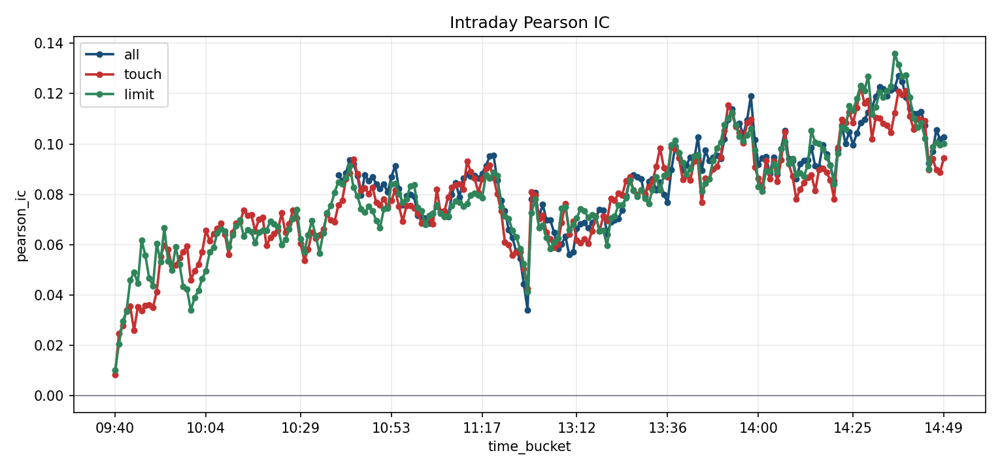

time_bucket vs pearson_ic.

time_bucket vs rank_ic.

字段解释

| field | explanation |
| --- | --- |
| time_bucket | intraday time bucket.  |
| pearson_ic | corr(prediction, target).  |
| rank_ic | corr(rank(prediction), rank(target)).  |
| sample_count | 样本数.  |

## 限制与适用边界

all/touch/limit 主矩阵已完成. touch 的 test pooled IC 为 0.0691368, all 为 0.0686563. 改变总体的 touch-test-all 单列解释. 当前artifact可得性只影响复现, 不作为历史成功/失败判据. 只有matched合同内的结果可以直接比较.

## 结论

本次归档保留上述历史事实. 研究结论, 推广门槛和执行限制分别解释, 不把模型无增益或净收益为负改写成实验流程失败.

## 附录

### 7. Appendix

### 7.1. Source Artifacts

### Source Artifacts

| experiment | artifact | path | exists | row_count | mtime |
| --- | --- | --- | --- | --- | --- |
| all | meta_yaml | [artifact-root]/nn/limit-pool/all/date_ranges/artifacts/npz/meta.yaml | True |  | 2026-06-14T23:11:52 |
| all | perf_audit_yaml | [artifact-root]/nn/limit-pool/all/date_ranges/perf_audit.yaml | True |  | 2026-06-15T05:35:49 |
| all | best_checkpoint_yaml | [artifact-root]/nn/limit-pool/all/date_ranges/run/checkpoint_metadata/best_checkpoint.yaml | True |  | 2026-06-15T04:26:37 |
| all | checkpoint_brief_index_csv | [artifact-root]/nn/limit-pool/all/date_ranges/run/checkpoint_brief_reports/checkpoint_brief_index.csv | True | 11 | 2026-06-15T04:26:37 |
| all | core_ic_summary_train_yaml | [artifact-root]/nn/limit-pool/all/date_ranges/core_ic_summary_train.yaml | True |  | 2026-06-15T05:25:36 |
| all | core_ic_summary_test_yaml | [artifact-root]/nn/limit-pool/all/date_ranges/core_ic_summary_test.yaml | True |  | 2026-06-15T05:25:30 |
| all | test_predict_manifest_yaml | [artifact-root]/nn/limit-pool/all/date_ranges/run/eval_test/iter_10000/predict_manifest.yaml | True | 176,945,440 | 2026-06-15T04:40:44 |
| all | train_predict_manifest_yaml | [artifact-root]/nn/limit-pool/all/date_ranges/run/eval_train/iter_10000/predict_manifest.yaml | True | 562,449,686 | 2026-06-15T05:25:04 |
| all | train_sample_predict_manifest_yaml | [artifact-root]/nn/limit-pool/all/date_ranges/run/eval_train_report_sample/iter_10000/predict_manifest.yaml | True | 31,875,072 | 2026-06-15T04:44:17 |
| all | invalid_feature_stats_csv | [artifact-root]/nn/limit-pool/all/date_ranges/artifacts/data_clean/invalid_feature_stats.csv | True | 15 | 2026-06-14T22:57:13 |
| all | pooled_feature_grid_png | [artifact-root]/nn/limit-pool/all/date_ranges/artifacts/data_clean/pooled_feature_grid.png | True |  | 2026-06-14T23:11:25 |
| all | tensorboard_scalars_parquet | [artifact-root]/nn/limit-pool/all/date_ranges/train/tensorboard_scalars.parquet | True | 0 | 2026-06-15T04:27:13 |
| touch | meta_yaml | [artifact-root]/nn/limit-pool/touch/date_ranges/artifacts/npz/meta.yaml | True |  | 2026-06-14T23:11:51 |
| touch | perf_audit_yaml | [artifact-root]/nn/limit-pool/touch/date_ranges/perf_audit.yaml | True |  | 2026-06-15T05:35:27 |
| touch | best_checkpoint_yaml | [artifact-root]/nn/limit-pool/touch/date_ranges/run/checkpoint_metadata/best_checkpoint.yaml | True |  | 2026-06-15T04:27:18 |
| touch | checkpoint_brief_index_csv | [artifact-root]/nn/limit-pool/touch/date_ranges/run/checkpoint_brief_reports/checkpoint_brief_index.csv | True | 11 | 2026-06-15T04:27:18 |
| touch | core_ic_summary_train_yaml | [artifact-root]/nn/limit-pool/touch/date_ranges/core_ic_summary_train.yaml | True |  | 2026-06-15T05:25:29 |
| touch | core_ic_summary_test_yaml | [artifact-root]/nn/limit-pool/touch/date_ranges/core_ic_summary_test.yaml | True |  | 2026-06-15T05:25:24 |
| touch | test_predict_manifest_yaml | [artifact-root]/nn/limit-pool/touch/date_ranges/run/eval_test/iter_10000/predict_manifest.yaml | True | 173,181,678 | 2026-06-15T04:41:13 |
| touch | train_predict_manifest_yaml | [artifact-root]/nn/limit-pool/touch/date_ranges/run/eval_train/iter_10000/predict_manifest.yaml | True | 552,649,621 | 2026-06-15T05:25:00 |
| touch | train_sample_predict_manifest_yaml | [artifact-root]/nn/limit-pool/touch/date_ranges/run/eval_train_report_sample/iter_10000/predict_manifest.yaml | True | 31,875,072 | 2026-06-15T04:44:49 |
| touch | invalid_feature_stats_csv | [artifact-root]/nn/limit-pool/touch/date_ranges/artifacts/data_clean/invalid_feature_stats.csv | True | 15 | 2026-06-14T22:56:44 |
| touch | pooled_feature_grid_png | [artifact-root]/nn/limit-pool/touch/date_ranges/artifacts/data_clean/pooled_feature_grid.png | True |  | 2026-06-14T23:11:24 |
| touch | tensorboard_scalars_parquet | [artifact-root]/nn/limit-pool/touch/date_ranges/train/tensorboard_scalars.parquet | True | 0 | 2026-06-15T04:27:52 |
| limit | meta_yaml | [artifact-root]/nn/limit-pool/limit/date_ranges/artifacts/npz/meta.yaml | True |  | 2026-06-14T23:10:24 |
| limit | perf_audit_yaml | [artifact-root]/nn/limit-pool/limit/date_ranges/perf_audit.yaml | True |  | 2026-06-15T05:31:41 |
| limit | best_checkpoint_yaml | [artifact-root]/nn/limit-pool/limit/date_ranges/run/checkpoint_metadata/best_checkpoint.yaml | True |  | 2026-06-15T04:23:45 |
| limit | checkpoint_brief_index_csv | [artifact-root]/nn/limit-pool/limit/date_ranges/run/checkpoint_brief_reports/checkpoint_brief_index.csv | True | 11 | 2026-06-15T04:23:45 |
| limit | core_ic_summary_train_yaml | [artifact-root]/nn/limit-pool/limit/date_ranges/core_ic_summary_train.yaml | True |  | 2026-06-15T05:21:22 |
| limit | core_ic_summary_test_yaml | [artifact-root]/nn/limit-pool/limit/date_ranges/core_ic_summary_test.yaml | True |  | 2026-06-15T05:21:17 |
| limit | test_predict_manifest_yaml | [artifact-root]/nn/limit-pool/limit/date_ranges/run/eval_test/iter_10000/predict_manifest.yaml | True | 172,431,790 | 2026-06-15T04:37:26 |
| limit | train_predict_manifest_yaml | [artifact-root]/nn/limit-pool/limit/date_ranges/run/eval_train/iter_10000/predict_manifest.yaml | True | 550,765,767 | 2026-06-15T05:20:57 |
| limit | train_sample_predict_manifest_yaml | [artifact-root]/nn/limit-pool/limit/date_ranges/run/eval_train_report_sample/iter_10000/predict_manifest.yaml | True | 31,875,072 | 2026-06-15T04:41:06 |
| limit | invalid_feature_stats_csv | [artifact-root]/nn/limit-pool/limit/date_ranges/artifacts/data_clean/invalid_feature_stats.csv | True | 15 | 2026-06-14T22:56:08 |
| limit | pooled_feature_grid_png | [artifact-root]/nn/limit-pool/limit/date_ranges/artifacts/data_clean/pooled_feature_grid.png | True |  | 2026-06-14T23:10:00 |
| limit | tensorboard_scalars_parquet | [artifact-root]/nn/limit-pool/limit/date_ranges/train/tensorboard_scalars.parquet | True | 0 | 2026-06-15T04:24:20 |

字段解释

| field | explanation |
| --- | --- |
| artifact | 输入或派生 artifact 名称.  |
| path | artifact 文件路径.  |
| exists | 文件是否存在.  |
| row_count | 分组样本数.  |
| mtime | 文件最后修改时间.  |

### 7.2. Generated Artifacts

### Generated Artifacts

| artifact | path | description |
| --- | --- | --- |
| comparison_report_html | [artifact-root]/nn/limit-pool/comparison_report/061513_limit_pool_comparison_report.html | 完整三实验对比 HTML.  |
| repo_report_html | [local-workspace]/exp-nn/limit-pool/report/061513_limit_pool_comparison_report.html | repo 内镜像 HTML.  |
| section_html_root | [artifact-root]/nn/limit-pool/comparison_report/section_html | standalone section HTML 输出目录.  |
| comparison_artifact_root | [artifact-root]/nn/limit-pool/comparison_report/artifacts | 对比报告派生 artifact 输出目录.  |

字段解释

| field | explanation |
| --- | --- |
| comparison_report_html | 完整三实验对比 HTML.  |
| repo_report_html | repo 内镜像 HTML.  |
| section_html_root | standalone section HTML 输出目录.  |
| comparison_artifact_root | 对比报告派生 artifact 输出目录.  |
