## 摘要

**历史结果: 历史成功.** 四臂 seed7 比较与 baseline verification 已完成. 未过滤 baseline 的 test IC 为0.075855, 高于 touch, ret-ge2 及其组合, 不支持局部增益直接叠加.

历史成功/失败按实验流程是否成功完成判断. 无增益, 成本后亏损, 归档和当前 artifact 缺失不改变历史成功事实. 失败的实验臂保留失败原因, 不填造未产生的 OOS 指标. 本次只整理已有材料, 未启动训练, 推理或回测.

### 1. Executive Summary

benchmark

baseline

current experiment

selected_checkpoint

10,000

checkpoint used for evaluation

train_pooled_ic

0.147383

corr(all train prediction, all train target)

test_pooled_ic

0.075855

corr(all test prediction, all test target)

top_prediction_return_bps

9.6803

mean top-bin prediction return

top95_hit

43.64%

test top 5% prediction label > 0

etf_top95_hit

50.31%

test ETF top 5% prediction label > 0

overfit_variance_ratio

0.016064

test prediction var / label var

model_class

GruMlpRegressor

prediction model

train_range

20210104 -> 20231229 (727 days)

npz split

val_range

20240102 -> 20240229 (37 days)

npz split

test_range

20240301 -> 20241231 (205 days)

npz split

字段解释

| field | explanation |
| --- | --- |
| benchmark | 实验标识.  |
| selected_checkpoint | 最终用于 evaluation 的 checkpoint iteration.  |
| train_pooled_ic | train split 上把所有样本合并后计算的 Pearson IC.  |
| test_pooled_ic | test split 上把所有样本合并后计算的 Pearson IC.  |
| top_prediction_return_bps | 最高 prediction 分组的平均 prediction return, 单位 bps.  |
| top95_hit | test split 中按 prediction 从高到低排序后取最高 5% 样本, 即 prediction >= test prediction 的 95% 分位; 该子样本内 target > 0 的比例.  |
| etf_top95_hit | test split 中先按重要股票池合成 ETF minute-level prediction/real return, 再按 etf_prediction 从高到低排序后取最高 5% 样本; 该子样本内 etf_real_return > 0 的比例.  |
| overfit_variance_ratio | test split 中 prediction 样本方差 / target 样本方差, 用作 overfit 系数; 数值越大表示 prediction 方差相对 label 越高.  |
| model_class | 模型类名.  |
| train_range | 训练集交易日范围.  |
| val_range | 验证集交易日范围.  |
| test_range | 测试集交易日范围.  |

## 研究背景与目标

本报告围绕过滤组合集成整理原始研究证据. 当前材料对应 registry report `main-combo-integration-baseline-verification-063022`, 来源SHA256为 `344e89c1805ab0262251f9caf690d85aa547ec769c90447d66c9e7027449e4f8`. 原报告的实验方法, 图表, 结果和解释保留在下文.

## 数据与方法

实验身份为 `main-combo-integration`. Split, label, sampler, feature与checkpoint定义按原报告记录, 不从其他实验借用缺失字段. 汇总入口见[全实验综述](../../prediction-nn-1min/1103-nn-registry-summary/).

### 2. Data Pipeline

### 2.1. Data Basics

train_days

727 days

val_days

37 days

test_days

205 days

feature_dim

14

features

ret_1m, ret_5m, ret_2m, ret_3m, ret_10m, hl, oc, log_vol, log_amount, vol_10m, log_vol_5m_mean, log_amount_5m_mean, minute_norm, session_minute_norm

label_horizon_minutes

10

label_entry_lag_minutes

1

字段解释

| field | explanation |
| --- | --- |
| features | 模型输入 feature 列表.  |
| feature_dim | 模型输入 feature 维度.  |
| label_horizon_minutes | label forward horizon, 单位 minutes.  |
| label_entry_lag_minutes | label entry lag, 单位 minutes.  |

### 2.2. Data Normalization

feature_normalization

pooled_zscore / scope=train_only

label_normalization

pooled_zscore / scope=train_only

label_horizon_minutes

10

label_entry_lag_minutes

1

train_kept_rate

90.9845%

val_kept_rate

90.7594%

test_kept_rate

90.7552%

max_invalid_ratio

4.3478%

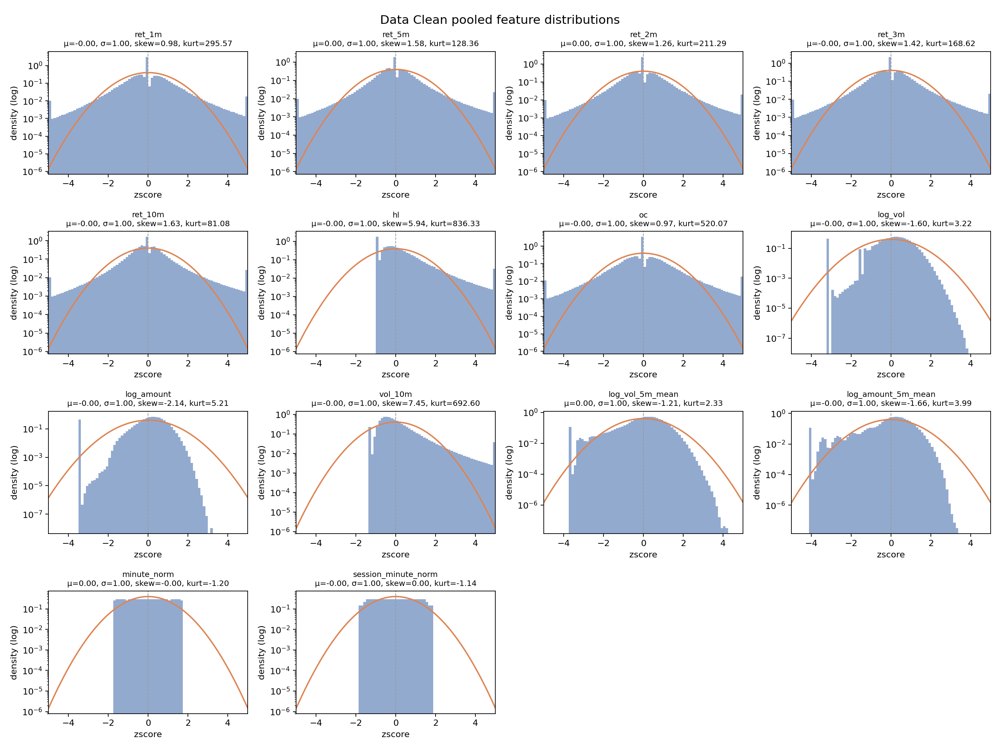

Data clean stage pooled feature distribution overview.

Invalid Feature Stats

| field | total_count | finite_count | nan_count | nan_ratio | inf_ratio | invalid_ratio | mean_finite | std_finite | skew_finite | kurtosis_finite | min_finite | max_finite |
| --- | --- | --- | --- | --- | --- | --- | --- | --- | --- | --- | --- | --- |
| ret_10m | 1,101,812,359 | 1,053,907,469 | 47,904,890 | 0.043478 | 0.000e+00 | 0.043478 | 1.761e-06 | 0.005603 | 1.6356 | 76.5539 | -1.6727 | 0.865563 |
| ret_5m | 1,101,812,359 | 1,077,859,914 | 23,952,445 | 0.021739 | 0.000e+00 | 0.021739 | 3.194e-06 | 0.004230 | 1.5051 | 123.1207 | -1.6727 | 0.798906 |
| ret_3m | 1,101,812,359 | 1,087,440,892 | 14,371,467 | 0.013043 | 0.000e+00 | 0.013043 | 1.985e-06 | 0.003453 | 1.2386 | 181.0435 | -1.6727 | 0.798906 |
| ret_2m | 1,101,812,359 | 1,092,231,381 | 9,580,978 | 0.008696 | 0.000e+00 | 0.008696 | 8.174e-07 | 0.002959 | 0.952790 | 261.6240 | -1.6727 | 0.798906 |
| vol_10m | 1,101,812,359 | 1,092,231,381 | 9,580,978 | 0.008696 | 0.000e+00 | 0.008696 | 5.761e-04 | 5.217e-04 | 16.4753 | 9,114 | 0.000e+00 | 0.617598 |
| ret_1m | 1,101,812,359 | 1,097,021,870 | 4,790,489 | 0.004348 | 0.000e+00 | 0.004348 | -4.458e-07 | 0.002307 | 0.362084 | 515.1994 | -1.6727 | 0.759663 |
| hl | 1,101,812,359 | 1,101,812,359 | 0 | 0.000e+00 | 0.000e+00 | 0.000e+00 | 6.297e-04 | 7.656e-04 | 6.5825 | 373.2723 | 0.000e+00 | 0.434688 |
| label_ret | 1,101,812,359 | 1,101,812,359 | 0 | 0.000e+00 | 0.000e+00 | 0.000e+00 | 1.255e-05 | 0.005302 | 1.8885 | 154.0531 | -1.0953 | 1.3763 |
| log_amount | 1,101,812,359 | 1,101,812,359 | 0 | 0.000e+00 | 0.000e+00 | 0.000e+00 | 11.4832 | 3.2305 | -2.1751 | 5.5956 | 0.000e+00 | 22.6198 |
| log_amount_5m_mean | 1,101,812,359 | 1,101,812,359 | 0 | 0.000e+00 | 0.000e+00 | 0.000e+00 | 11.4892 | 2.7392 | -1.6615 | 4.1620 | 0.000e+00 | 21.9334 |
| log_vol | 1,101,812,359 | 1,101,812,359 | 0 | 0.000e+00 | 0.000e+00 | 0.000e+00 | 9.0735 | 2.7798 | -1.6109 | 3.4554 | 0.000e+00 | 20.3408 |
| log_vol_5m_mean | 1,101,812,359 | 1,101,812,359 | 0 | 0.000e+00 | 0.000e+00 | 0.000e+00 | 9.0797 | 2.3991 | -1.1914 | 2.4276 | 0.000e+00 | 20.1280 |
| minute_norm | 1,101,812,359 | 1,101,812,359 | 0 | 0.000e+00 | 0.000e+00 | 0.000e+00 | 0.477083 | 0.276644 | -1.353e-07 | -1.2000 | 0.000e+00 | 0.954167 |
| oc | 1,101,812,359 | 1,101,812,359 | 0 | 0.000e+00 | 0.000e+00 | 0.000e+00 | 4.115e-06 | 7.239e-04 | 0.838557 | 287.4301 | -0.312980 | 0.353188 |
| session_minute_norm | 1,101,812,359 | 1,101,812,359 | 0 | 0.000e+00 | 0.000e+00 | 0.000e+00 | 0.475906 | 0.278200 | 0.019245 | -1.1738 | 0.000e+00 | 0.991667 |

字段解释

| field | explanation |
| --- | --- |
| feature_normalization | feature normalization 方法和 fit scope.  |
| label_normalization | label normalization 方法和 fit scope.  |
| kept_rate | 清洗后保留样本数 / 清洗前样本数.  |
| max_invalid_ratio | 单个字段中 invalid 样本占比的最大值.  |

## 主要结果

| 记录项 | 当前解释 |
| --- | --- |
| 实验 | main-combo-integration |
| 报告类型 | full_report_html |
| 历史状态 | 历史成功 |
| 证据 | main-combo-integration-baseline-verification-063022 |

训练监控, 信号质量, 交易成本与稳健性评估. 

生成日期: 2026-06-30

### 3. Evaluation

### 3.1. IC Summary

| split | pooled_ic | pooled_rank_ic | count |
| --- | --- | --- | --- |
| train | 0.147383 | 0.128778 | 7,968,768 |
| test | 0.075855 | 0.049263 | 176,945,440 |

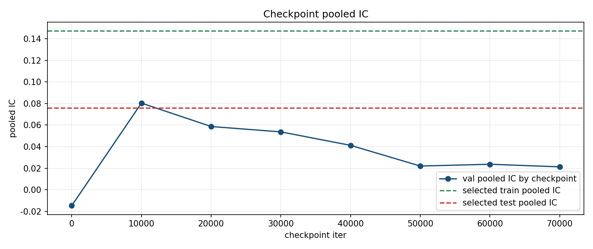

Validation checkpoint pooled IC with selected train/test pooled IC references.

### core_ic_metrics.csv

| split | pooled_ic | pooled_rank_ic | count |
| --- | --- | --- | --- |
| train | 0.147383 | 0.128778 | 7,968,768 |
| test | 0.075855 | 0.049263 | 176,945,440 |

字段解释

| field | explanation |
| --- | --- |
| pooled_ic | 合并样本后计算的 Pearson IC.  |
| pooled_rank_ic | 合并样本后计算的 Rank IC.  |
| pearson_ic | corr(prediction, target).  |
| rank_ic | corr(rank(prediction), rank(target)).  |

### 3.2. Signal Quality 1: bucket (10)

字段解释

| field | explanation |
| --- | --- |
| signal_bucket | 按 prediction 从低到高切分的分组编号.  |
| mean_prediction | 分组内 prediction 均值.  |
| mean_label_bps | 分组内 target 均值, 单位 bps.  |
| t_stat | 分组 mean_label_bps 相对 0 的 t-stat.  |
| hit_rate | 分组内 target > 0 的比例.  |
| top_bottom_signal_spread_bps | Top bucket 平均 target return 减 bottom bucket 平均 target return, 单位 bps.  |
| Daily top-minus-bottom signal spread | 每天内部按 prediction 排序, 用 ntile(10) 分 bucket. 对每天的 top decile 和 bottom decile 计算 realized return.  |

| signal_bucket | mean_prediction | mean_label_bps | t_stat | hit_rate | row_count | top_bottom_signal_spread_bps |
| --- | --- | --- | --- | --- | --- | --- |
| 1.0000 | -8.454e-04 | -5.1848 | -382.2619 | 0.362620 | 17,694,544 | 9.5939 |
| 2.0000 | -2.817e-04 | -1.0422 | -107.7003 | 0.385082 | 17,694,544 | 9.5939 |
| 3.0000 | -1.515e-04 | -0.762819 | -87.9951 | 0.377182 | 17,694,544 | 9.5939 |
| 4.0000 | -6.792e-05 | -0.480903 | -57.6010 | 0.369561 | 17,694,544 | 9.5939 |
| 5.0000 | 3.817e-06 | -0.128486 | -15.6339 | 0.364422 | 17,694,544 | 9.5939 |
| 6.0000 | 7.434e-05 | 0.282500 | 33.9054 | 0.373881 | 17,694,544 | 9.5939 |
| 7.0000 | 1.536e-04 | 0.721691 | 83.9100 | 0.388801 | 17,694,544 | 9.5939 |
| 8.0000 | 2.543e-04 | 1.2725 | 139.6842 | 0.400450 | 17,694,544 | 9.5939 |
| 9.0000 | 4.221e-04 | 1.9628 | 190.3165 | 0.413323 | 17,694,544 | 9.5939 |
| 10.0000 | 9.925e-04 | 4.4091 | 309.7889 | 0.429177 | 17,694,544 | 9.5939 |

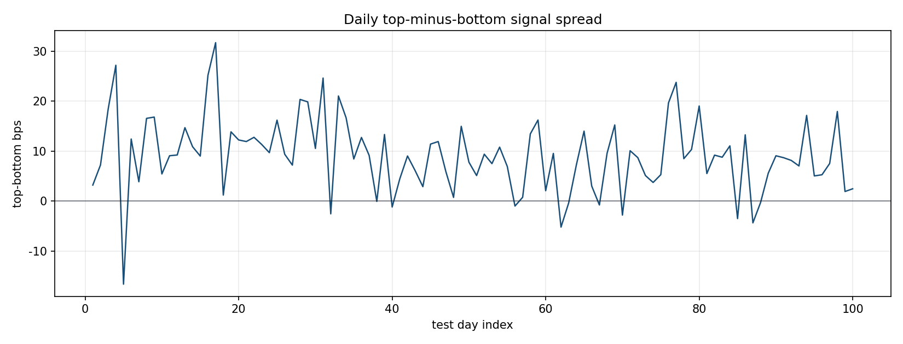

Daily top decile target return minus bottom decile target return on the test split.

### 3.3. Signal Quality 2: Important Stock Pool

prediction != 0 metrics dataset

test split, [artifact-root]/nn/main-combo-integration-rerun-baseline-fast/baseline/date_ranges/run/eval_test/iter_10000/predict_manifest.yaml

checkpoint IC dataset

val split checkpoints, [artifact-root]/nn/main-combo-integration-rerun-baseline-fast/baseline/date_ranges/run/eval_val

cumulative return dataset

train + val + test, shown in 5. Trading And Cost

### prediction != 0 metrics

| pool | etf_code | pearson_ic | rank_ic | mean_prediction_return | mean_real_return | prediction_positive_ratio | real_return_positive_ratio | count |
| --- | --- | --- | --- | --- | --- | --- | --- | --- |
| 1000 ETF | 512100.SH | 0.038027 | 0.023164 | 6.314e-05 | 1.142e-05 | 0.560952 | 0.395209 | 33,006,803 |
| 沪深300 ETF(沪) | 510300.SH | 0.024954 | 0.014380 | 8.511e-05 | 2.275e-05 | 0.589907 | 0.413857 | 9,902,614 |
| 中证500 ETF(沪) | 510500.SH | 0.028039 | 0.017748 | 7.239e-05 | -1.432e-06 | 0.575830 | 0.391601 | 16,503,970 |

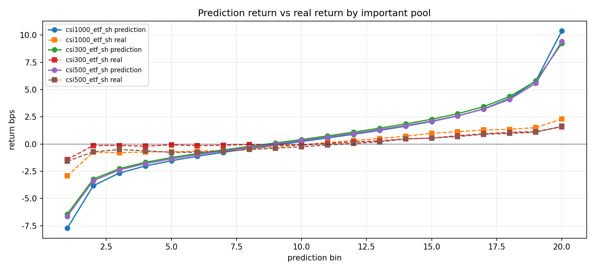

Important-pool mean prediction return and real return by prediction rank bin.

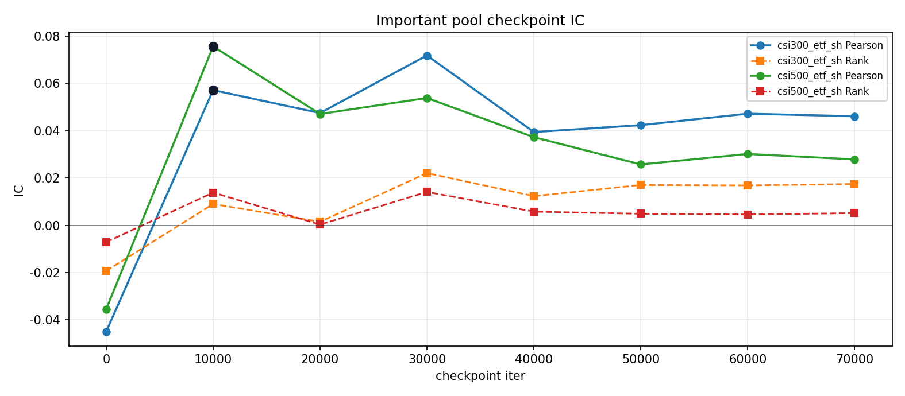

Checkpoint IC for CSI500 and CSI300 important pools.

字段解释

| field | explanation |
| --- | --- |
| prediction != 0 metrics | 按 date, code join prediction rows, 过滤 isfinite(prediction), isfinite(target), prediction != 0. 按 pool 聚合各项指标.  |
| Prediction Return vs Real Return 图 | 每个 pool 内按 prediction 排序, 用 ntile(20) 分 prediction_bin, 单位显示为 bps.  |
| pearson_ic | corr(prediction, target).  |
| rank_ic | corr(rank(prediction), rank(target)).  |
| mean_prediction_return | prediction 的样本均值.  |
| mean_real_return | target 的样本均值.  |
| real_return_positive_ratio | target > 0 的样本占比.  |
| prediction_positive_ratio | prediction > 0 的样本占比.  |

### 3.4. Goodness Of Fit

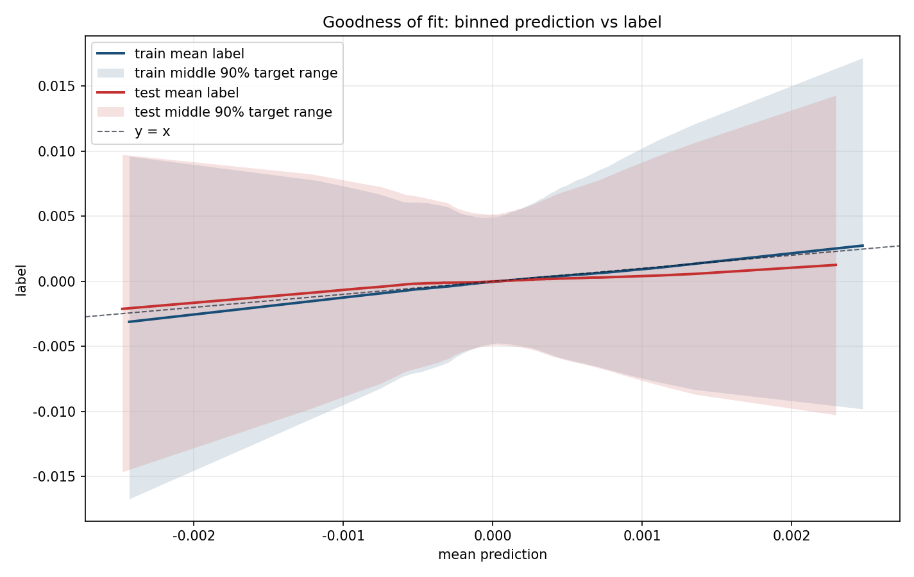

Train/test are separately sorted by prediction and cut into 100 equal-frequency bins; x is bin mean prediction, y is label, and transparent bands show the p5-p95 target range within each prediction bin.

### goodness_of_fit_metrics.csv edge bins

| split | prediction_bin | mean_prediction | mean_label | label_p05 | label_p95 | row_count |
| --- | --- | --- | --- | --- | --- | --- |
| train | 1 | -0.002432 | -0.003109 | -0.016708 | 0.009605 | 5,624,497 |
| train | 2 | -0.001174 | -0.001476 | -0.010353 | 0.007740 | 5,624,497 |
| train | 3 | -9.013e-04 | -0.001119 | -0.008980 | 0.007076 | 5,624,497 |
| train | 4 | -7.611e-04 | -9.408e-04 | -0.008263 | 0.006699 | 5,624,497 |
| train | 5 | -6.681e-04 | -8.208e-04 | -0.007702 | 0.006371 | 5,624,497 |
| train | 96 | 8.497e-04 | 7.700e-04 | -0.007004 | 0.009346 | 5,624,496 |
| train | 97 | 9.531e-04 | 8.824e-04 | -0.007317 | 0.009956 | 5,624,496 |
| train | 98 | 0.001102 | 0.001036 | -0.007721 | 0.010826 | 5,624,496 |
| train | 99 | 0.001357 | 0.001355 | -0.008324 | 0.012115 | 5,624,496 |
| train | 100 | 0.002474 | 0.002741 | -0.009804 | 0.017151 | 5,624,496 |
| test | 1 | -0.002479 | -0.002115 | -0.014633 | 0.009735 | 1,769,455 |
| test | 2 | -0.001216 | -8.821e-04 | -0.009766 | 0.008240 | 1,769,455 |
| test | 3 | -9.019e-04 | -5.602e-04 | -0.008453 | 0.007576 | 1,769,455 |
| test | 4 | -7.482e-04 | -4.178e-04 | -0.007835 | 0.007256 | 1,769,455 |
| test | 5 | -6.509e-04 | -3.165e-04 | -0.007298 | 0.006920 | 1,769,455 |
| test | 96 | 8.566e-04 | 3.440e-04 | -0.007145 | 0.008492 | 1,769,454 |
| test | 97 | 9.584e-04 | 3.862e-04 | -0.007488 | 0.008957 | 1,769,454 |
| test | 98 | 0.001105 | 4.417e-04 | -0.007957 | 0.009636 | 1,769,454 |
| test | 99 | 0.001355 | 5.731e-04 | -0.008682 | 0.010666 | 1,769,454 |
| test | 100 | 0.002296 | 0.001257 | -0.010254 | 0.014282 | 1,769,454 |

字段解释

| field | explanation |
| --- | --- |
| Goodness Of Fit | 按 split 全局对 prediction 从低到高排序并切成 100 个等频分段, 检查每段 mean_prediction 与 mean_label 是否接近.  |
| prediction_bin | 按 prediction 从低到高排序后的等频分段编号, 1 为最低 prediction 段.  |
| mean_prediction | 分组内 prediction 均值.  |
| mean_label | 分组内 target 均值, 保持原始 target 单位.  |
| label_std | 分组内 target 的样本标准差.  |
| label_se | 分组 mean_label 的标准误, 计算为 label_std / sqrt(row_count).  |
| label_p05 | 分组内 target 的 5% 分位, 用作中间 90% 散点位置阴影下界.  |
| label_p95 | 分组内 target 的 95% 分位, 用作中间 90% 散点位置阴影上界.  |
| label_ci90_low | mean_label 的 90% 正态近似置信区间下界, mean_label - 1.64485 * label_se.  |
| label_ci90_high | mean_label 的 90% 正态近似置信区间上界, mean_label + 1.64485 * label_se.  |
| row_count | 分组内有限 prediction/target 样本数.  |

### 3.5. Liquidity By ADV

ADV uses a shifted 20-trading-day mean of stock1d amount. Buckets are formed globally over the full test-universe date-code pool, not within each date. The current day's full daily_amount is not used to bucket current-day predictions.

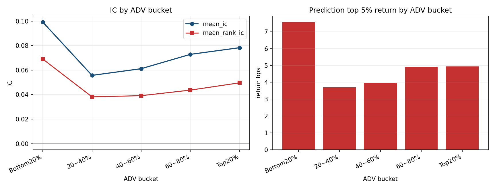

Left: Pearson IC and Rank IC by date-level ADV bucket. Right: prediction top 5% target return by ADV bucket.

### adv_liquidity_bucket_metrics.csv

| adv_bucket | bucket_label | row_count | day_count | mean_adv_amount | median_adv_amount | mean_ic | mean_rank_ic | icir | rank_icir | top5_return_bps | top5_hit_rate | top5_row_count |
| --- | --- | --- | --- | --- | --- | --- | --- | --- | --- | --- | --- | --- |
| 1 | Bottom20% | 33,213,495 | 100 | 22,436 | 23,206 | 0.099148 | 0.068982 | 3.4315 | 4.1688 | 7.5548 | 0.414912 | 1,667,316 |
| 2 | 20~40% | 33,714,849 | 100 | 46,291 | 45,971 | 0.055688 | 0.038185 | 3.3012 | 2.5759 | 3.7034 | 0.404881 | 1,693,237 |
| 3 | 40~60% | 33,822,880 | 100 | 78,908 | 77,696 | 0.061138 | 0.039124 | 3.1052 | 2.3752 | 3.9776 | 0.422230 | 1,698,228 |
| 4 | 60~80% | 33,743,507 | 100 | 145,624 | 141,033 | 0.072830 | 0.043659 | 3.5673 | 2.5356 | 4.9322 | 0.440097 | 1,694,364 |
| 5 | Top20% | 33,697,783 | 100 | 553,370 | 359,597 | 0.078268 | 0.049599 | 3.1319 | 2.4838 | 4.9330 | 0.458997 | 1,692,110 |

字段解释

| field | explanation |
| --- | --- |
| Liquidity By ADV | 按完整 test universe 的 date-code 样本池, 用 shifted/trailing ADV 全局分五桶, 检查不同流动性股票上的 IC 与 prediction top 5% return.  |
| adv_bucket | 按完整 test universe date-code 样本池的 adv_amount 排序后的全局五分桶编号; 1 为 Bottom20%, 5 为 Top20%.  |
| bucket_label | ADV 五分桶可读标签.  |
| row_count | 分组内有限 prediction/target 样本数.  |
| day_count | 入选样本覆盖的交易日数量.  |
| mean_adv_amount | 当前 ADV 桶内 date-code 层面的平均 shifted/trailing ADV.  |
| median_adv_amount | 当前 ADV 桶内 date-code 层面的中位 shifted/trailing ADV.  |
| mean_ic | 当前 ADV 桶内先按 date,time 横截面计算 Pearson IC, 再按 date 聚合后的均值.  |
| mean_rank_ic | 当前 ADV 桶内先按 date,time 横截面计算 Rank IC, 再按 date 聚合后的均值.  |
| icir | 当前 ADV 桶 daily IC 的 mean/std.  |
| rank_icir | 当前 ADV 桶 daily Rank IC 的 mean/std.  |
| top5_return_bps | 当前 ADV 桶内每个 date,time 截面 prediction 最高 5% 样本的平均 target return, 单位 bps.  |
| top5_hit_rate | 当前 ADV 桶内 prediction 最高 5% 样本 target > 0 的比例.  |
| top5_row_count | 当前 ADV 桶内进入 prediction top 5% return 统计的样本数.  |

### 4. Train Metrics

### 4.1. Checkpoint Selection

| key | value |
| --- | --- |
| best_iter | 10,000 |
| selection_metric | checkpoint_selection/score |
| selection_rule | early_top_k |
| selection_value | 0.048492 |
| candidate_count | 8 |

checkpoint_selector_table.csv

| iter | selected | val/objective/mse | val/quality/global_ic | val/quality/rank_ic | val/dist/pred_std_over_target_std | decision | metric_rank |
| --- | --- | --- | --- | --- | --- | --- | --- |
| 0 | False | 3.529e-05 | -0.014771 | 0.011102 | nan | reject | 8.0000 |
| 10,000 | True | 3.512e-05 | 0.080399 | 0.036025 | nan | promote | 1.0000 |
| 20,000 | False | 3.566e-05 | 0.058686 | 0.025840 | nan | reject | 2.0000 |
| 30,000 | False | 3.614e-05 | 0.053701 | 0.030732 | nan | reject | 3.0000 |
| 40,000 | False | 3.712e-05 | 0.041216 | 0.025889 | nan | reject | 4.0000 |
| 50,000 | False | 3.885e-05 | 0.022027 | 0.024470 | nan | reject | 6.0000 |
| 60,000 | False | 3.954e-05 | 0.023676 | 0.021437 | nan | reject | 5.0000 |
| 70,000 | False | 3.961e-05 | 0.021282 | 0.022415 | nan | reject | 7.0000 |

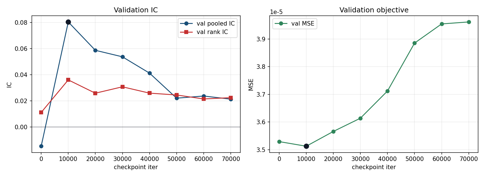

Validation objective and IC metrics by checkpoint iteration.

### 4.2. Model And Method

### Model

model_class

GruMlpRegressor

model class

trainable_parameter

1,808,129

trainable parameter count

input_tensor

batch, window, 14

GRU input

prediction_target

future log close return

raw target

label_horizon_minutes

10

requested report horizon

label_entry_lag_minutes

1

entry lag

gru_hidden_size

384

GRU hidden size

gru_num_layers

2

GRU layers

gru_bidirectional

False

GRU direction

gru_dropout

0.0

GRU dropout

mlp_effective_hidden_width

512

MLP effective hidden width

mlp_dropout

0.0

MLP dropout

optimizer

AdamW

optimizer

learning_rate

0.0003

base LR

lr_scheduler/type

LinearWarmup + CosineAnnealing

qmodel scheduler

approx_total_epochs

0.106599

through selected checkpoint

### 4.2.1. GRU

| field | value |
| --- | --- |
| input_tensor | batch, window, 14 |
| gru_hidden_size | 384 |
| gru_num_layers | 2 |
| gru_bidirectional | False |
| gru_dropout | 0.0 |

### 4.2.2. MLP

| field | value |
| --- | --- |
| mlp_effective_hidden_width | 512 |
| mlp_dropout | 0.0 |

### 4.2.3. Method

| field | value |
| --- | --- |
| parameter_initialization | PyTorch default GRU and Linear initialization |
| lr_scheduler/type | LinearWarmup + CosineAnnealing |
| optimizer | AdamW |
| approx_total_epochs | 0.106599 |
| final_iter | 70,000 |
| checkpoint_selection | early_top_k checkpoint_selection/score |

字段解释

| field | explanation |
| --- | --- |
| model_class | 模型类名.  |
| trainable_parameter | 可训练参数数量.  |
| gru_bidirectional | GRU 是否使用 bidirectional 结构.  |
| parameter_initialization | 模型参数初始化方式.  |
| selected_checkpoint | 最终用于 evaluation 的 checkpoint iteration.  |

### 4.3. Training Monitoring

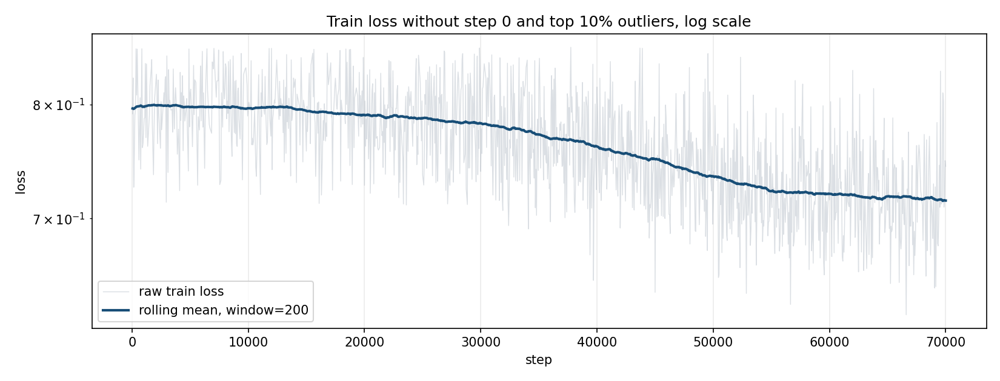

Train loss with step=0 and the top 10% loss outliers removed, log y-axis, and a rolling mean smoothing curve.

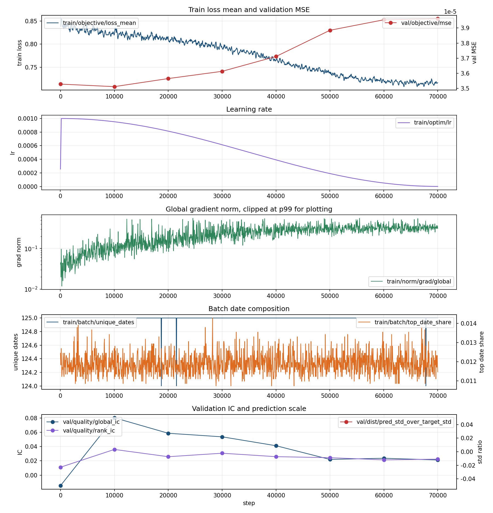

MLflow-backed train diagnostics plus local validation scalar curves for loss, LR, grad norm, batch composition, IC, and prediction scale.

字段解释

| field | explanation |
| --- | --- |
| Train loss | 读取 TensorBoard scalar parquet, 过滤 step > 0, 删除最高 10% loss outlier, 用 rolling(window=200, min_periods=20, center=True) 计算 smoothed_loss, y-axis 使用 log scale.  |
| train/objective/loss_mean | MLflow 中记录的 train objective loss rolling mean.  |
| train/optim/lr | MLflow 中记录的 optimizer learning rate.  |
| train/norm/grad/global | MLflow 中记录的所有可训练参数梯度拼接后的 L2 norm.  |
| train/batch/unique_dates | MLflow 中记录的一个 batch 内覆盖的不同交易日数量.  |
| train/batch/top_date_share | MLflow 中记录的一个 batch 内样本最多交易日的样本占比.  |
| val/objective/mse | validation split 上的 objective MSE.  |
| val/quality/global_ic | validation split 上的 global Pearson IC.  |
| val/quality/rank_ic | validation split 上的 rank IC.  |
| val/dist/pred_std_over_target_std | validation prediction std / target std.  |

### 5. Trading And Cost

### 5.0. Cost Model Status

Cost model artifact status

status

pending real cost artifact

available_metric

simple ETF prediction-threshold long/flat compound backtest by important stock pool

### 5.1. Cumulative Prediction, Real, And Excess Returns

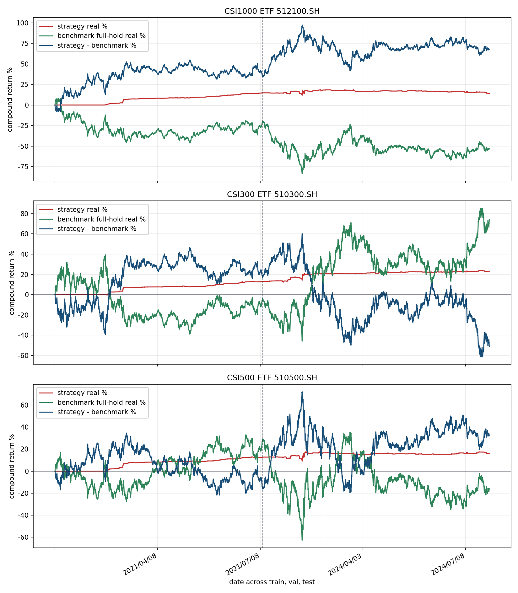

Benchmark is continuous full-hold ETF real return; strategy uses the 4800-minute trailing 95% ETF prediction threshold and 5-minute trading rule; excess line is strategy real % minus benchmark full-hold real %.

| pool | days | final_cum_prediction_bps | final_cum_real_bps | final_benchmark_real_bps | final_cum_excess_bps | 平均每天开仓次数 | 平均每天return_bps | 平均每次开仓return_bps |
| --- | --- | --- | --- | --- | --- | --- | --- | --- |
| 1000 ETF | 262 | 2,604 | 1,417 | -5,308 | 14,332 | 1.0534 | 5.1533 | 4.8868 |
| 沪深300 ETF(沪) | 262 | 2,519 | 2,261 | 7,388 | -2,948 | 1.1221 | 7.8432 | 6.9802 |
| 中证500 ETF(沪) | 262 | 2,542 | 1,600 | -1,605 | 3,817 | 1.0763 | 5.7561 | 5.3487 |

### Backtest risk/trading metrics

| pool | max_drawdown_pct | exposure_ratio | win_rate_by_trade | avg_holding_minutes |
| --- | --- | --- | --- | --- |
| 1000 ETF | -4.3800 | 0.045035 | 0.630435 | 6.9022 |
| 沪深300 ETF(沪) | -2.7394 | 0.044799 | 0.639456 | 6.4456 |
| 中证500 ETF(沪) | -4.7164 | 0.045626 | 0.624113 | 6.8440 |

### Test-only backtest metrics

| pool | test_days | test_cum_strategy_bps | test_cum_benchmark_bps | test_excess_bps | max_drawdown_pct | exposure_ratio | win_rate_by_trade | avg_holding_minutes |
| --- | --- | --- | --- | --- | --- | --- | --- | --- |
| 1000 ETF | 100 | -347.2762 | 1,627 | -1,698 | -3.8492 | 0.043789 | 0.533333 | 6.7143 |
| 沪深300 ETF(沪) | 100 | 120.0237 | 4,342 | -2,944 | -0.975368 | 0.048758 | 0.587786 | 5.9924 |
| 中证500 ETF(沪) | 100 | -50.9415 | -326.8983 | 285.2826 | -1.5943 | 0.043789 | 0.509434 | 6.6509 |

字段解释

| field | explanation |
| --- | --- |
| model | benchmark 为 ETF 每分钟一直满仓持有得到 real return; strategy 按 pool 合成分钟级 ETF prediction, 用过去 4800 分钟的 95% 分位做开仓阈值, 每 5 分钟开平仓并复利交易.  |
| strategy real % | 按 5 分钟开平仓规则, 用真实 etf_real_return 复利得到的策略实际收益.  |
| benchmark full-hold real % | 不做择时, ETF/pool 每分钟一直满仓持有, 用 etf_real_return 连续复利得到的 benchmark 收益.  |
| strategy - benchmark % | strategy real % - benchmark full-hold real %.  |
| max_drawdown_pct | strategy_nav 相对历史高点的最大回撤, 单位 %.  |
| exposure_ratio | position > 0 的分钟数 / 总分钟数.  |
| win_rate_by_trade | 按 trade_id 聚合每次开仓复利收益, 收益大于 0 的比例.  |
| avg_holding_minutes | 每个 trade_id 覆盖的分钟数均值.  |
| test_cum_strategy_bps | test split 内 strategy_minute_return 从 1 重新复利后的累计收益, 单位 bps.  |
| test_cum_benchmark_bps | test split 内 benchmark_minute_return 从 1 重新复利后的累计收益, 单位 bps.  |
| test_excess_bps | (1 + test_cum_strategy_return) / (1 + test_cum_benchmark_return) - 1, 单位 bps.  |

### 5.2. Single-Side Cost Sensitivity

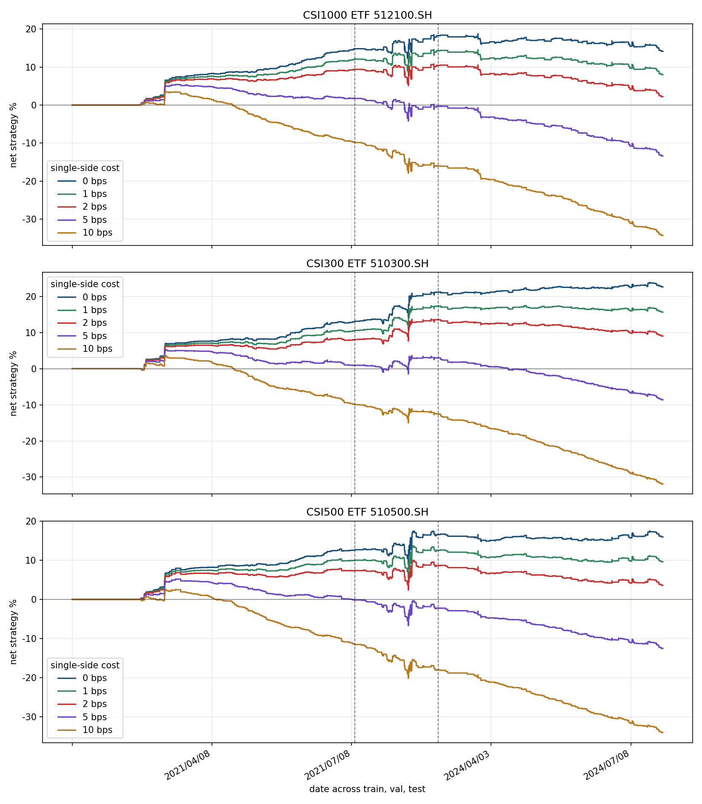

train, val, and test shown on the same axis as 5.1; trading rule is the same as 5.1; cost is deducted as abs(position - prev_position) * single-side cost bps / 10000.

### Test-only cost model metrics

| pool | single_side_cost_bps | test_days | test_cum_net_strategy_bps | test_cum_benchmark_bps | test_net_excess_bps | total_turnover | total_cost_bps | max_drawdown_pct | exposure_ratio | win_rate_by_trade | avg_holding_minutes |
| --- | --- | --- | --- | --- | --- | --- | --- | --- | --- | --- | --- |
| 1000 ETF | 0.000e+00 | 100 | -347.2762 | 1,627 | -1,698 | 210.0000 | 0.000e+00 | -3.8492 | 0.043789 | 0.533333 | 6.7143 |
| 1000 ETF | 1.0000 | 100 | -547.8725 | 1,627 | -1,870 | 210.0000 | 210.0000 | -5.7060 | 0.043789 | 0.485714 | 6.7143 |
| 1000 ETF | 2.0000 | 100 | -744.3196 | 1,627 | -2,039 | 210.0000 | 420.0000 | -7.5272 | 0.043789 | 0.457143 | 6.7143 |
| 1000 ETF | 5.0000 | 100 | -1,310 | 1,627 | -2,526 | 210.0000 | 1,050 | -13.1436 | 0.043789 | 0.285714 | 6.7143 |
| 1000 ETF | 10.0000 | 100 | -2,176 | 1,627 | -3,271 | 210.0000 | 2,100 | -21.7678 | 0.043789 | 0.114286 | 6.7143 |
| 沪深300 ETF(沪) | 0.000e+00 | 100 | 120.0237 | 4,342 | -2,944 | 262.0000 | 0.000e+00 | -0.975368 | 0.048758 | 0.587786 | 5.9924 |
| 沪深300 ETF(沪) | 1.0000 | 100 | -141.6900 | 4,342 | -3,126 | 262.0000 | 262.0000 | -1.5416 | 0.048758 | 0.519084 | 5.9924 |
| 沪深300 ETF(沪) | 2.0000 | 100 | -396.6606 | 4,342 | -3,304 | 262.0000 | 524.0000 | -4.0033 | 0.048758 | 0.450382 | 5.9924 |
| 沪深300 ETF(沪) | 5.0000 | 100 | -1,123 | 4,342 | -3,810 | 262.0000 | 1,310 | -11.2356 | 0.048758 | 0.244275 | 5.9924 |
| 沪深300 ETF(沪) | 10.0000 | 100 | -2,214 | 4,342 | -4,571 | 262.0000 | 2,620 | -22.1355 | 0.048758 | 0.061069 | 5.9924 |
| 中证500 ETF(沪) | 0.000e+00 | 100 | -50.9415 | -326.8983 | 285.2826 | 212.0000 | 0.000e+00 | -1.5943 | 0.043789 | 0.509434 | 6.6509 |
| 中证500 ETF(沪) | 1.0000 | 100 | -259.6534 | -326.8983 | 69.5174 | 212.0000 | 212.0000 | -2.7990 | 0.043789 | 0.462264 | 6.6509 |
| 中证500 ETF(沪) | 2.0000 | 100 | -464.0072 | -326.8983 | -141.7424 | 212.0000 | 424.0000 | -4.7110 | 0.043789 | 0.386792 | 6.6509 |
| 中证500 ETF(沪) | 5.0000 | 100 | -1,052 | -326.8983 | -749.4160 | 212.0000 | 1,060 | -10.5579 | 0.043789 | 0.235849 | 6.6509 |
| 中证500 ETF(沪) | 10.0000 | 100 | -1,952 | -326.8983 | -1,680 | 212.0000 | 2,120 | -19.5243 | 0.043789 | 0.066038 | 6.6509 |

Test date range: 2024/03/01 -> 2024/07/26 (100 trading days), including 2024/09 and 2024/10.

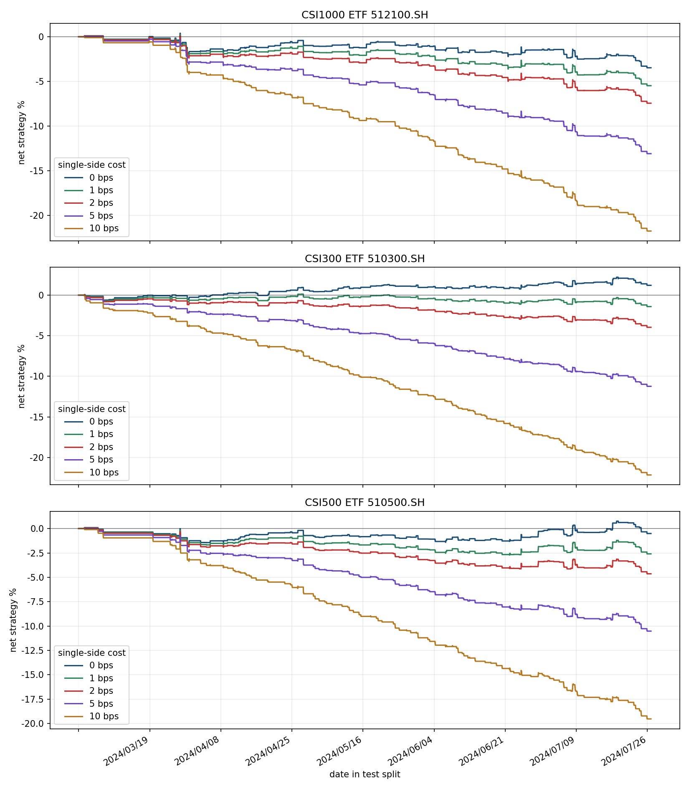

test split only; trading rule is the same as 5.1; cost is deducted as abs(position - prev_position) * single-side cost bps / 10000.

test split only with 2024/09 and 2024/10 removed before recompounding; trading rule and single-side cost deduction match the other 5.2 figures.

字段解释

| field | explanation |
| --- | --- |
| single_side_cost_bps | 单边交易成本, 按 abs(position - prev_position) * cost_bps / 10000 从 strategy_minute_return 中扣减.  |
| test_cum_net_strategy_bps | test split 内扣除单边交易成本后的 strategy_minute_return 从 1 重新复利后的累计收益, 单位 bps.  |
| test_cum_benchmark_bps | test split 内 benchmark_minute_return 从 1 重新复利后的累计收益, 单位 bps.  |
| test_net_excess_bps | (1 + test_cum_net_strategy_return) / (1 + test_cum_benchmark_return) - 1, 单位 bps.  |
| total_turnover | test split 内 abs(position - prev_position) 的合计.  |
| total_cost_bps | test split 内累计扣除的交易成本, 近似为 sum(turnover_event * single_side_cost_bps).  |
| max_drawdown_pct | strategy_nav 相对历史高点的最大回撤, 单位 %.  |
| exposure_ratio | position > 0 的分钟数 / 总分钟数.  |
| win_rate_by_trade | 按 trade_id 聚合每次开仓复利收益, 收益大于 0 的比例.  |
| avg_holding_minutes | 每个 trade_id 覆盖的分钟数均值.  |
| net_strategy_cumulative_return | test split 内扣除单边交易成本后的 strategy return 从 1 重新复利得到的累计收益.  |
| position | 调仓分钟 ETF prediction > baseline_threshold 时为 1, 否则为 0; 非调仓分钟沿用上一分钟持仓.  |
| prev_position | 同一个 pool 上一分钟的 position, 成本分析中用于计算 abs(position - prev_position).  |
| strategy_minute_return | return_event 为 true 时等于 position * etf_real_return, 否则为 0.  |

### 5.3. ETF Trade Return Distribution

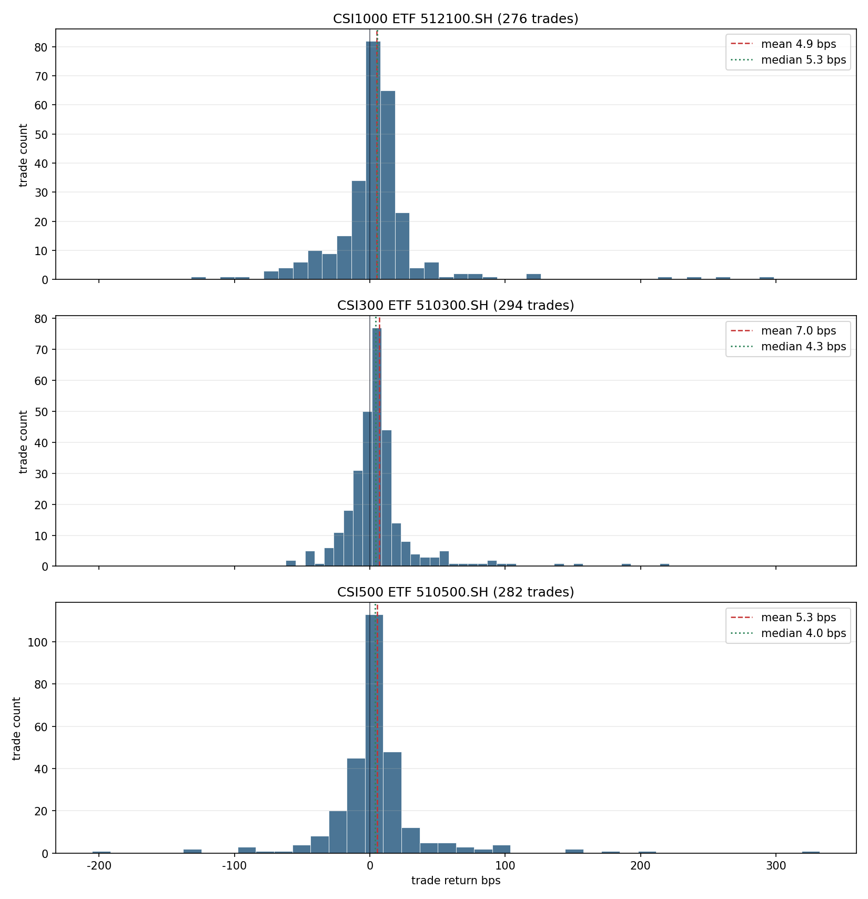

Each observation is one pool + trade_id from the 5.1 ETF long/flat strategy. For each trade_id, trade return is compounded across the rebalance return events while the position is active, using strategy_minute_return.

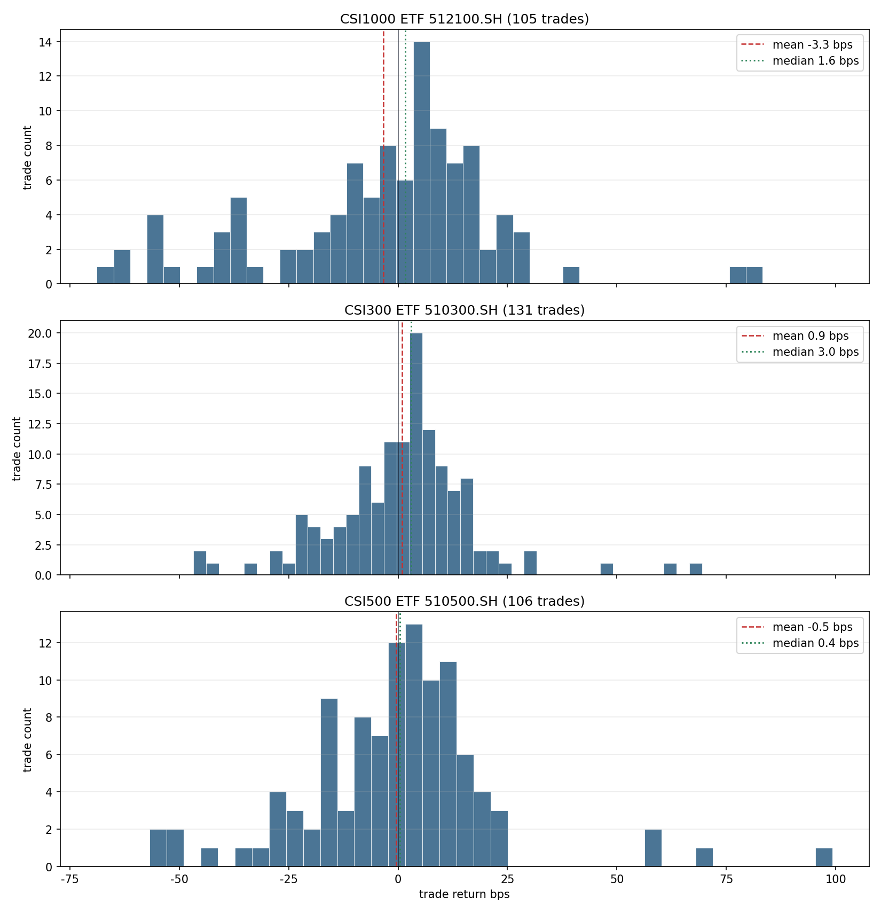

Test split only; each observation is one pool + trade_id observed inside test. For each trade_id, trade return is compounded across the rebalance return events while the position is active, using strategy_minute_return.

字段解释

| field | explanation |
| --- | --- |
| trade_return_bps | 按 pool + trade_id 聚合 strategy_minute_return 复利后的单笔交易收益, 单位 bps.  |
| trade_id | 每次开仓生成一个 trade id, 持仓期间沿用该 id, 空仓时为 0.  |
| holding_minutes | 持仓分钟数; 交易分布中表示同一个 trade_id 覆盖的分钟行数, 6.5 中表示 future holding horizon.  |
| strategy_minute_return | return_event 为 true 时等于 position * etf_real_return, 否则为 0.  |

### 5.4. Entry Delay Decay Experiment

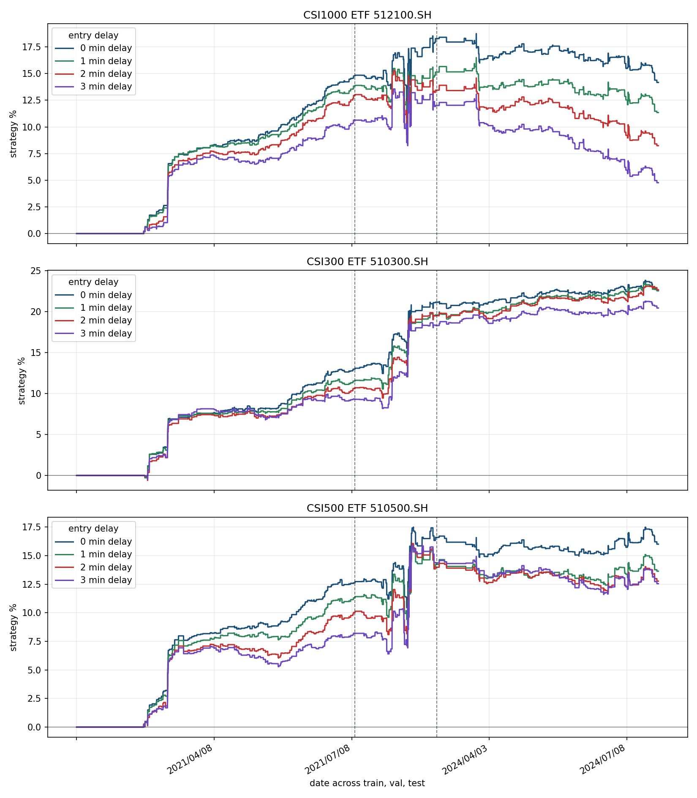

Delay levels are 0, 1, 2, and 3 minutes; only the entry timestamp is delayed, while the original exit timestamp and 5.1 trading rule stay unchanged.

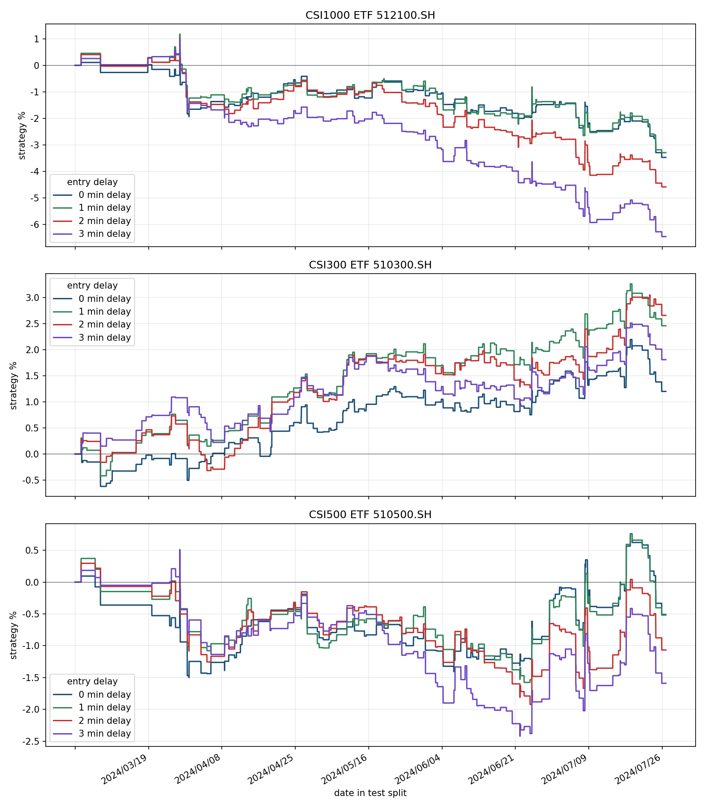

Test split only; delay levels are 0, 1, 2, and 3 minutes; trades shorter than the delay are skipped for that delayed path.

字段解释

| field | explanation |
| --- | --- |
| delay_minutes | entry delay decay 实验中相对原始开仓时间延后的分钟数.  |
| delayed_strategy_cumulative_return | 只延后开仓, 不延后平仓后, strategy return 从 1 重新复利得到的累计收益.  |
| open_event | 调仓分钟 position 从 0 切换到 1 时记为一次开仓.  |
| return_event | 只有调仓分钟入账一次 realized/expected return, 非调仓分钟为 0, 避免 forward label 每分钟重叠复利.  |
| position | 调仓分钟 ETF prediction > baseline_threshold 时为 1, 否则为 0; 非调仓分钟沿用上一分钟持仓.  |
| strategy_minute_return | return_event 为 true 时等于 position * etf_real_return, 否则为 0.  |

### 6. Robustness Diagnostics

### 6.1. IC by volatility rank

 和 corr(rank(prediction), rank(target)). ")

全 test 数据池按 volatility_label 排序切成 20 个等样本量分组, 每组计算 corr(prediction, target) 和 corr(rank(prediction), rank(target)). 

### 6.2. IC by price rank

 和 corr(rank(prediction), rank(target)). ")

全 test 数据池按 price_label 排序切成 20 个等样本量分组, 每组计算 corr(prediction, target) 和 corr(rank(prediction), rank(target)). 

### 6.3. Train/test intraday IC curve

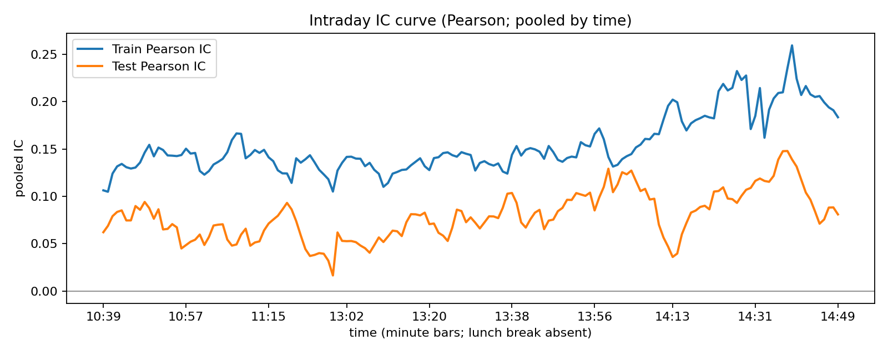

对 train/test 分别按 intraday time 分组, 将所有日期同一分钟的样本合并后计算一次 Pearson IC. 

### 6.4. Monthly signal spread and net efficiency

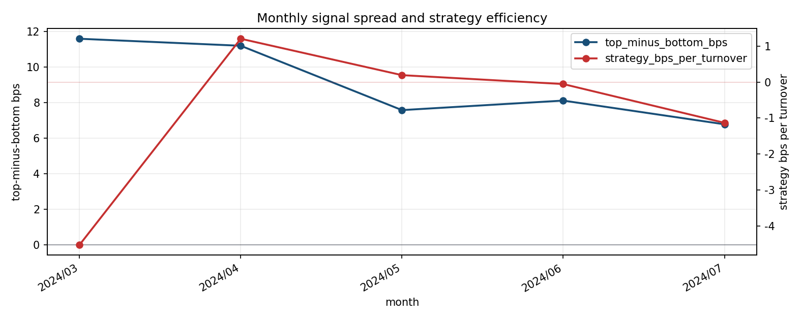

按月展示 test top-minus-bottom signal spread, 以及 5.1 strategy proxy 的三 pool 等权平均 bps per turnover. 

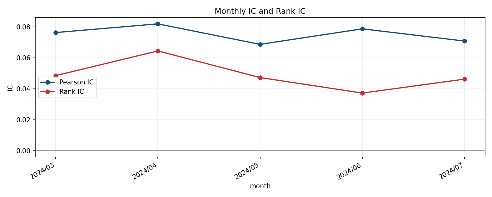

按月合并当前 test manifest 的所有样本, 分别计算 Pearson IC 和 Rank IC. 

### 6.5. Return Realization

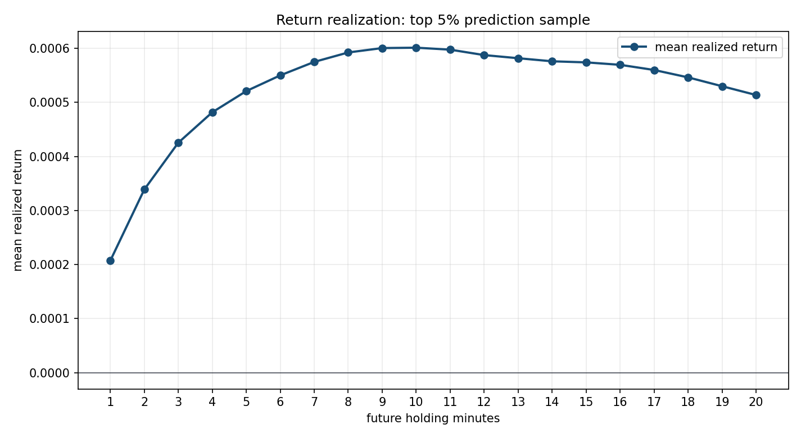

Selected test rows use prediction >= p95(prediction). For holding n minutes, realized return is log_close[t + 1 + n] - log_close[t + 1].

| holding_minutes | mean_return | mean_return_bps | row_count | prediction_p95 |
| --- | --- | --- | --- | --- |
| 1.0000 | 2.071e-04 | 2.0714 | 8,850,777 | 8.149e-04 |
| 2.0000 | 3.388e-04 | 3.3880 | 8,850,777 | 8.149e-04 |
| 3.0000 | 4.253e-04 | 4.2531 | 8,850,777 | 8.149e-04 |
| 4.0000 | 4.816e-04 | 4.8160 | 8,850,777 | 8.149e-04 |
| 5.0000 | 5.208e-04 | 5.2082 | 8,850,777 | 8.149e-04 |
| 6.0000 | 5.499e-04 | 5.4990 | 8,850,777 | 8.149e-04 |
| 7.0000 | 5.748e-04 | 5.7482 | 8,850,777 | 8.149e-04 |
| 8.0000 | 5.923e-04 | 5.9228 | 8,850,777 | 8.149e-04 |
| 9.0000 | 6.004e-04 | 6.0040 | 8,850,777 | 8.149e-04 |
| 10.0000 | 6.011e-04 | 6.0110 | 8,850,777 | 8.149e-04 |
| 11.0000 | 5.975e-04 | 5.9749 | 8,627,609 | 8.149e-04 |
| 12.0000 | 5.874e-04 | 5.8742 | 8,479,878 | 8.149e-04 |
| 13.0000 | 5.816e-04 | 5.8164 | 8,382,341 | 8.149e-04 |
| 14.0000 | 5.759e-04 | 5.7594 | 8,316,142 | 8.149e-04 |
| 15.0000 | 5.740e-04 | 5.7396 | 8,269,793 | 8.149e-04 |
| 16.0000 | 5.694e-04 | 5.6943 | 8,234,778 | 8.149e-04 |
| 17.0000 | 5.599e-04 | 5.5988 | 8,207,574 | 8.149e-04 |
| 18.0000 | 5.462e-04 | 5.4619 | 8,185,835 | 8.149e-04 |
| 19.0000 | 5.299e-04 | 5.2986 | 8,168,223 | 8.149e-04 |
| 20.0000 | 5.136e-04 | 5.1359 | 8,153,116 | 8.149e-04 |

字段解释

| field | explanation |
| --- | --- |
| Return Realization | 当前 selected test prediction 最高 5% 样本的未来持仓收益实现曲线.  |
| holding_minutes | 持仓分钟数; 交易分布中表示同一个 trade_id 覆盖的分钟行数, 6.5 中表示 future holding horizon.  |
| mean_return | 分组内 realized raw log return 的均值.  |
| mean_return_bps | 分组内 realized return 均值, 单位 bps.  |
| prediction_p95 | test split finite prediction 的 95% 分位阈值; 6.5 只保留 prediction >= prediction_p95 的样本.  |
| row_count | 该 holding horizon 下成功对齐 entry/exit close 且 realized raw log return finite 的样本数.  |

### 6.6. Top-k% Robustness

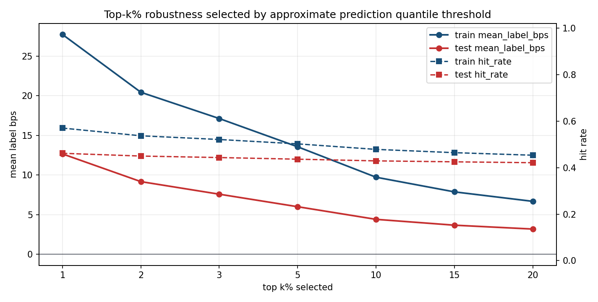

Top k% selected by approximate prediction quantile threshold within each split; k = 1, 2, 3, 5, 10, 15, 20.

| split | selection_method | k_pct | universe_count | selected_count | selected_fraction | prediction_threshold | mean_label_bps | median_label_bps | label_std_bps | hit_rate | day_count | timestamp_count |
| --- | --- | --- | --- | --- | --- | --- | --- | --- | --- | --- | --- | --- |
| train | approx_quantile_threshold | 1 | 562,449,686 | 5,469,541 | 0.009724 | 0.001581 | 27.7275 | 18.1716 | 103.4037 | 0.570206 | 125 | 20,243 |
| train | approx_quantile_threshold | 2 | 562,449,686 | 11,295,795 | 0.020083 | 0.001201 | 20.4389 | 10.9230 | 88.7617 | 0.537106 | 125 | 20,243 |
| train | approx_quantile_threshold | 3 | 562,449,686 | 16,815,990 | 0.029898 | 0.001019 | 17.1280 | 7.2364 | 81.7560 | 0.521126 | 125 | 20,243 |
| train | approx_quantile_threshold | 5 | 562,449,686 | 28,132,016 | 0.050017 | 8.071e-04 | 13.5651 | 2.5730 | 73.3567 | 0.502323 | 125 | 20,243 |
| train | approx_quantile_threshold | 10 | 562,449,686 | 56,215,303 | 0.099947 | 5.467e-04 | 9.7270 | 0.048161 | 63.3117 | 0.478618 | 125 | 20,243 |
| train | approx_quantile_threshold | 15 | 562,449,686 | 84,204,982 | 0.149711 | 4.015e-04 | 7.8792 | 1.342e-04 | 58.1520 | 0.464519 | 125 | 20,243 |
| train | approx_quantile_threshold | 20 | 562,449,686 | 112,546,839 | 0.200101 | 3.067e-04 | 6.6836 | 0.000e+00 | 54.5516 | 0.453520 | 125 | 20,243 |
| test | approx_quantile_threshold | 1 | 176,945,440 | 1,742,991 | 0.009850 | 0.001564 | 12.6657 | 0.000e+00 | 91.2327 | 0.461796 | 100 | 16,100 |
| test | approx_quantile_threshold | 2 | 176,945,440 | 3,524,799 | 0.019920 | 0.001205 | 9.1709 | 0.000e+00 | 80.6206 | 0.449928 | 100 | 16,100 |
| test | approx_quantile_threshold | 3 | 176,945,440 | 5,293,425 | 0.029916 | 0.001022 | 7.5856 | 0.000e+00 | 75.0582 | 0.443506 | 100 | 16,100 |
| test | approx_quantile_threshold | 5 | 176,945,440 | 8,837,527 | 0.049945 | 8.151e-04 | 6.0070 | 0.000e+00 | 68.4362 | 0.436439 | 100 | 16,100 |
| test | approx_quantile_threshold | 10 | 176,945,440 | 17,643,300 | 0.099710 | 5.596e-04 | 4.4138 | 0.000e+00 | 59.9015 | 0.429204 | 100 | 16,100 |
| test | approx_quantile_threshold | 15 | 176,945,440 | 26,466,332 | 0.149573 | 4.147e-04 | 3.6768 | 0.000e+00 | 55.4035 | 0.425156 | 100 | 16,100 |
| test | approx_quantile_threshold | 20 | 176,945,440 | 35,293,436 | 0.199459 | 3.202e-04 | 3.1896 | 0.000e+00 | 52.3212 | 0.421285 | 100 | 16,100 |

字段解释

| field | explanation |
| --- | --- |
| Top-k Robustness | train/test 各自样本池内用近似 prediction 分位阈值选择最高 k% 样本, 检查集中高 prediction 样本的 realized return.  |
| split | 样本池名称, 6.6 中为 train 或 test.  |
| selection_method | Top-k% 选择方法; 6.6 使用 approx_quantile_threshold, 即 DuckDB approx_quantile 给出的近似 prediction 分位阈值.  |
| k_pct | 按 prediction 全局降序选择的样本池顶部百分比.  |
| universe_count | 该 split 中 finite prediction/target 样本总数.  |
| selected_count | 该 split,k_pct 下 prediction >= prediction_threshold 的实际入选样本数.  |
| selected_fraction | selected_count / universe_count; 近似阈值口径下可能略偏离 k_pct / 100.  |
| prediction_threshold | DuckDB approx_quantile(prediction, 1 - k_pct / 100) 得到的近似入选阈值.  |
| mean_label_bps | 分组内 target 均值, 单位 bps.  |
| median_label_bps | Top-k% 样本 target 近似中位数, 使用 DuckDB approx_quantile(target, 0.5), 单位 bps.  |
| label_std_bps | Top-k% 样本 target 样本标准差, 单位 bps.  |
| hit_rate | 分组内 target > 0 的比例.  |
| day_count | 入选样本覆盖的交易日数量.  |
| timestamp_count | 入选样本覆盖的 date,time 截面数量.  |

## 限制与适用边界

四臂 seed7 比较与 baseline verification 已完成. 未过滤 baseline 的 test IC 为0.075855, 高于 touch, ret-ge2 及其组合, 不支持局部增益直接叠加. 当前artifact可得性只影响复现, 不作为历史成功/失败判据. 只有matched合同内的结果可以直接比较.

## 结论

本次归档保留上述历史事实. 研究结论, 推广门槛和执行限制分别解释, 不把模型无增益或净收益为负改写成实验流程失败.

## 附录

### 7. Appendix Diagnostics

Artifact Paths

run_root

[artifact-root]/nn/main-combo-integration-rerun-baseline-fast/baseline/date_ranges

research_report_root

[artifact-root]/nn/main-combo-integration-rerun-baseline-fast/baseline/research_report

npz_meta

[artifact-root]/nn/main-combo-integration-rerun-baseline-fast/baseline/date_ranges/artifacts/npz/meta.yaml

data_clean_invalid_stats

[artifact-root]/nn/main-combo-integration-rerun-baseline-fast/baseline/date_ranges/artifacts/data_clean/invalid_feature_stats.csv

core_ic_metrics

[artifact-root]/nn/main-combo-integration-rerun-baseline-fast/baseline/research_report/core_ic_metrics.csv

signal_bucket_metrics

[artifact-root]/nn/main-combo-integration-rerun-baseline-fast/baseline/research_report/signal_quality/signal_bucket_metrics.csv

daily_top_bottom_signal_spread

[artifact-root]/nn/main-combo-integration-rerun-baseline-fast/baseline/research_report/signal_quality/daily_top_bottom_signal_spread.csv

goodness_of_fit_metrics

[artifact-root]/nn/main-combo-integration-rerun-baseline-fast/baseline/research_report/signal_quality/goodness_of_fit_metrics.csv

goodness_of_fit_png

[artifact-root]/nn/main-combo-integration-rerun-baseline-fast/baseline/research_report/signal_quality/goodness_of_fit.png

important_pool_pooled_ic

[artifact-root]/nn/main-combo-integration-rerun-baseline-fast/baseline/research_report/important_pool/important_pool_pooled_ic.csv

important_pool_nonzero_metrics

[artifact-root]/nn/main-combo-integration-rerun-baseline-fast/baseline/research_report/important_pool/important_pool_nonzero_metrics.csv

important_pool_cumulative_returns

[artifact-root]/nn/main-combo-integration-rerun-baseline-fast/baseline/research_report/important_pool/important_pool_train_val_test_cumulative_returns.csv

train_test_intraday_ic

[artifact-root]/nn/main-combo-integration-rerun-baseline-fast/baseline/research_report/robustness/train_test_intraday_ic.csv

monthly_signal_spread_strategy_efficiency

[artifact-root]/nn/main-combo-integration-rerun-baseline-fast/baseline/research_report/robustness/monthly_signal_spread_strategy_efficiency.csv

monthly_ic_rank_ic

[artifact-root]/nn/main-combo-integration-rerun-baseline-fast/baseline/research_report/robustness/monthly_ic_rank_ic.csv

topk_robustness

[artifact-root]/nn/main-combo-integration-rerun-baseline-fast/baseline/research_report/robustness/topk_robustness.csv

topk_robustness_png

[artifact-root]/nn/main-combo-integration-rerun-baseline-fast/baseline/research_report/robustness/topk_robustness.png

train_loss_log_png

[artifact-root]/nn/main-combo-integration-rerun-baseline-fast/baseline/research_report/figures/train_loss_no_step0_smoothed_log.png

Extreme Value Metrics

| metric | value |
| --- | --- |
| val/dist/mean/pred | nan |
| val/dist/mean/target | nan |
| val/dist/abs_mean/pred | nan |
| val/dist/abs_mean/target | nan |
| val/dist/std/pred | nan |
| val/dist/std/target | nan |
| val/dist/pred_std_over_target_std | nan |
| val/dist/p01/pred | nan |
| val/dist/p01/target | nan |
| val/dist/p50/pred | nan |
| val/dist/p50/target | nan |
| val/dist/p99/pred | nan |
| val/dist/p99/target | nan |

Label Availability Coverage

| split | raw_rows | kept_rows | sampled_rows | out_rows | kept_rate |
| --- | --- | --- | --- | --- | --- |
| train | 844,720,556 | 768,564,829 | 768,564,829 | 768,564,829 | 0.909845 |
| val | 47,988,219 | 43,553,840 | 43,553,840 | 43,553,840 | 0.907594 |
| test | 266,418,782 | 241,788,800 | 241,788,800 | 241,788,800 | 0.907552 |

Pending Diagnostics

| diagnostic | status |
| --- | --- |
| turnover_decomposition | pending backtest/trading artifact |
| capacity_sensitivity | pending capacity artifact |
| short_side_diagnostics | pending long/short-side artifact |
