## 摘要

**历史结果: 历史成功.** 修正 mixed-normalization 评估后 full63 test IC/RankIC 为0.061496/0.051659. Matched family ablation 中 relative/liquidity9 为0.098183/0.075886; market16 在训练 gate 停止, 未读取 test.

历史成功/失败按实验流程是否成功完成判断. 无增益, 成本后亏损, 归档和当前 artifact 缺失不改变历史成功事实. 失败的实验臂保留失败原因, 不填造未产生的 OOS 指标. 本次只整理已有材料, 未启动训练, 推理或回测.

### 1. Executive Summary

benchmark

seed7

current experiment

selected_checkpoint

40,000

checkpoint used for evaluation

train_pooled_ic

0.126565

pooled IC on train report sample

test_pooled_ic

0.089951

corr(all test prediction, all test target)

top_prediction_return_bps

12.3333

mean top-bin prediction return

top95_hit

46.82%

test top 5% prediction label > 0

etf_top95_hit

55.81%

test ETF top 5% prediction label > 0

overfit_variance_ratio

0.027632

test prediction var / label var

model_class

GruMlpRegressor

prediction model

train_range

20210104 -> 20231229 (727 days)

npz split

val_range

20240102 -> 20240229 (37 days)

npz split

test_range

20240301 -> 20241231 (205 days)

npz split

字段解释

| field | explanation |
| --- | --- |
| benchmark | 实验标识.  |
| selected_checkpoint | 最终用于 evaluation 的 checkpoint iteration.  |
| train_pooled_ic | core_ic_summary_train.yaml 当前覆盖的 train-report 样本合并后计算的 Pearson IC; 启用 train report sample 时不是 full-train 指标.  |
| test_pooled_ic | test split 上把所有样本合并后计算的 Pearson IC.  |
| top_prediction_return_bps | 最高 prediction 分组的平均 prediction return, 单位 bps.  |
| top95_hit | test split 中按 prediction 从高到低排序后取最高 5% 样本, 即 prediction >= test prediction 的 95% 分位; 该子样本内 target > 0 的比例.  |
| etf_top95_hit | test split 中先按重要股票池合成 ETF minute-level prediction/real return, 再按 etf_prediction 从高到低排序后取最高 5% 样本; 该子样本内 etf_real_return > 0 的比例.  |
| overfit_variance_ratio | test split 中 prediction 样本方差 / target 样本方差, 用作 overfit 系数; 数值越大表示 prediction 方差相对 label 越高.  |
| model_class | 模型类名.  |
| train_range | 训练集交易日范围.  |
| val_range | 验证集交易日范围.  |
| test_range | 测试集交易日范围.  |

## 研究背景与目标

本报告围绕Multiscale 特征与 family ablation整理原始研究证据. 当前材料对应 registry report `multiscale-market-features-1min-ablation-legacy14-081320`, 来源SHA256为 `080715eadc04cb27a0a547465b7922be0ffc8b100f14509749df5f279e7350a3`. 原报告的实验方法, 图表, 结果和解释保留在下文.

## 数据与方法

实验身份为 `multiscale-market-features-1min`. Split, label, sampler, feature与checkpoint定义按原报告记录, 不从其他实验借用缺失字段. 汇总入口见[全实验综述](../../prediction-nn-1min/1103-nn-registry-summary/).

### 2. Data Pipeline

### 2.1. Data Basics

train_days

727 days

val_days

37 days

test_days

205 days

feature_dim

63

features

ret_1m, ret_5m, ret_2m, ret_3m, ret_10m, hl, oc, log_vol, log_amount, vol_10m, log_vol_5m_mean, log_amount_5m_mean, minute_norm, session_minute_norm, csi300_ret_10m, csi300_ret_60m, csi300_ret_120m, csi300_ret_240m, csi500_ret_10m, csi500_ret_60m, csi500_ret_120m, csi500_ret_240m, csi1000_ret_10m, csi1000_ret_60m, csi1000_ret_120m, csi1000_ret_240m, csi300_rv_60m, csi500_rv_60m, csi1000_rv_60m, market_cs_ret_60m_dispersion, stock_ret_60m_cs_rank, vol_same_minute_60d_pct, amount_same_minute_60d_pct, vol_trailing_5m_pct, vol_trailing_20m_pct, vol_trailing_60m_pct, amount_trailing_5m_pct, amount_trailing_20m_pct, amount_trailing_60m_pct, state_realized_vol_5m, state_realized_vol_20m, state_realized_vol_60m, state_realized_vol_120m, state_realized_vol_240m, state_realized_vol_480m, state_range_5m, state_range_20m, state_range_60m, state_range_120m, state_range_240m, state_range_480m, state_trend_5m, state_trend_20m, state_trend_60m, state_trend_120m, state_trend_240m, state_trend_480m, state_return_5m, state_return_20m, state_return_60m, state_return_120m, state_return_240m, state_return_480m

label_holding_minutes

10

label_exit_offset_minutes

11

label_entry_lag_minutes

1

字段解释

| field | explanation |
| --- | --- |
| features | 模型输入 feature 列表.  |
| feature_dim | 模型输入 feature 维度.  |
| label_holding_minutes | entry 到 exit 的实际持有期, 单位 minutes.  |
| label_exit_offset_minutes | 相对样本时点 t 的 exit 偏移, 单位 minutes.  |
| label_entry_lag_minutes | label entry lag, 单位 minutes.  |

### 2.2. Data Normalization

feature_normalization

pooled_zscore / scope=train_only

label_normalization

pooled_zscore / scope=train_only

label_holding_minutes

10

label_exit_offset_minutes

11

label_entry_lag_minutes

1

train_kept_rate

94.3300%

val_kept_rate

95.4382%

test_kept_rate

95.4104%

max_invalid_ratio

4.1494%

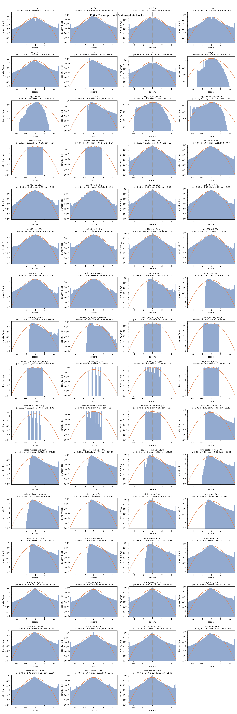

Data clean stage pooled feature distribution overview.

Invalid Feature Stats

| field | total_count | finite_count | nan_count | nan_ratio | inf_ratio | invalid_ratio | mean_finite | std_finite | skew_finite | kurtosis_finite | min_finite | max_finite |
| --- | --- | --- | --- | --- | --- | --- | --- | --- | --- | --- | --- | --- |
| ret_10m | 1,154,507,748 | 1,106,602,848 | 47,904,900 | 0.041494 | 0.000e+00 | 0.041494 | 1.156e-05 | 0.005543 | 1.6163 | 78.3080 | -1.6727 | 0.865563 |
| ret_5m | 1,154,507,748 | 1,130,555,298 | 23,952,450 | 0.020747 | 0.000e+00 | 0.020747 | 1.144e-05 | 0.004185 | 1.4880 | 125.8855 | -1.6727 | 0.798906 |
| ret_3m | 1,154,507,748 | 1,140,136,278 | 14,371,470 | 0.012448 | 0.000e+00 | 0.012448 | 7.312e-06 | 0.003416 | 1.2200 | 185.0343 | -1.6727 | 0.798906 |
| vol_10m | 1,154,507,748 | 1,144,926,768 | 9,580,980 | 0.008299 | 0.000e+00 | 0.008299 | 5.704e-04 | 5.162e-04 | 16.3785 | 9,073 | 0.000e+00 | 0.617598 |
| ret_2m | 1,154,507,748 | 1,144,926,768 | 9,580,980 | 0.008299 | 0.000e+00 | 0.008299 | 4.388e-06 | 0.002928 | 0.933046 | 267.1997 | -1.6727 | 0.798906 |
| state_trend_480m | 1,154,507,748 | 1,145,880,151 | 8,627,597 | 0.007473 | 0.000e+00 | 0.007473 | -1.708e-04 | 0.048678 | 0.825669 | 12.2462 | -1.4409 | 2.7698 |
| state_realized_vol_480m | 1,154,507,748 | 1,145,880,151 | 8,627,597 | 0.007473 | 0.000e+00 | 0.007473 | 0.047298 | 0.025484 | 3.7558 | 56.4574 | 0.000e+00 | 4.4568 |
| state_return_480m | 1,154,507,748 | 1,145,880,151 | 8,627,597 | 0.007473 | 0.000e+00 | 0.007473 | -1.725e-04 | 0.044855 | 0.789490 | 11.1986 | -3.2540 | 2.2282 |
| state_range_480m | 1,154,507,748 | 1,145,881,986 | 8,625,762 | 0.007471 | 0.000e+00 | 0.007471 | 0.060320 | 0.041866 | 2.6613 | 18.6129 | 0.000e+00 | 4.3267 |
| state_realized_vol_240m | 1,154,507,748 | 1,146,702,411 | 7,805,337 | 0.006761 | 0.000e+00 | 0.006761 | 0.033111 | 0.018812 | 4.3772 | 94.2240 | 0.000e+00 | 4.4489 |
| state_trend_240m | 1,154,507,748 | 1,146,702,411 | 7,805,337 | 0.006761 | 0.000e+00 | 0.006761 | -1.035e-04 | 0.033436 | 0.901790 | 18.6618 | -1.0788 | 2.7436 |
| state_return_240m | 1,154,507,748 | 1,146,702,411 | 7,805,337 | 0.006761 | 0.000e+00 | 0.006761 | -1.028e-04 | 0.030899 | 0.802987 | 14.8048 | -3.3363 | 1.8915 |
| state_range_240m | 1,154,507,748 | 1,146,704,492 | 7,803,256 | 0.006759 | 0.000e+00 | 0.006759 | 0.041697 | 0.029430 | 2.9076 | 31.1754 | 0.000e+00 | 4.3267 |
| state_realized_vol_120m | 1,154,507,748 | 1,147,129,011 | 7,378,737 | 0.006391 | 0.000e+00 | 0.006391 | 0.022659 | 0.014601 | 4.8702 | 130.1542 | 0.000e+00 | 4.4078 |
| state_trend_120m | 1,154,507,748 | 1,147,129,011 | 7,378,737 | 0.006391 | 0.000e+00 | 0.006391 | -5.497e-05 | 0.023507 | 1.1668 | 34.7462 | -1.1401 | 2.7261 |
| state_return_120m | 1,154,507,748 | 1,147,129,011 | 7,378,737 | 0.006391 | 0.000e+00 | 0.006391 | -5.460e-05 | 0.021642 | 0.992154 | 26.8210 | -3.3951 | 1.9106 |
| state_range_120m | 1,154,507,748 | 1,147,131,092 | 7,376,656 | 0.006389 | 0.000e+00 | 0.006389 | 0.028234 | 0.022304 | 3.3597 | 44.6815 | 0.000e+00 | 4.3267 |
| state_realized_vol_60m | 1,154,507,748 | 1,147,342,311 | 7,165,437 | 0.006206 | 0.000e+00 | 0.006206 | 0.015417 | 0.011231 | 5.6205 | 192.4926 | 0.000e+00 | 4.4038 |
| stock_ret_60m_cs_rank | 1,154,507,748 | 1,147,342,311 | 7,165,437 | 0.006206 | 0.000e+00 | 0.006206 | 0.500102 | 0.288583 | -7.133e-05 | -1.1987 | 1.862e-04 | 1.0000 |
| state_trend_60m | 1,154,507,748 | 1,147,342,311 | 7,165,437 | 0.006206 | 0.000e+00 | 0.006206 | -2.801e-05 | 0.016644 | 1.5965 | 64.7632 | -1.1703 | 2.6991 |
| state_return_60m | 1,154,507,748 | 1,147,342,311 | 7,165,437 | 0.006206 | 0.000e+00 | 0.006206 | -2.807e-05 | 0.015402 | 1.3202 | 50.5849 | -3.5243 | 1.8384 |
| state_range_60m | 1,154,507,748 | 1,147,344,392 | 7,163,356 | 0.006205 | 0.000e+00 | 0.006205 | 0.019035 | 0.016810 | 4.0298 | 66.2231 | 0.000e+00 | 4.3267 |
| state_return_20m | 1,154,507,748 | 1,147,484,511 | 7,023,237 | 0.006083 | 0.000e+00 | 0.006083 | -9.326e-06 | 0.009067 | 1.8585 | 143.5154 | -3.3363 | 1.8334 |
| state_realized_vol_20m | 1,154,507,748 | 1,147,484,511 | 7,023,237 | 0.006083 | 0.000e+00 | 0.006083 | 0.008391 | 0.007146 | 7.5579 | 457.2699 | 0.000e+00 | 4.3919 |
| state_trend_20m | 1,154,507,748 | 1,147,484,511 | 7,023,237 | 0.006083 | 0.000e+00 | 0.006083 | -9.306e-06 | 0.009637 | 2.2141 | 167.1458 | -1.3879 | 2.6150 |
| state_range_20m | 1,154,507,748 | 1,147,486,592 | 7,021,156 | 0.006082 | 0.000e+00 | 0.006082 | 0.010356 | 0.010229 | 5.4750 | 153.4727 | 0.000e+00 | 4.3267 |
| state_trend_5m | 1,154,507,748 | 1,147,537,841 | 6,969,907 | 0.006037 | 0.000e+00 | 0.006037 | -2.417e-06 | 0.004903 | 2.3417 | 595.7968 | -3.0905 | 2.3547 |
| state_return_5m | 1,154,507,748 | 1,147,537,841 | 6,969,907 | 0.006037 | 0.000e+00 | 0.006037 | -2.415e-06 | 0.004819 | 1.6681 | 988.4079 | -4.3267 | 1.8334 |
| state_realized_vol_5m | 1,154,507,748 | 1,147,537,841 | 6,969,907 | 0.006037 | 0.000e+00 | 0.006037 | 0.003817 | 0.003982 | 11.5091 | 2,100 | 0.000e+00 | 4.3267 |
| state_range_5m | 1,154,507,748 | 1,147,539,923 | 6,967,825 | 0.006035 | 0.000e+00 | 0.006035 | 0.004887 | 0.005183 | 8.1373 | 795.7123 | 0.000e+00 | 4.3267 |
| amount_same_minute_60d_pct | 1,154,507,748 | 1,147,653,949 | 6,853,799 | 0.005937 | 0.000e+00 | 0.005937 | 0.497584 | 0.299023 | 0.023598 | -1.2295 | 0.000e+00 | 1.0000 |
| vol_same_minute_60d_pct | 1,154,507,748 | 1,147,653,949 | 6,853,799 | 0.005937 | 0.000e+00 | 0.005937 | 0.500500 | 0.297900 | 0.010469 | -1.2244 | 0.000e+00 | 1.0000 |
| ret_1m | 1,154,507,748 | 1,149,717,258 | 4,790,490 | 0.004149 | 0.000e+00 | 0.004149 | 1.353e-06 | 0.002284 | 0.332178 | 524.6048 | -1.6727 | 0.759663 |
| vol_trailing_60m_pct | 1,154,507,748 | 1,154,394,888 | 112,860 | 9.776e-05 | 0.000e+00 | 9.776e-05 | 0.492990 | 0.304162 | 0.040254 | -1.2615 | 0.000e+00 | 1.0000 |
| amount_trailing_60m_pct | 1,154,507,748 | 1,154,394,888 | 112,860 | 9.776e-05 | 0.000e+00 | 9.776e-05 | 0.492823 | 0.304257 | 0.040368 | -1.2616 | 0.000e+00 | 1.0000 |
| vol_trailing_20m_pct | 1,154,507,748 | 1,154,470,128 | 37,620 | 3.259e-05 | 0.000e+00 | 3.259e-05 | 0.493187 | 0.309097 | 0.038864 | -1.2381 | 0.000e+00 | 1.0000 |
| amount_trailing_20m_pct | 1,154,507,748 | 1,154,470,128 | 37,620 | 3.259e-05 | 0.000e+00 | 3.259e-05 | 0.493058 | 0.309245 | 0.038454 | -1.2381 | 0.000e+00 | 1.0000 |
| amount_trailing_5m_pct | 1,154,507,748 | 1,154,498,343 | 9,405 | 8.146e-06 | 0.000e+00 | 8.146e-06 | 0.493761 | 0.343533 | 0.038037 | -1.2806 | 0.000e+00 | 1.0000 |
| vol_trailing_5m_pct | 1,154,507,748 | 1,154,498,343 | 9,405 | 8.146e-06 | 0.000e+00 | 8.146e-06 | 0.493844 | 0.343189 | 0.039355 | -1.2805 | 0.000e+00 | 1.0000 |
| log_amount_5m_mean | 1,154,507,748 | 1,154,507,748 | 0 | 0.000e+00 | 0.000e+00 | 0.000e+00 | 11.4836 | 2.7379 | -1.6409 | 4.0784 | 0.000e+00 | 21.9334 |
| csi300_ret_10m | 1,154,507,748 | 1,154,507,748 | 0 | 0.000e+00 | 0.000e+00 | 0.000e+00 | -1.478e-05 | 0.002313 | 3.8863 | 155.4279 | -0.048251 | 0.103755 |
| session_minute_norm | 1,154,507,748 | 1,154,507,748 | 0 | 0.000e+00 | 0.000e+00 | 0.000e+00 | 0.493776 | 0.289824 | 5.194e-04 | -1.2009 | 0.000e+00 | 0.991667 |
| minute_norm | 1,154,507,748 | 1,154,507,748 | 0 | 0.000e+00 | 0.000e+00 | 0.000e+00 | 0.500000 | 0.289875 | -1.373e-07 | -1.2000 | 0.000e+00 | 1.0000 |
| log_vol | 1,154,507,748 | 1,154,507,748 | 0 | 0.000e+00 | 0.000e+00 | 0.000e+00 | 9.0413 | 2.8688 | -1.6155 | 3.2278 | 0.000e+00 | 20.3408 |
| log_vol_5m_mean | 1,154,507,748 | 1,154,507,748 | 0 | 0.000e+00 | 0.000e+00 | 0.000e+00 | 9.0800 | 2.3960 | -1.1786 | 2.3900 | 0.000e+00 | 20.1280 |
| log_amount | 1,154,507,748 | 1,154,507,748 | 0 | 0.000e+00 | 0.000e+00 | 0.000e+00 | 11.4358 | 3.3520 | -2.1437 | 5.1304 | 0.000e+00 | 22.6198 |
| csi300_ret_120m | 1,154,507,748 | 1,154,507,748 | 0 | 0.000e+00 | 0.000e+00 | 0.000e+00 | -1.727e-04 | 0.007806 | 0.828607 | 9.0171 | -0.074354 | 0.119413 |
| oc | 1,154,507,748 | 1,154,507,748 | 0 | 0.000e+00 | 0.000e+00 | 0.000e+00 | 4.718e-06 | 7.159e-04 | 0.807232 | 305.3296 | -0.312980 | 0.353188 |
| hl | 1,154,507,748 | 1,154,507,748 | 0 | 0.000e+00 | 0.000e+00 | 0.000e+00 | 6.217e-04 | 7.591e-04 | 6.6258 | 384.2352 | 0.000e+00 | 0.434688 |
| csi300_ret_60m | 1,154,507,748 | 1,154,507,748 | 0 | 0.000e+00 | 0.000e+00 | 0.000e+00 | -8.761e-05 | 0.005515 | 1.1950 | 18.5202 | -0.067646 | 0.101166 |
| market_cs_ret_60m_dispersion | 1,154,507,748 | 1,154,507,748 | 0 | 0.000e+00 | 0.000e+00 | 0.000e+00 | 0.012717 | 0.005468 | 1.3443 | 2.5501 | 0.004631 | 0.056040 |
| csi300_ret_240m | 1,154,507,748 | 1,154,507,748 | 0 | 0.000e+00 | 0.000e+00 | 0.000e+00 | -3.412e-04 | 0.011430 | 0.978299 | 8.0478 | -0.086401 | 0.137105 |
| csi500_ret_10m | 1,154,507,748 | 1,154,507,748 | 0 | 0.000e+00 | 0.000e+00 | 0.000e+00 | -1.272e-05 | 0.002477 | 3.9748 | 154.2897 | -0.050518 | 0.112549 |
| csi500_ret_60m | 1,154,507,748 | 1,154,507,748 | 0 | 0.000e+00 | 0.000e+00 | 0.000e+00 | -7.537e-05 | 0.006123 | 1.3528 | 19.9641 | -0.069577 | 0.109966 |
| csi500_ret_240m | 1,154,507,748 | 1,154,507,748 | 0 | 0.000e+00 | 0.000e+00 | 0.000e+00 | -2.902e-04 | 0.012961 | 1.1169 | 10.3339 | -0.085051 | 0.153507 |
| csi1000_ret_10m | 1,154,507,748 | 1,154,507,748 | 0 | 0.000e+00 | 0.000e+00 | 0.000e+00 | -1.645e-05 | 0.002769 | 3.2529 | 126.3830 | -0.051145 | 0.120919 |
| csi1000_ret_60m | 1,154,507,748 | 1,154,507,748 | 0 | 0.000e+00 | 0.000e+00 | 0.000e+00 | -9.754e-05 | 0.006981 | 0.865910 | 17.1892 | -0.078297 | 0.116933 |
| csi1000_ret_120m | 1,154,507,748 | 1,154,507,748 | 0 | 0.000e+00 | 0.000e+00 | 0.000e+00 | -1.927e-04 | 0.010015 | 0.498933 | 9.0144 | -0.081850 | 0.133210 |
| csi1000_ret_240m | 1,154,507,748 | 1,154,507,748 | 0 | 0.000e+00 | 0.000e+00 | 0.000e+00 | -3.773e-04 | 0.014963 | 0.596401 | 8.2321 | -0.120203 | 0.165821 |
| csi300_rv_60m | 1,154,507,748 | 1,154,507,748 | 0 | 0.000e+00 | 0.000e+00 | 0.000e+00 | 0.004328 | 0.003258 | 10.8424 | 257.2810 | 9.309e-04 | 0.102853 |
| csi500_rv_60m | 1,154,507,748 | 1,154,507,748 | 0 | 0.000e+00 | 0.000e+00 | 0.000e+00 | 0.004559 | 0.003445 | 11.2045 | 276.6439 | 0.001017 | 0.110987 |
| csi1000_rv_60m | 1,154,507,748 | 1,154,507,748 | 0 | 0.000e+00 | 0.000e+00 | 0.000e+00 | 0.004822 | 0.003732 | 10.6276 | 263.1252 | 7.997e-04 | 0.119361 |
| csi500_ret_120m | 1,154,507,748 | 1,154,507,748 | 0 | 0.000e+00 | 0.000e+00 | 0.000e+00 | -1.484e-04 | 0.008732 | 0.904930 | 10.5283 | -0.074420 | 0.124283 |

字段解释

| field | explanation |
| --- | --- |
| feature_normalization | feature normalization 方法和 fit scope.  |
| label_normalization | label normalization 方法和 fit scope.  |
| kept_rate | 清洗后保留样本数 / 清洗前样本数.  |
| max_invalid_ratio | 单个字段中 invalid 样本占比的最大值.  |

### 2.3. Label Distribution

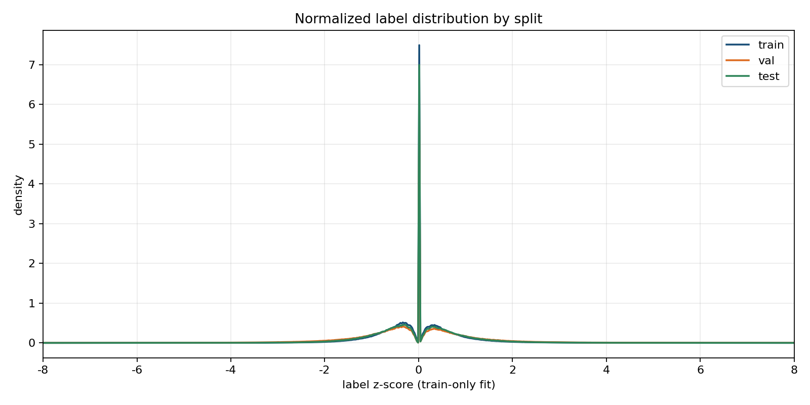

Normalized label distributions for train/val/test using train-only fit parameters; the table reports raw log-return moments after inverse transformation.

| split | count | mean_raw_bps | std_raw_bps | zero_ratio | abs_raw_gt_1pct_ratio |
| --- | --- | --- | --- | --- | --- |
| train | 553,898,121 | -0.074716 | 42.2281 | 0.186762 | 0.028168 |
| val | 31,737,447 | -0.863159 | 62.4642 | 0.147426 | 0.076608 |
| test | 176,134,322 | -0.035505 | 50.2074 | 0.174398 | 0.039702 |

字段解释

| field | explanation |
| --- | --- |
| label_distribution | train-only z-score 参数下的 train/val/test 标签分布; 图中使用标准化标签, 表格同时报告还原后的收益率 bps.  |

## 主要结果

| 记录项 | 当前解释 |
| --- | --- |
| 实验 | multiscale-market-features-1min |
| 报告类型 | full_report_html |
| 历史状态 | 历史成功 |
| 证据 | multiscale-market-features-1min-ablation-legacy14-081320 |

训练监控, 信号质量, 交易成本与稳健性评估. 

生成日期: 2026-08-13

### 3. Evaluation

### 3.1. IC Summary

| split | pooled_ic | pooled_rank_ic | count |
| --- | --- | --- | --- |
| train | 0.126565 | 0.106853 | 31,875,072 |
| test | 0.089951 | 0.059541 | 176,134,322 |

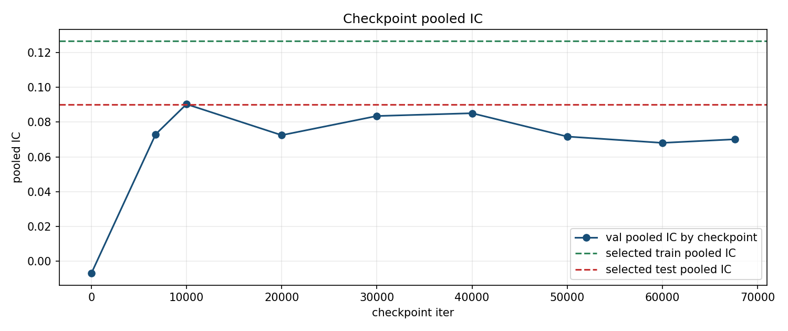

Validation checkpoint pooled IC with selected train/test pooled IC references.

### core_ic_metrics.csv

| split | pooled_ic | pooled_rank_ic | count |
| --- | --- | --- | --- |
| train | 0.126565 | 0.106853 | 31,875,072 |
| test | 0.089951 | 0.059541 | 176,134,322 |

字段解释

| field | explanation |
| --- | --- |
| pooled_ic | 合并样本后计算的 Pearson IC.  |
| pooled_rank_ic | 合并样本后计算的 Rank IC.  |
| pearson_ic | corr(prediction, target).  |
| rank_ic | corr(rank(prediction), rank(target)).  |

### 3.2. Signal Quality 1: bucket (10)

字段解释

| field | explanation |
| --- | --- |
| signal_bucket | 按 prediction 从低到高切分的分组编号.  |
| mean_prediction | 分组内 prediction 均值.  |
| mean_label_bps | 分组内 target 均值, 单位 bps.  |
| t_stat | 分组 mean_label_bps 相对 0 的 t-stat.  |
| hit_rate | 分组内 target > 0 的比例.  |
| top_bottom_signal_spread_bps | Top bucket 平均 target return 减 bottom bucket 平均 target return, 单位 bps.  |
| Daily top-minus-bottom signal spread | 每天内部按 prediction 排序, 用 ntile(10) 分 bucket. 对每天的 top decile 和 bottom decile 计算 realized return.  |

| signal_bucket | mean_prediction | mean_label_bps | t_stat | hit_rate | row_count | top_bottom_signal_spread_bps |
| --- | --- | --- | --- | --- | --- | --- |
| 1.0000 | -0.001243 | -6.3881 | -361.4984 | 0.360128 | 17,613,433 | 13.3811 |
| 2.0000 | -3.939e-04 | -1.7566 | -156.5511 | 0.374861 | 17,613,433 | 13.3811 |
| 3.0000 | -2.205e-04 | -1.1713 | -114.8993 | 0.375082 | 17,613,432 | 13.3811 |
| 4.0000 | -1.049e-04 | -0.730814 | -77.0550 | 0.372318 | 17,613,432 | 13.3811 |
| 5.0000 | -2.150e-05 | -0.455263 | -51.0270 | 0.364674 | 17,613,432 | 13.3811 |
| 6.0000 | 4.850e-05 | -0.208586 | -23.2383 | 0.373337 | 17,613,432 | 13.3811 |
| 7.0000 | 1.262e-04 | 0.209128 | 22.5053 | 0.390482 | 17,613,432 | 13.3811 |
| 8.0000 | 2.311e-04 | 0.957182 | 95.6807 | 0.406609 | 17,613,432 | 13.3811 |
| 9.0000 | 4.143e-04 | 2.1949 | 191.5129 | 0.424352 | 17,613,432 | 13.3811 |
| 10.0000 | 0.001331 | 6.9930 | 393.6359 | 0.455266 | 17,613,432 | 13.3811 |

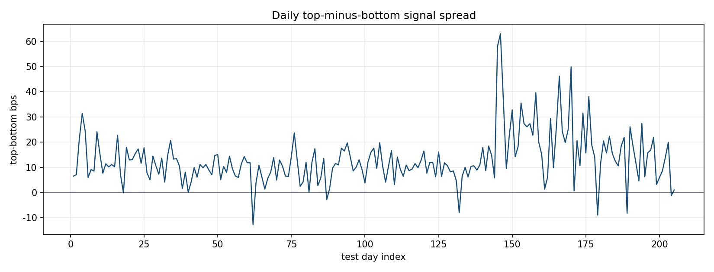

Daily top decile target return minus bottom decile target return on the test split.

### 3.3. Signal Quality 2: Important Stock Pool

prediction != 0 metrics dataset

test split, [artifact-root]/nn/multiscale-market-features-1min-ablation/legacy14/seed7/date_ranges/run/eval_test/iter_40000/predict_manifest.yaml

checkpoint IC dataset

val split checkpoints, [artifact-root]/nn/multiscale-market-features-1min-ablation/legacy14/seed7/date_ranges/run/eval_val

cumulative return dataset

train + val + test, shown in 5. Trading And Cost

### prediction != 0 metrics

| pool | etf_code | pearson_ic | rank_ic | mean_prediction_return | mean_real_return | prediction_positive_ratio | real_return_positive_ratio | count |
| --- | --- | --- | --- | --- | --- | --- | --- | --- |
| 1000 ETF | 512100.SH | 0.061515 | 0.037466 | 2.196e-05 | -8.221e-06 | 0.522141 | 0.395829 | 32,953,989 |
| 沪深300 ETF(沪) | 510300.SH | 0.061617 | 0.037666 | 1.654e-05 | 1.427e-05 | 0.507006 | 0.413561 | 9,885,093 |
| 中证500 ETF(沪) | 510500.SH | 0.054512 | 0.035447 | 2.199e-05 | -1.311e-05 | 0.519919 | 0.393434 | 16,488,212 |

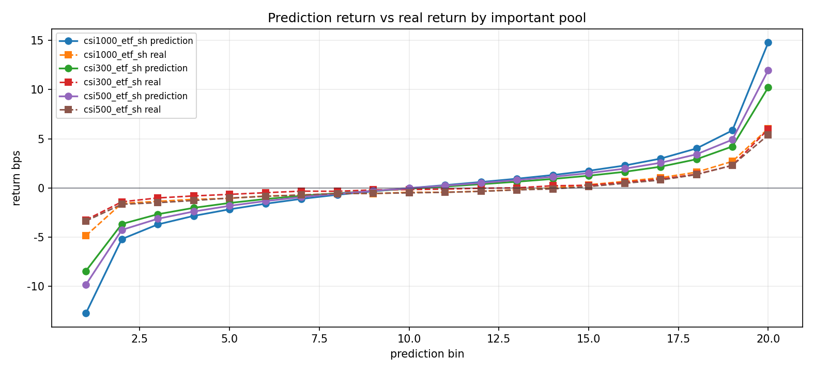

Important-pool mean prediction return and real return by prediction rank bin.

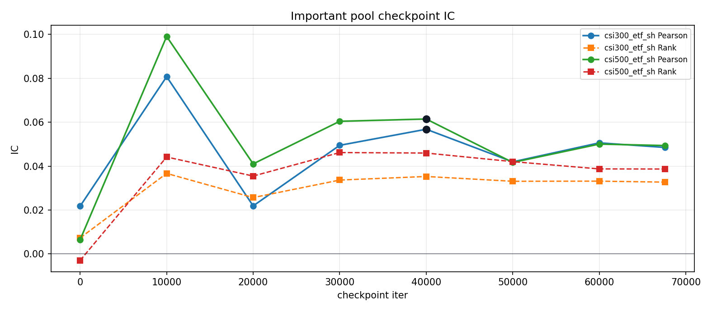

Checkpoint IC for CSI500 and CSI300 important pools.

字段解释

| field | explanation |
| --- | --- |
| prediction != 0 metrics | 按 date, code join prediction rows, 过滤 isfinite(prediction), isfinite(target), prediction != 0. 按 pool 聚合各项指标.  |
| Prediction Return vs Real Return 图 | 每个 pool 内按 prediction 排序, 用 ntile(20) 分 prediction_bin, 单位显示为 bps.  |
| pearson_ic | corr(prediction, target).  |
| rank_ic | corr(rank(prediction), rank(target)).  |
| mean_prediction_return | prediction 的样本均值.  |
| mean_real_return | target 的样本均值.  |
| real_return_positive_ratio | target > 0 的样本占比.  |
| prediction_positive_ratio | prediction > 0 的样本占比.  |

### 3.4. Goodness Of Fit

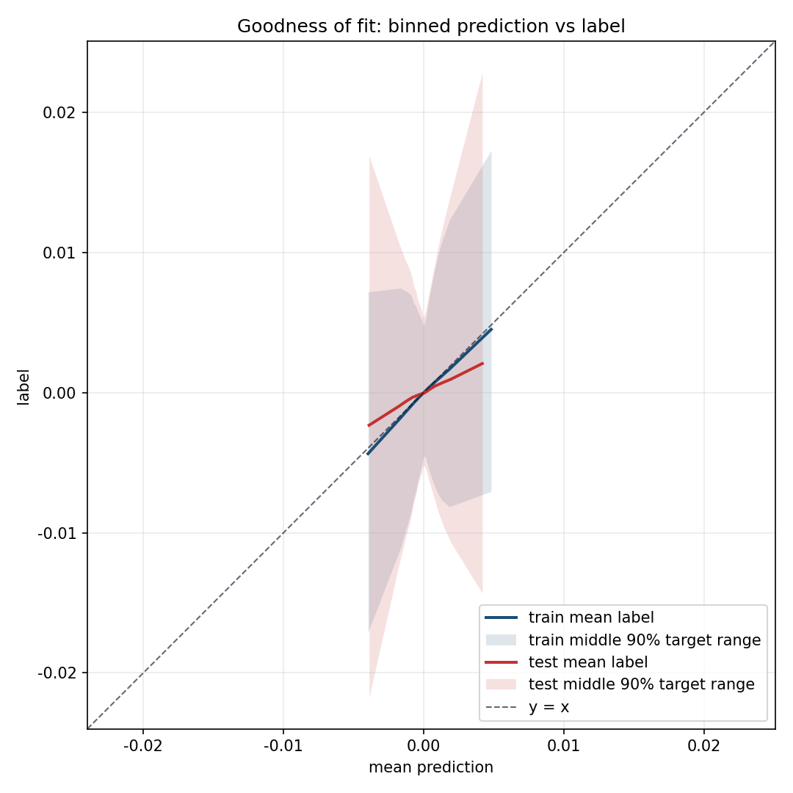

Train/test are separately sorted by prediction and cut into 100 equal-frequency bins; x is bin mean prediction, y is label, and transparent bands show the p5-p95 target range within each prediction bin.

### goodness_of_fit_metrics.csv edge bins

| split | prediction_bin | mean_prediction | mean_label | label_p05 | label_p95 | row_count |
| --- | --- | --- | --- | --- | --- | --- |
| train | 1 | -0.003966 | -0.004358 | -0.017105 | 0.007187 | 5,538,982 |
| train | 2 | -0.001651 | -0.001810 | -0.011116 | 0.007462 | 5,538,982 |
| train | 3 | -0.001169 | -0.001265 | -0.009491 | 0.007195 | 5,538,982 |
| train | 4 | -9.351e-04 | -0.001001 | -0.008682 | 0.007019 | 5,538,982 |
| train | 5 | -7.942e-04 | -8.431e-04 | -0.008026 | 0.006691 | 5,538,982 |
| train | 96 | 8.488e-04 | 7.893e-04 | -0.006786 | 0.008987 | 5,538,981 |
| train | 97 | 0.001009 | 9.364e-04 | -0.007145 | 0.009689 | 5,538,981 |
| train | 98 | 0.001277 | 0.001168 | -0.007648 | 0.010696 | 5,538,981 |
| train | 99 | 0.001856 | 0.001681 | -0.008141 | 0.012321 | 5,538,981 |
| train | 100 | 0.004827 | 0.004514 | -0.007050 | 0.017303 | 5,538,981 |
| test | 1 | -0.003886 | -0.002326 | -0.021759 | 0.016907 | 1,761,344 |
| test | 2 | -0.001789 | -9.893e-04 | -0.012466 | 0.010765 | 1,761,344 |
| test | 3 | -0.001336 | -6.809e-04 | -0.010597 | 0.009560 | 1,761,344 |
| test | 4 | -0.001091 | -5.165e-04 | -0.009666 | 0.009026 | 1,761,344 |
| test | 5 | -9.327e-04 | -4.249e-04 | -0.009041 | 0.008621 | 1,761,344 |
| test | 96 | 9.902e-04 | 5.449e-04 | -0.008308 | 0.010132 | 1,761,343 |
| test | 97 | 0.001164 | 6.252e-04 | -0.008820 | 0.010986 | 1,761,343 |
| test | 98 | 0.001436 | 7.453e-04 | -0.009567 | 0.012184 | 1,761,343 |
| test | 99 | 0.001951 | 9.583e-04 | -0.010689 | 0.014206 | 1,761,343 |
| test | 100 | 0.004193 | 0.002076 | -0.014320 | 0.022858 | 1,761,343 |

字段解释

| field | explanation |
| --- | --- |
| Goodness Of Fit | 按 split 全局对 prediction 从低到高排序并切成 100 个等频分段, 检查每段 mean_prediction 与 mean_label 是否接近.  |
| prediction_bin | 按 prediction 从低到高排序后的等频分段编号, 1 为最低 prediction 段.  |
| mean_prediction | 分组内 prediction 均值.  |
| mean_label | 分组内 target 均值, 保持原始 target 单位.  |
| label_std | 分组内 target 的样本标准差.  |
| label_se | 分组 mean_label 的标准误, 计算为 label_std / sqrt(row_count).  |
| label_p05 | 分组内 target 的 5% 分位, 用作中间 90% 散点位置阴影下界.  |
| label_p95 | 分组内 target 的 95% 分位, 用作中间 90% 散点位置阴影上界.  |
| label_ci90_low | mean_label 的 90% 正态近似置信区间下界, mean_label - 1.64485 * label_se.  |
| label_ci90_high | mean_label 的 90% 正态近似置信区间上界, mean_label + 1.64485 * label_se.  |
| row_count | 分组内有限 prediction/target 样本数.  |

### 3.5. Liquidity By ADV

ADV uses a shifted 20-trading-day mean of stock1d amount. Buckets are formed globally over the full test-universe date-code pool, not within each date. The current day's full daily_amount is not used to bucket current-day predictions.

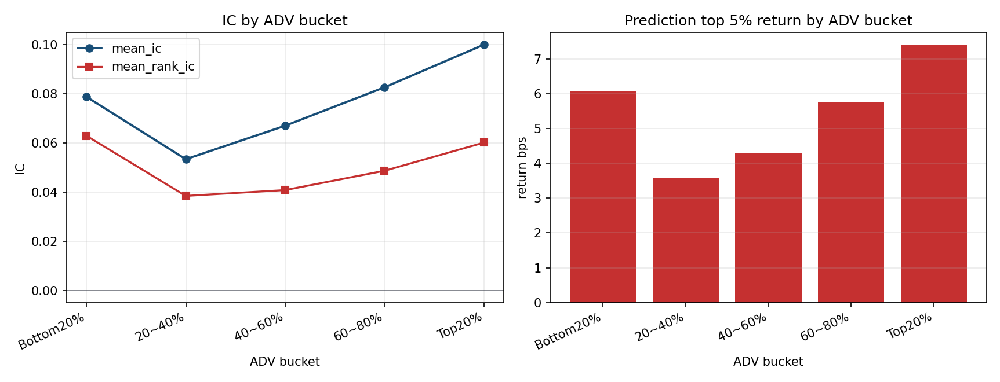

Left: Pearson IC and Rank IC by date-level ADV bucket. Right: prediction top 5% target return by ADV bucket.

### adv_liquidity_bucket_metrics.csv

| adv_bucket | bucket_label | row_count | day_count | mean_adv_amount | median_adv_amount | mean_ic | mean_rank_ic | icir | rank_icir | top5_return_bps | top5_hit_rate | top5_row_count |
| --- | --- | --- | --- | --- | --- | --- | --- | --- | --- | --- | --- | --- |
| 1 | Bottom20% | 33,579,609 | 205 | 22,043 | 22,558 | 0.078796 | 0.062917 | 3.3813 | 4.0099 | 6.0627 | 0.420931 | 1,694,847 |
| 2 | 20~40% | 33,579,609 | 205 | 49,378 | 48,887 | 0.053384 | 0.038439 | 2.9626 | 2.6253 | 3.5628 | 0.418458 | 1,695,008 |
| 3 | 40~60% | 33,579,609 | 205 | 89,103 | 87,560 | 0.067011 | 0.040814 | 2.9566 | 2.5320 | 4.2938 | 0.431843 | 1,694,203 |
| 4 | 60~80% | 33,579,448 | 205 | 170,680 | 165,081 | 0.082681 | 0.048667 | 3.6138 | 2.7976 | 5.7450 | 0.449141 | 1,695,008 |
| 5 | Top20% | 33,579,448 | 205 | 714,122 | 442,449 | 0.100036 | 0.060140 | 3.4636 | 2.7081 | 7.3898 | 0.464937 | 1,695,008 |

字段解释

| field | explanation |
| --- | --- |
| Liquidity By ADV | 按完整 test universe 的 date-code 样本池, 用 shifted/trailing ADV 全局分五桶, 检查不同流动性股票上的 IC 与 prediction top 5% return.  |
| adv_bucket | 按完整 test universe date-code 样本池的 adv_amount 排序后的全局五分桶编号; 1 为 Bottom20%, 5 为 Top20%.  |
| bucket_label | ADV 五分桶可读标签.  |
| row_count | 分组内有限 prediction/target 样本数.  |
| day_count | 入选样本覆盖的交易日数量.  |
| mean_adv_amount | 当前 ADV 桶内 date-code 层面的平均 shifted/trailing ADV.  |
| median_adv_amount | 当前 ADV 桶内 date-code 层面的中位 shifted/trailing ADV.  |
| mean_ic | 当前 ADV 桶内先按 date,time 横截面计算 Pearson IC, 再按 date 聚合后的均值.  |
| mean_rank_ic | 当前 ADV 桶内先按 date,time 横截面计算 Rank IC, 再按 date 聚合后的均值.  |
| icir | 当前 ADV 桶 daily IC 的 mean/std.  |
| rank_icir | 当前 ADV 桶 daily Rank IC 的 mean/std.  |
| top5_return_bps | 当前 ADV 桶内每个 date,time 截面 prediction 最高 5% 样本的平均 target return, 单位 bps.  |
| top5_hit_rate | 当前 ADV 桶内 prediction 最高 5% 样本 target > 0 的比例.  |
| top5_row_count | 当前 ADV 桶内进入 prediction top 5% return 统计的样本数.  |

### 4. Train Metrics

### 4.1. Checkpoint Selection

| key | value |
| --- | --- |
| best_iter | 40,000 |
| selection_metric | checkpoint_selection/score |
| selection_rule | early_top_k |
| selection_value | 0.049401 |
| candidate_count | 8 |

checkpoint_selector_table.csv

| iter | selected | val/objective/mse | val/quality/global_ic | val/quality/rank_ic | val/dist/pred_std_over_target_std | decision | metric_rank |
| --- | --- | --- | --- | --- | --- | --- | --- |
| 0 | False | 3.902e-05 | -0.006974 | -0.009873 | nan | reject | 8.0000 |
| 10,000 | False | 3.884e-05 | 0.090288 | 0.061683 | nan | reject | 1.0000 |
| 20,000 | False | 3.911e-05 | 0.072475 | 0.060097 | nan | reject | 4.0000 |
| 30,000 | False | 3.908e-05 | 0.083493 | 0.070427 | nan | reject | 3.0000 |
| 40,000 | True | 3.922e-05 | 0.085087 | 0.065637 | nan | promote | 2.0000 |
| 50,000 | False | 3.976e-05 | 0.071685 | 0.063601 | nan | reject | 5.0000 |
| 60,000 | False | 3.984e-05 | 0.068064 | 0.058595 | nan | reject | 7.0000 |
| 67,615 | False | 3.987e-05 | 0.070116 | 0.059748 | nan | reject | 6.0000 |

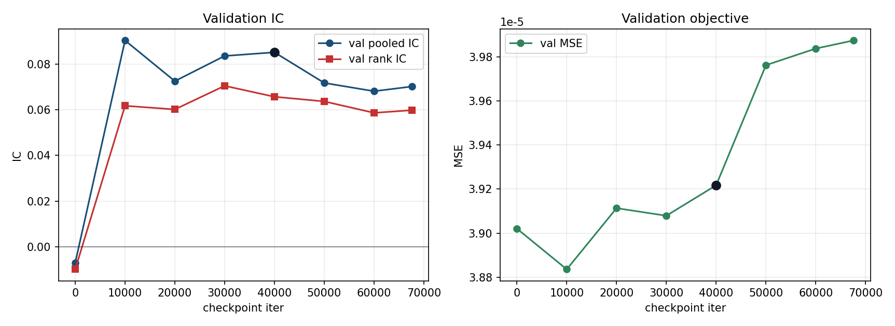

Validation objective and IC metrics by checkpoint iteration.

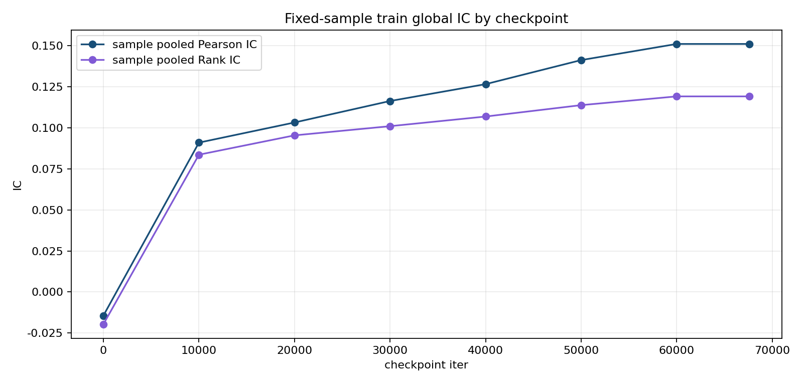

Every checkpoint is evaluated on the same deterministic 3,891-batch / 31,875,072-row train sample.

| iter | pooled_ic | pooled_rank_ic | count | scope |
| --- | --- | --- | --- | --- |
| 0 | -0.014388 | -0.019632 | 31,875,072 | fixed train sample: 3891 batches |
| 10,000 | 0.090968 | 0.083606 | 31,875,072 | fixed train sample: 3891 batches |
| 20,000 | 0.103222 | 0.095385 | 31,875,072 | fixed train sample: 3891 batches |
| 30,000 | 0.116304 | 0.100980 | 31,875,072 | fixed train sample: 3891 batches |
| 40,000 | 0.126570 | 0.106853 | 31,875,072 | fixed train sample: 3891 batches |
| 50,000 | 0.141216 | 0.113791 | 31,875,072 | fixed train sample: 3891 batches |
| 60,000 | 0.151048 | 0.119118 | 31,875,072 | fixed train sample: 3891 batches |
| 67,615 | 0.151048 | 0.119118 | 31,875,072 | fixed train sample: 3891 batches |

字段解释

| field | explanation |
| --- | --- |
| train_checkpoint_sample_ic | 每个 checkpoint 在同一固定 3,891-batch 训练样本上的 pooled Pearson/Rank IC; 不是 full-train 指标.  |

### 4.2. Model And Method

### Model

model_class

GruMlpRegressor

model class

trainable_parameter

1,864,577

trainable parameter count

input_tensor

batch, window, 63

GRU input

prediction_target

log_close[t+11] - log_close[t+1]

raw target

label_holding_minutes

10

entry-to-exit holding period

label_exit_offset_minutes

11

exit offset from t

label_entry_lag_minutes

1

entry lag

gru_hidden_size

384

GRU hidden size

gru_num_layers

2

GRU layers

gru_bidirectional

False

GRU direction

gru_dropout

0.0

GRU dropout

mlp_effective_hidden_width

512

MLP effective hidden width

mlp_dropout

0.0

MLP dropout

optimizer

AdamW

optimizer

learning_rate

0.001000

base LR

lr_scheduler/type

LinearWarmup + CosineAnnealing

qmodel scheduler

approx_total_epochs

0.591589

through selected checkpoint

### 4.2.1. GRU

| field | value |
| --- | --- |
| input_tensor | batch, window, 63 |
| gru_hidden_size | 384 |
| gru_num_layers | 2 |
| gru_bidirectional | False |
| gru_dropout | 0.0 |

### 4.2.2. MLP

| field | value |
| --- | --- |
| mlp_effective_hidden_width | 512 |
| mlp_dropout | 0.0 |

### 4.2.3. Method

| field | value |
| --- | --- |
| parameter_initialization | PyTorch default GRU and Linear initialization |
| lr_scheduler/type | LinearWarmup + CosineAnnealing |
| optimizer | AdamW |
| approx_total_epochs | 0.591589 |
| final_iter | 67,615 |
| checkpoint_selection | early_top_k checkpoint_selection/score |

字段解释

| field | explanation |
| --- | --- |
| model_class | 模型类名.  |
| trainable_parameter | 可训练参数数量.  |
| gru_bidirectional | GRU 是否使用 bidirectional 结构.  |
| parameter_initialization | 模型参数初始化方式.  |
| selected_checkpoint | 最终用于 evaluation 的 checkpoint iteration.  |

### 4.3. Training Monitoring

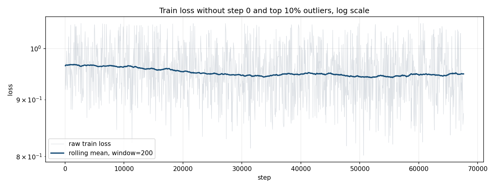

Train loss with step=0 and the top 10% loss outliers removed, log y-axis, and a rolling mean smoothing curve.

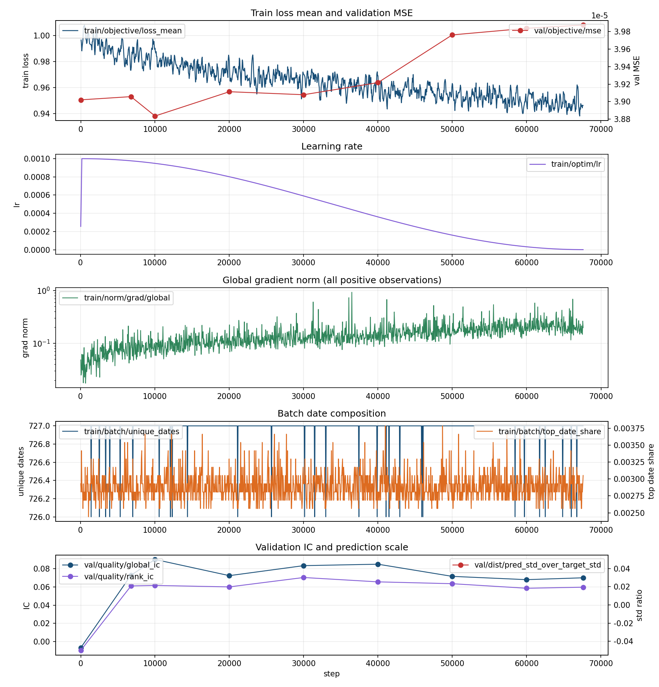

MLflow-backed train diagnostics plus local validation scalar curves for loss, LR, batch composition, IC, and prediction scale; grad norm retains every positive observation without p99 clipping and uses a log y-axis.

字段解释

| field | explanation |
| --- | --- |
| Train loss | 读取 TensorBoard scalar parquet, 过滤 step > 0, 删除最高 10% loss outlier, 用 rolling(window=200, min_periods=20, center=True) 计算 smoothed_loss, y-axis 使用 log scale.  |
| train/objective/loss_mean | MLflow 中记录的 train objective loss rolling mean.  |
| train/optim/lr | MLflow 中记录的 optimizer learning rate.  |
| train/norm/grad/global | MLflow 中记录的所有可训练参数梯度拼接后的 L2 norm; 监控图保留全部正值观测, 不做 p99 截断, 并使用 log y-axis 展示.  |
| train/batch/unique_dates | MLflow 中记录的一个 batch 内覆盖的不同交易日数量.  |
| train/batch/top_date_share | MLflow 中记录的一个 batch 内样本最多交易日的样本占比.  |
| val/objective/mse | validation split 上的 objective MSE.  |
| val/quality/global_ic | validation split 上的 global Pearson IC.  |
| val/quality/rank_ic | validation split 上的 rank IC.  |
| val/dist/pred_std_over_target_std | validation prediction std / target std.  |

### 5. Trading And Cost

### 5.0. Cost Model Status

Cost model artifact status

status

pending real cost artifact

available_metric

simple ETF prediction-threshold long/flat compound backtest by important stock pool

### 5.1. Cumulative Prediction, Real, And Excess Returns

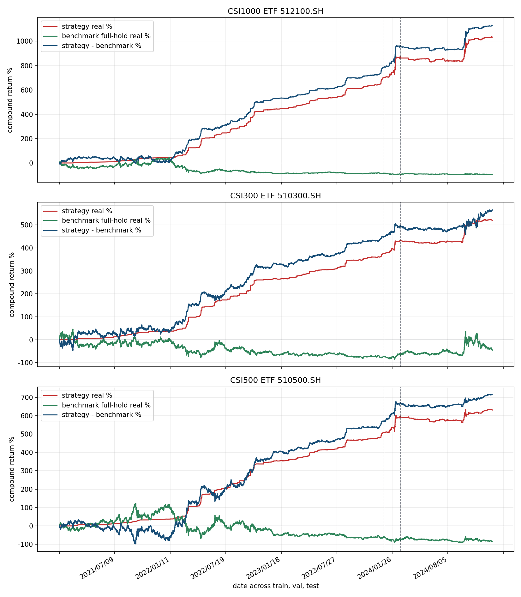

Benchmark is continuous full-hold ETF real return; strategy uses the 4800-minute trailing 95% ETF prediction threshold and 5-minute trading rule; excess line is strategy real % minus benchmark full-hold real %.

| pool | days | final_cum_prediction_bps | final_cum_real_bps | final_benchmark_real_bps | final_cum_excess_bps | 平均每天开仓次数 | 平均每天return_bps | 平均每次开仓return_bps |
| --- | --- | --- | --- | --- | --- | --- | --- | --- |
| 1000 ETF | 969 | 33,827 | 103,261 | -9,468 | 2,119,586 | 1.0702 | 25.5306 | 23.6818 |
| 沪深300 ETF(沪) | 969 | 18,987 | 52,025 | -4,615 | 105,187 | 1.0640 | 19.1252 | 17.8927 |
| 中证500 ETF(沪) | 969 | 28,866 | 63,038 | -8,487 | 472,759 | 1.0939 | 20.9029 | 18.9918 |

### Backtest risk/trading metrics

| pool | max_drawdown_pct | exposure_ratio | win_rate_by_trade | avg_holding_minutes |
| --- | --- | --- | --- | --- |
| 1000 ETF | -4.5697 | 0.048972 | 0.739634 | 7.3674 |
| 沪深300 ETF(沪) | -3.4274 | 0.048298 | 0.689622 | 7.3084 |
| 中证500 ETF(沪) | -5.5698 | 0.048843 | 0.687736 | 7.1887 |

### Test-only backtest metrics

| pool | test_days | test_cum_strategy_bps | test_cum_benchmark_bps | test_excess_bps | max_drawdown_pct | exposure_ratio | win_rate_by_trade | avg_holding_minutes |
| --- | --- | --- | --- | --- | --- | --- | --- | --- |
| 1000 ETF | 205 | 1,775 | -3,172 | 7,245 | -4.2805 | 0.045751 | 0.561905 | 7.1905 |
| 沪深300 ETF(沪) | 205 | 1,684 | 5,005 | -2,213 | -3.4274 | 0.050598 | 0.548936 | 7.1064 |
| 中证500 ETF(沪) | 205 | 563.6743 | -4,043 | 7,734 | -4.8891 | 0.047872 | 0.525641 | 6.7521 |

字段解释

| field | explanation |
| --- | --- |
| model | benchmark 为 ETF 每分钟一直满仓持有得到 real return; strategy 按 pool 合成分钟级 ETF prediction, 用过去 4800 分钟的 95% 分位做开仓阈值, 每 5 分钟开平仓并复利交易.  |
| strategy real % | 按 5 分钟开平仓规则, 用真实 etf_real_return 复利得到的策略实际收益.  |
| benchmark full-hold real % | 不做择时, ETF/pool 每分钟一直满仓持有, 用 etf_real_return 连续复利得到的 benchmark 收益.  |
| strategy - benchmark % | strategy real % - benchmark full-hold real %.  |
| max_drawdown_pct | strategy_nav 相对历史高点的最大回撤, 单位 %.  |
| exposure_ratio | position > 0 的分钟数 / 总分钟数.  |
| win_rate_by_trade | 按 trade_id 聚合每次开仓复利收益, 收益大于 0 的比例.  |
| avg_holding_minutes | 每个 trade_id 覆盖的分钟数均值.  |
| test_cum_strategy_bps | test split 内 strategy_minute_return 从 1 重新复利后的累计收益, 单位 bps.  |
| test_cum_benchmark_bps | test split 内 benchmark_minute_return 从 1 重新复利后的累计收益, 单位 bps.  |
| test_excess_bps | (1 + test_cum_strategy_return) / (1 + test_cum_benchmark_return) - 1, 单位 bps.  |

### 5.2. Single-Side Cost Sensitivity

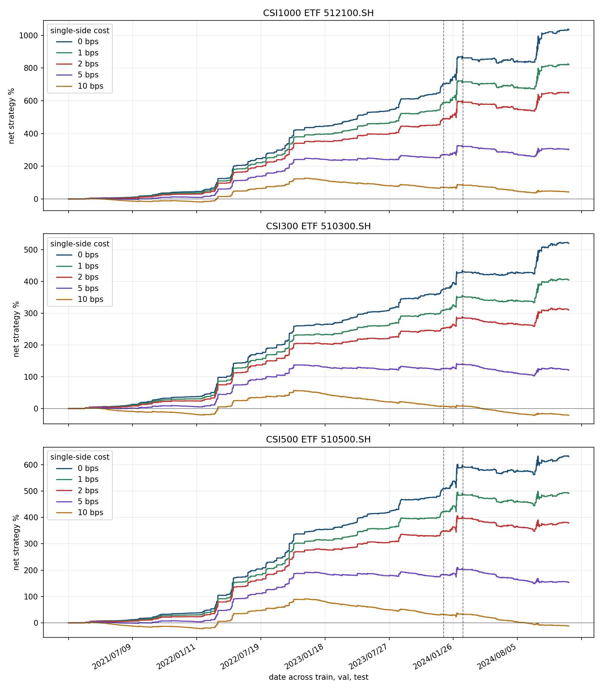

train, val, and test shown on the same axis as 5.1; trading rule is the same as 5.1; cost is deducted as abs(position - prev_position) * single-side cost bps / 10000.

### Test-only cost model metrics

| pool | single_side_cost_bps | test_days | test_cum_net_strategy_bps | test_cum_benchmark_bps | test_net_excess_bps | total_turnover | total_cost_bps | max_drawdown_pct | exposure_ratio | win_rate_by_trade | avg_holding_minutes |
| --- | --- | --- | --- | --- | --- | --- | --- | --- | --- | --- | --- |
| 1000 ETF | 0.000e+00 | 205 | 1,775 | -3,172 | 7,245 | 420.0000 | 0.000e+00 | -4.2805 | 0.045751 | 0.561905 | 7.1905 |
| 1000 ETF | 1.0000 | 205 | 1,291 | -3,172 | 6,536 | 420.0000 | 420.0000 | -5.3278 | 0.045751 | 0.538095 | 7.1905 |
| 1000 ETF | 2.0000 | 205 | 826.6909 | -3,172 | 5,855 | 420.0000 | 840.0000 | -7.8131 | 0.045751 | 0.490476 | 7.1905 |
| 1000 ETF | 5.0000 | 205 | -455.2627 | -3,172 | 3,978 | 420.0000 | 2,100 | -14.8911 | 0.045751 | 0.371429 | 7.1905 |
| 1000 ETF | 10.0000 | 205 | -2,264 | -3,172 | 1,329 | 420.0000 | 4,200 | -25.5718 | 0.045751 | 0.242857 | 7.1905 |
| 沪深300 ETF(沪) | 0.000e+00 | 205 | 1,684 | 5,005 | -2,213 | 470.0000 | 0.000e+00 | -3.4274 | 0.050598 | 0.548936 | 7.1064 |
| 沪深300 ETF(沪) | 1.0000 | 205 | 1,148 | 5,005 | -2,570 | 470.0000 | 470.0000 | -4.2447 | 0.050598 | 0.502128 | 7.1064 |
| 沪深300 ETF(沪) | 2.0000 | 205 | 635.9808 | 5,005 | -2,912 | 470.0000 | 940.0000 | -7.0751 | 0.050598 | 0.442553 | 7.1064 |
| 沪深300 ETF(沪) | 5.0000 | 205 | -763.0283 | 5,005 | -3,844 | 470.0000 | 2,350 | -15.1246 | 0.050598 | 0.293617 | 7.1064 |
| 沪深300 ETF(沪) | 10.0000 | 205 | -2,699 | 5,005 | -5,134 | 470.0000 | 4,700 | -27.1014 | 0.050598 | 0.174468 | 7.1064 |
| 中证500 ETF(沪) | 0.000e+00 | 205 | 563.6743 | -4,043 | 7,734 | 468.0000 | 0.000e+00 | -4.8891 | 0.047872 | 0.525641 | 6.7521 |
| 中证500 ETF(沪) | 1.0000 | 205 | 80.7073 | -4,043 | 6,924 | 468.0000 | 468.0000 | -7.3705 | 0.047872 | 0.491453 | 6.7521 |
| 中证500 ETF(沪) | 2.0000 | 205 | -380.2236 | -4,043 | 6,150 | 468.0000 | 936.0000 | -10.1356 | 0.047872 | 0.444444 | 6.7521 |
| 中证500 ETF(沪) | 5.0000 | 205 | -1,641 | -4,043 | 4,034 | 468.0000 | 2,340 | -17.9733 | 0.047872 | 0.269231 | 6.7521 |
| 中证500 ETF(沪) | 10.0000 | 205 | -3,386 | -4,043 | 1,104 | 468.0000 | 4,680 | -33.8571 | 0.047872 | 0.170940 | 6.7521 |

Test date range: 2024/03/01 -> 2024/12/31 (205 trading days), including 2024/09 and 2024/10.

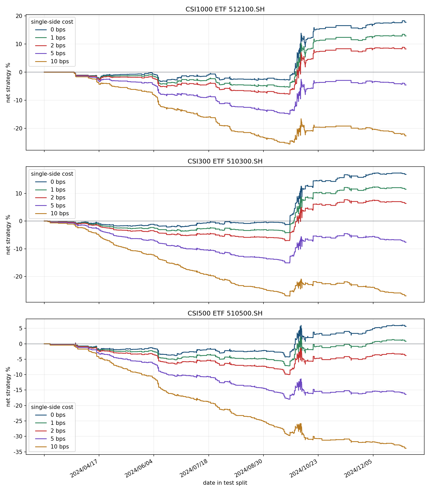

test split only; trading rule is the same as 5.1; cost is deducted as abs(position - prev_position) * single-side cost bps / 10000.

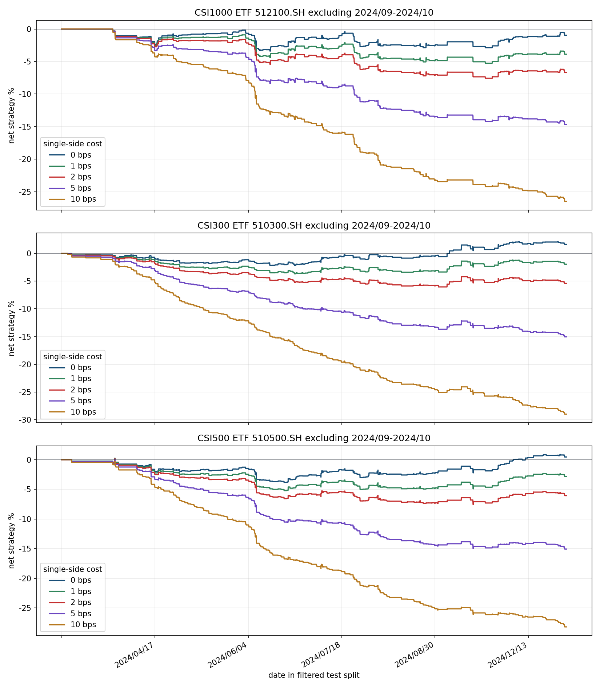

test split only with 2024/09 and 2024/10 removed before recompounding; trading rule and single-side cost deduction match the other 5.2 figures.

字段解释

| field | explanation |
| --- | --- |
| single_side_cost_bps | 单边交易成本, 按 abs(position - prev_position) * cost_bps / 10000 从 strategy_minute_return 中扣减.  |
| test_cum_net_strategy_bps | test split 内扣除单边交易成本后的 strategy_minute_return 从 1 重新复利后的累计收益, 单位 bps.  |
| test_cum_benchmark_bps | test split 内 benchmark_minute_return 从 1 重新复利后的累计收益, 单位 bps.  |
| test_net_excess_bps | (1 + test_cum_net_strategy_return) / (1 + test_cum_benchmark_return) - 1, 单位 bps.  |
| total_turnover | test split 内 abs(position - prev_position) 的合计.  |
| total_cost_bps | test split 内累计扣除的交易成本, 近似为 sum(turnover_event * single_side_cost_bps).  |
| max_drawdown_pct | strategy_nav 相对历史高点的最大回撤, 单位 %.  |
| exposure_ratio | position > 0 的分钟数 / 总分钟数.  |
| win_rate_by_trade | 按 trade_id 聚合每次开仓复利收益, 收益大于 0 的比例.  |
| avg_holding_minutes | 每个 trade_id 覆盖的分钟数均值.  |
| net_strategy_cumulative_return | test split 内扣除单边交易成本后的 strategy return 从 1 重新复利得到的累计收益.  |
| position | 调仓分钟 ETF prediction > baseline_threshold 时为 1, 否则为 0; 非调仓分钟沿用上一分钟持仓.  |
| prev_position | 同一个 pool 上一分钟的 position, 成本分析中用于计算 abs(position - prev_position).  |
| strategy_minute_return | return_event 为 true 时等于 position * etf_real_return, 否则为 0.  |

### 5.3. ETF Trade Return Distribution

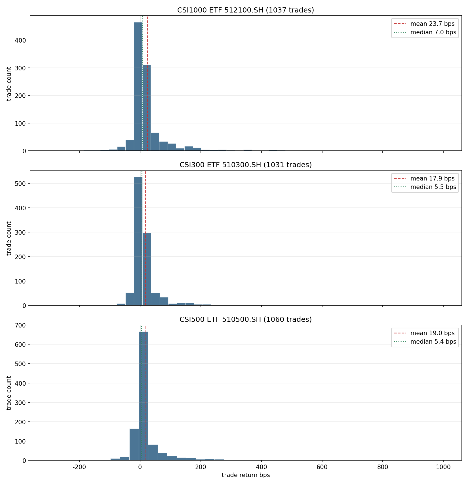

Each observation is one pool + trade_id from the 5.1 ETF long/flat strategy. For each trade_id, trade return is compounded across the rebalance return events while the position is active, using strategy_minute_return.

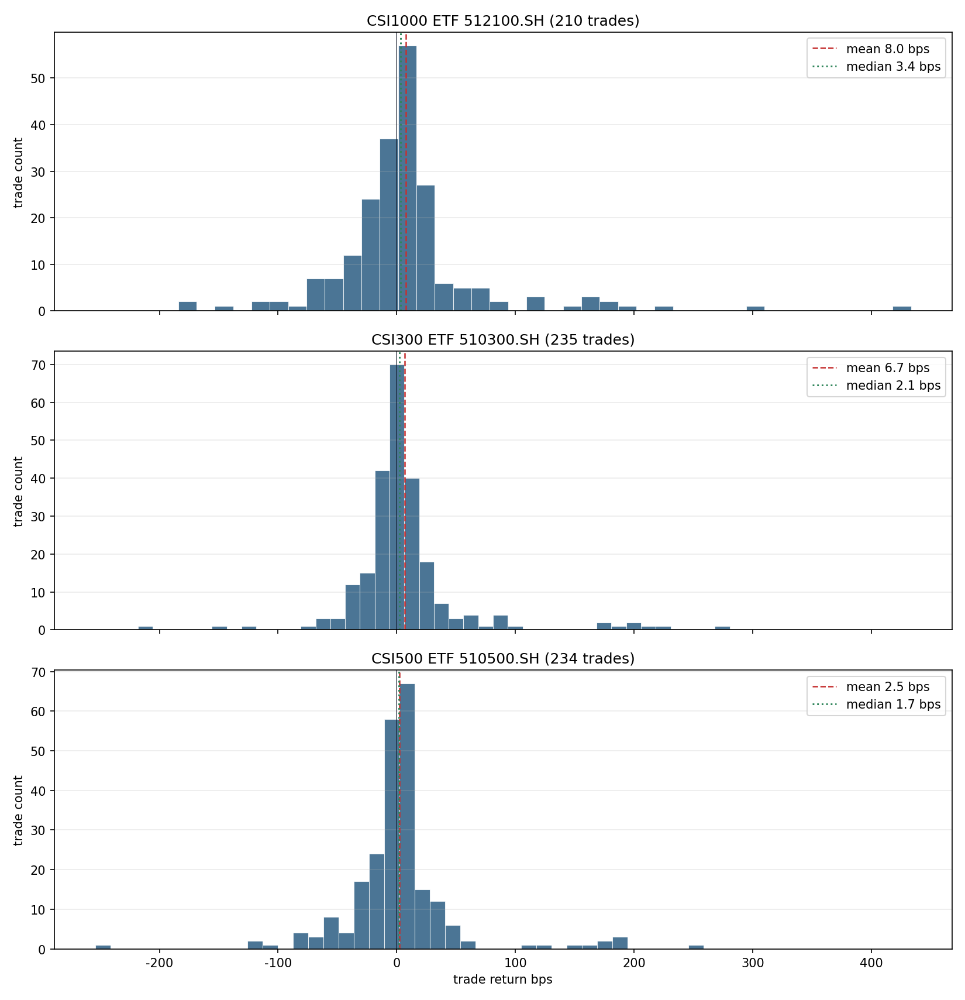

Test split only; each observation is one pool + trade_id observed inside test. For each trade_id, trade return is compounded across the rebalance return events while the position is active, using strategy_minute_return.

字段解释

| field | explanation |
| --- | --- |
| trade_return_bps | 按 pool + trade_id 聚合 strategy_minute_return 复利后的单笔交易收益, 单位 bps.  |
| trade_id | 每次开仓生成一个 trade id, 持仓期间沿用该 id, 空仓时为 0.  |
| holding_minutes | 持仓分钟数; 交易分布中表示同一个 trade_id 覆盖的分钟行数, 6.5 中表示 future holding horizon.  |
| strategy_minute_return | return_event 为 true 时等于 position * etf_real_return, 否则为 0.  |

### 5.4. Entry Delay Decay Experiment

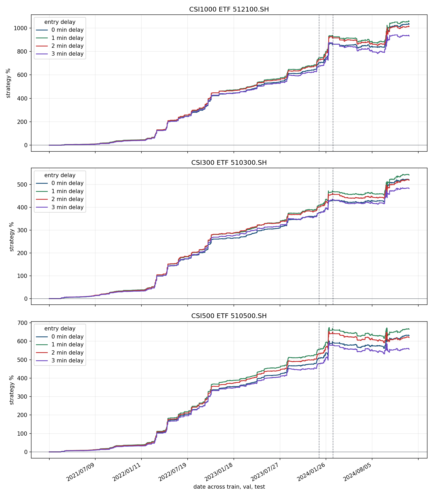

Delay levels are 0, 1, 2, and 3 minutes; only the entry timestamp is delayed, while the original exit timestamp and 5.1 trading rule stay unchanged.

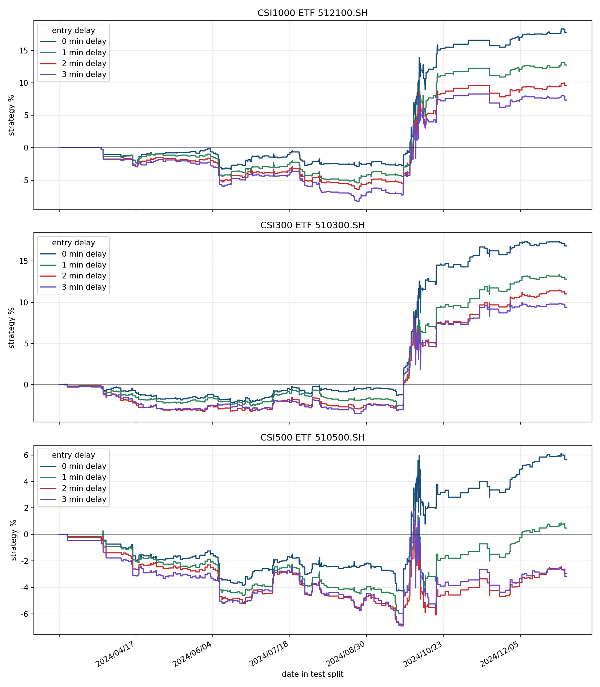

Test split only; delay levels are 0, 1, 2, and 3 minutes; trades shorter than the delay are skipped for that delayed path.

字段解释

| field | explanation |
| --- | --- |
| delay_minutes | entry delay decay 实验中相对原始开仓时间延后的分钟数.  |
| delayed_strategy_cumulative_return | 只延后开仓, 不延后平仓后, strategy return 从 1 重新复利得到的累计收益.  |
| open_event | 调仓分钟 position 从 0 切换到 1 时记为一次开仓.  |
| return_event | 只有调仓分钟入账一次 realized/expected return, 非调仓分钟为 0, 避免 forward label 每分钟重叠复利.  |
| position | 调仓分钟 ETF prediction > baseline_threshold 时为 1, 否则为 0; 非调仓分钟沿用上一分钟持仓.  |
| strategy_minute_return | return_event 为 true 时等于 position * etf_real_return, 否则为 0.  |

### 6. Robustness Diagnostics

### 6.1. IC by volatility rank

 和 corr(rank(prediction), rank(target)). ")

全 test 数据池按 volatility_label 排序切成 20 个等样本量分组, 每组计算 corr(prediction, target) 和 corr(rank(prediction), rank(target)). 

### 6.2. IC by price rank

 和 corr(rank(prediction), rank(target)). ")

全 test 数据池按 price_label 排序切成 20 个等样本量分组, 每组计算 corr(prediction, target) 和 corr(rank(prediction), rank(target)). 

### 6.3. Train/test intraday IC curve

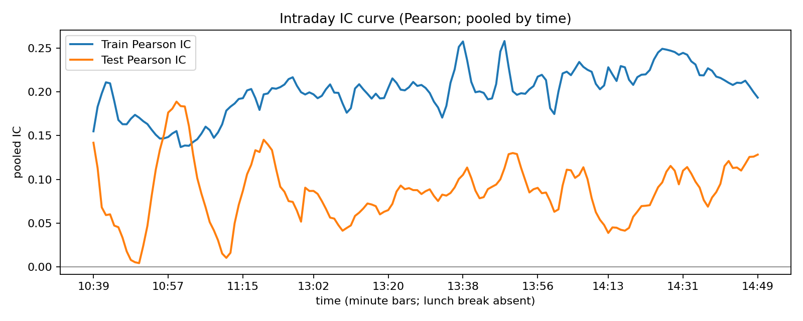

对 train/test 分别按 intraday time 分组, 将所有日期同一分钟的样本合并后计算一次 Pearson IC. 

### 6.4. Monthly signal spread and net efficiency

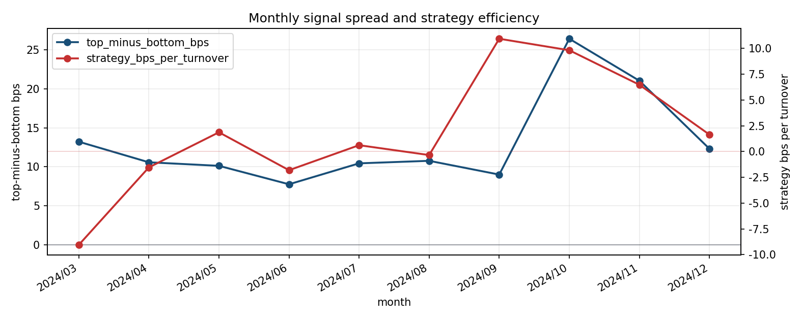

按月展示 test top-minus-bottom signal spread, 以及 5.1 strategy proxy 的三 pool 等权平均 bps per turnover. 

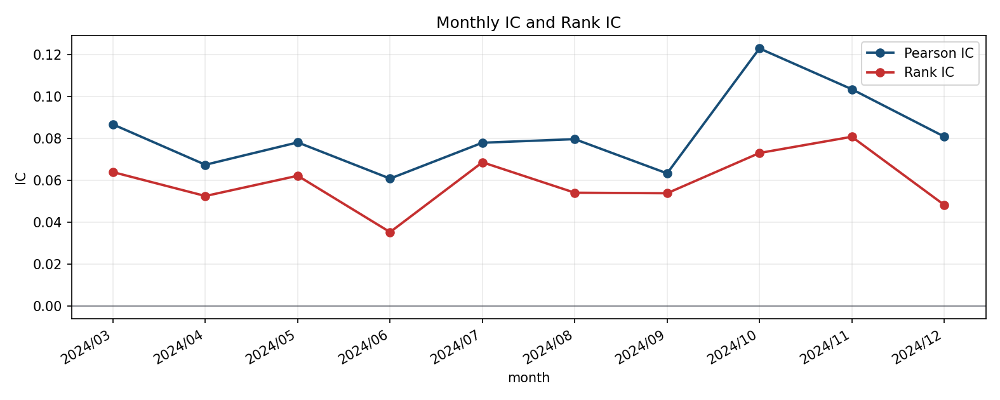

按月合并当前 test manifest 的所有样本, 分别计算 Pearson IC 和 Rank IC. 

### 6.5. Return Realization

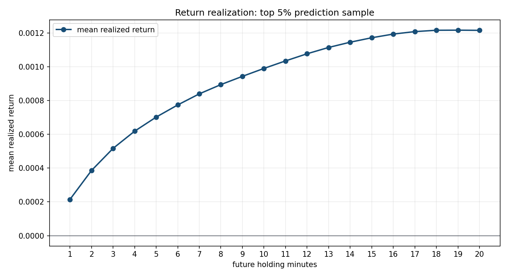

Selected test rows use prediction >= p95(prediction). For holding n minutes, realized return is log_close[t + 1 + n] - log_close[t + 1].

| holding_minutes | mean_return | mean_return_bps | row_count | prediction_p95 |
| --- | --- | --- | --- | --- |
| 1.0000 | 2.145e-04 | 2.1450 | 8,809,543 | 9.227e-04 |
| 2.0000 | 3.858e-04 | 3.8581 | 8,809,543 | 9.227e-04 |
| 3.0000 | 5.165e-04 | 5.1649 | 8,809,543 | 9.227e-04 |
| 4.0000 | 6.182e-04 | 6.1822 | 8,809,543 | 9.227e-04 |
| 5.0000 | 7.016e-04 | 7.0165 | 8,809,543 | 9.227e-04 |
| 6.0000 | 7.736e-04 | 7.7361 | 8,809,543 | 9.227e-04 |
| 7.0000 | 8.391e-04 | 8.3912 | 8,809,543 | 9.227e-04 |
| 8.0000 | 8.938e-04 | 8.9383 | 8,809,543 | 9.227e-04 |
| 9.0000 | 9.427e-04 | 9.4273 | 8,809,543 | 9.227e-04 |
| 10.0000 | 9.896e-04 | 9.8963 | 8,809,543 | 9.227e-04 |
| 11.0000 | 0.001034 | 10.3410 | 8,659,628 | 9.227e-04 |
| 12.0000 | 0.001076 | 10.7634 | 8,528,091 | 9.227e-04 |
| 13.0000 | 0.001114 | 11.1370 | 8,413,482 | 9.227e-04 |
| 14.0000 | 0.001145 | 11.4476 | 8,314,605 | 9.227e-04 |
| 15.0000 | 0.001171 | 11.7114 | 8,227,363 | 9.227e-04 |
| 16.0000 | 0.001193 | 11.9291 | 8,151,421 | 9.227e-04 |
| 17.0000 | 0.001207 | 12.0746 | 8,086,953 | 9.227e-04 |
| 18.0000 | 0.001215 | 12.1545 | 8,033,272 | 9.227e-04 |
| 19.0000 | 0.001216 | 12.1600 | 7,986,918 | 9.227e-04 |
| 20.0000 | 0.001215 | 12.1497 | 7,945,255 | 9.227e-04 |

字段解释

| field | explanation |
| --- | --- |
| Return Realization | 当前 selected test prediction 最高 5% 样本的未来持仓收益实现曲线.  |
| holding_minutes | 持仓分钟数; 交易分布中表示同一个 trade_id 覆盖的分钟行数, 6.5 中表示 future holding horizon.  |
| mean_return | 分组内 realized raw log return 的均值.  |
| mean_return_bps | 分组内 realized return 均值, 单位 bps.  |
| prediction_p95 | test split finite prediction 的 95% 分位阈值; 6.5 只保留 prediction >= prediction_p95 的样本.  |
| row_count | 该 holding horizon 下成功对齐 entry/exit close 且 realized raw log return finite 的样本数.  |

### 6.6. Top-k% Robustness

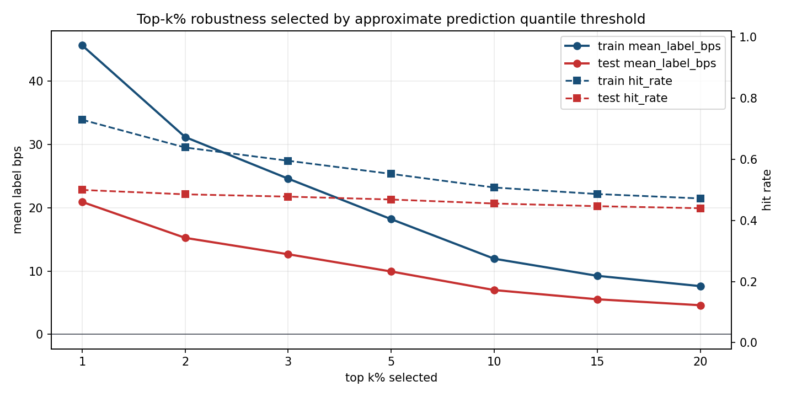

Top k% selected by approximate prediction quantile threshold within each split; k = 1, 2, 3, 5, 10, 15, 20.

| split | selection_method | k_pct | universe_count | selected_count | selected_fraction | prediction_threshold | mean_label_bps | median_label_bps | label_std_bps | hit_rate | day_count | timestamp_count |
| --- | --- | --- | --- | --- | --- | --- | --- | --- | --- | --- | --- | --- |
| train | approx_quantile_threshold | 1 | 553,898,121 | 5,422,345 | 0.009789 | 0.002447 | 45.6354 | 39.5797 | 87.8393 | 0.729294 | 727 | 116,865 |
| train | approx_quantile_threshold | 2 | 553,898,121 | 10,963,575 | 0.019793 | 0.001492 | 31.1545 | 24.9189 | 81.5703 | 0.638536 | 727 | 117,047 |
| train | approx_quantile_threshold | 3 | 553,898,121 | 16,567,492 | 0.029911 | 0.001119 | 24.5832 | 18.1686 | 76.7756 | 0.595106 | 727 | 117,047 |
| train | approx_quantile_threshold | 5 | 553,898,121 | 27,665,356 | 0.049947 | 7.891e-04 | 18.1871 | 11.6085 | 69.9706 | 0.552147 | 727 | 117,047 |
| train | approx_quantile_threshold | 10 | 553,898,121 | 55,418,987 | 0.100053 | 4.790e-04 | 11.9407 | 3.7693 | 60.6747 | 0.507636 | 727 | 117,047 |
| train | approx_quantile_threshold | 15 | 553,898,121 | 82,950,245 | 0.149757 | 3.405e-04 | 9.2436 | 0.173741 | 55.5286 | 0.486287 | 727 | 117,047 |
| train | approx_quantile_threshold | 20 | 553,898,121 | 110,875,540 | 0.200173 | 2.552e-04 | 7.6144 | 9.339e-04 | 51.9862 | 0.471832 | 727 | 117,047 |
| test | approx_quantile_threshold | 1 | 176,134,322 | 1,735,367 | 0.009853 | 0.002411 | 20.9116 | 2.9485 | 127.1465 | 0.499680 | 205 | 32,998 |
| test | approx_quantile_threshold | 2 | 176,134,322 | 3,486,983 | 0.019797 | 0.001639 | 15.2383 | 0.279351 | 109.3411 | 0.485359 | 205 | 33,005 |
| test | approx_quantile_threshold | 3 | 176,134,322 | 5,238,964 | 0.029744 | 0.001283 | 12.6482 | 0.036441 | 99.8364 | 0.477790 | 205 | 33,005 |
| test | approx_quantile_threshold | 5 | 176,134,322 | 8,764,244 | 0.049759 | 9.260e-04 | 9.9227 | 4.133e-04 | 88.4675 | 0.468338 | 205 | 33,005 |
| test | approx_quantile_threshold | 10 | 176,134,322 | 17,615,526 | 0.100012 | 5.693e-04 | 6.9926 | 0.000e+00 | 74.5545 | 0.455264 | 205 | 33,005 |
| test | approx_quantile_threshold | 15 | 176,134,322 | 26,379,475 | 0.149769 | 4.050e-04 | 5.5369 | 0.000e+00 | 67.4780 | 0.446592 | 205 | 33,005 |
| test | approx_quantile_threshold | 20 | 176,134,322 | 35,183,034 | 0.199751 | 3.017e-04 | 4.5981 | 0.000e+00 | 62.8045 | 0.439843 | 205 | 33,005 |

字段解释

| field | explanation |
| --- | --- |
| Top-k Robustness | train/test 各自样本池内用近似 prediction 分位阈值选择最高 k% 样本, 检查集中高 prediction 样本的 realized return.  |
| split | 样本池名称, 6.6 中为 train 或 test.  |
| selection_method | Top-k% 选择方法; 6.6 使用 approx_quantile_threshold, 即 DuckDB approx_quantile 给出的近似 prediction 分位阈值.  |
| k_pct | 按 prediction 全局降序选择的样本池顶部百分比.  |
| universe_count | 该 split 中 finite prediction/target 样本总数.  |
| selected_count | 该 split,k_pct 下 prediction >= prediction_threshold 的实际入选样本数.  |
| selected_fraction | selected_count / universe_count; 近似阈值口径下可能略偏离 k_pct / 100.  |
| prediction_threshold | DuckDB approx_quantile(prediction, 1 - k_pct / 100) 得到的近似入选阈值.  |
| mean_label_bps | 分组内 target 均值, 单位 bps.  |
| median_label_bps | Top-k% 样本 target 近似中位数, 使用 DuckDB approx_quantile(target, 0.5), 单位 bps.  |
| label_std_bps | Top-k% 样本 target 样本标准差, 单位 bps.  |
| hit_rate | 分组内 target > 0 的比例.  |
| day_count | 入选样本覆盖的交易日数量.  |
| timestamp_count | 入选样本覆盖的 date,time 截面数量.  |

## 限制与适用边界

修正 mixed-normalization 评估后 full63 test IC/RankIC 为0.061496/0.051659. Matched family ablation 中 relative/liquidity9 为0.098183/0.075886; market16 在训练 gate 停止, 未读取 test. 当前artifact可得性只影响复现, 不作为历史成功/失败判据. 只有matched合同内的结果可以直接比较.

## 结论

本次归档保留上述历史事实. 研究结论, 推广门槛和执行限制分别解释, 不把模型无增益或净收益为负改写成实验流程失败.

## 附录

### 7. Appendix Diagnostics

Artifact Paths

run_root

[artifact-root]/nn/multiscale-market-features-1min-ablation/legacy14/seed7/date_ranges

research_report_root

[artifact-root]/nn/multiscale-market-features-1min-ablation/legacy14/seed7/research_report

npz_meta

[artifact-root]/nn/multiscale-market-features-1min-ablation/legacy14/seed7/date_ranges/artifacts/npz/meta.yaml

data_clean_invalid_stats

[artifact-root]/nn/multiscale-market-features-1min-ablation/legacy14/seed7/date_ranges/artifacts/data_clean/invalid_feature_stats.csv

core_ic_metrics

[artifact-root]/nn/multiscale-market-features-1min-ablation/legacy14/seed7/research_report/core_ic_metrics.csv

signal_bucket_metrics

[artifact-root]/nn/multiscale-market-features-1min-ablation/legacy14/seed7/research_report/signal_quality/signal_bucket_metrics.csv

daily_top_bottom_signal_spread

[artifact-root]/nn/multiscale-market-features-1min-ablation/legacy14/seed7/research_report/signal_quality/daily_top_bottom_signal_spread.csv

goodness_of_fit_metrics

[artifact-root]/nn/multiscale-market-features-1min-ablation/legacy14/seed7/research_report/signal_quality/goodness_of_fit_metrics.csv

goodness_of_fit_png

[artifact-root]/nn/multiscale-market-features-1min-ablation/legacy14/seed7/research_report/signal_quality/goodness_of_fit.png

label_distribution_summary

[artifact-root]/nn/multiscale-market-features-1min-ablation/legacy14/seed7/research_report/data_pipeline/label_distribution_summary.csv

label_distribution_png

[artifact-root]/nn/multiscale-market-features-1min-ablation/legacy14/seed7/research_report/data_pipeline/label_distribution_by_split.png

important_pool_pooled_ic

[artifact-root]/nn/multiscale-market-features-1min-ablation/legacy14/seed7/research_report/important_pool/important_pool_pooled_ic.csv

important_pool_nonzero_metrics

[artifact-root]/nn/multiscale-market-features-1min-ablation/legacy14/seed7/research_report/important_pool/important_pool_nonzero_metrics.csv

important_pool_cumulative_returns

[artifact-root]/nn/multiscale-market-features-1min-ablation/legacy14/seed7/research_report/important_pool/important_pool_train_val_test_cumulative_returns.csv

train_test_intraday_ic

[artifact-root]/nn/multiscale-market-features-1min-ablation/legacy14/seed7/research_report/robustness/train_test_intraday_ic.csv

monthly_signal_spread_strategy_efficiency

[artifact-root]/nn/multiscale-market-features-1min-ablation/legacy14/seed7/research_report/robustness/monthly_signal_spread_strategy_efficiency.csv

monthly_ic_rank_ic

[artifact-root]/nn/multiscale-market-features-1min-ablation/legacy14/seed7/research_report/robustness/monthly_ic_rank_ic.csv

topk_robustness

[artifact-root]/nn/multiscale-market-features-1min-ablation/legacy14/seed7/research_report/robustness/topk_robustness.csv

topk_robustness_png

[artifact-root]/nn/multiscale-market-features-1min-ablation/legacy14/seed7/research_report/robustness/topk_robustness.png

train_loss_log_png

[artifact-root]/nn/multiscale-market-features-1min-ablation/legacy14/seed7/research_report/figures/train_loss_no_step0_smoothed_log.png

train_checkpoint_sample_ic

[artifact-root]/nn/multiscale-market-features-1min-ablation/legacy14/seed7/research_report/train_metrics/train_checkpoint_sample_ic.csv

train_checkpoint_sample_ic_png

[artifact-root]/nn/multiscale-market-features-1min-ablation/legacy14/seed7/research_report/train_metrics/train_checkpoint_sample_ic.png

Extreme Value Metrics

| metric | value |
| --- | --- |
| val/dist/mean/pred | nan |
| val/dist/mean/target | nan |
| val/dist/abs_mean/pred | nan |
| val/dist/abs_mean/target | nan |
| val/dist/std/pred | nan |
| val/dist/std/target | nan |
| val/dist/pred_std_over_target_std | nan |
| val/dist/p01/pred | nan |
| val/dist/p01/target | nan |
| val/dist/p50/pred | nan |
| val/dist/p50/target | nan |
| val/dist/p99/pred | nan |
| val/dist/p99/target | nan |

Label Availability Coverage

| split | raw_rows | kept_rows | sampled_rows | out_rows | kept_rate |
| --- | --- | --- | --- | --- | --- |
| train | 842,496,476 | 794,726,723 | 553,898,121 | 553,898,121 | 0.943300 |
| val | 47,712,939 | 45,536,385 | 31,737,447 | 31,737,447 | 0.954382 |
| test | 264,871,532 | 252,715,072 | 176,134,322 | 176,134,322 | 0.954104 |

Pending Diagnostics

| diagnostic | status |
| --- | --- |
| turnover_decomposition | pending backtest/trading artifact |
| capacity_sensitivity | pending capacity artifact |
| short_side_diagnostics | pending long/short-side artifact |
