## 摘要

**历史结果: 历史成功.** 三臂 full train/evaluation 已完成. ret-ge2-nz5e-4 在 pooled IC 与高预测组收益上领先, flat-ret123-oc 在 hit-rate 指标上领先, 不合成单一 winner.

历史成功/失败按实验流程是否成功完成判断. 无增益, 成本后亏损, 归档和当前 artifact 缺失不改变历史成功事实. 失败的实验臂保留失败原因, 不填造未产生的 OOS 指标. 本次只整理已有材料, 未启动训练, 推理或回测.

### 1. Executive Summary

model_class

GruMlpRegressor

common across all experiments

train_range

20210104 -> 20231229 (727 days)

common across all experiments

val_range

20240102 -> 20240229 (37 days)

common across all experiments

test_range

20240301 -> 20241231 (205 days)

common across all experiments

### Executive Summary

| experiment | selected_checkpoint | train_pooled_ic | test_pooled_ic | top_prediction_return_bps | top95_hit | etf_top95_hit | overfit_variance_ratio |
| --- | --- | --- | --- | --- | --- | --- | --- |
| flat-all-ret | 20,000 | 0.227303 | 0.060086 | 9.6137 | 0.452697 | 0.539754 | 0.023484 |
| flat-ret123-oc | 10,000 | 0.215312 | 0.065607 | 9.7616 | 0.460260 | 0.553337 | 0.022102 |
| ret-ge2-nz5e-4 | 10,000 | 0.162022 | 0.070737 | 10.2585 | 0.437267 | 0.522352 | 0.023302 |

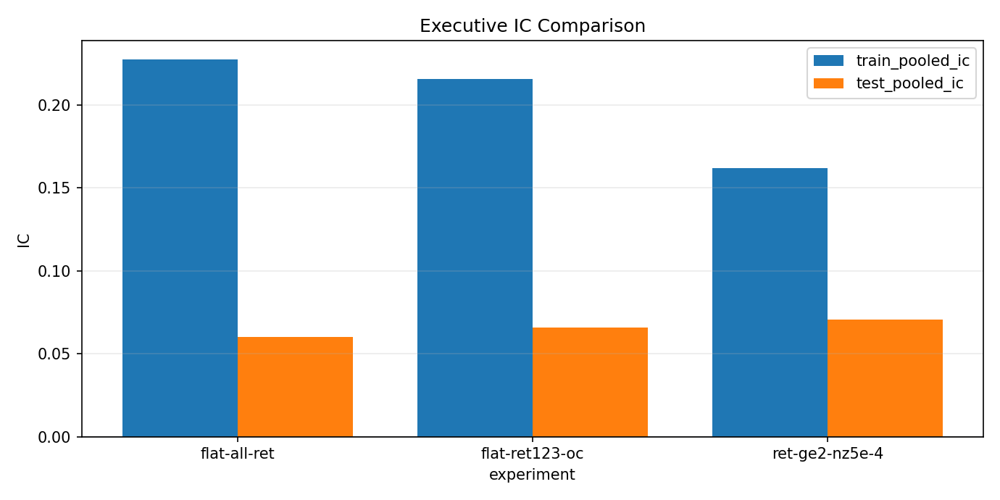

train_pooled_ic and test_pooled_ic.

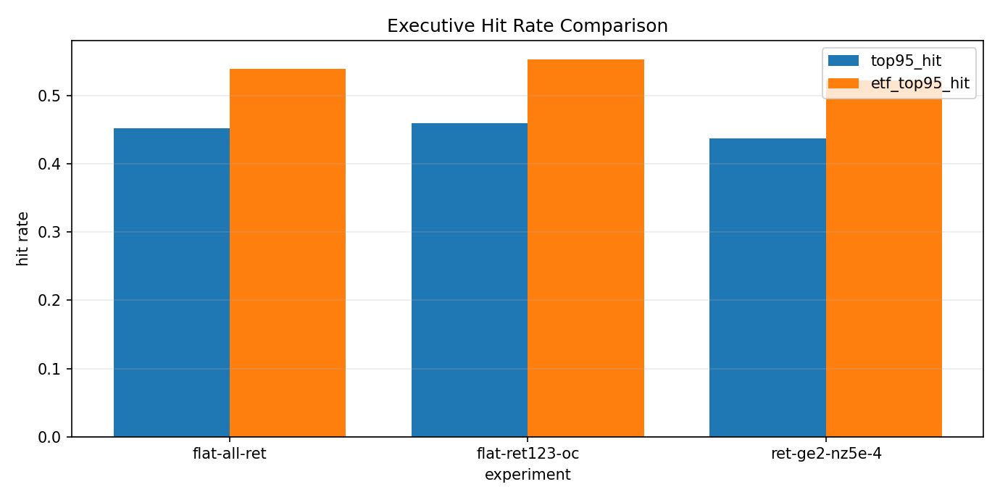

top95_hit and etf_top95_hit.

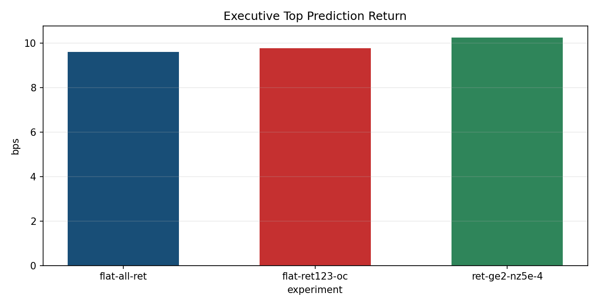

top_prediction_return_bps.

字段解释

| field | explanation |
| --- | --- |
| experiment | 对比实验名称.  |
| selected_checkpoint | 最终用于 evaluation 的 checkpoint iteration.  |
| train_pooled_ic | train split 上把所有样本合并后计算的 Pearson IC.  |
| test_pooled_ic | test split 上把所有样本合并后计算的 Pearson IC.  |
| top_prediction_return_bps | 最高 prediction 分组的平均 prediction return, 单位 bps.  |
| top95_hit | test split 中 prediction 最高 5% 样本内 target > 0 的比例.  |
| etf_top95_hit | test split 重要股票池合成 ETF prediction 最高 5% 样本内 etf_real_return > 0 的比例.  |
| overfit_variance_ratio | test split 中 prediction 样本方差 / target 样本方差.  |
| model_class | 模型类名.  |
| train_range | 训练集交易日范围.  |
| val_range | 验证集交易日范围.  |
| test_range | 测试集交易日范围.  |

## 研究背景与目标

本报告围绕Near-zero 样本过滤整理原始研究证据. 当前材料对应 registry report `near-zero-filter-comparison-061720`, 来源SHA256为 `d2f1c795c33d0cecfbf8bfe306f1a65b4c7de74be7d7b24e7252a72507d2ceba`. 原报告的实验方法, 图表, 结果和解释保留在下文.

## 数据与方法

实验身份为 `near-zero-filter`. Split, label, sampler, feature与checkpoint定义按原报告记录, 不从其他实验借用缺失字段. 汇总入口见[全实验综述](../../prediction-nn-1min/1103-nn-registry-summary/).

### 2. Experiment Setup And Data Pipeline

### 2.1. Experiment Setup

selection_metric

val/quality/pooled_ic

common across all experiments

selection_rule

max

common across all experiments

### Experiment Setup

| experiment | selected_checkpoint | selection_value | checkpoint_sha256 | candidate_count |
| --- | --- | --- | --- | --- |
| flat-all-ret | 20,000 | 0.073014 | 733b1737df7391e28ef8c996924c631cc56fa82347184c8ad7d54ba0a7b49911 | 6 |
| flat-ret123-oc | 10,000 | 0.057526 | c9729551c8de910147a5d0480fc34d6d78afe44e8f82c6ed122a97ed6a721f5a | 4 |
| ret-ge2-nz5e-4 | 10,000 | 0.073524 | 38eb0c8b218facef075db51b37a7e837461527d437424e9b666dfc6e5aeba6ce | 6 |

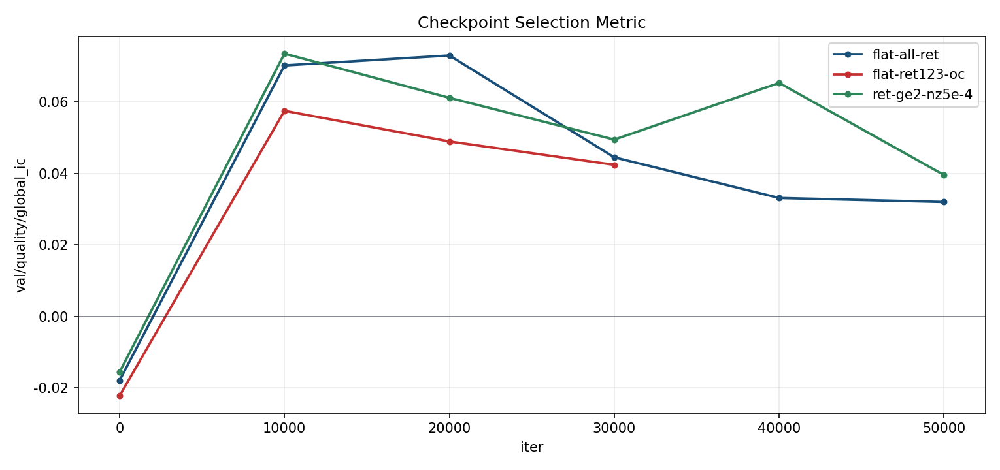

val/quality/global_ic by checkpoint.

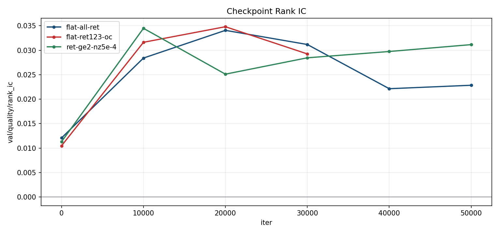

val/quality/rank_ic by checkpoint.

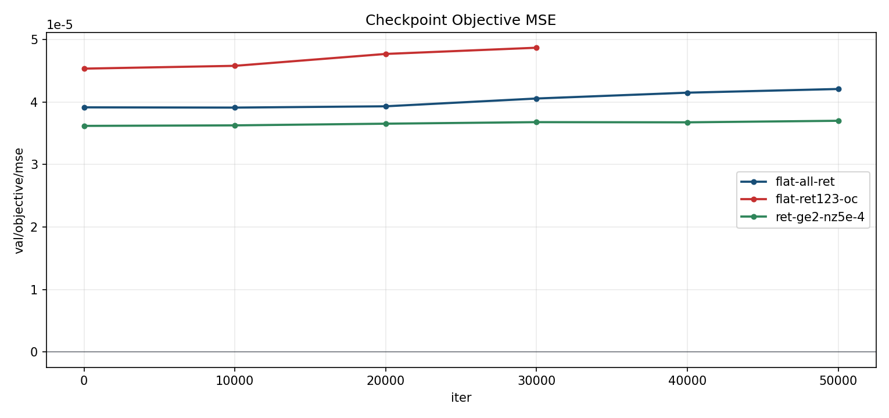

val/objective/mse by checkpoint.

字段解释

| field | explanation |
| --- | --- |
| experiment | 对比实验名称.  |
| selected_checkpoint | 最终用于 evaluation 的 checkpoint iteration.  |
| selection_value | 被选中 checkpoint 的 selection metric 数值.  |
| checkpoint_sha256 | checkpoint 文件 SHA256.  |
| candidate_count | 参与选择的 checkpoint 数量.  |
| selection_metric | checkpoint 选择使用的 validation metric.  |
| selection_rule | checkpoint 选择规则.  |

### 2.2. Data Basics

train_days

727

common across all experiments

val_days

37

common across all experiments

test_days

205

common across all experiments

### Data Basics

| experiment | train_rows | val_rows | test_rows | feature_dim | features | label_horizon_minutes | label_entry_lag_minutes |
| --- | --- | --- | --- | --- | --- | --- | --- |
| flat-all-ret | 735,793,772 | 42,292,401 | 233,229,389 | 14 | ret_1m, ret_5m, ret_2m, ret_3m, ret_10m, hl, oc, log_vol, log_amount, vol_10m, log_vol_5m_mean, log_amount_5m_mean, minute_norm, session_minute_norm | 10 | 1 |
| flat-ret123-oc | 693,580,605 | 40,710,907 | 221,041,835 | 14 | ret_1m, ret_5m, ret_2m, ret_3m, ret_10m, hl, oc, log_vol, log_amount, vol_10m, log_vol_5m_mean, log_amount_5m_mean, minute_norm, session_minute_norm | 10 | 1 |
| ret-ge2-nz5e-4 | 717,519,343 | 41,544,784 | 229,476,365 | 14 | ret_1m, ret_5m, ret_2m, ret_3m, ret_10m, hl, oc, log_vol, log_amount, vol_10m, log_vol_5m_mean, log_amount_5m_mean, minute_norm, session_minute_norm | 10 | 1 |

字段解释

| field | explanation |
| --- | --- |
| train_rows | train split 样本数量.  |
| val_rows | validation split 样本数量.  |
| test_rows | test split 样本数量.  |
| feature_dim | 模型输入 feature 维度.  |
| features | 模型输入 feature 列表.  |
| label_horizon_minutes | label forward horizon, 单位 minutes.  |
| label_entry_lag_minutes | label entry lag, 单位 minutes.  |
| train_days | train split 交易日数量.  |
| val_days | validation split 交易日数量.  |
| test_days | test split 交易日数量.  |

### 2.3. Data Normalization And Cleaning

### Data Normalization And Cleaning

| experiment | feature_normalization | label_normalization | train_kept_rate | val_kept_rate | test_kept_rate | max_invalid_ratio |
| --- | --- | --- | --- | --- | --- | --- |
| flat-all-ret | pooled_zscore / scope=train_only | pooled_zscore / scope=train_only | 0.871050 | 0.881308 | 0.875424 | 0.043478 |
| flat-ret123-oc | pooled_zscore / scope=train_only | pooled_zscore / scope=train_only | 0.821077 | 0.848352 | 0.829678 | 0.043478 |
| ret-ge2-nz5e-4 | pooled_zscore / scope=train_only | pooled_zscore / scope=train_only | 0.849416 | 0.865729 | 0.861337 | 0.043478 |

字段解释

| field | explanation |
| --- | --- |
| feature_normalization | feature normalization 方法和 fit scope.  |
| label_normalization | label normalization 方法和 fit scope.  |
| train_kept_rate | train split 清洗后保留比例.  |
| val_kept_rate | validation split 清洗后保留比例.  |
| test_kept_rate | test split 清洗后保留比例.  |
| max_invalid_ratio | 单个字段中 invalid 样本占比的最大值.  |

## 主要结果

| 记录项 | 当前解释 |
| --- | --- |
| 实验 | near-zero-filter |
| 报告类型 | comparison_report_html |
| 历史状态 | 历史成功 |
| 证据 | near-zero-filter-comparison-061720 |

flat-all-ret, flat-ret123-oc, ret-ge2-nz5e-4 横向对比; 数据来自 run artifacts, 缓存数据和 comparison-only 派生 artifacts. 

生成日期: 2026-06-17

### 3. Signal Quality Comparison

### 3.1. IC Summary

### IC Summary

| experiment | split | pooled_ic | pooled_rank_ic | count |
| --- | --- | --- | --- | --- |
| flat-all-ret | train | 0.227303 | 0.144090 | 31,875,072 |
| flat-all-ret | test | 0.060086 | 0.040709 | 122,700,191 |
| flat-ret123-oc | train | 0.215312 | 0.135608 | 31,875,072 |
| flat-ret123-oc | test | 0.065607 | 0.042609 | 60,992,275 |
| ret-ge2-nz5e-4 | train | 0.162022 | 0.125001 | 31,875,072 |
| ret-ge2-nz5e-4 | test | 0.070737 | 0.048291 | 131,501,803 |

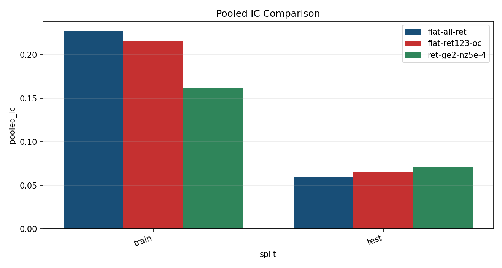

train/test pooled_ic.

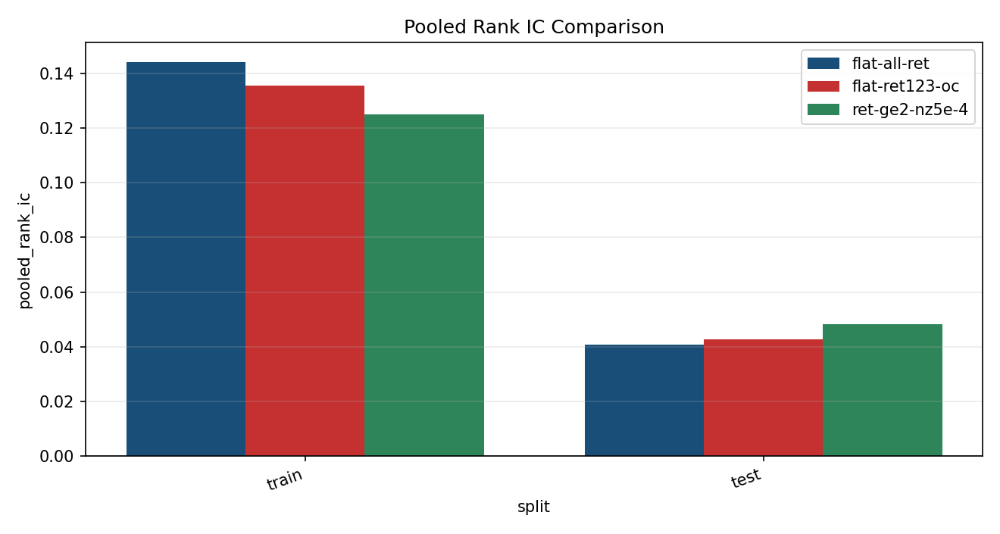

train/test pooled_rank_ic.

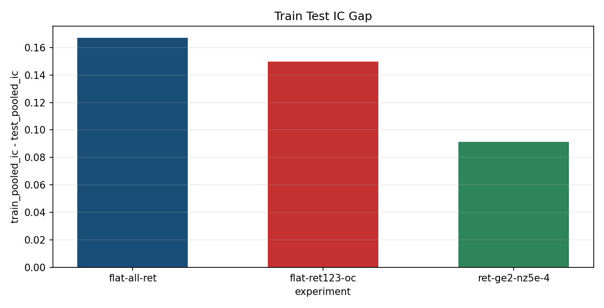

train_pooled_ic - test_pooled_ic.

字段解释

| field | explanation |
| --- | --- |
| split | 数据 split.  |
| pooled_ic | 合并样本后计算的 Pearson IC.  |
| pooled_rank_ic | 合并样本后计算的 Rank IC.  |
| count | 样本数.  |

### 3.2. Prediction Bucket Quality

### Prediction Bucket Quality

| experiment | signal_bucket | mean_prediction | mean_label_bps | t_stat | hit_rate | row_count | top_bottom_signal_spread_bps |
| --- | --- | --- | --- | --- | --- | --- | --- |
| flat-all-ret | 1 | -0.001163 | -5.1136 | -271.3851 | 0.387822 | 12,270,020 | 8.7470 |
| flat-all-ret | 2 | -4.553e-04 | -1.0293 | -81.0414 | 0.406651 | 12,270,019 | 8.7470 |
| flat-all-ret | 3 | -2.868e-04 | -0.614948 | -55.7062 | 0.398984 | 12,270,019 | 8.7470 |
| flat-all-ret | 4 | -1.873e-04 | -0.448260 | -41.5722 | 0.397123 | 12,270,019 | 8.7470 |
| flat-all-ret | 5 | -9.744e-05 | -0.161709 | -14.9876 | 0.399564 | 12,270,019 | 8.7470 |
| flat-all-ret | 6 | -9.809e-06 | 0.189183 | 17.3300 | 0.403556 | 12,270,019 | 8.7470 |
| flat-all-ret | 7 | 8.508e-05 | 0.534607 | 47.4418 | 0.409192 | 12,270,019 | 8.7470 |
| flat-all-ret | 8 | 1.992e-04 | 0.953911 | 80.0694 | 0.416568 | 12,270,019 | 8.7470 |
| flat-all-ret | 9 | 3.613e-04 | 1.5208 | 116.7478 | 0.425602 | 12,270,019 | 8.7470 |
| flat-all-ret | 10 | 0.001017 | 3.6334 | 195.5018 | 0.443901 | 12,270,019 | 8.7470 |
| flat-ret123-oc | 1 | -0.001095 | -5.1814 | -182.5188 | 0.395302 | 6,099,228 | 9.3952 |
| flat-ret123-oc | 2 | -3.874e-04 | -1.1888 | -63.8132 | 0.410331 | 6,099,228 | 9.3952 |
| flat-ret123-oc | 3 | -2.223e-04 | -0.705581 | -41.9031 | 0.408150 | 6,099,228 | 9.3952 |
| flat-ret123-oc | 4 | -1.146e-04 | -0.427610 | -26.2553 | 0.407934 | 6,099,228 | 9.3952 |
| flat-ret123-oc | 5 | -2.283e-05 | -0.138678 | -8.6831 | 0.409601 | 6,099,228 | 9.3952 |
| flat-ret123-oc | 6 | 6.485e-05 | 0.197482 | 12.3105 | 0.414106 | 6,099,227 | 9.3952 |
| flat-ret123-oc | 7 | 1.589e-04 | 0.603084 | 36.7687 | 0.420531 | 6,099,227 | 9.3952 |
| flat-ret123-oc | 8 | 2.715e-04 | 0.909814 | 53.0046 | 0.427631 | 6,099,227 | 9.3952 |
| flat-ret123-oc | 9 | 4.339e-04 | 1.4871 | 78.7820 | 0.434549 | 6,099,227 | 9.3952 |
| flat-ret123-oc | 10 | 0.001069 | 4.2139 | 156.1140 | 0.451201 | 6,099,227 | 9.3952 |
| ret-ge2-nz5e-4 | 1 | -0.001108 | -5.2989 | -300.4469 | 0.352450 | 13,150,181 | 9.6635 |
| ret-ge2-nz5e-4 | 2 | -4.099e-04 | -1.1272 | -98.4097 | 0.371793 | 13,150,181 | 9.6635 |
| ret-ge2-nz5e-4 | 3 | -2.130e-04 | -0.983745 | -94.0397 | 0.360721 | 13,150,181 | 9.6635 |
| ret-ge2-nz5e-4 | 4 | -9.480e-05 | -0.624292 | -62.1046 | 0.348631 | 13,150,180 | 9.6635 |
| ret-ge2-nz5e-4 | 5 | -2.118e-06 | -0.262152 | -25.9489 | 0.350902 | 13,150,180 | 9.6635 |
| ret-ge2-nz5e-4 | 6 | 8.676e-05 | 0.136940 | 13.2719 | 0.363129 | 13,150,180 | 9.6635 |
| ret-ge2-nz5e-4 | 7 | 1.846e-04 | 0.601715 | 55.4583 | 0.378981 | 13,150,180 | 9.6635 |
| ret-ge2-nz5e-4 | 8 | 3.102e-04 | 1.1855 | 101.8568 | 0.394599 | 13,150,180 | 9.6635 |
| ret-ge2-nz5e-4 | 9 | 4.963e-04 | 1.8971 | 148.7879 | 0.407949 | 13,150,180 | 9.6635 |
| ret-ge2-nz5e-4 | 10 | 0.001132 | 4.3646 | 250.0118 | 0.426638 | 13,150,180 | 9.6635 |

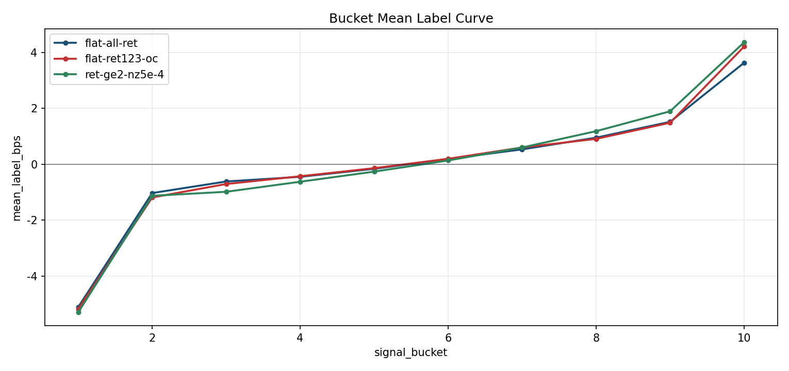

signal_bucket vs mean_label_bps.

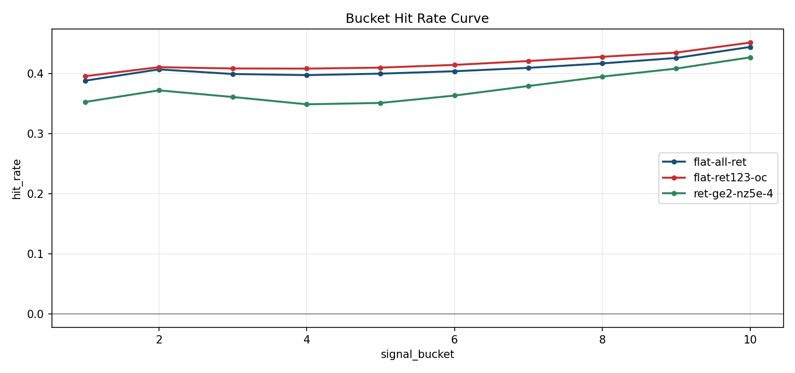

signal_bucket vs hit_rate.

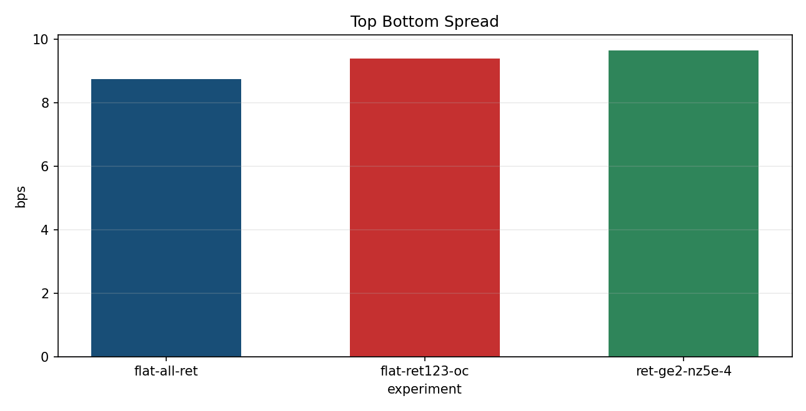

top_bottom_signal_spread_bps.

字段解释

| field | explanation |
| --- | --- |
| signal_bucket | 按 prediction 排序后的分桶编号.  |
| mean_prediction | 分组内 prediction 均值.  |
| mean_label_bps | 分组内 target 均值, 单位 bps.  |
| t_stat | 分组 mean label 的 t-stat.  |
| hit_rate | 分组内 target > 0 的比例.  |
| row_count | 分组样本数.  |
| top_bottom_signal_spread_bps | top bucket mean label bps - bottom bucket mean label bps.  |

### 3.3. Goodness Of Fit

Goodness Of Fit

| experiment | split | prediction_bin | mean_prediction | mean_label | label_p05 | label_p95 | row_count |
| --- | --- | --- | --- | --- | --- | --- | --- |
| flat-all-ret | train | 1 | -0.004038 | -0.004567 | -0.021744 | 0.011230 | 3,712,737 |
| flat-all-ret | train | 2 | -0.001760 | -0.001869 | -0.012627 | 0.009499 | 3,712,737 |
| flat-all-ret | train | 3 | -0.001363 | -0.001395 | -0.010818 | 0.008560 | 3,712,737 |
| flat-all-ret | train | 4 | -0.001135 | -0.001155 | -0.010109 | 0.008347 | 3,712,737 |
| flat-all-ret | train | 5 | -9.815e-04 | -9.821e-04 | -0.009552 | 0.008087 | 3,712,737 |
| flat-all-ret | train | 6 | -8.687e-04 | -8.721e-04 | -0.009186 | 0.007942 | 3,712,737 |
| flat-all-ret | train | 7 | -7.816e-04 | -7.664e-04 | -0.008743 | 0.007740 | 3,712,737 |
| flat-all-ret | train | 8 | -7.173e-04 | -7.116e-04 | -0.008331 | 0.007381 | 3,712,737 |
| flat-all-ret | train | 9 | -6.672e-04 | -6.500e-04 | -0.007973 | 0.007156 | 3,712,737 |
| flat-all-ret | train | 10 | -6.252e-04 | -6.000e-04 | -0.007706 | 0.006969 | 3,712,737 |
| flat-all-ret | train | 11 | -5.883e-04 | -5.534e-04 | -0.007504 | 0.006859 | 3,712,737 |
| flat-all-ret | train | 12 | -5.550e-04 | -5.195e-04 | -0.007362 | 0.006752 | 3,712,737 |
| flat-all-ret | train | 13 | -5.244e-04 | -4.802e-04 | -0.007221 | 0.006702 | 3,712,737 |
| flat-all-ret | train | 14 | -4.959e-04 | -4.547e-04 | -0.007114 | 0.006645 | 3,712,737 |
| flat-all-ret | train | 15 | -4.693e-04 | -4.206e-04 | -0.006973 | 0.006573 | 3,712,737 |
| flat-all-ret | train | 16 | -4.443e-04 | -3.933e-04 | -0.006878 | 0.006535 | 3,712,737 |
| flat-all-ret | train | 17 | -4.206e-04 | -3.831e-04 | -0.006790 | 0.006413 | 3,712,737 |
| flat-all-ret | train | 18 | -3.984e-04 | -3.692e-04 | -0.006706 | 0.006348 | 3,712,737 |
| flat-all-ret | train | 19 | -3.773e-04 | -3.356e-04 | -0.006592 | 0.006317 | 3,712,737 |
| flat-all-ret | train | 20 | -3.576e-04 | -3.156e-04 | -0.006454 | 0.006199 | 3,712,737 |
| flat-all-ret | train | 21 | -3.393e-04 | -3.024e-04 | -0.006302 | 0.006077 | 3,712,737 |
| flat-all-ret | train | 22 | -3.228e-04 | -2.749e-04 | -0.006100 | 0.005901 | 3,712,737 |
| flat-all-ret | train | 23 | -3.085e-04 | -2.689e-04 | -0.005909 | 0.005665 | 3,712,737 |
| flat-all-ret | train | 24 | -2.961e-04 | -2.544e-04 | -0.005775 | 0.005554 | 3,712,737 |
| flat-all-ret | train | 25 | -2.847e-04 | -2.439e-04 | -0.005703 | 0.005493 | 3,712,737 |
| flat-all-ret | train | 26 | -2.738e-04 | -2.264e-04 | -0.005634 | 0.005459 | 3,712,737 |
| flat-all-ret | train | 27 | -2.632e-04 | -2.076e-04 | -0.005585 | 0.005436 | 3,712,737 |
| flat-all-ret | train | 28 | -2.528e-04 | -1.970e-04 | -0.005558 | 0.005436 | 3,712,737 |
| flat-all-ret | train | 29 | -2.426e-04 | -1.824e-04 | -0.005535 | 0.005444 | 3,712,737 |
| flat-all-ret | train | 30 | -2.325e-04 | -1.679e-04 | -0.005505 | 0.005459 | 3,712,737 |
| flat-all-ret | train | 31 | -2.225e-04 | -1.622e-04 | -0.005508 | 0.005486 | 3,712,737 |
| flat-all-ret | train | 32 | -2.126e-04 | -1.448e-04 | -0.005493 | 0.005524 | 3,712,737 |
| flat-all-ret | train | 33 | -2.028e-04 | -1.443e-04 | -0.005493 | 0.005505 | 3,712,737 |
| flat-all-ret | train | 34 | -1.931e-04 | -1.319e-04 | -0.005489 | 0.005543 | 3,712,737 |
| flat-all-ret | train | 35 | -1.834e-04 | -1.155e-04 | -0.005489 | 0.005573 | 3,712,737 |
| flat-all-ret | train | 36 | -1.739e-04 | -1.035e-04 | -0.005474 | 0.005611 | 3,712,737 |
| flat-all-ret | train | 37 | -1.644e-04 | -1.002e-04 | -0.005470 | 0.005596 | 3,712,737 |
| flat-all-ret | train | 38 | -1.551e-04 | -7.738e-05 | -0.005440 | 0.005634 | 3,712,737 |
| flat-all-ret | train | 39 | -1.459e-04 | -7.181e-05 | -0.005447 | 0.005623 | 3,712,737 |
| flat-all-ret | train | 40 | -1.368e-04 | -6.758e-05 | -0.005421 | 0.005642 | 3,712,737 |
| flat-all-ret | train | 41 | -1.278e-04 | -5.920e-05 | -0.005409 | 0.005650 | 3,712,737 |
| flat-all-ret | train | 42 | -1.189e-04 | -4.956e-05 | -0.005402 | 0.005657 | 3,712,737 |
| flat-all-ret | train | 43 | -1.100e-04 | -5.051e-05 | -0.005383 | 0.005630 | 3,712,737 |
| flat-all-ret | train | 44 | -1.012e-04 | -3.515e-05 | -0.005390 | 0.005680 | 3,712,737 |
| flat-all-ret | train | 45 | -9.247e-05 | -2.208e-05 | -0.005360 | 0.005699 | 3,712,737 |
| flat-all-ret | train | 46 | -8.373e-05 | -2.394e-05 | -0.005383 | 0.005718 | 3,712,737 |
| flat-all-ret | train | 47 | -7.500e-05 | -8.950e-06 | -0.005367 | 0.005730 | 3,712,737 |
| flat-all-ret | train | 48 | -6.631e-05 | 5.386e-07 | -0.005344 | 0.005730 | 3,712,737 |
| flat-all-ret | train | 49 | -5.761e-05 | 9.292e-06 | -0.005352 | 0.005749 | 3,712,737 |
| flat-all-ret | train | 50 | -4.889e-05 | 2.767e-05 | -0.005322 | 0.005764 | 3,712,737 |
| flat-all-ret | train | 51 | -4.017e-05 | 2.722e-05 | -0.005360 | 0.005810 | 3,712,737 |
| flat-all-ret | train | 52 | -3.143e-05 | 3.247e-05 | -0.005352 | 0.005833 | 3,712,737 |
| flat-all-ret | train | 53 | -2.265e-05 | 4.586e-05 | -0.005341 | 0.005859 | 3,712,737 |
| flat-all-ret | train | 54 | -1.383e-05 | 5.339e-05 | -0.005344 | 0.005867 | 3,712,737 |
| flat-all-ret | train | 55 | -4.954e-06 | 6.131e-05 | -0.005341 | 0.005898 | 3,712,737 |
| flat-all-ret | train | 56 | 3.987e-06 | 8.133e-05 | -0.005337 | 0.005943 | 3,712,737 |
| flat-all-ret | train | 57 | 1.300e-05 | 8.137e-05 | -0.005356 | 0.005962 | 3,712,737 |
| flat-all-ret | train | 58 | 2.209e-05 | 9.754e-05 | -0.005341 | 0.006001 | 3,712,737 |
| flat-all-ret | train | 59 | 3.127e-05 | 1.013e-04 | -0.005360 | 0.006031 | 3,712,737 |
| flat-all-ret | train | 60 | 4.055e-05 | 1.058e-04 | -0.005375 | 0.006023 | 3,712,737 |
| flat-all-ret | train | 61 | 4.994e-05 | 1.216e-04 | -0.005383 | 0.006073 | 3,712,737 |
| flat-all-ret | train | 62 | 5.945e-05 | 1.237e-04 | -0.005390 | 0.006096 | 3,712,737 |
| flat-all-ret | train | 63 | 6.910e-05 | 1.309e-04 | -0.005417 | 0.006165 | 3,712,737 |
| flat-all-ret | train | 64 | 7.889e-05 | 1.482e-04 | -0.005417 | 0.006218 | 3,712,737 |
| flat-all-ret | train | 65 | 8.886e-05 | 1.570e-04 | -0.005428 | 0.006264 | 3,712,737 |
| flat-all-ret | train | 66 | 9.900e-05 | 1.714e-04 | -0.005447 | 0.006313 | 3,712,737 |
| flat-all-ret | train | 67 | 1.093e-04 | 1.853e-04 | -0.005478 | 0.006378 | 3,712,737 |
| flat-all-ret | train | 68 | 1.199e-04 | 1.835e-04 | -0.005508 | 0.006401 | 3,712,737 |
| flat-all-ret | train | 69 | 1.307e-04 | 2.027e-04 | -0.005508 | 0.006481 | 3,712,737 |
| flat-all-ret | train | 70 | 1.418e-04 | 2.128e-04 | -0.005543 | 0.006523 | 3,712,737 |
| flat-all-ret | train | 71 | 1.531e-04 | 2.194e-04 | -0.005581 | 0.006577 | 3,712,737 |
| flat-all-ret | train | 72 | 1.648e-04 | 2.286e-04 | -0.005600 | 0.006638 | 3,712,737 |
| flat-all-ret | train | 73 | 1.768e-04 | 2.464e-04 | -0.005642 | 0.006721 | 3,712,737 |
| flat-all-ret | train | 74 | 1.892e-04 | 2.593e-04 | -0.005672 | 0.006809 | 3,712,737 |
| flat-all-ret | train | 75 | 2.019e-04 | 2.717e-04 | -0.005703 | 0.006866 | 3,712,737 |
| flat-all-ret | train | 76 | 2.151e-04 | 2.778e-04 | -0.005753 | 0.006939 | 3,712,737 |
| flat-all-ret | train | 77 | 2.288e-04 | 3.035e-04 | -0.005798 | 0.007046 | 3,712,737 |
| flat-all-ret | train | 78 | 2.431e-04 | 3.170e-04 | -0.005821 | 0.007130 | 3,712,737 |
| flat-all-ret | train | 79 | 2.580e-04 | 3.255e-04 | -0.005898 | 0.007210 | 3,712,737 |
| flat-all-ret | train | 80 | 2.735e-04 | 3.404e-04 | -0.005928 | 0.007301 | 3,712,737 |
| flat-all-ret | train | 81 | 2.897e-04 | 3.655e-04 | -0.005978 | 0.007420 | 3,712,736 |
| flat-all-ret | train | 82 | 3.068e-04 | 3.897e-04 | -0.006050 | 0.007557 | 3,712,736 |
| flat-all-ret | train | 83 | 3.248e-04 | 4.097e-04 | -0.006081 | 0.007664 | 3,712,736 |
| flat-all-ret | train | 84 | 3.440e-04 | 4.260e-04 | -0.006172 | 0.007782 | 3,712,736 |
| flat-all-ret | train | 85 | 3.644e-04 | 4.455e-04 | -0.006268 | 0.007904 | 3,712,736 |
| flat-all-ret | train | 86 | 3.863e-04 | 4.735e-04 | -0.006325 | 0.008057 | 3,712,736 |
| flat-all-ret | train | 87 | 4.100e-04 | 4.990e-04 | -0.006420 | 0.008232 | 3,712,736 |
| flat-all-ret | train | 88 | 4.358e-04 | 5.321e-04 | -0.006512 | 0.008453 | 3,712,736 |
| flat-all-ret | train | 89 | 4.643e-04 | 5.559e-04 | -0.006645 | 0.008644 | 3,712,736 |
| flat-all-ret | train | 90 | 4.961e-04 | 5.982e-04 | -0.006779 | 0.008881 | 3,712,736 |
| flat-all-ret | train | 91 | 5.322e-04 | 6.384e-04 | -0.006943 | 0.009163 | 3,712,736 |
| flat-all-ret | train | 92 | 5.739e-04 | 6.877e-04 | -0.007145 | 0.009499 | 3,712,736 |
| flat-all-ret | train | 93 | 6.232e-04 | 7.472e-04 | -0.007359 | 0.009903 | 3,712,736 |
| flat-all-ret | train | 94 | 6.835e-04 | 8.026e-04 | -0.007664 | 0.010368 | 3,712,736 |
| flat-all-ret | train | 95 | 7.599e-04 | 8.796e-04 | -0.008018 | 0.010880 | 3,712,736 |
| flat-all-ret | train | 96 | 8.612e-04 | 0.001000 | -0.008415 | 0.011604 | 3,712,736 |
| flat-all-ret | train | 97 | 0.001005 | 0.001154 | -0.008865 | 0.012428 | 3,712,736 |
| flat-all-ret | train | 98 | 0.001230 | 0.001388 | -0.009422 | 0.013519 | 3,712,736 |
| flat-all-ret | train | 99 | 0.001682 | 0.001890 | -0.010155 | 0.015396 | 3,712,736 |
| flat-all-ret | train | 100 | 0.004356 | 0.004646 | -0.011017 | 0.024277 | 3,712,736 |
| flat-all-ret | test | 1 | -0.003355 | -0.001917 | -0.017456 | 0.014259 | 1,227,002 |
| flat-all-ret | test | 2 | -0.001599 | -8.146e-04 | -0.010803 | 0.009659 | 1,227,002 |
| flat-all-ret | test | 3 | -0.001251 | -5.342e-04 | -0.009476 | 0.008759 | 1,227,002 |
| flat-all-ret | test | 4 | -0.001046 | -4.158e-04 | -0.008850 | 0.008347 | 1,227,002 |
| flat-all-ret | test | 5 | -9.103e-04 | -3.271e-04 | -0.008408 | 0.007980 | 1,227,002 |
| flat-all-ret | test | 6 | -8.097e-04 | -2.840e-04 | -0.008041 | 0.007828 | 1,227,002 |
| flat-all-ret | test | 7 | -7.364e-04 | -2.516e-04 | -0.007629 | 0.007488 | 1,227,002 |
| flat-all-ret | test | 8 | -6.823e-04 | -2.209e-04 | -0.007301 | 0.007202 | 1,227,002 |
| flat-all-ret | test | 9 | -6.387e-04 | -1.824e-04 | -0.007030 | 0.006985 | 1,227,002 |
| flat-all-ret | test | 10 | -6.016e-04 | -1.657e-04 | -0.006836 | 0.006824 | 1,227,002 |
| flat-all-ret | test | 11 | -5.687e-04 | -1.356e-04 | -0.006691 | 0.006718 | 1,227,002 |
| flat-all-ret | test | 12 | -5.388e-04 | -1.293e-04 | -0.006580 | 0.006615 | 1,227,002 |
| flat-all-ret | test | 13 | -5.112e-04 | -1.197e-04 | -0.006454 | 0.006508 | 1,227,002 |
| flat-all-ret | test | 14 | -4.854e-04 | -1.169e-04 | -0.006390 | 0.006470 | 1,227,002 |
| flat-all-ret | test | 15 | -4.612e-04 | -1.027e-04 | -0.006298 | 0.006428 | 1,227,002 |
| flat-all-ret | test | 16 | -4.384e-04 | -9.902e-05 | -0.006245 | 0.006329 | 1,227,002 |
| flat-all-ret | test | 17 | -4.168e-04 | -8.184e-05 | -0.006161 | 0.006310 | 1,227,002 |
| flat-all-ret | test | 18 | -3.964e-04 | -8.918e-05 | -0.006069 | 0.006203 | 1,227,002 |
| flat-all-ret | test | 19 | -3.770e-04 | -7.993e-05 | -0.006012 | 0.006161 | 1,227,002 |
| flat-all-ret | test | 20 | -3.589e-04 | -7.533e-05 | -0.005920 | 0.006077 | 1,227,002 |
| flat-all-ret | test | 21 | -3.418e-04 | -6.248e-05 | -0.005814 | 0.006004 | 1,227,002 |
| flat-all-ret | test | 22 | -3.263e-04 | -5.960e-05 | -0.005688 | 0.005871 | 1,227,002 |
| flat-all-ret | test | 23 | -3.125e-04 | -6.680e-05 | -0.005562 | 0.005688 | 1,227,002 |
| flat-all-ret | test | 24 | -3.005e-04 | -6.206e-05 | -0.005444 | 0.005623 | 1,227,002 |
| flat-all-ret | test | 25 | -2.897e-04 | -6.514e-05 | -0.005383 | 0.005543 | 1,227,002 |
| flat-all-ret | test | 26 | -2.794e-04 | -5.949e-05 | -0.005337 | 0.005512 | 1,227,002 |
| flat-all-ret | test | 27 | -2.693e-04 | -6.451e-05 | -0.005337 | 0.005512 | 1,227,002 |
| flat-all-ret | test | 28 | -2.593e-04 | -6.328e-05 | -0.005322 | 0.005505 | 1,227,002 |
| flat-all-ret | test | 29 | -2.494e-04 | -5.598e-05 | -0.005333 | 0.005520 | 1,227,002 |
| flat-all-ret | test | 30 | -2.397e-04 | -5.564e-05 | -0.005310 | 0.005512 | 1,227,002 |
| flat-all-ret | test | 31 | -2.300e-04 | -4.918e-05 | -0.005333 | 0.005547 | 1,227,002 |
| flat-all-ret | test | 32 | -2.203e-04 | -5.329e-05 | -0.005337 | 0.005527 | 1,227,002 |
| flat-all-ret | test | 33 | -2.107e-04 | -5.114e-05 | -0.005333 | 0.005543 | 1,227,002 |
| flat-all-ret | test | 34 | -2.012e-04 | -5.355e-05 | -0.005337 | 0.005543 | 1,227,002 |
| flat-all-ret | test | 35 | -1.917e-04 | -4.267e-05 | -0.005333 | 0.005577 | 1,227,002 |
| flat-all-ret | test | 36 | -1.823e-04 | -5.064e-05 | -0.005333 | 0.005554 | 1,227,002 |
| flat-all-ret | test | 37 | -1.729e-04 | -3.852e-05 | -0.005337 | 0.005592 | 1,227,002 |
| flat-all-ret | test | 38 | -1.637e-04 | -3.757e-05 | -0.005333 | 0.005592 | 1,227,002 |
| flat-all-ret | test | 39 | -1.546e-04 | -4.418e-05 | -0.005337 | 0.005566 | 1,227,002 |
| flat-all-ret | test | 40 | -1.456e-04 | -2.790e-05 | -0.005318 | 0.005608 | 1,227,002 |
| flat-all-ret | test | 41 | -1.367e-04 | -2.784e-05 | -0.005333 | 0.005596 | 1,227,002 |
| flat-all-ret | test | 42 | -1.279e-04 | -2.837e-05 | -0.005325 | 0.005623 | 1,227,002 |
| flat-all-ret | test | 43 | -1.191e-04 | -2.620e-05 | -0.005318 | 0.005600 | 1,227,002 |
| flat-all-ret | test | 44 | -1.104e-04 | -2.504e-05 | -0.005302 | 0.005600 | 1,227,002 |
| flat-all-ret | test | 45 | -1.017e-04 | -1.587e-05 | -0.005310 | 0.005611 | 1,227,002 |
| flat-all-ret | test | 46 | -9.303e-05 | -1.479e-05 | -0.005310 | 0.005630 | 1,227,002 |
| flat-all-ret | test | 47 | -8.437e-05 | -1.395e-05 | -0.005302 | 0.005623 | 1,227,002 |
| flat-all-ret | test | 48 | -7.573e-05 | -6.038e-06 | -0.005295 | 0.005642 | 1,227,002 |
| flat-all-ret | test | 49 | -6.707e-05 | 3.657e-07 | -0.005310 | 0.005665 | 1,227,002 |
| flat-all-ret | test | 50 | -5.840e-05 | -3.813e-06 | -0.005333 | 0.005661 | 1,227,002 |
| flat-all-ret | test | 51 | -4.970e-05 | 1.258e-06 | -0.005310 | 0.005676 | 1,227,002 |
| flat-all-ret | test | 52 | -4.098e-05 | 3.403e-06 | -0.005333 | 0.005699 | 1,227,002 |
| flat-all-ret | test | 53 | -3.222e-05 | 1.473e-05 | -0.005318 | 0.005699 | 1,227,002 |
| flat-all-ret | test | 54 | -2.343e-05 | 1.263e-05 | -0.005318 | 0.005703 | 1,227,002 |
| flat-all-ret | test | 55 | -1.457e-05 | 1.624e-05 | -0.005333 | 0.005722 | 1,227,002 |
| flat-all-ret | test | 56 | -5.626e-06 | 1.441e-05 | -0.005341 | 0.005741 | 1,227,002 |
| flat-all-ret | test | 57 | 3.377e-06 | 2.402e-05 | -0.005356 | 0.005764 | 1,227,002 |
| flat-all-ret | test | 58 | 1.247e-05 | 3.041e-05 | -0.005352 | 0.005783 | 1,227,002 |
| flat-all-ret | test | 59 | 2.165e-05 | 2.877e-05 | -0.005383 | 0.005795 | 1,227,002 |
| flat-all-ret | test | 60 | 3.093e-05 | 4.297e-05 | -0.005383 | 0.005833 | 1,227,002 |
| flat-all-ret | test | 61 | 4.034e-05 | 3.735e-05 | -0.005402 | 0.005840 | 1,227,002 |
| flat-all-ret | test | 62 | 4.985e-05 | 4.171e-05 | -0.005405 | 0.005852 | 1,227,002 |
| flat-all-ret | test | 63 | 5.951e-05 | 3.758e-05 | -0.005424 | 0.005875 | 1,227,002 |
| flat-all-ret | test | 64 | 6.932e-05 | 4.568e-05 | -0.005447 | 0.005894 | 1,227,002 |
| flat-all-ret | test | 65 | 7.931e-05 | 4.496e-05 | -0.005466 | 0.005939 | 1,227,002 |
| flat-all-ret | test | 66 | 8.944e-05 | 5.609e-05 | -0.005478 | 0.005978 | 1,227,002 |
| flat-all-ret | test | 67 | 9.978e-05 | 6.188e-05 | -0.005508 | 0.006008 | 1,227,002 |
| flat-all-ret | test | 68 | 1.103e-04 | 6.344e-05 | -0.005531 | 0.006042 | 1,227,002 |
| flat-all-ret | test | 69 | 1.210e-04 | 7.279e-05 | -0.005531 | 0.006077 | 1,227,002 |
| flat-all-ret | test | 70 | 1.320e-04 | 7.290e-05 | -0.005569 | 0.006130 | 1,227,002 |
| flat-all-ret | test | 71 | 1.432e-04 | 7.269e-05 | -0.005592 | 0.006157 | 1,227,002 |
| flat-all-ret | test | 72 | 1.547e-04 | 7.650e-05 | -0.005634 | 0.006180 | 1,227,002 |
| flat-all-ret | test | 73 | 1.665e-04 | 8.937e-05 | -0.005646 | 0.006271 | 1,227,002 |
| flat-all-ret | test | 74 | 1.786e-04 | 8.861e-05 | -0.005672 | 0.006275 | 1,227,002 |
| flat-all-ret | test | 75 | 1.911e-04 | 9.444e-05 | -0.005707 | 0.006336 | 1,227,002 |
| flat-all-ret | test | 76 | 2.040e-04 | 1.006e-04 | -0.005737 | 0.006390 | 1,227,002 |
| flat-all-ret | test | 77 | 2.173e-04 | 1.058e-04 | -0.005775 | 0.006454 | 1,227,002 |
| flat-all-ret | test | 78 | 2.310e-04 | 1.071e-04 | -0.005817 | 0.006485 | 1,227,002 |
| flat-all-ret | test | 79 | 2.453e-04 | 1.042e-04 | -0.005867 | 0.006550 | 1,227,002 |
| flat-all-ret | test | 80 | 2.601e-04 | 1.147e-04 | -0.005890 | 0.006599 | 1,227,002 |
| flat-all-ret | test | 81 | 2.756e-04 | 1.204e-04 | -0.005909 | 0.006664 | 1,227,002 |
| flat-all-ret | test | 82 | 2.917e-04 | 1.362e-04 | -0.005962 | 0.006741 | 1,227,002 |
| flat-all-ret | test | 83 | 3.087e-04 | 1.335e-04 | -0.006054 | 0.006828 | 1,227,002 |
| flat-all-ret | test | 84 | 3.266e-04 | 1.293e-04 | -0.006104 | 0.006859 | 1,227,002 |
| flat-all-ret | test | 85 | 3.455e-04 | 1.460e-04 | -0.006149 | 0.006981 | 1,227,002 |
| flat-all-ret | test | 86 | 3.657e-04 | 1.632e-04 | -0.006210 | 0.007069 | 1,227,002 |
| flat-all-ret | test | 87 | 3.874e-04 | 1.618e-04 | -0.006294 | 0.007133 | 1,227,002 |
| flat-all-ret | test | 88 | 4.108e-04 | 1.754e-04 | -0.006359 | 0.007248 | 1,227,002 |
| flat-all-ret | test | 89 | 4.364e-04 | 1.684e-04 | -0.006470 | 0.007355 | 1,227,002 |
| flat-all-ret | test | 90 | 4.647e-04 | 1.872e-04 | -0.006557 | 0.007523 | 1,227,002 |
| flat-all-ret | test | 91 | 4.964e-04 | 1.979e-04 | -0.006691 | 0.007679 | 1,227,002 |
| flat-all-ret | test | 92 | 5.324e-04 | 2.123e-04 | -0.006836 | 0.007889 | 1,227,001 |
| flat-all-ret | test | 93 | 5.744e-04 | 2.355e-04 | -0.006996 | 0.008102 | 1,227,001 |
| flat-all-ret | test | 94 | 6.248e-04 | 2.458e-04 | -0.007191 | 0.008347 | 1,227,001 |
| flat-all-ret | test | 95 | 6.873e-04 | 2.544e-04 | -0.007496 | 0.008698 | 1,227,001 |
| flat-all-ret | test | 96 | 7.692e-04 | 3.078e-04 | -0.007805 | 0.009209 | 1,227,001 |
| flat-all-ret | test | 97 | 8.840e-04 | 3.464e-04 | -0.008263 | 0.009781 | 1,227,001 |
| flat-all-ret | test | 98 | 0.001062 | 3.916e-04 | -0.008896 | 0.010574 | 1,227,001 |
| flat-all-ret | test | 99 | 0.001400 | 4.722e-04 | -0.009789 | 0.011818 | 1,227,001 |
| flat-all-ret | test | 100 | 0.003144 | 9.693e-04 | -0.012894 | 0.016876 | 1,227,001 |
| flat-ret123-oc | train | 1 | -0.004290 | -0.004560 | -0.022644 | 0.012901 | 1,823,974 |
| flat-ret123-oc | train | 2 | -0.001639 | -0.001831 | -0.013351 | 0.010674 | 1,823,974 |
| flat-ret123-oc | train | 3 | -0.001190 | -0.001324 | -0.011543 | 0.009712 | 1,823,974 |
| flat-ret123-oc | train | 4 | -9.599e-04 | -0.001091 | -0.010574 | 0.009155 | 1,823,974 |
| flat-ret123-oc | train | 5 | -8.145e-04 | -9.258e-04 | -0.009834 | 0.008659 | 1,823,974 |
| flat-ret123-oc | train | 6 | -7.169e-04 | -8.327e-04 | -0.009216 | 0.008163 | 1,823,974 |
| flat-ret123-oc | train | 7 | -6.665e-04 | -7.186e-04 | -0.007874 | 0.006729 | 1,823,974 |
| flat-ret123-oc | train | 8 | -6.202e-04 | -6.644e-04 | -0.008408 | 0.007549 | 1,823,974 |
| flat-ret123-oc | train | 9 | -5.776e-04 | -6.156e-04 | -0.007942 | 0.007179 | 1,823,974 |
| flat-ret123-oc | train | 10 | -5.440e-04 | -5.716e-04 | -0.007683 | 0.006989 | 1,823,974 |
| flat-ret123-oc | train | 11 | -5.144e-04 | -5.256e-04 | -0.007557 | 0.006931 | 1,823,974 |
| flat-ret123-oc | train | 12 | -4.841e-04 | -4.996e-04 | -0.007526 | 0.006935 | 1,823,974 |
| flat-ret123-oc | train | 13 | -4.560e-04 | -4.724e-04 | -0.007397 | 0.006886 | 1,823,974 |
| flat-ret123-oc | train | 14 | -4.284e-04 | -4.423e-04 | -0.007278 | 0.006813 | 1,823,974 |
| flat-ret123-oc | train | 15 | -4.022e-04 | -4.041e-04 | -0.007156 | 0.006794 | 1,823,974 |
| flat-ret123-oc | train | 16 | -3.778e-04 | -3.795e-04 | -0.007092 | 0.006779 | 1,823,973 |
| flat-ret123-oc | train | 17 | -3.550e-04 | -3.675e-04 | -0.006962 | 0.006630 | 1,823,973 |
| flat-ret123-oc | train | 18 | -3.342e-04 | -3.435e-04 | -0.006775 | 0.006508 | 1,823,973 |
| flat-ret123-oc | train | 19 | -3.157e-04 | -3.304e-04 | -0.006691 | 0.006443 | 1,823,973 |
| flat-ret123-oc | train | 20 | -2.977e-04 | -3.077e-04 | -0.006653 | 0.006432 | 1,823,973 |
| flat-ret123-oc | train | 21 | -2.816e-04 | -2.946e-04 | -0.006439 | 0.006275 | 1,823,973 |
| flat-ret123-oc | train | 22 | -2.671e-04 | -2.731e-04 | -0.006416 | 0.006256 | 1,823,973 |
| flat-ret123-oc | train | 23 | -2.533e-04 | -2.507e-04 | -0.006325 | 0.006218 | 1,823,973 |
| flat-ret123-oc | train | 24 | -2.401e-04 | -2.477e-04 | -0.006306 | 0.006180 | 1,823,973 |
| flat-ret123-oc | train | 25 | -2.275e-04 | -2.270e-04 | -0.006233 | 0.006161 | 1,823,973 |
| flat-ret123-oc | train | 26 | -2.154e-04 | -2.133e-04 | -0.006184 | 0.006176 | 1,823,973 |
| flat-ret123-oc | train | 27 | -2.036e-04 | -2.026e-04 | -0.006145 | 0.006142 | 1,823,973 |
| flat-ret123-oc | train | 28 | -1.921e-04 | -2.037e-04 | -0.006081 | 0.006065 | 1,823,973 |
| flat-ret123-oc | train | 29 | -1.810e-04 | -1.844e-04 | -0.006058 | 0.006100 | 1,823,973 |
| flat-ret123-oc | train | 30 | -1.700e-04 | -1.706e-04 | -0.006008 | 0.006062 | 1,823,973 |
| flat-ret123-oc | train | 31 | -1.592e-04 | -1.590e-04 | -0.006016 | 0.006119 | 1,823,973 |
| flat-ret123-oc | train | 32 | -1.483e-04 | -1.461e-04 | -0.005974 | 0.006081 | 1,823,973 |
| flat-ret123-oc | train | 33 | -1.376e-04 | -1.295e-04 | -0.005939 | 0.006081 | 1,823,973 |
| flat-ret123-oc | train | 34 | -1.271e-04 | -1.258e-04 | -0.005920 | 0.006084 | 1,823,973 |
| flat-ret123-oc | train | 35 | -1.167e-04 | -1.168e-04 | -0.005878 | 0.006058 | 1,823,973 |
| flat-ret123-oc | train | 36 | -1.066e-04 | -1.103e-04 | -0.005878 | 0.006065 | 1,823,973 |
| flat-ret123-oc | train | 37 | -9.658e-05 | -9.196e-05 | -0.005817 | 0.006092 | 1,823,973 |
| flat-ret123-oc | train | 38 | -8.674e-05 | -9.117e-05 | -0.005779 | 0.006001 | 1,823,973 |
| flat-ret123-oc | train | 39 | -7.746e-05 | -7.037e-05 | -0.005733 | 0.006016 | 1,823,973 |
| flat-ret123-oc | train | 40 | -6.841e-05 | -7.160e-05 | -0.005699 | 0.005959 | 1,823,973 |
| flat-ret123-oc | train | 41 | -5.942e-05 | -6.014e-05 | -0.005665 | 0.005959 | 1,823,973 |
| flat-ret123-oc | train | 42 | -5.053e-05 | -5.152e-05 | -0.005657 | 0.005978 | 1,823,973 |
| flat-ret123-oc | train | 43 | -4.169e-05 | -3.473e-05 | -0.005634 | 0.006001 | 1,823,973 |
| flat-ret123-oc | train | 44 | -3.289e-05 | -3.437e-05 | -0.005619 | 0.005962 | 1,823,973 |
| flat-ret123-oc | train | 45 | -2.414e-05 | -2.859e-05 | -0.005619 | 0.005989 | 1,823,973 |
| flat-ret123-oc | train | 46 | -1.542e-05 | -1.344e-05 | -0.005604 | 0.006023 | 1,823,973 |
| flat-ret123-oc | train | 47 | -6.770e-06 | -9.466e-06 | -0.005589 | 0.005989 | 1,823,973 |
| flat-ret123-oc | train | 48 | 1.913e-06 | 2.708e-06 | -0.005592 | 0.006020 | 1,823,973 |
| flat-ret123-oc | train | 49 | 1.059e-05 | 6.196e-06 | -0.005573 | 0.006020 | 1,823,973 |
| flat-ret123-oc | train | 50 | 1.925e-05 | 2.039e-05 | -0.005531 | 0.006031 | 1,823,973 |
| flat-ret123-oc | train | 51 | 2.796e-05 | 2.893e-05 | -0.005558 | 0.006084 | 1,823,973 |
| flat-ret123-oc | train | 52 | 3.671e-05 | 3.600e-05 | -0.005558 | 0.006126 | 1,823,973 |
| flat-ret123-oc | train | 53 | 4.548e-05 | 4.140e-05 | -0.005566 | 0.006142 | 1,823,973 |
| flat-ret123-oc | train | 54 | 5.427e-05 | 4.386e-05 | -0.005543 | 0.006119 | 1,823,973 |
| flat-ret123-oc | train | 55 | 6.314e-05 | 5.642e-05 | -0.005554 | 0.006161 | 1,823,973 |
| flat-ret123-oc | train | 56 | 7.206e-05 | 7.318e-05 | -0.005550 | 0.006203 | 1,823,973 |
| flat-ret123-oc | train | 57 | 8.105e-05 | 7.900e-05 | -0.005554 | 0.006222 | 1,823,973 |
| flat-ret123-oc | train | 58 | 9.013e-05 | 1.074e-04 | -0.005524 | 0.006290 | 1,823,973 |
| flat-ret123-oc | train | 59 | 9.927e-05 | 9.907e-05 | -0.005577 | 0.006275 | 1,823,973 |
| flat-ret123-oc | train | 60 | 1.085e-04 | 9.762e-05 | -0.005573 | 0.006300 | 1,823,973 |
| flat-ret123-oc | train | 61 | 1.179e-04 | 1.216e-04 | -0.005566 | 0.006351 | 1,823,973 |
| flat-ret123-oc | train | 62 | 1.274e-04 | 1.237e-04 | -0.005543 | 0.006351 | 1,823,973 |
| flat-ret123-oc | train | 63 | 1.370e-04 | 1.388e-04 | -0.005589 | 0.006405 | 1,823,973 |
| flat-ret123-oc | train | 64 | 1.468e-04 | 1.498e-04 | -0.005608 | 0.006474 | 1,823,973 |
| flat-ret123-oc | train | 65 | 1.567e-04 | 1.560e-04 | -0.005619 | 0.006493 | 1,823,973 |
| flat-ret123-oc | train | 66 | 1.668e-04 | 1.678e-04 | -0.005630 | 0.006557 | 1,823,973 |
| flat-ret123-oc | train | 67 | 1.771e-04 | 1.746e-04 | -0.005638 | 0.006577 | 1,823,973 |
| flat-ret123-oc | train | 68 | 1.877e-04 | 1.960e-04 | -0.005646 | 0.006653 | 1,823,973 |
| flat-ret123-oc | train | 69 | 1.985e-04 | 2.008e-04 | -0.005707 | 0.006706 | 1,823,973 |
| flat-ret123-oc | train | 70 | 2.095e-04 | 2.080e-04 | -0.005718 | 0.006779 | 1,823,973 |
| flat-ret123-oc | train | 71 | 2.209e-04 | 2.142e-04 | -0.005768 | 0.006824 | 1,823,973 |
| flat-ret123-oc | train | 72 | 2.326e-04 | 2.349e-04 | -0.005779 | 0.006893 | 1,823,973 |
| flat-ret123-oc | train | 73 | 2.446e-04 | 2.502e-04 | -0.005814 | 0.006981 | 1,823,973 |
| flat-ret123-oc | train | 74 | 2.570e-04 | 2.571e-04 | -0.005840 | 0.007008 | 1,823,973 |
| flat-ret123-oc | train | 75 | 2.699e-04 | 2.677e-04 | -0.005886 | 0.007103 | 1,823,973 |
| flat-ret123-oc | train | 76 | 2.832e-04 | 2.908e-04 | -0.005901 | 0.007206 | 1,823,973 |
| flat-ret123-oc | train | 77 | 2.971e-04 | 2.919e-04 | -0.005989 | 0.007267 | 1,823,973 |
| flat-ret123-oc | train | 78 | 3.115e-04 | 3.262e-04 | -0.005989 | 0.007378 | 1,823,973 |
| flat-ret123-oc | train | 79 | 3.265e-04 | 3.398e-04 | -0.006050 | 0.007469 | 1,823,973 |
| flat-ret123-oc | train | 80 | 3.422e-04 | 3.451e-04 | -0.006126 | 0.007576 | 1,823,973 |
| flat-ret123-oc | train | 81 | 3.586e-04 | 3.604e-04 | -0.006145 | 0.007679 | 1,823,973 |
| flat-ret123-oc | train | 82 | 3.759e-04 | 3.869e-04 | -0.006203 | 0.007805 | 1,823,973 |
| flat-ret123-oc | train | 83 | 3.942e-04 | 4.005e-04 | -0.006287 | 0.007927 | 1,823,973 |
| flat-ret123-oc | train | 84 | 4.135e-04 | 4.199e-04 | -0.006371 | 0.008072 | 1,823,973 |
| flat-ret123-oc | train | 85 | 4.341e-04 | 4.428e-04 | -0.006451 | 0.008186 | 1,823,973 |
| flat-ret123-oc | train | 86 | 4.562e-04 | 4.770e-04 | -0.006550 | 0.008400 | 1,823,973 |
| flat-ret123-oc | train | 87 | 4.800e-04 | 4.958e-04 | -0.006634 | 0.008553 | 1,823,973 |
| flat-ret123-oc | train | 88 | 5.060e-04 | 5.144e-04 | -0.006756 | 0.008720 | 1,823,973 |
| flat-ret123-oc | train | 89 | 5.344e-04 | 5.481e-04 | -0.006901 | 0.008934 | 1,823,973 |
| flat-ret123-oc | train | 90 | 5.661e-04 | 5.804e-04 | -0.007023 | 0.009178 | 1,823,973 |
| flat-ret123-oc | train | 91 | 6.017e-04 | 6.237e-04 | -0.007210 | 0.009453 | 1,823,973 |
| flat-ret123-oc | train | 92 | 6.425e-04 | 6.690e-04 | -0.007355 | 0.009735 | 1,823,973 |
| flat-ret123-oc | train | 93 | 6.900e-04 | 7.139e-04 | -0.007584 | 0.010048 | 1,823,973 |
| flat-ret123-oc | train | 94 | 7.466e-04 | 7.865e-04 | -0.007790 | 0.010391 | 1,823,973 |
| flat-ret123-oc | train | 95 | 8.166e-04 | 8.764e-04 | -0.007996 | 0.010849 | 1,823,973 |
| flat-ret123-oc | train | 96 | 9.075e-04 | 9.674e-04 | -0.008301 | 0.011337 | 1,823,973 |
| flat-ret123-oc | train | 97 | 0.001033 | 0.001122 | -0.008675 | 0.012093 | 1,823,973 |
| flat-ret123-oc | train | 98 | 0.001223 | 0.001323 | -0.009186 | 0.013138 | 1,823,973 |
| flat-ret123-oc | train | 99 | 0.001585 | 0.001804 | -0.009911 | 0.015236 | 1,823,973 |
| flat-ret123-oc | train | 100 | 0.003834 | 0.004549 | -0.010918 | 0.024857 | 1,823,973 |
| flat-ret123-oc | test | 1 | -0.003688 | -0.002096 | -0.019196 | 0.016571 | 609,923 |
| flat-ret123-oc | test | 2 | -0.001508 | -8.671e-04 | -0.012093 | 0.011383 | 609,923 |
| flat-ret123-oc | test | 3 | -0.001099 | -5.977e-04 | -0.010376 | 0.009888 | 609,923 |
| flat-ret123-oc | test | 4 | -8.865e-04 | -4.484e-04 | -0.009453 | 0.009056 | 609,923 |
| flat-ret123-oc | test | 5 | -7.572e-04 | -3.234e-04 | -0.008659 | 0.008385 | 609,923 |
| flat-ret123-oc | test | 6 | -6.813e-04 | -1.126e-04 | -0.007122 | 0.006931 | 609,923 |
| flat-ret123-oc | test | 7 | -6.472e-04 | -2.073e-04 | -0.007645 | 0.007507 | 609,923 |
| flat-ret123-oc | test | 8 | -5.971e-04 | -1.930e-04 | -0.007362 | 0.007214 | 609,923 |
| flat-ret123-oc | test | 9 | -5.601e-04 | -1.814e-04 | -0.007122 | 0.007050 | 609,923 |
| flat-ret123-oc | test | 10 | -5.295e-04 | -1.547e-04 | -0.006878 | 0.006855 | 609,923 |
| flat-ret123-oc | test | 11 | -5.003e-04 | -1.644e-04 | -0.006905 | 0.006870 | 609,923 |
| flat-ret123-oc | test | 12 | -4.712e-04 | -1.461e-04 | -0.006809 | 0.006783 | 609,923 |
| flat-ret123-oc | test | 13 | -4.441e-04 | -1.326e-04 | -0.006756 | 0.006790 | 609,923 |
| flat-ret123-oc | test | 14 | -4.175e-04 | -1.226e-04 | -0.006664 | 0.006718 | 609,923 |
| flat-ret123-oc | test | 15 | -3.926e-04 | -1.226e-04 | -0.006569 | 0.006653 | 609,923 |
| flat-ret123-oc | test | 16 | -3.693e-04 | -1.133e-04 | -0.006493 | 0.006573 | 609,923 |
| flat-ret123-oc | test | 17 | -3.475e-04 | -1.119e-04 | -0.006378 | 0.006504 | 609,923 |
| flat-ret123-oc | test | 18 | -3.283e-04 | -9.072e-05 | -0.006233 | 0.006390 | 609,923 |
| flat-ret123-oc | test | 19 | -3.105e-04 | -7.926e-05 | -0.006191 | 0.006393 | 609,923 |
| flat-ret123-oc | test | 20 | -2.933e-04 | -1.046e-04 | -0.006165 | 0.006302 | 609,923 |
| flat-ret123-oc | test | 21 | -2.783e-04 | -8.648e-05 | -0.006008 | 0.006214 | 609,923 |
| flat-ret123-oc | test | 22 | -2.645e-04 | -8.432e-05 | -0.006008 | 0.006199 | 609,923 |
| flat-ret123-oc | test | 23 | -2.513e-04 | -8.665e-05 | -0.005966 | 0.006138 | 609,923 |
| flat-ret123-oc | test | 24 | -2.387e-04 | -7.549e-05 | -0.005947 | 0.006134 | 609,923 |
| flat-ret123-oc | test | 25 | -2.266e-04 | -5.879e-05 | -0.005871 | 0.006153 | 609,923 |
| flat-ret123-oc | test | 26 | -2.149e-04 | -5.918e-05 | -0.005829 | 0.006126 | 609,923 |
| flat-ret123-oc | test | 27 | -2.035e-04 | -6.830e-05 | -0.005817 | 0.006073 | 609,923 |
| flat-ret123-oc | test | 28 | -1.924e-04 | -5.952e-05 | -0.005756 | 0.006042 | 609,923 |
| flat-ret123-oc | test | 29 | -1.816e-04 | -6.431e-05 | -0.005756 | 0.006039 | 609,923 |
| flat-ret123-oc | test | 30 | -1.710e-04 | -6.264e-05 | -0.005722 | 0.005981 | 609,923 |
| flat-ret123-oc | test | 31 | -1.604e-04 | -5.754e-05 | -0.005768 | 0.006054 | 609,923 |
| flat-ret123-oc | test | 32 | -1.498e-04 | -5.898e-05 | -0.005741 | 0.006001 | 609,923 |
| flat-ret123-oc | test | 33 | -1.393e-04 | -5.100e-05 | -0.005676 | 0.005974 | 609,923 |
| flat-ret123-oc | test | 34 | -1.291e-04 | -4.987e-05 | -0.005692 | 0.005981 | 609,923 |
| flat-ret123-oc | test | 35 | -1.190e-04 | -4.573e-05 | -0.005669 | 0.005997 | 609,923 |
| flat-ret123-oc | test | 36 | -1.090e-04 | -3.196e-05 | -0.005634 | 0.006012 | 609,923 |
| flat-ret123-oc | test | 37 | -9.915e-05 | -4.022e-05 | -0.005653 | 0.005959 | 609,923 |
| flat-ret123-oc | test | 38 | -8.944e-05 | -2.989e-05 | -0.005615 | 0.005955 | 609,923 |
| flat-ret123-oc | test | 39 | -8.013e-05 | -3.748e-05 | -0.005569 | 0.005890 | 609,923 |
| flat-ret123-oc | test | 40 | -7.113e-05 | -2.516e-05 | -0.005531 | 0.005867 | 609,923 |
| flat-ret123-oc | test | 41 | -6.221e-05 | -1.966e-05 | -0.005543 | 0.005901 | 609,923 |
| flat-ret123-oc | test | 42 | -5.337e-05 | -1.445e-05 | -0.005531 | 0.005913 | 609,923 |
| flat-ret123-oc | test | 43 | -4.457e-05 | -2.451e-05 | -0.005531 | 0.005901 | 609,923 |
| flat-ret123-oc | test | 44 | -3.579e-05 | -1.842e-05 | -0.005508 | 0.005898 | 609,923 |
| flat-ret123-oc | test | 45 | -2.707e-05 | -2.534e-05 | -0.005531 | 0.005890 | 609,923 |
| flat-ret123-oc | test | 46 | -1.839e-05 | -1.695e-05 | -0.005493 | 0.005890 | 609,923 |
| flat-ret123-oc | test | 47 | -9.700e-06 | -1.456e-05 | -0.005470 | 0.005856 | 609,923 |
| flat-ret123-oc | test | 48 | -1.057e-06 | 4.046e-06 | -0.005489 | 0.005931 | 609,923 |
| flat-ret123-oc | test | 49 | 7.597e-06 | -3.590e-06 | -0.005505 | 0.005901 | 609,923 |
| flat-ret123-oc | test | 50 | 1.627e-05 | -5.538e-06 | -0.005474 | 0.005886 | 609,923 |
| flat-ret123-oc | test | 51 | 2.499e-05 | 5.430e-06 | -0.005463 | 0.005913 | 609,923 |
| flat-ret123-oc | test | 52 | 3.374e-05 | 3.675e-06 | -0.005512 | 0.005947 | 609,923 |
| flat-ret123-oc | test | 53 | 4.250e-05 | 4.557e-06 | -0.005493 | 0.005909 | 609,923 |
| flat-ret123-oc | test | 54 | 5.132e-05 | 2.267e-05 | -0.005470 | 0.005936 | 609,923 |
| flat-ret123-oc | test | 55 | 6.014e-05 | 1.077e-05 | -0.005474 | 0.005936 | 609,923 |
| flat-ret123-oc | test | 56 | 6.905e-05 | 1.987e-05 | -0.005493 | 0.005974 | 609,923 |
| flat-ret123-oc | test | 57 | 7.802e-05 | 2.886e-05 | -0.005486 | 0.005981 | 609,923 |
| flat-ret123-oc | test | 58 | 8.708e-05 | 3.699e-05 | -0.005489 | 0.005997 | 609,923 |
| flat-ret123-oc | test | 59 | 9.621e-05 | 2.726e-05 | -0.005505 | 0.006016 | 609,923 |
| flat-ret123-oc | test | 60 | 1.054e-04 | 3.758e-05 | -0.005516 | 0.006004 | 609,923 |
| flat-ret123-oc | test | 61 | 1.147e-04 | 4.625e-05 | -0.005527 | 0.006054 | 609,923 |
| flat-ret123-oc | test | 62 | 1.242e-04 | 4.034e-05 | -0.005516 | 0.006077 | 609,923 |
| flat-ret123-oc | test | 63 | 1.337e-04 | 5.163e-05 | -0.005531 | 0.006081 | 609,923 |
| flat-ret123-oc | test | 64 | 1.434e-04 | 5.148e-05 | -0.005535 | 0.006134 | 609,923 |
| flat-ret123-oc | test | 65 | 1.532e-04 | 5.377e-05 | -0.005554 | 0.006145 | 609,923 |
| flat-ret123-oc | test | 66 | 1.632e-04 | 5.902e-05 | -0.005585 | 0.006145 | 609,923 |
| flat-ret123-oc | test | 67 | 1.733e-04 | 7.271e-05 | -0.005573 | 0.006161 | 609,923 |
| flat-ret123-oc | test | 68 | 1.837e-04 | 7.119e-05 | -0.005589 | 0.006195 | 609,923 |
| flat-ret123-oc | test | 69 | 1.943e-04 | 7.837e-05 | -0.005634 | 0.006275 | 609,923 |
| flat-ret123-oc | test | 70 | 2.051e-04 | 7.823e-05 | -0.005604 | 0.006245 | 609,923 |
| flat-ret123-oc | test | 71 | 2.162e-04 | 6.819e-05 | -0.005676 | 0.006290 | 609,923 |
| flat-ret123-oc | test | 72 | 2.275e-04 | 7.772e-05 | -0.005676 | 0.006298 | 609,923 |
| flat-ret123-oc | test | 73 | 2.392e-04 | 8.367e-05 | -0.005688 | 0.006348 | 609,923 |
| flat-ret123-oc | test | 74 | 2.511e-04 | 8.071e-05 | -0.005730 | 0.006386 | 609,923 |
| flat-ret123-oc | test | 75 | 2.634e-04 | 9.126e-05 | -0.005741 | 0.006424 | 609,923 |
| flat-ret123-oc | test | 76 | 2.761e-04 | 1.067e-04 | -0.005775 | 0.006485 | 609,922 |
| flat-ret123-oc | test | 77 | 2.893e-04 | 9.820e-05 | -0.005821 | 0.006512 | 609,922 |
| flat-ret123-oc | test | 78 | 3.030e-04 | 1.031e-04 | -0.005871 | 0.006569 | 609,922 |
| flat-ret123-oc | test | 79 | 3.171e-04 | 1.054e-04 | -0.005894 | 0.006626 | 609,922 |
| flat-ret123-oc | test | 80 | 3.319e-04 | 9.456e-05 | -0.005966 | 0.006672 | 609,922 |
| flat-ret123-oc | test | 81 | 3.473e-04 | 1.179e-04 | -0.005962 | 0.006748 | 609,922 |
| flat-ret123-oc | test | 82 | 3.635e-04 | 1.347e-04 | -0.006027 | 0.006840 | 609,922 |
| flat-ret123-oc | test | 83 | 3.805e-04 | 1.262e-04 | -0.006058 | 0.006874 | 609,922 |
| flat-ret123-oc | test | 84 | 3.984e-04 | 1.504e-04 | -0.006119 | 0.007004 | 609,922 |
| flat-ret123-oc | test | 85 | 4.176e-04 | 1.346e-04 | -0.006207 | 0.007038 | 609,922 |
| flat-ret123-oc | test | 86 | 4.381e-04 | 1.435e-04 | -0.006313 | 0.007164 | 609,922 |
| flat-ret123-oc | test | 87 | 4.601e-04 | 1.553e-04 | -0.006351 | 0.007267 | 609,922 |
| flat-ret123-oc | test | 88 | 4.840e-04 | 1.671e-04 | -0.006454 | 0.007408 | 609,922 |
| flat-ret123-oc | test | 89 | 5.103e-04 | 1.639e-04 | -0.006603 | 0.007519 | 609,922 |
| flat-ret123-oc | test | 90 | 5.395e-04 | 1.936e-04 | -0.006676 | 0.007702 | 609,922 |
| flat-ret123-oc | test | 91 | 5.723e-04 | 2.063e-04 | -0.006836 | 0.007889 | 609,922 |
| flat-ret123-oc | test | 92 | 6.098e-04 | 2.141e-04 | -0.006992 | 0.008102 | 609,922 |
| flat-ret123-oc | test | 93 | 6.535e-04 | 2.337e-04 | -0.007225 | 0.008286 | 609,922 |
| flat-ret123-oc | test | 94 | 7.062e-04 | 2.562e-04 | -0.007458 | 0.008621 | 609,922 |
| flat-ret123-oc | test | 95 | 7.714e-04 | 2.797e-04 | -0.007744 | 0.008934 | 609,922 |
| flat-ret123-oc | test | 96 | 8.558e-04 | 3.293e-04 | -0.008034 | 0.009399 | 609,922 |
| flat-ret123-oc | test | 97 | 9.710e-04 | 3.755e-04 | -0.008415 | 0.009941 | 609,922 |
| flat-ret123-oc | test | 98 | 0.001143 | 4.369e-04 | -0.008942 | 0.010704 | 609,922 |
| flat-ret123-oc | test | 99 | 0.001453 | 6.051e-04 | -0.009789 | 0.012154 | 609,922 |
| flat-ret123-oc | test | 100 | 0.002958 | 0.001277 | -0.012711 | 0.017563 | 609,922 |
| ret-ge2-nz5e-4 | train | 1 | -0.003899 | -0.003636 | -0.020386 | 0.012978 | 3,902,838 |
| ret-ge2-nz5e-4 | train | 2 | -0.001660 | -0.001567 | -0.012062 | 0.009872 | 3,902,838 |
| ret-ge2-nz5e-4 | train | 3 | -0.001259 | -0.001156 | -0.010551 | 0.009033 | 3,902,838 |
| ret-ge2-nz5e-4 | train | 4 | -0.001043 | -9.389e-04 | -0.009666 | 0.008514 | 3,902,838 |
| ret-ge2-nz5e-4 | train | 5 | -9.008e-04 | -8.144e-04 | -0.009010 | 0.008080 | 3,902,838 |
| ret-ge2-nz5e-4 | train | 6 | -8.015e-04 | -7.227e-04 | -0.008537 | 0.007664 | 3,902,838 |
| ret-ge2-nz5e-4 | train | 7 | -7.266e-04 | -6.529e-04 | -0.008163 | 0.007367 | 3,902,838 |
| ret-ge2-nz5e-4 | train | 8 | -6.652e-04 | -5.894e-04 | -0.007805 | 0.007122 | 3,902,838 |
| ret-ge2-nz5e-4 | train | 9 | -6.145e-04 | -5.389e-04 | -0.007534 | 0.006893 | 3,902,838 |
| ret-ge2-nz5e-4 | train | 10 | -5.715e-04 | -4.991e-04 | -0.007259 | 0.006706 | 3,902,838 |
| ret-ge2-nz5e-4 | train | 11 | -5.351e-04 | -4.529e-04 | -0.006981 | 0.006474 | 3,902,838 |
| ret-ge2-nz5e-4 | train | 12 | -5.035e-04 | -4.171e-04 | -0.006733 | 0.006260 | 3,902,838 |
| ret-ge2-nz5e-4 | train | 13 | -4.742e-04 | -4.000e-04 | -0.006615 | 0.006145 | 3,902,838 |
| ret-ge2-nz5e-4 | train | 14 | -4.450e-04 | -3.732e-04 | -0.006756 | 0.006390 | 3,902,838 |
| ret-ge2-nz5e-4 | train | 15 | -4.144e-04 | -3.428e-04 | -0.006641 | 0.006340 | 3,902,838 |
| ret-ge2-nz5e-4 | train | 16 | -3.855e-04 | -3.283e-04 | -0.006496 | 0.006180 | 3,902,838 |
| ret-ge2-nz5e-4 | train | 17 | -3.593e-04 | -3.054e-04 | -0.006260 | 0.005951 | 3,902,838 |
| ret-ge2-nz5e-4 | train | 18 | -3.363e-04 | -2.899e-04 | -0.006149 | 0.005852 | 3,902,838 |
| ret-ge2-nz5e-4 | train | 19 | -3.144e-04 | -2.719e-04 | -0.006058 | 0.005817 | 3,902,838 |
| ret-ge2-nz5e-4 | train | 20 | -2.928e-04 | -2.612e-04 | -0.006001 | 0.005768 | 3,902,838 |
| ret-ge2-nz5e-4 | train | 21 | -2.726e-04 | -2.425e-04 | -0.005852 | 0.005642 | 3,902,838 |
| ret-ge2-nz5e-4 | train | 22 | -2.545e-04 | -2.213e-04 | -0.005745 | 0.005573 | 3,902,838 |
| ret-ge2-nz5e-4 | train | 23 | -2.374e-04 | -2.130e-04 | -0.005692 | 0.005527 | 3,902,838 |
| ret-ge2-nz5e-4 | train | 24 | -2.212e-04 | -1.969e-04 | -0.005642 | 0.005520 | 3,902,838 |
| ret-ge2-nz5e-4 | train | 25 | -2.056e-04 | -1.867e-04 | -0.005619 | 0.005527 | 3,902,838 |
| ret-ge2-nz5e-4 | train | 26 | -1.908e-04 | -1.809e-04 | -0.005585 | 0.005512 | 3,902,838 |
| ret-ge2-nz5e-4 | train | 27 | -1.768e-04 | -1.629e-04 | -0.005558 | 0.005527 | 3,902,838 |
| ret-ge2-nz5e-4 | train | 28 | -1.637e-04 | -1.540e-04 | -0.005478 | 0.005474 | 3,902,838 |
| ret-ge2-nz5e-4 | train | 29 | -1.517e-04 | -1.432e-04 | -0.005436 | 0.005424 | 3,902,838 |
| ret-ge2-nz5e-4 | train | 30 | -1.402e-04 | -1.357e-04 | -0.005409 | 0.005432 | 3,902,838 |
| ret-ge2-nz5e-4 | train | 31 | -1.292e-04 | -1.208e-04 | -0.005405 | 0.005451 | 3,902,838 |
| ret-ge2-nz5e-4 | train | 32 | -1.187e-04 | -1.126e-04 | -0.005310 | 0.005363 | 3,902,837 |
| ret-ge2-nz5e-4 | train | 33 | -1.085e-04 | -1.088e-04 | -0.005333 | 0.005386 | 3,902,837 |
| ret-ge2-nz5e-4 | train | 34 | -9.860e-05 | -9.642e-05 | -0.005306 | 0.005390 | 3,902,837 |
| ret-ge2-nz5e-4 | train | 35 | -8.862e-05 | -8.657e-05 | -0.005325 | 0.005447 | 3,902,837 |
| ret-ge2-nz5e-4 | train | 36 | -7.879e-05 | -8.293e-05 | -0.005302 | 0.005444 | 3,902,837 |
| ret-ge2-nz5e-4 | train | 37 | -6.913e-05 | -7.640e-05 | -0.005306 | 0.005451 | 3,902,837 |
| ret-ge2-nz5e-4 | train | 38 | -5.963e-05 | -6.308e-05 | -0.005283 | 0.005451 | 3,902,837 |
| ret-ge2-nz5e-4 | train | 39 | -5.028e-05 | -5.977e-05 | -0.005280 | 0.005444 | 3,902,837 |
| ret-ge2-nz5e-4 | train | 40 | -4.107e-05 | -5.329e-05 | -0.005264 | 0.005478 | 3,902,837 |
| ret-ge2-nz5e-4 | train | 41 | -3.195e-05 | -4.535e-05 | -0.005257 | 0.005489 | 3,902,837 |
| ret-ge2-nz5e-4 | train | 42 | -2.292e-05 | -3.420e-05 | -0.005241 | 0.005489 | 3,902,837 |
| ret-ge2-nz5e-4 | train | 43 | -1.396e-05 | -3.588e-05 | -0.005249 | 0.005516 | 3,902,837 |
| ret-ge2-nz5e-4 | train | 44 | -5.058e-06 | -2.184e-05 | -0.005249 | 0.005527 | 3,902,837 |
| ret-ge2-nz5e-4 | train | 45 | 3.765e-06 | -2.328e-05 | -0.005238 | 0.005493 | 3,902,837 |
| ret-ge2-nz5e-4 | train | 46 | 1.254e-05 | -4.845e-06 | -0.005222 | 0.005550 | 3,902,837 |
| ret-ge2-nz5e-4 | train | 47 | 2.128e-05 | -2.388e-06 | -0.005238 | 0.005550 | 3,902,837 |
| ret-ge2-nz5e-4 | train | 48 | 3.000e-05 | 6.223e-06 | -0.005222 | 0.005573 | 3,902,837 |
| ret-ge2-nz5e-4 | train | 49 | 3.868e-05 | 1.487e-05 | -0.005222 | 0.005615 | 3,902,837 |
| ret-ge2-nz5e-4 | train | 50 | 4.735e-05 | 1.660e-05 | -0.005219 | 0.005615 | 3,902,837 |
| ret-ge2-nz5e-4 | train | 51 | 5.602e-05 | 3.799e-05 | -0.005207 | 0.005661 | 3,902,837 |
| ret-ge2-nz5e-4 | train | 52 | 6.467e-05 | 3.101e-05 | -0.005215 | 0.005642 | 3,902,837 |
| ret-ge2-nz5e-4 | train | 53 | 7.334e-05 | 4.345e-05 | -0.005226 | 0.005676 | 3,902,837 |
| ret-ge2-nz5e-4 | train | 54 | 8.206e-05 | 5.138e-05 | -0.005219 | 0.005699 | 3,902,837 |
| ret-ge2-nz5e-4 | train | 55 | 9.079e-05 | 5.738e-05 | -0.005226 | 0.005711 | 3,902,837 |
| ret-ge2-nz5e-4 | train | 56 | 9.959e-05 | 6.476e-05 | -0.005215 | 0.005745 | 3,902,837 |
| ret-ge2-nz5e-4 | train | 57 | 1.084e-04 | 7.823e-05 | -0.005215 | 0.005775 | 3,902,837 |
| ret-ge2-nz5e-4 | train | 58 | 1.174e-04 | 7.449e-05 | -0.005241 | 0.005783 | 3,902,837 |
| ret-ge2-nz5e-4 | train | 59 | 1.265e-04 | 8.767e-05 | -0.005280 | 0.005852 | 3,902,837 |
| ret-ge2-nz5e-4 | train | 60 | 1.357e-04 | 9.855e-05 | -0.005264 | 0.005882 | 3,902,837 |
| ret-ge2-nz5e-4 | train | 61 | 1.451e-04 | 1.037e-04 | -0.005287 | 0.005913 | 3,902,837 |
| ret-ge2-nz5e-4 | train | 62 | 1.547e-04 | 1.151e-04 | -0.005302 | 0.005974 | 3,902,837 |
| ret-ge2-nz5e-4 | train | 63 | 1.643e-04 | 1.221e-04 | -0.005348 | 0.006008 | 3,902,837 |
| ret-ge2-nz5e-4 | train | 64 | 1.742e-04 | 1.285e-04 | -0.005348 | 0.006065 | 3,902,837 |
| ret-ge2-nz5e-4 | train | 65 | 1.843e-04 | 1.316e-04 | -0.005386 | 0.006115 | 3,902,837 |
| ret-ge2-nz5e-4 | train | 66 | 1.946e-04 | 1.390e-04 | -0.005436 | 0.006180 | 3,902,837 |
| ret-ge2-nz5e-4 | train | 67 | 2.053e-04 | 1.505e-04 | -0.005459 | 0.006260 | 3,902,837 |
| ret-ge2-nz5e-4 | train | 68 | 2.162e-04 | 1.525e-04 | -0.005520 | 0.006294 | 3,902,837 |
| ret-ge2-nz5e-4 | train | 69 | 2.274e-04 | 1.739e-04 | -0.005547 | 0.006378 | 3,902,837 |
| ret-ge2-nz5e-4 | train | 70 | 2.390e-04 | 1.809e-04 | -0.005581 | 0.006454 | 3,902,837 |
| ret-ge2-nz5e-4 | train | 71 | 2.510e-04 | 1.902e-04 | -0.005638 | 0.006516 | 3,902,837 |
| ret-ge2-nz5e-4 | train | 72 | 2.634e-04 | 2.007e-04 | -0.005695 | 0.006622 | 3,902,837 |
| ret-ge2-nz5e-4 | train | 73 | 2.762e-04 | 2.137e-04 | -0.005730 | 0.006710 | 3,902,837 |
| ret-ge2-nz5e-4 | train | 74 | 2.895e-04 | 2.217e-04 | -0.005768 | 0.006760 | 3,902,837 |
| ret-ge2-nz5e-4 | train | 75 | 3.033e-04 | 2.322e-04 | -0.005840 | 0.006874 | 3,902,837 |
| ret-ge2-nz5e-4 | train | 76 | 3.177e-04 | 2.430e-04 | -0.005863 | 0.006950 | 3,902,837 |
| ret-ge2-nz5e-4 | train | 77 | 3.326e-04 | 2.548e-04 | -0.005901 | 0.007019 | 3,902,837 |
| ret-ge2-nz5e-4 | train | 78 | 3.482e-04 | 2.774e-04 | -0.005951 | 0.007122 | 3,902,837 |
| ret-ge2-nz5e-4 | train | 79 | 3.644e-04 | 2.911e-04 | -0.006008 | 0.007236 | 3,902,837 |
| ret-ge2-nz5e-4 | train | 80 | 3.814e-04 | 3.019e-04 | -0.006069 | 0.007332 | 3,902,837 |
| ret-ge2-nz5e-4 | train | 81 | 3.992e-04 | 3.228e-04 | -0.006130 | 0.007439 | 3,902,837 |
| ret-ge2-nz5e-4 | train | 82 | 4.180e-04 | 3.423e-04 | -0.006176 | 0.007538 | 3,902,837 |
| ret-ge2-nz5e-4 | train | 83 | 4.377e-04 | 3.595e-04 | -0.006226 | 0.007645 | 3,902,837 |
| ret-ge2-nz5e-4 | train | 84 | 4.586e-04 | 3.637e-04 | -0.006340 | 0.007793 | 3,902,837 |
| ret-ge2-nz5e-4 | train | 85 | 4.808e-04 | 3.996e-04 | -0.006348 | 0.007912 | 3,902,837 |
| ret-ge2-nz5e-4 | train | 86 | 5.043e-04 | 4.194e-04 | -0.006435 | 0.008034 | 3,902,837 |
| ret-ge2-nz5e-4 | train | 87 | 5.295e-04 | 4.385e-04 | -0.006504 | 0.008194 | 3,902,837 |
| ret-ge2-nz5e-4 | train | 88 | 5.568e-04 | 4.645e-04 | -0.006580 | 0.008339 | 3,902,837 |
| ret-ge2-nz5e-4 | train | 89 | 5.865e-04 | 4.947e-04 | -0.006668 | 0.008499 | 3,902,837 |
| ret-ge2-nz5e-4 | train | 90 | 6.190e-04 | 5.245e-04 | -0.006779 | 0.008705 | 3,902,837 |
| ret-ge2-nz5e-4 | train | 91 | 6.551e-04 | 5.704e-04 | -0.006897 | 0.008942 | 3,902,837 |
| ret-ge2-nz5e-4 | train | 92 | 6.957e-04 | 6.084e-04 | -0.007034 | 0.009193 | 3,902,837 |
| ret-ge2-nz5e-4 | train | 93 | 7.424e-04 | 6.589e-04 | -0.007221 | 0.009499 | 3,902,837 |
| ret-ge2-nz5e-4 | train | 94 | 7.977e-04 | 7.151e-04 | -0.007454 | 0.009895 | 3,902,837 |
| ret-ge2-nz5e-4 | train | 95 | 8.660e-04 | 7.827e-04 | -0.007755 | 0.010384 | 3,902,837 |
| ret-ge2-nz5e-4 | train | 96 | 9.549e-04 | 8.682e-04 | -0.008118 | 0.010948 | 3,902,837 |
| ret-ge2-nz5e-4 | train | 97 | 0.001081 | 0.001002 | -0.008659 | 0.011833 | 3,902,837 |
| ret-ge2-nz5e-4 | train | 98 | 0.001281 | 0.001202 | -0.009270 | 0.012894 | 3,902,837 |
| ret-ge2-nz5e-4 | train | 99 | 0.001672 | 0.001562 | -0.010071 | 0.014450 | 3,902,837 |
| ret-ge2-nz5e-4 | train | 100 | 0.003925 | 0.003391 | -0.011887 | 0.021393 | 3,902,837 |
| ret-ge2-nz5e-4 | test | 1 | -0.003223 | -0.002087 | -0.016891 | 0.012985 | 1,315,019 |
| ret-ge2-nz5e-4 | test | 2 | -0.001560 | -9.456e-04 | -0.010719 | 0.009369 | 1,315,019 |
| ret-ge2-nz5e-4 | test | 3 | -0.001190 | -5.978e-04 | -0.009438 | 0.008705 | 1,315,019 |
| ret-ge2-nz5e-4 | test | 4 | -9.864e-04 | -4.185e-04 | -0.008598 | 0.008118 | 1,315,018 |
| ret-ge2-nz5e-4 | test | 5 | -8.556e-04 | -3.184e-04 | -0.007973 | 0.007637 | 1,315,018 |
| ret-ge2-nz5e-4 | test | 6 | -7.668e-04 | -2.464e-04 | -0.007511 | 0.007275 | 1,315,018 |
| ret-ge2-nz5e-4 | test | 7 | -6.988e-04 | -2.131e-04 | -0.007202 | 0.007019 | 1,315,018 |
| ret-ge2-nz5e-4 | test | 8 | -6.438e-04 | -1.816e-04 | -0.006939 | 0.006783 | 1,315,018 |
| ret-ge2-nz5e-4 | test | 9 | -5.983e-04 | -1.530e-04 | -0.006680 | 0.006580 | 1,315,018 |
| ret-ge2-nz5e-4 | test | 10 | -5.600e-04 | -1.378e-04 | -0.006462 | 0.006405 | 1,315,018 |
| ret-ge2-nz5e-4 | test | 11 | -5.278e-04 | -1.076e-04 | -0.006195 | 0.006157 | 1,315,018 |
| ret-ge2-nz5e-4 | test | 12 | -5.001e-04 | -1.008e-04 | -0.006008 | 0.005917 | 1,315,018 |
| ret-ge2-nz5e-4 | test | 13 | -4.739e-04 | -9.353e-05 | -0.005936 | 0.005856 | 1,315,018 |
| ret-ge2-nz5e-4 | test | 14 | -4.475e-04 | -1.320e-04 | -0.006176 | 0.006092 | 1,315,018 |
| ret-ge2-nz5e-4 | test | 15 | -4.188e-04 | -1.267e-04 | -0.006088 | 0.005997 | 1,315,018 |
| ret-ge2-nz5e-4 | test | 16 | -3.916e-04 | -1.227e-04 | -0.005985 | 0.005955 | 1,315,018 |
| ret-ge2-nz5e-4 | test | 17 | -3.666e-04 | -1.121e-04 | -0.005821 | 0.005783 | 1,315,018 |
| ret-ge2-nz5e-4 | test | 18 | -3.448e-04 | -1.118e-04 | -0.005680 | 0.005665 | 1,315,018 |
| ret-ge2-nz5e-4 | test | 19 | -3.243e-04 | -1.097e-04 | -0.005665 | 0.005653 | 1,315,018 |
| ret-ge2-nz5e-4 | test | 20 | -3.040e-04 | -1.105e-04 | -0.005642 | 0.005638 | 1,315,018 |
| ret-ge2-nz5e-4 | test | 21 | -2.841e-04 | -1.226e-04 | -0.005589 | 0.005559 | 1,315,018 |
| ret-ge2-nz5e-4 | test | 22 | -2.659e-04 | -1.089e-04 | -0.005497 | 0.005512 | 1,315,018 |
| ret-ge2-nz5e-4 | test | 23 | -2.491e-04 | -1.076e-04 | -0.005447 | 0.005470 | 1,315,018 |
| ret-ge2-nz5e-4 | test | 24 | -2.331e-04 | -1.053e-04 | -0.005459 | 0.005493 | 1,315,018 |
| ret-ge2-nz5e-4 | test | 25 | -2.178e-04 | -9.829e-05 | -0.005451 | 0.005505 | 1,315,018 |
| ret-ge2-nz5e-4 | test | 26 | -2.028e-04 | -9.566e-05 | -0.005409 | 0.005451 | 1,315,018 |
| ret-ge2-nz5e-4 | test | 27 | -1.887e-04 | -9.005e-05 | -0.005390 | 0.005466 | 1,315,018 |
| ret-ge2-nz5e-4 | test | 28 | -1.752e-04 | -9.247e-05 | -0.005375 | 0.005424 | 1,315,018 |
| ret-ge2-nz5e-4 | test | 29 | -1.626e-04 | -8.445e-05 | -0.005329 | 0.005409 | 1,315,018 |
| ret-ge2-nz5e-4 | test | 30 | -1.510e-04 | -7.824e-05 | -0.005280 | 0.005390 | 1,315,018 |
| ret-ge2-nz5e-4 | test | 31 | -1.399e-04 | -8.250e-05 | -0.005291 | 0.005363 | 1,315,018 |
| ret-ge2-nz5e-4 | test | 32 | -1.291e-04 | -8.048e-05 | -0.005280 | 0.005360 | 1,315,018 |
| ret-ge2-nz5e-4 | test | 33 | -1.189e-04 | -6.699e-05 | -0.005196 | 0.005306 | 1,315,018 |
| ret-ge2-nz5e-4 | test | 34 | -1.090e-04 | -6.780e-05 | -0.005219 | 0.005329 | 1,315,018 |
| ret-ge2-nz5e-4 | test | 35 | -9.931e-05 | -6.837e-05 | -0.005222 | 0.005325 | 1,315,018 |
| ret-ge2-nz5e-4 | test | 36 | -8.950e-05 | -6.320e-05 | -0.005241 | 0.005371 | 1,315,018 |
| ret-ge2-nz5e-4 | test | 37 | -7.979e-05 | -5.500e-05 | -0.005222 | 0.005371 | 1,315,018 |
| ret-ge2-nz5e-4 | test | 38 | -7.021e-05 | -5.219e-05 | -0.005226 | 0.005363 | 1,315,018 |
| ret-ge2-nz5e-4 | test | 39 | -6.078e-05 | -4.305e-05 | -0.005196 | 0.005379 | 1,315,018 |
| ret-ge2-nz5e-4 | test | 40 | -5.151e-05 | -4.431e-05 | -0.005207 | 0.005371 | 1,315,018 |
| ret-ge2-nz5e-4 | test | 41 | -4.235e-05 | -3.744e-05 | -0.005199 | 0.005372 | 1,315,018 |
| ret-ge2-nz5e-4 | test | 42 | -3.328e-05 | -4.714e-05 | -0.005207 | 0.005363 | 1,315,018 |
| ret-ge2-nz5e-4 | test | 43 | -2.428e-05 | -3.643e-05 | -0.005180 | 0.005363 | 1,315,018 |
| ret-ge2-nz5e-4 | test | 44 | -1.533e-05 | -2.929e-05 | -0.005196 | 0.005390 | 1,315,018 |
| ret-ge2-nz5e-4 | test | 45 | -6.418e-06 | -2.215e-05 | -0.005184 | 0.005409 | 1,315,018 |
| ret-ge2-nz5e-4 | test | 46 | 2.454e-06 | -2.190e-05 | -0.005196 | 0.005409 | 1,315,018 |
| ret-ge2-nz5e-4 | test | 47 | 1.128e-05 | -1.938e-05 | -0.005207 | 0.005409 | 1,315,018 |
| ret-ge2-nz5e-4 | test | 48 | 2.011e-05 | -2.453e-05 | -0.005219 | 0.005413 | 1,315,018 |
| ret-ge2-nz5e-4 | test | 49 | 2.893e-05 | -1.466e-05 | -0.005199 | 0.005428 | 1,315,018 |
| ret-ge2-nz5e-4 | test | 50 | 3.772e-05 | -9.064e-06 | -0.005203 | 0.005451 | 1,315,018 |
| ret-ge2-nz5e-4 | test | 51 | 4.650e-05 | -8.175e-06 | -0.005207 | 0.005466 | 1,315,018 |
| ret-ge2-nz5e-4 | test | 52 | 5.530e-05 | -1.968e-06 | -0.005219 | 0.005463 | 1,315,018 |
| ret-ge2-nz5e-4 | test | 53 | 6.413e-05 | 3.965e-06 | -0.005222 | 0.005489 | 1,315,018 |
| ret-ge2-nz5e-4 | test | 54 | 7.301e-05 | 1.054e-06 | -0.005238 | 0.005497 | 1,315,018 |
| ret-ge2-nz5e-4 | test | 55 | 8.196e-05 | 1.116e-05 | -0.005249 | 0.005547 | 1,315,018 |
| ret-ge2-nz5e-4 | test | 56 | 9.097e-05 | 1.532e-05 | -0.005249 | 0.005554 | 1,315,018 |
| ret-ge2-nz5e-4 | test | 57 | 1.000e-04 | 2.367e-05 | -0.005257 | 0.005569 | 1,315,018 |
| ret-ge2-nz5e-4 | test | 58 | 1.092e-04 | 2.624e-05 | -0.005268 | 0.005573 | 1,315,018 |
| ret-ge2-nz5e-4 | test | 59 | 1.185e-04 | 3.271e-05 | -0.005283 | 0.005615 | 1,315,018 |
| ret-ge2-nz5e-4 | test | 60 | 1.280e-04 | 3.253e-05 | -0.005302 | 0.005638 | 1,315,018 |
| ret-ge2-nz5e-4 | test | 61 | 1.377e-04 | 3.954e-05 | -0.005322 | 0.005680 | 1,315,018 |
| ret-ge2-nz5e-4 | test | 62 | 1.475e-04 | 4.456e-05 | -0.005333 | 0.005703 | 1,315,018 |
| ret-ge2-nz5e-4 | test | 63 | 1.575e-04 | 5.679e-05 | -0.005363 | 0.005772 | 1,315,018 |
| ret-ge2-nz5e-4 | test | 64 | 1.677e-04 | 4.400e-05 | -0.005390 | 0.005783 | 1,315,018 |
| ret-ge2-nz5e-4 | test | 65 | 1.782e-04 | 5.400e-05 | -0.005424 | 0.005825 | 1,315,018 |
| ret-ge2-nz5e-4 | test | 66 | 1.889e-04 | 7.095e-05 | -0.005440 | 0.005878 | 1,315,018 |
| ret-ge2-nz5e-4 | test | 67 | 1.998e-04 | 6.789e-05 | -0.005493 | 0.005936 | 1,315,018 |
| ret-ge2-nz5e-4 | test | 68 | 2.111e-04 | 6.716e-05 | -0.005531 | 0.005959 | 1,315,018 |
| ret-ge2-nz5e-4 | test | 69 | 2.227e-04 | 7.785e-05 | -0.005566 | 0.006027 | 1,315,018 |
| ret-ge2-nz5e-4 | test | 70 | 2.346e-04 | 7.962e-05 | -0.005608 | 0.006084 | 1,315,018 |
| ret-ge2-nz5e-4 | test | 71 | 2.470e-04 | 9.097e-05 | -0.005646 | 0.006142 | 1,315,018 |
| ret-ge2-nz5e-4 | test | 72 | 2.598e-04 | 1.029e-04 | -0.005665 | 0.006199 | 1,315,018 |
| ret-ge2-nz5e-4 | test | 73 | 2.729e-04 | 9.772e-05 | -0.005730 | 0.006237 | 1,315,018 |
| ret-ge2-nz5e-4 | test | 74 | 2.866e-04 | 1.076e-04 | -0.005749 | 0.006313 | 1,315,018 |
| ret-ge2-nz5e-4 | test | 75 | 3.007e-04 | 1.090e-04 | -0.005802 | 0.006344 | 1,315,018 |
| ret-ge2-nz5e-4 | test | 76 | 3.153e-04 | 1.273e-04 | -0.005833 | 0.006439 | 1,315,018 |
| ret-ge2-nz5e-4 | test | 77 | 3.305e-04 | 1.308e-04 | -0.005863 | 0.006489 | 1,315,018 |
| ret-ge2-nz5e-4 | test | 78 | 3.463e-04 | 1.281e-04 | -0.005920 | 0.006535 | 1,315,018 |
| ret-ge2-nz5e-4 | test | 79 | 3.628e-04 | 1.371e-04 | -0.005959 | 0.006603 | 1,315,018 |
| ret-ge2-nz5e-4 | test | 80 | 3.799e-04 | 1.538e-04 | -0.005970 | 0.006702 | 1,315,018 |
| ret-ge2-nz5e-4 | test | 81 | 3.978e-04 | 1.571e-04 | -0.006046 | 0.006752 | 1,315,018 |
| ret-ge2-nz5e-4 | test | 82 | 4.166e-04 | 1.666e-04 | -0.006069 | 0.006802 | 1,315,018 |
| ret-ge2-nz5e-4 | test | 83 | 4.363e-04 | 1.715e-04 | -0.006134 | 0.006866 | 1,315,018 |
| ret-ge2-nz5e-4 | test | 84 | 4.571e-04 | 1.764e-04 | -0.006180 | 0.006958 | 1,315,018 |
| ret-ge2-nz5e-4 | test | 85 | 4.790e-04 | 1.861e-04 | -0.006218 | 0.007004 | 1,315,018 |
| ret-ge2-nz5e-4 | test | 86 | 5.021e-04 | 1.807e-04 | -0.006298 | 0.007069 | 1,315,018 |
| ret-ge2-nz5e-4 | test | 87 | 5.268e-04 | 2.039e-04 | -0.006298 | 0.007145 | 1,315,018 |
| ret-ge2-nz5e-4 | test | 88 | 5.532e-04 | 2.044e-04 | -0.006363 | 0.007236 | 1,315,018 |
| ret-ge2-nz5e-4 | test | 89 | 5.816e-04 | 2.257e-04 | -0.006432 | 0.007381 | 1,315,018 |
| ret-ge2-nz5e-4 | test | 90 | 6.125e-04 | 2.242e-04 | -0.006516 | 0.007412 | 1,315,018 |
| ret-ge2-nz5e-4 | test | 91 | 6.464e-04 | 2.323e-04 | -0.006588 | 0.007545 | 1,315,018 |
| ret-ge2-nz5e-4 | test | 92 | 6.842e-04 | 2.386e-04 | -0.006702 | 0.007664 | 1,315,018 |
| ret-ge2-nz5e-4 | test | 93 | 7.272e-04 | 2.610e-04 | -0.006828 | 0.007866 | 1,315,018 |
| ret-ge2-nz5e-4 | test | 94 | 7.773e-04 | 2.757e-04 | -0.006969 | 0.008080 | 1,315,018 |
| ret-ge2-nz5e-4 | test | 95 | 8.380e-04 | 2.993e-04 | -0.007175 | 0.008392 | 1,315,018 |
| ret-ge2-nz5e-4 | test | 96 | 9.154e-04 | 3.274e-04 | -0.007469 | 0.008766 | 1,315,018 |
| ret-ge2-nz5e-4 | test | 97 | 0.001022 | 3.735e-04 | -0.007904 | 0.009346 | 1,315,018 |
| ret-ge2-nz5e-4 | test | 98 | 0.001190 | 4.587e-04 | -0.008446 | 0.010124 | 1,315,018 |
| ret-ge2-nz5e-4 | test | 99 | 0.001511 | 6.359e-04 | -0.009315 | 0.011360 | 1,315,018 |
| ret-ge2-nz5e-4 | test | 100 | 0.003008 | 0.001263 | -0.011902 | 0.016220 | 1,315,018 |

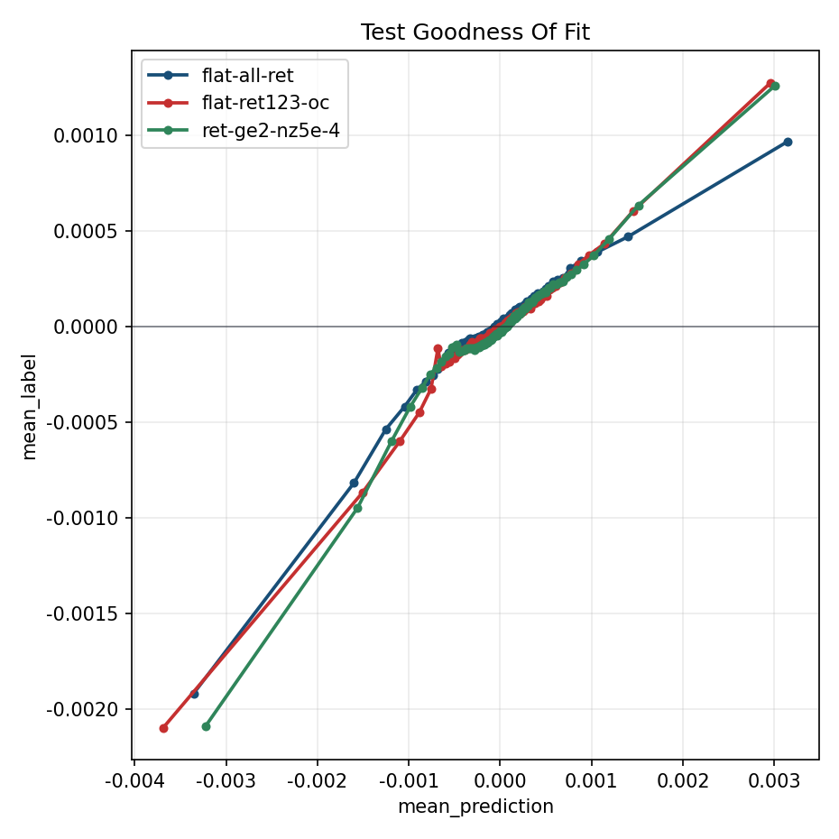

test split mean_prediction vs mean_label.

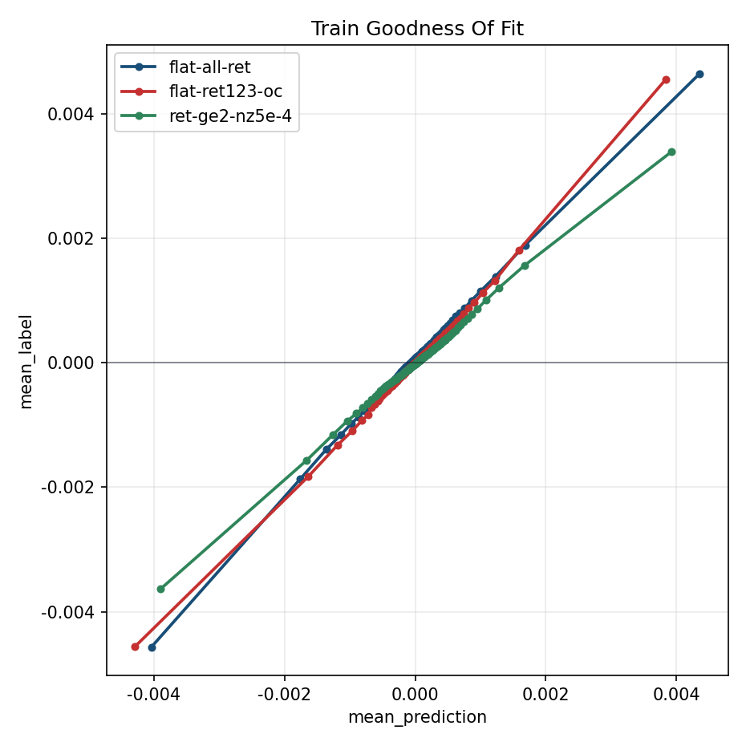

train split mean_prediction vs mean_label.

字段解释

| field | explanation |
| --- | --- |
| split | 数据 split.  |
| prediction_bin | 按 prediction 排序后的等频分箱编号.  |
| mean_prediction | 分组内 prediction 均值.  |
| mean_label | bin 内 label 均值.  |
| label_p05 | bin 内 label 5% 分位数.  |
| label_p95 | bin 内 label 95% 分位数.  |
| row_count | 分组样本数.  |

### 3.4. Top-k Robustness

### Top-k Robustness

| experiment | split | selection_method | k_pct | universe_count | selected_count | selected_fraction | prediction_threshold | mean_label_bps | median_label_bps | label_std_bps | hit_rate | day_count | timestamp_count |
| --- | --- | --- | --- | --- | --- | --- | --- | --- | --- | --- | --- | --- | --- |
| flat-all-ret | train | approx_quantile_threshold | 1 | 371,273,680 | 3,631,298 | 0.009781 | 0.002135 | 46.9926 | 33.8309 | 126.1270 | 0.646707 | 125 | 27,341 |
| flat-all-ret | train | approx_quantile_threshold | 2 | 371,273,680 | 7,403,638 | 0.019941 | 0.001395 | 32.7258 | 22.4601 | 108.5533 | 0.597395 | 125 | 27,429 |
| flat-all-ret | train | approx_quantile_threshold | 3 | 371,273,680 | 11,003,465 | 0.029637 | 0.001106 | 26.5833 | 17.2484 | 99.7628 | 0.572973 | 125 | 27,466 |
| flat-all-ret | train | approx_quantile_threshold | 5 | 371,273,680 | 18,508,185 | 0.049851 | 8.071e-04 | 20.1896 | 11.4005 | 89.1493 | 0.544142 | 125 | 27,492 |
| flat-all-ret | train | approx_quantile_threshold | 10 | 371,273,680 | 37,024,448 | 0.099723 | 5.144e-04 | 13.8559 | 4.1068 | 75.8971 | 0.509689 | 125 | 27,497 |
| flat-all-ret | train | approx_quantile_threshold | 15 | 371,273,680 | 55,615,080 | 0.149795 | 3.754e-04 | 11.0039 | 0.477887 | 68.8034 | 0.490599 | 125 | 27,499 |
| flat-all-ret | train | approx_quantile_threshold | 20 | 371,273,680 | 74,253,506 | 0.199997 | 2.815e-04 | 9.2645 | 0.012659 | 64.1779 | 0.477189 | 125 | 27,500 |
| flat-all-ret | test | approx_quantile_threshold | 1 | 122,700,191 | 1,185,757 | 0.009664 | 0.001728 | 9.8385 | 0.002283 | 104.9116 | 0.471639 | 101 | 22,060 |
| flat-all-ret | test | approx_quantile_threshold | 2 | 122,700,191 | 2,431,140 | 0.019814 | 0.001195 | 7.2337 | 0.000e+00 | 91.1869 | 0.462363 | 101 | 22,098 |
| flat-all-ret | test | approx_quantile_threshold | 3 | 122,700,191 | 3,644,056 | 0.029699 | 9.635e-04 | 6.1359 | 0.000e+00 | 84.1329 | 0.458158 | 101 | 22,117 |
| flat-all-ret | test | approx_quantile_threshold | 5 | 122,700,191 | 6,118,804 | 0.049868 | 7.257e-04 | 4.9808 | 0.000e+00 | 75.6730 | 0.452730 | 101 | 22,143 |
| flat-all-ret | test | approx_quantile_threshold | 10 | 122,700,191 | 12,259,787 | 0.099917 | 4.804e-04 | 3.6347 | 0.000e+00 | 65.1124 | 0.443914 | 101 | 22,175 |
| flat-all-ret | test | approx_quantile_threshold | 15 | 122,700,191 | 18,375,433 | 0.149759 | 3.557e-04 | 2.9947 | 0.000e+00 | 59.6983 | 0.438673 | 101 | 22,198 |
| flat-all-ret | test | approx_quantile_threshold | 20 | 122,700,191 | 24,586,478 | 0.200378 | 2.671e-04 | 2.5744 | 0.000e+00 | 56.2026 | 0.434727 | 101 | 22,207 |
| flat-ret123-oc | train | approx_quantile_threshold | 1 | 182,397,315 | 1,766,720 | 0.009686 | 0.001944 | 46.2195 | 31.0578 | 127.3076 | 0.630595 | 126 | 27,517 |
| flat-ret123-oc | train | approx_quantile_threshold | 2 | 182,397,315 | 3,598,421 | 0.019728 | 0.001366 | 31.9873 | 20.0512 | 109.0611 | 0.581897 | 126 | 27,650 |
| flat-ret123-oc | train | approx_quantile_threshold | 3 | 182,397,315 | 5,449,358 | 0.029876 | 0.001116 | 25.6408 | 14.9344 | 99.4259 | 0.557285 | 126 | 27,686 |
| flat-ret123-oc | train | approx_quantile_threshold | 5 | 182,397,315 | 9,114,870 | 0.049973 | 8.582e-04 | 19.5348 | 9.7927 | 88.6658 | 0.531804 | 126 | 27,706 |
| flat-ret123-oc | train | approx_quantile_threshold | 10 | 182,397,315 | 18,245,685 | 0.100033 | 5.831e-04 | 13.4316 | 2.6651 | 75.9676 | 0.503107 | 126 | 27,718 |
| flat-ret123-oc | train | approx_quantile_threshold | 15 | 182,397,315 | 27,416,590 | 0.150312 | 4.443e-04 | 10.6863 | 0.139351 | 69.2372 | 0.487614 | 126 | 27,719 |
| flat-ret123-oc | train | approx_quantile_threshold | 20 | 182,397,315 | 36,456,133 | 0.199872 | 3.507e-04 | 9.0339 | 0.008302 | 64.8116 | 0.476924 | 126 | 27,719 |
| flat-ret123-oc | test | approx_quantile_threshold | 1 | 60,992,275 | 597,149 | 0.009791 | 0.001734 | 12.8787 | 0.565648 | 106.0819 | 0.490864 | 101 | 22,120 |
| flat-ret123-oc | test | approx_quantile_threshold | 2 | 60,992,275 | 1,209,137 | 0.019824 | 0.001266 | 9.4414 | 0.008956 | 92.7197 | 0.475908 | 102 | 22,209 |
| flat-ret123-oc | test | approx_quantile_threshold | 3 | 60,992,275 | 1,816,960 | 0.029790 | 0.001048 | 7.7641 | 0.001333 | 85.5193 | 0.468186 | 102 | 22,222 |
| flat-ret123-oc | test | approx_quantile_threshold | 5 | 60,992,275 | 3,040,487 | 0.049850 | 8.110e-04 | 6.0554 | 0.000e+00 | 77.1072 | 0.460294 | 102 | 22,244 |
| flat-ret123-oc | test | approx_quantile_threshold | 10 | 60,992,275 | 6,072,765 | 0.099566 | 5.567e-04 | 4.2232 | 0.000e+00 | 66.7255 | 0.451238 | 102 | 22,288 |
| flat-ret123-oc | test | approx_quantile_threshold | 15 | 60,992,275 | 9,143,107 | 0.149906 | 4.278e-04 | 3.3590 | 0.000e+00 | 61.1374 | 0.446243 | 102 | 22,328 |
| flat-ret123-oc | test | approx_quantile_threshold | 20 | 60,992,275 | 12,203,823 | 0.200088 | 3.395e-04 | 2.8493 | 0.000e+00 | 57.5299 | 0.442869 | 102 | 22,347 |
| ret-ge2-nz5e-4 | train | approx_quantile_threshold | 1 | 390,283,731 | 3,854,691 | 0.009877 | 0.002041 | 34.0880 | 24.3399 | 118.6830 | 0.594705 | 122 | 26,824 |
| ret-ge2-nz5e-4 | train | approx_quantile_threshold | 2 | 390,283,731 | 7,712,133 | 0.019760 | 0.001434 | 24.8967 | 15.9747 | 103.1317 | 0.556782 | 122 | 26,840 |
| ret-ge2-nz5e-4 | train | approx_quantile_threshold | 3 | 390,283,731 | 11,601,475 | 0.029726 | 0.001169 | 20.6032 | 11.4770 | 95.0336 | 0.537023 | 122 | 26,840 |
| ret-ge2-nz5e-4 | train | approx_quantile_threshold | 5 | 390,283,731 | 19,489,249 | 0.049936 | 9.065e-04 | 16.0621 | 5.9139 | 85.1812 | 0.513621 | 122 | 26,840 |
| ret-ge2-nz5e-4 | train | approx_quantile_threshold | 10 | 390,283,731 | 38,966,159 | 0.099841 | 6.370e-04 | 11.3706 | 0.225235 | 73.0105 | 0.484775 | 122 | 26,840 |
| ret-ge2-nz5e-4 | train | approx_quantile_threshold | 15 | 390,283,731 | 58,469,024 | 0.149812 | 4.927e-04 | 9.1415 | 0.002634 | 66.7505 | 0.468234 | 122 | 26,840 |
| ret-ge2-nz5e-4 | train | approx_quantile_threshold | 20 | 390,283,731 | 78,059,346 | 0.200007 | 3.901e-04 | 7.7452 | 0.000e+00 | 62.7100 | 0.456304 | 122 | 26,840 |
| ret-ge2-nz5e-4 | test | approx_quantile_threshold | 1 | 131,501,803 | 1,285,096 | 0.009772 | 0.001808 | 12.7380 | 0.004700 | 101.6230 | 0.469669 | 101 | 22,205 |
| ret-ge2-nz5e-4 | test | approx_quantile_threshold | 2 | 131,501,803 | 2,620,618 | 0.019928 | 0.001313 | 9.5099 | 0.000e+00 | 88.2263 | 0.455704 | 101 | 22,219 |
| ret-ge2-nz5e-4 | test | approx_quantile_threshold | 3 | 131,501,803 | 3,916,564 | 0.029783 | 0.001095 | 7.8793 | 0.000e+00 | 81.3821 | 0.447384 | 101 | 22,220 |
| ret-ge2-nz5e-4 | test | approx_quantile_threshold | 5 | 131,501,803 | 6,540,341 | 0.049736 | 8.753e-04 | 6.1288 | 0.000e+00 | 73.3040 | 0.437329 | 101 | 22,220 |
| ret-ge2-nz5e-4 | test | approx_quantile_threshold | 10 | 131,501,803 | 13,153,859 | 0.100028 | 6.289e-04 | 4.3635 | 0.000e+00 | 63.3027 | 0.426629 | 101 | 22,220 |
| ret-ge2-nz5e-4 | test | approx_quantile_threshold | 15 | 131,501,803 | 19,720,747 | 0.149966 | 4.904e-04 | 3.6032 | 0.000e+00 | 58.4876 | 0.421397 | 101 | 22,220 |
| ret-ge2-nz5e-4 | test | approx_quantile_threshold | 20 | 131,501,803 | 26,301,397 | 0.200008 | 3.890e-04 | 3.1306 | 0.000e+00 | 55.4466 | 0.417290 | 101 | 22,220 |

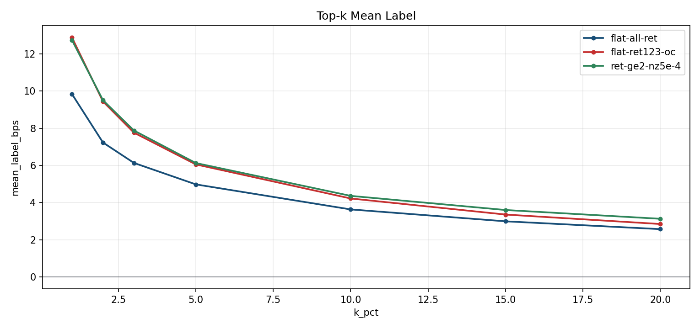

test split k_pct vs mean_label_bps.

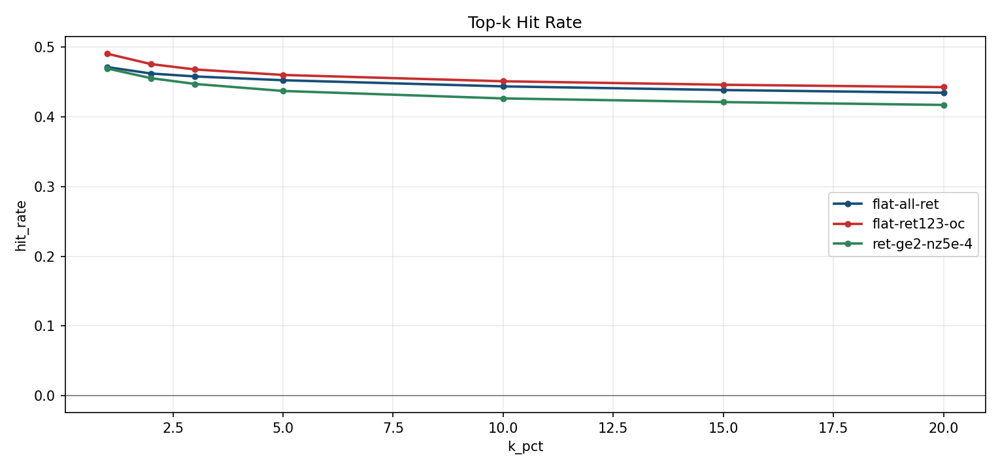

test split k_pct vs hit_rate.

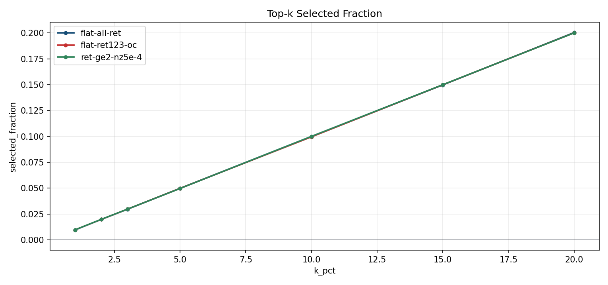

test split k_pct vs selected_fraction.

字段解释

| field | explanation |
| --- | --- |
| split | 数据 split.  |
| selection_method | Top-k 样本选择方法.  |
| k_pct | 选择 prediction 最高的百分比.  |
| universe_count | 可选样本总数.  |
| selected_count | 被选中样本数.  |
| selected_fraction | 实际选中比例.  |
| prediction_threshold | selection threshold.  |
| mean_label_bps | 分组内 target 均值, 单位 bps.  |
| median_label_bps | 选中样本 median label, 单位 bps.  |
| label_std_bps | 选中样本 label 标准差, 单位 bps.  |
| hit_rate | 分组内 target > 0 的比例.  |
| day_count | 覆盖交易日数量.  |
| timestamp_count | 覆盖时间戳数量.  |

### 4. Important Stock Pool And Liquidity

### 4.1. Important Stock Pool

### Important Stock Pool

| experiment | pool | display_name | etf_code | index_code | pearson_ic | rank_ic | mean_prediction_return | mean_real_return | real_return_positive_ratio | prediction_positive_ratio | count |
| --- | --- | --- | --- | --- | --- | --- | --- | --- | --- | --- | --- |
| flat-all-ret | csi1000_etf_sh | 1000 ETF | 512100.SH | 000852.SH | 0.036091 | 0.019300 | -4.074e-05 | -7.980e-06 | 0.411272 | 0.437294 | 23,978,870 |
| flat-all-ret | csi300_etf_sh | 沪深300 ETF(沪) | 510300.SH | 000300.SH | 0.028032 | 0.017561 | -4.461e-05 | 1.839e-05 | 0.428127 | 0.437585 | 7,439,408 |
| flat-all-ret | csi500_etf_sh | 中证500 ETF(沪) | 510500.SH | 000905.SH | 0.026275 | 0.015829 | -3.514e-05 | -1.152e-05 | 0.409048 | 0.442179 | 11,813,198 |
| flat-ret123-oc | csi1000_etf_sh | 1000 ETF | 512100.SH | 000852.SH | 0.041232 | 0.022648 | 2.035e-05 | -7.789e-07 | 0.421327 | 0.518979 | 12,911,925 |
| flat-ret123-oc | csi300_etf_sh | 沪深300 ETF(沪) | 510300.SH | 000300.SH | 0.027018 | 0.017570 | 6.702e-05 | 1.534e-05 | 0.438030 | 0.585189 | 4,591,066 |
| flat-ret123-oc | csi500_etf_sh | 中证500 ETF(沪) | 510500.SH | 000905.SH | 0.027878 | 0.016853 | 3.694e-05 | -9.089e-06 | 0.420219 | 0.538227 | 6,706,307 |
| ret-ge2-nz5e-4 | csi1000_etf_sh | 1000 ETF | 512100.SH | 000852.SH | 0.039584 | 0.025115 | 3.466e-05 | -3.652e-06 | 0.383865 | 0.542185 | 24,036,806 |
| ret-ge2-nz5e-4 | csi300_etf_sh | 沪深300 ETF(沪) | 510300.SH | 000300.SH | 0.033292 | 0.024965 | 4.267e-05 | 2.028e-05 | 0.393571 | 0.565401 | 5,864,109 |
| ret-ge2-nz5e-4 | csi500_etf_sh | 中证500 ETF(沪) | 510500.SH | 000905.SH | 0.027771 | 0.020871 | 3.360e-05 | -7.103e-06 | 0.377594 | 0.549850 | 11,624,814 |

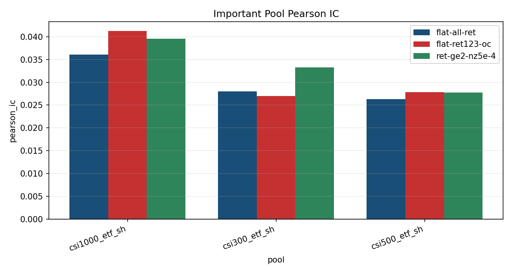

pool-level pearson_ic.

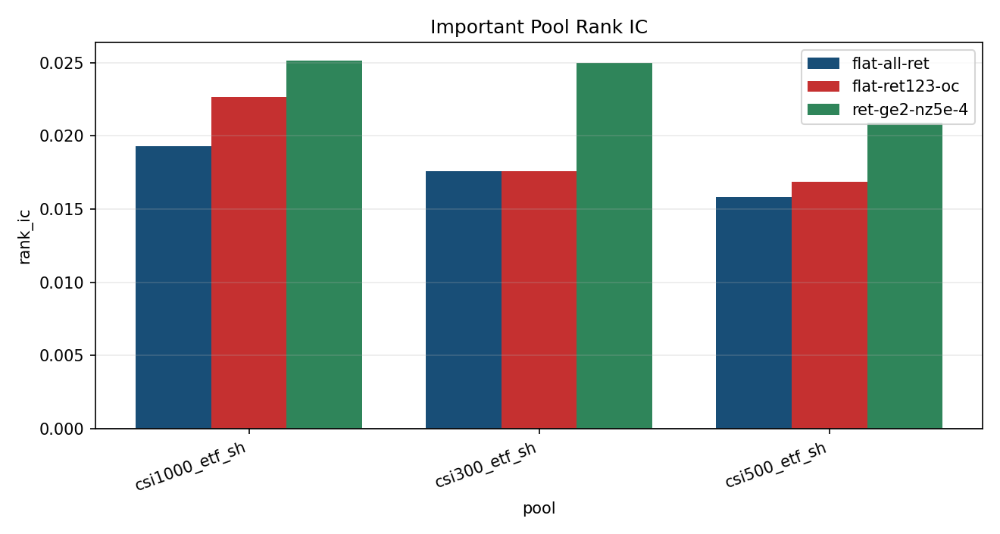

pool-level rank_ic.

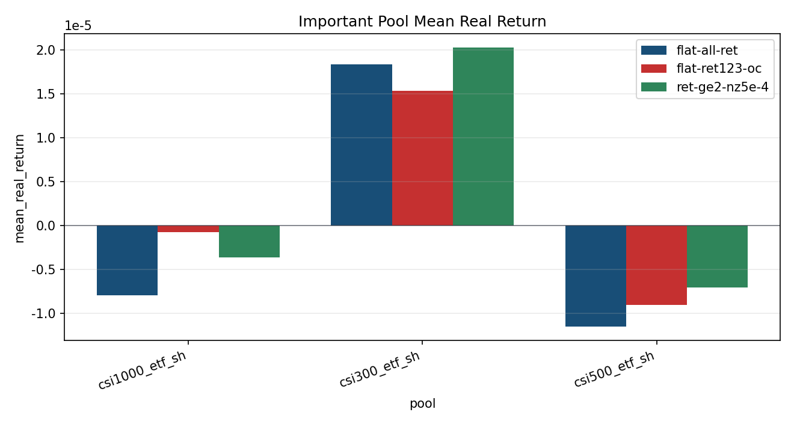

pool-level mean_real_return.

字段解释

| field | explanation |
| --- | --- |
| pool | important stock pool 标识.  |
| display_name | pool 展示名称.  |
| etf_code | pool 对应 ETF code.  |
| index_code | pool 对应指数 code.  |
| pearson_ic | corr(prediction, target).  |
| rank_ic | corr(rank(prediction), rank(target)).  |
| mean_prediction_return | prediction 的样本均值.  |
| mean_real_return | target 的样本均值.  |
| real_return_positive_ratio | target > 0 的样本比例.  |
| prediction_positive_ratio | prediction > 0 的样本比例.  |
| count | 样本数.  |

### 4.2. Important Pool Prediction Curve

Important Pool Prediction Curve

| experiment | pool | prediction_bin | mean_prediction_return | mean_real_return | real_return_positive_ratio | count |
| --- | --- | --- | --- | --- | --- | --- |
| flat-all-ret | csi1000_etf_sh | 1 | -0.001176 | -3.452e-04 | 0.409299 | 1,198,944 |
| flat-all-ret | csi1000_etf_sh | 2 | -5.880e-04 | -9.397e-05 | 0.417981 | 1,198,944 |
| flat-all-ret | csi1000_etf_sh | 3 | -4.458e-04 | -6.470e-05 | 0.415461 | 1,198,944 |
| flat-all-ret | csi1000_etf_sh | 4 | -3.486e-04 | -5.890e-05 | 0.408886 | 1,198,944 |
| flat-all-ret | csi1000_etf_sh | 5 | -2.859e-04 | -6.391e-05 | 0.400234 | 1,198,944 |
| flat-all-ret | csi1000_etf_sh | 6 | -2.395e-04 | -5.603e-05 | 0.399068 | 1,198,944 |
| flat-all-ret | csi1000_etf_sh | 7 | -1.951e-04 | -5.109e-05 | 0.399783 | 1,198,944 |
| flat-all-ret | csi1000_etf_sh | 8 | -1.523e-04 | -4.747e-05 | 0.399924 | 1,198,944 |
| flat-all-ret | csi1000_etf_sh | 9 | -1.115e-04 | -3.317e-05 | 0.401167 | 1,198,944 |
| flat-all-ret | csi1000_etf_sh | 10 | -7.142e-05 | -2.203e-05 | 0.401905 | 1,198,944 |
| flat-all-ret | csi1000_etf_sh | 11 | -3.109e-05 | -7.813e-06 | 0.403592 | 1,198,943 |
| flat-all-ret | csi1000_etf_sh | 12 | 1.049e-05 | 9.130e-06 | 0.405620 | 1,198,943 |
| flat-all-ret | csi1000_etf_sh | 13 | 5.426e-05 | 1.797e-05 | 0.407556 | 1,198,943 |
| flat-all-ret | csi1000_etf_sh | 14 | 1.014e-04 | 3.601e-05 | 0.410936 | 1,198,943 |
| flat-all-ret | csi1000_etf_sh | 15 | 1.533e-04 | 5.376e-05 | 0.415171 | 1,198,943 |
| flat-all-ret | csi1000_etf_sh | 16 | 2.126e-04 | 6.648e-05 | 0.416906 | 1,198,943 |
| flat-all-ret | csi1000_etf_sh | 17 | 2.833e-04 | 7.043e-05 | 0.419684 | 1,198,943 |
| flat-all-ret | csi1000_etf_sh | 18 | 3.747e-04 | 9.424e-05 | 0.424169 | 1,198,943 |
| flat-all-ret | csi1000_etf_sh | 19 | 5.170e-04 | 1.102e-04 | 0.427576 | 1,198,943 |
| flat-all-ret | csi1000_etf_sh | 20 | 0.001124 | 2.265e-04 | 0.440520 | 1,198,943 |
| flat-all-ret | csi300_etf_sh | 1 | -9.402e-04 | -2.016e-04 | 0.428297 | 371,971 |
| flat-all-ret | csi300_etf_sh | 2 | -5.242e-04 | -4.334e-05 | 0.437284 | 371,971 |
| flat-all-ret | csi300_etf_sh | 3 | -3.981e-04 | -2.712e-05 | 0.433421 | 371,971 |
| flat-all-ret | csi300_etf_sh | 4 | -3.137e-04 | -2.603e-05 | 0.426786 | 371,971 |
| flat-all-ret | csi300_etf_sh | 5 | -2.598e-04 | -1.411e-05 | 0.423342 | 371,971 |
| flat-all-ret | csi300_etf_sh | 6 | -2.142e-04 | -1.389e-05 | 0.419132 | 371,971 |
| flat-all-ret | csi300_etf_sh | 7 | -1.724e-04 | -1.676e-05 | 0.417831 | 371,971 |
| flat-all-ret | csi300_etf_sh | 8 | -1.343e-04 | 8.021e-07 | 0.419113 | 371,971 |
| flat-all-ret | csi300_etf_sh | 9 | -9.804e-05 | -1.104e-05 | 0.417918 | 371,970 |
| flat-all-ret | csi300_etf_sh | 10 | -6.249e-05 | 2.442e-07 | 0.418093 | 371,970 |
| flat-all-ret | csi300_etf_sh | 11 | -2.700e-05 | 1.559e-05 | 0.420305 | 371,970 |
| flat-all-ret | csi300_etf_sh | 12 | 9.340e-06 | 2.965e-05 | 0.424163 | 371,970 |
| flat-all-ret | csi300_etf_sh | 13 | 4.720e-05 | 2.727e-05 | 0.425201 | 371,970 |
| flat-all-ret | csi300_etf_sh | 14 | 8.745e-05 | 4.908e-05 | 0.427368 | 371,970 |
| flat-all-ret | csi300_etf_sh | 15 | 1.311e-04 | 5.226e-05 | 0.429841 | 371,970 |
| flat-all-ret | csi300_etf_sh | 16 | 1.798e-04 | 5.666e-05 | 0.430298 | 371,970 |
| flat-all-ret | csi300_etf_sh | 17 | 2.367e-04 | 7.395e-05 | 0.432476 | 371,970 |
| flat-all-ret | csi300_etf_sh | 18 | 3.094e-04 | 8.028e-05 | 0.435231 | 371,970 |
| flat-all-ret | csi300_etf_sh | 19 | 4.214e-04 | 1.185e-04 | 0.441931 | 371,970 |
| flat-all-ret | csi300_etf_sh | 20 | 8.298e-04 | 2.174e-04 | 0.454510 | 371,970 |
| flat-all-ret | csi500_etf_sh | 1 | -9.949e-04 | -2.108e-04 | 0.420851 | 590,660 |
| flat-all-ret | csi500_etf_sh | 2 | -5.309e-04 | -7.649e-05 | 0.419573 | 590,660 |
| flat-all-ret | csi500_etf_sh | 3 | -3.992e-04 | -6.156e-05 | 0.414242 | 590,660 |
| flat-all-ret | csi500_etf_sh | 4 | -3.143e-04 | -5.352e-05 | 0.405772 | 590,660 |
| flat-all-ret | csi500_etf_sh | 5 | -2.625e-04 | -5.036e-05 | 0.399362 | 590,660 |
| flat-all-ret | csi500_etf_sh | 6 | -2.182e-04 | -6.094e-05 | 0.395414 | 590,660 |
| flat-all-ret | csi500_etf_sh | 7 | -1.760e-04 | -5.607e-05 | 0.396814 | 590,660 |
| flat-all-ret | csi500_etf_sh | 8 | -1.366e-04 | -4.556e-05 | 0.397117 | 590,660 |
| flat-all-ret | csi500_etf_sh | 9 | -9.917e-05 | -4.206e-05 | 0.397039 | 590,660 |
| flat-all-ret | csi500_etf_sh | 10 | -6.228e-05 | -3.516e-05 | 0.396985 | 590,660 |
| flat-all-ret | csi500_etf_sh | 11 | -2.501e-05 | -1.464e-05 | 0.400681 | 590,660 |
| flat-all-ret | csi500_etf_sh | 12 | 1.347e-05 | -6.169e-06 | 0.401910 | 590,660 |
| flat-all-ret | csi500_etf_sh | 13 | 5.390e-05 | 8.682e-06 | 0.405760 | 590,660 |
| flat-all-ret | csi500_etf_sh | 14 | 9.736e-05 | 1.985e-05 | 0.407625 | 590,660 |
| flat-all-ret | csi500_etf_sh | 15 | 1.450e-04 | 2.970e-05 | 0.410695 | 590,660 |
| flat-all-ret | csi500_etf_sh | 16 | 1.989e-04 | 4.331e-05 | 0.414601 | 590,660 |
| flat-all-ret | csi500_etf_sh | 17 | 2.627e-04 | 5.926e-05 | 0.416561 | 590,660 |
| flat-all-ret | csi500_etf_sh | 18 | 3.445e-04 | 6.028e-05 | 0.419813 | 590,660 |
| flat-all-ret | csi500_etf_sh | 19 | 4.697e-04 | 7.411e-05 | 0.422718 | 590,659 |
| flat-all-ret | csi500_etf_sh | 20 | 9.308e-04 | 1.878e-04 | 0.437425 | 590,659 |
| flat-ret123-oc | csi1000_etf_sh | 1 | -0.001065 | -3.559e-04 | 0.412424 | 645,597 |
| flat-ret123-oc | csi1000_etf_sh | 2 | -5.265e-04 | -1.166e-04 | 0.421515 | 645,597 |
| flat-ret123-oc | csi1000_etf_sh | 3 | -3.912e-04 | -9.156e-05 | 0.419314 | 645,597 |
| flat-ret123-oc | csi1000_etf_sh | 4 | -2.964e-04 | -6.371e-05 | 0.416515 | 645,597 |
| flat-ret123-oc | csi1000_etf_sh | 5 | -2.323e-04 | -5.985e-05 | 0.414890 | 645,597 |
| flat-ret123-oc | csi1000_etf_sh | 6 | -1.799e-04 | -5.710e-05 | 0.411517 | 645,596 |
| flat-ret123-oc | csi1000_etf_sh | 7 | -1.316e-04 | -4.225e-05 | 0.412551 | 645,596 |
| flat-ret123-oc | csi1000_etf_sh | 8 | -8.636e-05 | -3.158e-05 | 0.413189 | 645,596 |
| flat-ret123-oc | csi1000_etf_sh | 9 | -4.505e-05 | -2.814e-05 | 0.412424 | 645,596 |
| flat-ret123-oc | csi1000_etf_sh | 10 | -4.807e-06 | -1.011e-05 | 0.414323 | 645,596 |
| flat-ret123-oc | csi1000_etf_sh | 11 | 3.567e-05 | -6.704e-06 | 0.414563 | 645,596 |
| flat-ret123-oc | csi1000_etf_sh | 12 | 7.700e-05 | 6.569e-06 | 0.416672 | 645,596 |
| flat-ret123-oc | csi1000_etf_sh | 13 | 1.202e-04 | 2.179e-05 | 0.419247 | 645,596 |
| flat-ret123-oc | csi1000_etf_sh | 14 | 1.664e-04 | 4.687e-05 | 0.422665 | 645,596 |
| flat-ret123-oc | csi1000_etf_sh | 15 | 2.172e-04 | 4.907e-05 | 0.424570 | 645,596 |
| flat-ret123-oc | csi1000_etf_sh | 16 | 2.751e-04 | 6.396e-05 | 0.427874 | 645,596 |
| flat-ret123-oc | csi1000_etf_sh | 17 | 3.443e-04 | 7.816e-05 | 0.429459 | 645,596 |
| flat-ret123-oc | csi1000_etf_sh | 18 | 4.341e-04 | 9.948e-05 | 0.433325 | 645,596 |
| flat-ret123-oc | csi1000_etf_sh | 19 | 5.734e-04 | 1.354e-04 | 0.437792 | 645,596 |
| flat-ret123-oc | csi1000_etf_sh | 20 | 0.001123 | 3.466e-04 | 0.451716 | 645,596 |
| flat-ret123-oc | csi300_etf_sh | 1 | -7.041e-04 | -1.754e-04 | 0.432251 | 229,554 |
| flat-ret123-oc | csi300_etf_sh | 2 | -3.790e-04 | -6.173e-05 | 0.438002 | 229,554 |
| flat-ret123-oc | csi300_etf_sh | 3 | -2.722e-04 | -3.851e-05 | 0.436067 | 229,554 |
| flat-ret123-oc | csi300_etf_sh | 4 | -2.072e-04 | -3.533e-05 | 0.431428 | 229,554 |
| flat-ret123-oc | csi300_etf_sh | 5 | -1.550e-04 | -2.808e-05 | 0.430252 | 229,554 |
| flat-ret123-oc | csi300_etf_sh | 6 | -1.082e-04 | -4.079e-06 | 0.430600 | 229,554 |
| flat-ret123-oc | csi300_etf_sh | 7 | -6.686e-05 | -5.349e-06 | 0.430184 | 229,553 |
| flat-ret123-oc | csi300_etf_sh | 8 | -2.909e-05 | -1.188e-05 | 0.428742 | 229,553 |
| flat-ret123-oc | csi300_etf_sh | 9 | 7.375e-06 | -4.705e-07 | 0.429883 | 229,553 |
| flat-ret123-oc | csi300_etf_sh | 10 | 4.334e-05 | 8.013e-07 | 0.430785 | 229,553 |
| flat-ret123-oc | csi300_etf_sh | 11 | 7.955e-05 | 2.680e-05 | 0.434022 | 229,553 |
| flat-ret123-oc | csi300_etf_sh | 12 | 1.165e-04 | 1.709e-05 | 0.435786 | 229,553 |
| flat-ret123-oc | csi300_etf_sh | 13 | 1.548e-04 | 2.477e-05 | 0.436662 | 229,553 |
| flat-ret123-oc | csi300_etf_sh | 14 | 1.953e-04 | 4.238e-05 | 0.439829 | 229,553 |
| flat-ret123-oc | csi300_etf_sh | 15 | 2.388e-04 | 3.089e-05 | 0.440495 | 229,553 |
| flat-ret123-oc | csi300_etf_sh | 16 | 2.871e-04 | 5.338e-05 | 0.445257 | 229,553 |
| flat-ret123-oc | csi300_etf_sh | 17 | 3.434e-04 | 6.226e-05 | 0.449090 | 229,553 |
| flat-ret123-oc | csi300_etf_sh | 18 | 4.139e-04 | 7.793e-05 | 0.448520 | 229,553 |
| flat-ret123-oc | csi300_etf_sh | 19 | 5.182e-04 | 1.164e-04 | 0.451212 | 229,553 |
| flat-ret123-oc | csi300_etf_sh | 20 | 8.639e-04 | 2.148e-04 | 0.461540 | 229,553 |
| flat-ret123-oc | csi500_etf_sh | 1 | -8.308e-04 | -2.252e-04 | 0.421128 | 335,316 |
| flat-ret123-oc | csi500_etf_sh | 2 | -4.533e-04 | -7.299e-05 | 0.425089 | 335,316 |
| flat-ret123-oc | csi500_etf_sh | 3 | -3.295e-04 | -7.496e-05 | 0.418441 | 335,316 |
| flat-ret123-oc | csi500_etf_sh | 4 | -2.535e-04 | -5.667e-05 | 0.415847 | 335,316 |
| flat-ret123-oc | csi500_etf_sh | 5 | -1.984e-04 | -5.536e-05 | 0.412521 | 335,316 |
| flat-ret123-oc | csi500_etf_sh | 6 | -1.506e-04 | -4.744e-05 | 0.411164 | 335,316 |
| flat-ret123-oc | csi500_etf_sh | 7 | -1.059e-04 | -5.452e-05 | 0.408558 | 335,316 |
| flat-ret123-oc | csi500_etf_sh | 8 | -6.540e-05 | -4.372e-05 | 0.409024 | 335,315 |
| flat-ret123-oc | csi500_etf_sh | 9 | -2.748e-05 | -3.960e-05 | 0.409484 | 335,315 |
| flat-ret123-oc | csi500_etf_sh | 10 | 9.874e-06 | -1.045e-05 | 0.413077 | 335,315 |
| flat-ret123-oc | csi500_etf_sh | 11 | 4.769e-05 | -9.571e-06 | 0.412618 | 335,315 |
| flat-ret123-oc | csi500_etf_sh | 12 | 8.659e-05 | 2.198e-06 | 0.414986 | 335,315 |
| flat-ret123-oc | csi500_etf_sh | 13 | 1.273e-04 | 1.995e-05 | 0.418207 | 335,315 |
| flat-ret123-oc | csi500_etf_sh | 14 | 1.706e-04 | 1.128e-05 | 0.420181 | 335,315 |
| flat-ret123-oc | csi500_etf_sh | 15 | 2.181e-04 | 2.993e-05 | 0.423130 | 335,315 |
| flat-ret123-oc | csi500_etf_sh | 16 | 2.715e-04 | 2.758e-05 | 0.426650 | 335,315 |
| flat-ret123-oc | csi500_etf_sh | 17 | 3.344e-04 | 5.179e-05 | 0.430622 | 335,315 |
| flat-ret123-oc | csi500_etf_sh | 18 | 4.137e-04 | 6.863e-05 | 0.431985 | 335,315 |
| flat-ret123-oc | csi500_etf_sh | 19 | 5.326e-04 | 9.137e-05 | 0.437147 | 335,315 |
| flat-ret123-oc | csi500_etf_sh | 20 | 9.413e-04 | 2.060e-04 | 0.444516 | 335,315 |
| ret-ge2-nz5e-4 | csi1000_etf_sh | 1 | -0.001134 | -3.459e-04 | 0.375336 | 1,201,841 |
| ret-ge2-nz5e-4 | csi1000_etf_sh | 2 | -5.679e-04 | -8.923e-05 | 0.382838 | 1,201,841 |
| ret-ge2-nz5e-4 | csi1000_etf_sh | 3 | -4.301e-04 | -9.119e-05 | 0.378306 | 1,201,841 |
| ret-ge2-nz5e-4 | csi1000_etf_sh | 4 | -3.206e-04 | -9.763e-05 | 0.373132 | 1,201,841 |
| ret-ge2-nz5e-4 | csi1000_etf_sh | 5 | -2.363e-04 | -9.761e-05 | 0.367336 | 1,201,841 |
| ret-ge2-nz5e-4 | csi1000_etf_sh | 6 | -1.704e-04 | -9.113e-05 | 0.364945 | 1,201,841 |
| ret-ge2-nz5e-4 | csi1000_etf_sh | 7 | -1.184e-04 | -7.609e-05 | 0.361626 | 1,201,840 |
| ret-ge2-nz5e-4 | csi1000_etf_sh | 8 | -7.200e-05 | -4.984e-05 | 0.365396 | 1,201,840 |
| ret-ge2-nz5e-4 | csi1000_etf_sh | 9 | -2.798e-05 | -3.952e-05 | 0.366881 | 1,201,840 |
| ret-ge2-nz5e-4 | csi1000_etf_sh | 10 | 1.441e-05 | -1.992e-05 | 0.370118 | 1,201,840 |
| ret-ge2-nz5e-4 | csi1000_etf_sh | 11 | 5.596e-05 | -3.028e-06 | 0.373312 | 1,201,840 |
| ret-ge2-nz5e-4 | csi1000_etf_sh | 12 | 9.779e-05 | 2.174e-05 | 0.378515 | 1,201,840 |
| ret-ge2-nz5e-4 | csi1000_etf_sh | 13 | 1.415e-04 | 4.076e-05 | 0.383562 | 1,201,840 |
| ret-ge2-nz5e-4 | csi1000_etf_sh | 14 | 1.894e-04 | 5.475e-05 | 0.387756 | 1,201,840 |
| ret-ge2-nz5e-4 | csi1000_etf_sh | 15 | 2.444e-04 | 7.932e-05 | 0.395449 | 1,201,840 |
| ret-ge2-nz5e-4 | csi1000_etf_sh | 16 | 3.099e-04 | 1.031e-04 | 0.401367 | 1,201,840 |
| ret-ge2-nz5e-4 | csi1000_etf_sh | 17 | 3.902e-04 | 1.211e-04 | 0.406745 | 1,201,840 |
| ret-ge2-nz5e-4 | csi1000_etf_sh | 18 | 4.936e-04 | 1.332e-04 | 0.409297 | 1,201,840 |
| ret-ge2-nz5e-4 | csi1000_etf_sh | 19 | 6.429e-04 | 1.361e-04 | 0.411732 | 1,201,840 |
| ret-ge2-nz5e-4 | csi1000_etf_sh | 20 | 0.001191 | 2.380e-04 | 0.423642 | 1,201,840 |
| ret-ge2-nz5e-4 | csi300_etf_sh | 1 | -8.459e-04 | -2.139e-04 | 0.385783 | 293,206 |
| ret-ge2-nz5e-4 | csi300_etf_sh | 2 | -4.642e-04 | -7.090e-05 | 0.387502 | 293,206 |
| ret-ge2-nz5e-4 | csi300_etf_sh | 3 | -3.277e-04 | -5.025e-05 | 0.384327 | 293,206 |
| ret-ge2-nz5e-4 | csi300_etf_sh | 4 | -2.357e-04 | -5.346e-05 | 0.381363 | 293,206 |
| ret-ge2-nz5e-4 | csi300_etf_sh | 5 | -1.690e-04 | -5.186e-05 | 0.378891 | 293,206 |
| ret-ge2-nz5e-4 | csi300_etf_sh | 6 | -1.201e-04 | -3.986e-05 | 0.379962 | 293,206 |
| ret-ge2-nz5e-4 | csi300_etf_sh | 7 | -7.907e-05 | -4.444e-05 | 0.378730 | 293,206 |
| ret-ge2-nz5e-4 | csi300_etf_sh | 8 | -4.163e-05 | -2.425e-05 | 0.380671 | 293,206 |
| ret-ge2-nz5e-4 | csi300_etf_sh | 9 | -6.587e-06 | 7.248e-07 | 0.382594 | 293,206 |
| ret-ge2-nz5e-4 | csi300_etf_sh | 10 | 2.728e-05 | 2.273e-05 | 0.385757 | 293,205 |
| ret-ge2-nz5e-4 | csi300_etf_sh | 11 | 6.078e-05 | 2.418e-05 | 0.387555 | 293,205 |
| ret-ge2-nz5e-4 | csi300_etf_sh | 12 | 9.470e-05 | 3.184e-05 | 0.388844 | 293,205 |
| ret-ge2-nz5e-4 | csi300_etf_sh | 13 | 1.301e-04 | 4.439e-05 | 0.389018 | 293,205 |
| ret-ge2-nz5e-4 | csi300_etf_sh | 14 | 1.685e-04 | 6.876e-05 | 0.395007 | 293,205 |
| ret-ge2-nz5e-4 | csi300_etf_sh | 15 | 2.122e-04 | 8.640e-05 | 0.399744 | 293,205 |
| ret-ge2-nz5e-4 | csi300_etf_sh | 16 | 2.649e-04 | 8.661e-05 | 0.405760 | 293,205 |
| ret-ge2-nz5e-4 | csi300_etf_sh | 17 | 3.308e-04 | 9.610e-05 | 0.408912 | 293,205 |
| ret-ge2-nz5e-4 | csi300_etf_sh | 18 | 4.159e-04 | 1.123e-04 | 0.413056 | 293,205 |
| ret-ge2-nz5e-4 | csi300_etf_sh | 19 | 5.379e-04 | 1.345e-04 | 0.419972 | 293,205 |
| ret-ge2-nz5e-4 | csi300_etf_sh | 20 | 9.002e-04 | 2.460e-04 | 0.437967 | 293,205 |
| ret-ge2-nz5e-4 | csi500_etf_sh | 1 | -9.422e-04 | -2.155e-04 | 0.371089 | 581,241 |
| ret-ge2-nz5e-4 | csi500_etf_sh | 2 | -5.229e-04 | -6.588e-05 | 0.375058 | 581,241 |
| ret-ge2-nz5e-4 | csi500_etf_sh | 3 | -3.882e-04 | -7.251e-05 | 0.369122 | 581,241 |
| ret-ge2-nz5e-4 | csi500_etf_sh | 4 | -2.865e-04 | -8.793e-05 | 0.366067 | 581,241 |
| ret-ge2-nz5e-4 | csi500_etf_sh | 5 | -2.093e-04 | -8.537e-05 | 0.362278 | 581,241 |
| ret-ge2-nz5e-4 | csi500_etf_sh | 6 | -1.507e-04 | -8.869e-05 | 0.359551 | 581,241 |
| ret-ge2-nz5e-4 | csi500_etf_sh | 7 | -1.038e-04 | -6.924e-05 | 0.361755 | 581,241 |
| ret-ge2-nz5e-4 | csi500_etf_sh | 8 | -6.066e-05 | -5.433e-05 | 0.364694 | 581,241 |
| ret-ge2-nz5e-4 | csi500_etf_sh | 9 | -1.990e-05 | -3.532e-05 | 0.367075 | 581,241 |
| ret-ge2-nz5e-4 | csi500_etf_sh | 10 | 1.918e-05 | -3.118e-05 | 0.367765 | 581,241 |
| ret-ge2-nz5e-4 | csi500_etf_sh | 11 | 5.727e-05 | -8.917e-07 | 0.370313 | 581,241 |
| ret-ge2-nz5e-4 | csi500_etf_sh | 12 | 9.512e-05 | 2.931e-06 | 0.370905 | 581,241 |
| ret-ge2-nz5e-4 | csi500_etf_sh | 13 | 1.342e-04 | 2.495e-05 | 0.374349 | 581,241 |
| ret-ge2-nz5e-4 | csi500_etf_sh | 14 | 1.766e-04 | 3.002e-05 | 0.376462 | 581,241 |
| ret-ge2-nz5e-4 | csi500_etf_sh | 15 | 2.250e-04 | 5.793e-05 | 0.384173 | 581,240 |
| ret-ge2-nz5e-4 | csi500_etf_sh | 16 | 2.832e-04 | 7.336e-05 | 0.390023 | 581,240 |
| ret-ge2-nz5e-4 | csi500_etf_sh | 17 | 3.549e-04 | 8.811e-05 | 0.396230 | 581,240 |
| ret-ge2-nz5e-4 | csi500_etf_sh | 18 | 4.467e-04 | 1.119e-04 | 0.403004 | 581,240 |
| ret-ge2-nz5e-4 | csi500_etf_sh | 19 | 5.774e-04 | 1.139e-04 | 0.406085 | 581,240 |
| ret-ge2-nz5e-4 | csi500_etf_sh | 20 | 9.866e-04 | 1.617e-04 | 0.415887 | 581,240 |

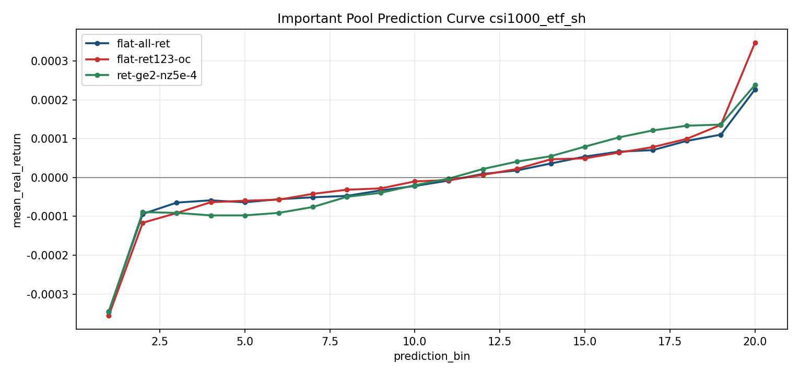

csi1000_etf_sh: prediction_bin vs mean_real_return.

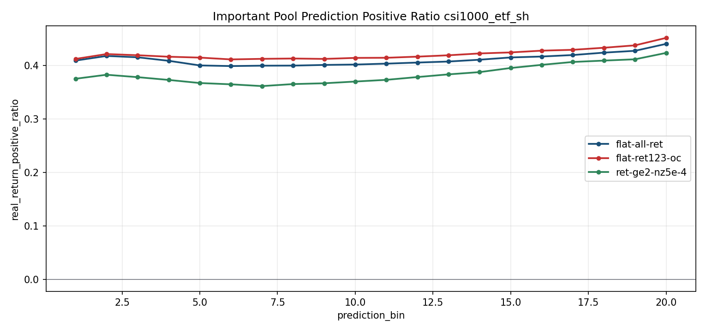

csi1000_etf_sh: prediction_bin vs real_return_positive_ratio.

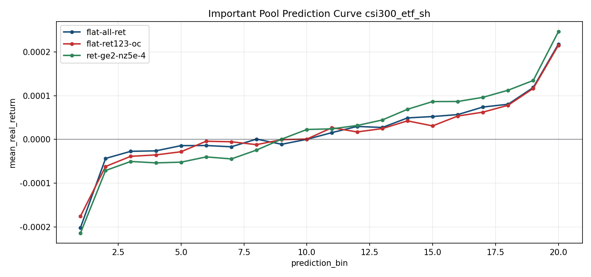

csi300_etf_sh: prediction_bin vs mean_real_return.

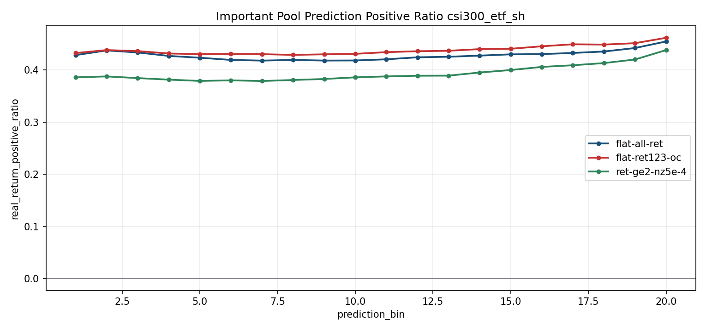

csi300_etf_sh: prediction_bin vs real_return_positive_ratio.

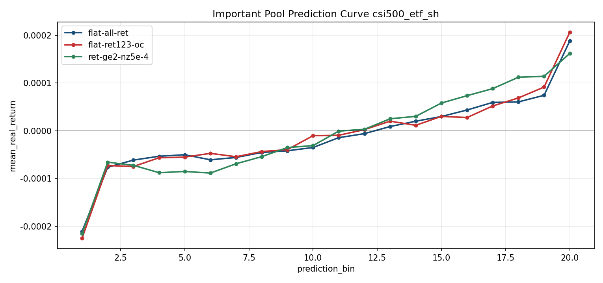

csi500_etf_sh: prediction_bin vs mean_real_return.

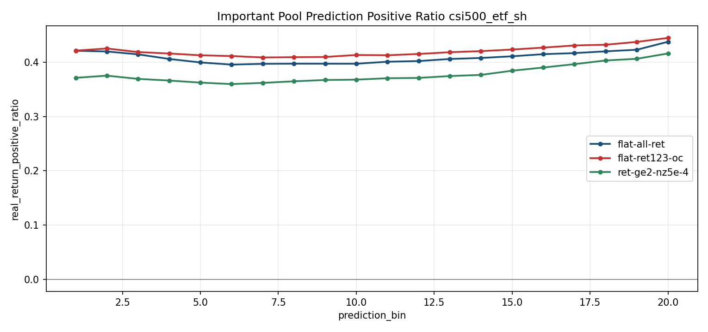

csi500_etf_sh: prediction_bin vs real_return_positive_ratio.

字段解释

| field | explanation |
| --- | --- |
| pool | important stock pool 标识.  |
| prediction_bin | 按 prediction 排序后的等频分箱编号.  |
| mean_prediction_return | prediction 的样本均值.  |
| mean_real_return | target 的样本均值.  |
| real_return_positive_ratio | target > 0 的样本比例.  |
| count | 样本数.  |

### 4.3. Liquidity By ADV

### Liquidity By ADV

| experiment | adv_bucket | bucket_label | row_count | day_count | mean_adv_amount | median_adv_amount | mean_ic | mean_rank_ic | icir | rank_icir | top5_return_bps | top5_hit_rate | top5_row_count |
| --- | --- | --- | --- | --- | --- | --- | --- | --- | --- | --- | --- | --- | --- |
| flat-all-ret | 1 | Bottom20% | 21,692,476 | 101 | 22,585 | 23,356 | 0.068379 | 0.052185 | 2.8541 | 3.8244 | 4.1323 | 0.433075 | 1,095,171 |
| flat-all-ret | 2 | 20~40% | 22,688,807 | 101 | 46,485 | 46,179 | 0.052609 | 0.034310 | 2.9428 | 2.8367 | 3.0280 | 0.426855 | 1,144,942 |
| flat-all-ret | 3 | 40~60% | 23,502,881 | 101 | 79,264 | 78,052 | 0.058678 | 0.037514 | 3.0948 | 2.8689 | 3.8807 | 0.439029 | 1,185,766 |
| flat-all-ret | 4 | 60~80% | 24,489,553 | 101 | 146,336 | 141,718 | 0.069289 | 0.044018 | 3.3897 | 3.1929 | 5.1444 | 0.453407 | 1,235,088 |
| flat-all-ret | 5 | Top20% | 25,827,380 | 101 | 555,538 | 361,283 | 0.071417 | 0.049201 | 2.9888 | 2.7103 | 5.4955 | 0.465882 | 1,301,920 |
| flat-ret123-oc | 1 | Bottom20% | 8,807,173 | 102 | 23,213 | 23,956 | 0.061919 | 0.047414 | 1.9123 | 1.9834 | 4.3867 | 0.426972 | 451,103 |
| flat-ret123-oc | 2 | 20~40% | 10,503,021 | 102 | 47,816 | 47,504 | 0.055798 | 0.037561 | 2.1456 | 2.0801 | 3.6124 | 0.429200 | 535,884 |
| flat-ret123-oc | 3 | 40~60% | 11,839,765 | 102 | 81,942 | 80,641 | 0.064413 | 0.037740 | 1.8712 | 1.2703 | 4.7650 | 0.446674 | 602,780 |
| flat-ret123-oc | 4 | 60~80% | 13,220,225 | 102 | 151,819 | 147,043 | 0.074666 | 0.045437 | 2.5785 | 1.7543 | 5.7623 | 0.458772 | 671,686 |
| flat-ret123-oc | 5 | Top20% | 15,220,769 | 102 | 574,303 | 374,184 | 0.076338 | 0.051392 | 2.2341 | 1.9730 | 6.0861 | 0.472506 | 771,763 |
| ret-ge2-nz5e-4 | 1 | Bottom20% | 25,251,505 | 101 | 22,327 | 23,101 | 0.081362 | 0.056453 | 3.4868 | 3.6884 | 6.0198 | 0.404649 | 1,273,048 |
| ret-ge2-nz5e-4 | 2 | 20~40% | 25,920,096 | 101 | 45,962 | 45,622 | 0.051611 | 0.033168 | 2.9000 | 2.5939 | 2.9157 | 0.400992 | 1,306,565 |
| ret-ge2-nz5e-4 | 3 | 40~60% | 25,599,400 | 101 | 78,147 | 76,962 | 0.056253 | 0.034134 | 3.0401 | 2.6138 | 3.3369 | 0.417161 | 1,290,517 |
| ret-ge2-nz5e-4 | 4 | 60~80% | 24,634,636 | 101 | 143,897 | 139,362 | 0.069797 | 0.040560 | 3.1408 | 2.7107 | 4.8126 | 0.436124 | 1,242,275 |
| ret-ge2-nz5e-4 | 5 | Top20% | 22,665,732 | 101 | 544,918 | 355,336 | 0.078505 | 0.048115 | 3.6096 | 2.7169 | 5.9622 | 0.459187 | 1,143,910 |

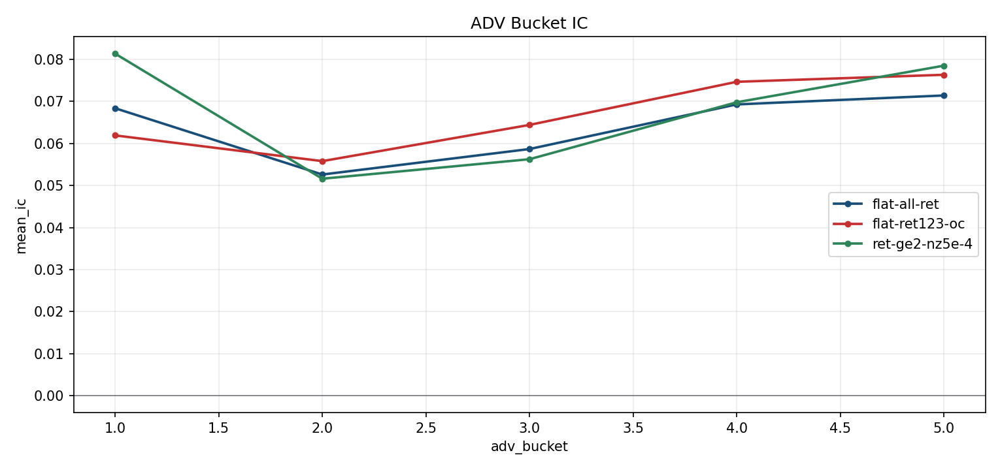

adv_bucket vs mean_ic.

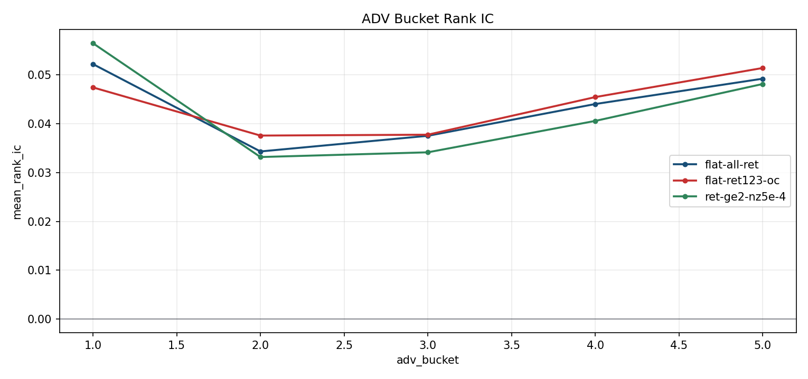

adv_bucket vs mean_rank_ic.

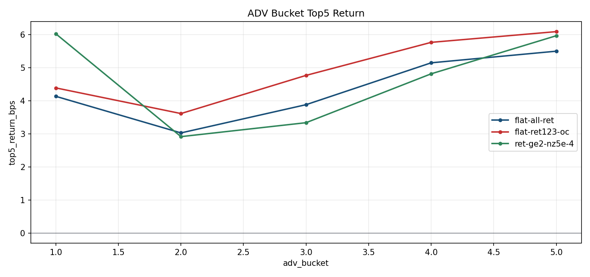

adv_bucket vs top5_return_bps.

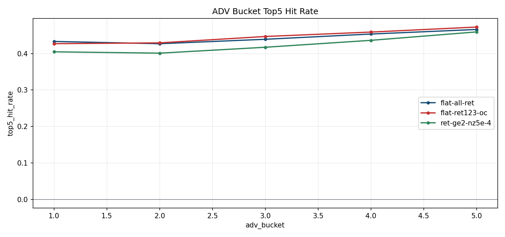

adv_bucket vs top5_hit_rate.

字段解释

| field | explanation |
| --- | --- |
| adv_bucket | shifted ADV bucket 编号.  |
| bucket_label | ADV bucket 展示名称.  |
| row_count | 分组样本数.  |
| day_count | 覆盖交易日数量.  |
| mean_adv_amount | bucket 内平均 ADV amount.  |
| median_adv_amount | bucket 内 median ADV amount.  |
| mean_ic | bucket 内 mean IC.  |
| mean_rank_ic | bucket 内 mean Rank IC.  |
| icir | bucket 内 ICIR.  |
| rank_icir | bucket 内 Rank ICIR.  |
| top5_return_bps | bucket 内 prediction top 5% return, 单位 bps.  |
| top5_hit_rate | bucket 内 prediction top 5% target > 0 比例.  |
| top5_row_count | bucket 内 top 5% 样本数.  |

### 5. Trading And Cost Proxy

### 5.1. Strategy And Benchmark Summary

### Strategy And Benchmark Summary

| experiment | pool | strategy_return_bps | benchmark_return_bps | excess_return_bps | expected_return_bps | position_rate | open_count | open_per_day |
| --- | --- | --- | --- | --- | --- | --- | --- | --- |
| flat-all-ret | csi1000_etf_sh | 300.2693 | -4,211 | 7,793 | 1,218 | 0.048605 | 149 | 1.4752 |
| flat-all-ret | csi300_etf_sh | 549.9038 | 2,090 | -1,274 | 854.6398 | 0.049055 | 156 | 1.5446 |
| flat-all-ret | csi500_etf_sh | 559.5979 | -3,336 | 5,847 | 981.5822 | 0.046670 | 144 | 1.4257 |
| flat-ret123-oc | csi1000_etf_sh | 1,092 | -2,325 | 4,452 | 1,305 | 0.050368 | 143 | 1.4020 |
| flat-ret123-oc | csi300_etf_sh | 724.7362 | 4,081 | -2,384 | 1,156 | 0.051840 | 151 | 1.4804 |
| flat-ret123-oc | csi500_etf_sh | 801.0600 | -2,829 | 5,062 | 1,203 | 0.050409 | 147 | 1.4412 |
| ret-ge2-nz5e-4 | csi1000_etf_sh | 297.6330 | -4,070 | 7,366 | 1,733 | 0.053555 | 171 | 1.6931 |
| ret-ge2-nz5e-4 | csi300_etf_sh | 638.5989 | 2,230 | -1,301 | 1,353 | 0.054815 | 194 | 1.9208 |
| ret-ge2-nz5e-4 | csi500_etf_sh | 320.0859 | -3,852 | 6,785 | 1,457 | 0.051755 | 179 | 1.7723 |

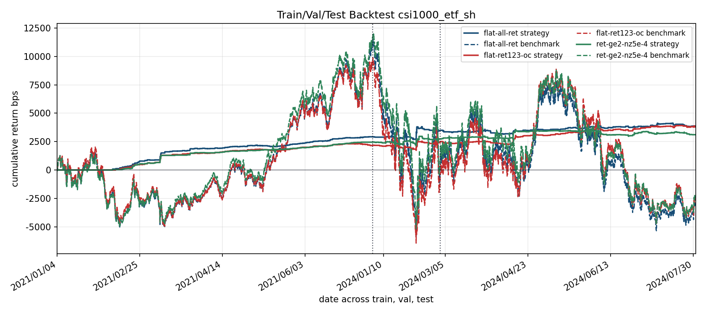

csi1000_etf_sh: strategy and benchmark cumulative returns across train, val, and test.

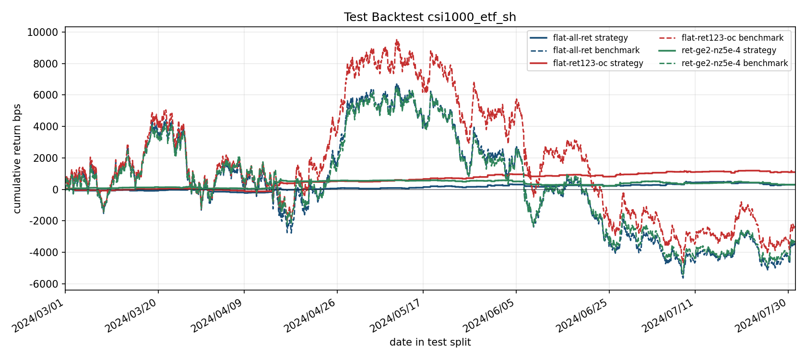

csi1000_etf_sh: strategy and benchmark cumulative returns on test split.

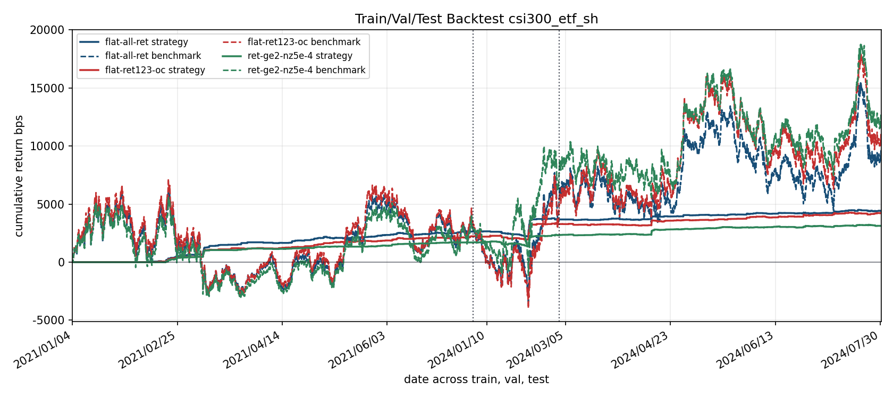

csi300_etf_sh: strategy and benchmark cumulative returns across train, val, and test.

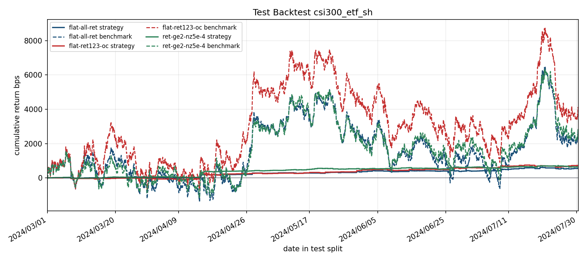

csi300_etf_sh: strategy and benchmark cumulative returns on test split.

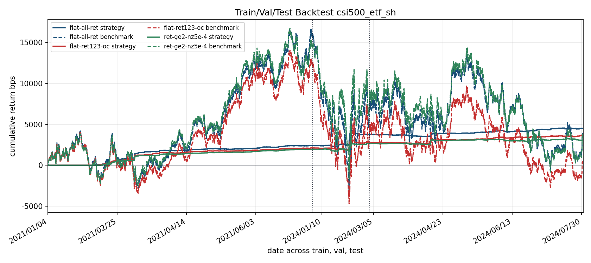

csi500_etf_sh: strategy and benchmark cumulative returns across train, val, and test.

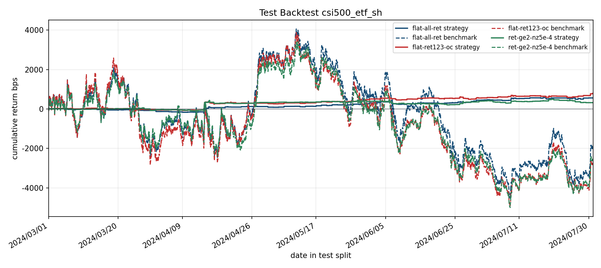

csi500_etf_sh: strategy and benchmark cumulative returns on test split.

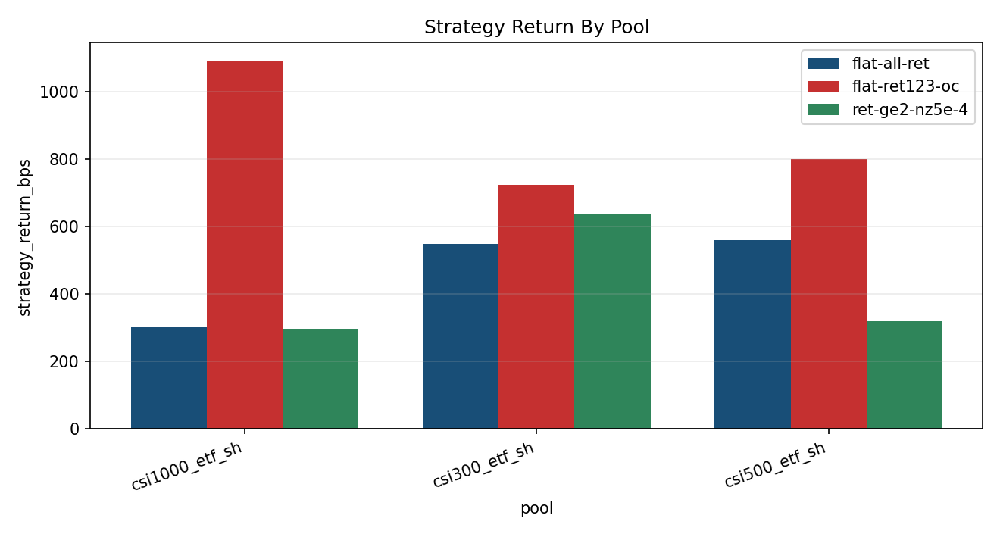

pool-level strategy_return_bps.

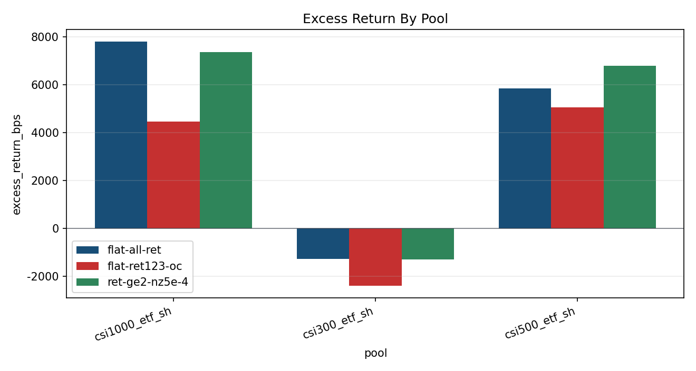

pool-level excess_return_bps.

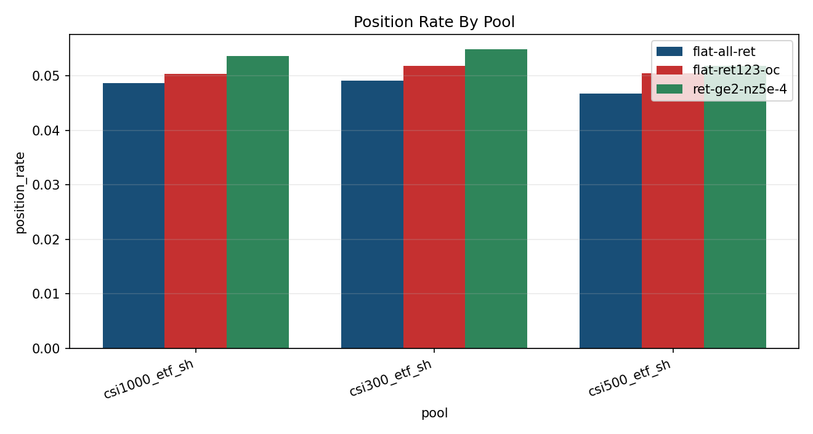

pool-level position_rate.

字段解释

| field | explanation |
| --- | --- |
| strategy_return_bps | test split 上 strategy minute return 复利收益, 单位 bps.  |
| benchmark_return_bps | test split 上 benchmark minute return 复利收益, 单位 bps.  |
| excess_return_bps | strategy 相对 benchmark 的复利 excess return, 单位 bps.  |
| expected_return_bps | expected minute return 复利收益, 单位 bps.  |
| position_rate | position > 0 的分钟比例.  |
| open_count | 开仓次数.  |
| open_per_day | 平均每日开仓次数.  |

### 5.2. Cost Sensitivity

### Cost Sensitivity

| experiment | pool | single_side_cost_bps | net_strategy_cumulative_return_bps |
| --- | --- | --- | --- |
| flat-all-ret | csi1000_etf_sh | 0.000e+00 | 300.2693 |
| flat-all-ret | csi1000_etf_sh | 1.0000 | -2.1496 |
| flat-all-ret | csi1000_etf_sh | 2.0000 | -295.7183 |
| flat-all-ret | csi1000_etf_sh | 5.0000 | -1,126 |
| flat-all-ret | csi1000_etf_sh | 10.0000 | -2,355 |
| flat-all-ret | csi300_etf_sh | 0.000e+00 | 549.9038 |
| flat-all-ret | csi300_etf_sh | 1.0000 | 225.8315 |
| flat-all-ret | csi300_etf_sh | 2.0000 | -88.3168 |
| flat-all-ret | csi300_etf_sh | 5.0000 | -974.2019 |
| flat-all-ret | csi300_etf_sh | 10.0000 | -2,279 |
| flat-all-ret | csi500_etf_sh | 0.000e+00 | 559.5979 |
| flat-all-ret | csi500_etf_sh | 1.0000 | 260.8659 |
| flat-all-ret | csi500_etf_sh | 2.0000 | -29.4435 |
| flat-all-ret | csi500_etf_sh | 5.0000 | -852.1702 |
| flat-all-ret | csi500_etf_sh | 10.0000 | -2,076 |
| flat-ret123-oc | csi1000_etf_sh | 0.000e+00 | 1,092 |
| flat-ret123-oc | csi1000_etf_sh | 1.0000 | 779.7122 |
| flat-ret123-oc | csi1000_etf_sh | 2.0000 | 475.7866 |
| flat-ret123-oc | csi1000_etf_sh | 5.0000 | -385.7012 |
| flat-ret123-oc | csi1000_etf_sh | 10.0000 | -1,667 |
| flat-ret123-oc | csi300_etf_sh | 0.000e+00 | 724.7362 |
| flat-ret123-oc | csi300_etf_sh | 1.0000 | 405.6836 |
| flat-ret123-oc | csi300_etf_sh | 2.0000 | 96.0921 |
| flat-ret123-oc | csi300_etf_sh | 5.0000 | -778.6716 |
| flat-ret123-oc | csi300_etf_sh | 10.0000 | -2,072 |
| flat-ret123-oc | csi500_etf_sh | 0.000e+00 | 801.0600 |
| flat-ret123-oc | csi500_etf_sh | 1.0000 | 489.1875 |
| flat-ret123-oc | csi500_etf_sh | 2.0000 | 186.2902 |
| flat-ret123-oc | csi500_etf_sh | 5.0000 | -671.0879 |
| flat-ret123-oc | csi500_etf_sh | 10.0000 | -1,943 |
| ret-ge2-nz5e-4 | csi1000_etf_sh | 0.000e+00 | 297.6330 |
| ret-ge2-nz5e-4 | csi1000_etf_sh | 1.0000 | -48.5698 |
| ret-ge2-nz5e-4 | csi1000_etf_sh | 2.0000 | -383.1662 |
| ret-ge2-nz5e-4 | csi1000_etf_sh | 5.0000 | -1,321 |
| ret-ge2-nz5e-4 | csi1000_etf_sh | 10.0000 | -2,686 |
| ret-ge2-nz5e-4 | csi300_etf_sh | 0.000e+00 | 638.5989 |
| ret-ge2-nz5e-4 | csi300_etf_sh | 1.0000 | 232.7265 |
| ret-ge2-nz5e-4 | csi300_etf_sh | 2.0000 | -157.6997 |
| ret-ge2-nz5e-4 | csi300_etf_sh | 5.0000 | -1,242 |
| ret-ge2-nz5e-4 | csi300_etf_sh | 10.0000 | -2,791 |
| ret-ge2-nz5e-4 | csi500_etf_sh | 0.000e+00 | 320.0859 |
| ret-ge2-nz5e-4 | csi500_etf_sh | 1.0000 | -42.8266 |
| ret-ge2-nz5e-4 | csi500_etf_sh | 2.0000 | -393.0115 |
| ret-ge2-nz5e-4 | csi500_etf_sh | 5.0000 | -1,372 |
| ret-ge2-nz5e-4 | csi500_etf_sh | 10.0000 | -2,787 |

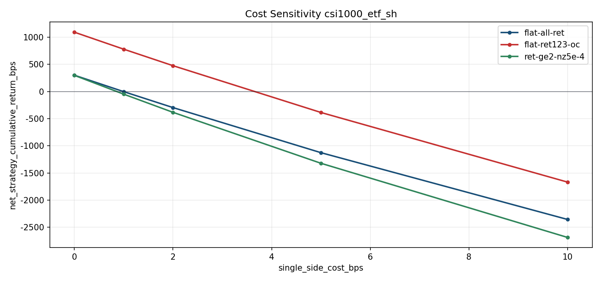

csi1000_etf_sh: single_side_cost_bps vs net_strategy_cumulative_return_bps.

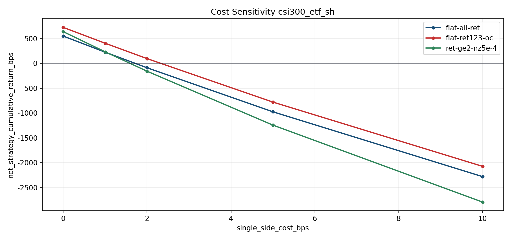

csi300_etf_sh: single_side_cost_bps vs net_strategy_cumulative_return_bps.

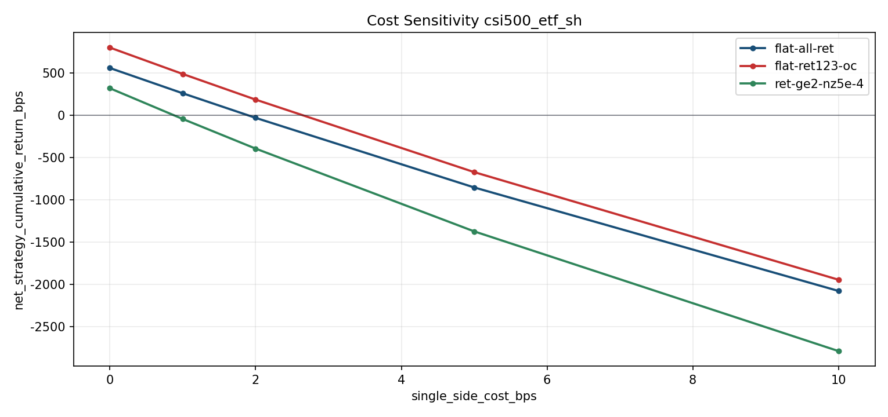

csi500_etf_sh: single_side_cost_bps vs net_strategy_cumulative_return_bps.

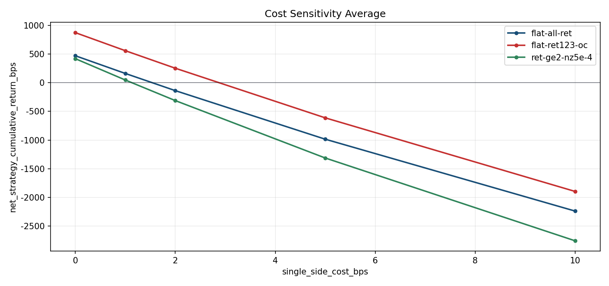

pool-average cost sensitivity.

字段解释

| field | explanation |
| --- | --- |
| single_side_cost_bps | 单边交易成本, 单位 bps.  |
| net_strategy_cumulative_return_bps | 扣成本后的 strategy cumulative return, 单位 bps.  |

### 5.3. Trade Return Distribution

### Trade Return Distribution

| experiment | pool | split | trade_count | mean_trade_return_bps | median_trade_return_bps | hit_rate | p05_trade_return_bps | p95_trade_return_bps |
| --- | --- | --- | --- | --- | --- | --- | --- | --- |
| flat-all-ret | csi1000_etf_sh | train_val_test | 337 | 9.8487 | 6.8386 | 0.620178 | -53.7624 | 63.8580 |
| flat-all-ret | csi300_etf_sh | train_val_test | 345 | 10.7290 | 3.9287 | 0.585507 | -34.0977 | 63.6660 |
| flat-all-ret | csi500_etf_sh | train_val_test | 334 | 11.3075 | 4.5654 | 0.598802 | -36.6488 | 62.2502 |
| flat-all-ret | csi1000_etf_sh | test | 149 | 2.0463 | 3.2331 | 0.543624 | -58.9231 | 53.7745 |
| flat-all-ret | csi300_etf_sh | test | 156 | 3.4554 | 1.7818 | 0.551282 | -29.6821 | 38.4723 |
| flat-all-ret | csi500_etf_sh | test | 144 | 3.8196 | 2.0139 | 0.541667 | -31.9030 | 40.4743 |
| flat-ret123-oc | csi1000_etf_sh | train_val_test | 320 | 10.1976 | 5.2816 | 0.625000 | -48.2751 | 65.6319 |
| flat-ret123-oc | csi300_etf_sh | train_val_test | 326 | 10.9571 | 3.7332 | 0.570552 | -32.3683 | 62.4548 |
| flat-ret123-oc | csi500_etf_sh | train_val_test | 325 | 9.9332 | 4.7183 | 0.612308 | -41.8541 | 66.3269 |
| flat-ret123-oc | csi1000_etf_sh | test | 143 | 7.3474 | 5.0812 | 0.622378 | -50.0088 | 58.2814 |
| flat-ret123-oc | csi300_etf_sh | test | 151 | 4.6877 | 2.4283 | 0.549669 | -28.4565 | 35.6385 |
| flat-ret123-oc | csi500_etf_sh | test | 147 | 5.3253 | 2.8744 | 0.578231 | -36.9540 | 50.0800 |
| ret-ge2-nz5e-4 | csi1000_etf_sh | train_val_test | 370 | 7.4326 | 5.2664 | 0.613514 | -46.4736 | 56.1721 |
| ret-ge2-nz5e-4 | csi300_etf_sh | train_val_test | 386 | 7.1155 | 3.7816 | 0.588083 | -26.8014 | 44.7895 |
| ret-ge2-nz5e-4 | csi500_etf_sh | train_val_test | 378 | 7.1568 | 3.8994 | 0.608466 | -38.2991 | 52.4282 |
| ret-ge2-nz5e-4 | csi1000_etf_sh | test | 171 | 1.7920 | 2.6015 | 0.549708 | -45.0867 | 45.2213 |
| ret-ge2-nz5e-4 | csi300_etf_sh | test | 195 | 3.2031 | 3.1481 | 0.584615 | -22.4080 | 21.5140 |
| ret-ge2-nz5e-4 | csi500_etf_sh | test | 179 | 1.8240 | 1.5474 | 0.558659 | -37.9863 | 26.6629 |

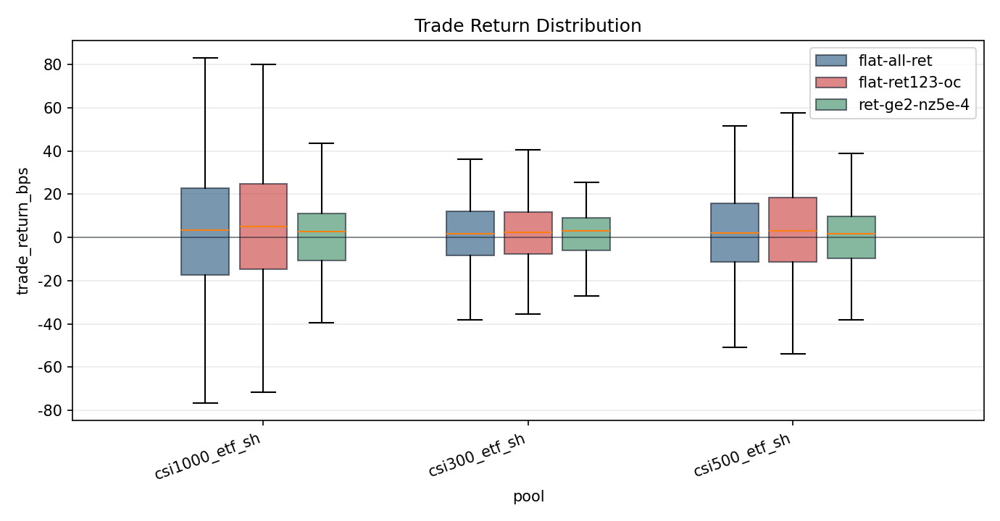

test split trade_return_bps distribution.

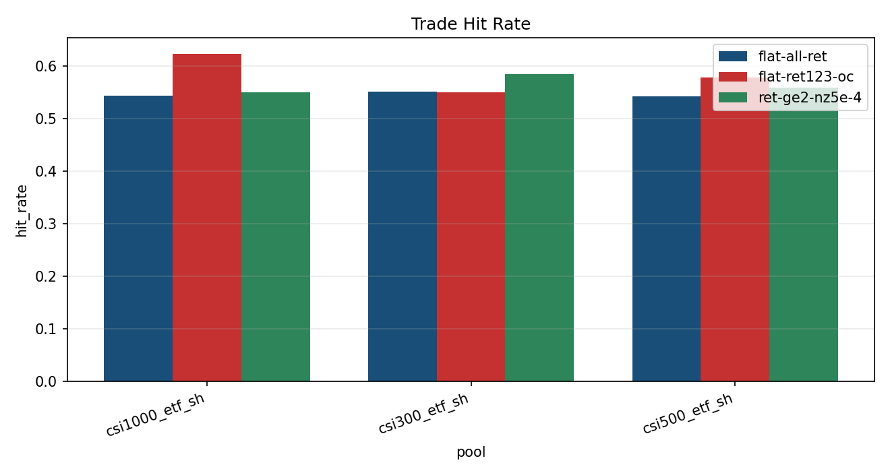

test split trade hit rate.

字段解释

| field | explanation |
| --- | --- |
| trade_count | trade id 数量.  |
| mean_trade_return_bps | 单笔 trade 平均收益, 单位 bps.  |
| median_trade_return_bps | 单笔 trade 中位数收益, 单位 bps.  |
| hit_rate | 分组内 target > 0 的比例.  |
| p05_trade_return_bps | 单笔 trade return 5% 分位数, 单位 bps.  |
| p95_trade_return_bps | 单笔 trade return 95% 分位数, 单位 bps.  |

### 6. Robustness Diagnostics

### 6.1. Return Realization

### Return Realization

| experiment | holding_minutes | mean_return | mean_return_bps | row_count | prediction_p95 |
| --- | --- | --- | --- | --- | --- |
| flat-all-ret | 1 | 1.653e-04 | 1.6530 | 6,136,141 | 7.243e-04 |
| flat-all-ret | 2 | 2.725e-04 | 2.7251 | 6,136,141 | 7.243e-04 |
| flat-all-ret | 3 | 3.438e-04 | 3.4381 | 6,136,141 | 7.243e-04 |
| flat-all-ret | 4 | 3.911e-04 | 3.9109 | 6,136,141 | 7.243e-04 |
| flat-all-ret | 5 | 4.236e-04 | 4.2364 | 6,136,141 | 7.243e-04 |
| flat-all-ret | 6 | 4.490e-04 | 4.4904 | 6,136,141 | 7.243e-04 |
| flat-all-ret | 7 | 4.739e-04 | 4.7389 | 6,136,141 | 7.243e-04 |
| flat-all-ret | 8 | 4.892e-04 | 4.8921 | 6,136,141 | 7.243e-04 |
| flat-all-ret | 9 | 4.975e-04 | 4.9746 | 6,136,141 | 7.243e-04 |
| flat-all-ret | 10 | 5.042e-04 | 5.0423 | 6,136,141 | 7.243e-04 |
| flat-all-ret | 11 | 5.013e-04 | 5.0131 | 6,027,113 | 7.243e-04 |
| flat-all-ret | 12 | 4.922e-04 | 4.9217 | 5,950,803 | 7.243e-04 |
| flat-all-ret | 13 | 4.866e-04 | 4.8664 | 5,897,938 | 7.243e-04 |
| flat-all-ret | 14 | 4.794e-04 | 4.7944 | 5,861,877 | 7.243e-04 |
| flat-all-ret | 15 | 4.743e-04 | 4.7429 | 5,836,773 | 7.243e-04 |
| flat-all-ret | 16 | 4.658e-04 | 4.6582 | 5,817,801 | 7.243e-04 |
| flat-all-ret | 17 | 4.479e-04 | 4.4788 | 5,803,813 | 7.243e-04 |
| flat-all-ret | 18 | 4.255e-04 | 4.2552 | 5,793,551 | 7.243e-04 |
| flat-all-ret | 19 | 4.011e-04 | 4.0110 | 5,785,700 | 7.243e-04 |
| flat-all-ret | 20 | 3.804e-04 | 3.8045 | 5,779,132 | 7.243e-04 |
| flat-ret123-oc | 1 | 1.879e-04 | 1.8793 | 3,053,174 | 8.097e-04 |
| flat-ret123-oc | 2 | 3.132e-04 | 3.1324 | 3,053,174 | 8.097e-04 |
| flat-ret123-oc | 3 | 3.940e-04 | 3.9400 | 3,053,174 | 8.097e-04 |
| flat-ret123-oc | 4 | 4.472e-04 | 4.4720 | 3,053,174 | 8.097e-04 |
| flat-ret123-oc | 5 | 4.881e-04 | 4.8809 | 3,053,174 | 8.097e-04 |
| flat-ret123-oc | 6 | 5.234e-04 | 5.2339 | 3,053,174 | 8.097e-04 |
| flat-ret123-oc | 7 | 5.569e-04 | 5.5690 | 3,053,174 | 8.097e-04 |
| flat-ret123-oc | 8 | 5.836e-04 | 5.8365 | 3,053,174 | 8.097e-04 |
| flat-ret123-oc | 9 | 6.041e-04 | 6.0414 | 3,053,174 | 8.097e-04 |
| flat-ret123-oc | 10 | 6.228e-04 | 6.2282 | 3,053,174 | 8.097e-04 |
| flat-ret123-oc | 11 | 6.374e-04 | 6.3741 | 2,996,606 | 8.097e-04 |
| flat-ret123-oc | 12 | 6.459e-04 | 6.4591 | 2,953,807 | 8.097e-04 |
| flat-ret123-oc | 13 | 6.567e-04 | 6.5675 | 2,921,638 | 8.097e-04 |
| flat-ret123-oc | 14 | 6.635e-04 | 6.6353 | 2,897,679 | 8.097e-04 |
| flat-ret123-oc | 15 | 6.672e-04 | 6.6715 | 2,880,048 | 8.097e-04 |
| flat-ret123-oc | 16 | 6.653e-04 | 6.6534 | 2,866,901 | 8.097e-04 |
| flat-ret123-oc | 17 | 6.512e-04 | 6.5120 | 2,857,331 | 8.097e-04 |
| flat-ret123-oc | 18 | 6.315e-04 | 6.3149 | 2,850,318 | 8.097e-04 |
| flat-ret123-oc | 19 | 6.102e-04 | 6.1016 | 2,845,501 | 8.097e-04 |
| flat-ret123-oc | 20 | 5.933e-04 | 5.9330 | 2,842,206 | 8.097e-04 |
| ret-ge2-nz5e-4 | 1 | 1.897e-04 | 1.8969 | 6,579,791 | 8.731e-04 |
| ret-ge2-nz5e-4 | 2 | 3.094e-04 | 3.0936 | 6,579,791 | 8.731e-04 |
| ret-ge2-nz5e-4 | 3 | 3.909e-04 | 3.9092 | 6,579,791 | 8.731e-04 |
| ret-ge2-nz5e-4 | 4 | 4.500e-04 | 4.5002 | 6,579,791 | 8.731e-04 |
| ret-ge2-nz5e-4 | 5 | 4.929e-04 | 4.9289 | 6,579,791 | 8.731e-04 |
| ret-ge2-nz5e-4 | 6 | 5.307e-04 | 5.3075 | 6,579,791 | 8.731e-04 |
| ret-ge2-nz5e-4 | 7 | 5.676e-04 | 5.6755 | 6,579,791 | 8.731e-04 |
| ret-ge2-nz5e-4 | 8 | 5.931e-04 | 5.9306 | 6,579,791 | 8.731e-04 |
| ret-ge2-nz5e-4 | 9 | 6.110e-04 | 6.1101 | 6,579,791 | 8.731e-04 |
| ret-ge2-nz5e-4 | 10 | 6.234e-04 | 6.2344 | 6,579,791 | 8.731e-04 |
| ret-ge2-nz5e-4 | 11 | 6.333e-04 | 6.3332 | 6,429,957 | 8.731e-04 |
| ret-ge2-nz5e-4 | 12 | 6.361e-04 | 6.3610 | 6,321,821 | 8.731e-04 |
| ret-ge2-nz5e-4 | 13 | 6.441e-04 | 6.4411 | 6,245,779 | 8.731e-04 |
| ret-ge2-nz5e-4 | 14 | 6.498e-04 | 6.4979 | 6,195,118 | 8.731e-04 |
| ret-ge2-nz5e-4 | 15 | 6.552e-04 | 6.5516 | 6,160,361 | 8.731e-04 |
| ret-ge2-nz5e-4 | 16 | 6.571e-04 | 6.5711 | 6,135,201 | 8.731e-04 |
| ret-ge2-nz5e-4 | 17 | 6.494e-04 | 6.4937 | 6,117,297 | 8.731e-04 |
| ret-ge2-nz5e-4 | 18 | 6.326e-04 | 6.3261 | 6,104,597 | 8.731e-04 |
| ret-ge2-nz5e-4 | 19 | 6.145e-04 | 6.1446 | 6,095,399 | 8.731e-04 |
| ret-ge2-nz5e-4 | 20 | 5.949e-04 | 5.9494 | 6,087,772 | 8.731e-04 |

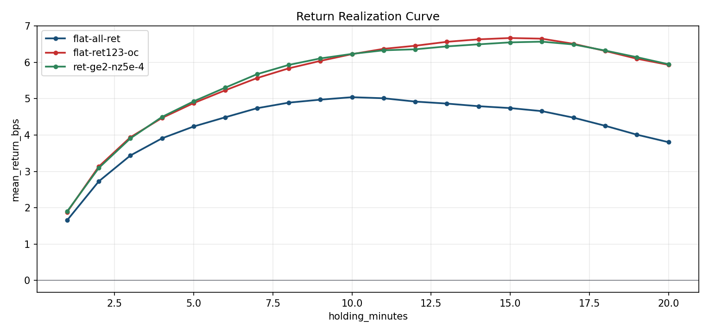

holding_minutes vs mean_return_bps.

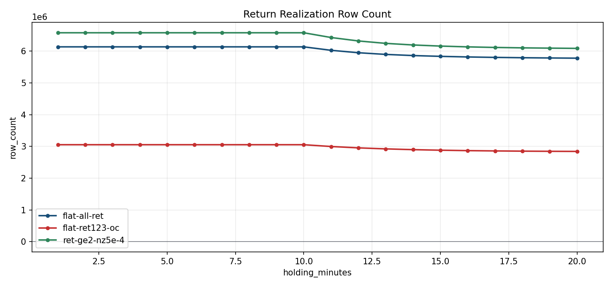

holding_minutes vs row_count.

字段解释

| field | explanation |
| --- | --- |
| holding_minutes | forward holding horizon, 单位 minutes.  |
| mean_return | 该 holding horizon 的平均 realized return.  |
| mean_return_bps | 该 holding horizon 的平均 realized return, 单位 bps.  |
| row_count | 分组样本数.  |
| prediction_p95 | prediction 95% 分位 threshold.  |

### 6.2. Monthly IC

### Monthly IC

| experiment | month | pearson_ic | rank_ic | sample_count |
| --- | --- | --- | --- | --- |
| flat-all-ret | 2024/03 | 0.060909 | 0.030409 | 27,112,746 |
| flat-all-ret | 2024/04 | 0.071531 | 0.068449 | 22,504,888 |
| flat-all-ret | 2024/05 | 0.063606 | 0.045619 | 24,766,955 |
| flat-all-ret | 2024/06 | 0.051985 | 0.028466 | 24,062,829 |
| flat-all-ret | 2024/07 | 0.050385 | 0.032267 | 24,252,773 |
| flat-ret123-oc | 2024/03 | 0.073038 | 0.040958 | 12,762,792 |
| flat-ret123-oc | 2024/04 | 0.076830 | 0.067705 | 10,403,535 |
| flat-ret123-oc | 2024/05 | 0.060702 | 0.039905 | 13,120,211 |
| flat-ret123-oc | 2024/06 | 0.058757 | 0.034273 | 12,554,123 |
| flat-ret123-oc | 2024/07 | 0.055090 | 0.032917 | 12,151,614 |
| ret-ge2-nz5e-4 | 2024/03 | 0.066927 | 0.040520 | 30,639,929 |
| ret-ge2-nz5e-4 | 2024/04 | 0.082968 | 0.071578 | 26,677,967 |
| ret-ge2-nz5e-4 | 2024/05 | 0.068610 | 0.054137 | 24,956,374 |
| ret-ge2-nz5e-4 | 2024/06 | 0.062985 | 0.026716 | 23,672,153 |
| ret-ge2-nz5e-4 | 2024/07 | 0.069340 | 0.046766 | 25,555,380 |

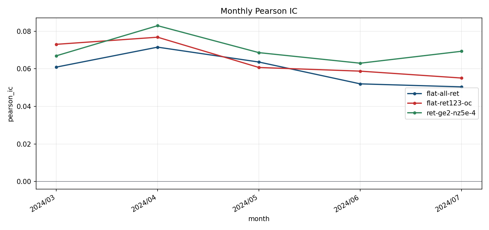

month vs pearson_ic.

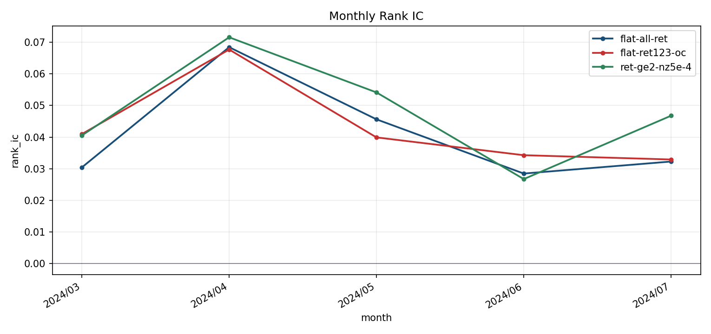

month vs rank_ic.

字段解释

| field | explanation |
| --- | --- |
| month | 月份.  |
| pearson_ic | corr(prediction, target).  |
| rank_ic | corr(rank(prediction), rank(target)).  |
| sample_count | 样本数.  |

### 6.3. Intraday IC

Intraday IC

| experiment | time_bucket | pearson_ic | rank_ic | sample_count |
| --- | --- | --- | --- | --- |
| flat-all-ret | 94,000 | 0.012010 | 0.015877 | 140 |
| flat-all-ret | 94,100 | 0.021519 | 0.010683 | 140 |
| flat-all-ret | 94,200 | 0.032071 | 0.017180 | 140 |
| flat-all-ret | 94,300 | 0.036671 | 0.034640 | 140 |
| flat-all-ret | 94,400 | 0.051527 | 0.034567 | 140 |
| flat-all-ret | 94,500 | 0.042669 | 0.027879 | 140 |
| flat-all-ret | 94,600 | 0.049233 | 0.029821 | 140 |
| flat-all-ret | 94,700 | 0.048727 | 0.033164 | 140 |
| flat-all-ret | 94,800 | 0.045671 | 0.034725 | 140 |
| flat-all-ret | 94,900 | 0.041020 | 0.030802 | 139 |
| flat-all-ret | 95,000 | 0.037042 | 0.030612 | 139 |
| flat-all-ret | 95,100 | 0.045595 | 0.031873 | 140 |
| flat-all-ret | 95,200 | 0.046115 | 0.030908 | 140 |
| flat-all-ret | 95,300 | 0.048637 | 0.033849 | 140 |
| flat-all-ret | 95,400 | 0.038897 | 0.031457 | 140 |
| flat-all-ret | 95,500 | 0.041837 | 0.029975 | 140 |
| flat-all-ret | 95,600 | 0.037500 | 0.027526 | 140 |
| flat-all-ret | 95,700 | 0.042258 | 0.024049 | 139 |
| flat-all-ret | 95,800 | 0.039916 | 0.023895 | 140 |
| flat-all-ret | 95,900 | 0.041206 | 0.026750 | 140 |
| flat-all-ret | 100,000 | 0.037842 | 0.018462 | 140 |
| flat-all-ret | 100,100 | 0.038843 | 0.020945 | 140 |
| flat-all-ret | 100,200 | 0.045395 | 0.020402 | 140 |
| flat-all-ret | 100,300 | 0.050411 | 0.020961 | 140 |
| flat-all-ret | 100,400 | 0.055015 | 0.024614 | 140 |
| flat-all-ret | 100,500 | 0.056012 | 0.029976 | 140 |
| flat-all-ret | 100,600 | 0.066187 | 0.034123 | 140 |
| flat-all-ret | 100,700 | 0.064166 | 0.038264 | 140 |
| flat-all-ret | 100,800 | 0.068798 | 0.043557 | 140 |
| flat-all-ret | 100,900 | 0.067111 | 0.048886 | 140 |
| flat-all-ret | 101,000 | 0.058038 | 0.039770 | 140 |
| flat-all-ret | 101,100 | 0.061050 | 0.042604 | 140 |
| flat-all-ret | 101,200 | 0.065395 | 0.043472 | 140 |
| flat-all-ret | 101,300 | 0.066923 | 0.048223 | 140 |
| flat-all-ret | 101,400 | 0.073682 | 0.048688 | 140 |
| flat-all-ret | 101,500 | 0.063731 | 0.042962 | 139 |
| flat-all-ret | 101,600 | 0.074211 | 0.052754 | 140 |
| flat-all-ret | 101,700 | 0.068861 | 0.046776 | 139 |
| flat-all-ret | 101,800 | 0.077053 | 0.045904 | 140 |
| flat-all-ret | 101,900 | 0.073163 | 0.047798 | 140 |
| flat-all-ret | 102,000 | 0.069826 | 0.044666 | 140 |
| flat-all-ret | 102,100 | 0.071019 | 0.047436 | 140 |
| flat-all-ret | 102,200 | 0.070993 | 0.045866 | 139 |
| flat-all-ret | 102,300 | 0.069818 | 0.047705 | 140 |
| flat-all-ret | 102,400 | 0.072650 | 0.045756 | 140 |
| flat-all-ret | 102,500 | 0.066096 | 0.044632 | 140 |
| flat-all-ret | 102,600 | 0.068654 | 0.052918 | 140 |
| flat-all-ret | 102,700 | 0.068251 | 0.049210 | 140 |
| flat-all-ret | 102,800 | 0.067788 | 0.044636 | 139 |
| flat-all-ret | 102,900 | 0.057825 | 0.040738 | 140 |
| flat-all-ret | 103,000 | 0.057291 | 0.035987 | 140 |
| flat-all-ret | 103,100 | 0.068651 | 0.044012 | 140 |
| flat-all-ret | 103,200 | 0.073685 | 0.040840 | 140 |
| flat-all-ret | 103,300 | 0.071723 | 0.042620 | 140 |
| flat-all-ret | 103,400 | 0.072771 | 0.039358 | 140 |
| flat-all-ret | 103,500 | 0.070420 | 0.045266 | 140 |
| flat-all-ret | 103,600 | 0.083270 | 0.051778 | 140 |
| flat-all-ret | 103,700 | 0.084396 | 0.058214 | 139 |
| flat-all-ret | 103,800 | 0.084506 | 0.066888 | 140 |
| flat-all-ret | 103,900 | 0.085748 | 0.066821 | 268 |
| flat-all-ret | 104,000 | 0.075285 | 0.058179 | 268 |
| flat-all-ret | 104,100 | 0.084576 | 0.064309 | 265 |
| flat-all-ret | 104,200 | 0.088098 | 0.067316 | 268 |
| flat-all-ret | 104,300 | 0.081102 | 0.066271 | 268 |
| flat-all-ret | 104,400 | 0.084693 | 0.063542 | 268 |
| flat-all-ret | 104,500 | 0.072375 | 0.055466 | 267 |
| flat-all-ret | 104,600 | 0.080278 | 0.055898 | 268 |
| flat-all-ret | 104,700 | 0.078075 | 0.058184 | 267 |
| flat-all-ret | 104,800 | 0.078425 | 0.058854 | 268 |
| flat-all-ret | 104,900 | 0.073143 | 0.053956 | 268 |
| flat-all-ret | 105,000 | 0.067510 | 0.047713 | 267 |
| flat-all-ret | 105,100 | 0.067952 | 0.050073 | 268 |
| flat-all-ret | 105,200 | 0.068223 | 0.052853 | 268 |
| flat-all-ret | 105,300 | 0.073510 | 0.056457 | 268 |
| flat-all-ret | 105,400 | 0.078332 | 0.059723 | 268 |
| flat-all-ret | 105,500 | 0.074048 | 0.056441 | 267 |
| flat-all-ret | 105,600 | 0.064104 | 0.052461 | 267 |
| flat-all-ret | 105,700 | 0.068752 | 0.056391 | 268 |
| flat-all-ret | 105,800 | 0.074444 | 0.061563 | 268 |
| flat-all-ret | 105,900 | 0.079642 | 0.063468 | 268 |
| flat-all-ret | 110,000 | 0.072466 | 0.058303 | 267 |
| flat-all-ret | 110,100 | 0.066512 | 0.045892 | 268 |
| flat-all-ret | 110,200 | 0.063032 | 0.041000 | 268 |
| flat-all-ret | 110,300 | 0.063445 | 0.043497 | 267 |
| flat-all-ret | 110,400 | 0.063780 | 0.047062 | 268 |
| flat-all-ret | 110,500 | 0.072431 | 0.047352 | 268 |
| flat-all-ret | 110,600 | 0.072819 | 0.050448 | 268 |
| flat-all-ret | 110,700 | 0.069988 | 0.053246 | 268 |
| flat-all-ret | 110,800 | 0.069232 | 0.055342 | 268 |
| flat-all-ret | 110,900 | 0.071652 | 0.059897 | 267 |
| flat-all-ret | 111,000 | 0.073291 | 0.060163 | 268 |
| flat-all-ret | 111,100 | 0.074623 | 0.056821 | 267 |
| flat-all-ret | 111,200 | 0.075530 | 0.055053 | 268 |
| flat-all-ret | 111,300 | 0.074944 | 0.058340 | 268 |
| flat-all-ret | 111,400 | 0.080212 | 0.055382 | 267 |
| flat-all-ret | 111,500 | 0.072555 | 0.048920 | 265 |
| flat-all-ret | 111,600 | 0.067392 | 0.049816 | 267 |
| flat-all-ret | 111,700 | 0.070615 | 0.052821 | 268 |
| flat-all-ret | 111,800 | 0.069645 | 0.056618 | 268 |
| flat-all-ret | 111,900 | 0.076277 | 0.056932 | 268 |
| flat-all-ret | 112,000 | 0.070322 | 0.050902 | 268 |
| flat-all-ret | 112,100 | 0.066133 | 0.049211 | 268 |
| flat-all-ret | 112,200 | 0.060358 | 0.047224 | 268 |
| flat-all-ret | 112,300 | 0.052500 | 0.040232 | 268 |
| flat-all-ret | 112,400 | 0.050518 | 0.039536 | 268 |
| flat-all-ret | 112,500 | 0.049580 | 0.035650 | 268 |
| flat-all-ret | 112,600 | 0.049478 | 0.038902 | 268 |
| flat-all-ret | 112,700 | 0.048169 | 0.043117 | 268 |
| flat-all-ret | 112,800 | 0.042525 | 0.044297 | 267 |
| flat-all-ret | 112,900 | 0.043882 | 0.041112 | 268 |
| flat-all-ret | 113,000 | 0.080758 | 0.080198 | 267 |
| flat-all-ret | 130,100 | 0.081112 | 0.061289 | 267 |
| flat-all-ret | 130,200 | 0.069063 | 0.043428 | 268 |
| flat-all-ret | 130,300 | 0.064288 | 0.034422 | 268 |
| flat-all-ret | 130,400 | 0.053152 | 0.026814 | 268 |
| flat-all-ret | 130,500 | 0.044839 | 0.021558 | 268 |
| flat-all-ret | 130,600 | 0.042266 | 0.026989 | 268 |
| flat-all-ret | 130,700 | 0.041344 | 0.027909 | 268 |
| flat-all-ret | 130,800 | 0.050058 | 0.030751 | 268 |
| flat-all-ret | 130,900 | 0.051964 | 0.029373 | 268 |
| flat-all-ret | 131,000 | 0.047329 | 0.026344 | 265 |
| flat-all-ret | 131,100 | 0.045958 | 0.034022 | 268 |
| flat-all-ret | 131,200 | 0.046339 | 0.032339 | 268 |
| flat-all-ret | 131,300 | 0.047278 | 0.037280 | 268 |
| flat-all-ret | 131,400 | 0.050963 | 0.034174 | 267 |
| flat-all-ret | 131,500 | 0.051162 | 0.036048 | 267 |
| flat-all-ret | 131,600 | 0.055056 | 0.033398 | 268 |
| flat-all-ret | 131,700 | 0.057638 | 0.034607 | 268 |
| flat-all-ret | 131,800 | 0.061403 | 0.037105 | 268 |
| flat-all-ret | 131,900 | 0.064296 | 0.037428 | 268 |
| flat-all-ret | 132,000 | 0.056129 | 0.034455 | 268 |
| flat-all-ret | 132,100 | 0.054547 | 0.035709 | 268 |
| flat-all-ret | 132,200 | 0.059243 | 0.037103 | 267 |
| flat-all-ret | 132,300 | 0.069695 | 0.044236 | 268 |
| flat-all-ret | 132,400 | 0.071510 | 0.043493 | 268 |
| flat-all-ret | 132,500 | 0.066189 | 0.048234 | 267 |
| flat-all-ret | 132,600 | 0.078579 | 0.057176 | 268 |
| flat-all-ret | 132,700 | 0.078541 | 0.058218 | 267 |
| flat-all-ret | 132,800 | 0.071386 | 0.059423 | 268 |
| flat-all-ret | 132,900 | 0.073047 | 0.062911 | 268 |
| flat-all-ret | 133,000 | 0.078872 | 0.056912 | 268 |
| flat-all-ret | 133,100 | 0.078019 | 0.044771 | 268 |
| flat-all-ret | 133,200 | 0.072625 | 0.045081 | 267 |
| flat-all-ret | 133,300 | 0.080892 | 0.054217 | 268 |
| flat-all-ret | 133,400 | 0.072357 | 0.053111 | 268 |
| flat-all-ret | 133,500 | 0.066763 | 0.048184 | 268 |
| flat-all-ret | 133,600 | 0.056280 | 0.050319 | 268 |
| flat-all-ret | 133,700 | 0.064411 | 0.060717 | 268 |
| flat-all-ret | 133,800 | 0.076311 | 0.067307 | 267 |
| flat-all-ret | 133,900 | 0.084428 | 0.063599 | 267 |
| flat-all-ret | 134,000 | 0.073737 | 0.052181 | 268 |
| flat-all-ret | 134,100 | 0.067408 | 0.053055 | 267 |
| flat-all-ret | 134,200 | 0.075031 | 0.056372 | 268 |
| flat-all-ret | 134,300 | 0.075105 | 0.058473 | 268 |
| flat-all-ret | 134,400 | 0.088188 | 0.061834 | 268 |
| flat-all-ret | 134,500 | 0.070621 | 0.057982 | 268 |
| flat-all-ret | 134,600 | 0.075563 | 0.052811 | 268 |
| flat-all-ret | 134,700 | 0.085188 | 0.054270 | 268 |
| flat-all-ret | 134,800 | 0.079324 | 0.058078 | 268 |
| flat-all-ret | 134,900 | 0.087870 | 0.058755 | 268 |
| flat-all-ret | 135,000 | 0.098643 | 0.056456 | 267 |
| flat-all-ret | 135,100 | 0.110404 | 0.057920 | 267 |
| flat-all-ret | 135,200 | 0.114552 | 0.064906 | 268 |
| flat-all-ret | 135,300 | 0.122369 | 0.070805 | 268 |
| flat-all-ret | 135,400 | 0.120080 | 0.072788 | 267 |
| flat-all-ret | 135,500 | 0.111010 | 0.071451 | 268 |
| flat-all-ret | 135,600 | 0.109933 | 0.069025 | 268 |
| flat-all-ret | 135,700 | 0.112946 | 0.073163 | 268 |
| flat-all-ret | 135,800 | 0.114486 | 0.077158 | 268 |
| flat-all-ret | 135,900 | 0.101443 | 0.060201 | 268 |
| flat-all-ret | 140,000 | 0.083479 | 0.050717 | 268 |
| flat-all-ret | 140,100 | 0.081417 | 0.047430 | 268 |
| flat-all-ret | 140,200 | 0.089840 | 0.050653 | 268 |
| flat-all-ret | 140,300 | 0.084272 | 0.052866 | 268 |
| flat-all-ret | 140,400 | 0.085259 | 0.061346 | 268 |
| flat-all-ret | 140,500 | 0.081770 | 0.061514 | 268 |
| flat-all-ret | 140,600 | 0.084591 | 0.058458 | 268 |
| flat-all-ret | 140,700 | 0.094595 | 0.060874 | 268 |
| flat-all-ret | 140,800 | 0.080185 | 0.057696 | 267 |
| flat-all-ret | 140,900 | 0.076583 | 0.058419 | 268 |
| flat-all-ret | 141,000 | 0.070927 | 0.049361 | 267 |
| flat-all-ret | 141,100 | 0.069943 | 0.049668 | 267 |
| flat-all-ret | 141,200 | 0.078053 | 0.051027 | 268 |
| flat-all-ret | 141,300 | 0.081866 | 0.048106 | 267 |
| flat-all-ret | 141,400 | 0.081685 | 0.049601 | 268 |
| flat-all-ret | 141,500 | 0.080172 | 0.050554 | 268 |
| flat-all-ret | 141,600 | 0.077883 | 0.051594 | 267 |
| flat-all-ret | 141,700 | 0.085363 | 0.057250 | 268 |
| flat-all-ret | 141,800 | 0.088163 | 0.056894 | 268 |
| flat-all-ret | 141,900 | 0.088145 | 0.057377 | 268 |
| flat-all-ret | 142,000 | 0.076832 | 0.057729 | 268 |
| flat-all-ret | 142,100 | 0.091813 | 0.073429 | 268 |
| flat-all-ret | 142,200 | 0.101862 | 0.082175 | 267 |
| flat-all-ret | 142,300 | 0.107824 | 0.085228 | 267 |
| flat-all-ret | 142,400 | 0.101648 | 0.079077 | 267 |
| flat-all-ret | 142,500 | 0.108509 | 0.078289 | 267 |
| flat-all-ret | 142,600 | 0.109614 | 0.080452 | 268 |
| flat-all-ret | 142,700 | 0.118069 | 0.088495 | 266 |
| flat-all-ret | 142,800 | 0.119195 | 0.088985 | 268 |
| flat-all-ret | 142,900 | 0.118651 | 0.084215 | 268 |
| flat-all-ret | 143,000 | 0.111167 | 0.073581 | 268 |
| flat-all-ret | 143,100 | 0.113989 | 0.081818 | 268 |
| flat-all-ret | 143,200 | 0.115442 | 0.088280 | 268 |
| flat-all-ret | 143,300 | 0.119393 | 0.087759 | 268 |
| flat-all-ret | 143,400 | 0.115511 | 0.083854 | 268 |
| flat-all-ret | 143,500 | 0.121793 | 0.074350 | 268 |
| flat-all-ret | 143,600 | 0.120344 | 0.086240 | 268 |
| flat-all-ret | 143,700 | 0.119104 | 0.084806 | 267 |
| flat-all-ret | 143,800 | 0.118876 | 0.087380 | 266 |
| flat-all-ret | 143,900 | 0.116530 | 0.081519 | 268 |
| flat-all-ret | 144,000 | 0.102904 | 0.070036 | 268 |
| flat-all-ret | 144,100 | 0.098717 | 0.067173 | 266 |
| flat-all-ret | 144,200 | 0.099406 | 0.065761 | 268 |
| flat-all-ret | 144,300 | 0.103597 | 0.064339 | 268 |
| flat-all-ret | 144,400 | 0.103370 | 0.063608 | 268 |
| flat-all-ret | 144,500 | 0.093930 | 0.057711 | 267 |
| flat-all-ret | 144,600 | 0.094521 | 0.061270 | 268 |
| flat-all-ret | 144,700 | 0.089525 | 0.069197 | 268 |
| flat-all-ret | 144,800 | 0.080817 | 0.071284 | 267 |
| flat-all-ret | 144,900 | 0.086752 | 0.068240 | 268 |
| flat-ret123-oc | 94,000 | 0.010405 | 0.007853 | 125 |
| flat-ret123-oc | 94,100 | 0.013426 | 0.011001 | 125 |
| flat-ret123-oc | 94,200 | 0.026831 | 0.013887 | 125 |
| flat-ret123-oc | 94,300 | 0.037464 | 0.025007 | 125 |
| flat-ret123-oc | 94,400 | 0.042514 | 0.026016 | 125 |
| flat-ret123-oc | 94,500 | 0.032991 | 0.024942 | 125 |
| flat-ret123-oc | 94,600 | 0.031438 | 0.020099 | 125 |
| flat-ret123-oc | 94,700 | 0.032650 | 0.026222 | 125 |
| flat-ret123-oc | 94,800 | 0.032005 | 0.026667 | 125 |
| flat-ret123-oc | 94,900 | 0.040800 | 0.033653 | 125 |
| flat-ret123-oc | 95,000 | 0.044116 | 0.034191 | 125 |
| flat-ret123-oc | 95,100 | 0.051999 | 0.045240 | 125 |
| flat-ret123-oc | 95,200 | 0.054643 | 0.046815 | 125 |
| flat-ret123-oc | 95,300 | 0.045370 | 0.042881 | 125 |
| flat-ret123-oc | 95,400 | 0.053799 | 0.044881 | 125 |
| flat-ret123-oc | 95,500 | 0.048105 | 0.038411 | 125 |
| flat-ret123-oc | 95,600 | 0.050757 | 0.031704 | 125 |
| flat-ret123-oc | 95,700 | 0.054128 | 0.037755 | 125 |
| flat-ret123-oc | 95,800 | 0.050745 | 0.036441 | 125 |
| flat-ret123-oc | 95,900 | 0.054202 | 0.035252 | 125 |
| flat-ret123-oc | 100,000 | 0.051412 | 0.031602 | 124 |
| flat-ret123-oc | 100,100 | 0.058044 | 0.036143 | 125 |
| flat-ret123-oc | 100,200 | 0.054634 | 0.038940 | 125 |
| flat-ret123-oc | 100,300 | 0.063305 | 0.047529 | 125 |
| flat-ret123-oc | 100,400 | 0.063838 | 0.047105 | 125 |
| flat-ret123-oc | 100,500 | 0.066704 | 0.049824 | 125 |
| flat-ret123-oc | 100,600 | 0.083229 | 0.058903 | 125 |
| flat-ret123-oc | 100,700 | 0.075741 | 0.050814 | 125 |
| flat-ret123-oc | 100,800 | 0.082937 | 0.053798 | 125 |
| flat-ret123-oc | 100,900 | 0.077257 | 0.049983 | 123 |
| flat-ret123-oc | 101,000 | 0.056876 | 0.033086 | 125 |
| flat-ret123-oc | 101,100 | 0.069875 | 0.044371 | 125 |
| flat-ret123-oc | 101,200 | 0.072271 | 0.054443 | 125 |
| flat-ret123-oc | 101,300 | 0.075160 | 0.053292 | 125 |
| flat-ret123-oc | 101,400 | 0.075726 | 0.043851 | 125 |
| flat-ret123-oc | 101,500 | 0.075623 | 0.044378 | 124 |
| flat-ret123-oc | 101,600 | 0.075484 | 0.051219 | 125 |
| flat-ret123-oc | 101,700 | 0.063653 | 0.041584 | 125 |
| flat-ret123-oc | 101,800 | 0.067270 | 0.046417 | 125 |
| flat-ret123-oc | 101,900 | 0.076434 | 0.055231 | 125 |
| flat-ret123-oc | 102,000 | 0.062758 | 0.043878 | 124 |
| flat-ret123-oc | 102,100 | 0.053881 | 0.043073 | 125 |
| flat-ret123-oc | 102,200 | 0.051975 | 0.036698 | 125 |
| flat-ret123-oc | 102,300 | 0.060322 | 0.044974 | 125 |
| flat-ret123-oc | 102,400 | 0.065549 | 0.042770 | 125 |
| flat-ret123-oc | 102,500 | 0.053914 | 0.040753 | 125 |
| flat-ret123-oc | 102,600 | 0.057014 | 0.047899 | 125 |
| flat-ret123-oc | 102,700 | 0.049267 | 0.041653 | 125 |
| flat-ret123-oc | 102,800 | 0.044773 | 0.031697 | 125 |
| flat-ret123-oc | 102,900 | 0.047534 | 0.033391 | 125 |
| flat-ret123-oc | 103,000 | 0.044147 | 0.027397 | 125 |
| flat-ret123-oc | 103,100 | 0.060648 | 0.035039 | 125 |
| flat-ret123-oc | 103,200 | 0.053757 | 0.035482 | 125 |
| flat-ret123-oc | 103,300 | 0.066146 | 0.046441 | 124 |
| flat-ret123-oc | 103,400 | 0.061364 | 0.036338 | 125 |
| flat-ret123-oc | 103,500 | 0.056736 | 0.044501 | 125 |
| flat-ret123-oc | 103,600 | 0.084498 | 0.057059 | 125 |
| flat-ret123-oc | 103,700 | 0.081864 | 0.054967 | 125 |
| flat-ret123-oc | 103,800 | 0.083160 | 0.061001 | 125 |
| flat-ret123-oc | 103,900 | 0.078550 | 0.054812 | 238 |
| flat-ret123-oc | 104,000 | 0.075732 | 0.053391 | 238 |
| flat-ret123-oc | 104,100 | 0.083673 | 0.058080 | 238 |
| flat-ret123-oc | 104,200 | 0.089229 | 0.060038 | 238 |
| flat-ret123-oc | 104,300 | 0.082653 | 0.059483 | 238 |
| flat-ret123-oc | 104,400 | 0.082371 | 0.060387 | 237 |
| flat-ret123-oc | 104,500 | 0.072587 | 0.053212 | 237 |
| flat-ret123-oc | 104,600 | 0.074604 | 0.053634 | 238 |
| flat-ret123-oc | 104,700 | 0.074359 | 0.055556 | 236 |
| flat-ret123-oc | 104,800 | 0.076560 | 0.060639 | 238 |
| flat-ret123-oc | 104,900 | 0.076528 | 0.051898 | 238 |
| flat-ret123-oc | 105,000 | 0.060586 | 0.041321 | 238 |
| flat-ret123-oc | 105,100 | 0.060354 | 0.042200 | 238 |
| flat-ret123-oc | 105,200 | 0.063385 | 0.044387 | 238 |
| flat-ret123-oc | 105,300 | 0.074284 | 0.052200 | 238 |
| flat-ret123-oc | 105,400 | 0.073280 | 0.056491 | 238 |
| flat-ret123-oc | 105,500 | 0.068165 | 0.051520 | 238 |
| flat-ret123-oc | 105,600 | 0.054722 | 0.048509 | 238 |
| flat-ret123-oc | 105,700 | 0.061564 | 0.049867 | 238 |
| flat-ret123-oc | 105,800 | 0.071694 | 0.058299 | 238 |
| flat-ret123-oc | 105,900 | 0.070821 | 0.058741 | 238 |
| flat-ret123-oc | 110,000 | 0.072825 | 0.049182 | 238 |
| flat-ret123-oc | 110,100 | 0.059741 | 0.039192 | 238 |
| flat-ret123-oc | 110,200 | 0.048959 | 0.032251 | 238 |
| flat-ret123-oc | 110,300 | 0.054054 | 0.037279 | 238 |
| flat-ret123-oc | 110,400 | 0.061954 | 0.040805 | 236 |
| flat-ret123-oc | 110,500 | 0.071013 | 0.041001 | 237 |
| flat-ret123-oc | 110,600 | 0.063696 | 0.039758 | 238 |
| flat-ret123-oc | 110,700 | 0.075813 | 0.047981 | 238 |
| flat-ret123-oc | 110,800 | 0.065842 | 0.050976 | 238 |
| flat-ret123-oc | 110,900 | 0.065569 | 0.049283 | 238 |
| flat-ret123-oc | 111,000 | 0.065652 | 0.053194 | 238 |
| flat-ret123-oc | 111,100 | 0.066730 | 0.049075 | 238 |
| flat-ret123-oc | 111,200 | 0.075140 | 0.050606 | 238 |
| flat-ret123-oc | 111,300 | 0.071853 | 0.051606 | 237 |
| flat-ret123-oc | 111,400 | 0.068088 | 0.054094 | 237 |
| flat-ret123-oc | 111,500 | 0.066710 | 0.047041 | 238 |
| flat-ret123-oc | 111,600 | 0.063008 | 0.047289 | 238 |
| flat-ret123-oc | 111,700 | 0.070535 | 0.049931 | 238 |
| flat-ret123-oc | 111,800 | 0.079574 | 0.056415 | 238 |
| flat-ret123-oc | 111,900 | 0.081565 | 0.056449 | 238 |
| flat-ret123-oc | 112,000 | 0.067800 | 0.040364 | 238 |
| flat-ret123-oc | 112,100 | 0.058436 | 0.041616 | 238 |
| flat-ret123-oc | 112,200 | 0.049550 | 0.041525 | 238 |
| flat-ret123-oc | 112,300 | 0.048367 | 0.042130 | 238 |
| flat-ret123-oc | 112,400 | 0.042894 | 0.039736 | 238 |
| flat-ret123-oc | 112,500 | 0.038150 | 0.028954 | 238 |
| flat-ret123-oc | 112,600 | 0.044847 | 0.032831 | 238 |
| flat-ret123-oc | 112,700 | 0.036021 | 0.032271 | 238 |
| flat-ret123-oc | 112,800 | 0.032877 | 0.029450 | 238 |
| flat-ret123-oc | 112,900 | 0.030471 | 0.032213 | 238 |
| flat-ret123-oc | 113,000 | 0.092428 | 0.073084 | 238 |
| flat-ret123-oc | 130,100 | 0.084140 | 0.060026 | 238 |
| flat-ret123-oc | 130,200 | 0.073140 | 0.047149 | 238 |
| flat-ret123-oc | 130,300 | 0.078678 | 0.044649 | 238 |
| flat-ret123-oc | 130,400 | 0.063717 | 0.031949 | 238 |
| flat-ret123-oc | 130,500 | 0.051246 | 0.022306 | 238 |
| flat-ret123-oc | 130,600 | 0.050314 | 0.017830 | 238 |
| flat-ret123-oc | 130,700 | 0.053627 | 0.022711 | 238 |
| flat-ret123-oc | 130,800 | 0.048767 | 0.022398 | 238 |
| flat-ret123-oc | 130,900 | 0.043416 | 0.022009 | 236 |
| flat-ret123-oc | 131,000 | 0.049418 | 0.020749 | 238 |
| flat-ret123-oc | 131,100 | 0.054380 | 0.028232 | 238 |
| flat-ret123-oc | 131,200 | 0.056080 | 0.031331 | 238 |
| flat-ret123-oc | 131,300 | 0.043390 | 0.028385 | 238 |
| flat-ret123-oc | 131,400 | 0.052300 | 0.033677 | 236 |
| flat-ret123-oc | 131,500 | 0.044767 | 0.027488 | 238 |
| flat-ret123-oc | 131,600 | 0.043776 | 0.028733 | 237 |
| flat-ret123-oc | 131,700 | 0.060630 | 0.031627 | 238 |
| flat-ret123-oc | 131,800 | 0.062337 | 0.031992 | 238 |
| flat-ret123-oc | 131,900 | 0.061556 | 0.033159 | 237 |
| flat-ret123-oc | 132,000 | 0.046826 | 0.028171 | 238 |
| flat-ret123-oc | 132,100 | 0.050942 | 0.022839 | 238 |
| flat-ret123-oc | 132,200 | 0.076389 | 0.040097 | 238 |
| flat-ret123-oc | 132,300 | 0.079583 | 0.033021 | 238 |
| flat-ret123-oc | 132,400 | 0.079013 | 0.040682 | 237 |
| flat-ret123-oc | 132,500 | 0.071673 | 0.038004 | 238 |
| flat-ret123-oc | 132,600 | 0.073306 | 0.040809 | 238 |
| flat-ret123-oc | 132,700 | 0.070831 | 0.044939 | 238 |
| flat-ret123-oc | 132,800 | 0.065202 | 0.039521 | 238 |
| flat-ret123-oc | 132,900 | 0.067277 | 0.046024 | 238 |
| flat-ret123-oc | 133,000 | 0.070727 | 0.050386 | 238 |
| flat-ret123-oc | 133,100 | 0.067740 | 0.036820 | 238 |
| flat-ret123-oc | 133,200 | 0.065234 | 0.042771 | 238 |
| flat-ret123-oc | 133,300 | 0.067037 | 0.043696 | 237 |
| flat-ret123-oc | 133,400 | 0.067414 | 0.047493 | 238 |
| flat-ret123-oc | 133,500 | 0.064975 | 0.043471 | 238 |
| flat-ret123-oc | 133,600 | 0.067498 | 0.048634 | 238 |
| flat-ret123-oc | 133,700 | 0.067628 | 0.057116 | 238 |
| flat-ret123-oc | 133,800 | 0.075699 | 0.064407 | 237 |
| flat-ret123-oc | 133,900 | 0.067961 | 0.055865 | 238 |
| flat-ret123-oc | 134,000 | 0.060247 | 0.048963 | 238 |
| flat-ret123-oc | 134,100 | 0.053017 | 0.043752 | 238 |
| flat-ret123-oc | 134,200 | 0.068496 | 0.049214 | 238 |
| flat-ret123-oc | 134,300 | 0.059863 | 0.050143 | 238 |
| flat-ret123-oc | 134,400 | 0.065197 | 0.053847 | 238 |
| flat-ret123-oc | 134,500 | 0.058884 | 0.044255 | 237 |
| flat-ret123-oc | 134,600 | 0.063903 | 0.037514 | 238 |
| flat-ret123-oc | 134,700 | 0.075568 | 0.043261 | 238 |
| flat-ret123-oc | 134,800 | 0.075393 | 0.046130 | 238 |
| flat-ret123-oc | 134,900 | 0.079541 | 0.048510 | 238 |
| flat-ret123-oc | 135,000 | 0.087146 | 0.053038 | 238 |
| flat-ret123-oc | 135,100 | 0.093103 | 0.052642 | 238 |
| flat-ret123-oc | 135,200 | 0.109403 | 0.060167 | 238 |
| flat-ret123-oc | 135,300 | 0.115152 | 0.062837 | 238 |
| flat-ret123-oc | 135,400 | 0.113254 | 0.065542 | 238 |
| flat-ret123-oc | 135,500 | 0.109330 | 0.066896 | 238 |
| flat-ret123-oc | 135,600 | 0.110393 | 0.064864 | 238 |
| flat-ret123-oc | 135,700 | 0.118603 | 0.074301 | 238 |
| flat-ret123-oc | 135,800 | 0.128987 | 0.081557 | 238 |
| flat-ret123-oc | 135,900 | 0.117851 | 0.065369 | 238 |
| flat-ret123-oc | 140,000 | 0.099899 | 0.053538 | 238 |
| flat-ret123-oc | 140,100 | 0.092237 | 0.052070 | 238 |
| flat-ret123-oc | 140,200 | 0.101184 | 0.062061 | 238 |
| flat-ret123-oc | 140,300 | 0.092412 | 0.065039 | 238 |
| flat-ret123-oc | 140,400 | 0.101120 | 0.071960 | 237 |
| flat-ret123-oc | 140,500 | 0.087134 | 0.067456 | 238 |
| flat-ret123-oc | 140,600 | 0.098363 | 0.069090 | 238 |
| flat-ret123-oc | 140,700 | 0.110273 | 0.077884 | 238 |
| flat-ret123-oc | 140,800 | 0.098747 | 0.075732 | 238 |
| flat-ret123-oc | 140,900 | 0.093173 | 0.071801 | 237 |
| flat-ret123-oc | 141,000 | 0.085297 | 0.061704 | 238 |
| flat-ret123-oc | 141,100 | 0.091479 | 0.066875 | 238 |
| flat-ret123-oc | 141,200 | 0.094123 | 0.065611 | 238 |
| flat-ret123-oc | 141,300 | 0.093891 | 0.065657 | 238 |
| flat-ret123-oc | 141,400 | 0.088386 | 0.064436 | 238 |
| flat-ret123-oc | 141,500 | 0.078199 | 0.062331 | 238 |
| flat-ret123-oc | 141,600 | 0.072427 | 0.057450 | 238 |
| flat-ret123-oc | 141,700 | 0.081584 | 0.062039 | 238 |
| flat-ret123-oc | 141,800 | 0.079988 | 0.056556 | 238 |
| flat-ret123-oc | 141,900 | 0.086898 | 0.053113 | 238 |
| flat-ret123-oc | 142,000 | 0.070015 | 0.048856 | 238 |
| flat-ret123-oc | 142,100 | 0.095286 | 0.069023 | 238 |
| flat-ret123-oc | 142,200 | 0.095104 | 0.076332 | 238 |
| flat-ret123-oc | 142,300 | 0.101306 | 0.087358 | 238 |
| flat-ret123-oc | 142,400 | 0.109432 | 0.091512 | 237 |
| flat-ret123-oc | 142,500 | 0.110104 | 0.082857 | 238 |
| flat-ret123-oc | 142,600 | 0.119317 | 0.084456 | 238 |
| flat-ret123-oc | 142,700 | 0.129988 | 0.091237 | 237 |
| flat-ret123-oc | 142,800 | 0.130214 | 0.099763 | 237 |
| flat-ret123-oc | 142,900 | 0.134145 | 0.094477 | 238 |
| flat-ret123-oc | 143,000 | 0.122538 | 0.088655 | 238 |
| flat-ret123-oc | 143,100 | 0.130052 | 0.091557 | 238 |
| flat-ret123-oc | 143,200 | 0.136572 | 0.099567 | 238 |
| flat-ret123-oc | 143,300 | 0.132093 | 0.096339 | 238 |
| flat-ret123-oc | 143,400 | 0.137480 | 0.099429 | 238 |
| flat-ret123-oc | 143,500 | 0.138605 | 0.090572 | 238 |
| flat-ret123-oc | 143,600 | 0.146099 | 0.096295 | 238 |
| flat-ret123-oc | 143,700 | 0.141372 | 0.099274 | 238 |
| flat-ret123-oc | 143,800 | 0.135460 | 0.090309 | 238 |
| flat-ret123-oc | 143,900 | 0.124672 | 0.083074 | 238 |
| flat-ret123-oc | 144,000 | 0.118927 | 0.073397 | 238 |
| flat-ret123-oc | 144,100 | 0.105739 | 0.065137 | 238 |
| flat-ret123-oc | 144,200 | 0.110528 | 0.066805 | 238 |
| flat-ret123-oc | 144,300 | 0.099902 | 0.062671 | 238 |
| flat-ret123-oc | 144,400 | 0.107276 | 0.061068 | 238 |
| flat-ret123-oc | 144,500 | 0.088652 | 0.060029 | 236 |
| flat-ret123-oc | 144,600 | 0.092485 | 0.059299 | 238 |
| flat-ret123-oc | 144,700 | 0.087086 | 0.065742 | 238 |
| flat-ret123-oc | 144,800 | 0.090152 | 0.075114 | 238 |
| flat-ret123-oc | 144,900 | 0.095765 | 0.076206 | 238 |
| ret-ge2-nz5e-4 | 94,000 | 0.010669 | 0.012395 | 139 |
| ret-ge2-nz5e-4 | 94,100 | 0.027529 | 0.018269 | 139 |
| ret-ge2-nz5e-4 | 94,200 | 0.040697 | 0.024301 | 139 |
| ret-ge2-nz5e-4 | 94,300 | 0.043826 | 0.032378 | 139 |
| ret-ge2-nz5e-4 | 94,400 | 0.050590 | 0.037350 | 138 |
| ret-ge2-nz5e-4 | 94,500 | 0.041865 | 0.037301 | 139 |
| ret-ge2-nz5e-4 | 94,600 | 0.050244 | 0.041426 | 139 |
| ret-ge2-nz5e-4 | 94,700 | 0.050561 | 0.045078 | 139 |
| ret-ge2-nz5e-4 | 94,800 | 0.048930 | 0.040180 | 139 |
| ret-ge2-nz5e-4 | 94,900 | 0.042245 | 0.038387 | 139 |
| ret-ge2-nz5e-4 | 95,000 | 0.038115 | 0.033347 | 139 |
| ret-ge2-nz5e-4 | 95,100 | 0.048339 | 0.034455 | 139 |
| ret-ge2-nz5e-4 | 95,200 | 0.047808 | 0.040686 | 139 |
| ret-ge2-nz5e-4 | 95,300 | 0.055775 | 0.042567 | 138 |
| ret-ge2-nz5e-4 | 95,400 | 0.050680 | 0.039200 | 139 |
| ret-ge2-nz5e-4 | 95,500 | 0.048709 | 0.035768 | 138 |
| ret-ge2-nz5e-4 | 95,600 | 0.057452 | 0.042416 | 139 |
| ret-ge2-nz5e-4 | 95,700 | 0.057771 | 0.041194 | 139 |
| ret-ge2-nz5e-4 | 95,800 | 0.059240 | 0.043688 | 138 |
| ret-ge2-nz5e-4 | 95,900 | 0.057158 | 0.041924 | 139 |
| ret-ge2-nz5e-4 | 100,000 | 0.055052 | 0.034344 | 138 |
| ret-ge2-nz5e-4 | 100,100 | 0.053851 | 0.036852 | 139 |
| ret-ge2-nz5e-4 | 100,200 | 0.053701 | 0.033918 | 139 |
| ret-ge2-nz5e-4 | 100,300 | 0.059829 | 0.031648 | 138 |
| ret-ge2-nz5e-4 | 100,400 | 0.053745 | 0.029264 | 139 |
| ret-ge2-nz5e-4 | 100,500 | 0.065820 | 0.035367 | 138 |
| ret-ge2-nz5e-4 | 100,600 | 0.065802 | 0.040169 | 139 |
| ret-ge2-nz5e-4 | 100,700 | 0.073797 | 0.049127 | 139 |
| ret-ge2-nz5e-4 | 100,800 | 0.077399 | 0.048814 | 139 |
| ret-ge2-nz5e-4 | 100,900 | 0.076818 | 0.051548 | 139 |
| ret-ge2-nz5e-4 | 101,000 | 0.070537 | 0.044088 | 139 |
| ret-ge2-nz5e-4 | 101,100 | 0.066445 | 0.040732 | 139 |
| ret-ge2-nz5e-4 | 101,200 | 0.064222 | 0.043020 | 139 |
| ret-ge2-nz5e-4 | 101,300 | 0.061739 | 0.045262 | 138 |
| ret-ge2-nz5e-4 | 101,400 | 0.065545 | 0.049155 | 138 |
| ret-ge2-nz5e-4 | 101,500 | 0.062266 | 0.041881 | 138 |
| ret-ge2-nz5e-4 | 101,600 | 0.062267 | 0.038278 | 139 |
| ret-ge2-nz5e-4 | 101,700 | 0.061073 | 0.033008 | 139 |
| ret-ge2-nz5e-4 | 101,800 | 0.071209 | 0.036508 | 138 |
| ret-ge2-nz5e-4 | 101,900 | 0.071410 | 0.036866 | 139 |
| ret-ge2-nz5e-4 | 102,000 | 0.075265 | 0.038535 | 139 |
| ret-ge2-nz5e-4 | 102,100 | 0.068339 | 0.032992 | 139 |
| ret-ge2-nz5e-4 | 102,200 | 0.075217 | 0.034240 | 139 |
| ret-ge2-nz5e-4 | 102,300 | 0.068410 | 0.034299 | 139 |
| ret-ge2-nz5e-4 | 102,400 | 0.070999 | 0.037905 | 139 |
| ret-ge2-nz5e-4 | 102,500 | 0.070158 | 0.039762 | 139 |
| ret-ge2-nz5e-4 | 102,600 | 0.073865 | 0.044979 | 139 |
| ret-ge2-nz5e-4 | 102,700 | 0.072406 | 0.044100 | 139 |
| ret-ge2-nz5e-4 | 102,800 | 0.066203 | 0.039847 | 139 |
| ret-ge2-nz5e-4 | 102,900 | 0.064762 | 0.038902 | 138 |
| ret-ge2-nz5e-4 | 103,000 | 0.063831 | 0.034943 | 137 |
| ret-ge2-nz5e-4 | 103,100 | 0.069352 | 0.037074 | 139 |
| ret-ge2-nz5e-4 | 103,200 | 0.067659 | 0.033694 | 139 |
| ret-ge2-nz5e-4 | 103,300 | 0.075219 | 0.044220 | 139 |
| ret-ge2-nz5e-4 | 103,400 | 0.070397 | 0.044788 | 139 |
| ret-ge2-nz5e-4 | 103,500 | 0.074715 | 0.048005 | 139 |
| ret-ge2-nz5e-4 | 103,600 | 0.085745 | 0.055582 | 139 |
| ret-ge2-nz5e-4 | 103,700 | 0.089420 | 0.060733 | 138 |
| ret-ge2-nz5e-4 | 103,800 | 0.088681 | 0.067267 | 139 |
| ret-ge2-nz5e-4 | 103,900 | 0.089255 | 0.071165 | 271 |
| ret-ge2-nz5e-4 | 104,000 | 0.085899 | 0.063719 | 270 |
| ret-ge2-nz5e-4 | 104,100 | 0.096905 | 0.069150 | 271 |
| ret-ge2-nz5e-4 | 104,200 | 0.092961 | 0.070533 | 271 |
| ret-ge2-nz5e-4 | 104,300 | 0.095512 | 0.071756 | 270 |
| ret-ge2-nz5e-4 | 104,400 | 0.093040 | 0.069358 | 271 |
| ret-ge2-nz5e-4 | 104,500 | 0.086319 | 0.063712 | 271 |
| ret-ge2-nz5e-4 | 104,600 | 0.089678 | 0.067140 | 271 |
| ret-ge2-nz5e-4 | 104,700 | 0.088156 | 0.064731 | 271 |
| ret-ge2-nz5e-4 | 104,800 | 0.089568 | 0.069462 | 271 |
| ret-ge2-nz5e-4 | 104,900 | 0.082669 | 0.059817 | 271 |
| ret-ge2-nz5e-4 | 105,000 | 0.082913 | 0.054949 | 271 |
| ret-ge2-nz5e-4 | 105,100 | 0.086756 | 0.060919 | 271 |
| ret-ge2-nz5e-4 | 105,200 | 0.085909 | 0.060452 | 271 |
| ret-ge2-nz5e-4 | 105,300 | 0.087889 | 0.067949 | 271 |
| ret-ge2-nz5e-4 | 105,400 | 0.093430 | 0.075491 | 271 |
| ret-ge2-nz5e-4 | 105,500 | 0.083063 | 0.065939 | 270 |
| ret-ge2-nz5e-4 | 105,600 | 0.085054 | 0.064833 | 271 |
| ret-ge2-nz5e-4 | 105,700 | 0.088109 | 0.068276 | 270 |
| ret-ge2-nz5e-4 | 105,800 | 0.092326 | 0.071489 | 271 |
| ret-ge2-nz5e-4 | 105,900 | 0.097515 | 0.071470 | 270 |
| ret-ge2-nz5e-4 | 110,000 | 0.088251 | 0.066165 | 271 |
| ret-ge2-nz5e-4 | 110,100 | 0.081528 | 0.055601 | 271 |
| ret-ge2-nz5e-4 | 110,200 | 0.079278 | 0.050912 | 271 |
| ret-ge2-nz5e-4 | 110,300 | 0.074957 | 0.052532 | 271 |
| ret-ge2-nz5e-4 | 110,400 | 0.077512 | 0.053470 | 270 |
| ret-ge2-nz5e-4 | 110,500 | 0.087107 | 0.052512 | 271 |
| ret-ge2-nz5e-4 | 110,600 | 0.079359 | 0.050373 | 270 |
| ret-ge2-nz5e-4 | 110,700 | 0.076794 | 0.052070 | 271 |
| ret-ge2-nz5e-4 | 110,800 | 0.076825 | 0.056940 | 271 |
| ret-ge2-nz5e-4 | 110,900 | 0.086218 | 0.059749 | 271 |
| ret-ge2-nz5e-4 | 111,000 | 0.085073 | 0.055891 | 271 |
| ret-ge2-nz5e-4 | 111,100 | 0.089003 | 0.059917 | 271 |
| ret-ge2-nz5e-4 | 111,200 | 0.089889 | 0.059453 | 271 |
| ret-ge2-nz5e-4 | 111,300 | 0.094094 | 0.064006 | 271 |
| ret-ge2-nz5e-4 | 111,400 | 0.095741 | 0.067834 | 271 |
| ret-ge2-nz5e-4 | 111,500 | 0.090763 | 0.061393 | 270 |
| ret-ge2-nz5e-4 | 111,600 | 0.087411 | 0.058748 | 270 |
| ret-ge2-nz5e-4 | 111,700 | 0.091608 | 0.059587 | 271 |
| ret-ge2-nz5e-4 | 111,800 | 0.098232 | 0.063264 | 271 |
| ret-ge2-nz5e-4 | 111,900 | 0.094795 | 0.061900 | 271 |
| ret-ge2-nz5e-4 | 112,000 | 0.086750 | 0.055847 | 271 |
| ret-ge2-nz5e-4 | 112,100 | 0.073444 | 0.049913 | 271 |
| ret-ge2-nz5e-4 | 112,200 | 0.070890 | 0.048326 | 271 |
| ret-ge2-nz5e-4 | 112,300 | 0.062084 | 0.042031 | 271 |
| ret-ge2-nz5e-4 | 112,400 | 0.058542 | 0.038167 | 271 |
| ret-ge2-nz5e-4 | 112,500 | 0.062311 | 0.037065 | 271 |
| ret-ge2-nz5e-4 | 112,600 | 0.063538 | 0.043010 | 270 |
| ret-ge2-nz5e-4 | 112,700 | 0.060024 | 0.041445 | 271 |
| ret-ge2-nz5e-4 | 112,800 | 0.058257 | 0.041231 | 270 |
| ret-ge2-nz5e-4 | 112,900 | 0.055715 | 0.035045 | 271 |
| ret-ge2-nz5e-4 | 113,000 | 0.077558 | 0.064095 | 271 |
| ret-ge2-nz5e-4 | 130,100 | 0.083654 | 0.055650 | 271 |
| ret-ge2-nz5e-4 | 130,200 | 0.079491 | 0.044494 | 271 |
| ret-ge2-nz5e-4 | 130,300 | 0.080476 | 0.038132 | 270 |
| ret-ge2-nz5e-4 | 130,400 | 0.064352 | 0.029183 | 271 |
| ret-ge2-nz5e-4 | 130,500 | 0.060894 | 0.020226 | 271 |
| ret-ge2-nz5e-4 | 130,600 | 0.053274 | 0.028826 | 271 |
| ret-ge2-nz5e-4 | 130,700 | 0.055069 | 0.032449 | 271 |
| ret-ge2-nz5e-4 | 130,800 | 0.068279 | 0.035854 | 270 |
| ret-ge2-nz5e-4 | 130,900 | 0.073194 | 0.036766 | 271 |
| ret-ge2-nz5e-4 | 131,000 | 0.061681 | 0.030216 | 271 |
| ret-ge2-nz5e-4 | 131,100 | 0.068217 | 0.040211 | 268 |
| ret-ge2-nz5e-4 | 131,200 | 0.064148 | 0.040015 | 271 |
| ret-ge2-nz5e-4 | 131,300 | 0.068614 | 0.042491 | 271 |
| ret-ge2-nz5e-4 | 131,400 | 0.062001 | 0.040545 | 270 |
| ret-ge2-nz5e-4 | 131,500 | 0.069603 | 0.039901 | 271 |
| ret-ge2-nz5e-4 | 131,600 | 0.074586 | 0.042217 | 270 |
| ret-ge2-nz5e-4 | 131,700 | 0.074722 | 0.040544 | 271 |
| ret-ge2-nz5e-4 | 131,800 | 0.069058 | 0.031703 | 270 |
| ret-ge2-nz5e-4 | 131,900 | 0.081193 | 0.033773 | 271 |
| ret-ge2-nz5e-4 | 132,000 | 0.065001 | 0.030446 | 271 |
| ret-ge2-nz5e-4 | 132,100 | 0.072320 | 0.028510 | 271 |
| ret-ge2-nz5e-4 | 132,200 | 0.078093 | 0.032933 | 271 |
| ret-ge2-nz5e-4 | 132,300 | 0.082788 | 0.034859 | 271 |
| ret-ge2-nz5e-4 | 132,400 | 0.075817 | 0.032589 | 271 |
| ret-ge2-nz5e-4 | 132,500 | 0.072850 | 0.035916 | 270 |
| ret-ge2-nz5e-4 | 132,600 | 0.082366 | 0.043030 | 271 |
| ret-ge2-nz5e-4 | 132,700 | 0.082220 | 0.045289 | 271 |
| ret-ge2-nz5e-4 | 132,800 | 0.079449 | 0.043510 | 270 |
| ret-ge2-nz5e-4 | 132,900 | 0.081418 | 0.049349 | 271 |
| ret-ge2-nz5e-4 | 133,000 | 0.073970 | 0.049380 | 271 |
| ret-ge2-nz5e-4 | 133,100 | 0.070563 | 0.035937 | 271 |
| ret-ge2-nz5e-4 | 133,200 | 0.072785 | 0.040105 | 271 |
| ret-ge2-nz5e-4 | 133,300 | 0.082166 | 0.052961 | 271 |
| ret-ge2-nz5e-4 | 133,400 | 0.084152 | 0.055515 | 269 |
| ret-ge2-nz5e-4 | 133,500 | 0.078777 | 0.053983 | 271 |
| ret-ge2-nz5e-4 | 133,600 | 0.077491 | 0.060735 | 271 |
| ret-ge2-nz5e-4 | 133,700 | 0.091788 | 0.067625 | 271 |
| ret-ge2-nz5e-4 | 133,800 | 0.090592 | 0.071751 | 271 |
| ret-ge2-nz5e-4 | 133,900 | 0.087255 | 0.068815 | 271 |
| ret-ge2-nz5e-4 | 134,000 | 0.078221 | 0.056606 | 270 |
| ret-ge2-nz5e-4 | 134,100 | 0.077177 | 0.059075 | 271 |
| ret-ge2-nz5e-4 | 134,200 | 0.085519 | 0.061490 | 271 |
| ret-ge2-nz5e-4 | 134,300 | 0.091087 | 0.060625 | 271 |
| ret-ge2-nz5e-4 | 134,400 | 0.092534 | 0.066349 | 271 |
| ret-ge2-nz5e-4 | 134,500 | 0.071795 | 0.055686 | 271 |
| ret-ge2-nz5e-4 | 134,600 | 0.079239 | 0.055256 | 269 |
| ret-ge2-nz5e-4 | 134,700 | 0.079497 | 0.053573 | 271 |
| ret-ge2-nz5e-4 | 134,800 | 0.085371 | 0.061516 | 271 |
| ret-ge2-nz5e-4 | 134,900 | 0.084285 | 0.059039 | 270 |
| ret-ge2-nz5e-4 | 135,000 | 0.082424 | 0.056446 | 271 |
| ret-ge2-nz5e-4 | 135,100 | 0.097918 | 0.053625 | 271 |
| ret-ge2-nz5e-4 | 135,200 | 0.119855 | 0.064161 | 270 |
| ret-ge2-nz5e-4 | 135,300 | 0.116992 | 0.063012 | 271 |
| ret-ge2-nz5e-4 | 135,400 | 0.112127 | 0.070849 | 270 |
| ret-ge2-nz5e-4 | 135,500 | 0.115529 | 0.070383 | 271 |
| ret-ge2-nz5e-4 | 135,600 | 0.112664 | 0.072033 | 270 |
| ret-ge2-nz5e-4 | 135,700 | 0.116066 | 0.080388 | 270 |
| ret-ge2-nz5e-4 | 135,800 | 0.109190 | 0.081879 | 271 |
| ret-ge2-nz5e-4 | 135,900 | 0.110745 | 0.071743 | 271 |
| ret-ge2-nz5e-4 | 140,000 | 0.096279 | 0.062285 | 271 |
| ret-ge2-nz5e-4 | 140,100 | 0.088537 | 0.057832 | 271 |
| ret-ge2-nz5e-4 | 140,200 | 0.091184 | 0.059957 | 268 |
| ret-ge2-nz5e-4 | 140,300 | 0.090756 | 0.065926 | 271 |
| ret-ge2-nz5e-4 | 140,400 | 0.096109 | 0.069642 | 270 |
| ret-ge2-nz5e-4 | 140,500 | 0.087141 | 0.069527 | 271 |
| ret-ge2-nz5e-4 | 140,600 | 0.095646 | 0.069065 | 271 |
| ret-ge2-nz5e-4 | 140,700 | 0.106264 | 0.071367 | 271 |
| ret-ge2-nz5e-4 | 140,800 | 0.088532 | 0.064136 | 271 |
| ret-ge2-nz5e-4 | 140,900 | 0.084503 | 0.062888 | 271 |
| ret-ge2-nz5e-4 | 141,000 | 0.079042 | 0.053525 | 271 |
| ret-ge2-nz5e-4 | 141,100 | 0.081391 | 0.054636 | 271 |
| ret-ge2-nz5e-4 | 141,200 | 0.089343 | 0.053974 | 271 |
| ret-ge2-nz5e-4 | 141,300 | 0.085800 | 0.050222 | 271 |
| ret-ge2-nz5e-4 | 141,400 | 0.088234 | 0.049785 | 270 |
| ret-ge2-nz5e-4 | 141,500 | 0.084737 | 0.053054 | 270 |
| ret-ge2-nz5e-4 | 141,600 | 0.077921 | 0.050939 | 270 |
| ret-ge2-nz5e-4 | 141,700 | 0.089652 | 0.062501 | 270 |
| ret-ge2-nz5e-4 | 141,800 | 0.087971 | 0.057459 | 271 |
| ret-ge2-nz5e-4 | 141,900 | 0.078117 | 0.055511 | 271 |
| ret-ge2-nz5e-4 | 142,000 | 0.068252 | 0.054251 | 271 |
| ret-ge2-nz5e-4 | 142,100 | 0.089087 | 0.072832 | 271 |
| ret-ge2-nz5e-4 | 142,200 | 0.100707 | 0.080085 | 270 |
| ret-ge2-nz5e-4 | 142,300 | 0.097890 | 0.082331 | 271 |
| ret-ge2-nz5e-4 | 142,400 | 0.106832 | 0.081193 | 270 |
| ret-ge2-nz5e-4 | 142,500 | 0.106714 | 0.083256 | 271 |
| ret-ge2-nz5e-4 | 142,600 | 0.114905 | 0.081210 | 271 |
| ret-ge2-nz5e-4 | 142,700 | 0.121175 | 0.082995 | 269 |
| ret-ge2-nz5e-4 | 142,800 | 0.126403 | 0.086999 | 270 |
| ret-ge2-nz5e-4 | 142,900 | 0.128117 | 0.086376 | 271 |
| ret-ge2-nz5e-4 | 143,000 | 0.116773 | 0.077690 | 271 |
| ret-ge2-nz5e-4 | 143,100 | 0.125768 | 0.084889 | 270 |
| ret-ge2-nz5e-4 | 143,200 | 0.126239 | 0.086401 | 271 |
| ret-ge2-nz5e-4 | 143,300 | 0.122418 | 0.082598 | 271 |
| ret-ge2-nz5e-4 | 143,400 | 0.115458 | 0.074995 | 270 |
| ret-ge2-nz5e-4 | 143,500 | 0.116661 | 0.069882 | 270 |
| ret-ge2-nz5e-4 | 143,600 | 0.114951 | 0.072640 | 271 |
| ret-ge2-nz5e-4 | 143,700 | 0.118683 | 0.074274 | 271 |
| ret-ge2-nz5e-4 | 143,800 | 0.123515 | 0.075117 | 271 |
| ret-ge2-nz5e-4 | 143,900 | 0.116526 | 0.070396 | 270 |
| ret-ge2-nz5e-4 | 144,000 | 0.113025 | 0.067698 | 271 |
| ret-ge2-nz5e-4 | 144,100 | 0.106214 | 0.065562 | 271 |
| ret-ge2-nz5e-4 | 144,200 | 0.103426 | 0.062931 | 271 |
| ret-ge2-nz5e-4 | 144,300 | 0.109424 | 0.064694 | 271 |
| ret-ge2-nz5e-4 | 144,400 | 0.108648 | 0.059864 | 270 |
| ret-ge2-nz5e-4 | 144,500 | 0.097800 | 0.057138 | 271 |
| ret-ge2-nz5e-4 | 144,600 | 0.099181 | 0.055077 | 271 |
| ret-ge2-nz5e-4 | 144,700 | 0.098875 | 0.069991 | 271 |
| ret-ge2-nz5e-4 | 144,800 | 0.095346 | 0.075800 | 270 |
| ret-ge2-nz5e-4 | 144,900 | 0.098212 | 0.071149 | 271 |

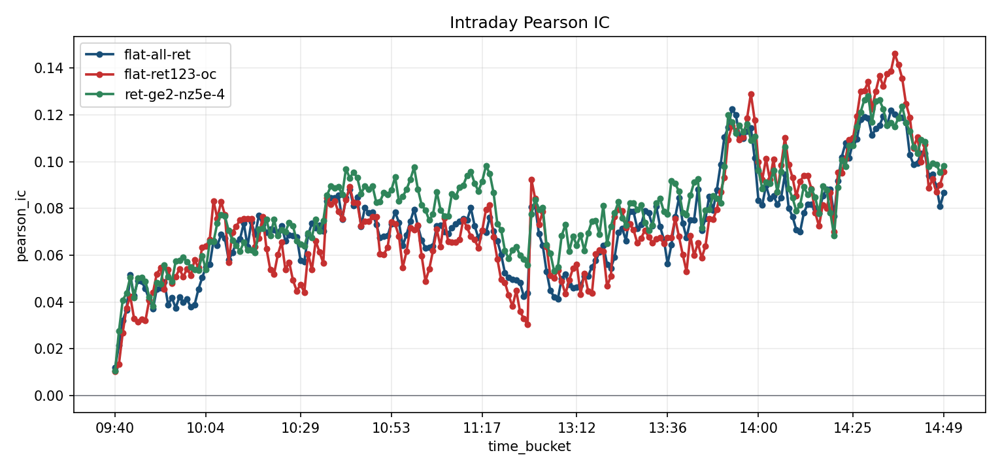

time_bucket vs pearson_ic.

time_bucket vs rank_ic.

字段解释

| field | explanation |
| --- | --- |
| time_bucket | intraday time bucket.  |
| pearson_ic | corr(prediction, target).  |
| rank_ic | corr(rank(prediction), rank(target)).  |
| sample_count | 样本数.  |

## 限制与适用边界

三臂 full train/evaluation 已完成. ret-ge2-nz5e-4 在 pooled IC 与高预测组收益上领先, flat-ret123-oc 在 hit-rate 指标上领先, 不合成单一 winner. 当前artifact可得性只影响复现, 不作为历史成功/失败判据. 只有matched合同内的结果可以直接比较.

## 结论

本次归档保留上述历史事实. 研究结论, 推广门槛和执行限制分别解释, 不把模型无增益或净收益为负改写成实验流程失败.

## 附录

### 7. Appendix

### 7.1. Source Artifacts

### Source Artifacts

| experiment | artifact | path | exists | row_count | mtime |
| --- | --- | --- | --- | --- | --- |
| flat-all-ret | meta_yaml | [artifact-root]/nn/near-zero-filter/flat-all-ret/date_ranges/artifacts/npz/meta.yaml | True |  | 2026-06-16T02:39:00 |
| flat-all-ret | perf_audit_yaml | [artifact-root]/nn/near-zero-filter/flat-all-ret/date_ranges/perf_audit.yaml | True |  | 2026-06-17T19:15:30 |
| flat-all-ret | best_checkpoint_yaml | [artifact-root]/nn/near-zero-filter/flat-all-ret/date_ranges/run/checkpoint_metadata/best_checkpoint.yaml | True |  | 2026-06-17T18:29:21 |
| flat-all-ret | checkpoint_brief_index_csv | [artifact-root]/nn/near-zero-filter/flat-all-ret/date_ranges/run/checkpoint_brief_reports/checkpoint_brief_index.csv | True | 6 | 2026-06-17T18:29:21 |
| flat-all-ret | core_ic_summary_train_yaml | [artifact-root]/nn/near-zero-filter/flat-all-ret/date_ranges/core_ic_summary_train.yaml | True |  | 2026-06-17T19:10:18 |
| flat-all-ret | core_ic_summary_test_yaml | [artifact-root]/nn/near-zero-filter/flat-all-ret/date_ranges/core_ic_summary_test.yaml | True |  | 2026-06-17T19:10:14 |
| flat-all-ret | test_predict_manifest_yaml | [artifact-root]/nn/near-zero-filter/flat-all-ret/date_ranges/run/eval_test/iter_20000/predict_manifest.yaml | True | 122,700,191 | 2026-06-17T18:39:49 |
| flat-all-ret | train_predict_manifest_yaml | [artifact-root]/nn/near-zero-filter/flat-all-ret/date_ranges/run/eval_train/iter_20000/predict_manifest.yaml | True | 371,273,680 | 2026-06-17T19:10:03 |
| flat-all-ret | train_sample_predict_manifest_yaml | [artifact-root]/nn/near-zero-filter/flat-all-ret/date_ranges/run/eval_train_report_sample/iter_20000/predict_manifest.yaml | True | 31,875,072 | 2026-06-17T18:43:10 |
| flat-all-ret | invalid_feature_stats_csv | [artifact-root]/nn/near-zero-filter/flat-all-ret/date_ranges/artifacts/data_clean/invalid_feature_stats.csv | True | 15 | 2026-06-15T22:45:36 |
| flat-all-ret | pooled_feature_grid_png | [artifact-root]/nn/near-zero-filter/flat-all-ret/date_ranges/artifacts/data_clean/pooled_feature_grid.png | True |  | 2026-06-15T22:58:14 |
| flat-all-ret | tensorboard_scalars_parquet | [artifact-root]/nn/near-zero-filter/flat-all-ret/date_ranges/train/tensorboard_scalars.parquet | True | 0 | 2026-06-17T18:30:13 |
| flat-ret123-oc | meta_yaml | [artifact-root]/nn/near-zero-filter/flat-ret123-oc/date_ranges/artifacts/npz/meta.yaml | True |  | 2026-06-16T02:36:16 |
| flat-ret123-oc | perf_audit_yaml | [artifact-root]/nn/near-zero-filter/flat-ret123-oc/date_ranges/perf_audit.yaml | True |  | 2026-06-17T15:08:49 |
| flat-ret123-oc | best_checkpoint_yaml | [artifact-root]/nn/near-zero-filter/flat-ret123-oc/date_ranges/run/checkpoint_metadata/best_checkpoint.yaml | True |  | 2026-06-16T04:19:32 |
| flat-ret123-oc | checkpoint_brief_index_csv | [artifact-root]/nn/near-zero-filter/flat-ret123-oc/date_ranges/run/checkpoint_brief_reports/checkpoint_brief_index.csv | True | 4 | 2026-06-17T15:11:55 |
| flat-ret123-oc | core_ic_summary_train_yaml | [artifact-root]/nn/near-zero-filter/flat-ret123-oc/date_ranges/core_ic_summary_train.yaml | True |  | 2026-06-17T15:06:37 |
| flat-ret123-oc | core_ic_summary_test_yaml | [artifact-root]/nn/near-zero-filter/flat-ret123-oc/date_ranges/core_ic_summary_test.yaml | True |  | 2026-06-17T15:06:34 |
| flat-ret123-oc | test_predict_manifest_yaml | [artifact-root]/nn/near-zero-filter/flat-ret123-oc/date_ranges/run/eval_test/iter_10000/predict_manifest.yaml | True | 60,992,275 | 2026-06-16T04:25:26 |
| flat-ret123-oc | train_predict_manifest_yaml | [artifact-root]/nn/near-zero-filter/flat-ret123-oc/date_ranges/run/eval_train/iter_10000/predict_manifest.yaml | True | 182,397,315 | 2026-06-16T04:42:32 |
| flat-ret123-oc | train_sample_predict_manifest_yaml | [artifact-root]/nn/near-zero-filter/flat-ret123-oc/date_ranges/run/eval_train_report_sample/iter_10000/predict_manifest.yaml | True | 31,875,072 | 2026-06-16T04:28:44 |
| flat-ret123-oc | invalid_feature_stats_csv | [artifact-root]/nn/near-zero-filter/flat-ret123-oc/date_ranges/artifacts/data_clean/invalid_feature_stats.csv | True | 15 | 2026-06-15T22:41:19 |
| flat-ret123-oc | pooled_feature_grid_png | [artifact-root]/nn/near-zero-filter/flat-ret123-oc/date_ranges/artifacts/data_clean/pooled_feature_grid.png | True |  | 2026-06-15T22:53:01 |
| flat-ret123-oc | tensorboard_scalars_parquet | [artifact-root]/nn/near-zero-filter/flat-ret123-oc/date_ranges/train/tensorboard_scalars.parquet | True | 0 | 2026-06-17T15:06:28 |
| ret-ge2-nz5e-4 | meta_yaml | [artifact-root]/nn/near-zero-filter/ret-ge2-nz5em04/date_ranges/artifacts/npz/meta.yaml | True |  | 2026-06-16T02:39:00 |
| ret-ge2-nz5e-4 | perf_audit_yaml | [artifact-root]/nn/near-zero-filter/ret-ge2-nz5em04/date_ranges/perf_audit.yaml | True |  | 2026-06-17T13:43:58 |
| ret-ge2-nz5e-4 | best_checkpoint_yaml | [artifact-root]/nn/near-zero-filter/ret-ge2-nz5em04/date_ranges/run/checkpoint_metadata/best_checkpoint.yaml | True |  | 2026-06-17T12:54:46 |
| ret-ge2-nz5e-4 | checkpoint_brief_index_csv | [artifact-root]/nn/near-zero-filter/ret-ge2-nz5em04/date_ranges/run/checkpoint_brief_reports/checkpoint_brief_index.csv | True | 6 | 2026-06-17T12:54:47 |
| ret-ge2-nz5e-4 | core_ic_summary_train_yaml | [artifact-root]/nn/near-zero-filter/ret-ge2-nz5em04/date_ranges/core_ic_summary_train.yaml | True |  | 2026-06-17T13:38:23 |
| ret-ge2-nz5e-4 | core_ic_summary_test_yaml | [artifact-root]/nn/near-zero-filter/ret-ge2-nz5em04/date_ranges/core_ic_summary_test.yaml | True |  | 2026-06-17T13:38:18 |
| ret-ge2-nz5e-4 | test_predict_manifest_yaml | [artifact-root]/nn/near-zero-filter/ret-ge2-nz5em04/date_ranges/run/eval_test/iter_10000/predict_manifest.yaml | True | 131,501,803 | 2026-06-17T13:05:47 |
| ret-ge2-nz5e-4 | train_predict_manifest_yaml | [artifact-root]/nn/near-zero-filter/ret-ge2-nz5em04/date_ranges/run/eval_train/iter_10000/predict_manifest.yaml | True | 390,283,731 | 2026-06-17T13:38:04 |
| ret-ge2-nz5e-4 | train_sample_predict_manifest_yaml | [artifact-root]/nn/near-zero-filter/ret-ge2-nz5em04/date_ranges/run/eval_train_report_sample/iter_10000/predict_manifest.yaml | True | 31,875,072 | 2026-06-17T13:09:17 |
| ret-ge2-nz5e-4 | invalid_feature_stats_csv | [artifact-root]/nn/near-zero-filter/ret-ge2-nz5em04/date_ranges/artifacts/data_clean/invalid_feature_stats.csv | True | 15 | 2026-06-15T22:45:46 |
| ret-ge2-nz5e-4 | pooled_feature_grid_png | [artifact-root]/nn/near-zero-filter/ret-ge2-nz5em04/date_ranges/artifacts/data_clean/pooled_feature_grid.png | True |  | 2026-06-15T22:57:46 |
| ret-ge2-nz5e-4 | tensorboard_scalars_parquet | [artifact-root]/nn/near-zero-filter/ret-ge2-nz5em04/date_ranges/train/tensorboard_scalars.parquet | True | 0 | 2026-06-17T12:55:38 |

字段解释

| field | explanation |
| --- | --- |
| artifact | 输入或派生 artifact 名称.  |
| path | artifact 文件路径.  |
| exists | 文件是否存在.  |
| row_count | 分组样本数.  |
| mtime | 文件最后修改时间.  |

### 7.2. Generated Artifacts

### Generated Artifacts

| artifact | path | description |
| --- | --- | --- |
| comparison_report_html | [artifact-root]/nn/near-zero-filter/comparison_report/061720_near_zero_filter_comparison_report.html | 完整三实验对比 HTML.  |
| repo_report_html | [local-workspace]/exp-nn/near-zero-filter/report/061720_near_zero_filter_comparison_report.html | repo 内镜像 HTML.  |
| section_html_root | [artifact-root]/nn/near-zero-filter/comparison_report/section_html | standalone section HTML 输出目录.  |
| comparison_artifact_root | [artifact-root]/nn/near-zero-filter/comparison_report/artifacts | 对比报告派生 artifact 输出目录.  |

字段解释

| field | explanation |
| --- | --- |
| comparison_report_html | 完整三实验对比 HTML.  |
| repo_report_html | repo 内镜像 HTML.  |
| section_html_root | standalone section HTML 输出目录.  |
| comparison_artifact_root | 对比报告派生 artifact 输出目录.  |
