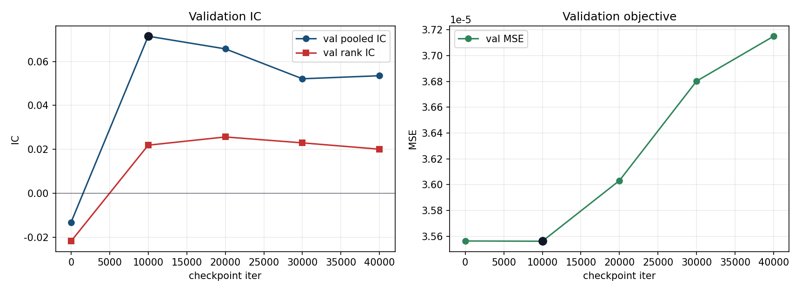
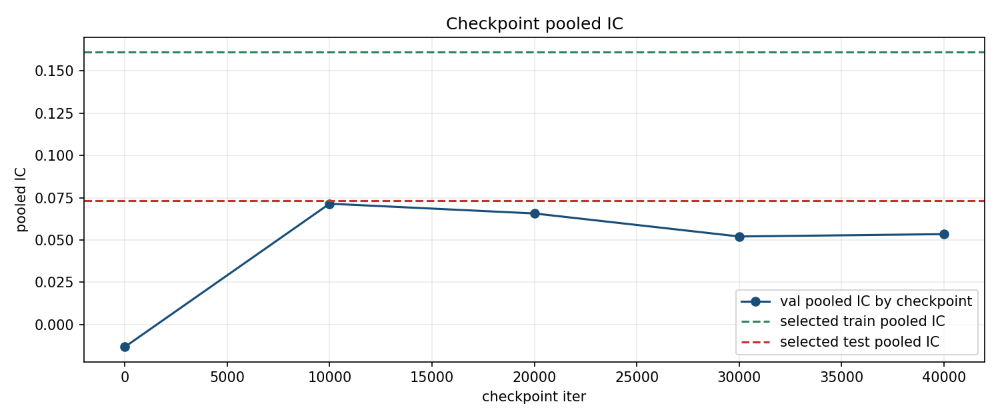
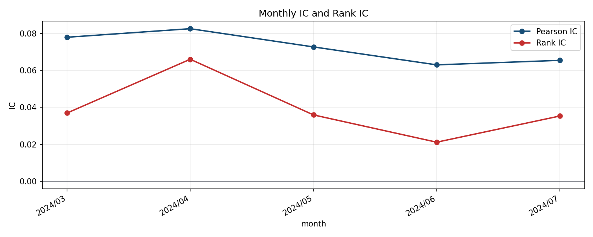
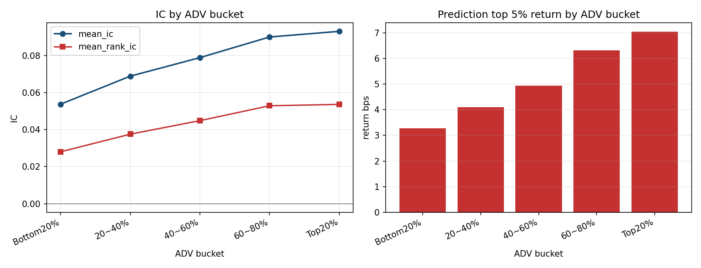
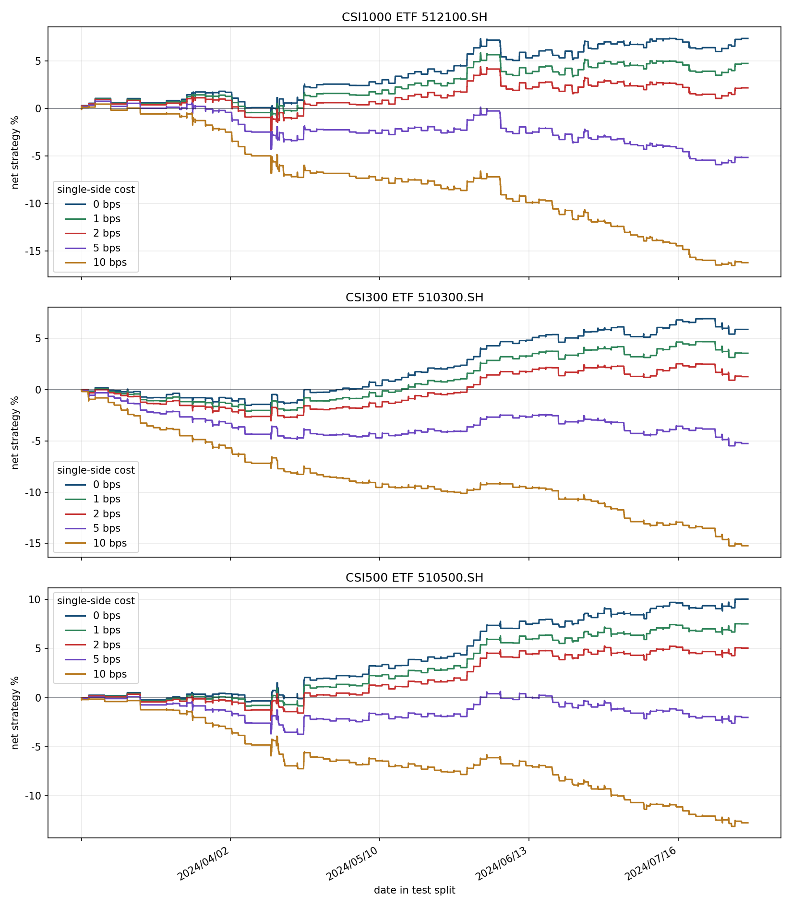
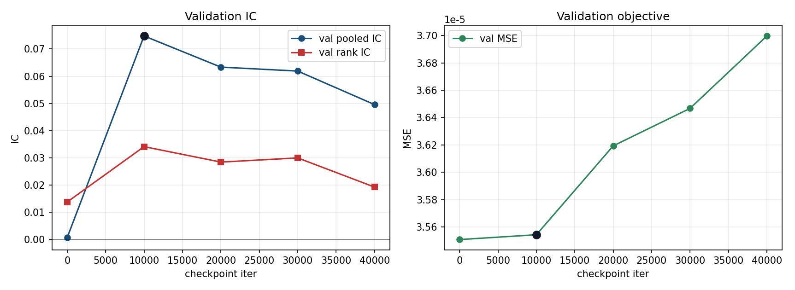
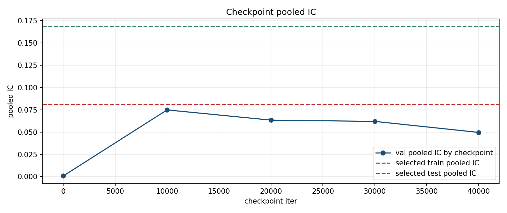
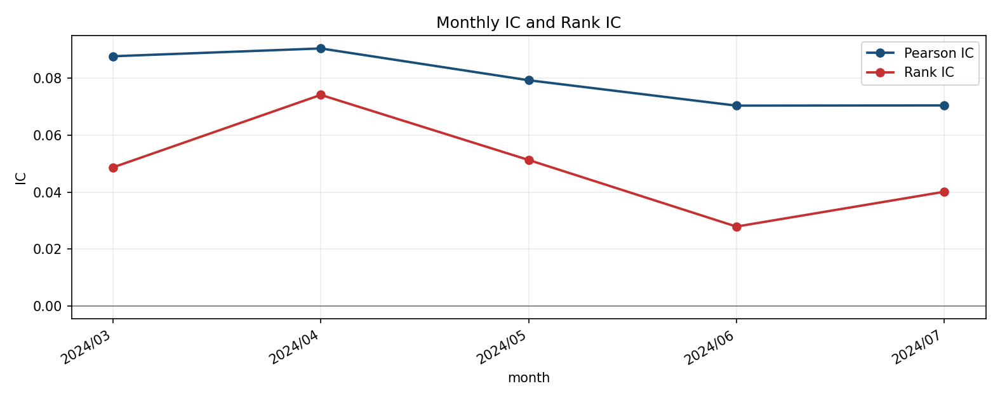
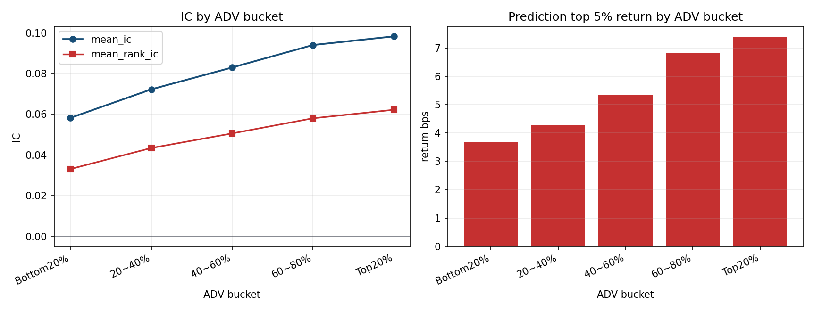
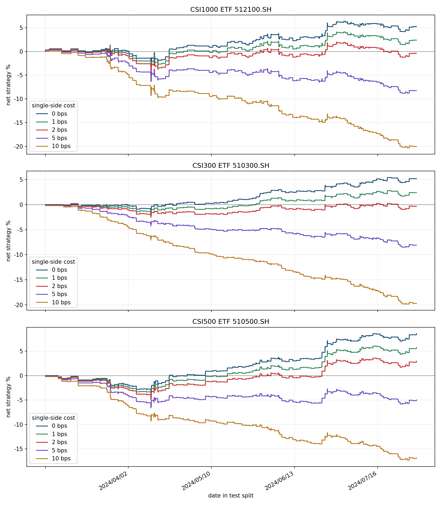

## 摘要

**历史结果: 历史成功.** GRU192×2 last-hidden 在 seeds 7/11/13 的 IC 和 RankIC 均优于 attention, 平均 test IC 为 0.0789459. TCN 的 seed7 gate 未通过.

历史成功/失败按实验流程是否成功完成判断. 无增益, 成本后亏损, 归档和当前 artifact 缺失不改变历史成功事实. 失败的实验臂保留失败原因, 不填造未产生的 OOS 指标. 本次只整理已有材料, 未启动训练, 推理或回测.

### Executive Summary

decision

Do not promote attention over last_hidden; final test evidence favors GRU192x2 last_hidden.

mean_test_pooled_ic_delta_last_minus_attention

0.008284

mean_test_rank_ic_delta_last_minus_attention

0.005758

mean_validation_score_delta_last_minus_attention

-0.003415

last_hidden_wins_all_test_pooled_ic_seeds

True

last_hidden_wins_all_test_rank_ic_seeds

True

attention_parameters

342530

last_hidden_parameters

342337

Validation screening favored attention pooling, but the full test and robustness evidence reverses that ranking. Last_hidden has higher test pooled IC and higher test rank IC in every paired seed. The comparison therefore retains GRU192x2 last_hidden as the stronger final candidate among the tested pooling variants.

## 研究背景与目标

本报告围绕1min 模型结构比较整理原始研究证据. 当前材料对应 registry report `optimize-1min-model-final-comparison-072504`, 来源SHA256为 `e5e0abc834ba3c327c65323eb1f5b1221b6ee2adf65516865aac5f4ecbd849d7`. 原报告的实验方法, 图表, 结果和解释保留在下文.

## 数据与方法

实验身份为 `optimize-1min-model`. Split, label, sampler, feature与checkpoint定义按原报告记录, 不从其他实验借用缺失字段. 汇总入口见[全实验综述](../../prediction-nn-1min/1103-nn-registry-summary/).

## 主要结果

| 记录项 | 当前解释 |
| --- | --- |
| 实验 | optimize-1min-model |
| 报告类型 | comparison_report_html |
| 历史状态 | 历史成功 |
| 证据 | optimize-1min-model-final-comparison-072504 |

GRU192x2 attention pooling versus GRU192x2 last_hidden control across seeds 7/11/13; full test, monthly IC, cost, liquidity, and checkpoint report evidence.

2026-07-25 04:32:41 CST

### Final Test Metrics

### Per Run

| model_id | seed | best_validation_score | test_pooled_ic | test_rank_ic | train_pooled_ic | train_rank_ic | trainable_parameters | best_iter |
| --- | --- | --- | --- | --- | --- | --- | --- | --- |
| attention | 7 | 0.054489 | 0.073179 | 0.039356 | 0.161144 | 0.101620 | 342530 | 10000 |
| attention | 11 | 0.052320 | 0.067921 | 0.038106 | 0.158219 | 0.103259 | 342530 | 10000 |
| attention | 13 | 0.062734 | 0.070887 | 0.044810 | 0.159192 | 0.107798 | 342530 | 10000 |
| last_hidden | 7 | 0.051623 | 0.080738 | 0.048828 | 0.168345 | 0.114748 | 342337 | 10000 |
| last_hidden | 11 | 0.055650 | 0.077904 | 0.045462 | 0.168320 | 0.116572 | 342337 | 10000 |
| last_hidden | 13 | 0.052024 | 0.078197 | 0.045255 | 0.168569 | 0.114388 | 342337 | 10000 |

### Model Summary

| model_id | seeds | test_pooled_ic_mean | test_pooled_ic_std | test_pooled_ic_min | test_rank_ic_mean | test_rank_ic_std | test_rank_ic_min | best_validation_score_mean | trainable_parameters |
| --- | --- | --- | --- | --- | --- | --- | --- | --- | --- |
| last_hidden | 3 | 0.078946 | 0.001559 | 0.077904 | 0.046515 | 0.002006 | 0.045255 | 0.053099 | 342337 |
| attention | 3 | 0.070662 | 0.002636 | 0.067921 | 0.040757 | 0.003565 | 0.038106 | 0.056514 | 342530 |

### Paired Seed Deltas

| seed | test_pooled_ic_delta_last_minus_attention | test_rank_ic_delta_last_minus_attention | validation_score_delta_last_minus_attention | train_pooled_ic_delta_last_minus_attention |
| --- | --- | --- | --- | --- |
| 7 | 0.007559 | 0.009472 | -0.002866 | 0.007201 |
| 11 | 0.009983 | 0.007356 | 0.003330 | 0.010101 |
| 13 | 0.007310 | 0.000445 | -0.010710 | 0.009377 |

### Monthly Robustness

### Overall Monthly Summary

| model_id | monthly_pearson_ic_mean | monthly_pearson_ic_min | monthly_rank_ic_mean | monthly_rank_ic_min |
| --- | --- | --- | --- | --- |
| attention | 0.069709 | 0.057055 | 0.040383 | 0.021184 |
| last_hidden | 0.077744 | 0.061758 | 0.046012 | 0.027818 |

### Monthly Mean By Model

| model_id | month | pearson_ic_mean | pearson_ic_min | rank_ic_mean | rank_ic_min | sample_count_mean |
| --- | --- | --- | --- | --- | --- | --- |
| attention | 2024/03 | 0.076738 | 0.074504 | 0.039129 | 0.036943 | 23968176.000000 |
| attention | 2024/04 | 0.078042 | 0.071438 | 0.063511 | 0.060079 | 20483690.000000 |
| attention | 2024/05 | 0.068130 | 0.065669 | 0.036389 | 0.035355 | 22396267.000000 |
| attention | 2024/06 | 0.062884 | 0.061010 | 0.028672 | 0.021184 | 20484073.000000 |
| attention | 2024/07 | 0.062748 | 0.057055 | 0.034212 | 0.023905 | 21337906.000000 |
| last_hidden | 2024/03 | 0.087361 | 0.086589 | 0.046269 | 0.044544 | 23968176.000000 |
| last_hidden | 2024/04 | 0.087426 | 0.085718 | 0.070430 | 0.067287 | 20483690.000000 |
| last_hidden | 2024/05 | 0.075235 | 0.073097 | 0.042702 | 0.035794 | 22396267.000000 |
| last_hidden | 2024/06 | 0.066914 | 0.061758 | 0.030460 | 0.027818 | 20484073.000000 |
| last_hidden | 2024/07 | 0.071781 | 0.070423 | 0.040197 | 0.039836 | 21337906.000000 |

### Liquidity By ADV

| model_id | adv_bucket | bucket_label | mean_ic_mean | mean_rank_ic_mean | top5_return_bps_mean | top5_hit_rate_mean |
| --- | --- | --- | --- | --- | --- | --- |
| attention | 1 | Bottom20% | 0.050686 | 0.029109 | 3.089202 | 0.477665 |
| attention | 2 | 20~40% | 0.066552 | 0.039584 | 3.998684 | 0.493327 |
| attention | 3 | 40~60% | 0.076602 | 0.047935 | 4.910586 | 0.502570 |
| attention | 4 | 60~80% | 0.087255 | 0.055699 | 6.244904 | 0.511205 |
| attention | 5 | Top20% | 0.092011 | 0.057588 | 6.765024 | 0.512686 |
| last_hidden | 1 | Bottom20% | 0.057268 | 0.032675 | 3.641004 | 0.481143 |
| last_hidden | 2 | 20~40% | 0.071643 | 0.042463 | 4.234309 | 0.494961 |
| last_hidden | 3 | 40~60% | 0.082506 | 0.050560 | 5.274815 | 0.503163 |
| last_hidden | 4 | 60~80% | 0.094850 | 0.058657 | 6.895867 | 0.512608 |
| last_hidden | 5 | Top20% | 0.099969 | 0.063395 | 7.595462 | 0.515926 |

### Important Pool Cost Sensitivity

| model_id | pool | single_side_cost_bps | final_cumulative_return_mean | final_cumulative_return_min |
| --- | --- | --- | --- | --- |
| attention | csi1000_etf_sh | 0.000000 | 0.006825 | -0.045164 |
| attention | csi1000_etf_sh | 1.000000 | -0.019073 | -0.067625 |
| attention | csi1000_etf_sh | 2.000000 | -0.044301 | -0.089560 |
| attention | csi1000_etf_sh | 5.000000 | -0.116138 | -0.152330 |
| attention | csi1000_etf_sh | 10.000000 | -0.224013 | -0.262436 |
| attention | csi300_etf_sh | 0.000000 | 0.035448 | 0.005112 |
| attention | csi300_etf_sh | 1.000000 | 0.008888 | -0.019706 |
| attention | csi300_etf_sh | 2.000000 | -0.016981 | -0.043914 |
| attention | csi300_etf_sh | 5.000000 | -0.090618 | -0.113022 |
| attention | csi300_etf_sh | 10.000000 | -0.201129 | -0.233831 |
| attention | csi500_etf_sh | 0.000000 | 0.054056 | -0.002131 |
| attention | csi500_etf_sh | 1.000000 | 0.027957 | -0.025405 |
| attention | csi500_etf_sh | 2.000000 | 0.002508 | -0.048140 |
| attention | csi500_etf_sh | 5.000000 | -0.070104 | -0.113222 |
| attention | csi500_etf_sh | 10.000000 | -0.179575 | -0.211992 |
| last_hidden | csi1000_etf_sh | 0.000000 | 0.016695 | -0.016636 |
| last_hidden | csi1000_etf_sh | 1.000000 | -0.009116 | -0.038803 |
| last_hidden | csi1000_etf_sh | 2.000000 | -0.034270 | -0.060473 |
| last_hidden | csi1000_etf_sh | 5.000000 | -0.105957 | -0.122607 |
| last_hidden | csi1000_etf_sh | 10.000000 | -0.213781 | -0.224114 |
| last_hidden | csi300_etf_sh | 0.000000 | 0.021437 | -0.015527 |
| last_hidden | csi300_etf_sh | 1.000000 | -0.007040 | -0.041562 |
| last_hidden | csi300_etf_sh | 2.000000 | -0.034722 | -0.066911 |
| last_hidden | csi300_etf_sh | 5.000000 | -0.113219 | -0.139020 |
| last_hidden | csi300_etf_sh | 10.000000 | -0.230107 | -0.247072 |
| last_hidden | csi500_etf_sh | 0.000000 | 0.024523 | -0.009127 |
| last_hidden | csi500_etf_sh | 1.000000 | -0.002537 | -0.032589 |
| last_hidden | csi500_etf_sh | 2.000000 | -0.028880 | -0.060905 |
| last_hidden | csi500_etf_sh | 5.000000 | -0.103792 | -0.140990 |
| last_hidden | csi500_etf_sh | 10.000000 | -0.215983 | -0.259623 |

### Checkpoint And Template Figures

### attention seed7



Checkpoint selector metrics from the full report template.



Checkpoint-level train/test pooled IC from the report template.



Monthly test IC/rank IC robustness diagnostic.



ADV bucket liquidity diagnostic from the report template.



Important-pool cost sensitivity diagnostic from the report template.

### last_hidden seed7



Checkpoint selector metrics from the full report template.



Checkpoint-level train/test pooled IC from the report template.



Monthly test IC/rank IC robustness diagnostic.



ADV bucket liquidity diagnostic from the report template.



Important-pool cost sensitivity diagnostic from the report template.

## 限制与适用边界

GRU192×2 last-hidden 在 seeds 7/11/13 的 IC 和 RankIC 均优于 attention, 平均 test IC 为 0.0789459. TCN 的 seed7 gate 未通过. 当前artifact可得性只影响复现, 不作为历史成功/失败判据. 只有matched合同内的结果可以直接比较.

## 结论

本次归档保留上述历史事实. 研究结论, 推广门槛和执行限制分别解释, 不把模型无增益或净收益为负改写成实验流程失败.

## 附录

### Artifacts

summary_yaml

[artifact-root]/nn/model-structure-1min-final-eval/final_eval_summary.yaml

final_eval_rows_csv

[artifact-root]/nn/model-structure-1min-final-eval/final_eval_rows.csv

model_summary_csv

[artifact-root]/nn/model-structure-1min-final-eval/final_eval_model_summary.csv

seed_deltas_csv

[artifact-root]/nn/model-structure-1min-final-eval/final_eval_seed_deltas.csv

monthly_summary_csv

[artifact-root]/nn/model-structure-1min-final-eval/monthly_ic_model_summary.csv

adv_summary_csv

[artifact-root]/nn/model-structure-1min-final-eval/adv_liquidity_model_summary.csv

cost_summary_csv

[artifact-root]/nn/model-structure-1min-final-eval/cost_sensitivity_model_summary.csv

### Single Run Reports

| model_id | seed | full_report |
| --- | --- | --- |
| attention | 7 | attention seed7 |
| attention | 11 | attention seed11 |
| attention | 13 | attention seed13 |
| last_hidden | 7 | last_hidden seed7 |
| last_hidden | 11 | last_hidden seed11 |
| last_hidden | 13 | last_hidden seed13 |

```text
note: Each linked single-run report is also self-contained and includes the complete
  template figures for that seed.
```
