## 摘要

**历史结果: 历史成功.** 四个 zero-aware transform 已有历史结果, F24 三臂 IC 约为0.0722-0.0725. 缺少 off control 且旧 model card 有不一致, 不能据此归因增益.

历史成功/失败按实验流程是否成功完成判断. 无增益, 成本后亏损, 归档和当前 artifact 缺失不改变历史成功事实. 失败的实验臂保留失败原因, 不填造未产生的 OOS 指标. 本次只整理已有材料, 未启动训练, 推理或回测.

### 1. Executive Summary

model_class

GruMlpRegressor

common across all experiments

train_range

20210104 -> 20231229 (727 days)

common across all experiments

val_range

20240102 -> 20240229 (37 days)

common across all experiments

test_range

20240301 -> 20241231 (205 days)

common across all experiments

### Executive Summary

| experiment | selected_checkpoint | train_pooled_ic | test_pooled_ic | top_prediction_return_bps | top95_hit | etf_top95_hit | overfit_variance_ratio |
| --- | --- | --- | --- | --- | --- | --- | --- |
| zero_indicator | 10,000 | 0.173929 | 0.072480 | 9.2124 | 0.429296 | 0.532505 | 0.018295 |
| zero_split_zscore | 10,000 | 0.185475 | 0.072192 | 9.7266 | 0.432453 | 0.498137 | 0.019679 |
| hurdle_norm | 10,000 | 0.169806 | 0.072169 | 9.0149 | 0.432555 | 0.512215 | 0.016066 |
| zero_jitter | 10,000 | 0.179536 | 0.069461 | 9.8815 | 0.430999 | 0.494410 | 0.018285 |

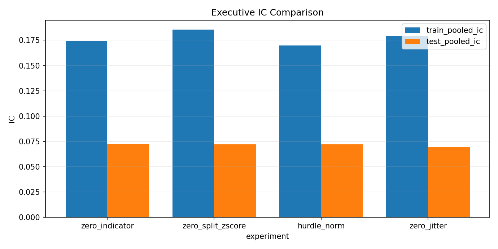

train_pooled_ic and test_pooled_ic.

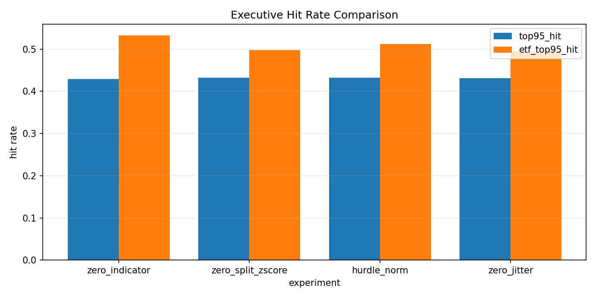

top95_hit and etf_top95_hit.

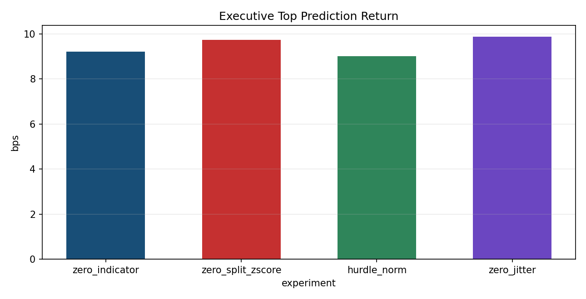

top_prediction_return_bps.

字段解释

| field | explanation |
| --- | --- |
| experiment | 对比实验名称.  |
| selected_checkpoint | 最终用于 evaluation 的 checkpoint iteration.  |
| train_pooled_ic | train split 上把所有样本合并后计算的 Pearson IC.  |
| test_pooled_ic | test split 上把所有样本合并后计算的 Pearson IC.  |
| top_prediction_return_bps | 最高 prediction 分组的平均 prediction return, 单位 bps.  |
| top95_hit | test split 中 prediction 最高 5% 样本内 target > 0 的比例.  |
| etf_top95_hit | test split 重要股票池合成 ETF prediction 最高 5% 样本内 etf_real_return > 0 的比例.  |
| overfit_variance_ratio | test split 中 prediction 样本方差 / target 样本方差.  |
| model_class | 模型类名.  |
| train_range | 训练集交易日范围.  |
| val_range | 验证集交易日范围.  |
| test_range | 测试集交易日范围.  |

## 研究背景与目标

本报告围绕Zero-aware normalization整理原始研究证据. 当前材料对应 registry report `zero-aware-normalization-comparison`, 来源SHA256为 `4225f4e4237871075f11527cac94218a4fe12f2c6b1fab2dfab818c8cda242c2`. 原报告的实验方法, 图表, 结果和解释保留在下文.

## 数据与方法

实验身份为 `zero-aware-normalization`. Split, label, sampler, feature与checkpoint定义按原报告记录, 不从其他实验借用缺失字段. 汇总入口见[全实验综述](../../prediction-nn-1min/1103-nn-registry-summary/).

### 2. Experiment Setup And Data Pipeline

### 2.1. Experiment Setup

selection_metric

val/quality/pooled_ic

common across all experiments

selection_rule

max

common across all experiments

### Experiment Setup

| experiment | selected_checkpoint | selection_value | checkpoint_sha256 | candidate_count |
| --- | --- | --- | --- | --- |
| zero_indicator | 10,000 | 0.072872 | a8528291358920f50c839ea2b0bc7e00fc36f8dd664924a89a556dfb40a4b9f7 | 11 |
| zero_split_zscore | 10,000 | 0.090374 | e2cfc6254cb3ca50fdf87b99b99c443e35e2e7c180a381e961d2d12ee7591109 | 11 |
| hurdle_norm | 10,000 | 0.080685 | 406f8dd05536abb6d0ccf9d6faab5c545eeea59caba0cec70dfee873e96ffbc4 | 11 |
| zero_jitter | 10,000 | 0.072092 | fe477694b776c3d54969b26de42ec89e21a739dbc0342eef21c99b68635cd9a8 | 11 |

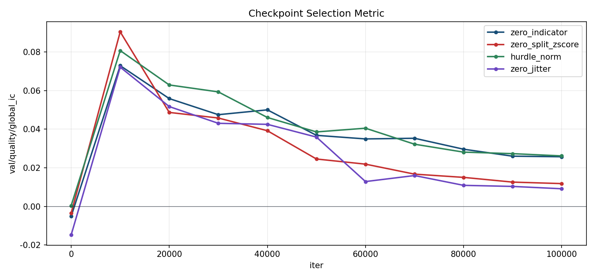

val/quality/global_ic by checkpoint.

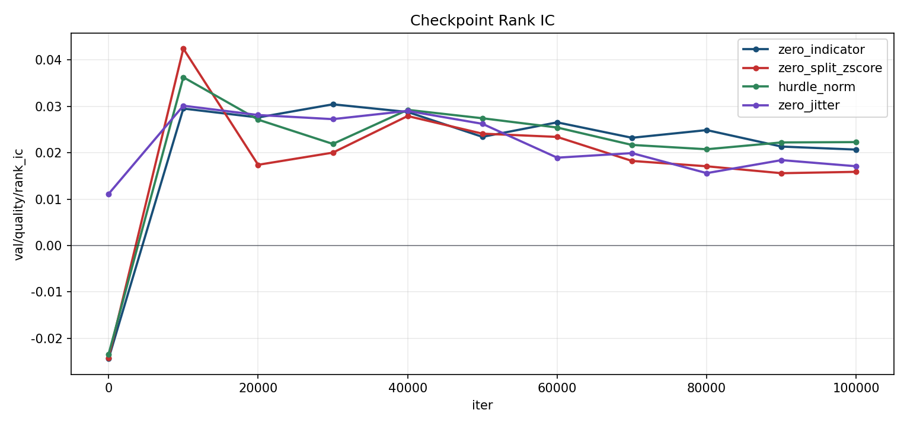

val/quality/rank_ic by checkpoint.

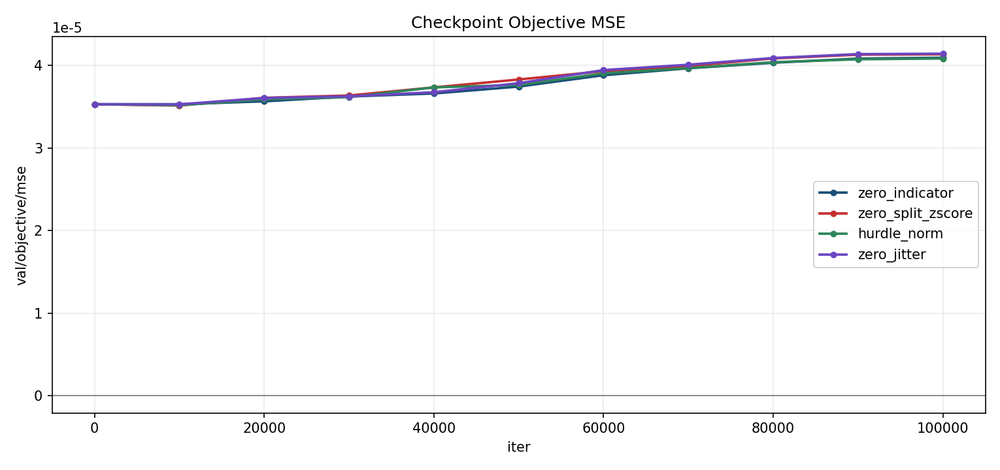

val/objective/mse by checkpoint.

字段解释

| field | explanation |
| --- | --- |
| experiment | 对比实验名称.  |
| selected_checkpoint | 最终用于 evaluation 的 checkpoint iteration.  |
| selection_value | 被选中 checkpoint 的 selection metric 数值.  |
| checkpoint_sha256 | checkpoint 文件 SHA256.  |
| candidate_count | 参与选择的 checkpoint 数量.  |
| selection_metric | checkpoint 选择使用的 validation metric.  |
| selection_rule | checkpoint 选择规则.  |

### 2.2. Data Basics

train_days

727

common across all experiments

val_days

37

common across all experiments

test_days

205

common across all experiments

### Data Basics

| experiment | train_rows | val_rows | test_rows | feature_dim | features | label_horizon_minutes | label_entry_lag_minutes |
| --- | --- | --- | --- | --- | --- | --- | --- |
| zero_indicator | 768,564,829 | 43,553,840 | 241,788,800 | 24 | ret_1m, ret_5m, ret_2m, ret_3m, ret_10m, hl, oc, log_vol, log_amount, vol_10m, log_vol_5m_mean, log_amount_5m_mean, ret_1m_is_zero, ret_2m_is_zero, ret_3m_is_zero, ret_5m_is_zero, ret_10m_is_zero, hl_is_zero, oc_is_zero, log_vol_is_zero, log_amount_is_zero, vol_10m_is_zero, minute_norm, session_minute_norm | 10 | 1 |
| zero_split_zscore | 768,564,829 | 43,553,840 | 241,788,800 | 24 | ret_1m, ret_5m, ret_2m, ret_3m, ret_10m, hl, oc, log_vol, log_amount, vol_10m, log_vol_5m_mean, log_amount_5m_mean, ret_1m_is_zero, ret_2m_is_zero, ret_3m_is_zero, ret_5m_is_zero, ret_10m_is_zero, hl_is_zero, oc_is_zero, log_vol_is_zero, log_amount_is_zero, vol_10m_is_zero, minute_norm, session_minute_norm | 10 | 1 |
| hurdle_norm | 768,564,829 | 43,553,840 | 241,788,800 | 24 | ret_1m, ret_5m, ret_2m, ret_3m, ret_10m, hl, oc, log_vol, log_amount, vol_10m, log_vol_5m_mean, log_amount_5m_mean, ret_1m_is_zero, ret_2m_is_zero, ret_3m_is_zero, ret_5m_is_zero, ret_10m_is_zero, hl_is_zero, oc_is_zero, log_vol_is_zero, log_amount_is_zero, vol_10m_is_zero, minute_norm, session_minute_norm | 10 | 1 |
| zero_jitter | 768,564,829 | 43,553,840 | 241,788,800 | 14 | ret_1m, ret_5m, ret_2m, ret_3m, ret_10m, hl, oc, log_vol, log_amount, vol_10m, log_vol_5m_mean, log_amount_5m_mean, minute_norm, session_minute_norm | 10 | 1 |

字段解释

| field | explanation |
| --- | --- |
| train_rows | train split 样本数量.  |
| val_rows | validation split 样本数量.  |
| test_rows | test split 样本数量.  |
| feature_dim | 模型输入 feature 维度.  |
| features | 模型输入 feature 列表.  |
| label_horizon_minutes | label forward horizon, 单位 minutes.  |
| label_entry_lag_minutes | label entry lag, 单位 minutes.  |
| train_days | train split 交易日数量.  |
| val_days | validation split 交易日数量.  |
| test_days | test split 交易日数量.  |

### 2.3. Data Normalization And Cleaning

### Data Normalization And Cleaning

| experiment | feature_normalization | label_normalization | train_kept_rate | val_kept_rate | test_kept_rate | max_invalid_ratio |
| --- | --- | --- | --- | --- | --- | --- |
| zero_indicator | zero_indicator / scope=train_only | pooled_zscore / scope=train_only | 0.909845 | 0.907594 | 0.907552 | 0.043478 |
| zero_split_zscore | zero_split_zscore / scope=train_only | pooled_zscore / scope=train_only | 0.909845 | 0.907594 | 0.907552 | 0.043478 |
| hurdle_norm | hurdle_norm / scope=train_only | pooled_zscore / scope=train_only | 0.909845 | 0.907594 | 0.907552 | 0.043478 |
| zero_jitter | zero_jitter / scope=train_only | pooled_zscore / scope=train_only | 0.909845 | 0.907594 | 0.907552 | 0.043478 |

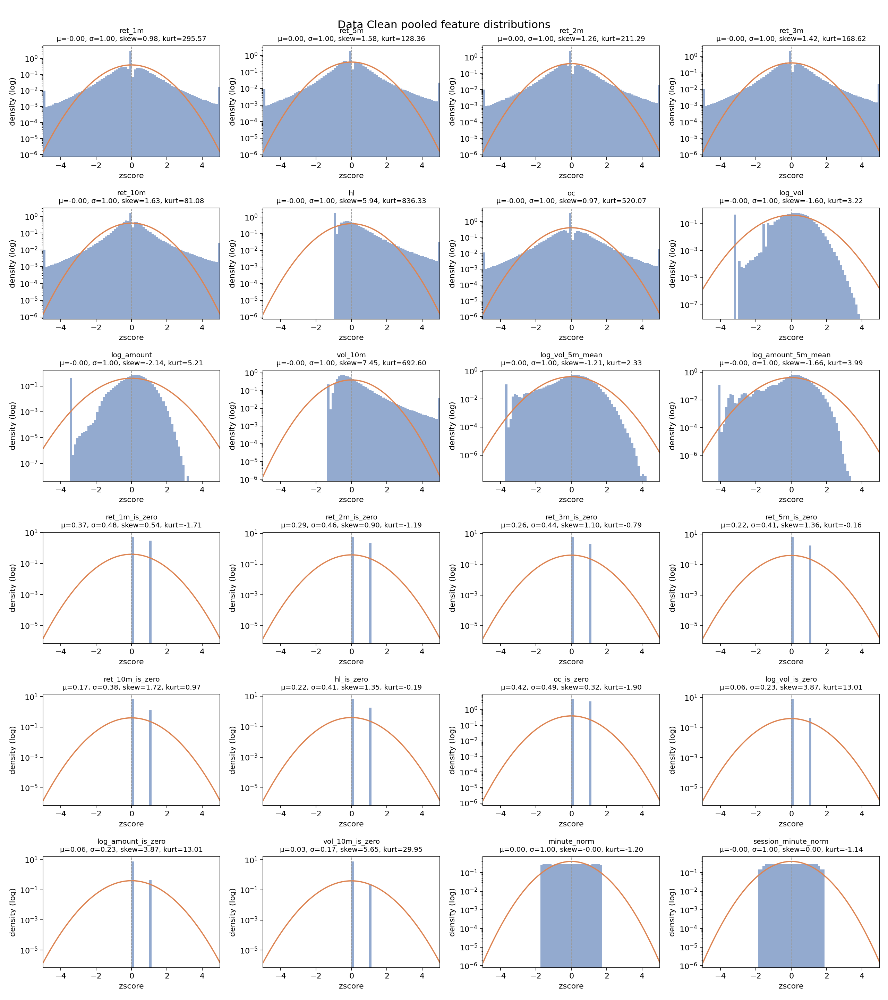

zero_indicator: pooled standardized feature distributions after filtering and normalization.

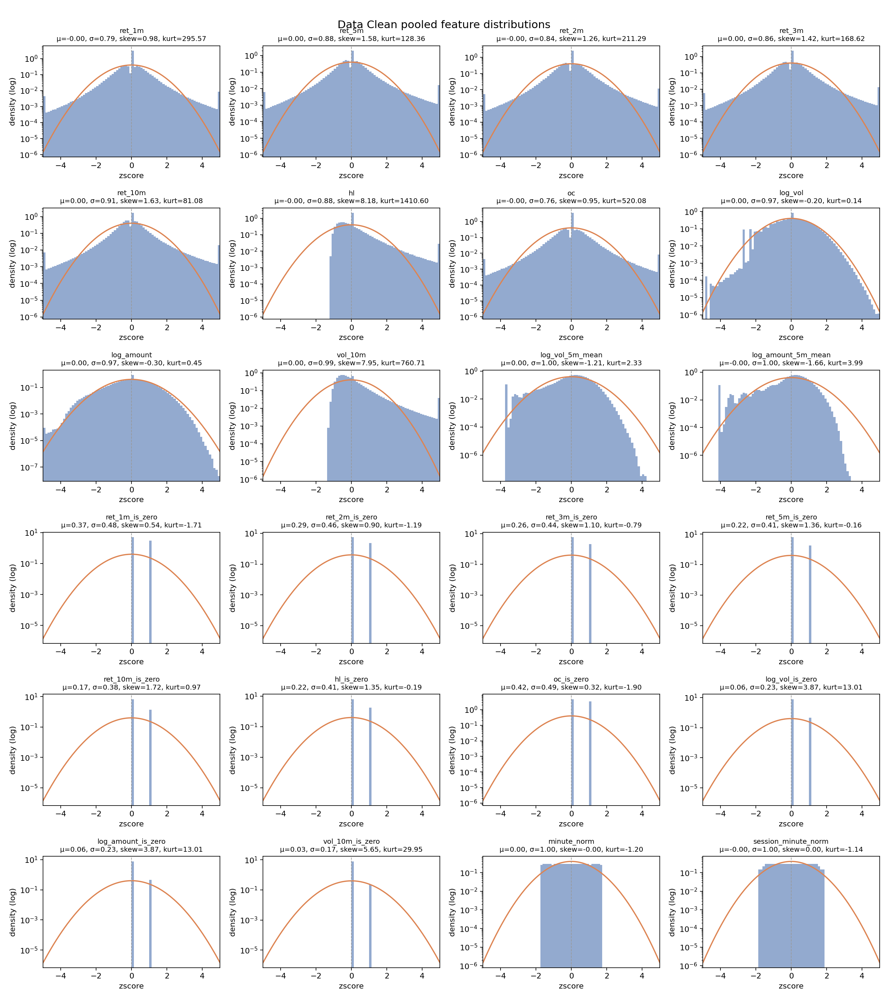

zero_split_zscore: pooled standardized feature distributions after filtering and normalization.

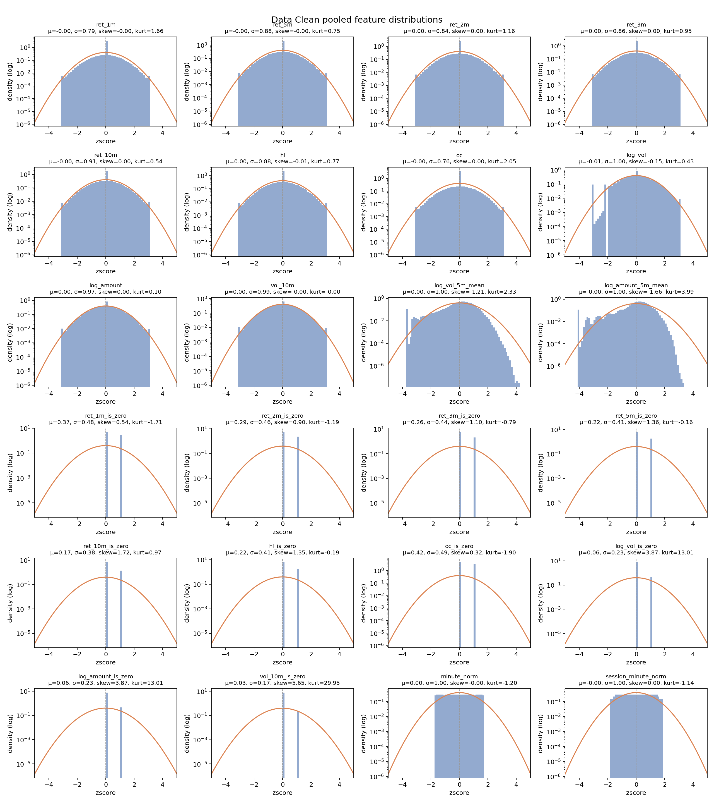

hurdle_norm: pooled standardized feature distributions after filtering and normalization.

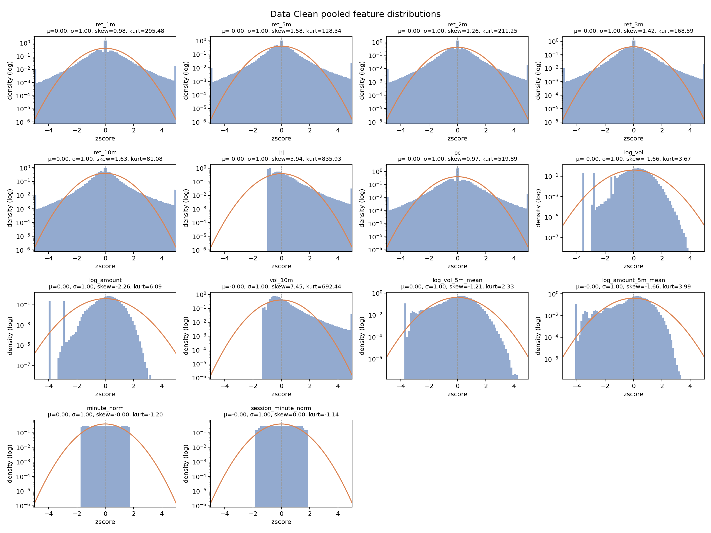

zero_jitter: pooled standardized feature distributions after filtering and normalization.

字段解释

| field | explanation |
| --- | --- |
| feature_normalization | feature normalization 方法和 fit scope.  |
| label_normalization | label normalization 方法和 fit scope.  |
| train_kept_rate | train split 清洗后保留比例.  |
| val_kept_rate | validation split 清洗后保留比例.  |
| test_kept_rate | test split 清洗后保留比例.  |
| max_invalid_ratio | 单个字段中 invalid 样本占比的最大值.  |

## 主要结果

| 记录项 | 当前解释 |
| --- | --- |
| 实验 | zero-aware-normalization |
| 报告类型 | comparison_report_html |
| 历史状态 | 历史成功 |
| 证据 | zero-aware-normalization-comparison |

zero_indicator, zero_split_zscore, hurdle_norm, and zero_jitter compared from existing run artifacts.

生成日期: 2026-06-19

### 3. Signal Quality Comparison

### 3.1. IC Summary

### IC Summary

| experiment | split | pooled_ic | pooled_rank_ic | count |
| --- | --- | --- | --- | --- |
| zero_indicator | train | 0.173929 | 0.132156 | 31,875,072 |
| zero_indicator | test | 0.072480 | 0.047220 | 176,945,440 |
| zero_split_zscore | train | 0.185475 | 0.139279 | 31,875,072 |
| zero_split_zscore | test | 0.072192 | 0.047272 | 176,945,440 |
| hurdle_norm | train | 0.169806 | 0.135296 | 31,875,072 |
| hurdle_norm | test | 0.072169 | 0.049082 | 176,945,440 |
| zero_jitter | train | 0.179536 | 0.134981 | 31,875,072 |
| zero_jitter | test | 0.069461 | 0.045689 | 176,945,440 |

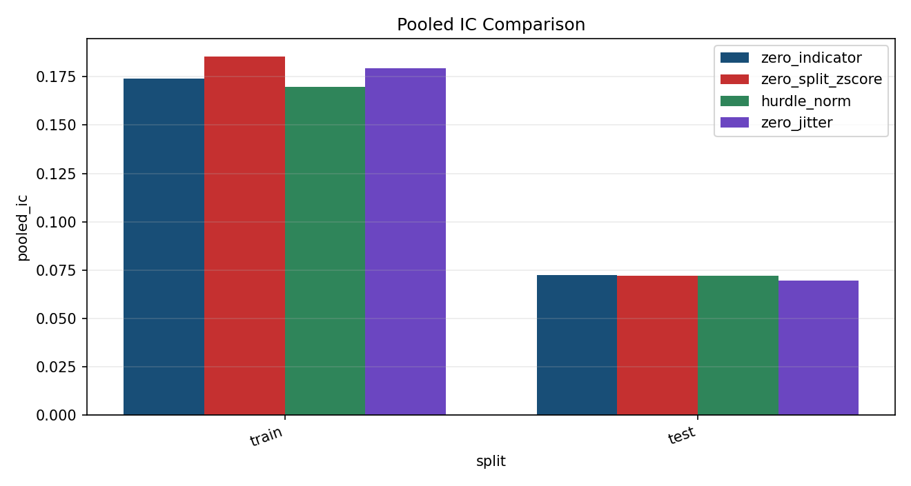

train/test pooled_ic.

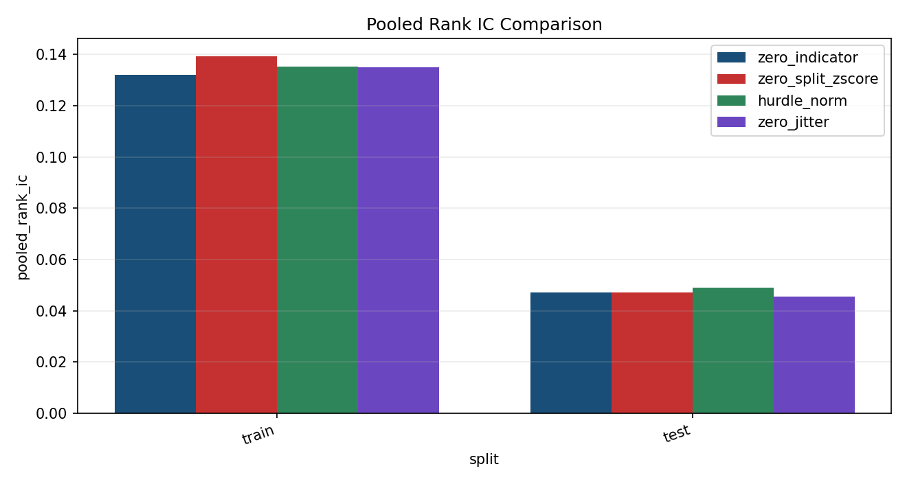

train/test pooled_rank_ic.

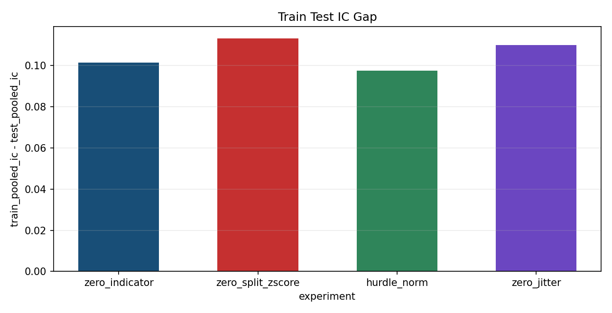

train_pooled_ic - test_pooled_ic.

字段解释

| field | explanation |
| --- | --- |
| split | 数据 split.  |
| pooled_ic | 合并样本后计算的 Pearson IC.  |
| pooled_rank_ic | 合并样本后计算的 Rank IC.  |
| count | 样本数.  |

### 3.2. Prediction Bucket Quality

### Prediction Bucket Quality

| experiment | signal_bucket | mean_prediction | mean_label_bps | t_stat | hit_rate | row_count | top_bottom_signal_spread_bps |
| --- | --- | --- | --- | --- | --- | --- | --- |
| zero_indicator | 1 | -8.523e-04 | -5.1382 | -367.4564 | 0.366882 | 17,694,544 | 9.5862 |
| zero_indicator | 2 | -2.987e-04 | -0.834601 | -91.4204 | 0.391823 | 17,694,544 | 9.5862 |
| zero_indicator | 3 | -1.624e-04 | -0.767820 | -88.2255 | 0.379557 | 17,694,544 | 9.5862 |
| zero_indicator | 4 | -6.508e-05 | -0.477426 | -56.9446 | 0.364082 | 17,694,544 | 9.5862 |
| zero_indicator | 5 | 1.319e-05 | -0.114935 | -13.9394 | 0.362281 | 17,694,544 | 9.5862 |
| zero_indicator | 6 | 8.861e-05 | 0.237759 | 28.3459 | 0.375952 | 17,694,544 | 9.5862 |
| zero_indicator | 7 | 1.710e-04 | 0.685979 | 79.3551 | 0.391461 | 17,694,544 | 9.5862 |
| zero_indicator | 8 | 2.732e-04 | 1.2146 | 132.8573 | 0.402063 | 17,694,544 | 9.5862 |
| zero_indicator | 9 | 4.320e-04 | 1.7959 | 178.0790 | 0.409000 | 17,694,544 | 9.5862 |
| zero_indicator | 10 | 0.001042 | 4.4480 | 312.8555 | 0.421396 | 17,694,544 | 9.5862 |
| zero_split_zscore | 1 | -9.153e-04 | -4.9871 | -358.6024 | 0.372719 | 17,694,544 | 9.3224 |
| zero_split_zscore | 2 | -3.216e-04 | -0.963254 | -99.1798 | 0.390416 | 17,694,544 | 9.3224 |
| zero_split_zscore | 3 | -1.652e-04 | -0.833489 | -93.6843 | 0.380310 | 17,694,544 | 9.3224 |
| zero_split_zscore | 4 | -7.105e-05 | -0.499570 | -59.6323 | 0.366007 | 17,694,544 | 9.3224 |
| zero_split_zscore | 5 | -2.826e-07 | -0.135080 | -16.6184 | 0.350559 | 17,694,544 | 9.3224 |
| zero_split_zscore | 6 | 6.946e-05 | 0.304537 | 36.7005 | 0.379460 | 17,694,544 | 9.3224 |
| zero_split_zscore | 7 | 1.475e-04 | 0.718644 | 84.9635 | 0.389149 | 17,694,544 | 9.3224 |
| zero_split_zscore | 8 | 2.475e-04 | 1.1492 | 129.4669 | 0.397635 | 17,694,544 | 9.3224 |
| zero_split_zscore | 9 | 4.187e-04 | 1.9600 | 193.7701 | 0.411747 | 17,694,544 | 9.3224 |
| zero_split_zscore | 10 | 0.001082 | 4.3354 | 305.9119 | 0.426494 | 17,694,544 | 9.3224 |
| hurdle_norm | 1 | -8.439e-04 | -5.2589 | -381.5242 | 0.361676 | 17,694,544 | 9.5932 |
| hurdle_norm | 2 | -3.363e-04 | -1.2823 | -132.8865 | 0.381831 | 17,694,544 | 9.5932 |
| hurdle_norm | 3 | -1.932e-04 | -0.672527 | -75.3219 | 0.378691 | 17,694,544 | 9.5932 |
| hurdle_norm | 4 | -1.031e-04 | -0.300191 | -35.2521 | 0.373822 | 17,694,544 | 9.5932 |
| hurdle_norm | 5 | -2.717e-05 | 0.052892 | 6.3449 | 0.370335 | 17,694,544 | 9.5932 |
| hurdle_norm | 6 | 4.526e-05 | 0.465859 | 55.8926 | 0.377813 | 17,694,544 | 9.5932 |
| hurdle_norm | 7 | 1.234e-04 | 0.821287 | 96.1662 | 0.388605 | 17,694,544 | 9.5932 |
| hurdle_norm | 8 | 2.210e-04 | 1.1594 | 129.5228 | 0.398390 | 17,694,544 | 9.5932 |
| hurdle_norm | 9 | 3.815e-04 | 1.7295 | 171.0682 | 0.408389 | 17,694,544 | 9.5932 |
| hurdle_norm | 10 | 9.670e-04 | 4.3343 | 309.7945 | 0.424944 | 17,694,544 | 9.5932 |
| zero_jitter | 1 | -8.493e-04 | -4.6306 | -336.0755 | 0.370761 | 17,694,544 | 8.8088 |
| zero_jitter | 2 | -3.304e-04 | -0.973208 | -101.6066 | 0.387516 | 17,694,544 | 8.8088 |
| zero_jitter | 3 | -1.981e-04 | -0.842138 | -96.5094 | 0.373247 | 17,694,544 | 8.8088 |
| zero_jitter | 4 | -1.071e-04 | -0.623669 | -75.9293 | 0.362959 | 17,694,544 | 8.8088 |
| zero_jitter | 5 | -3.381e-05 | -0.190200 | -23.7663 | 0.364452 | 17,694,544 | 8.8088 |
| zero_jitter | 6 | 3.676e-05 | 0.269059 | 33.1895 | 0.374608 | 17,694,544 | 8.8088 |
| zero_jitter | 7 | 1.197e-04 | 0.745520 | 86.3808 | 0.390625 | 17,694,544 | 8.8088 |
| zero_jitter | 8 | 2.329e-04 | 1.2112 | 130.4057 | 0.403994 | 17,694,544 | 8.8088 |
| zero_jitter | 9 | 4.055e-04 | 1.9052 | 186.1546 | 0.412563 | 17,694,544 | 8.8088 |
| zero_jitter | 10 | 0.001043 | 4.1781 | 291.6172 | 0.423772 | 17,694,544 | 8.8088 |

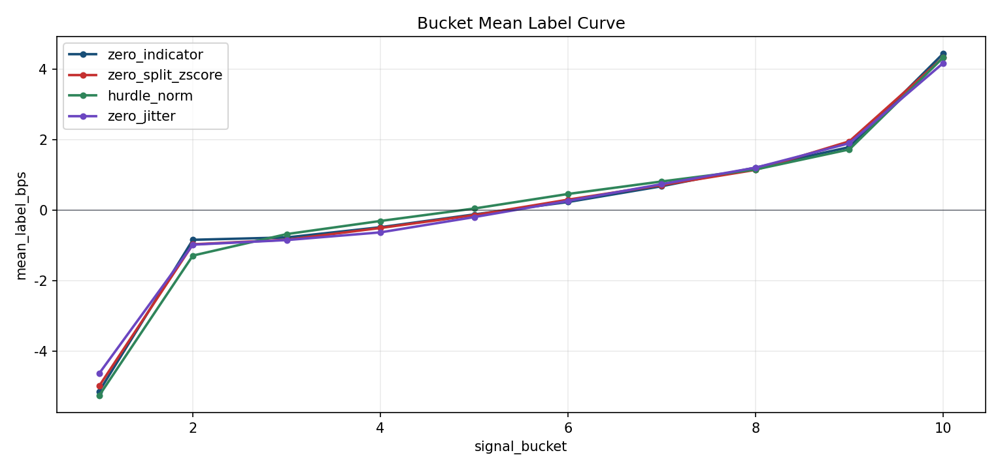

signal_bucket vs mean_label_bps.

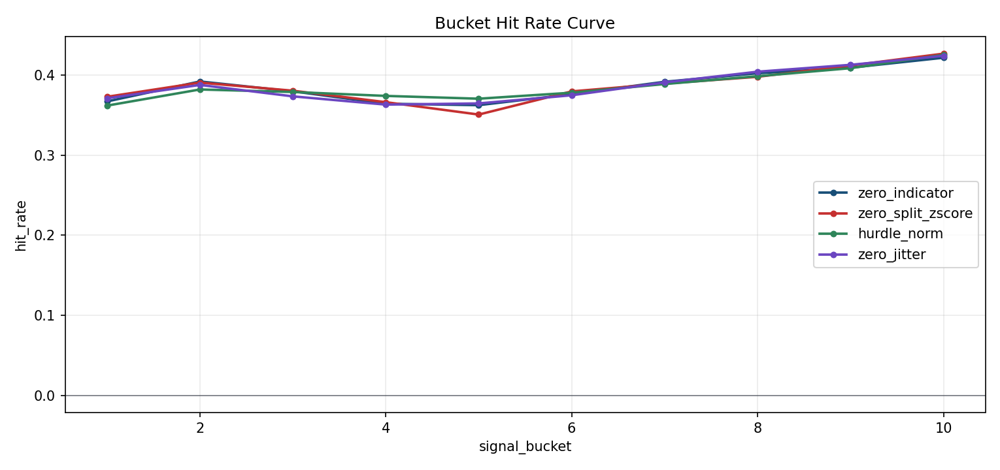

signal_bucket vs hit_rate.

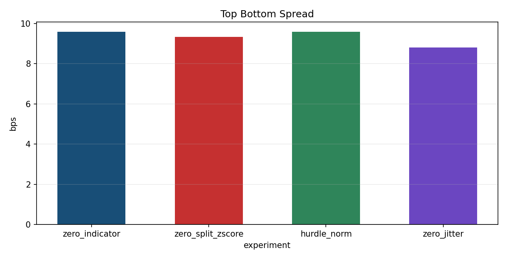

top_bottom_signal_spread_bps.

字段解释

| field | explanation |
| --- | --- |
| signal_bucket | 按 prediction 排序后的分桶编号.  |
| mean_prediction | 分组内 prediction 均值.  |
| mean_label_bps | 分组内 target 均值, 单位 bps.  |
| t_stat | 分组 mean label 的 t-stat.  |
| hit_rate | 分组内 target > 0 的比例.  |
| row_count | 分组样本数.  |
| top_bottom_signal_spread_bps | top bucket mean label bps - bottom bucket mean label bps.  |

### 3.3. Goodness Of Fit

Goodness Of Fit

| experiment | split | prediction_bin | mean_prediction | mean_label | label_p05 | label_p95 | row_count |
| --- | --- | --- | --- | --- | --- | --- | --- |
| zero_indicator | train | 1 | -0.002513 | -0.003063 | -0.017212 | 0.010582 | 5,624,497 |
| zero_indicator | train | 2 | -0.001135 | -0.001448 | -0.010521 | 0.008148 | 5,624,497 |
| zero_indicator | train | 3 | -8.806e-04 | -0.001086 | -0.008888 | 0.007160 | 5,624,497 |
| zero_indicator | train | 4 | -7.642e-04 | -9.026e-04 | -0.008202 | 0.006824 | 5,624,497 |
| zero_indicator | train | 5 | -6.817e-04 | -7.986e-04 | -0.007835 | 0.006626 | 5,624,497 |
| zero_indicator | train | 6 | -6.156e-04 | -7.286e-04 | -0.007580 | 0.006474 | 5,624,497 |
| zero_indicator | train | 7 | -5.596e-04 | -6.575e-04 | -0.007343 | 0.006382 | 5,624,497 |
| zero_indicator | train | 8 | -5.115e-04 | -5.958e-04 | -0.007133 | 0.006241 | 5,624,497 |
| zero_indicator | train | 9 | -4.685e-04 | -5.607e-04 | -0.006969 | 0.006172 | 5,624,497 |
| zero_indicator | train | 10 | -4.303e-04 | -5.130e-04 | -0.006752 | 0.006039 | 5,624,497 |
| zero_indicator | train | 11 | -3.981e-04 | -5.026e-04 | -0.006573 | 0.005817 | 5,624,497 |
| zero_indicator | train | 12 | -3.714e-04 | -4.688e-04 | -0.006409 | 0.005680 | 5,624,497 |
| zero_indicator | train | 13 | -3.480e-04 | -4.290e-04 | -0.006233 | 0.005569 | 5,624,497 |
| zero_indicator | train | 14 | -3.269e-04 | -4.027e-04 | -0.006119 | 0.005486 | 5,624,497 |
| zero_indicator | train | 15 | -3.078e-04 | -3.757e-04 | -0.005978 | 0.005402 | 5,624,497 |
| zero_indicator | train | 16 | -2.904e-04 | -3.520e-04 | -0.005852 | 0.005318 | 5,624,497 |
| zero_indicator | train | 17 | -2.744e-04 | -3.316e-04 | -0.005775 | 0.005272 | 5,624,497 |
| zero_indicator | train | 18 | -2.592e-04 | -3.180e-04 | -0.005692 | 0.005238 | 5,624,497 |
| zero_indicator | train | 19 | -2.447e-04 | -3.010e-04 | -0.005642 | 0.005222 | 5,624,497 |
| zero_indicator | train | 20 | -2.309e-04 | -2.829e-04 | -0.005596 | 0.005203 | 5,624,497 |
| zero_indicator | train | 21 | -2.175e-04 | -2.764e-04 | -0.005547 | 0.005177 | 5,624,497 |
| zero_indicator | train | 22 | -2.047e-04 | -2.556e-04 | -0.005524 | 0.005222 | 5,624,497 |
| zero_indicator | train | 23 | -1.924e-04 | -2.493e-04 | -0.005493 | 0.005173 | 5,624,497 |
| zero_indicator | train | 24 | -1.805e-04 | -2.339e-04 | -0.005466 | 0.005180 | 5,624,497 |
| zero_indicator | train | 25 | -1.691e-04 | -2.200e-04 | -0.005428 | 0.005169 | 5,624,497 |
| zero_indicator | train | 26 | -1.581e-04 | -2.171e-04 | -0.005402 | 0.005154 | 5,624,497 |
| zero_indicator | train | 27 | -1.474e-04 | -1.958e-04 | -0.005348 | 0.005157 | 5,624,497 |
| zero_indicator | train | 28 | -1.370e-04 | -1.847e-04 | -0.005310 | 0.005138 | 5,624,497 |
| zero_indicator | train | 29 | -1.269e-04 | -1.823e-04 | -0.005306 | 0.005127 | 5,624,497 |
| zero_indicator | train | 30 | -1.171e-04 | -1.679e-04 | -0.005257 | 0.005112 | 5,624,497 |
| zero_indicator | train | 31 | -1.075e-04 | -1.676e-04 | -0.005238 | 0.005093 | 5,624,497 |
| zero_indicator | train | 32 | -9.819e-05 | -1.537e-04 | -0.005196 | 0.005104 | 5,624,497 |
| zero_indicator | train | 33 | -8.908e-05 | -1.451e-04 | -0.005173 | 0.005062 | 5,624,497 |
| zero_indicator | train | 34 | -8.020e-05 | -1.408e-04 | -0.005131 | 0.005035 | 5,624,497 |
| zero_indicator | train | 35 | -7.156e-05 | -1.285e-04 | -0.005096 | 0.005024 | 5,624,497 |
| zero_indicator | train | 36 | -6.312e-05 | -1.186e-04 | -0.005066 | 0.005005 | 5,624,497 |
| zero_indicator | train | 37 | -5.488e-05 | -1.061e-04 | -0.005013 | 0.005001 | 5,624,497 |
| zero_indicator | train | 38 | -4.687e-05 | -9.618e-05 | -0.004948 | 0.004948 | 5,624,497 |
| zero_indicator | train | 39 | -3.918e-05 | -8.150e-05 | -0.004902 | 0.004925 | 5,624,497 |
| zero_indicator | train | 40 | -3.164e-05 | -7.262e-05 | -0.004848 | 0.004887 | 5,624,497 |
| zero_indicator | train | 41 | -2.414e-05 | -8.154e-05 | -0.004890 | 0.004902 | 5,624,497 |
| zero_indicator | train | 42 | -1.675e-05 | -6.783e-05 | -0.004826 | 0.004879 | 5,624,497 |
| zero_indicator | train | 43 | -9.409e-06 | -6.551e-05 | -0.004848 | 0.004913 | 5,624,497 |
| zero_indicator | train | 44 | -2.084e-06 | -4.895e-05 | -0.004818 | 0.004925 | 5,624,497 |
| zero_indicator | train | 45 | 5.202e-06 | -4.214e-05 | -0.004818 | 0.004951 | 5,624,497 |
| zero_indicator | train | 46 | 1.244e-05 | -3.611e-05 | -0.004814 | 0.004948 | 5,624,497 |
| zero_indicator | train | 47 | 1.967e-05 | -3.475e-05 | -0.004833 | 0.004967 | 5,624,497 |
| zero_indicator | train | 48 | 2.689e-05 | -2.155e-05 | -0.004791 | 0.004974 | 5,624,497 |
| zero_indicator | train | 49 | 3.409e-05 | -1.301e-05 | -0.004784 | 0.004997 | 5,624,497 |
| zero_indicator | train | 50 | 4.127e-05 | -1.843e-05 | -0.004795 | 0.004982 | 5,624,497 |
| zero_indicator | train | 51 | 4.843e-05 | -9.390e-06 | -0.004772 | 0.004974 | 5,624,497 |
| zero_indicator | train | 52 | 5.560e-05 | 9.192e-06 | -0.004765 | 0.005028 | 5,624,497 |
| zero_indicator | train | 53 | 6.279e-05 | 8.323e-06 | -0.004772 | 0.005035 | 5,624,497 |
| zero_indicator | train | 54 | 7.001e-05 | 1.912e-05 | -0.004749 | 0.005020 | 5,624,497 |
| zero_indicator | train | 55 | 7.725e-05 | 2.296e-05 | -0.004765 | 0.005074 | 5,624,497 |
| zero_indicator | train | 56 | 8.453e-05 | 3.367e-05 | -0.004749 | 0.005089 | 5,624,497 |
| zero_indicator | train | 57 | 9.192e-05 | 3.049e-05 | -0.004787 | 0.005116 | 5,624,497 |
| zero_indicator | train | 58 | 9.940e-05 | 4.416e-05 | -0.004772 | 0.005150 | 5,624,497 |
| zero_indicator | train | 59 | 1.070e-04 | 5.008e-05 | -0.004791 | 0.005177 | 5,624,497 |
| zero_indicator | train | 60 | 1.146e-04 | 5.378e-05 | -0.004784 | 0.005157 | 5,624,497 |
| zero_indicator | train | 61 | 1.224e-04 | 7.445e-05 | -0.004787 | 0.005249 | 5,624,497 |
| zero_indicator | train | 62 | 1.303e-04 | 7.961e-05 | -0.004795 | 0.005268 | 5,624,497 |
| zero_indicator | train | 63 | 1.384e-04 | 9.456e-05 | -0.004803 | 0.005329 | 5,624,497 |
| zero_indicator | train | 64 | 1.465e-04 | 8.386e-05 | -0.004837 | 0.005322 | 5,624,497 |
| zero_indicator | train | 65 | 1.549e-04 | 1.029e-04 | -0.004848 | 0.005363 | 5,624,497 |
| zero_indicator | train | 66 | 1.634e-04 | 1.124e-04 | -0.004848 | 0.005409 | 5,624,497 |
| zero_indicator | train | 67 | 1.721e-04 | 1.172e-04 | -0.004875 | 0.005447 | 5,624,497 |
| zero_indicator | train | 68 | 1.810e-04 | 1.243e-04 | -0.004890 | 0.005478 | 5,624,497 |
| zero_indicator | train | 69 | 1.901e-04 | 1.346e-04 | -0.004902 | 0.005535 | 5,624,497 |
| zero_indicator | train | 70 | 1.995e-04 | 1.525e-04 | -0.004913 | 0.005585 | 5,624,497 |
| zero_indicator | train | 71 | 2.091e-04 | 1.634e-04 | -0.004921 | 0.005627 | 5,624,497 |
| zero_indicator | train | 72 | 2.190e-04 | 1.644e-04 | -0.004963 | 0.005669 | 5,624,497 |
| zero_indicator | train | 73 | 2.293e-04 | 1.803e-04 | -0.004963 | 0.005733 | 5,624,497 |
| zero_indicator | train | 74 | 2.399e-04 | 1.919e-04 | -0.004990 | 0.005783 | 5,624,497 |
| zero_indicator | train | 75 | 2.510e-04 | 1.995e-04 | -0.005013 | 0.005817 | 5,624,497 |
| zero_indicator | train | 76 | 2.625e-04 | 2.085e-04 | -0.005058 | 0.005878 | 5,624,497 |
| zero_indicator | train | 77 | 2.744e-04 | 2.207e-04 | -0.005085 | 0.005939 | 5,624,497 |
| zero_indicator | train | 78 | 2.870e-04 | 2.401e-04 | -0.005104 | 0.006042 | 5,624,497 |
| zero_indicator | train | 79 | 3.001e-04 | 2.535e-04 | -0.005138 | 0.006104 | 5,624,497 |
| zero_indicator | train | 80 | 3.139e-04 | 2.620e-04 | -0.005173 | 0.006134 | 5,624,497 |
| zero_indicator | train | 81 | 3.284e-04 | 2.808e-04 | -0.005230 | 0.006268 | 5,624,497 |
| zero_indicator | train | 82 | 3.438e-04 | 3.000e-04 | -0.005253 | 0.006348 | 5,624,497 |
| zero_indicator | train | 83 | 3.603e-04 | 3.113e-04 | -0.005291 | 0.006428 | 5,624,497 |
| zero_indicator | train | 84 | 3.780e-04 | 3.278e-04 | -0.005348 | 0.006527 | 5,624,497 |
| zero_indicator | train | 85 | 3.970e-04 | 3.507e-04 | -0.005405 | 0.006638 | 5,624,497 |
| zero_indicator | train | 86 | 4.177e-04 | 3.793e-04 | -0.005447 | 0.006790 | 5,624,497 |
| zero_indicator | train | 87 | 4.405e-04 | 3.912e-04 | -0.005547 | 0.006874 | 5,624,496 |
| zero_indicator | train | 88 | 4.658e-04 | 4.186e-04 | -0.005650 | 0.007053 | 5,624,496 |
| zero_indicator | train | 89 | 4.938e-04 | 4.307e-04 | -0.005772 | 0.007236 | 5,624,496 |
| zero_indicator | train | 90 | 5.256e-04 | 4.707e-04 | -0.005867 | 0.007435 | 5,624,496 |
| zero_indicator | train | 91 | 5.620e-04 | 5.048e-04 | -0.006001 | 0.007633 | 5,624,496 |
| zero_indicator | train | 92 | 6.038e-04 | 5.323e-04 | -0.006161 | 0.007881 | 5,624,496 |
| zero_indicator | train | 93 | 6.528e-04 | 5.792e-04 | -0.006317 | 0.008133 | 5,624,496 |
| zero_indicator | train | 94 | 7.110e-04 | 6.203e-04 | -0.006512 | 0.008453 | 5,624,496 |
| zero_indicator | train | 95 | 7.818e-04 | 7.015e-04 | -0.006683 | 0.008812 | 5,624,496 |
| zero_indicator | train | 96 | 8.705e-04 | 7.653e-04 | -0.006954 | 0.009201 | 5,624,496 |
| zero_indicator | train | 97 | 9.883e-04 | 8.766e-04 | -0.007320 | 0.009827 | 5,624,496 |
| zero_indicator | train | 98 | 0.001159 | 0.001021 | -0.007805 | 0.010628 | 5,624,496 |
| zero_indicator | train | 99 | 0.001454 | 0.001321 | -0.008461 | 0.011902 | 5,624,496 |
| zero_indicator | train | 100 | 0.002835 | 0.002653 | -0.010254 | 0.017242 | 5,624,496 |
| zero_indicator | test | 1 | -0.002516 | -0.002058 | -0.015388 | 0.011108 | 1,769,455 |
| zero_indicator | test | 2 | -0.001184 | -8.729e-04 | -0.010040 | 0.008858 | 1,769,455 |
| zero_indicator | test | 3 | -8.875e-04 | -5.247e-04 | -0.008446 | 0.007763 | 1,769,455 |
| zero_indicator | test | 4 | -7.578e-04 | -3.791e-04 | -0.007774 | 0.007294 | 1,769,455 |
| zero_indicator | test | 5 | -6.701e-04 | -3.032e-04 | -0.007381 | 0.007050 | 1,769,455 |
| zero_indicator | test | 6 | -6.013e-04 | -2.751e-04 | -0.007118 | 0.006836 | 1,769,455 |
| zero_indicator | test | 7 | -5.440e-04 | -2.404e-04 | -0.006908 | 0.006660 | 1,769,455 |
| zero_indicator | test | 8 | -4.950e-04 | -2.136e-04 | -0.006725 | 0.006508 | 1,769,455 |
| zero_indicator | test | 9 | -4.517e-04 | -1.600e-04 | -0.006489 | 0.006390 | 1,769,455 |
| zero_indicator | test | 10 | -4.149e-04 | -1.107e-04 | -0.006210 | 0.006187 | 1,769,455 |
| zero_indicator | test | 11 | -3.854e-04 | -5.925e-05 | -0.005913 | 0.005962 | 1,769,455 |
| zero_indicator | test | 12 | -3.608e-04 | -5.532e-05 | -0.005760 | 0.005791 | 1,769,455 |
| zero_indicator | test | 13 | -3.392e-04 | -7.451e-05 | -0.005661 | 0.005669 | 1,769,455 |
| zero_indicator | test | 14 | -3.195e-04 | -8.529e-05 | -0.005581 | 0.005569 | 1,769,455 |
| zero_indicator | test | 15 | -3.017e-04 | -9.076e-05 | -0.005478 | 0.005489 | 1,769,455 |
| zero_indicator | test | 16 | -2.854e-04 | -1.049e-04 | -0.005424 | 0.005421 | 1,769,455 |
| zero_indicator | test | 17 | -2.701e-04 | -9.731e-05 | -0.005379 | 0.005386 | 1,769,455 |
| zero_indicator | test | 18 | -2.554e-04 | -9.595e-05 | -0.005352 | 0.005367 | 1,769,455 |
| zero_indicator | test | 19 | -2.413e-04 | -8.706e-05 | -0.005325 | 0.005367 | 1,769,455 |
| zero_indicator | test | 20 | -2.277e-04 | -8.484e-05 | -0.005322 | 0.005375 | 1,769,455 |
| zero_indicator | test | 21 | -2.146e-04 | -7.923e-05 | -0.005306 | 0.005375 | 1,769,455 |
| zero_indicator | test | 22 | -2.019e-04 | -7.877e-05 | -0.005302 | 0.005375 | 1,769,455 |
| zero_indicator | test | 23 | -1.897e-04 | -8.343e-05 | -0.005283 | 0.005356 | 1,769,455 |
| zero_indicator | test | 24 | -1.779e-04 | -8.097e-05 | -0.005287 | 0.005344 | 1,769,455 |
| zero_indicator | test | 25 | -1.665e-04 | -7.732e-05 | -0.005257 | 0.005356 | 1,769,455 |
| zero_indicator | test | 26 | -1.555e-04 | -8.486e-05 | -0.005253 | 0.005333 | 1,769,455 |
| zero_indicator | test | 27 | -1.448e-04 | -6.913e-05 | -0.005211 | 0.005352 | 1,769,455 |
| zero_indicator | test | 28 | -1.343e-04 | -7.630e-05 | -0.005238 | 0.005329 | 1,769,455 |
| zero_indicator | test | 29 | -1.242e-04 | -6.562e-05 | -0.005196 | 0.005333 | 1,769,455 |
| zero_indicator | test | 30 | -1.143e-04 | -7.227e-05 | -0.005196 | 0.005314 | 1,769,455 |
| zero_indicator | test | 31 | -1.047e-04 | -5.973e-05 | -0.005173 | 0.005310 | 1,769,455 |
| zero_indicator | test | 32 | -9.529e-05 | -6.456e-05 | -0.005150 | 0.005276 | 1,769,455 |
| zero_indicator | test | 33 | -8.610e-05 | -5.645e-05 | -0.005142 | 0.005265 | 1,769,455 |
| zero_indicator | test | 34 | -7.715e-05 | -5.376e-05 | -0.005100 | 0.005249 | 1,769,455 |
| zero_indicator | test | 35 | -6.842e-05 | -5.007e-05 | -0.005062 | 0.005207 | 1,769,455 |
| zero_indicator | test | 36 | -5.989e-05 | -4.723e-05 | -0.005058 | 0.005207 | 1,769,455 |
| zero_indicator | test | 37 | -5.159e-05 | -4.673e-05 | -0.005020 | 0.005169 | 1,769,455 |
| zero_indicator | test | 38 | -4.359e-05 | -3.669e-05 | -0.004940 | 0.005085 | 1,769,455 |
| zero_indicator | test | 39 | -3.585e-05 | -2.830e-05 | -0.004902 | 0.005096 | 1,769,455 |
| zero_indicator | test | 40 | -2.823e-05 | -3.393e-05 | -0.004925 | 0.005070 | 1,769,455 |
| zero_indicator | test | 41 | -2.061e-05 | -2.787e-05 | -0.004902 | 0.005089 | 1,769,454 |
| zero_indicator | test | 42 | -1.311e-05 | -2.379e-05 | -0.004894 | 0.005096 | 1,769,454 |
| zero_indicator | test | 43 | -5.569e-06 | -2.638e-05 | -0.004925 | 0.005131 | 1,769,454 |
| zero_indicator | test | 44 | 1.966e-06 | -1.642e-05 | -0.004929 | 0.005127 | 1,769,454 |
| zero_indicator | test | 45 | 9.471e-06 | -1.632e-05 | -0.004906 | 0.005157 | 1,769,454 |
| zero_indicator | test | 46 | 1.697e-05 | -5.605e-06 | -0.004921 | 0.005180 | 1,769,454 |
| zero_indicator | test | 47 | 2.449e-05 | -8.765e-06 | -0.004940 | 0.005180 | 1,769,454 |
| zero_indicator | test | 48 | 3.199e-05 | -3.348e-08 | -0.004917 | 0.005196 | 1,769,454 |
| zero_indicator | test | 49 | 3.945e-05 | 1.908e-06 | -0.004921 | 0.005196 | 1,769,454 |
| zero_indicator | test | 50 | 4.691e-05 | 8.470e-06 | -0.004917 | 0.005199 | 1,769,454 |
| zero_indicator | test | 51 | 5.437e-05 | 6.048e-06 | -0.004925 | 0.005203 | 1,769,454 |
| zero_indicator | test | 52 | 6.187e-05 | 6.778e-06 | -0.004921 | 0.005199 | 1,769,454 |
| zero_indicator | test | 53 | 6.938e-05 | 1.096e-05 | -0.004921 | 0.005238 | 1,769,454 |
| zero_indicator | test | 54 | 7.691e-05 | 2.301e-05 | -0.004929 | 0.005249 | 1,769,454 |
| zero_indicator | test | 55 | 8.446e-05 | 2.242e-05 | -0.004921 | 0.005249 | 1,769,454 |
| zero_indicator | test | 56 | 9.213e-05 | 2.204e-05 | -0.004951 | 0.005287 | 1,769,454 |
| zero_indicator | test | 57 | 9.989e-05 | 3.750e-05 | -0.004944 | 0.005318 | 1,769,454 |
| zero_indicator | test | 58 | 1.077e-04 | 3.255e-05 | -0.004986 | 0.005341 | 1,769,454 |
| zero_indicator | test | 59 | 1.157e-04 | 3.369e-05 | -0.004990 | 0.005360 | 1,769,454 |
| zero_indicator | test | 60 | 1.237e-04 | 4.305e-05 | -0.004986 | 0.005383 | 1,769,454 |
| zero_indicator | test | 61 | 1.319e-04 | 4.258e-05 | -0.005009 | 0.005413 | 1,769,454 |
| zero_indicator | test | 62 | 1.402e-04 | 4.800e-05 | -0.005013 | 0.005432 | 1,769,454 |
| zero_indicator | test | 63 | 1.486e-04 | 5.528e-05 | -0.005032 | 0.005466 | 1,769,454 |
| zero_indicator | test | 64 | 1.571e-04 | 6.419e-05 | -0.005039 | 0.005478 | 1,769,454 |
| zero_indicator | test | 65 | 1.659e-04 | 6.317e-05 | -0.005062 | 0.005508 | 1,769,454 |
| zero_indicator | test | 66 | 1.747e-04 | 7.403e-05 | -0.005058 | 0.005547 | 1,769,454 |
| zero_indicator | test | 67 | 1.838e-04 | 7.484e-05 | -0.005062 | 0.005581 | 1,769,454 |
| zero_indicator | test | 68 | 1.931e-04 | 8.631e-05 | -0.005074 | 0.005604 | 1,769,454 |
| zero_indicator | test | 69 | 2.026e-04 | 8.456e-05 | -0.005112 | 0.005623 | 1,769,454 |
| zero_indicator | test | 70 | 2.123e-04 | 9.279e-05 | -0.005112 | 0.005676 | 1,769,454 |
| zero_indicator | test | 71 | 2.224e-04 | 1.002e-04 | -0.005142 | 0.005722 | 1,769,454 |
| zero_indicator | test | 72 | 2.326e-04 | 1.017e-04 | -0.005177 | 0.005733 | 1,769,454 |
| zero_indicator | test | 73 | 2.432e-04 | 1.009e-04 | -0.005199 | 0.005779 | 1,769,454 |
| zero_indicator | test | 74 | 2.542e-04 | 1.137e-04 | -0.005222 | 0.005834 | 1,769,454 |
| zero_indicator | test | 75 | 2.655e-04 | 1.207e-04 | -0.005230 | 0.005856 | 1,769,454 |
| zero_indicator | test | 76 | 2.773e-04 | 1.253e-04 | -0.005257 | 0.005898 | 1,769,454 |
| zero_indicator | test | 77 | 2.894e-04 | 1.314e-04 | -0.005306 | 0.005970 | 1,769,454 |
| zero_indicator | test | 78 | 3.022e-04 | 1.303e-04 | -0.005329 | 0.006012 | 1,769,454 |
| zero_indicator | test | 79 | 3.155e-04 | 1.401e-04 | -0.005352 | 0.006050 | 1,769,454 |
| zero_indicator | test | 80 | 3.295e-04 | 1.505e-04 | -0.005390 | 0.006107 | 1,769,454 |
| zero_indicator | test | 81 | 3.442e-04 | 1.501e-04 | -0.005428 | 0.006168 | 1,769,454 |
| zero_indicator | test | 82 | 3.599e-04 | 1.567e-04 | -0.005459 | 0.006245 | 1,769,454 |
| zero_indicator | test | 83 | 3.765e-04 | 1.594e-04 | -0.005531 | 0.006287 | 1,769,454 |
| zero_indicator | test | 84 | 3.944e-04 | 1.711e-04 | -0.005564 | 0.006397 | 1,769,454 |
| zero_indicator | test | 85 | 4.138e-04 | 1.726e-04 | -0.005627 | 0.006451 | 1,769,454 |
| zero_indicator | test | 86 | 4.348e-04 | 1.812e-04 | -0.005714 | 0.006561 | 1,769,454 |
| zero_indicator | test | 87 | 4.579e-04 | 1.819e-04 | -0.005798 | 0.006653 | 1,769,454 |
| zero_indicator | test | 88 | 4.833e-04 | 1.930e-04 | -0.005856 | 0.006779 | 1,769,454 |
| zero_indicator | test | 89 | 5.116e-04 | 2.078e-04 | -0.005966 | 0.006920 | 1,769,454 |
| zero_indicator | test | 90 | 5.435e-04 | 2.220e-04 | -0.006088 | 0.007050 | 1,769,454 |
| zero_indicator | test | 91 | 5.796e-04 | 2.327e-04 | -0.006226 | 0.007195 | 1,769,454 |
| zero_indicator | test | 92 | 6.211e-04 | 2.524e-04 | -0.006336 | 0.007362 | 1,769,454 |
| zero_indicator | test | 93 | 6.693e-04 | 2.649e-04 | -0.006512 | 0.007523 | 1,769,454 |
| zero_indicator | test | 94 | 7.261e-04 | 2.850e-04 | -0.006691 | 0.007748 | 1,769,454 |
| zero_indicator | test | 95 | 7.951e-04 | 3.193e-04 | -0.006931 | 0.008041 | 1,769,454 |
| zero_indicator | test | 96 | 8.815e-04 | 3.763e-04 | -0.007183 | 0.008423 | 1,769,454 |
| zero_indicator | test | 97 | 9.958e-04 | 3.972e-04 | -0.007572 | 0.008850 | 1,769,454 |
| zero_indicator | test | 98 | 0.001160 | 4.610e-04 | -0.008064 | 0.009529 | 1,769,454 |
| zero_indicator | test | 99 | 0.001438 | 5.976e-04 | -0.008797 | 0.010582 | 1,769,454 |
| zero_indicator | test | 100 | 0.002556 | 0.001262 | -0.010696 | 0.014694 | 1,769,454 |
| zero_split_zscore | train | 1 | -0.002642 | -0.003267 | -0.017380 | 0.010162 | 5,624,497 |
| zero_split_zscore | train | 2 | -0.001284 | -0.001505 | -0.010628 | 0.007965 | 5,624,497 |
| zero_split_zscore | train | 3 | -0.001006 | -0.001140 | -0.009300 | 0.007332 | 5,624,497 |
| zero_split_zscore | train | 4 | -8.553e-04 | -9.576e-04 | -0.008614 | 0.007034 | 5,624,497 |
| zero_split_zscore | train | 5 | -7.478e-04 | -8.398e-04 | -0.008133 | 0.006798 | 5,624,497 |
| zero_split_zscore | train | 6 | -6.647e-04 | -7.487e-04 | -0.007717 | 0.006527 | 5,624,497 |
| zero_split_zscore | train | 7 | -5.995e-04 | -6.731e-04 | -0.007362 | 0.006321 | 5,624,497 |
| zero_split_zscore | train | 8 | -5.470e-04 | -6.265e-04 | -0.007118 | 0.006153 | 5,624,497 |
| zero_split_zscore | train | 9 | -5.030e-04 | -5.631e-04 | -0.006893 | 0.006073 | 5,624,497 |
| zero_split_zscore | train | 10 | -4.648e-04 | -5.463e-04 | -0.006767 | 0.005920 | 5,624,497 |
| zero_split_zscore | train | 11 | -4.315e-04 | -4.864e-04 | -0.006603 | 0.005878 | 5,624,497 |
| zero_split_zscore | train | 12 | -4.016e-04 | -4.716e-04 | -0.006481 | 0.005783 | 5,624,497 |
| zero_split_zscore | train | 13 | -3.745e-04 | -4.495e-04 | -0.006390 | 0.005718 | 5,624,497 |
| zero_split_zscore | train | 14 | -3.497e-04 | -4.171e-04 | -0.006287 | 0.005661 | 5,624,497 |
| zero_split_zscore | train | 15 | -3.267e-04 | -3.995e-04 | -0.006172 | 0.005600 | 5,624,497 |
| zero_split_zscore | train | 16 | -3.054e-04 | -3.725e-04 | -0.006111 | 0.005569 | 5,624,497 |
| zero_split_zscore | train | 17 | -2.855e-04 | -3.550e-04 | -0.006031 | 0.005562 | 5,624,497 |
| zero_split_zscore | train | 18 | -2.671e-04 | -3.353e-04 | -0.005936 | 0.005501 | 5,624,497 |
| zero_split_zscore | train | 19 | -2.498e-04 | -3.146e-04 | -0.005852 | 0.005444 | 5,624,497 |
| zero_split_zscore | train | 20 | -2.338e-04 | -2.994e-04 | -0.005764 | 0.005390 | 5,624,497 |
| zero_split_zscore | train | 21 | -2.187e-04 | -2.830e-04 | -0.005695 | 0.005356 | 5,624,497 |
| zero_split_zscore | train | 22 | -2.046e-04 | -2.775e-04 | -0.005646 | 0.005291 | 5,624,497 |
| zero_split_zscore | train | 23 | -1.914e-04 | -2.568e-04 | -0.005581 | 0.005291 | 5,624,497 |
| zero_split_zscore | train | 24 | -1.789e-04 | -2.451e-04 | -0.005489 | 0.005249 | 5,624,497 |
| zero_split_zscore | train | 25 | -1.671e-04 | -2.270e-04 | -0.005444 | 0.005215 | 5,624,497 |
| zero_split_zscore | train | 26 | -1.559e-04 | -2.223e-04 | -0.005390 | 0.005173 | 5,624,497 |
| zero_split_zscore | train | 27 | -1.453e-04 | -2.104e-04 | -0.005348 | 0.005138 | 5,624,497 |
| zero_split_zscore | train | 28 | -1.351e-04 | -1.953e-04 | -0.005283 | 0.005116 | 5,624,497 |
| zero_split_zscore | train | 29 | -1.254e-04 | -1.900e-04 | -0.005253 | 0.005074 | 5,624,497 |
| zero_split_zscore | train | 30 | -1.161e-04 | -1.752e-04 | -0.005196 | 0.005051 | 5,624,497 |
| zero_split_zscore | train | 31 | -1.071e-04 | -1.626e-04 | -0.005161 | 0.005043 | 5,624,497 |
| zero_split_zscore | train | 32 | -9.842e-05 | -1.554e-04 | -0.005112 | 0.005035 | 5,624,497 |
| zero_split_zscore | train | 33 | -8.999e-05 | -1.491e-04 | -0.005051 | 0.004967 | 5,624,497 |
| zero_split_zscore | train | 34 | -8.182e-05 | -1.356e-04 | -0.005032 | 0.004959 | 5,624,497 |
| zero_split_zscore | train | 35 | -7.390e-05 | -1.230e-04 | -0.004993 | 0.004948 | 5,624,497 |
| zero_split_zscore | train | 36 | -6.619e-05 | -1.133e-04 | -0.004974 | 0.004936 | 5,624,497 |
| zero_split_zscore | train | 37 | -5.867e-05 | -1.085e-04 | -0.004917 | 0.004902 | 5,624,497 |
| zero_split_zscore | train | 38 | -5.138e-05 | -1.047e-04 | -0.004879 | 0.004856 | 5,624,497 |
| zero_split_zscore | train | 39 | -4.428e-05 | -9.818e-05 | -0.004837 | 0.004833 | 5,624,497 |
| zero_split_zscore | train | 40 | -3.740e-05 | -7.533e-05 | -0.004765 | 0.004772 | 5,624,497 |
| zero_split_zscore | train | 41 | -3.074e-05 | -5.969e-05 | -0.004719 | 0.004768 | 5,624,497 |
| zero_split_zscore | train | 42 | -2.423e-05 | -6.749e-05 | -0.004669 | 0.004688 | 5,624,497 |
| zero_split_zscore | train | 43 | -1.796e-05 | -5.303e-05 | -0.004612 | 0.004662 | 5,624,497 |
| zero_split_zscore | train | 44 | -1.174e-05 | -5.496e-05 | -0.004669 | 0.004749 | 5,624,497 |
| zero_split_zscore | train | 45 | -5.304e-06 | -5.587e-05 | -0.004726 | 0.004810 | 5,624,497 |
| zero_split_zscore | train | 46 | 1.208e-06 | -3.556e-05 | -0.004704 | 0.004864 | 5,624,497 |
| zero_split_zscore | train | 47 | 7.760e-06 | -3.507e-05 | -0.004711 | 0.004860 | 5,624,497 |
| zero_split_zscore | train | 48 | 1.435e-05 | -2.660e-05 | -0.004715 | 0.004902 | 5,624,497 |
| zero_split_zscore | train | 49 | 2.101e-05 | -2.158e-05 | -0.004742 | 0.004925 | 5,624,497 |
| zero_split_zscore | train | 50 | 2.775e-05 | -1.588e-05 | -0.004761 | 0.004955 | 5,624,497 |
| zero_split_zscore | train | 51 | 3.455e-05 | -1.080e-06 | -0.004749 | 0.004990 | 5,624,497 |
| zero_split_zscore | train | 52 | 4.141e-05 | 2.170e-06 | -0.004742 | 0.005013 | 5,624,497 |
| zero_split_zscore | train | 53 | 4.831e-05 | 5.668e-06 | -0.004765 | 0.005047 | 5,624,497 |
| zero_split_zscore | train | 54 | 5.528e-05 | 1.715e-05 | -0.004726 | 0.005081 | 5,624,497 |
| zero_split_zscore | train | 55 | 6.230e-05 | 2.084e-05 | -0.004742 | 0.005070 | 5,624,497 |
| zero_split_zscore | train | 56 | 6.939e-05 | 3.314e-05 | -0.004749 | 0.005116 | 5,624,497 |
| zero_split_zscore | train | 57 | 7.655e-05 | 3.738e-05 | -0.004757 | 0.005096 | 5,624,497 |
| zero_split_zscore | train | 58 | 8.379e-05 | 4.711e-05 | -0.004726 | 0.005138 | 5,624,497 |
| zero_split_zscore | train | 59 | 9.112e-05 | 6.235e-05 | -0.004723 | 0.005161 | 5,624,497 |
| zero_split_zscore | train | 60 | 9.854e-05 | 6.512e-05 | -0.004738 | 0.005207 | 5,624,497 |
| zero_split_zscore | train | 61 | 1.061e-04 | 7.728e-05 | -0.004742 | 0.005219 | 5,624,497 |
| zero_split_zscore | train | 62 | 1.137e-04 | 7.441e-05 | -0.004742 | 0.005215 | 5,624,497 |
| zero_split_zscore | train | 63 | 1.215e-04 | 9.143e-05 | -0.004726 | 0.005260 | 5,624,497 |
| zero_split_zscore | train | 64 | 1.294e-04 | 1.013e-04 | -0.004726 | 0.005306 | 5,624,497 |
| zero_split_zscore | train | 65 | 1.375e-04 | 1.023e-04 | -0.004745 | 0.005299 | 5,624,497 |
| zero_split_zscore | train | 66 | 1.457e-04 | 1.171e-04 | -0.004742 | 0.005329 | 5,624,497 |
| zero_split_zscore | train | 67 | 1.541e-04 | 1.193e-04 | -0.004742 | 0.005318 | 5,624,497 |
| zero_split_zscore | train | 68 | 1.627e-04 | 1.270e-04 | -0.004761 | 0.005375 | 5,624,497 |
| zero_split_zscore | train | 69 | 1.716e-04 | 1.486e-04 | -0.004784 | 0.005444 | 5,624,497 |
| zero_split_zscore | train | 70 | 1.807e-04 | 1.524e-04 | -0.004772 | 0.005455 | 5,624,497 |
| zero_split_zscore | train | 71 | 1.900e-04 | 1.551e-04 | -0.004803 | 0.005478 | 5,624,497 |
| zero_split_zscore | train | 72 | 1.997e-04 | 1.733e-04 | -0.004818 | 0.005539 | 5,624,497 |
| zero_split_zscore | train | 73 | 2.098e-04 | 1.889e-04 | -0.004818 | 0.005600 | 5,624,497 |
| zero_split_zscore | train | 74 | 2.202e-04 | 2.006e-04 | -0.004833 | 0.005646 | 5,624,497 |
| zero_split_zscore | train | 75 | 2.311e-04 | 2.001e-04 | -0.004894 | 0.005684 | 5,624,497 |
| zero_split_zscore | train | 76 | 2.425e-04 | 2.192e-04 | -0.004890 | 0.005733 | 5,624,497 |
| zero_split_zscore | train | 77 | 2.545e-04 | 2.339e-04 | -0.004940 | 0.005840 | 5,624,497 |
| zero_split_zscore | train | 78 | 2.671e-04 | 2.423e-04 | -0.004990 | 0.005875 | 5,624,497 |
| zero_split_zscore | train | 79 | 2.804e-04 | 2.568e-04 | -0.005016 | 0.005966 | 5,624,497 |
| zero_split_zscore | train | 80 | 2.946e-04 | 2.657e-04 | -0.005089 | 0.006054 | 5,624,497 |
| zero_split_zscore | train | 81 | 3.098e-04 | 2.825e-04 | -0.005161 | 0.006180 | 5,624,497 |
| zero_split_zscore | train | 82 | 3.261e-04 | 3.096e-04 | -0.005222 | 0.006294 | 5,624,497 |
| zero_split_zscore | train | 83 | 3.438e-04 | 3.160e-04 | -0.005306 | 0.006413 | 5,624,497 |
| zero_split_zscore | train | 84 | 3.629e-04 | 3.342e-04 | -0.005413 | 0.006542 | 5,624,497 |
| zero_split_zscore | train | 85 | 3.838e-04 | 3.470e-04 | -0.005508 | 0.006687 | 5,624,497 |
| zero_split_zscore | train | 86 | 4.068e-04 | 3.849e-04 | -0.005581 | 0.006874 | 5,624,497 |
| zero_split_zscore | train | 87 | 4.320e-04 | 4.006e-04 | -0.005695 | 0.007034 | 5,624,496 |
| zero_split_zscore | train | 88 | 4.600e-04 | 4.196e-04 | -0.005817 | 0.007183 | 5,624,496 |
| zero_split_zscore | train | 89 | 4.909e-04 | 4.386e-04 | -0.005920 | 0.007355 | 5,624,496 |
| zero_split_zscore | train | 90 | 5.253e-04 | 4.766e-04 | -0.006054 | 0.007587 | 5,624,496 |
| zero_split_zscore | train | 91 | 5.642e-04 | 5.229e-04 | -0.006157 | 0.007797 | 5,624,496 |
| zero_split_zscore | train | 92 | 6.081e-04 | 5.626e-04 | -0.006275 | 0.008034 | 5,624,496 |
| zero_split_zscore | train | 93 | 6.585e-04 | 6.027e-04 | -0.006386 | 0.008270 | 5,624,496 |
| zero_split_zscore | train | 94 | 7.172e-04 | 6.562e-04 | -0.006565 | 0.008575 | 5,624,496 |
| zero_split_zscore | train | 95 | 7.877e-04 | 7.143e-04 | -0.006733 | 0.008919 | 5,624,496 |
| zero_split_zscore | train | 96 | 8.755e-04 | 8.147e-04 | -0.006924 | 0.009338 | 5,624,496 |
| zero_split_zscore | train | 97 | 9.926e-04 | 9.197e-04 | -0.007206 | 0.009911 | 5,624,496 |
| zero_split_zscore | train | 98 | 0.001164 | 0.001083 | -0.007648 | 0.010765 | 5,624,496 |
| zero_split_zscore | train | 99 | 0.001474 | 0.001383 | -0.008347 | 0.012131 | 5,624,496 |
| zero_split_zscore | train | 100 | 0.003067 | 0.002913 | -0.009941 | 0.017975 | 5,624,496 |
| zero_split_zscore | test | 1 | -0.002549 | -0.002116 | -0.015388 | 0.010864 | 1,769,455 |
| zero_split_zscore | test | 2 | -0.001296 | -9.025e-04 | -0.009918 | 0.008408 | 1,769,455 |
| zero_split_zscore | test | 3 | -9.994e-04 | -5.272e-04 | -0.008583 | 0.007797 | 1,769,455 |
| zero_split_zscore | test | 4 | -8.419e-04 | -3.860e-04 | -0.007973 | 0.007442 | 1,769,455 |
| zero_split_zscore | test | 5 | -7.328e-04 | -2.995e-04 | -0.007515 | 0.007122 | 1,769,455 |
| zero_split_zscore | test | 6 | -6.511e-04 | -2.231e-04 | -0.007118 | 0.006821 | 1,769,455 |
| zero_split_zscore | test | 7 | -5.884e-04 | -1.694e-04 | -0.006790 | 0.006599 | 1,769,455 |
| zero_split_zscore | test | 8 | -5.382e-04 | -1.412e-04 | -0.006557 | 0.006416 | 1,769,455 |
| zero_split_zscore | test | 9 | -4.961e-04 | -1.223e-04 | -0.006382 | 0.006294 | 1,769,455 |
| zero_split_zscore | test | 10 | -4.596e-04 | -9.986e-05 | -0.006233 | 0.006233 | 1,769,455 |
| zero_split_zscore | test | 11 | -4.274e-04 | -1.001e-04 | -0.006138 | 0.006142 | 1,769,455 |
| zero_split_zscore | test | 12 | -3.985e-04 | -1.017e-04 | -0.006073 | 0.006062 | 1,769,455 |
| zero_split_zscore | test | 13 | -3.723e-04 | -9.189e-05 | -0.005970 | 0.006016 | 1,769,455 |
| zero_split_zscore | test | 14 | -3.481e-04 | -9.208e-05 | -0.005913 | 0.005932 | 1,769,455 |
| zero_split_zscore | test | 15 | -3.258e-04 | -9.633e-05 | -0.005840 | 0.005882 | 1,769,455 |
| zero_split_zscore | test | 16 | -3.050e-04 | -9.758e-05 | -0.005798 | 0.005852 | 1,769,455 |
| zero_split_zscore | test | 17 | -2.857e-04 | -8.712e-05 | -0.005714 | 0.005791 | 1,769,455 |
| zero_split_zscore | test | 18 | -2.675e-04 | -1.006e-04 | -0.005707 | 0.005764 | 1,769,455 |
| zero_split_zscore | test | 19 | -2.506e-04 | -9.306e-05 | -0.005627 | 0.005718 | 1,769,455 |
| zero_split_zscore | test | 20 | -2.347e-04 | -1.022e-04 | -0.005600 | 0.005653 | 1,769,455 |
| zero_split_zscore | test | 21 | -2.199e-04 | -9.255e-05 | -0.005516 | 0.005615 | 1,769,455 |
| zero_split_zscore | test | 22 | -2.059e-04 | -8.903e-05 | -0.005486 | 0.005592 | 1,769,455 |
| zero_split_zscore | test | 23 | -1.928e-04 | -8.987e-05 | -0.005455 | 0.005554 | 1,769,455 |
| zero_split_zscore | test | 24 | -1.803e-04 | -8.288e-05 | -0.005394 | 0.005497 | 1,769,455 |
| zero_split_zscore | test | 25 | -1.686e-04 | -9.343e-05 | -0.005375 | 0.005451 | 1,769,455 |
| zero_split_zscore | test | 26 | -1.574e-04 | -8.578e-05 | -0.005333 | 0.005436 | 1,769,455 |
| zero_split_zscore | test | 27 | -1.467e-04 | -8.043e-05 | -0.005302 | 0.005398 | 1,769,455 |
| zero_split_zscore | test | 28 | -1.364e-04 | -7.784e-05 | -0.005268 | 0.005405 | 1,769,455 |
| zero_split_zscore | test | 29 | -1.266e-04 | -7.463e-05 | -0.005241 | 0.005360 | 1,769,455 |
| zero_split_zscore | test | 30 | -1.171e-04 | -6.712e-05 | -0.005211 | 0.005352 | 1,769,455 |
| zero_split_zscore | test | 31 | -1.080e-04 | -6.519e-05 | -0.005173 | 0.005329 | 1,769,455 |
| zero_split_zscore | test | 32 | -9.916e-05 | -5.678e-05 | -0.005142 | 0.005310 | 1,769,455 |
| zero_split_zscore | test | 33 | -9.057e-05 | -6.402e-05 | -0.005138 | 0.005276 | 1,769,455 |
| zero_split_zscore | test | 34 | -8.222e-05 | -5.510e-05 | -0.005096 | 0.005276 | 1,769,455 |
| zero_split_zscore | test | 35 | -7.412e-05 | -5.770e-05 | -0.005077 | 0.005230 | 1,769,455 |
| zero_split_zscore | test | 36 | -6.623e-05 | -4.501e-05 | -0.005051 | 0.005238 | 1,769,455 |
| zero_split_zscore | test | 37 | -5.852e-05 | -4.475e-05 | -0.005032 | 0.005203 | 1,769,455 |
| zero_split_zscore | test | 38 | -5.107e-05 | -3.860e-05 | -0.004951 | 0.005131 | 1,769,455 |
| zero_split_zscore | test | 39 | -4.379e-05 | -3.779e-05 | -0.004944 | 0.005131 | 1,769,455 |
| zero_split_zscore | test | 40 | -3.676e-05 | -3.476e-05 | -0.004883 | 0.005051 | 1,769,455 |
| zero_split_zscore | test | 41 | -2.997e-05 | -2.995e-05 | -0.004837 | 0.005005 | 1,769,454 |
| zero_split_zscore | test | 42 | -2.335e-05 | -3.548e-05 | -0.004795 | 0.004929 | 1,769,454 |
| zero_split_zscore | test | 43 | -1.699e-05 | -2.161e-05 | -0.004738 | 0.004910 | 1,769,454 |
| zero_split_zscore | test | 44 | -1.061e-05 | -2.442e-05 | -0.004814 | 0.004997 | 1,769,454 |
| zero_split_zscore | test | 45 | -3.945e-06 | -1.362e-05 | -0.004860 | 0.005096 | 1,769,454 |
| zero_split_zscore | test | 46 | 2.785e-06 | -9.819e-06 | -0.004868 | 0.005138 | 1,769,454 |
| zero_split_zscore | test | 47 | 9.548e-06 | -5.352e-06 | -0.004879 | 0.005131 | 1,769,454 |
| zero_split_zscore | test | 48 | 1.636e-05 | -8.820e-06 | -0.004890 | 0.005138 | 1,769,454 |
| zero_split_zscore | test | 49 | 2.322e-05 | 7.489e-06 | -0.004868 | 0.005184 | 1,769,454 |
| zero_split_zscore | test | 50 | 3.014e-05 | 6.497e-06 | -0.004902 | 0.005196 | 1,769,454 |
| zero_split_zscore | test | 51 | 3.712e-05 | 1.311e-05 | -0.004898 | 0.005238 | 1,769,454 |
| zero_split_zscore | test | 52 | 4.416e-05 | 1.502e-05 | -0.004921 | 0.005226 | 1,769,454 |
| zero_split_zscore | test | 53 | 5.125e-05 | 2.908e-05 | -0.004890 | 0.005276 | 1,769,454 |
| zero_split_zscore | test | 54 | 5.838e-05 | 1.666e-05 | -0.004917 | 0.005230 | 1,769,454 |
| zero_split_zscore | test | 55 | 6.556e-05 | 2.436e-05 | -0.004906 | 0.005260 | 1,769,454 |
| zero_split_zscore | test | 56 | 7.281e-05 | 3.103e-05 | -0.004913 | 0.005276 | 1,769,454 |
| zero_split_zscore | test | 57 | 8.014e-05 | 3.628e-05 | -0.004902 | 0.005276 | 1,769,454 |
| zero_split_zscore | test | 58 | 8.755e-05 | 4.279e-05 | -0.004890 | 0.005295 | 1,769,454 |
| zero_split_zscore | test | 59 | 9.504e-05 | 4.364e-05 | -0.004902 | 0.005283 | 1,769,454 |
| zero_split_zscore | test | 60 | 1.026e-04 | 5.260e-05 | -0.004890 | 0.005310 | 1,769,454 |
| zero_split_zscore | test | 61 | 1.103e-04 | 5.188e-05 | -0.004921 | 0.005337 | 1,769,454 |
| zero_split_zscore | test | 62 | 1.182e-04 | 6.559e-05 | -0.004917 | 0.005370 | 1,769,454 |
| zero_split_zscore | test | 63 | 1.261e-04 | 6.400e-05 | -0.004921 | 0.005367 | 1,769,454 |
| zero_split_zscore | test | 64 | 1.342e-04 | 6.177e-05 | -0.004940 | 0.005360 | 1,769,454 |
| zero_split_zscore | test | 65 | 1.425e-04 | 6.682e-05 | -0.004917 | 0.005383 | 1,769,454 |
| zero_split_zscore | test | 66 | 1.509e-04 | 6.979e-05 | -0.004944 | 0.005402 | 1,769,454 |
| zero_split_zscore | test | 67 | 1.596e-04 | 8.095e-05 | -0.004963 | 0.005447 | 1,769,454 |
| zero_split_zscore | test | 68 | 1.685e-04 | 7.966e-05 | -0.004963 | 0.005447 | 1,769,454 |
| zero_split_zscore | test | 69 | 1.776e-04 | 8.575e-05 | -0.004982 | 0.005486 | 1,769,454 |
| zero_split_zscore | test | 70 | 1.870e-04 | 9.258e-05 | -0.004990 | 0.005516 | 1,769,454 |
| zero_split_zscore | test | 71 | 1.966e-04 | 9.862e-05 | -0.004990 | 0.005558 | 1,769,454 |
| zero_split_zscore | test | 72 | 2.067e-04 | 9.609e-05 | -0.005032 | 0.005566 | 1,769,454 |
| zero_split_zscore | test | 73 | 2.171e-04 | 1.044e-04 | -0.005051 | 0.005608 | 1,769,454 |
| zero_split_zscore | test | 74 | 2.279e-04 | 1.057e-04 | -0.005074 | 0.005634 | 1,769,454 |
| zero_split_zscore | test | 75 | 2.392e-04 | 1.049e-04 | -0.005108 | 0.005699 | 1,769,454 |
| zero_split_zscore | test | 76 | 2.510e-04 | 1.153e-04 | -0.005131 | 0.005737 | 1,769,454 |
| zero_split_zscore | test | 77 | 2.635e-04 | 1.281e-04 | -0.005169 | 0.005814 | 1,769,454 |
| zero_split_zscore | test | 78 | 2.767e-04 | 1.192e-04 | -0.005225 | 0.005825 | 1,769,454 |
| zero_split_zscore | test | 79 | 2.906e-04 | 1.368e-04 | -0.005260 | 0.005917 | 1,769,454 |
| zero_split_zscore | test | 80 | 3.054e-04 | 1.401e-04 | -0.005322 | 0.006016 | 1,769,454 |
| zero_split_zscore | test | 81 | 3.212e-04 | 1.440e-04 | -0.005390 | 0.006081 | 1,769,454 |
| zero_split_zscore | test | 82 | 3.383e-04 | 1.657e-04 | -0.005428 | 0.006203 | 1,769,454 |
| zero_split_zscore | test | 83 | 3.566e-04 | 1.744e-04 | -0.005512 | 0.006306 | 1,769,454 |
| zero_split_zscore | test | 84 | 3.765e-04 | 1.835e-04 | -0.005592 | 0.006405 | 1,769,454 |
| zero_split_zscore | test | 85 | 3.982e-04 | 1.978e-04 | -0.005669 | 0.006538 | 1,769,454 |
| zero_split_zscore | test | 86 | 4.218e-04 | 1.973e-04 | -0.005764 | 0.006630 | 1,769,454 |
| zero_split_zscore | test | 87 | 4.478e-04 | 2.078e-04 | -0.005863 | 0.006733 | 1,769,454 |
| zero_split_zscore | test | 88 | 4.764e-04 | 2.166e-04 | -0.005950 | 0.006874 | 1,769,454 |
| zero_split_zscore | test | 89 | 5.077e-04 | 2.275e-04 | -0.006031 | 0.006992 | 1,769,454 |
| zero_split_zscore | test | 90 | 5.428e-04 | 2.451e-04 | -0.006142 | 0.007149 | 1,769,454 |
| zero_split_zscore | test | 91 | 5.820e-04 | 2.563e-04 | -0.006233 | 0.007275 | 1,769,454 |
| zero_split_zscore | test | 92 | 6.264e-04 | 2.587e-04 | -0.006371 | 0.007423 | 1,769,454 |
| zero_split_zscore | test | 93 | 6.771e-04 | 2.757e-04 | -0.006512 | 0.007622 | 1,769,454 |
| zero_split_zscore | test | 94 | 7.363e-04 | 2.880e-04 | -0.006657 | 0.007793 | 1,769,454 |
| zero_split_zscore | test | 95 | 8.075e-04 | 3.095e-04 | -0.006847 | 0.008057 | 1,769,454 |
| zero_split_zscore | test | 96 | 8.968e-04 | 3.468e-04 | -0.007114 | 0.008408 | 1,769,454 |
| zero_split_zscore | test | 97 | 0.001016 | 3.797e-04 | -0.007450 | 0.008873 | 1,769,454 |
| zero_split_zscore | test | 98 | 0.001192 | 4.521e-04 | -0.007896 | 0.009514 | 1,769,454 |
| zero_split_zscore | test | 99 | 0.001503 | 6.278e-04 | -0.008583 | 0.010658 | 1,769,454 |
| zero_split_zscore | test | 100 | 0.002788 | 0.001141 | -0.010658 | 0.014679 | 1,769,454 |
| hurdle_norm | train | 1 | -0.002377 | -0.003049 | -0.017258 | 0.010567 | 5,624,497 |
| hurdle_norm | train | 2 | -0.001130 | -0.001456 | -0.010971 | 0.008614 | 5,624,497 |
| hurdle_norm | train | 3 | -8.771e-04 | -0.001131 | -0.009407 | 0.007580 | 5,624,497 |
| hurdle_norm | train | 4 | -7.379e-04 | -9.319e-04 | -0.008339 | 0.006813 | 5,624,497 |
| hurdle_norm | train | 5 | -6.605e-04 | -8.176e-04 | -0.007565 | 0.006191 | 5,624,497 |
| hurdle_norm | train | 6 | -6.120e-04 | -7.241e-04 | -0.007133 | 0.005917 | 5,624,497 |
| hurdle_norm | train | 7 | -5.743e-04 | -6.621e-04 | -0.006924 | 0.005829 | 5,624,497 |
| hurdle_norm | train | 8 | -5.402e-04 | -6.138e-04 | -0.006779 | 0.005768 | 5,624,497 |
| hurdle_norm | train | 9 | -5.086e-04 | -5.688e-04 | -0.006638 | 0.005733 | 5,624,497 |
| hurdle_norm | train | 10 | -4.788e-04 | -5.313e-04 | -0.006554 | 0.005699 | 5,624,497 |
| hurdle_norm | train | 11 | -4.502e-04 | -4.961e-04 | -0.006458 | 0.005684 | 5,624,497 |
| hurdle_norm | train | 12 | -4.236e-04 | -4.674e-04 | -0.006413 | 0.005676 | 5,624,497 |
| hurdle_norm | train | 13 | -3.987e-04 | -4.344e-04 | -0.006325 | 0.005650 | 5,624,497 |
| hurdle_norm | train | 14 | -3.753e-04 | -4.119e-04 | -0.006233 | 0.005627 | 5,624,497 |
| hurdle_norm | train | 15 | -3.532e-04 | -3.905e-04 | -0.006168 | 0.005569 | 5,624,497 |
| hurdle_norm | train | 16 | -3.325e-04 | -3.729e-04 | -0.006100 | 0.005547 | 5,624,497 |
| hurdle_norm | train | 17 | -3.129e-04 | -3.495e-04 | -0.006008 | 0.005535 | 5,624,497 |
| hurdle_norm | train | 18 | -2.944e-04 | -3.275e-04 | -0.005909 | 0.005493 | 5,624,497 |
| hurdle_norm | train | 19 | -2.769e-04 | -3.116e-04 | -0.005840 | 0.005421 | 5,624,497 |
| hurdle_norm | train | 20 | -2.613e-04 | -3.093e-04 | -0.005798 | 0.005356 | 5,624,497 |
| hurdle_norm | train | 21 | -2.485e-04 | -2.829e-04 | -0.005676 | 0.005322 | 5,624,497 |
| hurdle_norm | train | 22 | -2.365e-04 | -2.679e-04 | -0.005630 | 0.005295 | 5,624,497 |
| hurdle_norm | train | 23 | -2.250e-04 | -2.515e-04 | -0.005592 | 0.005295 | 5,624,497 |
| hurdle_norm | train | 24 | -2.139e-04 | -2.370e-04 | -0.005539 | 0.005276 | 5,624,497 |
| hurdle_norm | train | 25 | -2.033e-04 | -2.252e-04 | -0.005527 | 0.005276 | 5,624,497 |
| hurdle_norm | train | 26 | -1.930e-04 | -2.178e-04 | -0.005489 | 0.005249 | 5,624,497 |
| hurdle_norm | train | 27 | -1.830e-04 | -2.081e-04 | -0.005436 | 0.005226 | 5,624,497 |
| hurdle_norm | train | 28 | -1.733e-04 | -2.013e-04 | -0.005398 | 0.005199 | 5,624,497 |
| hurdle_norm | train | 29 | -1.639e-04 | -1.751e-04 | -0.005352 | 0.005222 | 5,624,497 |
| hurdle_norm | train | 30 | -1.547e-04 | -1.658e-04 | -0.005322 | 0.005196 | 5,624,497 |
| hurdle_norm | train | 31 | -1.458e-04 | -1.623e-04 | -0.005280 | 0.005138 | 5,624,497 |
| hurdle_norm | train | 32 | -1.371e-04 | -1.521e-04 | -0.005253 | 0.005127 | 5,624,497 |
| hurdle_norm | train | 33 | -1.287e-04 | -1.408e-04 | -0.005219 | 0.005116 | 5,624,497 |
| hurdle_norm | train | 34 | -1.204e-04 | -1.324e-04 | -0.005188 | 0.005116 | 5,624,497 |
| hurdle_norm | train | 35 | -1.122e-04 | -1.273e-04 | -0.005161 | 0.005108 | 5,624,497 |
| hurdle_norm | train | 36 | -1.041e-04 | -1.089e-04 | -0.005112 | 0.005108 | 5,624,497 |
| hurdle_norm | train | 37 | -9.622e-05 | -1.189e-04 | -0.005112 | 0.005047 | 5,624,497 |
| hurdle_norm | train | 38 | -8.846e-05 | -1.010e-04 | -0.005074 | 0.005074 | 5,624,497 |
| hurdle_norm | train | 39 | -8.084e-05 | -9.071e-05 | -0.005051 | 0.005074 | 5,624,497 |
| hurdle_norm | train | 40 | -7.331e-05 | -8.248e-05 | -0.004997 | 0.005066 | 5,624,497 |
| hurdle_norm | train | 41 | -6.588e-05 | -7.699e-05 | -0.004990 | 0.005039 | 5,624,497 |
| hurdle_norm | train | 42 | -5.861e-05 | -7.519e-05 | -0.004951 | 0.004990 | 5,624,497 |
| hurdle_norm | train | 43 | -5.144e-05 | -6.749e-05 | -0.004898 | 0.004967 | 5,624,497 |
| hurdle_norm | train | 44 | -4.431e-05 | -5.404e-05 | -0.004921 | 0.005005 | 5,624,497 |
| hurdle_norm | train | 45 | -3.722e-05 | -4.606e-05 | -0.004871 | 0.005013 | 5,624,497 |
| hurdle_norm | train | 46 | -3.018e-05 | -4.737e-05 | -0.004883 | 0.004997 | 5,624,497 |
| hurdle_norm | train | 47 | -2.320e-05 | -3.594e-05 | -0.004852 | 0.004990 | 5,624,497 |
| hurdle_norm | train | 48 | -1.624e-05 | -2.370e-05 | -0.004841 | 0.005005 | 5,624,497 |
| hurdle_norm | train | 49 | -9.273e-06 | -1.991e-05 | -0.004841 | 0.005001 | 5,624,497 |
| hurdle_norm | train | 50 | -2.325e-06 | -1.056e-05 | -0.004810 | 0.005016 | 5,624,497 |
| hurdle_norm | train | 51 | 4.633e-06 | -7.669e-06 | -0.004807 | 0.005005 | 5,624,497 |
| hurdle_norm | train | 52 | 1.161e-05 | 3.226e-06 | -0.004803 | 0.005043 | 5,624,497 |
| hurdle_norm | train | 53 | 1.861e-05 | 8.988e-06 | -0.004807 | 0.005051 | 5,624,497 |
| hurdle_norm | train | 54 | 2.564e-05 | 1.993e-05 | -0.004795 | 0.005081 | 5,624,497 |
| hurdle_norm | train | 55 | 3.270e-05 | 2.384e-05 | -0.004795 | 0.005089 | 5,624,497 |
| hurdle_norm | train | 56 | 3.982e-05 | 3.442e-05 | -0.004772 | 0.005104 | 5,624,497 |
| hurdle_norm | train | 57 | 4.700e-05 | 4.188e-05 | -0.004787 | 0.005127 | 5,624,497 |
| hurdle_norm | train | 58 | 5.424e-05 | 5.070e-05 | -0.004772 | 0.005146 | 5,624,497 |
| hurdle_norm | train | 59 | 6.156e-05 | 6.682e-05 | -0.004761 | 0.005192 | 5,624,497 |
| hurdle_norm | train | 60 | 6.897e-05 | 6.250e-05 | -0.004795 | 0.005192 | 5,624,497 |
| hurdle_norm | train | 61 | 7.649e-05 | 7.405e-05 | -0.004795 | 0.005230 | 5,624,497 |
| hurdle_norm | train | 62 | 8.412e-05 | 7.511e-05 | -0.004807 | 0.005222 | 5,624,497 |
| hurdle_norm | train | 63 | 9.188e-05 | 9.753e-05 | -0.004795 | 0.005283 | 5,624,497 |
| hurdle_norm | train | 64 | 9.977e-05 | 9.443e-05 | -0.004810 | 0.005295 | 5,624,497 |
| hurdle_norm | train | 65 | 1.078e-04 | 1.070e-04 | -0.004814 | 0.005352 | 5,624,497 |
| hurdle_norm | train | 66 | 1.160e-04 | 1.175e-04 | -0.004810 | 0.005375 | 5,624,497 |
| hurdle_norm | train | 67 | 1.245e-04 | 1.238e-04 | -0.004818 | 0.005390 | 5,624,497 |
| hurdle_norm | train | 68 | 1.330e-04 | 1.364e-04 | -0.004833 | 0.005455 | 5,624,497 |
| hurdle_norm | train | 69 | 1.419e-04 | 1.481e-04 | -0.004841 | 0.005489 | 5,624,497 |
| hurdle_norm | train | 70 | 1.509e-04 | 1.520e-04 | -0.004856 | 0.005501 | 5,624,497 |
| hurdle_norm | train | 71 | 1.602e-04 | 1.552e-04 | -0.004875 | 0.005535 | 5,624,497 |
| hurdle_norm | train | 72 | 1.698e-04 | 1.727e-04 | -0.004890 | 0.005615 | 5,624,497 |
| hurdle_norm | train | 73 | 1.797e-04 | 1.807e-04 | -0.004913 | 0.005669 | 5,624,497 |
| hurdle_norm | train | 74 | 1.900e-04 | 1.947e-04 | -0.004917 | 0.005733 | 5,624,497 |
| hurdle_norm | train | 75 | 2.007e-04 | 2.068e-04 | -0.004951 | 0.005768 | 5,624,497 |
| hurdle_norm | train | 76 | 2.119e-04 | 2.165e-04 | -0.004974 | 0.005829 | 5,624,497 |
| hurdle_norm | train | 77 | 2.235e-04 | 2.308e-04 | -0.005013 | 0.005917 | 5,624,497 |
| hurdle_norm | train | 78 | 2.358e-04 | 2.418e-04 | -0.005032 | 0.005970 | 5,624,497 |
| hurdle_norm | train | 79 | 2.487e-04 | 2.579e-04 | -0.005096 | 0.006065 | 5,624,497 |
| hurdle_norm | train | 80 | 2.624e-04 | 2.721e-04 | -0.005138 | 0.006176 | 5,624,497 |
| hurdle_norm | train | 81 | 2.770e-04 | 2.882e-04 | -0.005184 | 0.006256 | 5,624,497 |
| hurdle_norm | train | 82 | 2.927e-04 | 3.043e-04 | -0.005253 | 0.006390 | 5,624,497 |
| hurdle_norm | train | 83 | 3.095e-04 | 3.121e-04 | -0.005314 | 0.006451 | 5,624,497 |
| hurdle_norm | train | 84 | 3.277e-04 | 3.316e-04 | -0.005421 | 0.006599 | 5,624,497 |
| hurdle_norm | train | 85 | 3.476e-04 | 3.593e-04 | -0.005470 | 0.006733 | 5,624,497 |
| hurdle_norm | train | 86 | 3.694e-04 | 3.723e-04 | -0.005581 | 0.006924 | 5,624,497 |
| hurdle_norm | train | 87 | 3.936e-04 | 3.900e-04 | -0.005672 | 0.007080 | 5,624,496 |
| hurdle_norm | train | 88 | 4.205e-04 | 4.169e-04 | -0.005772 | 0.007210 | 5,624,496 |
| hurdle_norm | train | 89 | 4.505e-04 | 4.452e-04 | -0.005886 | 0.007397 | 5,624,496 |
| hurdle_norm | train | 90 | 4.840e-04 | 4.790e-04 | -0.005985 | 0.007565 | 5,624,496 |
| hurdle_norm | train | 91 | 5.215e-04 | 5.168e-04 | -0.006058 | 0.007740 | 5,624,496 |
| hurdle_norm | train | 92 | 5.638e-04 | 5.466e-04 | -0.006157 | 0.007881 | 5,624,496 |
| hurdle_norm | train | 93 | 6.116e-04 | 5.937e-04 | -0.006233 | 0.008064 | 5,624,496 |
| hurdle_norm | train | 94 | 6.667e-04 | 6.448e-04 | -0.006340 | 0.008301 | 5,624,496 |
| hurdle_norm | train | 95 | 7.313e-04 | 7.170e-04 | -0.006443 | 0.008598 | 5,624,496 |
| hurdle_norm | train | 96 | 8.102e-04 | 7.827e-04 | -0.006645 | 0.008942 | 5,624,496 |
| hurdle_norm | train | 97 | 9.140e-04 | 8.836e-04 | -0.006924 | 0.009499 | 5,624,496 |
| hurdle_norm | train | 98 | 0.001068 | 0.001043 | -0.007385 | 0.010384 | 5,624,496 |
| hurdle_norm | train | 99 | 0.001364 | 0.001322 | -0.008392 | 0.012115 | 5,624,496 |
| hurdle_norm | train | 100 | 0.002736 | 0.002671 | -0.009880 | 0.016922 | 5,624,496 |
| hurdle_norm | test | 1 | -0.002353 | -0.002019 | -0.015038 | 0.010582 | 1,769,455 |
| hurdle_norm | test | 2 | -0.001170 | -9.469e-04 | -0.010567 | 0.009010 | 1,769,455 |
| hurdle_norm | test | 3 | -8.814e-04 | -5.906e-04 | -0.008995 | 0.008141 | 1,769,455 |
| hurdle_norm | test | 4 | -7.305e-04 | -3.934e-04 | -0.007896 | 0.007378 | 1,769,455 |
| hurdle_norm | test | 5 | -6.507e-04 | -2.752e-04 | -0.007099 | 0.006779 | 1,769,455 |
| hurdle_norm | test | 6 | -6.019e-04 | -2.256e-04 | -0.006721 | 0.006485 | 1,769,455 |
| hurdle_norm | test | 7 | -5.632e-04 | -1.960e-04 | -0.006512 | 0.006348 | 1,769,455 |
| hurdle_norm | test | 8 | -5.279e-04 | -1.914e-04 | -0.006405 | 0.006256 | 1,769,455 |
| hurdle_norm | test | 9 | -4.958e-04 | -2.074e-04 | -0.006336 | 0.006126 | 1,769,455 |
| hurdle_norm | test | 10 | -4.651e-04 | -2.136e-04 | -0.006271 | 0.006062 | 1,769,455 |
| hurdle_norm | test | 11 | -4.364e-04 | -1.859e-04 | -0.006172 | 0.006023 | 1,769,455 |
| hurdle_norm | test | 12 | -4.100e-04 | -1.644e-04 | -0.006081 | 0.005970 | 1,769,455 |
| hurdle_norm | test | 13 | -3.855e-04 | -1.421e-04 | -0.006012 | 0.005970 | 1,769,455 |
| hurdle_norm | test | 14 | -3.626e-04 | -1.315e-04 | -0.005924 | 0.005917 | 1,769,455 |
| hurdle_norm | test | 15 | -3.411e-04 | -1.272e-04 | -0.005871 | 0.005863 | 1,769,455 |
| hurdle_norm | test | 16 | -3.209e-04 | -1.169e-04 | -0.005829 | 0.005836 | 1,769,455 |
| hurdle_norm | test | 17 | -3.019e-04 | -1.137e-04 | -0.005764 | 0.005806 | 1,769,455 |
| hurdle_norm | test | 18 | -2.839e-04 | -1.103e-04 | -0.005684 | 0.005707 | 1,769,455 |
| hurdle_norm | test | 19 | -2.672e-04 | -9.814e-05 | -0.005630 | 0.005699 | 1,769,455 |
| hurdle_norm | test | 20 | -2.535e-04 | -9.265e-05 | -0.005562 | 0.005634 | 1,769,455 |
| hurdle_norm | test | 21 | -2.413e-04 | -9.125e-05 | -0.005527 | 0.005589 | 1,769,455 |
| hurdle_norm | test | 22 | -2.296e-04 | -7.850e-05 | -0.005501 | 0.005608 | 1,769,455 |
| hurdle_norm | test | 23 | -2.183e-04 | -7.104e-05 | -0.005447 | 0.005569 | 1,769,455 |
| hurdle_norm | test | 24 | -2.075e-04 | -7.784e-05 | -0.005405 | 0.005516 | 1,769,455 |
| hurdle_norm | test | 25 | -1.970e-04 | -6.402e-05 | -0.005405 | 0.005531 | 1,769,455 |
| hurdle_norm | test | 26 | -1.869e-04 | -6.328e-05 | -0.005360 | 0.005497 | 1,769,455 |
| hurdle_norm | test | 27 | -1.770e-04 | -6.664e-05 | -0.005333 | 0.005447 | 1,769,455 |
| hurdle_norm | test | 28 | -1.674e-04 | -5.555e-05 | -0.005306 | 0.005455 | 1,769,455 |
| hurdle_norm | test | 29 | -1.581e-04 | -5.212e-05 | -0.005291 | 0.005447 | 1,769,455 |
| hurdle_norm | test | 30 | -1.490e-04 | -5.210e-05 | -0.005238 | 0.005405 | 1,769,455 |
| hurdle_norm | test | 31 | -1.402e-04 | -4.480e-05 | -0.005199 | 0.005383 | 1,769,455 |
| hurdle_norm | test | 32 | -1.316e-04 | -4.409e-05 | -0.005196 | 0.005333 | 1,769,455 |
| hurdle_norm | test | 33 | -1.232e-04 | -4.592e-05 | -0.005184 | 0.005363 | 1,769,455 |
| hurdle_norm | test | 34 | -1.148e-04 | -3.856e-05 | -0.005177 | 0.005360 | 1,769,455 |
| hurdle_norm | test | 35 | -1.066e-04 | -3.327e-05 | -0.005154 | 0.005356 | 1,769,455 |
| hurdle_norm | test | 36 | -9.854e-05 | -2.453e-05 | -0.005112 | 0.005333 | 1,769,455 |
| hurdle_norm | test | 37 | -9.058e-05 | -2.320e-05 | -0.005112 | 0.005322 | 1,769,455 |
| hurdle_norm | test | 38 | -8.278e-05 | -2.296e-05 | -0.005089 | 0.005283 | 1,769,455 |
| hurdle_norm | test | 39 | -7.506e-05 | -1.560e-05 | -0.005062 | 0.005299 | 1,769,455 |
| hurdle_norm | test | 40 | -6.742e-05 | -6.794e-06 | -0.005035 | 0.005268 | 1,769,455 |
| hurdle_norm | test | 41 | -5.993e-05 | -1.014e-05 | -0.004993 | 0.005238 | 1,769,454 |
| hurdle_norm | test | 42 | -5.256e-05 | -6.804e-06 | -0.004990 | 0.005226 | 1,769,454 |
| hurdle_norm | test | 43 | -4.523e-05 | -8.582e-06 | -0.004997 | 0.005238 | 1,769,454 |
| hurdle_norm | test | 44 | -3.792e-05 | -2.608e-06 | -0.004974 | 0.005226 | 1,769,454 |
| hurdle_norm | test | 45 | -3.065e-05 | -2.048e-06 | -0.004971 | 0.005226 | 1,769,454 |
| hurdle_norm | test | 46 | -2.344e-05 | 1.392e-05 | -0.004921 | 0.005230 | 1,769,454 |
| hurdle_norm | test | 47 | -1.626e-05 | 1.931e-05 | -0.004906 | 0.005222 | 1,769,454 |
| hurdle_norm | test | 48 | -9.079e-06 | 1.074e-05 | -0.004940 | 0.005226 | 1,769,454 |
| hurdle_norm | test | 49 | -1.912e-06 | 1.612e-05 | -0.004917 | 0.005230 | 1,769,454 |
| hurdle_norm | test | 50 | 5.267e-06 | 2.300e-05 | -0.004917 | 0.005238 | 1,769,454 |
| hurdle_norm | test | 51 | 1.244e-05 | 2.695e-05 | -0.004906 | 0.005249 | 1,769,454 |
| hurdle_norm | test | 52 | 1.963e-05 | 3.734e-05 | -0.004913 | 0.005260 | 1,769,454 |
| hurdle_norm | test | 53 | 2.684e-05 | 3.631e-05 | -0.004913 | 0.005260 | 1,769,454 |
| hurdle_norm | test | 54 | 3.408e-05 | 3.981e-05 | -0.004894 | 0.005249 | 1,769,454 |
| hurdle_norm | test | 55 | 4.137e-05 | 4.712e-05 | -0.004890 | 0.005276 | 1,769,454 |
| hurdle_norm | test | 56 | 4.871e-05 | 4.400e-05 | -0.004902 | 0.005276 | 1,769,454 |
| hurdle_norm | test | 57 | 5.611e-05 | 5.733e-05 | -0.004890 | 0.005291 | 1,769,454 |
| hurdle_norm | test | 58 | 6.356e-05 | 5.420e-05 | -0.004906 | 0.005306 | 1,769,454 |
| hurdle_norm | test | 59 | 7.110e-05 | 6.046e-05 | -0.004902 | 0.005333 | 1,769,454 |
| hurdle_norm | test | 60 | 7.873e-05 | 6.264e-05 | -0.004917 | 0.005337 | 1,769,454 |
| hurdle_norm | test | 61 | 8.644e-05 | 6.392e-05 | -0.004917 | 0.005356 | 1,769,454 |
| hurdle_norm | test | 62 | 9.426e-05 | 7.635e-05 | -0.004906 | 0.005383 | 1,769,454 |
| hurdle_norm | test | 63 | 1.022e-04 | 7.648e-05 | -0.004925 | 0.005383 | 1,769,454 |
| hurdle_norm | test | 64 | 1.103e-04 | 6.828e-05 | -0.004940 | 0.005390 | 1,769,454 |
| hurdle_norm | test | 65 | 1.186e-04 | 7.848e-05 | -0.004940 | 0.005421 | 1,769,454 |
| hurdle_norm | test | 66 | 1.270e-04 | 8.239e-05 | -0.004959 | 0.005455 | 1,769,454 |
| hurdle_norm | test | 67 | 1.355e-04 | 9.059e-05 | -0.004963 | 0.005493 | 1,769,454 |
| hurdle_norm | test | 68 | 1.443e-04 | 9.348e-05 | -0.004974 | 0.005489 | 1,769,454 |
| hurdle_norm | test | 69 | 1.533e-04 | 9.507e-05 | -0.004990 | 0.005520 | 1,769,454 |
| hurdle_norm | test | 70 | 1.625e-04 | 9.613e-05 | -0.005009 | 0.005554 | 1,769,454 |
| hurdle_norm | test | 71 | 1.720e-04 | 9.609e-05 | -0.005013 | 0.005558 | 1,769,454 |
| hurdle_norm | test | 72 | 1.818e-04 | 1.006e-04 | -0.005039 | 0.005611 | 1,769,454 |
| hurdle_norm | test | 73 | 1.919e-04 | 1.082e-04 | -0.005058 | 0.005638 | 1,769,454 |
| hurdle_norm | test | 74 | 2.024e-04 | 1.133e-04 | -0.005081 | 0.005703 | 1,769,454 |
| hurdle_norm | test | 75 | 2.133e-04 | 1.109e-04 | -0.005108 | 0.005703 | 1,769,454 |
| hurdle_norm | test | 76 | 2.247e-04 | 1.134e-04 | -0.005146 | 0.005749 | 1,769,454 |
| hurdle_norm | test | 77 | 2.365e-04 | 1.259e-04 | -0.005169 | 0.005814 | 1,769,454 |
| hurdle_norm | test | 78 | 2.490e-04 | 1.235e-04 | -0.005219 | 0.005856 | 1,769,454 |
| hurdle_norm | test | 79 | 2.622e-04 | 1.281e-04 | -0.005253 | 0.005909 | 1,769,454 |
| hurdle_norm | test | 80 | 2.761e-04 | 1.393e-04 | -0.005299 | 0.005993 | 1,769,454 |
| hurdle_norm | test | 81 | 2.909e-04 | 1.445e-04 | -0.005337 | 0.006081 | 1,769,454 |
| hurdle_norm | test | 82 | 3.068e-04 | 1.417e-04 | -0.005421 | 0.006119 | 1,769,454 |
| hurdle_norm | test | 83 | 3.238e-04 | 1.565e-04 | -0.005470 | 0.006268 | 1,769,454 |
| hurdle_norm | test | 84 | 3.423e-04 | 1.521e-04 | -0.005539 | 0.006332 | 1,769,454 |
| hurdle_norm | test | 85 | 3.623e-04 | 1.753e-04 | -0.005619 | 0.006490 | 1,769,454 |
| hurdle_norm | test | 86 | 3.842e-04 | 1.679e-04 | -0.005733 | 0.006580 | 1,769,454 |
| hurdle_norm | test | 87 | 4.084e-04 | 1.814e-04 | -0.005817 | 0.006706 | 1,769,454 |
| hurdle_norm | test | 88 | 4.350e-04 | 1.859e-04 | -0.005924 | 0.006790 | 1,769,454 |
| hurdle_norm | test | 89 | 4.645e-04 | 2.079e-04 | -0.006004 | 0.006966 | 1,769,454 |
| hurdle_norm | test | 90 | 4.972e-04 | 2.162e-04 | -0.006096 | 0.007069 | 1,769,454 |
| hurdle_norm | test | 91 | 5.338e-04 | 2.346e-04 | -0.006191 | 0.007210 | 1,769,454 |
| hurdle_norm | test | 92 | 5.748e-04 | 2.565e-04 | -0.006275 | 0.007301 | 1,769,454 |
| hurdle_norm | test | 93 | 6.211e-04 | 2.692e-04 | -0.006390 | 0.007420 | 1,769,454 |
| hurdle_norm | test | 94 | 6.743e-04 | 2.817e-04 | -0.006512 | 0.007587 | 1,769,454 |
| hurdle_norm | test | 95 | 7.365e-04 | 3.230e-04 | -0.006645 | 0.007812 | 1,769,454 |
| hurdle_norm | test | 96 | 8.126e-04 | 3.485e-04 | -0.006901 | 0.008110 | 1,769,454 |
| hurdle_norm | test | 97 | 9.120e-04 | 3.779e-04 | -0.007202 | 0.008514 | 1,769,454 |
| hurdle_norm | test | 98 | 0.001058 | 4.291e-04 | -0.007702 | 0.009216 | 1,769,454 |
| hurdle_norm | test | 99 | 0.001326 | 5.615e-04 | -0.008652 | 0.010551 | 1,769,454 |
| hurdle_norm | test | 100 | 0.002421 | 0.001252 | -0.010612 | 0.014610 | 1,769,454 |
| zero_jitter | train | 1 | -0.002568 | -0.003197 | -0.017227 | 0.010071 | 5,624,497 |
| zero_jitter | train | 2 | -0.001189 | -0.001489 | -0.010765 | 0.008286 | 5,624,497 |
| zero_jitter | train | 3 | -9.012e-04 | -0.001149 | -0.009384 | 0.007542 | 5,624,497 |
| zero_jitter | train | 4 | -7.594e-04 | -9.580e-04 | -0.008469 | 0.006958 | 5,624,497 |
| zero_jitter | train | 5 | -6.678e-04 | -8.291e-04 | -0.007942 | 0.006683 | 5,624,497 |
| zero_jitter | train | 6 | -6.011e-04 | -7.381e-04 | -0.007591 | 0.006451 | 5,624,497 |
| zero_jitter | train | 7 | -5.487e-04 | -6.672e-04 | -0.007275 | 0.006226 | 5,624,497 |
| zero_jitter | train | 8 | -5.082e-04 | -6.022e-04 | -0.006947 | 0.006031 | 5,624,497 |
| zero_jitter | train | 9 | -4.754e-04 | -5.706e-04 | -0.006752 | 0.005894 | 5,624,497 |
| zero_jitter | train | 10 | -4.471e-04 | -5.243e-04 | -0.006615 | 0.005840 | 5,624,497 |
| zero_jitter | train | 11 | -4.216e-04 | -4.984e-04 | -0.006512 | 0.005783 | 5,624,497 |
| zero_jitter | train | 12 | -3.984e-04 | -4.538e-04 | -0.006374 | 0.005737 | 5,624,497 |
| zero_jitter | train | 13 | -3.771e-04 | -4.311e-04 | -0.006271 | 0.005669 | 5,624,497 |
| zero_jitter | train | 14 | -3.574e-04 | -4.025e-04 | -0.006168 | 0.005604 | 5,624,497 |
| zero_jitter | train | 15 | -3.391e-04 | -3.814e-04 | -0.006073 | 0.005539 | 5,624,497 |
| zero_jitter | train | 16 | -3.220e-04 | -3.577e-04 | -0.005966 | 0.005516 | 5,624,497 |
| zero_jitter | train | 17 | -3.059e-04 | -3.447e-04 | -0.005898 | 0.005428 | 5,624,497 |
| zero_jitter | train | 18 | -2.907e-04 | -3.186e-04 | -0.005802 | 0.005390 | 5,624,497 |
| zero_jitter | train | 19 | -2.763e-04 | -3.120e-04 | -0.005760 | 0.005352 | 5,624,497 |
| zero_jitter | train | 20 | -2.626e-04 | -2.942e-04 | -0.005665 | 0.005306 | 5,624,497 |
| zero_jitter | train | 21 | -2.495e-04 | -2.784e-04 | -0.005604 | 0.005276 | 5,624,497 |
| zero_jitter | train | 22 | -2.369e-04 | -2.616e-04 | -0.005539 | 0.005249 | 5,624,497 |
| zero_jitter | train | 23 | -2.249e-04 | -2.501e-04 | -0.005489 | 0.005196 | 5,624,497 |
| zero_jitter | train | 24 | -2.134e-04 | -2.363e-04 | -0.005428 | 0.005157 | 5,624,497 |
| zero_jitter | train | 25 | -2.023e-04 | -2.217e-04 | -0.005360 | 0.005119 | 5,624,497 |
| zero_jitter | train | 26 | -1.916e-04 | -2.120e-04 | -0.005306 | 0.005066 | 5,624,497 |
| zero_jitter | train | 27 | -1.813e-04 | -2.041e-04 | -0.005260 | 0.005043 | 5,624,497 |
| zero_jitter | train | 28 | -1.714e-04 | -1.842e-04 | -0.005188 | 0.004990 | 5,624,497 |
| zero_jitter | train | 29 | -1.619e-04 | -1.756e-04 | -0.005131 | 0.004948 | 5,624,497 |
| zero_jitter | train | 30 | -1.528e-04 | -1.651e-04 | -0.005085 | 0.004925 | 5,624,497 |
| zero_jitter | train | 31 | -1.440e-04 | -1.565e-04 | -0.005032 | 0.004887 | 5,624,497 |
| zero_jitter | train | 32 | -1.354e-04 | -1.486e-04 | -0.005005 | 0.004875 | 5,624,497 |
| zero_jitter | train | 33 | -1.271e-04 | -1.416e-04 | -0.004963 | 0.004845 | 5,624,497 |
| zero_jitter | train | 34 | -1.190e-04 | -1.220e-04 | -0.004902 | 0.004833 | 5,624,497 |
| zero_jitter | train | 35 | -1.112e-04 | -1.193e-04 | -0.004871 | 0.004818 | 5,624,497 |
| zero_jitter | train | 36 | -1.035e-04 | -1.094e-04 | -0.004837 | 0.004787 | 5,624,497 |
| zero_jitter | train | 37 | -9.601e-05 | -1.057e-04 | -0.004810 | 0.004765 | 5,624,497 |
| zero_jitter | train | 38 | -8.869e-05 | -8.575e-05 | -0.004787 | 0.004772 | 5,624,497 |
| zero_jitter | train | 39 | -8.150e-05 | -8.440e-05 | -0.004765 | 0.004768 | 5,624,497 |
| zero_jitter | train | 40 | -7.445e-05 | -7.607e-05 | -0.004726 | 0.004753 | 5,624,497 |
| zero_jitter | train | 41 | -6.750e-05 | -7.180e-05 | -0.004719 | 0.004749 | 5,624,497 |
| zero_jitter | train | 42 | -6.064e-05 | -6.383e-05 | -0.004684 | 0.004745 | 5,624,497 |
| zero_jitter | train | 43 | -5.386e-05 | -5.144e-05 | -0.004673 | 0.004757 | 5,624,497 |
| zero_jitter | train | 44 | -4.713e-05 | -4.813e-05 | -0.004654 | 0.004772 | 5,624,497 |
| zero_jitter | train | 45 | -4.044e-05 | -4.047e-05 | -0.004642 | 0.004749 | 5,624,497 |
| zero_jitter | train | 46 | -3.378e-05 | -3.108e-05 | -0.004642 | 0.004787 | 5,624,497 |
| zero_jitter | train | 47 | -2.714e-05 | -2.447e-05 | -0.004635 | 0.004787 | 5,624,497 |
| zero_jitter | train | 48 | -2.050e-05 | -1.752e-05 | -0.004631 | 0.004810 | 5,624,497 |
| zero_jitter | train | 49 | -1.386e-05 | -5.107e-06 | -0.004601 | 0.004818 | 5,624,497 |
| zero_jitter | train | 50 | -7.194e-06 | -4.014e-06 | -0.004612 | 0.004826 | 5,624,497 |
| zero_jitter | train | 51 | -5.205e-07 | 1.172e-06 | -0.004597 | 0.004837 | 5,624,497 |
| zero_jitter | train | 52 | 6.206e-06 | 1.323e-05 | -0.004601 | 0.004845 | 5,624,497 |
| zero_jitter | train | 53 | 1.299e-05 | 1.325e-05 | -0.004612 | 0.004860 | 5,624,497 |
| zero_jitter | train | 54 | 1.983e-05 | 1.773e-05 | -0.004616 | 0.004883 | 5,624,497 |
| zero_jitter | train | 55 | 2.674e-05 | 2.886e-05 | -0.004597 | 0.004913 | 5,624,497 |
| zero_jitter | train | 56 | 3.375e-05 | 3.346e-05 | -0.004623 | 0.004936 | 5,624,497 |
| zero_jitter | train | 57 | 4.087e-05 | 4.370e-05 | -0.004642 | 0.004974 | 5,624,497 |
| zero_jitter | train | 58 | 4.810e-05 | 5.166e-05 | -0.004623 | 0.004997 | 5,624,497 |
| zero_jitter | train | 59 | 5.546e-05 | 6.478e-05 | -0.004665 | 0.005039 | 5,624,497 |
| zero_jitter | train | 60 | 6.299e-05 | 7.407e-05 | -0.004669 | 0.005089 | 5,624,497 |
| zero_jitter | train | 61 | 7.071e-05 | 7.973e-05 | -0.004677 | 0.005119 | 5,624,497 |
| zero_jitter | train | 62 | 7.862e-05 | 8.133e-05 | -0.004711 | 0.005169 | 5,624,497 |
| zero_jitter | train | 63 | 8.675e-05 | 9.143e-05 | -0.004742 | 0.005222 | 5,624,497 |
| zero_jitter | train | 64 | 9.514e-05 | 1.042e-04 | -0.004772 | 0.005276 | 5,624,497 |
| zero_jitter | train | 65 | 1.038e-04 | 9.951e-05 | -0.004829 | 0.005322 | 5,624,497 |
| zero_jitter | train | 66 | 1.128e-04 | 1.123e-04 | -0.004841 | 0.005383 | 5,624,497 |
| zero_jitter | train | 67 | 1.220e-04 | 1.280e-04 | -0.004868 | 0.005447 | 5,624,497 |
| zero_jitter | train | 68 | 1.316e-04 | 1.315e-04 | -0.004902 | 0.005508 | 5,624,497 |
| zero_jitter | train | 69 | 1.416e-04 | 1.438e-04 | -0.004967 | 0.005604 | 5,624,497 |
| zero_jitter | train | 70 | 1.520e-04 | 1.487e-04 | -0.004986 | 0.005634 | 5,624,497 |
| zero_jitter | train | 71 | 1.627e-04 | 1.571e-04 | -0.005035 | 0.005707 | 5,624,497 |
| zero_jitter | train | 72 | 1.739e-04 | 1.686e-04 | -0.005062 | 0.005768 | 5,624,497 |
| zero_jitter | train | 73 | 1.856e-04 | 1.851e-04 | -0.005089 | 0.005840 | 5,624,497 |
| zero_jitter | train | 74 | 1.977e-04 | 1.916e-04 | -0.005142 | 0.005909 | 5,624,497 |
| zero_jitter | train | 75 | 2.104e-04 | 1.992e-04 | -0.005177 | 0.005962 | 5,624,497 |
| zero_jitter | train | 76 | 2.235e-04 | 2.076e-04 | -0.005238 | 0.006058 | 5,624,497 |
| zero_jitter | train | 77 | 2.373e-04 | 2.323e-04 | -0.005257 | 0.006142 | 5,624,497 |
| zero_jitter | train | 78 | 2.516e-04 | 2.417e-04 | -0.005306 | 0.006180 | 5,624,497 |
| zero_jitter | train | 79 | 2.666e-04 | 2.451e-04 | -0.005348 | 0.006268 | 5,624,497 |
| zero_jitter | train | 80 | 2.823e-04 | 2.594e-04 | -0.005379 | 0.006336 | 5,624,497 |
| zero_jitter | train | 81 | 2.987e-04 | 2.779e-04 | -0.005405 | 0.006424 | 5,624,497 |
| zero_jitter | train | 82 | 3.160e-04 | 2.899e-04 | -0.005470 | 0.006470 | 5,624,497 |
| zero_jitter | train | 83 | 3.342e-04 | 3.080e-04 | -0.005531 | 0.006588 | 5,624,497 |
| zero_jitter | train | 84 | 3.534e-04 | 3.258e-04 | -0.005562 | 0.006683 | 5,624,497 |
| zero_jitter | train | 85 | 3.739e-04 | 3.406e-04 | -0.005623 | 0.006790 | 5,624,497 |
| zero_jitter | train | 86 | 3.959e-04 | 3.634e-04 | -0.005688 | 0.006878 | 5,624,497 |
| zero_jitter | train | 87 | 4.195e-04 | 3.943e-04 | -0.005741 | 0.007038 | 5,624,496 |
| zero_jitter | train | 88 | 4.451e-04 | 4.181e-04 | -0.005817 | 0.007175 | 5,624,496 |
| zero_jitter | train | 89 | 4.731e-04 | 4.427e-04 | -0.005898 | 0.007378 | 5,624,496 |
| zero_jitter | train | 90 | 5.038e-04 | 4.741e-04 | -0.005978 | 0.007488 | 5,624,496 |
| zero_jitter | train | 91 | 5.384e-04 | 5.121e-04 | -0.006111 | 0.007732 | 5,624,496 |
| zero_jitter | train | 92 | 5.776e-04 | 5.264e-04 | -0.006271 | 0.007896 | 5,624,496 |
| zero_jitter | train | 93 | 6.230e-04 | 5.836e-04 | -0.006371 | 0.008232 | 5,624,496 |
| zero_jitter | train | 94 | 6.769e-04 | 6.369e-04 | -0.006546 | 0.008560 | 5,624,496 |
| zero_jitter | train | 95 | 7.431e-04 | 6.860e-04 | -0.006756 | 0.008896 | 5,624,496 |
| zero_jitter | train | 96 | 8.281e-04 | 7.565e-04 | -0.007004 | 0.009346 | 5,624,496 |
| zero_jitter | train | 97 | 9.446e-04 | 8.720e-04 | -0.007298 | 0.009933 | 5,624,496 |
| zero_jitter | train | 98 | 0.001122 | 0.001038 | -0.007771 | 0.010796 | 5,624,496 |
| zero_jitter | train | 99 | 0.001450 | 0.001349 | -0.008461 | 0.012222 | 5,624,496 |
| zero_jitter | train | 100 | 0.002940 | 0.002787 | -0.010239 | 0.018112 | 5,624,496 |
| zero_jitter | test | 1 | -0.002484 | -0.002010 | -0.014946 | 0.010475 | 1,769,455 |
| zero_jitter | test | 2 | -0.001196 | -7.551e-04 | -0.009941 | 0.008720 | 1,769,455 |
| zero_jitter | test | 3 | -8.916e-04 | -5.016e-04 | -0.008659 | 0.007988 | 1,769,455 |
| zero_jitter | test | 4 | -7.474e-04 | -3.611e-04 | -0.007904 | 0.007500 | 1,769,455 |
| zero_jitter | test | 5 | -6.537e-04 | -2.588e-04 | -0.007381 | 0.007118 | 1,769,455 |
| zero_jitter | test | 6 | -5.861e-04 | -1.929e-04 | -0.007019 | 0.006786 | 1,769,455 |
| zero_jitter | test | 7 | -5.346e-04 | -1.585e-04 | -0.006657 | 0.006535 | 1,769,455 |
| zero_jitter | test | 8 | -4.963e-04 | -1.476e-04 | -0.006432 | 0.006336 | 1,769,455 |
| zero_jitter | test | 9 | -4.650e-04 | -1.328e-04 | -0.006287 | 0.006245 | 1,769,455 |
| zero_jitter | test | 10 | -4.377e-04 | -1.119e-04 | -0.006187 | 0.006180 | 1,769,455 |
| zero_jitter | test | 11 | -4.132e-04 | -1.141e-04 | -0.006088 | 0.006100 | 1,769,455 |
| zero_jitter | test | 12 | -3.910e-04 | -1.103e-04 | -0.006016 | 0.006023 | 1,769,455 |
| zero_jitter | test | 13 | -3.706e-04 | -1.042e-04 | -0.005932 | 0.005966 | 1,769,455 |
| zero_jitter | test | 14 | -3.518e-04 | -9.433e-05 | -0.005829 | 0.005909 | 1,769,455 |
| zero_jitter | test | 15 | -3.343e-04 | -9.597e-05 | -0.005772 | 0.005829 | 1,769,455 |
| zero_jitter | test | 16 | -3.180e-04 | -9.315e-05 | -0.005692 | 0.005768 | 1,769,455 |
| zero_jitter | test | 17 | -3.026e-04 | -9.446e-05 | -0.005661 | 0.005718 | 1,769,455 |
| zero_jitter | test | 18 | -2.880e-04 | -9.366e-05 | -0.005604 | 0.005680 | 1,769,455 |
| zero_jitter | test | 19 | -2.741e-04 | -9.053e-05 | -0.005539 | 0.005634 | 1,769,455 |
| zero_jitter | test | 20 | -2.608e-04 | -8.203e-05 | -0.005489 | 0.005608 | 1,769,455 |
| zero_jitter | test | 21 | -2.481e-04 | -9.354e-05 | -0.005447 | 0.005547 | 1,769,455 |
| zero_jitter | test | 22 | -2.359e-04 | -8.892e-05 | -0.005421 | 0.005524 | 1,769,455 |
| zero_jitter | test | 23 | -2.242e-04 | -8.261e-05 | -0.005383 | 0.005470 | 1,769,455 |
| zero_jitter | test | 24 | -2.129e-04 | -8.711e-05 | -0.005325 | 0.005405 | 1,769,455 |
| zero_jitter | test | 25 | -2.019e-04 | -8.261e-05 | -0.005287 | 0.005386 | 1,769,455 |
| zero_jitter | test | 26 | -1.914e-04 | -8.845e-05 | -0.005257 | 0.005333 | 1,769,455 |
| zero_jitter | test | 27 | -1.812e-04 | -8.043e-05 | -0.005219 | 0.005310 | 1,769,455 |
| zero_jitter | test | 28 | -1.713e-04 | -7.890e-05 | -0.005184 | 0.005272 | 1,769,455 |
| zero_jitter | test | 29 | -1.618e-04 | -8.137e-05 | -0.005127 | 0.005238 | 1,769,455 |
| zero_jitter | test | 30 | -1.527e-04 | -7.924e-05 | -0.005100 | 0.005192 | 1,769,455 |
| zero_jitter | test | 31 | -1.437e-04 | -7.425e-05 | -0.005066 | 0.005154 | 1,769,455 |
| zero_jitter | test | 32 | -1.351e-04 | -7.455e-05 | -0.005039 | 0.005154 | 1,769,455 |
| zero_jitter | test | 33 | -1.266e-04 | -7.228e-05 | -0.005028 | 0.005127 | 1,769,455 |
| zero_jitter | test | 34 | -1.184e-04 | -6.681e-05 | -0.005009 | 0.005096 | 1,769,455 |
| zero_jitter | test | 35 | -1.103e-04 | -6.952e-05 | -0.004971 | 0.005081 | 1,769,455 |
| zero_jitter | test | 36 | -1.024e-04 | -6.159e-05 | -0.004944 | 0.005089 | 1,769,455 |
| zero_jitter | test | 37 | -9.470e-05 | -4.591e-05 | -0.004917 | 0.005062 | 1,769,455 |
| zero_jitter | test | 38 | -8.716e-05 | -6.109e-05 | -0.004898 | 0.005016 | 1,769,455 |
| zero_jitter | test | 39 | -7.974e-05 | -4.596e-05 | -0.004879 | 0.005020 | 1,769,455 |
| zero_jitter | test | 40 | -7.244e-05 | -5.136e-05 | -0.004856 | 0.004997 | 1,769,455 |
| zero_jitter | test | 41 | -6.525e-05 | -3.925e-05 | -0.004837 | 0.005013 | 1,769,454 |
| zero_jitter | test | 42 | -5.813e-05 | -2.767e-05 | -0.004814 | 0.005013 | 1,769,454 |
| zero_jitter | test | 43 | -5.109e-05 | -2.832e-05 | -0.004810 | 0.004993 | 1,769,454 |
| zero_jitter | test | 44 | -4.411e-05 | -3.136e-05 | -0.004814 | 0.004997 | 1,769,454 |
| zero_jitter | test | 45 | -3.718e-05 | -2.594e-05 | -0.004803 | 0.004990 | 1,769,454 |
| zero_jitter | test | 46 | -3.026e-05 | -1.795e-05 | -0.004765 | 0.004982 | 1,769,454 |
| zero_jitter | test | 47 | -2.336e-05 | -1.439e-05 | -0.004772 | 0.004982 | 1,769,454 |
| zero_jitter | test | 48 | -1.648e-05 | -8.577e-06 | -0.004749 | 0.004997 | 1,769,454 |
| zero_jitter | test | 49 | -9.585e-06 | -1.107e-05 | -0.004768 | 0.004997 | 1,769,454 |
| zero_jitter | test | 50 | -2.684e-06 | 1.423e-05 | -0.004738 | 0.005028 | 1,769,454 |
| zero_jitter | test | 51 | 4.249e-06 | 9.521e-06 | -0.004749 | 0.005039 | 1,769,454 |
| zero_jitter | test | 52 | 1.123e-05 | 9.571e-06 | -0.004757 | 0.005047 | 1,769,454 |
| zero_jitter | test | 53 | 1.828e-05 | 1.674e-05 | -0.004772 | 0.005062 | 1,769,454 |
| zero_jitter | test | 54 | 2.541e-05 | 2.230e-05 | -0.004757 | 0.005081 | 1,769,454 |
| zero_jitter | test | 55 | 3.262e-05 | 2.150e-05 | -0.004787 | 0.005096 | 1,769,454 |
| zero_jitter | test | 56 | 3.995e-05 | 3.499e-05 | -0.004784 | 0.005112 | 1,769,454 |
| zero_jitter | test | 57 | 4.740e-05 | 3.017e-05 | -0.004791 | 0.005138 | 1,769,454 |
| zero_jitter | test | 58 | 5.500e-05 | 3.697e-05 | -0.004810 | 0.005161 | 1,769,454 |
| zero_jitter | test | 59 | 6.275e-05 | 4.735e-05 | -0.004841 | 0.005207 | 1,769,454 |
| zero_jitter | test | 60 | 7.070e-05 | 4.012e-05 | -0.004868 | 0.005207 | 1,769,454 |
| zero_jitter | test | 61 | 7.885e-05 | 5.301e-05 | -0.004875 | 0.005287 | 1,769,454 |
| zero_jitter | test | 62 | 8.721e-05 | 5.854e-05 | -0.004917 | 0.005333 | 1,769,454 |
| zero_jitter | test | 63 | 9.579e-05 | 6.555e-05 | -0.004940 | 0.005383 | 1,769,454 |
| zero_jitter | test | 64 | 1.046e-04 | 6.436e-05 | -0.004967 | 0.005386 | 1,769,454 |
| zero_jitter | test | 65 | 1.138e-04 | 6.458e-05 | -0.004997 | 0.005455 | 1,769,454 |
| zero_jitter | test | 66 | 1.232e-04 | 7.642e-05 | -0.005032 | 0.005497 | 1,769,454 |
| zero_jitter | test | 67 | 1.330e-04 | 9.402e-05 | -0.005062 | 0.005585 | 1,769,454 |
| zero_jitter | test | 68 | 1.430e-04 | 8.295e-05 | -0.005104 | 0.005604 | 1,769,454 |
| zero_jitter | test | 69 | 1.535e-04 | 9.117e-05 | -0.005142 | 0.005669 | 1,769,454 |
| zero_jitter | test | 70 | 1.643e-04 | 9.456e-05 | -0.005177 | 0.005707 | 1,769,454 |
| zero_jitter | test | 71 | 1.754e-04 | 9.825e-05 | -0.005222 | 0.005745 | 1,769,454 |
| zero_jitter | test | 72 | 1.870e-04 | 1.018e-04 | -0.005253 | 0.005787 | 1,769,454 |
| zero_jitter | test | 73 | 1.990e-04 | 1.097e-04 | -0.005280 | 0.005863 | 1,769,454 |
| zero_jitter | test | 74 | 2.114e-04 | 1.125e-04 | -0.005314 | 0.005909 | 1,769,454 |
| zero_jitter | test | 75 | 2.242e-04 | 1.202e-04 | -0.005344 | 0.005955 | 1,769,454 |
| zero_jitter | test | 76 | 2.375e-04 | 1.223e-04 | -0.005379 | 0.005993 | 1,769,454 |
| zero_jitter | test | 77 | 2.514e-04 | 1.239e-04 | -0.005436 | 0.006042 | 1,769,454 |
| zero_jitter | test | 78 | 2.658e-04 | 1.391e-04 | -0.005447 | 0.006100 | 1,769,454 |
| zero_jitter | test | 79 | 2.808e-04 | 1.372e-04 | -0.005482 | 0.006134 | 1,769,454 |
| zero_jitter | test | 80 | 2.965e-04 | 1.467e-04 | -0.005547 | 0.006218 | 1,769,454 |
| zero_jitter | test | 81 | 3.129e-04 | 1.569e-04 | -0.005569 | 0.006279 | 1,769,454 |
| zero_jitter | test | 82 | 3.302e-04 | 1.671e-04 | -0.005592 | 0.006348 | 1,769,454 |
| zero_jitter | test | 83 | 3.483e-04 | 1.632e-04 | -0.005665 | 0.006405 | 1,769,454 |
| zero_jitter | test | 84 | 3.676e-04 | 1.815e-04 | -0.005695 | 0.006496 | 1,769,454 |
| zero_jitter | test | 85 | 3.881e-04 | 1.885e-04 | -0.005756 | 0.006565 | 1,769,454 |
| zero_jitter | test | 86 | 4.100e-04 | 1.921e-04 | -0.005829 | 0.006641 | 1,769,454 |
| zero_jitter | test | 87 | 4.337e-04 | 2.023e-04 | -0.005898 | 0.006741 | 1,769,454 |
| zero_jitter | test | 88 | 4.593e-04 | 2.129e-04 | -0.005947 | 0.006866 | 1,769,454 |
| zero_jitter | test | 89 | 4.872e-04 | 2.147e-04 | -0.006058 | 0.006969 | 1,769,454 |
| zero_jitter | test | 90 | 5.180e-04 | 2.265e-04 | -0.006142 | 0.007099 | 1,769,454 |
| zero_jitter | test | 91 | 5.528e-04 | 2.310e-04 | -0.006256 | 0.007240 | 1,769,454 |
| zero_jitter | test | 92 | 5.923e-04 | 2.472e-04 | -0.006405 | 0.007412 | 1,769,454 |
| zero_jitter | test | 93 | 6.382e-04 | 2.558e-04 | -0.006523 | 0.007595 | 1,769,454 |
| zero_jitter | test | 94 | 6.930e-04 | 2.746e-04 | -0.006721 | 0.007843 | 1,769,454 |
| zero_jitter | test | 95 | 7.609e-04 | 2.900e-04 | -0.006969 | 0.008148 | 1,769,454 |
| zero_jitter | test | 96 | 8.485e-04 | 3.118e-04 | -0.007248 | 0.008514 | 1,769,454 |
| zero_jitter | test | 97 | 9.700e-04 | 3.653e-04 | -0.007610 | 0.009026 | 1,769,454 |
| zero_jitter | test | 98 | 0.001154 | 4.656e-04 | -0.008064 | 0.009750 | 1,769,454 |
| zero_jitter | test | 99 | 0.001484 | 6.163e-04 | -0.008804 | 0.010796 | 1,769,454 |
| zero_jitter | test | 100 | 0.002740 | 0.001120 | -0.010803 | 0.014771 | 1,769,454 |

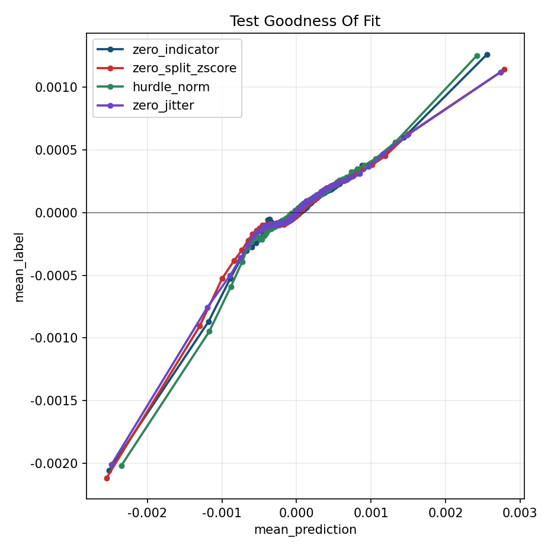

test split mean_prediction vs mean_label.

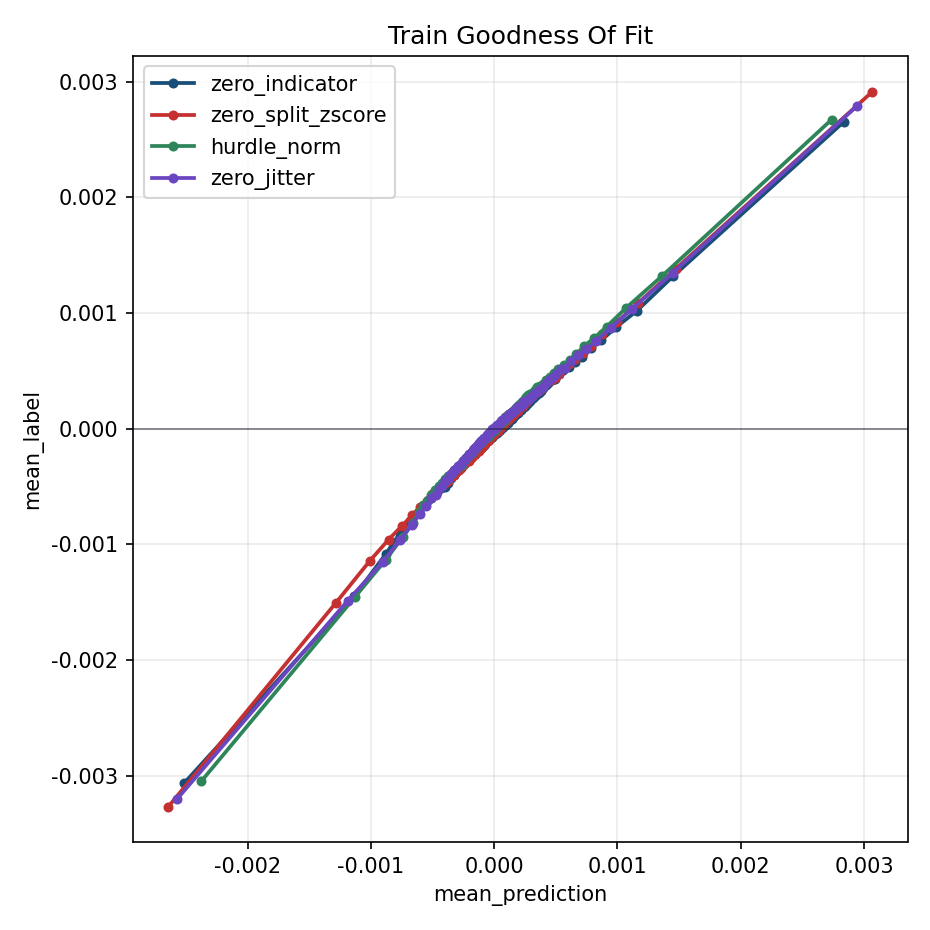

train split mean_prediction vs mean_label.

字段解释

| field | explanation |
| --- | --- |
| split | 数据 split.  |
| prediction_bin | 按 prediction 排序后的等频分箱编号.  |
| mean_prediction | 分组内 prediction 均值.  |
| mean_label | bin 内 label 均值.  |
| label_p05 | bin 内 label 5% 分位数.  |
| label_p95 | bin 内 label 95% 分位数.  |
| row_count | 分组样本数.  |

### 3.4. Top-k Robustness

### Top-k Robustness

| experiment | split | selection_method | k_pct | universe_count | selected_count | selected_fraction | prediction_threshold | mean_label_bps | median_label_bps | label_std_bps | hit_rate | day_count | timestamp_count |
| --- | --- | --- | --- | --- | --- | --- | --- | --- | --- | --- | --- | --- | --- |
| zero_indicator | train | approx_quantile_threshold | 1 | 562,449,686 | 5,525,014 | 0.009823 | 0.001706 | 26.7326 | 17.6989 | 104.4499 | 0.565381 | 125 | 20,241 |
| zero_indicator | train | approx_quantile_threshold | 2 | 562,449,686 | 11,156,433 | 0.019835 | 0.001279 | 19.9396 | 10.4718 | 89.3661 | 0.531308 | 125 | 20,243 |
| zero_indicator | train | approx_quantile_threshold | 3 | 562,449,686 | 16,733,426 | 0.029751 | 0.001066 | 16.7084 | 6.0747 | 81.9604 | 0.513543 | 125 | 20,243 |
| zero_indicator | train | approx_quantile_threshold | 5 | 562,449,686 | 28,110,922 | 0.049979 | 8.228e-04 | 13.2761 | 0.672248 | 73.3199 | 0.492931 | 125 | 20,243 |
| zero_indicator | train | approx_quantile_threshold | 10 | 562,449,686 | 56,343,961 | 0.100176 | 5.425e-04 | 9.5654 | 3.077e-04 | 63.0706 | 0.469497 | 125 | 20,243 |
| zero_indicator | train | approx_quantile_threshold | 15 | 562,449,686 | 84,195,289 | 0.149694 | 4.076e-04 | 7.7851 | 0.000e+00 | 57.5949 | 0.457045 | 125 | 20,243 |
| zero_indicator | train | approx_quantile_threshold | 20 | 562,449,686 | 112,456,923 | 0.199941 | 3.210e-04 | 6.6190 | 0.000e+00 | 53.9339 | 0.447474 | 125 | 20,243 |
| zero_indicator | test | approx_quantile_threshold | 1 | 176,945,440 | 1,754,915 | 0.009918 | 0.001665 | 12.6561 | 0.000e+00 | 92.8057 | 0.460985 | 100 | 16,099 |
| zero_indicator | test | approx_quantile_threshold | 2 | 176,945,440 | 3,511,249 | 0.019844 | 0.001274 | 9.3308 | 0.000e+00 | 81.6977 | 0.445642 | 100 | 16,100 |
| zero_indicator | test | approx_quantile_threshold | 3 | 176,945,440 | 5,273,029 | 0.029800 | 0.001070 | 7.7654 | 0.000e+00 | 75.7127 | 0.437594 | 100 | 16,100 |
| zero_indicator | test | approx_quantile_threshold | 5 | 176,945,440 | 8,849,225 | 0.050011 | 8.346e-04 | 6.1870 | 0.000e+00 | 68.6130 | 0.429296 | 100 | 16,100 |
| zero_indicator | test | approx_quantile_threshold | 10 | 176,945,440 | 17,659,955 | 0.099805 | 5.617e-04 | 4.4529 | 0.000e+00 | 59.8280 | 0.421424 | 100 | 16,100 |
| zero_indicator | test | approx_quantile_threshold | 15 | 176,945,440 | 26,488,906 | 0.149701 | 4.246e-04 | 3.6265 | 0.000e+00 | 55.0652 | 0.417691 | 100 | 16,100 |
| zero_indicator | test | approx_quantile_threshold | 20 | 176,945,440 | 35,341,991 | 0.199734 | 3.369e-04 | 3.1241 | 0.000e+00 | 51.8793 | 0.415209 | 100 | 16,100 |
| zero_split_zscore | train | approx_quantile_threshold | 1 | 562,449,686 | 5,474,640 | 0.009734 | 0.001756 | 29.4616 | 19.4102 | 107.3169 | 0.575548 | 125 | 20,239 |
| zero_split_zscore | train | approx_quantile_threshold | 2 | 562,449,686 | 11,190,576 | 0.019896 | 0.001286 | 21.5350 | 11.6605 | 91.0864 | 0.538105 | 125 | 20,243 |
| zero_split_zscore | train | approx_quantile_threshold | 3 | 562,449,686 | 16,738,052 | 0.029759 | 0.001070 | 17.9928 | 7.6628 | 83.2051 | 0.521292 | 125 | 20,243 |
| zero_split_zscore | train | approx_quantile_threshold | 5 | 562,449,686 | 28,025,463 | 0.049828 | 8.294e-04 | 14.2498 | 2.8114 | 74.2022 | 0.502800 | 125 | 20,243 |
| zero_split_zscore | train | approx_quantile_threshold | 10 | 562,449,686 | 56,121,614 | 0.099781 | 5.448e-04 | 10.1842 | 0.038783 | 63.7469 | 0.479691 | 125 | 20,243 |
| zero_split_zscore | train | approx_quantile_threshold | 15 | 562,449,686 | 84,264,593 | 0.149817 | 3.955e-04 | 8.2017 | 0.000e+00 | 58.2639 | 0.464981 | 125 | 20,243 |
| zero_split_zscore | train | approx_quantile_threshold | 20 | 562,449,686 | 112,438,064 | 0.199908 | 3.023e-04 | 6.9432 | 2.107e-07 | 54.4540 | 0.453486 | 125 | 20,243 |
| zero_split_zscore | test | approx_quantile_threshold | 1 | 176,945,440 | 1,754,160 | 0.009914 | 0.001762 | 11.4445 | 0.000e+00 | 93.0037 | 0.452123 | 100 | 16,099 |
| zero_split_zscore | test | approx_quantile_threshold | 2 | 176,945,440 | 3,509,436 | 0.019833 | 0.001318 | 8.8743 | 0.000e+00 | 81.5157 | 0.443715 | 100 | 16,100 |
| zero_split_zscore | test | approx_quantile_threshold | 3 | 176,945,440 | 5,299,783 | 0.029952 | 0.001093 | 7.4101 | 0.000e+00 | 75.4379 | 0.438216 | 100 | 16,100 |
| zero_split_zscore | test | approx_quantile_threshold | 5 | 176,945,440 | 8,858,066 | 0.050061 | 8.482e-04 | 5.8896 | 0.000e+00 | 68.2794 | 0.432453 | 100 | 16,100 |
| zero_split_zscore | test | approx_quantile_threshold | 10 | 176,945,440 | 17,675,907 | 0.099895 | 5.617e-04 | 4.3369 | 0.000e+00 | 59.6241 | 0.426500 | 100 | 16,100 |
| zero_split_zscore | test | approx_quantile_threshold | 15 | 176,945,440 | 26,497,061 | 0.149747 | 4.102e-04 | 3.6225 | 0.000e+00 | 55.0057 | 0.422903 | 100 | 16,100 |
| zero_split_zscore | test | approx_quantile_threshold | 20 | 176,945,440 | 35,364,525 | 0.199861 | 3.135e-04 | 3.1490 | 0.000e+00 | 51.8100 | 0.419135 | 100 | 16,100 |
| hurdle_norm | train | approx_quantile_threshold | 1 | 562,449,686 | 5,528,808 | 0.009830 | 0.001641 | 26.8907 | 18.4220 | 101.5825 | 0.570800 | 125 | 20,237 |
| hurdle_norm | train | approx_quantile_threshold | 2 | 562,449,686 | 11,134,126 | 0.019796 | 0.001182 | 20.0546 | 10.9218 | 88.4392 | 0.533219 | 125 | 20,243 |
| hurdle_norm | train | approx_quantile_threshold | 3 | 562,449,686 | 16,837,160 | 0.029935 | 9.799e-04 | 16.8016 | 6.4647 | 80.7612 | 0.514844 | 125 | 20,243 |
| hurdle_norm | train | approx_quantile_threshold | 5 | 562,449,686 | 28,093,190 | 0.049948 | 7.680e-04 | 13.4098 | 1.2330 | 71.9581 | 0.496092 | 125 | 20,243 |
| hurdle_norm | train | approx_quantile_threshold | 10 | 562,449,686 | 56,046,573 | 0.099647 | 5.033e-04 | 9.7376 | 0.001620 | 62.0941 | 0.474124 | 125 | 20,243 |
| hurdle_norm | train | approx_quantile_threshold | 15 | 562,449,686 | 84,240,902 | 0.149775 | 3.587e-04 | 7.8901 | 0.000e+00 | 57.0614 | 0.460786 | 125 | 20,243 |
| hurdle_norm | train | approx_quantile_threshold | 20 | 562,449,686 | 112,518,276 | 0.200050 | 2.696e-04 | 6.7092 | 0.000e+00 | 53.5623 | 0.450355 | 125 | 20,243 |
| hurdle_norm | test | approx_quantile_threshold | 1 | 176,945,440 | 1,747,079 | 0.009874 | 0.001570 | 12.5949 | 0.007223 | 91.8553 | 0.469987 | 100 | 16,098 |
| hurdle_norm | test | approx_quantile_threshold | 2 | 176,945,440 | 3,478,907 | 0.019661 | 0.001166 | 9.1396 | 0.000e+00 | 81.6298 | 0.450337 | 100 | 16,100 |
| hurdle_norm | test | approx_quantile_threshold | 3 | 176,945,440 | 5,289,648 | 0.029894 | 9.752e-04 | 7.4878 | 0.000e+00 | 75.0841 | 0.440913 | 100 | 16,100 |
| hurdle_norm | test | approx_quantile_threshold | 5 | 176,945,440 | 8,835,929 | 0.049936 | 7.720e-04 | 5.9425 | 0.000e+00 | 67.5541 | 0.432581 | 100 | 16,100 |
| hurdle_norm | test | approx_quantile_threshold | 10 | 176,945,440 | 17,670,127 | 0.099862 | 5.151e-04 | 4.3370 | 0.000e+00 | 58.8683 | 0.424953 | 100 | 16,100 |
| hurdle_norm | test | approx_quantile_threshold | 15 | 176,945,440 | 26,469,350 | 0.149590 | 3.736e-04 | 3.5350 | 0.000e+00 | 54.4695 | 0.420427 | 100 | 16,100 |
| hurdle_norm | test | approx_quantile_threshold | 20 | 176,945,440 | 35,413,119 | 0.200136 | 2.832e-04 | 3.0308 | 0.000e+00 | 51.3527 | 0.416655 | 100 | 16,100 |
| zero_jitter | train | approx_quantile_threshold | 1 | 562,449,686 | 5,520,150 | 0.009814 | 0.001746 | 28.0970 | 17.6155 | 106.5819 | 0.564309 | 125 | 20,242 |
| zero_jitter | train | approx_quantile_threshold | 2 | 562,449,686 | 11,177,405 | 0.019873 | 0.001249 | 20.7354 | 10.3159 | 91.1032 | 0.530484 | 125 | 20,243 |
| zero_jitter | train | approx_quantile_threshold | 3 | 562,449,686 | 16,946,377 | 0.030130 | 0.001017 | 17.2108 | 6.2186 | 83.1226 | 0.514471 | 125 | 20,243 |
| zero_jitter | train | approx_quantile_threshold | 5 | 562,449,686 | 28,063,252 | 0.049895 | 7.820e-04 | 13.6146 | 1.6825 | 74.2979 | 0.497387 | 125 | 20,243 |
| zero_jitter | train | approx_quantile_threshold | 10 | 562,449,686 | 56,229,544 | 0.099973 | 5.204e-04 | 9.7479 | 0.002224 | 63.6616 | 0.475311 | 125 | 20,243 |
| zero_jitter | train | approx_quantile_threshold | 15 | 562,449,686 | 84,493,515 | 0.150224 | 3.842e-04 | 7.8863 | 0.000e+00 | 58.1294 | 0.461977 | 125 | 20,243 |
| zero_jitter | train | approx_quantile_threshold | 20 | 562,449,686 | 112,474,554 | 0.199973 | 2.905e-04 | 6.6912 | 0.000e+00 | 54.5691 | 0.452168 | 125 | 20,243 |
| zero_jitter | test | approx_quantile_threshold | 1 | 176,945,440 | 1,744,623 | 0.009860 | 0.001763 | 11.2416 | 0.000e+00 | 93.2770 | 0.451856 | 100 | 16,100 |
| zero_jitter | test | approx_quantile_threshold | 2 | 176,945,440 | 3,516,974 | 0.019876 | 0.001286 | 8.7058 | 0.000e+00 | 82.2245 | 0.443369 | 100 | 16,100 |
| zero_jitter | test | approx_quantile_threshold | 3 | 176,945,440 | 5,273,527 | 0.029803 | 0.001051 | 7.3571 | 0.000e+00 | 76.4378 | 0.437698 | 100 | 16,100 |
| zero_jitter | test | approx_quantile_threshold | 5 | 176,945,440 | 8,818,299 | 0.049836 | 8.021e-04 | 5.7684 | 0.000e+00 | 69.3113 | 0.431047 | 100 | 16,100 |
| zero_jitter | test | approx_quantile_threshold | 10 | 176,945,440 | 17,659,316 | 0.099801 | 5.351e-04 | 4.1808 | 0.000e+00 | 60.2922 | 0.423778 | 100 | 16,100 |
| zero_jitter | test | approx_quantile_threshold | 15 | 176,945,440 | 26,471,856 | 0.149605 | 3.997e-04 | 3.4891 | 0.000e+00 | 55.5161 | 0.420626 | 100 | 16,100 |
| zero_jitter | test | approx_quantile_threshold | 20 | 176,945,440 | 35,406,324 | 0.200097 | 3.042e-04 | 3.0408 | 0.000e+00 | 52.3792 | 0.418161 | 100 | 16,100 |

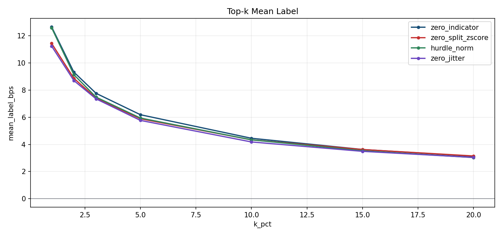

test split k_pct vs mean_label_bps.

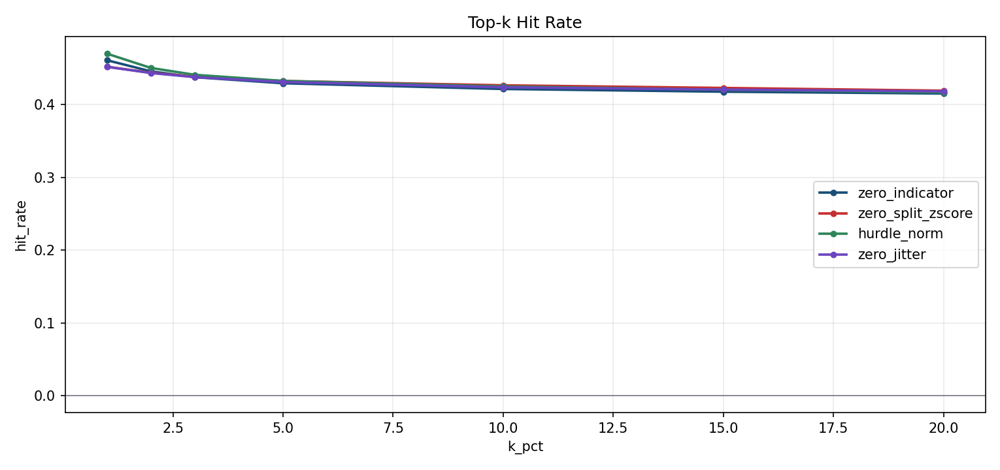

test split k_pct vs hit_rate.

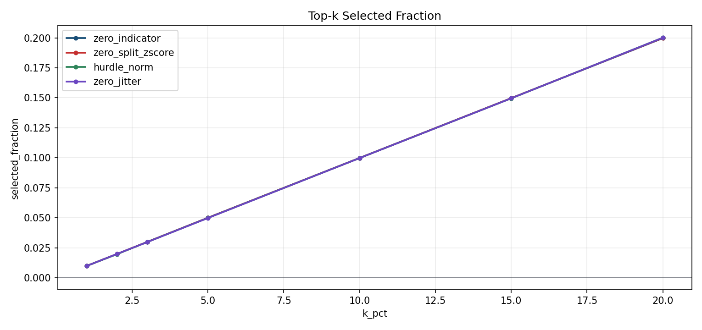

test split k_pct vs selected_fraction.

字段解释

| field | explanation |
| --- | --- |
| split | 数据 split.  |
| selection_method | Top-k 样本选择方法.  |
| k_pct | 选择 prediction 最高的百分比.  |
| universe_count | 可选样本总数.  |
| selected_count | 被选中样本数.  |
| selected_fraction | 实际选中比例.  |
| prediction_threshold | selection threshold.  |
| mean_label_bps | 分组内 target 均值, 单位 bps.  |
| median_label_bps | 选中样本 median label, 单位 bps.  |
| label_std_bps | 选中样本 label 标准差, 单位 bps.  |
| hit_rate | 分组内 target > 0 的比例.  |
| day_count | 覆盖交易日数量.  |
| timestamp_count | 覆盖时间戳数量.  |

### 4. Important Stock Pool And Liquidity

### 4.1. Important Stock Pool

### Important Stock Pool

| experiment | pool | display_name | etf_code | index_code | pearson_ic | rank_ic | mean_prediction_return | mean_real_return | real_return_positive_ratio | prediction_positive_ratio | count |
| --- | --- | --- | --- | --- | --- | --- | --- | --- | --- | --- | --- |
| zero_indicator | csi1000_etf_sh | 1000 ETF | 512100.SH | 000852.SH | 0.037343 | 0.020977 | 5.888e-05 | 1.143e-05 | 0.395209 | 0.557905 | 33,007,297 |
| zero_indicator | csi300_etf_sh | 沪深300 ETF(沪) | 510300.SH | 000300.SH | 0.027225 | 0.015742 | 3.090e-05 | 2.274e-05 | 0.413859 | 0.541492 | 9,902,676 |
| zero_indicator | csi500_etf_sh | 中证500 ETF(沪) | 510500.SH | 000905.SH | 0.027224 | 0.018194 | 4.843e-05 | -1.421e-06 | 0.391603 | 0.550273 | 16,504,116 |
| zero_split_zscore | csi1000_etf_sh | 1000 ETF | 512100.SH | 000852.SH | 0.035033 | 0.020491 | 5.063e-05 | 1.143e-05 | 0.395210 | 0.555157 | 33,006,939 |
| zero_split_zscore | csi300_etf_sh | 沪深300 ETF(沪) | 510300.SH | 000300.SH | 0.021643 | 0.010236 | 3.318e-05 | 2.273e-05 | 0.413860 | 0.559198 | 9,902,704 |
| zero_split_zscore | csi500_etf_sh | 中证500 ETF(沪) | 510500.SH | 000905.SH | 0.022771 | 0.014948 | 4.785e-05 | -1.428e-06 | 0.391604 | 0.565434 | 16,503,930 |
| hurdle_norm | csi1000_etf_sh | 1000 ETF | 512100.SH | 000852.SH | 0.037135 | 0.023165 | 3.194e-05 | 1.142e-05 | 0.395209 | 0.521048 | 33,007,532 |
| hurdle_norm | csi300_etf_sh | 沪深300 ETF(沪) | 510300.SH | 000300.SH | 0.028024 | 0.015573 | 4.471e-05 | 2.275e-05 | 0.413862 | 0.557951 | 9,902,808 |
| hurdle_norm | csi500_etf_sh | 中证500 ETF(沪) | 510500.SH | 000905.SH | 0.026943 | 0.018089 | 3.861e-05 | -1.426e-06 | 0.391605 | 0.538000 | 16,504,286 |
| zero_jitter | csi1000_etf_sh | 1000 ETF | 512100.SH | 000852.SH | 0.033506 | 0.020197 | 3.521e-05 | 1.143e-05 | 0.395211 | 0.504115 | 33,007,015 |
| zero_jitter | csi300_etf_sh | 沪深300 ETF(沪) | 510300.SH | 000300.SH | 0.025227 | 0.013420 | 5.085e-05 | 2.274e-05 | 0.413862 | 0.520246 | 9,902,657 |
| zero_jitter | csi500_etf_sh | 中证500 ETF(沪) | 510500.SH | 000905.SH | 0.026202 | 0.017309 | 4.790e-05 | -1.437e-06 | 0.391603 | 0.523512 | 16,503,780 |

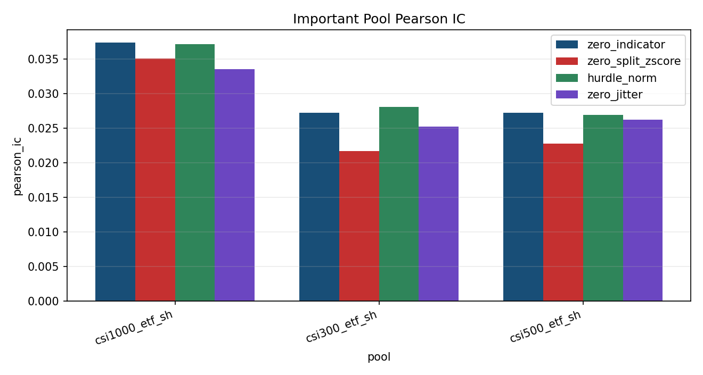

pool-level pearson_ic.

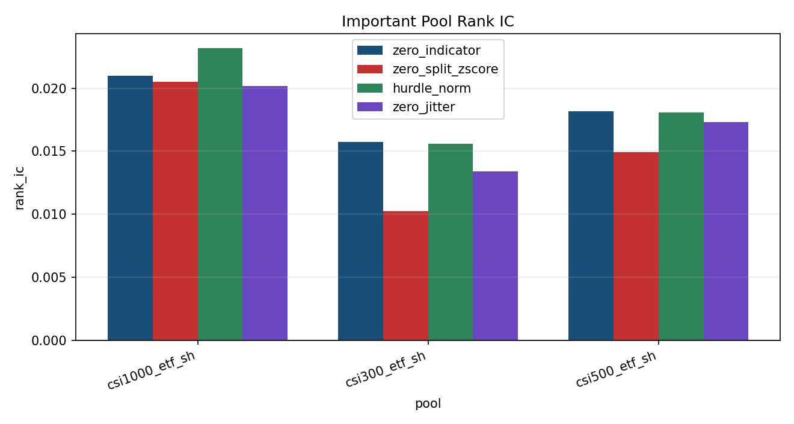

pool-level rank_ic.

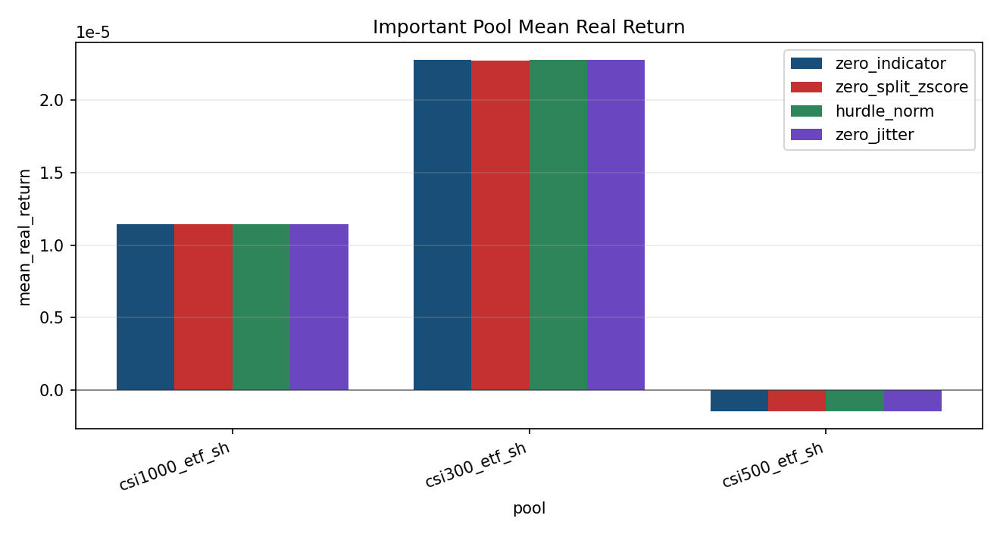

pool-level mean_real_return.

字段解释

| field | explanation |
| --- | --- |
| pool | important stock pool 标识.  |
| display_name | pool 展示名称.  |
| etf_code | pool 对应 ETF code.  |
| index_code | pool 对应指数 code.  |
| pearson_ic | corr(prediction, target).  |
| rank_ic | corr(rank(prediction), rank(target)).  |
| mean_prediction_return | prediction 的样本均值.  |
| mean_real_return | target 的样本均值.  |
| real_return_positive_ratio | target > 0 的样本比例.  |
| prediction_positive_ratio | prediction > 0 的样本比例.  |
| count | 样本数.  |

### 4.2. Important Pool Prediction Curve

Important Pool Prediction Curve

| experiment | pool | prediction_bin | mean_prediction_return | mean_real_return | real_return_positive_ratio | count |
| --- | --- | --- | --- | --- | --- | --- |
| zero_indicator | csi1000_etf_sh | 1 | -7.974e-04 | -2.777e-04 | 0.404115 | 1,650,365 |
| zero_indicator | csi1000_etf_sh | 2 | -4.003e-04 | -3.082e-05 | 0.412495 | 1,650,365 |
| zero_indicator | csi1000_etf_sh | 3 | -3.009e-04 | -6.782e-05 | 0.398788 | 1,650,365 |
| zero_indicator | csi1000_etf_sh | 4 | -2.358e-04 | -6.979e-05 | 0.390288 | 1,650,365 |
| zero_indicator | csi1000_etf_sh | 5 | -1.807e-04 | -7.081e-05 | 0.386657 | 1,650,365 |
| zero_indicator | csi1000_etf_sh | 6 | -1.325e-04 | -7.253e-05 | 0.383171 | 1,650,365 |
| zero_indicator | csi1000_etf_sh | 7 | -8.921e-05 | -6.783e-05 | 0.381841 | 1,650,365 |
| zero_indicator | csi1000_etf_sh | 8 | -4.945e-05 | -4.435e-05 | 0.377283 | 1,650,365 |
| zero_indicator | csi1000_etf_sh | 9 | -1.240e-05 | -2.696e-05 | 0.376389 | 1,650,365 |
| zero_indicator | csi1000_etf_sh | 10 | 2.362e-05 | -4.416e-06 | 0.381273 | 1,650,365 |
| zero_indicator | csi1000_etf_sh | 11 | 5.934e-05 | 2.931e-06 | 0.382296 | 1,650,365 |
| zero_indicator | csi1000_etf_sh | 12 | 9.569e-05 | 2.307e-05 | 0.387455 | 1,650,365 |
| zero_indicator | csi1000_etf_sh | 13 | 1.337e-04 | 4.229e-05 | 0.393174 | 1,650,365 |
| zero_indicator | csi1000_etf_sh | 14 | 1.748e-04 | 6.605e-05 | 0.398488 | 1,650,365 |
| zero_indicator | csi1000_etf_sh | 15 | 2.202e-04 | 8.578e-05 | 0.403217 | 1,650,365 |
| zero_indicator | csi1000_etf_sh | 16 | 2.722e-04 | 1.026e-04 | 0.406806 | 1,650,365 |
| zero_indicator | csi1000_etf_sh | 17 | 3.353e-04 | 1.144e-04 | 0.407520 | 1,650,365 |
| zero_indicator | csi1000_etf_sh | 18 | 4.211e-04 | 1.191e-04 | 0.408235 | 1,650,364 |
| zero_indicator | csi1000_etf_sh | 19 | 5.656e-04 | 1.407e-04 | 0.408697 | 1,650,364 |
| zero_indicator | csi1000_etf_sh | 20 | 0.001075 | 2.647e-04 | 0.415989 | 1,650,364 |
| zero_indicator | csi300_etf_sh | 1 | -6.352e-04 | -1.746e-04 | 0.421359 | 495,134 |
| zero_indicator | csi300_etf_sh | 2 | -3.527e-04 | 6.360e-06 | 0.426010 | 495,134 |
| zero_indicator | csi300_etf_sh | 3 | -2.822e-04 | -1.921e-05 | 0.417416 | 495,134 |
| zero_indicator | csi300_etf_sh | 4 | -2.292e-04 | -2.532e-05 | 0.408405 | 495,134 |
| zero_indicator | csi300_etf_sh | 5 | -1.799e-04 | -2.847e-05 | 0.406551 | 495,134 |
| zero_indicator | csi300_etf_sh | 6 | -1.349e-04 | -2.272e-05 | 0.403642 | 495,134 |
| zero_indicator | csi300_etf_sh | 7 | -9.392e-05 | -1.506e-05 | 0.401909 | 495,134 |
| zero_indicator | csi300_etf_sh | 8 | -5.645e-05 | -1.004e-05 | 0.399843 | 495,134 |
| zero_indicator | csi300_etf_sh | 9 | -2.193e-05 | -5.515e-06 | 0.399601 | 495,134 |
| zero_indicator | csi300_etf_sh | 10 | 1.050e-05 | 9.421e-06 | 0.402255 | 495,134 |
| zero_indicator | csi300_etf_sh | 11 | 4.210e-05 | 2.944e-05 | 0.404900 | 495,134 |
| zero_indicator | csi300_etf_sh | 12 | 7.401e-05 | 3.294e-05 | 0.406643 | 495,134 |
| zero_indicator | csi300_etf_sh | 13 | 1.072e-04 | 3.929e-05 | 0.409528 | 495,134 |
| zero_indicator | csi300_etf_sh | 14 | 1.427e-04 | 6.054e-05 | 0.415148 | 495,134 |
| zero_indicator | csi300_etf_sh | 15 | 1.812e-04 | 6.380e-05 | 0.417849 | 495,134 |
| zero_indicator | csi300_etf_sh | 16 | 2.241e-04 | 6.512e-05 | 0.420183 | 495,134 |
| zero_indicator | csi300_etf_sh | 17 | 2.741e-04 | 7.461e-05 | 0.422355 | 495,133 |
| zero_indicator | csi300_etf_sh | 18 | 3.373e-04 | 7.642e-05 | 0.427673 | 495,133 |
| zero_indicator | csi300_etf_sh | 19 | 4.335e-04 | 1.167e-04 | 0.432171 | 495,133 |
| zero_indicator | csi300_etf_sh | 20 | 7.778e-04 | 1.810e-04 | 0.433738 | 495,133 |
| zero_indicator | csi500_etf_sh | 1 | -6.692e-04 | -1.605e-04 | 0.412049 | 825,206 |
| zero_indicator | csi500_etf_sh | 2 | -3.640e-04 | -2.439e-05 | 0.409061 | 825,206 |
| zero_indicator | csi500_etf_sh | 3 | -2.849e-04 | -7.958e-05 | 0.393170 | 825,206 |
| zero_indicator | csi500_etf_sh | 4 | -2.276e-04 | -8.475e-05 | 0.384002 | 825,206 |
| zero_indicator | csi500_etf_sh | 5 | -1.769e-04 | -7.825e-05 | 0.381008 | 825,206 |
| zero_indicator | csi500_etf_sh | 6 | -1.318e-04 | -6.543e-05 | 0.378876 | 825,206 |
| zero_indicator | csi500_etf_sh | 7 | -9.074e-05 | -6.465e-05 | 0.377285 | 825,206 |
| zero_indicator | csi500_etf_sh | 8 | -5.286e-05 | -5.589e-05 | 0.375076 | 825,206 |
| zero_indicator | csi500_etf_sh | 9 | -1.721e-05 | -5.094e-05 | 0.374142 | 825,206 |
| zero_indicator | csi500_etf_sh | 10 | 1.731e-05 | -1.989e-05 | 0.378844 | 825,206 |
| zero_indicator | csi500_etf_sh | 11 | 5.137e-05 | -1.585e-05 | 0.380483 | 825,206 |
| zero_indicator | csi500_etf_sh | 12 | 8.597e-05 | 2.023e-05 | 0.386264 | 825,206 |
| zero_indicator | csi500_etf_sh | 13 | 1.220e-04 | 2.994e-05 | 0.390395 | 825,206 |
| zero_indicator | csi500_etf_sh | 14 | 1.605e-04 | 3.714e-05 | 0.393843 | 825,206 |
| zero_indicator | csi500_etf_sh | 15 | 2.026e-04 | 6.603e-05 | 0.400116 | 825,206 |
| zero_indicator | csi500_etf_sh | 16 | 2.499e-04 | 6.401e-05 | 0.401122 | 825,206 |
| zero_indicator | csi500_etf_sh | 17 | 3.058e-04 | 8.493e-05 | 0.404663 | 825,205 |
| zero_indicator | csi500_etf_sh | 18 | 3.787e-04 | 9.358e-05 | 0.404973 | 825,205 |
| zero_indicator | csi500_etf_sh | 19 | 4.980e-04 | 9.767e-05 | 0.404698 | 825,205 |
| zero_indicator | csi500_etf_sh | 20 | 9.114e-04 | 1.782e-04 | 0.401989 | 825,205 |
| zero_split_zscore | csi1000_etf_sh | 1 | -8.819e-04 | -2.532e-04 | 0.410837 | 1,650,347 |
| zero_split_zscore | csi1000_etf_sh | 2 | -4.456e-04 | -4.595e-05 | 0.410794 | 1,650,347 |
| zero_split_zscore | csi1000_etf_sh | 3 | -3.158e-04 | -7.316e-05 | 0.397480 | 1,650,347 |
| zero_split_zscore | csi1000_etf_sh | 4 | -2.311e-04 | -8.681e-05 | 0.387483 | 1,650,347 |
| zero_split_zscore | csi1000_etf_sh | 5 | -1.700e-04 | -8.463e-05 | 0.384071 | 1,650,347 |
| zero_split_zscore | csi1000_etf_sh | 6 | -1.220e-04 | -7.963e-05 | 0.380946 | 1,650,347 |
| zero_split_zscore | csi1000_etf_sh | 7 | -8.147e-05 | -6.373e-05 | 0.379795 | 1,650,347 |
| zero_split_zscore | csi1000_etf_sh | 8 | -4.553e-05 | -4.105e-05 | 0.375082 | 1,650,347 |
| zero_split_zscore | csi1000_etf_sh | 9 | -1.270e-05 | -2.039e-05 | 0.371513 | 1,650,347 |
| zero_split_zscore | csi1000_etf_sh | 10 | 1.925e-05 | -4.585e-06 | 0.380626 | 1,650,347 |
| zero_split_zscore | csi1000_etf_sh | 11 | 5.146e-05 | 1.920e-05 | 0.386674 | 1,650,347 |
| zero_split_zscore | csi1000_etf_sh | 12 | 8.468e-05 | 4.039e-05 | 0.391055 | 1,650,347 |
| zero_split_zscore | csi1000_etf_sh | 13 | 1.197e-04 | 5.498e-05 | 0.393005 | 1,650,347 |
| zero_split_zscore | csi1000_etf_sh | 14 | 1.579e-04 | 6.787e-05 | 0.395882 | 1,650,347 |
| zero_split_zscore | csi1000_etf_sh | 15 | 2.012e-04 | 8.577e-05 | 0.399186 | 1,650,347 |
| zero_split_zscore | csi1000_etf_sh | 16 | 2.534e-04 | 8.831e-05 | 0.401675 | 1,650,347 |
| zero_split_zscore | csi1000_etf_sh | 17 | 3.212e-04 | 1.148e-04 | 0.407571 | 1,650,347 |
| zero_split_zscore | csi1000_etf_sh | 18 | 4.199e-04 | 1.356e-04 | 0.413214 | 1,650,347 |
| zero_split_zscore | csi1000_etf_sh | 19 | 5.834e-04 | 1.648e-04 | 0.419073 | 1,650,347 |
| zero_split_zscore | csi1000_etf_sh | 20 | 0.001107 | 2.100e-04 | 0.418241 | 1,650,346 |
| zero_split_zscore | csi300_etf_sh | 1 | -7.695e-04 | -1.143e-04 | 0.431443 | 495,136 |
| zero_split_zscore | csi300_etf_sh | 2 | -4.377e-04 | 1.404e-05 | 0.430203 | 495,136 |
| zero_split_zscore | csi300_etf_sh | 3 | -3.176e-04 | -1.183e-05 | 0.418634 | 495,136 |
| zero_split_zscore | csi300_etf_sh | 4 | -2.344e-04 | -2.564e-05 | 0.411677 | 495,136 |
| zero_split_zscore | csi300_etf_sh | 5 | -1.708e-04 | -1.632e-05 | 0.408557 | 495,135 |
| zero_split_zscore | csi300_etf_sh | 6 | -1.206e-04 | -6.837e-06 | 0.406148 | 495,135 |
| zero_split_zscore | csi300_etf_sh | 7 | -7.899e-05 | -1.920e-05 | 0.401351 | 495,135 |
| zero_split_zscore | csi300_etf_sh | 8 | -4.276e-05 | 1.364e-06 | 0.402658 | 495,135 |
| zero_split_zscore | csi300_etf_sh | 9 | -1.000e-05 | 2.021e-06 | 0.400561 | 495,135 |
| zero_split_zscore | csi300_etf_sh | 10 | 2.103e-05 | 9.446e-06 | 0.402777 | 495,135 |
| zero_split_zscore | csi300_etf_sh | 11 | 5.139e-05 | 1.637e-05 | 0.405623 | 495,135 |
| zero_split_zscore | csi300_etf_sh | 12 | 8.204e-05 | 1.812e-05 | 0.407335 | 495,135 |
| zero_split_zscore | csi300_etf_sh | 13 | 1.139e-04 | 3.858e-05 | 0.409347 | 495,135 |
| zero_split_zscore | csi300_etf_sh | 14 | 1.483e-04 | 3.473e-05 | 0.409387 | 495,135 |
| zero_split_zscore | csi300_etf_sh | 15 | 1.866e-04 | 4.219e-05 | 0.411500 | 495,135 |
| zero_split_zscore | csi300_etf_sh | 16 | 2.312e-04 | 5.094e-05 | 0.414378 | 495,135 |
| zero_split_zscore | csi300_etf_sh | 17 | 2.867e-04 | 6.221e-05 | 0.417773 | 495,135 |
| zero_split_zscore | csi300_etf_sh | 18 | 3.648e-04 | 8.603e-05 | 0.424882 | 495,135 |
| zero_split_zscore | csi300_etf_sh | 19 | 4.945e-04 | 1.268e-04 | 0.432403 | 495,135 |
| zero_split_zscore | csi300_etf_sh | 20 | 8.653e-04 | 1.459e-04 | 0.430553 | 495,135 |
| zero_split_zscore | csi500_etf_sh | 1 | -7.739e-04 | -1.275e-04 | 0.421448 | 825,197 |
| zero_split_zscore | csi500_etf_sh | 2 | -4.185e-04 | -3.401e-05 | 0.409706 | 825,197 |
| zero_split_zscore | csi500_etf_sh | 3 | -2.974e-04 | -6.685e-05 | 0.393845 | 825,197 |
| zero_split_zscore | csi500_etf_sh | 4 | -2.161e-04 | -8.976e-05 | 0.382827 | 825,197 |
| zero_split_zscore | csi500_etf_sh | 5 | -1.571e-04 | -8.142e-05 | 0.379168 | 825,197 |
| zero_split_zscore | csi500_etf_sh | 6 | -1.107e-04 | -7.187e-05 | 0.375611 | 825,197 |
| zero_split_zscore | csi500_etf_sh | 7 | -7.175e-05 | -5.896e-05 | 0.374943 | 825,197 |
| zero_split_zscore | csi500_etf_sh | 8 | -3.747e-05 | -5.063e-05 | 0.371321 | 825,197 |
| zero_split_zscore | csi500_etf_sh | 9 | -5.924e-06 | -3.716e-05 | 0.373021 | 825,197 |
| zero_split_zscore | csi500_etf_sh | 10 | 2.463e-05 | -8.288e-06 | 0.380206 | 825,197 |
| zero_split_zscore | csi500_etf_sh | 11 | 5.509e-05 | -2.580e-06 | 0.382714 | 825,196 |
| zero_split_zscore | csi500_etf_sh | 12 | 8.625e-05 | 2.652e-05 | 0.387118 | 825,196 |
| zero_split_zscore | csi500_etf_sh | 13 | 1.190e-04 | 2.801e-05 | 0.388709 | 825,196 |
| zero_split_zscore | csi500_etf_sh | 14 | 1.545e-04 | 3.958e-05 | 0.390135 | 825,196 |
| zero_split_zscore | csi500_etf_sh | 15 | 1.944e-04 | 4.083e-05 | 0.392285 | 825,196 |
| zero_split_zscore | csi500_etf_sh | 16 | 2.417e-04 | 6.524e-05 | 0.396568 | 825,196 |
| zero_split_zscore | csi500_etf_sh | 17 | 3.021e-04 | 6.602e-05 | 0.400847 | 825,196 |
| zero_split_zscore | csi500_etf_sh | 18 | 3.891e-04 | 1.045e-04 | 0.408830 | 825,196 |
| zero_split_zscore | csi500_etf_sh | 19 | 5.326e-04 | 1.259e-04 | 0.414403 | 825,196 |
| zero_split_zscore | csi500_etf_sh | 20 | 9.462e-04 | 1.039e-04 | 0.408365 | 825,196 |
| hurdle_norm | csi1000_etf_sh | 1 | -7.663e-04 | -2.687e-04 | 0.402482 | 1,650,377 |
| hurdle_norm | csi1000_etf_sh | 2 | -4.385e-04 | -1.381e-04 | 0.394453 | 1,650,377 |
| hurdle_norm | csi1000_etf_sh | 3 | -3.207e-04 | -1.018e-04 | 0.391380 | 1,650,377 |
| hurdle_norm | csi1000_etf_sh | 4 | -2.429e-04 | -8.451e-05 | 0.388776 | 1,650,377 |
| hurdle_norm | csi1000_etf_sh | 5 | -1.905e-04 | -7.333e-05 | 0.387076 | 1,650,377 |
| hurdle_norm | csi1000_etf_sh | 6 | -1.462e-04 | -5.550e-05 | 0.385942 | 1,650,377 |
| hurdle_norm | csi1000_etf_sh | 7 | -1.067e-04 | -4.453e-05 | 0.386151 | 1,650,377 |
| hurdle_norm | csi1000_etf_sh | 8 | -7.033e-05 | -1.747e-05 | 0.385533 | 1,650,377 |
| hurdle_norm | csi1000_etf_sh | 9 | -3.601e-05 | -9.635e-06 | 0.383194 | 1,650,377 |
| hurdle_norm | csi1000_etf_sh | 10 | -2.630e-06 | 1.378e-05 | 0.385770 | 1,650,377 |
| hurdle_norm | csi1000_etf_sh | 11 | 3.067e-05 | 3.829e-05 | 0.389025 | 1,650,377 |
| hurdle_norm | csi1000_etf_sh | 12 | 6.460e-05 | 4.989e-05 | 0.390700 | 1,650,377 |
| hurdle_norm | csi1000_etf_sh | 13 | 9.999e-05 | 6.374e-05 | 0.393851 | 1,650,376 |
| hurdle_norm | csi1000_etf_sh | 14 | 1.381e-04 | 7.502e-05 | 0.395401 | 1,650,376 |
| hurdle_norm | csi1000_etf_sh | 15 | 1.806e-04 | 8.944e-05 | 0.399244 | 1,650,376 |
| hurdle_norm | csi1000_etf_sh | 16 | 2.304e-04 | 9.362e-05 | 0.401578 | 1,650,376 |
| hurdle_norm | csi1000_etf_sh | 17 | 2.934e-04 | 1.093e-04 | 0.405342 | 1,650,376 |
| hurdle_norm | csi1000_etf_sh | 18 | 3.828e-04 | 1.186e-04 | 0.409309 | 1,650,376 |
| hurdle_norm | csi1000_etf_sh | 19 | 5.330e-04 | 1.376e-04 | 0.412234 | 1,650,376 |
| hurdle_norm | csi1000_etf_sh | 20 | 0.001006 | 2.329e-04 | 0.416743 | 1,650,376 |
| hurdle_norm | csi300_etf_sh | 1 | -6.256e-04 | -1.818e-04 | 0.416122 | 495,141 |
| hurdle_norm | csi300_etf_sh | 2 | -3.776e-04 | -4.191e-05 | 0.422423 | 495,141 |
| hurdle_norm | csi300_etf_sh | 3 | -2.679e-04 | -2.369e-05 | 0.420321 | 495,141 |
| hurdle_norm | csi300_etf_sh | 4 | -2.043e-04 | -1.199e-05 | 0.417360 | 495,141 |
| hurdle_norm | csi300_etf_sh | 5 | -1.554e-04 | 6.720e-06 | 0.416368 | 495,141 |
| hurdle_norm | csi300_etf_sh | 6 | -1.137e-04 | 5.463e-07 | 0.412365 | 495,141 |
| hurdle_norm | csi300_etf_sh | 7 | -7.674e-05 | -1.340e-06 | 0.409289 | 495,141 |
| hurdle_norm | csi300_etf_sh | 8 | -4.280e-05 | -1.255e-06 | 0.404626 | 495,141 |
| hurdle_norm | csi300_etf_sh | 9 | -1.071e-05 | 8.045e-06 | 0.404086 | 495,140 |
| hurdle_norm | csi300_etf_sh | 10 | 2.037e-05 | 1.978e-05 | 0.405285 | 495,140 |
| hurdle_norm | csi300_etf_sh | 11 | 5.111e-05 | 2.729e-05 | 0.407000 | 495,140 |
| hurdle_norm | csi300_etf_sh | 12 | 8.230e-05 | 3.604e-05 | 0.407578 | 495,140 |
| hurdle_norm | csi300_etf_sh | 13 | 1.146e-04 | 3.843e-05 | 0.407265 | 495,140 |
| hurdle_norm | csi300_etf_sh | 14 | 1.488e-04 | 3.871e-05 | 0.407961 | 495,140 |
| hurdle_norm | csi300_etf_sh | 15 | 1.863e-04 | 5.129e-05 | 0.411934 | 495,140 |
| hurdle_norm | csi300_etf_sh | 16 | 2.291e-04 | 5.338e-05 | 0.412869 | 495,140 |
| hurdle_norm | csi300_etf_sh | 17 | 2.817e-04 | 5.317e-05 | 0.414717 | 495,140 |
| hurdle_norm | csi300_etf_sh | 18 | 3.546e-04 | 7.284e-05 | 0.416769 | 495,140 |
| hurdle_norm | csi300_etf_sh | 19 | 4.769e-04 | 1.086e-04 | 0.424924 | 495,140 |
| hurdle_norm | csi300_etf_sh | 20 | 8.232e-04 | 2.021e-04 | 0.437973 | 495,140 |
| hurdle_norm | csi500_etf_sh | 1 | -6.557e-04 | -1.805e-04 | 0.406100 | 825,215 |
| hurdle_norm | csi500_etf_sh | 2 | -3.945e-04 | -8.922e-05 | 0.397446 | 825,215 |
| hurdle_norm | csi500_etf_sh | 3 | -2.835e-04 | -8.281e-05 | 0.390056 | 825,215 |
| hurdle_norm | csi500_etf_sh | 4 | -2.171e-04 | -6.967e-05 | 0.387835 | 825,215 |
| hurdle_norm | csi500_etf_sh | 5 | -1.683e-04 | -6.310e-05 | 0.384742 | 825,215 |
| hurdle_norm | csi500_etf_sh | 6 | -1.268e-04 | -6.151e-05 | 0.382161 | 825,215 |
| hurdle_norm | csi500_etf_sh | 7 | -8.984e-05 | -4.568e-05 | 0.381839 | 825,214 |
| hurdle_norm | csi500_etf_sh | 8 | -5.562e-05 | -2.625e-05 | 0.382320 | 825,214 |
| hurdle_norm | csi500_etf_sh | 9 | -2.332e-05 | -2.029e-05 | 0.380814 | 825,214 |
| hurdle_norm | csi500_etf_sh | 10 | 8.120e-06 | -4.252e-06 | 0.383155 | 825,214 |
| hurdle_norm | csi500_etf_sh | 11 | 3.942e-05 | 7.122e-06 | 0.384809 | 825,214 |
| hurdle_norm | csi500_etf_sh | 12 | 7.139e-05 | 3.589e-05 | 0.387959 | 825,214 |
| hurdle_norm | csi500_etf_sh | 13 | 1.047e-04 | 2.985e-05 | 0.387455 | 825,214 |
| hurdle_norm | csi500_etf_sh | 14 | 1.405e-04 | 4.256e-05 | 0.390991 | 825,214 |
| hurdle_norm | csi500_etf_sh | 15 | 1.801e-04 | 4.140e-05 | 0.391863 | 825,214 |
| hurdle_norm | csi500_etf_sh | 16 | 2.261e-04 | 4.792e-05 | 0.394414 | 825,214 |
| hurdle_norm | csi500_etf_sh | 17 | 2.834e-04 | 5.937e-05 | 0.397743 | 825,214 |
| hurdle_norm | csi500_etf_sh | 18 | 3.634e-04 | 8.060e-05 | 0.403301 | 825,214 |
| hurdle_norm | csi500_etf_sh | 19 | 4.945e-04 | 1.095e-04 | 0.407297 | 825,214 |
| hurdle_norm | csi500_etf_sh | 20 | 8.752e-04 | 1.606e-04 | 0.409791 | 825,214 |
| zero_jitter | csi1000_etf_sh | 1 | -7.879e-04 | -2.005e-04 | 0.410860 | 1,650,351 |
| zero_jitter | csi1000_etf_sh | 2 | -4.165e-04 | -6.104e-05 | 0.406734 | 1,650,351 |
| zero_jitter | csi1000_etf_sh | 3 | -3.195e-04 | -7.063e-05 | 0.395481 | 1,650,351 |
| zero_jitter | csi1000_etf_sh | 4 | -2.519e-04 | -8.120e-05 | 0.388079 | 1,650,351 |
| zero_jitter | csi1000_etf_sh | 5 | -1.979e-04 | -8.454e-05 | 0.382286 | 1,650,351 |
| zero_jitter | csi1000_etf_sh | 6 | -1.524e-04 | -8.005e-05 | 0.375582 | 1,650,351 |
| zero_jitter | csi1000_etf_sh | 7 | -1.130e-04 | -7.083e-05 | 0.374467 | 1,650,351 |
| zero_jitter | csi1000_etf_sh | 8 | -7.778e-05 | -5.753e-05 | 0.374002 | 1,650,351 |
| zero_jitter | csi1000_etf_sh | 9 | -4.502e-05 | -3.708e-05 | 0.375944 | 1,650,351 |
| zero_jitter | csi1000_etf_sh | 10 | -1.323e-05 | -7.830e-06 | 0.379794 | 1,650,351 |
| zero_jitter | csi1000_etf_sh | 11 | 1.880e-05 | 1.148e-05 | 0.383363 | 1,650,351 |
| zero_jitter | csi1000_etf_sh | 12 | 5.259e-05 | 3.406e-05 | 0.389511 | 1,650,351 |
| zero_jitter | csi1000_etf_sh | 13 | 8.986e-05 | 5.388e-05 | 0.395030 | 1,650,351 |
| zero_jitter | csi1000_etf_sh | 14 | 1.325e-04 | 8.074e-05 | 0.402004 | 1,650,351 |
| zero_jitter | csi1000_etf_sh | 15 | 1.823e-04 | 9.264e-05 | 0.406260 | 1,650,351 |
| zero_jitter | csi1000_etf_sh | 16 | 2.413e-04 | 9.937e-05 | 0.408462 | 1,650,350 |
| zero_jitter | csi1000_etf_sh | 17 | 3.133e-04 | 1.211e-04 | 0.412773 | 1,650,350 |
| zero_jitter | csi1000_etf_sh | 18 | 4.080e-04 | 1.306e-04 | 0.413786 | 1,650,350 |
| zero_jitter | csi1000_etf_sh | 19 | 5.545e-04 | 1.367e-04 | 0.412548 | 1,650,350 |
| zero_jitter | csi1000_etf_sh | 20 | 0.001086 | 2.192e-04 | 0.417248 | 1,650,350 |
| zero_jitter | csi300_etf_sh | 1 | -6.246e-04 | -1.080e-04 | 0.427279 | 495,133 |
| zero_jitter | csi300_etf_sh | 2 | -3.570e-04 | -2.358e-05 | 0.424336 | 495,133 |
| zero_jitter | csi300_etf_sh | 3 | -2.752e-04 | -3.062e-05 | 0.412324 | 495,133 |
| zero_jitter | csi300_etf_sh | 4 | -2.180e-04 | -3.350e-05 | 0.406024 | 495,133 |
| zero_jitter | csi300_etf_sh | 5 | -1.720e-04 | -3.661e-05 | 0.401506 | 495,133 |
| zero_jitter | csi300_etf_sh | 6 | -1.329e-04 | -2.551e-05 | 0.400331 | 495,133 |
| zero_jitter | csi300_etf_sh | 7 | -9.788e-05 | -1.720e-05 | 0.397964 | 495,133 |
| zero_jitter | csi300_etf_sh | 8 | -6.544e-05 | -6.344e-06 | 0.398717 | 495,133 |
| zero_jitter | csi300_etf_sh | 9 | -3.411e-05 | -4.316e-06 | 0.400254 | 495,133 |
| zero_jitter | csi300_etf_sh | 10 | -2.937e-06 | 1.615e-05 | 0.403833 | 495,133 |
| zero_jitter | csi300_etf_sh | 11 | 2.925e-05 | 1.726e-05 | 0.405853 | 495,133 |
| zero_jitter | csi300_etf_sh | 12 | 6.407e-05 | 2.986e-05 | 0.408999 | 495,133 |
| zero_jitter | csi300_etf_sh | 13 | 1.032e-04 | 3.736e-05 | 0.412687 | 495,133 |
| zero_jitter | csi300_etf_sh | 14 | 1.474e-04 | 5.390e-05 | 0.418108 | 495,133 |
| zero_jitter | csi300_etf_sh | 15 | 1.971e-04 | 6.097e-05 | 0.421850 | 495,133 |
| zero_jitter | csi300_etf_sh | 16 | 2.543e-04 | 6.482e-05 | 0.424260 | 495,133 |
| zero_jitter | csi300_etf_sh | 17 | 3.223e-04 | 9.105e-05 | 0.428881 | 495,133 |
| zero_jitter | csi300_etf_sh | 18 | 4.102e-04 | 8.799e-05 | 0.427745 | 495,132 |
| zero_jitter | csi300_etf_sh | 19 | 5.433e-04 | 1.097e-04 | 0.426248 | 495,132 |
| zero_jitter | csi300_etf_sh | 20 | 9.259e-04 | 1.713e-04 | 0.430045 | 495,132 |
| zero_jitter | csi500_etf_sh | 1 | -6.576e-04 | -1.191e-04 | 0.416014 | 825,189 |
| zero_jitter | csi500_etf_sh | 2 | -3.681e-04 | -5.828e-05 | 0.403305 | 825,189 |
| zero_jitter | csi500_etf_sh | 3 | -2.811e-04 | -6.496e-05 | 0.390929 | 825,189 |
| zero_jitter | csi500_etf_sh | 4 | -2.204e-04 | -8.219e-05 | 0.381051 | 825,189 |
| zero_jitter | csi500_etf_sh | 5 | -1.719e-04 | -8.526e-05 | 0.375222 | 825,189 |
| zero_jitter | csi500_etf_sh | 6 | -1.310e-04 | -8.363e-05 | 0.372740 | 825,189 |
| zero_jitter | csi500_etf_sh | 7 | -9.513e-05 | -7.063e-05 | 0.372972 | 825,189 |
| zero_jitter | csi500_etf_sh | 8 | -6.249e-05 | -5.686e-05 | 0.372103 | 825,189 |
| zero_jitter | csi500_etf_sh | 9 | -3.148e-05 | -5.645e-05 | 0.372524 | 825,189 |
| zero_jitter | csi500_etf_sh | 10 | -8.907e-07 | -2.828e-05 | 0.376436 | 825,189 |
| zero_jitter | csi500_etf_sh | 11 | 3.025e-05 | -8.345e-07 | 0.381647 | 825,189 |
| zero_jitter | csi500_etf_sh | 12 | 6.346e-05 | 9.617e-06 | 0.385583 | 825,189 |
| zero_jitter | csi500_etf_sh | 13 | 1.003e-04 | 2.777e-05 | 0.390992 | 825,189 |
| zero_jitter | csi500_etf_sh | 14 | 1.422e-04 | 5.397e-05 | 0.397650 | 825,189 |
| zero_jitter | csi500_etf_sh | 15 | 1.904e-04 | 5.796e-05 | 0.401748 | 825,189 |
| zero_jitter | csi500_etf_sh | 16 | 2.466e-04 | 7.956e-05 | 0.405243 | 825,189 |
| zero_jitter | csi500_etf_sh | 17 | 3.142e-04 | 8.458e-05 | 0.407881 | 825,189 |
| zero_jitter | csi500_etf_sh | 18 | 4.023e-04 | 1.107e-04 | 0.410470 | 825,189 |
| zero_jitter | csi500_etf_sh | 19 | 5.362e-04 | 1.007e-04 | 0.408091 | 825,189 |
| zero_jitter | csi500_etf_sh | 20 | 9.524e-04 | 1.529e-04 | 0.409460 | 825,189 |

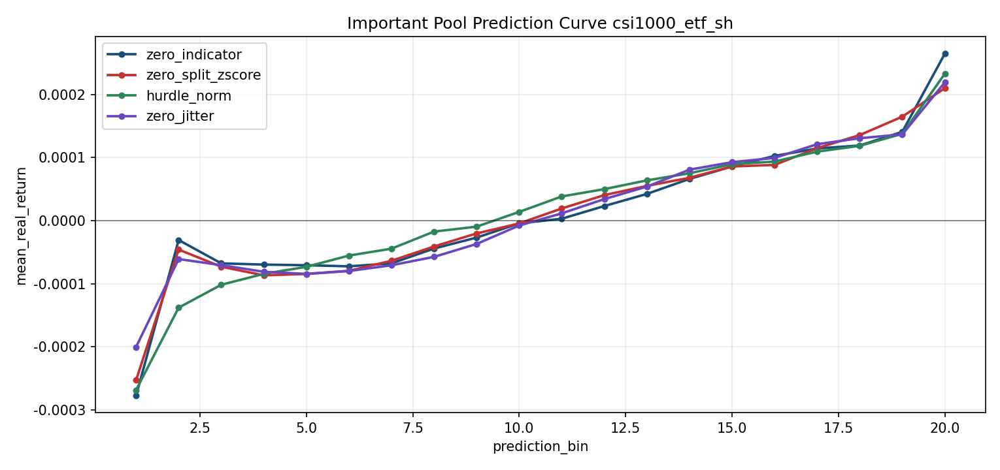

csi1000_etf_sh: prediction_bin vs mean_real_return.

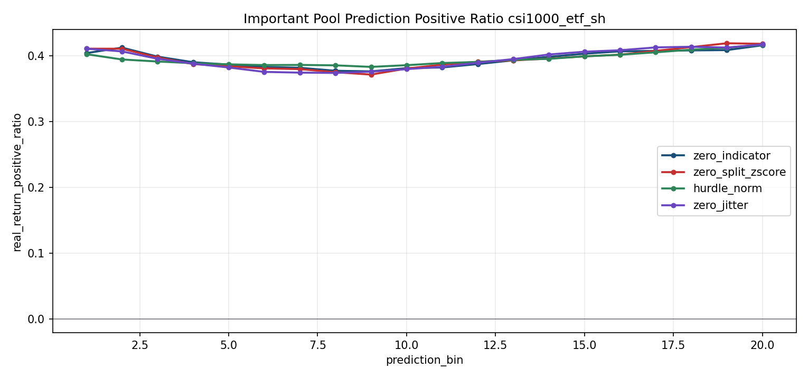

csi1000_etf_sh: prediction_bin vs real_return_positive_ratio.

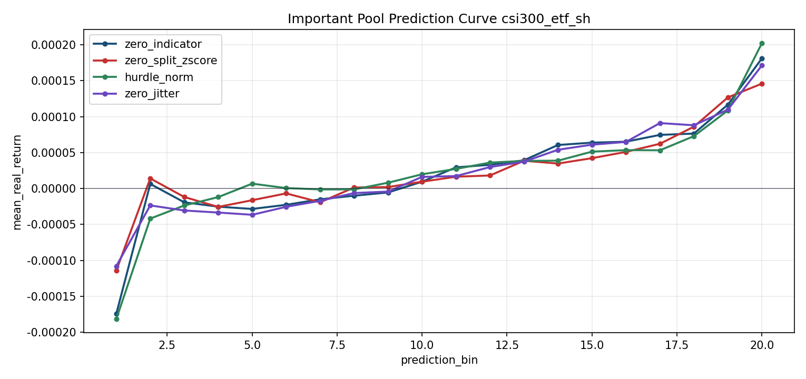

csi300_etf_sh: prediction_bin vs mean_real_return.

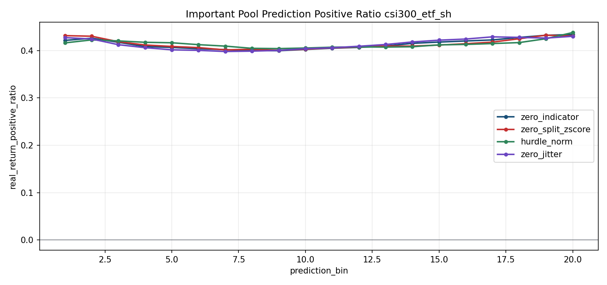

csi300_etf_sh: prediction_bin vs real_return_positive_ratio.

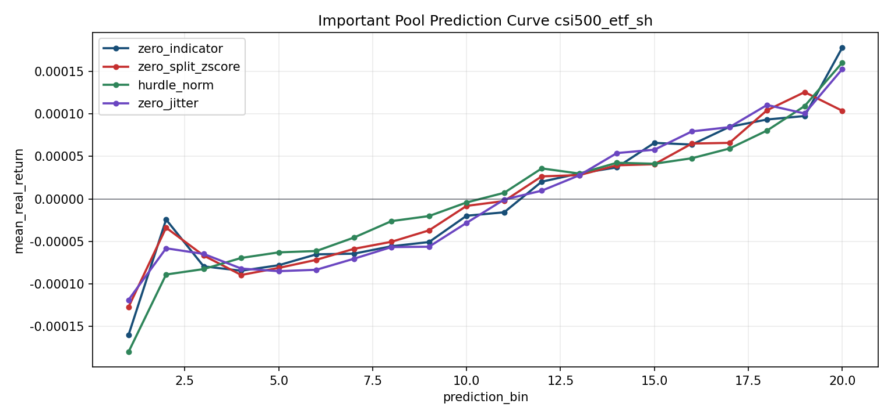

csi500_etf_sh: prediction_bin vs mean_real_return.

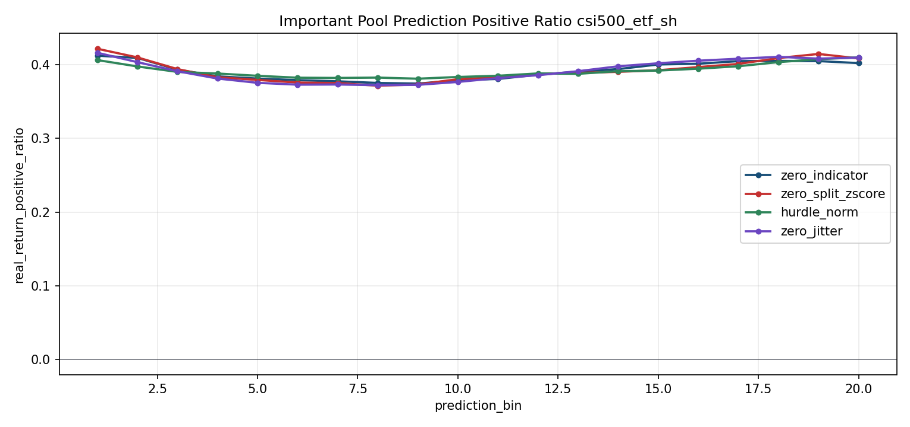

csi500_etf_sh: prediction_bin vs real_return_positive_ratio.

字段解释

| field | explanation |
| --- | --- |
| pool | important stock pool 标识.  |
| prediction_bin | 按 prediction 排序后的等频分箱编号.  |
| mean_prediction_return | prediction 的样本均值.  |
| mean_real_return | target 的样本均值.  |
| real_return_positive_ratio | target > 0 的样本比例.  |
| count | 样本数.  |

### 4.3. Liquidity By ADV

### Liquidity By ADV

| experiment | adv_bucket | bucket_label | row_count | day_count | mean_adv_amount | median_adv_amount | mean_ic | mean_rank_ic | icir | rank_icir | top5_return_bps | top5_hit_rate | top5_row_count |
| --- | --- | --- | --- | --- | --- | --- | --- | --- | --- | --- | --- | --- | --- |
| zero_indicator | 1 | Bottom20% | 33,213,495 | 100 | 22,436 | 23,206 | 0.098292 | 0.065812 | 3.2004 | 3.9417 | 7.4652 | 0.405716 | 1,667,316 |
| zero_indicator | 2 | 20~40% | 33,714,849 | 100 | 46,291 | 45,971 | 0.054776 | 0.036076 | 3.1897 | 2.2935 | 3.5621 | 0.393441 | 1,693,237 |
| zero_indicator | 3 | 40~60% | 33,822,880 | 100 | 78,908 | 77,696 | 0.060807 | 0.035917 | 3.2237 | 2.0252 | 3.9474 | 0.409463 | 1,698,228 |
| zero_indicator | 4 | 60~80% | 33,743,507 | 100 | 145,624 | 141,033 | 0.072284 | 0.041002 | 3.4779 | 2.1858 | 4.8492 | 0.427921 | 1,694,364 |
| zero_indicator | 5 | Top20% | 33,697,783 | 100 | 553,370 | 359,597 | 0.078154 | 0.047803 | 3.0459 | 2.0299 | 4.9011 | 0.452894 | 1,692,110 |
| zero_split_zscore | 1 | Bottom20% | 33,213,495 | 100 | 22,436 | 23,206 | 0.095371 | 0.066907 | 3.2299 | 3.9428 | 7.2944 | 0.411527 | 1,667,316 |
| zero_split_zscore | 2 | 20~40% | 33,714,849 | 100 | 46,291 | 45,971 | 0.053021 | 0.036605 | 2.9528 | 2.3078 | 3.7149 | 0.404167 | 1,693,237 |
| zero_split_zscore | 3 | 40~60% | 33,822,880 | 100 | 78,908 | 77,696 | 0.060134 | 0.038057 | 3.3028 | 2.1971 | 3.8423 | 0.420860 | 1,698,228 |
| zero_split_zscore | 4 | 60~80% | 33,743,507 | 100 | 145,624 | 141,033 | 0.074222 | 0.043296 | 3.9039 | 2.4016 | 4.9576 | 0.439689 | 1,694,364 |
| zero_split_zscore | 5 | Top20% | 33,697,783 | 100 | 553,370 | 359,597 | 0.079882 | 0.049658 | 3.1533 | 2.2266 | 5.1987 | 0.456984 | 1,692,110 |
| hurdle_norm | 1 | Bottom20% | 33,213,495 | 100 | 22,436 | 23,206 | 0.090799 | 0.065492 | 3.9783 | 4.2016 | 7.1060 | 0.408162 | 1,667,316 |
| hurdle_norm | 2 | 20~40% | 33,714,849 | 100 | 46,291 | 45,971 | 0.053527 | 0.036096 | 2.9584 | 2.4009 | 3.6446 | 0.400685 | 1,693,237 |
| hurdle_norm | 3 | 40~60% | 33,822,880 | 100 | 78,908 | 77,696 | 0.061307 | 0.037926 | 3.3587 | 2.3842 | 4.0391 | 0.419405 | 1,698,228 |
| hurdle_norm | 4 | 60~80% | 33,743,507 | 100 | 145,624 | 141,033 | 0.073727 | 0.043522 | 3.5632 | 2.5377 | 4.9353 | 0.438096 | 1,694,364 |
| hurdle_norm | 5 | Top20% | 33,697,783 | 100 | 553,370 | 359,597 | 0.079070 | 0.051643 | 3.0433 | 2.3992 | 5.0849 | 0.457724 | 1,692,110 |
| zero_jitter | 1 | Bottom20% | 33,213,495 | 100 | 22,436 | 23,206 | 0.096259 | 0.067402 | 3.2289 | 3.9217 | 7.4055 | 0.410679 | 1,667,316 |
| zero_jitter | 2 | 20~40% | 33,714,849 | 100 | 46,291 | 45,971 | 0.053894 | 0.036521 | 3.0860 | 2.4036 | 3.6589 | 0.401153 | 1,693,237 |
| zero_jitter | 3 | 40~60% | 33,822,880 | 100 | 78,908 | 77,696 | 0.058970 | 0.036804 | 3.0987 | 2.2476 | 3.8281 | 0.417210 | 1,698,228 |
| zero_jitter | 4 | 60~80% | 33,743,507 | 100 | 145,624 | 141,033 | 0.071114 | 0.041294 | 3.6119 | 2.4466 | 4.7261 | 0.434718 | 1,694,364 |
| zero_jitter | 5 | Top20% | 33,697,783 | 100 | 553,370 | 359,597 | 0.072151 | 0.044388 | 2.9134 | 2.0897 | 4.6325 | 0.453035 | 1,692,110 |

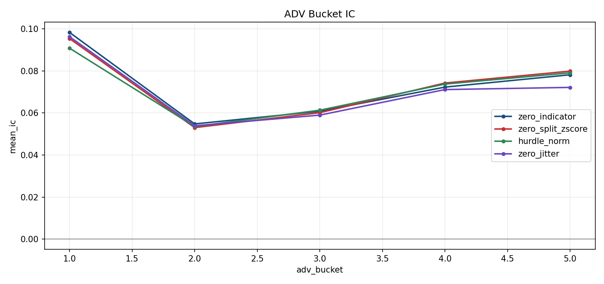

adv_bucket vs mean_ic.

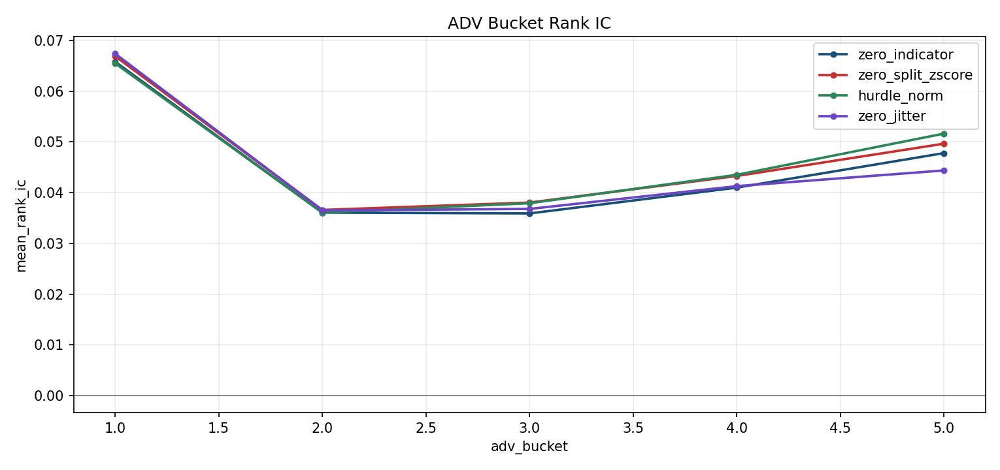

adv_bucket vs mean_rank_ic.

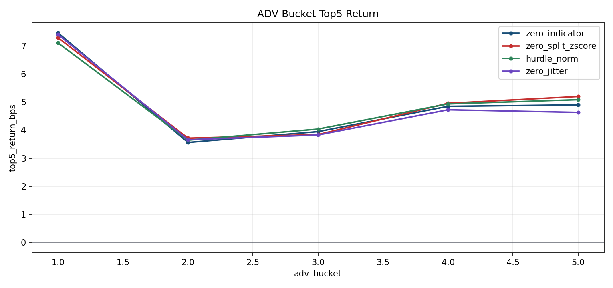

adv_bucket vs top5_return_bps.

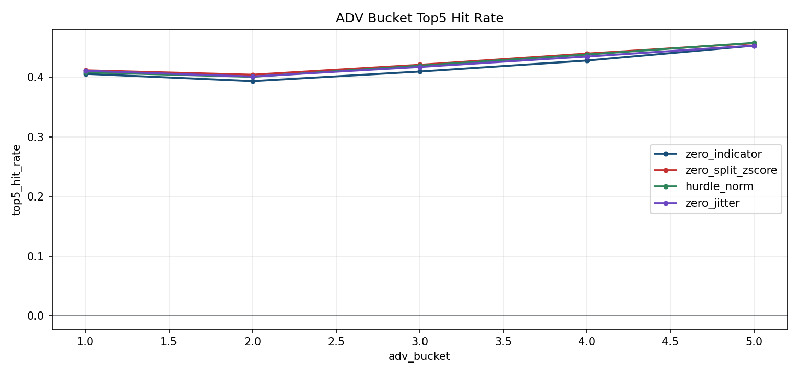

adv_bucket vs top5_hit_rate.

字段解释

| field | explanation |
| --- | --- |
| adv_bucket | shifted ADV bucket 编号.  |
| bucket_label | ADV bucket 展示名称.  |
| row_count | 分组样本数.  |
| day_count | 覆盖交易日数量.  |
| mean_adv_amount | bucket 内平均 ADV amount.  |
| median_adv_amount | bucket 内 median ADV amount.  |
| mean_ic | bucket 内 mean IC.  |
| mean_rank_ic | bucket 内 mean Rank IC.  |
| icir | bucket 内 ICIR.  |
| rank_icir | bucket 内 Rank ICIR.  |
| top5_return_bps | bucket 内 prediction top 5% return, 单位 bps.  |
| top5_hit_rate | bucket 内 prediction top 5% target > 0 比例.  |
| top5_row_count | bucket 内 top 5% 样本数.  |

### 5. Trading And Cost Proxy

### 5.1. Strategy And Benchmark Summary

### Strategy And Benchmark Summary

| experiment | pool | strategy_return_bps | benchmark_return_bps | excess_return_bps | expected_return_bps | position_rate | open_count | open_per_day |
| --- | --- | --- | --- | --- | --- | --- | --- | --- |
| zero_indicator | csi1000_etf_sh | 133.0271 | 1,627 | -1,285 | 953.2294 | 0.048137 | 112 | 1.1200 |
| zero_indicator | csi300_etf_sh | 176.3703 | 4,342 | -2,905 | 662.0884 | 0.046273 | 126 | 1.2600 |
| zero_indicator | csi500_etf_sh | 126.1875 | -326.8983 | 468.3977 | 815.4593 | 0.048137 | 121 | 1.2100 |
| zero_split_zscore | csi1000_etf_sh | -290.6099 | 1,627 | -1,649 | 824.5459 | 0.040994 | 95 | 0.950000 |
| zero_split_zscore | csi300_etf_sh | -134.6242 | 4,342 | -3,121 | 800.2129 | 0.051863 | 142 | 1.4200 |
| zero_split_zscore | csi500_etf_sh | -305.8252 | -326.8983 | 21.7852 | 793.4566 | 0.044410 | 117 | 1.1700 |
| hurdle_norm | csi1000_etf_sh | -289.6897 | 1,627 | -1,648 | 824.2054 | 0.045031 | 112 | 1.1200 |
| hurdle_norm | csi300_etf_sh | 269.1692 | 4,342 | -2,840 | 754.7061 | 0.047516 | 135 | 1.3500 |
| hurdle_norm | csi500_etf_sh | -166.7668 | -326.8983 | 165.5430 | 745.3956 | 0.044720 | 119 | 1.1900 |
| zero_jitter | csi1000_etf_sh | -288.0270 | 1,627 | -1,647 | 739.2826 | 0.038509 | 83 | 0.830000 |
| zero_jitter | csi300_etf_sh | 179.6796 | 4,342 | -2,902 | 774.0101 | 0.045031 | 111 | 1.1100 |
| zero_jitter | csi500_etf_sh | -95.1275 | -326.8983 | 239.6034 | 728.4478 | 0.042547 | 95 | 0.950000 |

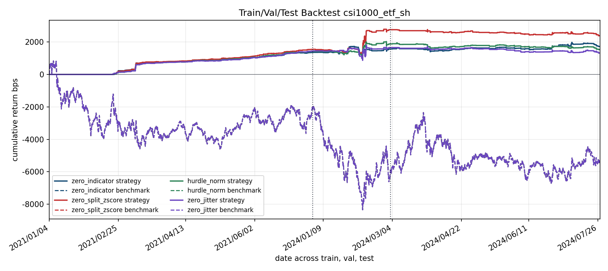

csi1000_etf_sh: strategy and benchmark cumulative returns across train, val, and test.

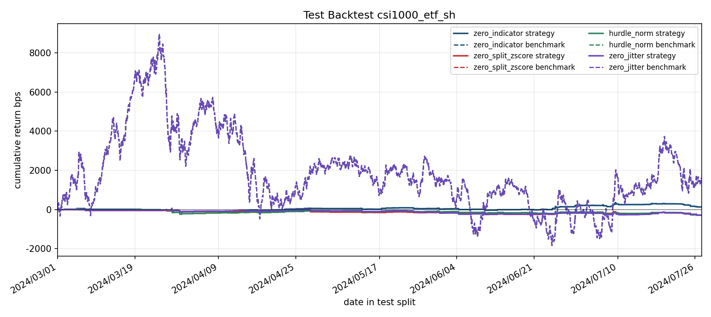

csi1000_etf_sh: strategy and benchmark cumulative returns on test split.

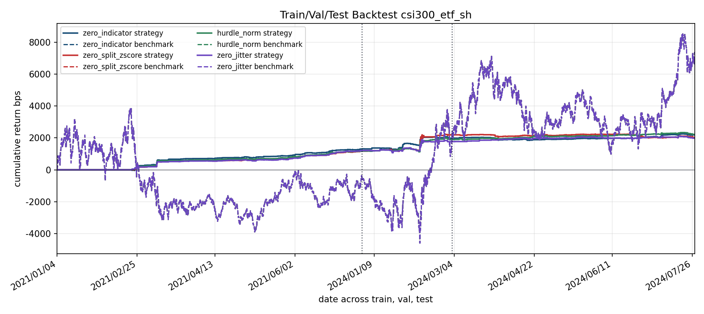

csi300_etf_sh: strategy and benchmark cumulative returns across train, val, and test.

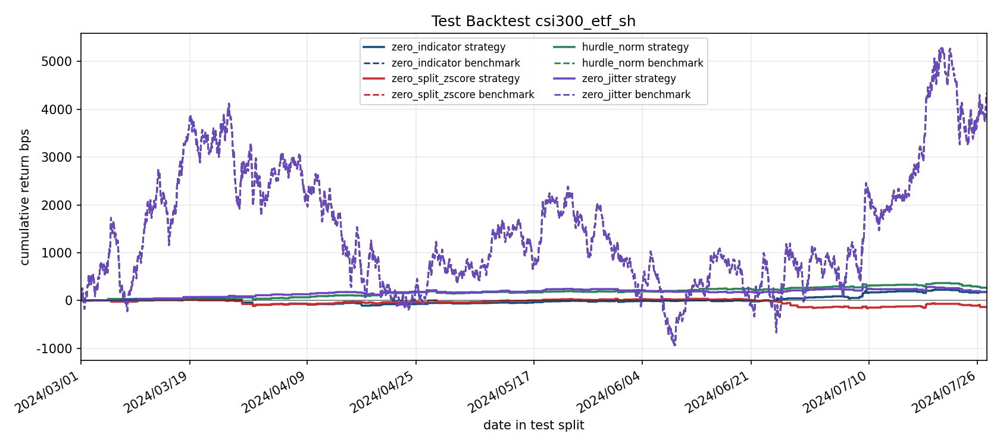

csi300_etf_sh: strategy and benchmark cumulative returns on test split.

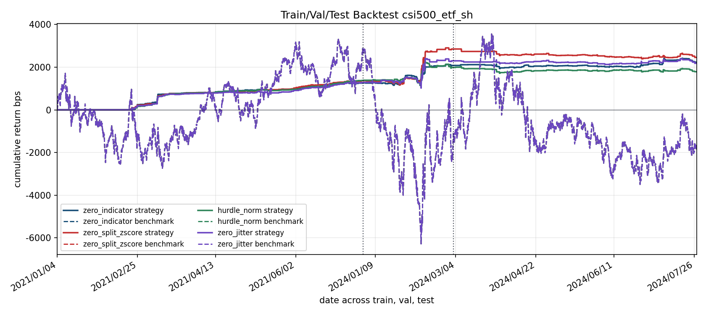

csi500_etf_sh: strategy and benchmark cumulative returns across train, val, and test.

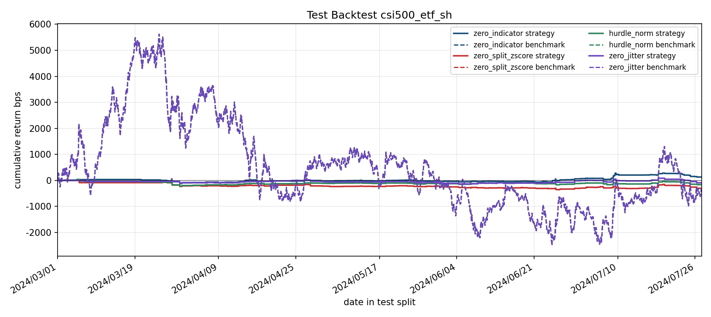

csi500_etf_sh: strategy and benchmark cumulative returns on test split.

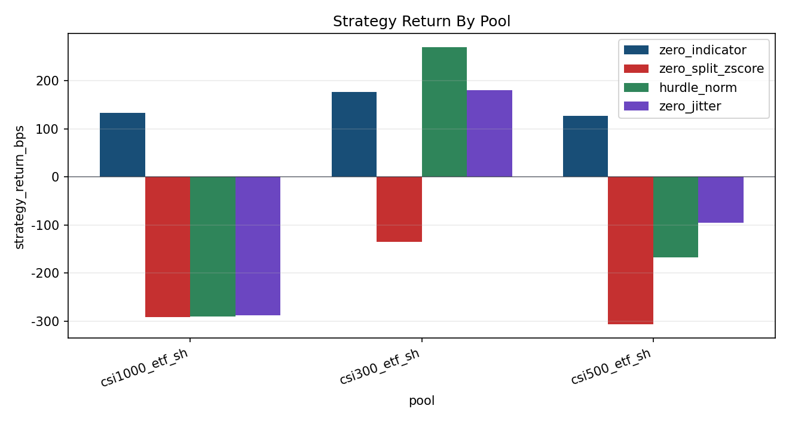

pool-level strategy_return_bps.

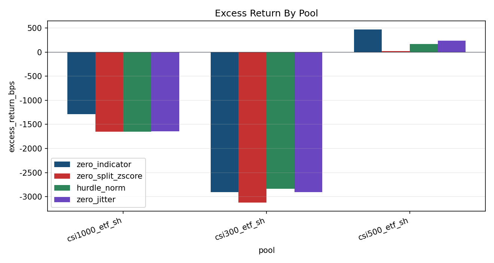

pool-level excess_return_bps.

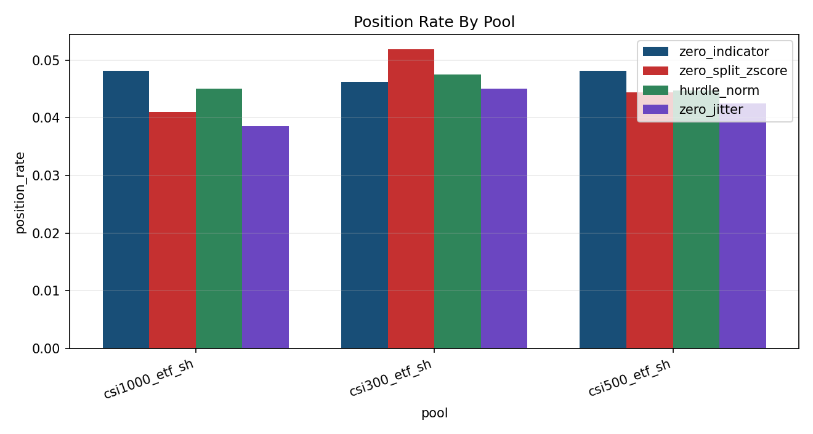

pool-level position_rate.

字段解释

| field | explanation |
| --- | --- |
| strategy_return_bps | test split 上 strategy minute return 复利收益, 单位 bps.  |
| benchmark_return_bps | test split 上 benchmark minute return 复利收益, 单位 bps.  |
| excess_return_bps | strategy 相对 benchmark 的复利 excess return, 单位 bps.  |
| expected_return_bps | expected minute return 复利收益, 单位 bps.  |
| position_rate | position > 0 的分钟比例.  |
| open_count | 开仓次数.  |
| open_per_day | 平均每日开仓次数.  |

### 5.2. Cost Sensitivity

### Cost Sensitivity

| experiment | pool | single_side_cost_bps | net_strategy_cumulative_return_bps |
| --- | --- | --- | --- |
| zero_indicator | csi1000_etf_sh | 0.000e+00 | 133.0271 |
| zero_indicator | csi1000_etf_sh | 1.0000 | -91.3976 |
| zero_indicator | csi1000_etf_sh | 2.0000 | -310.8734 |
| zero_indicator | csi1000_etf_sh | 5.0000 | -940.6827 |
| zero_indicator | csi1000_etf_sh | 10.0000 | -1,901 |
| zero_indicator | csi300_etf_sh | 0.000e+00 | 176.3703 |
| zero_indicator | csi300_etf_sh | 1.0000 | -76.8577 |
| zero_indicator | csi300_etf_sh | 2.0000 | -323.8088 |
| zero_indicator | csi300_etf_sh | 5.0000 | -1,029 |
| zero_indicator | csi300_etf_sh | 10.0000 | -2,091 |
| zero_indicator | csi500_etf_sh | 0.000e+00 | 126.1875 |
| zero_indicator | csi500_etf_sh | 1.0000 | -115.9143 |
| zero_indicator | csi500_etf_sh | 2.0000 | -352.2513 |
| zero_indicator | csi500_etf_sh | 5.0000 | -1,028 |
| zero_indicator | csi500_etf_sh | 10.0000 | -2,051 |
| zero_split_zscore | csi1000_etf_sh | 0.000e+00 | -290.6099 |
| zero_split_zscore | csi1000_etf_sh | 1.0000 | -473.3535 |
| zero_split_zscore | csi1000_etf_sh | 2.0000 | -652.6754 |
| zero_split_zscore | csi1000_etf_sh | 5.0000 | -1,171 |
| zero_split_zscore | csi1000_etf_sh | 10.0000 | -1,971 |
| zero_split_zscore | csi300_etf_sh | 0.000e+00 | -134.6242 |
| zero_split_zscore | csi300_etf_sh | 1.0000 | -410.8892 |
| zero_split_zscore | csi300_etf_sh | 2.0000 | -679.4443 |
| zero_split_zscore | csi300_etf_sh | 5.0000 | -1,441 |
| zero_split_zscore | csi300_etf_sh | 10.0000 | -2,575 |
| zero_split_zscore | csi500_etf_sh | 0.000e+00 | -305.8252 |
| zero_split_zscore | csi500_etf_sh | 1.0000 | -530.0547 |
| zero_split_zscore | csi500_etf_sh | 2.0000 | -749.1193 |
| zero_split_zscore | csi500_etf_sh | 5.0000 | -1,376 |
| zero_split_zscore | csi500_etf_sh | 10.0000 | -2,329 |
| hurdle_norm | csi1000_etf_sh | 0.000e+00 | -289.6897 |
| hurdle_norm | csi1000_etf_sh | 1.0000 | -504.7995 |
| hurdle_norm | csi1000_etf_sh | 2.0000 | -715.1648 |
| hurdle_norm | csi1000_etf_sh | 5.0000 | -1,319 |
| hurdle_norm | csi1000_etf_sh | 10.0000 | -2,239 |
| hurdle_norm | csi300_etf_sh | 0.000e+00 | 269.1692 |
| hurdle_norm | csi300_etf_sh | 1.0000 | -4.3834 |
| hurdle_norm | csi300_etf_sh | 2.0000 | -270.6754 |
| hurdle_norm | csi300_etf_sh | 5.0000 | -1,028 |
| hurdle_norm | csi300_etf_sh | 10.0000 | -2,162 |
| hurdle_norm | csi500_etf_sh | 0.000e+00 | -166.7668 |
| hurdle_norm | csi500_etf_sh | 1.0000 | -398.0563 |
| hurdle_norm | csi500_etf_sh | 2.0000 | -623.9279 |
| hurdle_norm | csi500_etf_sh | 5.0000 | -1,270 |
| hurdle_norm | csi500_etf_sh | 10.0000 | -2,250 |
| zero_jitter | csi1000_etf_sh | 0.000e+00 | -288.0270 |
| zero_jitter | csi1000_etf_sh | 1.0000 | -447.9177 |
| zero_jitter | csi1000_etf_sh | 2.0000 | -605.1916 |
| zero_jitter | csi1000_etf_sh | 5.0000 | -1,062 |
| zero_jitter | csi1000_etf_sh | 10.0000 | -1,774 |
| zero_jitter | csi300_etf_sh | 0.000e+00 | 179.6796 |
| zero_jitter | csi300_etf_sh | 1.0000 | -43.8296 |
| zero_jitter | csi300_etf_sh | 2.0000 | -262.4530 |
| zero_jitter | csi300_etf_sh | 5.0000 | -890.0599 |
| zero_jitter | csi300_etf_sh | 10.0000 | -1,848 |
| zero_jitter | csi500_etf_sh | 0.000e+00 | -95.1275 |
| zero_jitter | csi500_etf_sh | 1.0000 | -281.5559 |
| zero_jitter | csi500_etf_sh | 2.0000 | -464.4935 |
| zero_jitter | csi500_etf_sh | 5.0000 | -993.0058 |
| zero_jitter | csi500_etf_sh | 10.0000 | -1,810 |

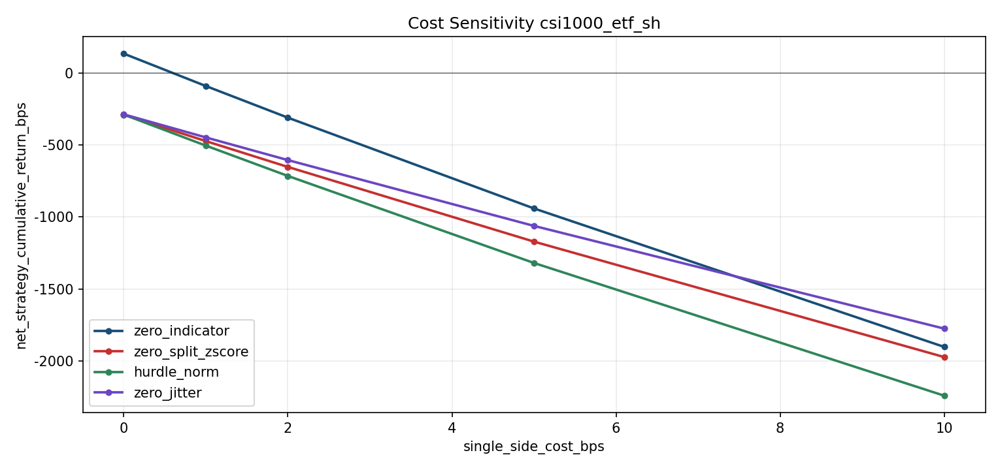

csi1000_etf_sh: single_side_cost_bps vs net_strategy_cumulative_return_bps.

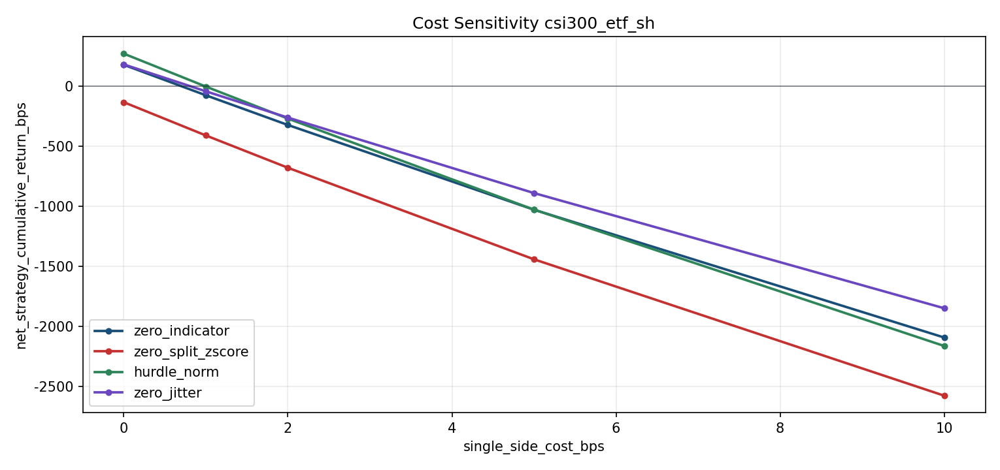

csi300_etf_sh: single_side_cost_bps vs net_strategy_cumulative_return_bps.

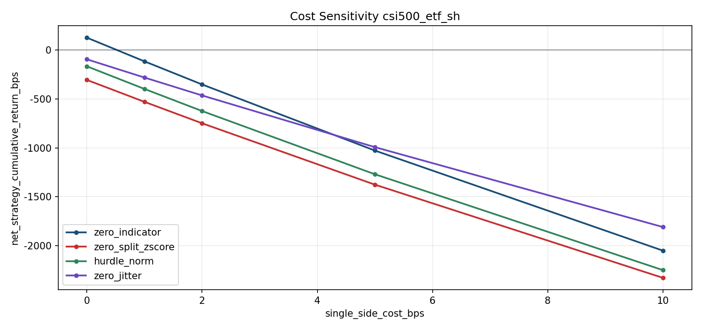

csi500_etf_sh: single_side_cost_bps vs net_strategy_cumulative_return_bps.

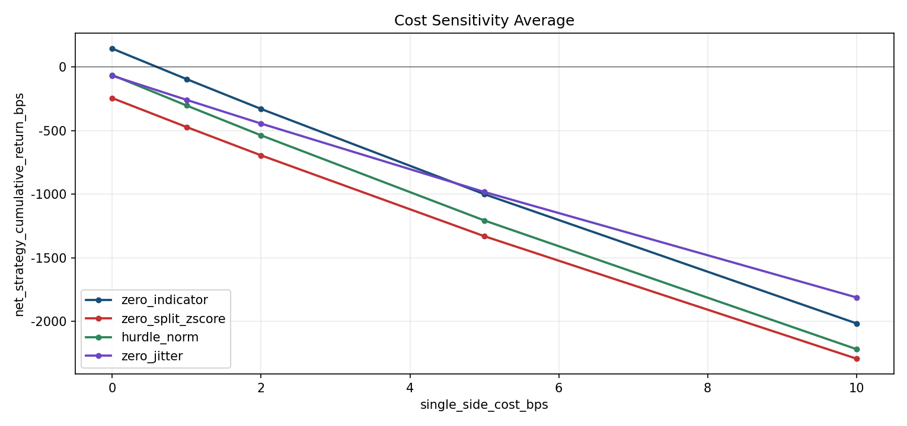

pool-average cost sensitivity.

字段解释

| field | explanation |
| --- | --- |
| single_side_cost_bps | 单边交易成本, 单位 bps.  |
| net_strategy_cumulative_return_bps | 扣成本后的 strategy cumulative return, 单位 bps.  |

### 5.3. Trade Return Distribution

### Trade Return Distribution

| experiment | pool | split | trade_count | mean_trade_return_bps | median_trade_return_bps | hit_rate | p05_trade_return_bps | p95_trade_return_bps |
| --- | --- | --- | --- | --- | --- | --- | --- | --- |
| zero_indicator | csi1000_etf_sh | train_val_test | 289 | 5.6014 | 5.4411 | 0.640138 | -41.0257 | 58.4011 |
| zero_indicator | csi300_etf_sh | train_val_test | 298 | 6.7020 | 4.2172 | 0.637584 | -25.9093 | 48.8045 |
| zero_indicator | csi500_etf_sh | train_val_test | 304 | 6.6951 | 4.0814 | 0.628289 | -33.9445 | 56.2860 |
| zero_indicator | csi1000_etf_sh | test | 112 | 1.2204 | 3.1186 | 0.544643 | -42.5301 | 40.1960 |
| zero_indicator | csi300_etf_sh | test | 126 | 1.4035 | 3.8743 | 0.619048 | -28.7795 | 22.7950 |
| zero_indicator | csi500_etf_sh | test | 121 | 1.0694 | 1.9868 | 0.537190 | -38.1088 | 43.5843 |
| zero_split_zscore | csi1000_etf_sh | train_val_test | 280 | 7.8092 | 5.8022 | 0.650000 | -41.5201 | 53.2761 |
| zero_split_zscore | csi300_etf_sh | train_val_test | 304 | 6.1608 | 3.4028 | 0.625000 | -27.7035 | 43.4770 |
| zero_split_zscore | csi500_etf_sh | train_val_test | 309 | 7.2320 | 4.1660 | 0.640777 | -38.0184 | 47.7325 |
| zero_split_zscore | csi1000_etf_sh | test | 95 | -3.0776 | 0.687631 | 0.515789 | -45.9621 | 25.0293 |
| zero_split_zscore | csi300_etf_sh | test | 142 | -0.941331 | 1.1980 | 0.549296 | -34.5333 | 15.1342 |
| zero_split_zscore | csi500_etf_sh | test | 117 | -2.6300 | 1.0335 | 0.512821 | -47.5587 | 23.0665 |
| hurdle_norm | csi1000_etf_sh | train_val_test | 292 | 4.9883 | 5.3886 | 0.633562 | -42.5301 | 68.7661 |
| hurdle_norm | csi300_etf_sh | train_val_test | 310 | 6.5270 | 3.8271 | 0.629032 | -26.2273 | 45.7857 |
| hurdle_norm | csi500_etf_sh | train_val_test | 305 | 5.4799 | 4.1655 | 0.649180 | -37.5245 | 52.7236 |
| hurdle_norm | csi1000_etf_sh | test | 112 | -2.5876 | 1.4850 | 0.526786 | -47.3944 | 28.4691 |
| hurdle_norm | csi300_etf_sh | test | 135 | 1.9790 | 3.6398 | 0.614815 | -22.8452 | 21.3355 |
| hurdle_norm | csi500_etf_sh | test | 119 | -1.3928 | 1.7014 | 0.537815 | -36.9283 | 23.0627 |
| zero_jitter | csi1000_etf_sh | train_val_test | 238 | 5.3903 | 6.2848 | 0.651261 | -56.7056 | 52.9703 |
| zero_jitter | csi300_etf_sh | train_val_test | 266 | 6.8628 | 4.1907 | 0.624060 | -28.4787 | 49.2179 |
| zero_jitter | csi500_etf_sh | train_val_test | 260 | 7.7167 | 4.4526 | 0.630769 | -43.5924 | 70.7055 |
| zero_jitter | csi1000_etf_sh | test | 83 | -3.4790 | 1.2549 | 0.530120 | -56.1801 | 26.0888 |
| zero_jitter | csi300_etf_sh | test | 111 | 1.6186 | 2.2555 | 0.585586 | -22.7386 | 26.5994 |
| zero_jitter | csi500_etf_sh | test | 95 | -0.977274 | 0.413744 | 0.505263 | -47.2250 | 23.3753 |

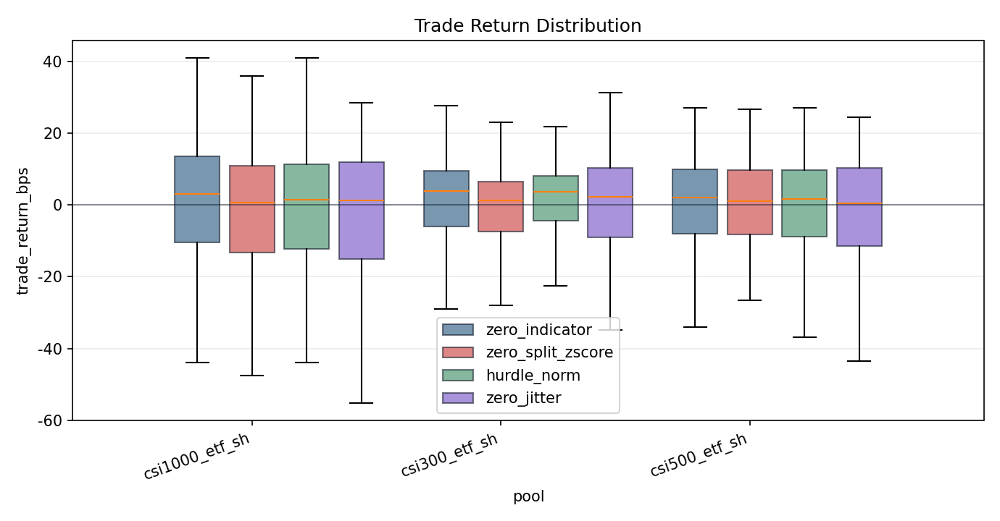

test split trade_return_bps distribution.

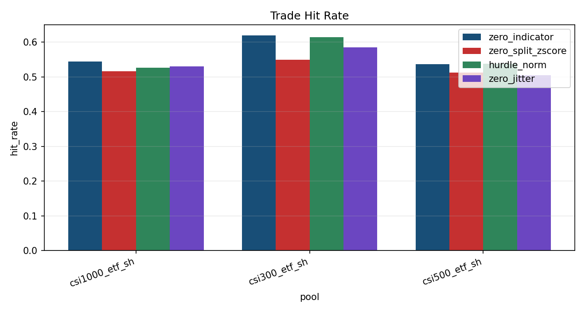

test split trade hit rate.

字段解释

| field | explanation |
| --- | --- |
| trade_count | trade id 数量.  |
| mean_trade_return_bps | 单笔 trade 平均收益, 单位 bps.  |
| median_trade_return_bps | 单笔 trade 中位数收益, 单位 bps.  |
| hit_rate | 分组内 target > 0 的比例.  |
| p05_trade_return_bps | 单笔 trade return 5% 分位数, 单位 bps.  |
| p95_trade_return_bps | 单笔 trade return 95% 分位数, 单位 bps.  |

### 6. Robustness Diagnostics

### 6.1. Return Realization

### Return Realization

| experiment | holding_minutes | mean_return | mean_return_bps | row_count | prediction_p95 |
| --- | --- | --- | --- | --- | --- |
| zero_indicator | 1 | 2.190e-04 | 2.1896 | 8,849,225 | 8.349e-04 |
| zero_indicator | 2 | 3.503e-04 | 3.5029 | 8,849,225 | 8.349e-04 |
| zero_indicator | 3 | 4.345e-04 | 4.3446 | 8,849,225 | 8.349e-04 |
| zero_indicator | 4 | 4.883e-04 | 4.8833 | 8,849,225 | 8.349e-04 |
| zero_indicator | 5 | 5.276e-04 | 5.2755 | 8,849,225 | 8.349e-04 |
| zero_indicator | 6 | 5.557e-04 | 5.5572 | 8,849,225 | 8.349e-04 |
| zero_indicator | 7 | 5.843e-04 | 5.8433 | 8,849,225 | 8.349e-04 |
| zero_indicator | 8 | 6.059e-04 | 6.0593 | 8,849,225 | 8.349e-04 |
| zero_indicator | 9 | 6.187e-04 | 6.1870 | 8,849,225 | 8.349e-04 |
| zero_indicator | 10 | 6.257e-04 | 6.2569 | 8,849,225 | 8.349e-04 |
| zero_indicator | 11 | 6.356e-04 | 6.3561 | 8,563,914 | 8.349e-04 |
| zero_indicator | 12 | 6.374e-04 | 6.3737 | 8,333,164 | 8.349e-04 |
| zero_indicator | 13 | 6.438e-04 | 6.4385 | 8,148,300 | 8.349e-04 |
| zero_indicator | 14 | 6.491e-04 | 6.4911 | 8,003,541 | 8.349e-04 |
| zero_indicator | 15 | 6.587e-04 | 6.5866 | 7,892,196 | 8.349e-04 |
| zero_indicator | 16 | 6.643e-04 | 6.6431 | 7,805,973 | 8.349e-04 |
| zero_indicator | 17 | 6.603e-04 | 6.6031 | 7,740,898 | 8.349e-04 |
| zero_indicator | 18 | 6.520e-04 | 6.5202 | 7,691,569 | 8.349e-04 |
| zero_indicator | 19 | 6.398e-04 | 6.3977 | 7,653,215 | 8.349e-04 |
| zero_indicator | 20 | 6.280e-04 | 6.2800 | 7,622,589 | 8.349e-04 |
| zero_split_zscore | 1 | 1.989e-04 | 1.9887 | 8,858,066 | 8.483e-04 |
| zero_split_zscore | 2 | 3.200e-04 | 3.1996 | 8,858,066 | 8.483e-04 |
| zero_split_zscore | 3 | 4.011e-04 | 4.0109 | 8,858,066 | 8.483e-04 |
| zero_split_zscore | 4 | 4.579e-04 | 4.5791 | 8,858,066 | 8.483e-04 |
| zero_split_zscore | 5 | 5.000e-04 | 5.0003 | 8,858,066 | 8.483e-04 |
| zero_split_zscore | 6 | 5.312e-04 | 5.3116 | 8,858,066 | 8.483e-04 |
| zero_split_zscore | 7 | 5.615e-04 | 5.6147 | 8,858,066 | 8.483e-04 |
| zero_split_zscore | 8 | 5.812e-04 | 5.8123 | 8,858,066 | 8.483e-04 |
| zero_split_zscore | 9 | 5.890e-04 | 5.8898 | 8,858,066 | 8.483e-04 |
| zero_split_zscore | 10 | 5.903e-04 | 5.9027 | 8,858,066 | 8.483e-04 |
| zero_split_zscore | 11 | 5.889e-04 | 5.8890 | 8,642,260 | 8.483e-04 |
| zero_split_zscore | 12 | 5.793e-04 | 5.7934 | 8,495,416 | 8.483e-04 |
| zero_split_zscore | 13 | 5.714e-04 | 5.7136 | 8,396,787 | 8.483e-04 |
| zero_split_zscore | 14 | 5.635e-04 | 5.6350 | 8,333,148 | 8.483e-04 |
| zero_split_zscore | 15 | 5.613e-04 | 5.6126 | 8,290,802 | 8.483e-04 |
| zero_split_zscore | 16 | 5.593e-04 | 5.5935 | 8,260,817 | 8.483e-04 |
| zero_split_zscore | 17 | 5.525e-04 | 5.5254 | 8,239,511 | 8.483e-04 |
| zero_split_zscore | 18 | 5.408e-04 | 5.4083 | 8,223,521 | 8.483e-04 |
| zero_split_zscore | 19 | 5.227e-04 | 5.2274 | 8,211,294 | 8.483e-04 |
| zero_split_zscore | 20 | 5.051e-04 | 5.0512 | 8,200,923 | 8.483e-04 |
| hurdle_norm | 1 | 2.080e-04 | 2.0797 | 8,849,489 | 7.720e-04 |
| hurdle_norm | 2 | 3.353e-04 | 3.3530 | 8,849,489 | 7.720e-04 |
| hurdle_norm | 3 | 4.171e-04 | 4.1714 | 8,849,489 | 7.720e-04 |
| hurdle_norm | 4 | 4.702e-04 | 4.7023 | 8,849,489 | 7.720e-04 |
| hurdle_norm | 5 | 5.093e-04 | 5.0928 | 8,849,489 | 7.720e-04 |
| hurdle_norm | 6 | 5.370e-04 | 5.3701 | 8,849,489 | 7.720e-04 |
| hurdle_norm | 7 | 5.629e-04 | 5.6292 | 8,849,489 | 7.720e-04 |
| hurdle_norm | 8 | 5.835e-04 | 5.8349 | 8,849,489 | 7.720e-04 |
| hurdle_norm | 9 | 5.939e-04 | 5.9386 | 8,849,489 | 7.720e-04 |
| hurdle_norm | 10 | 5.984e-04 | 5.9837 | 8,849,489 | 7.720e-04 |
| hurdle_norm | 11 | 6.009e-04 | 6.0092 | 8,589,357 | 7.720e-04 |
| hurdle_norm | 12 | 5.950e-04 | 5.9497 | 8,375,769 | 7.720e-04 |
| hurdle_norm | 13 | 5.922e-04 | 5.9218 | 8,201,864 | 7.720e-04 |
| hurdle_norm | 14 | 5.904e-04 | 5.9036 | 8,065,451 | 7.720e-04 |
| hurdle_norm | 15 | 5.917e-04 | 5.9173 | 7,958,631 | 7.720e-04 |
| hurdle_norm | 16 | 5.922e-04 | 5.9217 | 7,874,531 | 7.720e-04 |
| hurdle_norm | 17 | 5.848e-04 | 5.8483 | 7,811,519 | 7.720e-04 |
| hurdle_norm | 18 | 5.745e-04 | 5.7452 | 7,764,700 | 7.720e-04 |
| hurdle_norm | 19 | 5.596e-04 | 5.5960 | 7,730,111 | 7.720e-04 |
| hurdle_norm | 20 | 5.452e-04 | 5.4520 | 7,703,428 | 7.720e-04 |
| zero_jitter | 1 | 2.031e-04 | 2.0310 | 8,853,762 | 8.006e-04 |
| zero_jitter | 2 | 3.311e-04 | 3.3113 | 8,853,762 | 8.006e-04 |
| zero_jitter | 3 | 4.138e-04 | 4.1378 | 8,853,762 | 8.006e-04 |
| zero_jitter | 4 | 4.693e-04 | 4.6926 | 8,853,762 | 8.006e-04 |
| zero_jitter | 5 | 5.080e-04 | 5.0796 | 8,853,762 | 8.006e-04 |
| zero_jitter | 6 | 5.342e-04 | 5.3420 | 8,853,762 | 8.006e-04 |
| zero_jitter | 7 | 5.549e-04 | 5.5487 | 8,853,762 | 8.006e-04 |
| zero_jitter | 8 | 5.696e-04 | 5.6963 | 8,853,762 | 8.006e-04 |
| zero_jitter | 9 | 5.757e-04 | 5.7572 | 8,853,762 | 8.006e-04 |
| zero_jitter | 10 | 5.750e-04 | 5.7503 | 8,853,762 | 8.006e-04 |
| zero_jitter | 11 | 5.704e-04 | 5.7041 | 8,699,655 | 8.006e-04 |
| zero_jitter | 12 | 5.577e-04 | 5.5771 | 8,586,990 | 8.006e-04 |
| zero_jitter | 13 | 5.503e-04 | 5.5032 | 8,503,000 | 8.006e-04 |
| zero_jitter | 14 | 5.434e-04 | 5.4341 | 8,441,002 | 8.006e-04 |
| zero_jitter | 15 | 5.400e-04 | 5.3997 | 8,395,052 | 8.006e-04 |
| zero_jitter | 16 | 5.349e-04 | 5.3488 | 8,359,438 | 8.006e-04 |
| zero_jitter | 17 | 5.218e-04 | 5.2175 | 8,332,117 | 8.006e-04 |
| zero_jitter | 18 | 5.042e-04 | 5.0415 | 8,310,863 | 8.006e-04 |
| zero_jitter | 19 | 4.826e-04 | 4.8263 | 8,293,520 | 8.006e-04 |
| zero_jitter | 20 | 4.603e-04 | 4.6034 | 8,278,383 | 8.006e-04 |

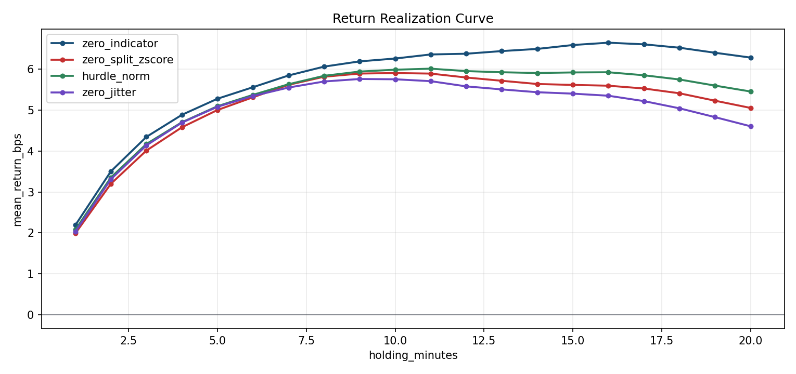

holding_minutes vs mean_return_bps.

holding_minutes vs row_count.

字段解释

| field | explanation |
| --- | --- |
| holding_minutes | forward holding horizon, 单位 minutes.  |
| mean_return | 该 holding horizon 的平均 realized return.  |
| mean_return_bps | 该 holding horizon 的平均 realized return, 单位 bps.  |
| row_count | 分组样本数.  |
| prediction_p95 | prediction 95% 分位 threshold.  |

### 6.2. Monthly IC

### Monthly IC

| experiment | month | pearson_ic | rank_ic | sample_count |
| --- | --- | --- | --- | --- |
| zero_indicator | 2024/03 | 0.075525 | 0.046488 | 40,561,535 |
| zero_indicator | 2024/04 | 0.078006 | 0.062331 | 34,533,212 |
| zero_indicator | 2024/05 | 0.065992 | 0.042359 | 34,535,788 |
| zero_indicator | 2024/06 | 0.068602 | 0.036212 | 32,818,884 |
| zero_indicator | 2024/07 | 0.070862 | 0.045837 | 34,496,021 |
| zero_split_zscore | 2024/03 | 0.071707 | 0.042644 | 40,561,535 |
| zero_split_zscore | 2024/04 | 0.078780 | 0.069767 | 34,533,212 |
| zero_split_zscore | 2024/05 | 0.067005 | 0.043695 | 34,535,788 |
| zero_split_zscore | 2024/06 | 0.075034 | 0.035805 | 32,818,884 |
| zero_split_zscore | 2024/07 | 0.065977 | 0.041574 | 34,496,021 |
| hurdle_norm | 2024/03 | 0.073294 | 0.043694 | 40,561,535 |
| hurdle_norm | 2024/04 | 0.081548 | 0.069720 | 34,533,212 |
| hurdle_norm | 2024/05 | 0.064125 | 0.046428 | 34,535,788 |
| hurdle_norm | 2024/06 | 0.073110 | 0.041513 | 32,818,884 |
| hurdle_norm | 2024/07 | 0.064937 | 0.042227 | 34,496,021 |
| zero_jitter | 2024/03 | 0.069044 | 0.040912 | 40,561,535 |
| zero_jitter | 2024/04 | 0.076039 | 0.062858 | 34,533,212 |
| zero_jitter | 2024/05 | 0.066122 | 0.045448 | 34,535,788 |
| zero_jitter | 2024/06 | 0.068233 | 0.030753 | 32,818,884 |
| zero_jitter | 2024/07 | 0.065990 | 0.047031 | 34,496,021 |

month vs pearson_ic.

month vs rank_ic.

字段解释

| field | explanation |
| --- | --- |
| month | 月份.  |
| pearson_ic | corr(prediction, target).  |
| rank_ic | corr(rank(prediction), rank(target)).  |
| sample_count | 样本数.  |

### 6.3. Intraday IC

Intraday IC

| experiment | time_bucket | pearson_ic | rank_ic | sample_count |
| --- | --- | --- | --- | --- |
| zero_indicator | 103,900 | 0.089699 | 0.068509 | 294 |
| zero_indicator | 104,000 | 0.090242 | 0.066455 | 294 |
| zero_indicator | 104,100 | 0.092504 | 0.068923 | 294 |
| zero_indicator | 104,200 | 0.095090 | 0.076586 | 294 |
| zero_indicator | 104,300 | 0.097365 | 0.074893 | 294 |
| zero_indicator | 104,400 | 0.088274 | 0.070458 | 294 |
| zero_indicator | 104,500 | 0.082338 | 0.058439 | 290 |
| zero_indicator | 104,600 | 0.088024 | 0.063279 | 294 |
| zero_indicator | 104,700 | 0.084471 | 0.060448 | 294 |
| zero_indicator | 104,800 | 0.088492 | 0.063583 | 294 |
| zero_indicator | 104,900 | 0.087911 | 0.059856 | 294 |
| zero_indicator | 105,000 | 0.085305 | 0.055810 | 294 |
| zero_indicator | 105,100 | 0.086793 | 0.059455 | 294 |
| zero_indicator | 105,200 | 0.081043 | 0.054510 | 290 |
| zero_indicator | 105,300 | 0.089047 | 0.061940 | 294 |
| zero_indicator | 105,400 | 0.093096 | 0.065488 | 294 |
| zero_indicator | 105,500 | 0.085091 | 0.058977 | 294 |
| zero_indicator | 105,600 | 0.080314 | 0.054441 | 294 |
| zero_indicator | 105,700 | 0.083224 | 0.059075 | 294 |
| zero_indicator | 105,800 | 0.089072 | 0.069973 | 294 |
| zero_indicator | 105,900 | 0.088095 | 0.069781 | 290 |
| zero_indicator | 110,000 | 0.078619 | 0.064076 | 294 |
| zero_indicator | 110,100 | 0.076740 | 0.055306 | 294 |
| zero_indicator | 110,200 | 0.071823 | 0.051217 | 294 |
| zero_indicator | 110,300 | 0.070437 | 0.052488 | 294 |
| zero_indicator | 110,400 | 0.076548 | 0.056421 | 294 |
| zero_indicator | 110,500 | 0.075573 | 0.054927 | 294 |
| zero_indicator | 110,600 | 0.075963 | 0.058123 | 290 |
| zero_indicator | 110,700 | 0.071388 | 0.058186 | 294 |
| zero_indicator | 110,800 | 0.067564 | 0.053852 | 294 |
| zero_indicator | 110,900 | 0.075001 | 0.055234 | 294 |
| zero_indicator | 111,000 | 0.077629 | 0.062485 | 294 |
| zero_indicator | 111,100 | 0.075048 | 0.058389 | 294 |
| zero_indicator | 111,200 | 0.076084 | 0.056831 | 294 |
| zero_indicator | 111,300 | 0.080086 | 0.056835 | 290 |
| zero_indicator | 111,400 | 0.081259 | 0.056132 | 294 |
| zero_indicator | 111,500 | 0.080767 | 0.050752 | 294 |
| zero_indicator | 111,600 | 0.079089 | 0.054015 | 294 |
| zero_indicator | 111,700 | 0.081375 | 0.054730 | 294 |
| zero_indicator | 111,800 | 0.083682 | 0.056782 | 294 |
| zero_indicator | 111,900 | 0.084950 | 0.055182 | 294 |
| zero_indicator | 112,000 | 0.088040 | 0.055469 | 290 |
| zero_indicator | 112,100 | 0.078890 | 0.049929 | 294 |
| zero_indicator | 112,200 | 0.070307 | 0.037217 | 294 |
| zero_indicator | 112,300 | 0.064287 | 0.030334 | 294 |
| zero_indicator | 112,400 | 0.057539 | 0.027268 | 294 |
| zero_indicator | 112,500 | 0.055040 | 0.024030 | 294 |
| zero_indicator | 112,600 | 0.047928 | 0.023980 | 294 |
| zero_indicator | 112,700 | 0.047441 | 0.026393 | 290 |
| zero_indicator | 112,800 | 0.041715 | 0.024741 | 294 |
| zero_indicator | 112,900 | 0.026541 | 0.017896 | 294 |
| zero_indicator | 113,000 | 0.081055 | 0.068160 | 294 |
| zero_indicator | 130,100 | 0.089372 | 0.056061 | 294 |
| zero_indicator | 130,200 | 0.079408 | 0.042742 | 294 |
| zero_indicator | 130,300 | 0.077663 | 0.040505 | 294 |
| zero_indicator | 130,400 | 0.073427 | 0.036110 | 290 |
| zero_indicator | 130,500 | 0.067510 | 0.032509 | 294 |
| zero_indicator | 130,600 | 0.064209 | 0.033392 | 294 |
| zero_indicator | 130,700 | 0.057671 | 0.030788 | 294 |
| zero_indicator | 130,800 | 0.060622 | 0.026566 | 294 |
| zero_indicator | 130,900 | 0.063202 | 0.027702 | 294 |
| zero_indicator | 131,000 | 0.059224 | 0.023300 | 294 |
| zero_indicator | 131,100 | 0.062349 | 0.032146 | 290 |
| zero_indicator | 131,200 | 0.068032 | 0.034276 | 294 |
| zero_indicator | 131,300 | 0.066189 | 0.038832 | 294 |
| zero_indicator | 131,400 | 0.070785 | 0.040366 | 294 |
| zero_indicator | 131,500 | 0.064193 | 0.038073 | 294 |
| zero_indicator | 131,600 | 0.070606 | 0.041796 | 294 |
| zero_indicator | 131,700 | 0.070721 | 0.037352 | 294 |
| zero_indicator | 131,800 | 0.076766 | 0.040829 | 290 |
| zero_indicator | 131,900 | 0.077367 | 0.039796 | 294 |
| zero_indicator | 132,000 | 0.068562 | 0.037941 | 294 |
| zero_indicator | 132,100 | 0.073763 | 0.040691 | 294 |
| zero_indicator | 132,200 | 0.076615 | 0.045491 | 294 |
| zero_indicator | 132,300 | 0.075459 | 0.046971 | 294 |
| zero_indicator | 132,400 | 0.077301 | 0.045469 | 294 |
| zero_indicator | 132,500 | 0.083364 | 0.047733 | 290 |
| zero_indicator | 132,600 | 0.090128 | 0.052822 | 294 |
| zero_indicator | 132,700 | 0.094269 | 0.057453 | 294 |
| zero_indicator | 132,800 | 0.088925 | 0.057166 | 294 |
| zero_indicator | 132,900 | 0.085268 | 0.056645 | 294 |
| zero_indicator | 133,000 | 0.088443 | 0.055856 | 294 |
| zero_indicator | 133,100 | 0.089638 | 0.041918 | 294 |
| zero_indicator | 133,200 | 0.084405 | 0.043033 | 290 |
| zero_indicator | 133,300 | 0.082592 | 0.050640 | 294 |
| zero_indicator | 133,400 | 0.084319 | 0.051092 | 294 |
| zero_indicator | 133,500 | 0.083589 | 0.048275 | 294 |
| zero_indicator | 133,600 | 0.075947 | 0.047625 | 294 |
| zero_indicator | 133,700 | 0.086536 | 0.060199 | 294 |
| zero_indicator | 133,800 | 0.095624 | 0.063713 | 294 |
| zero_indicator | 133,900 | 0.092361 | 0.059178 | 290 |
| zero_indicator | 134,000 | 0.087467 | 0.049197 | 294 |
| zero_indicator | 134,100 | 0.093334 | 0.051863 | 294 |
| zero_indicator | 134,200 | 0.089963 | 0.048772 | 294 |
| zero_indicator | 134,300 | 0.089711 | 0.048832 | 294 |
| zero_indicator | 134,400 | 0.097392 | 0.051200 | 294 |
| zero_indicator | 134,500 | 0.086570 | 0.046457 | 294 |
| zero_indicator | 134,600 | 0.094081 | 0.041475 | 290 |
| zero_indicator | 134,700 | 0.088345 | 0.045591 | 294 |
| zero_indicator | 134,800 | 0.092379 | 0.052179 | 294 |
| zero_indicator | 134,900 | 0.094460 | 0.054510 | 294 |
| zero_indicator | 135,000 | 0.095204 | 0.053109 | 294 |
| zero_indicator | 135,100 | 0.106408 | 0.052284 | 294 |
| zero_indicator | 135,200 | 0.114811 | 0.061064 | 294 |
| zero_indicator | 135,300 | 0.118455 | 0.066001 | 290 |
| zero_indicator | 135,400 | 0.111574 | 0.069747 | 294 |
| zero_indicator | 135,500 | 0.113293 | 0.071772 | 294 |
| zero_indicator | 135,600 | 0.112534 | 0.073356 | 294 |
| zero_indicator | 135,700 | 0.117219 | 0.080648 | 294 |
| zero_indicator | 135,800 | 0.127981 | 0.093052 | 294 |
| zero_indicator | 135,900 | 0.113299 | 0.070315 | 294 |
| zero_indicator | 140,000 | 0.097117 | 0.061594 | 290 |
| zero_indicator | 140,100 | 0.095424 | 0.060506 | 294 |
| zero_indicator | 140,200 | 0.099412 | 0.065568 | 294 |
| zero_indicator | 140,300 | 0.093949 | 0.068012 | 294 |
| zero_indicator | 140,400 | 0.101997 | 0.072459 | 294 |
| zero_indicator | 140,500 | 0.094242 | 0.071926 | 294 |
| zero_indicator | 140,600 | 0.100882 | 0.071094 | 294 |
| zero_indicator | 140,700 | 0.112794 | 0.073684 | 291 |
| zero_indicator | 140,800 | 0.099643 | 0.069960 | 294 |
| zero_indicator | 140,900 | 0.097614 | 0.065519 | 294 |
| zero_indicator | 141,000 | 0.092416 | 0.053885 | 294 |
| zero_indicator | 141,100 | 0.098323 | 0.059985 | 294 |
| zero_indicator | 141,200 | 0.098809 | 0.058726 | 294 |
| zero_indicator | 141,300 | 0.099395 | 0.054338 | 294 |
| zero_indicator | 141,400 | 0.101152 | 0.057930 | 290 |
| zero_indicator | 141,500 | 0.094265 | 0.060886 | 294 |
| zero_indicator | 141,600 | 0.096616 | 0.061138 | 294 |
| zero_indicator | 141,700 | 0.104807 | 0.068542 | 294 |
| zero_indicator | 141,800 | 0.102014 | 0.067579 | 294 |
| zero_indicator | 141,900 | 0.096679 | 0.071748 | 294 |
| zero_indicator | 142,000 | 0.086765 | 0.072980 | 294 |
| zero_indicator | 142,100 | 0.098346 | 0.085974 | 291 |
| zero_indicator | 142,200 | 0.104732 | 0.085683 | 294 |
| zero_indicator | 142,300 | 0.103789 | 0.090071 | 294 |
| zero_indicator | 142,400 | 0.111891 | 0.090897 | 294 |
| zero_indicator | 142,500 | 0.110534 | 0.085095 | 294 |
| zero_indicator | 142,600 | 0.112732 | 0.085780 | 294 |
| zero_indicator | 142,700 | 0.123061 | 0.085019 | 294 |
| zero_indicator | 142,800 | 0.116866 | 0.083951 | 290 |
| zero_indicator | 142,900 | 0.122811 | 0.087640 | 294 |
| zero_indicator | 143,000 | 0.129904 | 0.096918 | 294 |
| zero_indicator | 143,100 | 0.132041 | 0.097306 | 294 |
| zero_indicator | 143,200 | 0.136518 | 0.101504 | 294 |
| zero_indicator | 143,300 | 0.127818 | 0.098381 | 294 |
| zero_indicator | 143,400 | 0.131591 | 0.097762 | 294 |
| zero_indicator | 143,500 | 0.126429 | 0.087841 | 291 |
| zero_indicator | 143,600 | 0.122488 | 0.093580 | 294 |
| zero_indicator | 143,700 | 0.121026 | 0.089298 | 294 |
| zero_indicator | 143,800 | 0.118955 | 0.093316 | 294 |
| zero_indicator | 143,900 | 0.112086 | 0.091409 | 294 |
| zero_indicator | 144,000 | 0.112034 | 0.082694 | 294 |
| zero_indicator | 144,100 | 0.100863 | 0.072279 | 294 |
| zero_indicator | 144,200 | 0.101851 | 0.072764 | 290 |
| zero_indicator | 144,300 | 0.103664 | 0.070086 | 294 |
| zero_indicator | 144,400 | 0.099147 | 0.067701 | 294 |
| zero_indicator | 144,500 | 0.089695 | 0.065883 | 294 |
| zero_indicator | 144,600 | 0.097172 | 0.069173 | 294 |
| zero_indicator | 144,700 | 0.107086 | 0.087329 | 294 |
| zero_indicator | 144,800 | 0.102027 | 0.088709 | 294 |
| zero_indicator | 144,900 | 0.101660 | 0.081692 | 291 |
| zero_split_zscore | 103,900 | 0.088424 | 0.064692 | 294 |
| zero_split_zscore | 104,000 | 0.085984 | 0.063972 | 294 |
| zero_split_zscore | 104,100 | 0.090138 | 0.063556 | 294 |
| zero_split_zscore | 104,200 | 0.091508 | 0.069451 | 294 |
| zero_split_zscore | 104,300 | 0.093990 | 0.069893 | 294 |
| zero_split_zscore | 104,400 | 0.091532 | 0.070568 | 294 |
| zero_split_zscore | 104,500 | 0.081970 | 0.058072 | 290 |
| zero_split_zscore | 104,600 | 0.090378 | 0.065625 | 294 |
| zero_split_zscore | 104,700 | 0.089875 | 0.063070 | 294 |
| zero_split_zscore | 104,800 | 0.091417 | 0.067293 | 294 |
| zero_split_zscore | 104,900 | 0.090074 | 0.063362 | 294 |
| zero_split_zscore | 105,000 | 0.087275 | 0.057868 | 294 |
| zero_split_zscore | 105,100 | 0.091423 | 0.060906 | 294 |
| zero_split_zscore | 105,200 | 0.085973 | 0.059903 | 290 |
| zero_split_zscore | 105,300 | 0.093633 | 0.067879 | 294 |
| zero_split_zscore | 105,400 | 0.102145 | 0.072710 | 294 |
| zero_split_zscore | 105,500 | 0.091254 | 0.064918 | 294 |
| zero_split_zscore | 105,600 | 0.085941 | 0.058983 | 294 |
| zero_split_zscore | 105,700 | 0.085351 | 0.062295 | 294 |
| zero_split_zscore | 105,800 | 0.087306 | 0.067983 | 294 |
| zero_split_zscore | 105,900 | 0.087502 | 0.067320 | 290 |
| zero_split_zscore | 110,000 | 0.078945 | 0.061171 | 294 |
| zero_split_zscore | 110,100 | 0.079224 | 0.050583 | 294 |
| zero_split_zscore | 110,200 | 0.076003 | 0.048065 | 294 |
| zero_split_zscore | 110,300 | 0.071377 | 0.049260 | 294 |
| zero_split_zscore | 110,400 | 0.074449 | 0.050894 | 294 |
| zero_split_zscore | 110,500 | 0.078772 | 0.052035 | 294 |
| zero_split_zscore | 110,600 | 0.080189 | 0.055359 | 290 |
| zero_split_zscore | 110,700 | 0.077825 | 0.057588 | 294 |
| zero_split_zscore | 110,800 | 0.073765 | 0.058416 | 294 |
| zero_split_zscore | 110,900 | 0.077248 | 0.060346 | 294 |
| zero_split_zscore | 111,000 | 0.076221 | 0.063717 | 294 |
| zero_split_zscore | 111,100 | 0.073659 | 0.059569 | 294 |
| zero_split_zscore | 111,200 | 0.074796 | 0.061477 | 294 |
| zero_split_zscore | 111,300 | 0.074645 | 0.060662 | 290 |
| zero_split_zscore | 111,400 | 0.075570 | 0.060880 | 294 |
| zero_split_zscore | 111,500 | 0.075960 | 0.053647 | 294 |
| zero_split_zscore | 111,600 | 0.071490 | 0.051043 | 294 |
| zero_split_zscore | 111,700 | 0.080953 | 0.052750 | 294 |
| zero_split_zscore | 111,800 | 0.085655 | 0.055465 | 294 |
| zero_split_zscore | 111,900 | 0.084564 | 0.049600 | 294 |
| zero_split_zscore | 112,000 | 0.088432 | 0.050390 | 290 |
| zero_split_zscore | 112,100 | 0.077424 | 0.042675 | 294 |
| zero_split_zscore | 112,200 | 0.071956 | 0.034654 | 294 |
| zero_split_zscore | 112,300 | 0.069437 | 0.033101 | 294 |
| zero_split_zscore | 112,400 | 0.062660 | 0.031960 | 294 |
| zero_split_zscore | 112,500 | 0.063856 | 0.036604 | 294 |
| zero_split_zscore | 112,600 | 0.063281 | 0.043453 | 294 |
| zero_split_zscore | 112,700 | 0.062949 | 0.047052 | 290 |
| zero_split_zscore | 112,800 | 0.057953 | 0.049790 | 294 |
| zero_split_zscore | 112,900 | 0.048132 | 0.045528 | 294 |
| zero_split_zscore | 113,000 | 0.073826 | 0.071218 | 294 |
| zero_split_zscore | 130,100 | 0.076583 | 0.054060 | 294 |
| zero_split_zscore | 130,200 | 0.071490 | 0.039165 | 294 |
| zero_split_zscore | 130,300 | 0.076094 | 0.035880 | 294 |
| zero_split_zscore | 130,400 | 0.072986 | 0.030244 | 290 |
| zero_split_zscore | 130,500 | 0.071914 | 0.029775 | 294 |
| zero_split_zscore | 130,600 | 0.070848 | 0.037129 | 294 |
| zero_split_zscore | 130,700 | 0.063658 | 0.035366 | 294 |
| zero_split_zscore | 130,800 | 0.063462 | 0.034224 | 294 |
| zero_split_zscore | 130,900 | 0.064964 | 0.033260 | 294 |
| zero_split_zscore | 131,000 | 0.058421 | 0.026696 | 294 |
| zero_split_zscore | 131,100 | 0.060694 | 0.033556 | 290 |
| zero_split_zscore | 131,200 | 0.066506 | 0.036653 | 294 |
| zero_split_zscore | 131,300 | 0.066837 | 0.041733 | 294 |
| zero_split_zscore | 131,400 | 0.067689 | 0.043154 | 294 |
| zero_split_zscore | 131,500 | 0.066537 | 0.044897 | 294 |
| zero_split_zscore | 131,600 | 0.068073 | 0.044668 | 294 |
| zero_split_zscore | 131,700 | 0.067922 | 0.040089 | 294 |
| zero_split_zscore | 131,800 | 0.074192 | 0.040201 | 290 |
| zero_split_zscore | 131,900 | 0.071838 | 0.040112 | 294 |
| zero_split_zscore | 132,000 | 0.062736 | 0.039203 | 294 |
| zero_split_zscore | 132,100 | 0.070350 | 0.039979 | 294 |
| zero_split_zscore | 132,200 | 0.069573 | 0.041328 | 294 |
| zero_split_zscore | 132,300 | 0.069523 | 0.045168 | 294 |
| zero_split_zscore | 132,400 | 0.066611 | 0.040972 | 294 |
| zero_split_zscore | 132,500 | 0.079197 | 0.047834 | 290 |
| zero_split_zscore | 132,600 | 0.084829 | 0.052889 | 294 |
| zero_split_zscore | 132,700 | 0.088424 | 0.054813 | 294 |
| zero_split_zscore | 132,800 | 0.088687 | 0.058080 | 294 |
| zero_split_zscore | 132,900 | 0.083656 | 0.059431 | 294 |
| zero_split_zscore | 133,000 | 0.077970 | 0.058011 | 294 |
| zero_split_zscore | 133,100 | 0.082396 | 0.045568 | 294 |
| zero_split_zscore | 133,200 | 0.081644 | 0.046673 | 290 |
| zero_split_zscore | 133,300 | 0.083492 | 0.058622 | 294 |
| zero_split_zscore | 133,400 | 0.088092 | 0.058563 | 294 |
| zero_split_zscore | 133,500 | 0.086654 | 0.057072 | 294 |
| zero_split_zscore | 133,600 | 0.081207 | 0.056574 | 294 |
| zero_split_zscore | 133,700 | 0.096066 | 0.072642 | 294 |
| zero_split_zscore | 133,800 | 0.108782 | 0.079609 | 294 |
| zero_split_zscore | 133,900 | 0.104187 | 0.072373 | 290 |
| zero_split_zscore | 134,000 | 0.093853 | 0.062302 | 294 |
| zero_split_zscore | 134,100 | 0.096004 | 0.063936 | 294 |
| zero_split_zscore | 134,200 | 0.098471 | 0.063533 | 294 |
| zero_split_zscore | 134,300 | 0.094790 | 0.065040 | 294 |
| zero_split_zscore | 134,400 | 0.102167 | 0.070077 | 294 |
| zero_split_zscore | 134,500 | 0.091989 | 0.063579 | 294 |
| zero_split_zscore | 134,600 | 0.093163 | 0.057396 | 290 |
| zero_split_zscore | 134,700 | 0.087687 | 0.057061 | 294 |
| zero_split_zscore | 134,800 | 0.091661 | 0.063818 | 294 |
| zero_split_zscore | 134,900 | 0.095927 | 0.064132 | 294 |
| zero_split_zscore | 135,000 | 0.101392 | 0.063756 | 294 |
| zero_split_zscore | 135,100 | 0.109294 | 0.062070 | 294 |
| zero_split_zscore | 135,200 | 0.119051 | 0.069034 | 294 |
| zero_split_zscore | 135,300 | 0.122314 | 0.072948 | 290 |
| zero_split_zscore | 135,400 | 0.110944 | 0.071792 | 294 |
| zero_split_zscore | 135,500 | 0.116975 | 0.074374 | 294 |
| zero_split_zscore | 135,600 | 0.114090 | 0.073848 | 294 |
| zero_split_zscore | 135,700 | 0.115711 | 0.078068 | 294 |
| zero_split_zscore | 135,800 | 0.120481 | 0.082967 | 294 |
| zero_split_zscore | 135,900 | 0.105552 | 0.065123 | 294 |
| zero_split_zscore | 140,000 | 0.093818 | 0.061693 | 290 |
| zero_split_zscore | 140,100 | 0.095037 | 0.061919 | 294 |
| zero_split_zscore | 140,200 | 0.098681 | 0.065268 | 294 |
| zero_split_zscore | 140,300 | 0.094118 | 0.067785 | 294 |
| zero_split_zscore | 140,400 | 0.100564 | 0.071145 | 294 |
| zero_split_zscore | 140,500 | 0.094996 | 0.070822 | 294 |
| zero_split_zscore | 140,600 | 0.105372 | 0.069240 | 294 |
| zero_split_zscore | 140,700 | 0.113177 | 0.071036 | 291 |
| zero_split_zscore | 140,800 | 0.099755 | 0.066512 | 294 |
| zero_split_zscore | 140,900 | 0.098348 | 0.062018 | 294 |
| zero_split_zscore | 141,000 | 0.092710 | 0.052589 | 294 |
| zero_split_zscore | 141,100 | 0.097644 | 0.060289 | 294 |
| zero_split_zscore | 141,200 | 0.097360 | 0.058968 | 294 |
| zero_split_zscore | 141,300 | 0.094234 | 0.050175 | 294 |
| zero_split_zscore | 141,400 | 0.098727 | 0.053083 | 290 |
| zero_split_zscore | 141,500 | 0.089282 | 0.051931 | 294 |
| zero_split_zscore | 141,600 | 0.092005 | 0.050840 | 294 |
| zero_split_zscore | 141,700 | 0.101225 | 0.058122 | 294 |
| zero_split_zscore | 141,800 | 0.096379 | 0.051434 | 294 |
| zero_split_zscore | 141,900 | 0.092447 | 0.052939 | 294 |
| zero_split_zscore | 142,000 | 0.080304 | 0.053063 | 294 |
| zero_split_zscore | 142,100 | 0.093566 | 0.072821 | 291 |
| zero_split_zscore | 142,200 | 0.104981 | 0.078634 | 294 |
| zero_split_zscore | 142,300 | 0.096692 | 0.078467 | 294 |
| zero_split_zscore | 142,400 | 0.103564 | 0.077141 | 294 |
| zero_split_zscore | 142,500 | 0.099339 | 0.076583 | 294 |
| zero_split_zscore | 142,600 | 0.103661 | 0.074745 | 294 |
| zero_split_zscore | 142,700 | 0.106992 | 0.075084 | 294 |
| zero_split_zscore | 142,800 | 0.104203 | 0.076715 | 290 |
| zero_split_zscore | 142,900 | 0.109418 | 0.074894 | 294 |
| zero_split_zscore | 143,000 | 0.117101 | 0.087913 | 294 |
| zero_split_zscore | 143,100 | 0.122984 | 0.090144 | 294 |
| zero_split_zscore | 143,200 | 0.127331 | 0.092578 | 294 |
| zero_split_zscore | 143,300 | 0.119219 | 0.084676 | 294 |
| zero_split_zscore | 143,400 | 0.123806 | 0.085830 | 294 |
| zero_split_zscore | 143,500 | 0.117266 | 0.080104 | 291 |
| zero_split_zscore | 143,600 | 0.120069 | 0.085928 | 294 |
| zero_split_zscore | 143,700 | 0.123313 | 0.086981 | 294 |
| zero_split_zscore | 143,800 | 0.123666 | 0.087452 | 294 |
| zero_split_zscore | 143,900 | 0.120269 | 0.089933 | 294 |
| zero_split_zscore | 144,000 | 0.114723 | 0.083779 | 294 |
| zero_split_zscore | 144,100 | 0.111795 | 0.078973 | 294 |
| zero_split_zscore | 144,200 | 0.106166 | 0.078166 | 290 |
| zero_split_zscore | 144,300 | 0.106592 | 0.075153 | 294 |
| zero_split_zscore | 144,400 | 0.100111 | 0.070821 | 294 |
| zero_split_zscore | 144,500 | 0.088740 | 0.067193 | 294 |
| zero_split_zscore | 144,600 | 0.093196 | 0.070193 | 294 |
| zero_split_zscore | 144,700 | 0.097921 | 0.088533 | 294 |
| zero_split_zscore | 144,800 | 0.098613 | 0.091202 | 294 |
| zero_split_zscore | 144,900 | 0.103330 | 0.086128 | 291 |
| hurdle_norm | 103,900 | 0.085028 | 0.060836 | 294 |
| hurdle_norm | 104,000 | 0.085022 | 0.058385 | 294 |
| hurdle_norm | 104,100 | 0.088779 | 0.063631 | 294 |
| hurdle_norm | 104,200 | 0.088207 | 0.066865 | 294 |
| hurdle_norm | 104,300 | 0.090773 | 0.065611 | 294 |
| hurdle_norm | 104,400 | 0.087955 | 0.064399 | 294 |
| hurdle_norm | 104,500 | 0.078922 | 0.053494 | 290 |
| hurdle_norm | 104,600 | 0.086407 | 0.058416 | 294 |
| hurdle_norm | 104,700 | 0.082952 | 0.055272 | 294 |
| hurdle_norm | 104,800 | 0.082197 | 0.056305 | 294 |
| hurdle_norm | 104,900 | 0.083256 | 0.053503 | 294 |
| hurdle_norm | 105,000 | 0.077106 | 0.045956 | 294 |
| hurdle_norm | 105,100 | 0.075805 | 0.048772 | 294 |
| hurdle_norm | 105,200 | 0.072584 | 0.048108 | 290 |
| hurdle_norm | 105,300 | 0.082038 | 0.057150 | 294 |
| hurdle_norm | 105,400 | 0.087301 | 0.061921 | 294 |
| hurdle_norm | 105,500 | 0.082011 | 0.054621 | 294 |
| hurdle_norm | 105,600 | 0.076692 | 0.051066 | 294 |
| hurdle_norm | 105,700 | 0.079303 | 0.056991 | 294 |
| hurdle_norm | 105,800 | 0.083612 | 0.064919 | 294 |
| hurdle_norm | 105,900 | 0.083538 | 0.066858 | 290 |
| hurdle_norm | 110,000 | 0.079336 | 0.060596 | 294 |
| hurdle_norm | 110,100 | 0.079916 | 0.052341 | 294 |
| hurdle_norm | 110,200 | 0.072230 | 0.050162 | 294 |
| hurdle_norm | 110,300 | 0.071141 | 0.052090 | 294 |
| hurdle_norm | 110,400 | 0.074562 | 0.055760 | 294 |
| hurdle_norm | 110,500 | 0.076064 | 0.052043 | 294 |
| hurdle_norm | 110,600 | 0.081107 | 0.057190 | 290 |
| hurdle_norm | 110,700 | 0.079365 | 0.057399 | 294 |
| hurdle_norm | 110,800 | 0.076739 | 0.058740 | 294 |
| hurdle_norm | 110,900 | 0.077273 | 0.059284 | 294 |
| hurdle_norm | 111,000 | 0.082968 | 0.065323 | 294 |
| hurdle_norm | 111,100 | 0.079135 | 0.062804 | 294 |
| hurdle_norm | 111,200 | 0.081214 | 0.064431 | 294 |
| hurdle_norm | 111,300 | 0.083905 | 0.062966 | 290 |
| hurdle_norm | 111,400 | 0.082028 | 0.060140 | 294 |
| hurdle_norm | 111,500 | 0.082205 | 0.053772 | 294 |
| hurdle_norm | 111,600 | 0.077410 | 0.054051 | 294 |
| hurdle_norm | 111,700 | 0.076929 | 0.054898 | 294 |
| hurdle_norm | 111,800 | 0.085791 | 0.060568 | 294 |
| hurdle_norm | 111,900 | 0.088326 | 0.058304 | 294 |
| hurdle_norm | 112,000 | 0.092778 | 0.058994 | 290 |
| hurdle_norm | 112,100 | 0.077705 | 0.051922 | 294 |
| hurdle_norm | 112,200 | 0.068180 | 0.042154 | 294 |
| hurdle_norm | 112,300 | 0.064308 | 0.038470 | 294 |
| hurdle_norm | 112,400 | 0.058511 | 0.034779 | 294 |
| hurdle_norm | 112,500 | 0.056708 | 0.034587 | 294 |
| hurdle_norm | 112,600 | 0.054421 | 0.037889 | 294 |
| hurdle_norm | 112,700 | 0.055238 | 0.040551 | 290 |
| hurdle_norm | 112,800 | 0.048691 | 0.041932 | 294 |
| hurdle_norm | 112,900 | 0.044790 | 0.038917 | 294 |
| hurdle_norm | 113,000 | 0.089252 | 0.077160 | 294 |
| hurdle_norm | 130,100 | 0.084366 | 0.060857 | 294 |
| hurdle_norm | 130,200 | 0.076179 | 0.044465 | 294 |
| hurdle_norm | 130,300 | 0.080316 | 0.041942 | 294 |
| hurdle_norm | 130,400 | 0.075714 | 0.036170 | 290 |
| hurdle_norm | 130,500 | 0.073654 | 0.035408 | 294 |
| hurdle_norm | 130,600 | 0.065671 | 0.036822 | 294 |
| hurdle_norm | 130,700 | 0.062822 | 0.037037 | 294 |
| hurdle_norm | 130,800 | 0.064794 | 0.035376 | 294 |
| hurdle_norm | 130,900 | 0.066144 | 0.035116 | 294 |
| hurdle_norm | 131,000 | 0.058790 | 0.028057 | 294 |
| hurdle_norm | 131,100 | 0.061341 | 0.032968 | 290 |
| hurdle_norm | 131,200 | 0.065668 | 0.036397 | 294 |
| hurdle_norm | 131,300 | 0.064887 | 0.041246 | 294 |
| hurdle_norm | 131,400 | 0.070065 | 0.044125 | 294 |
| hurdle_norm | 131,500 | 0.070342 | 0.045053 | 294 |
| hurdle_norm | 131,600 | 0.071935 | 0.044420 | 294 |
| hurdle_norm | 131,700 | 0.069658 | 0.041872 | 294 |
| hurdle_norm | 131,800 | 0.070407 | 0.043214 | 290 |
| hurdle_norm | 131,900 | 0.068892 | 0.044513 | 294 |
| hurdle_norm | 132,000 | 0.063693 | 0.045330 | 294 |
| hurdle_norm | 132,100 | 0.068759 | 0.045701 | 294 |
| hurdle_norm | 132,200 | 0.069681 | 0.047253 | 294 |
| hurdle_norm | 132,300 | 0.071092 | 0.049674 | 294 |
| hurdle_norm | 132,400 | 0.072497 | 0.046452 | 294 |
| hurdle_norm | 132,500 | 0.078814 | 0.051211 | 290 |
| hurdle_norm | 132,600 | 0.086143 | 0.055575 | 294 |
| hurdle_norm | 132,700 | 0.091946 | 0.059689 | 294 |
| hurdle_norm | 132,800 | 0.087260 | 0.060738 | 294 |
| hurdle_norm | 132,900 | 0.084003 | 0.061146 | 294 |
| hurdle_norm | 133,000 | 0.082822 | 0.059683 | 294 |
| hurdle_norm | 133,100 | 0.078673 | 0.045532 | 294 |
| hurdle_norm | 133,200 | 0.081774 | 0.044356 | 290 |
| hurdle_norm | 133,300 | 0.078992 | 0.049921 | 294 |
| hurdle_norm | 133,400 | 0.085499 | 0.053848 | 294 |
| hurdle_norm | 133,500 | 0.077196 | 0.047672 | 294 |
| hurdle_norm | 133,600 | 0.075118 | 0.049341 | 294 |
| hurdle_norm | 133,700 | 0.090606 | 0.066750 | 294 |
| hurdle_norm | 133,800 | 0.100661 | 0.071552 | 294 |
| hurdle_norm | 133,900 | 0.098589 | 0.068390 | 290 |
| hurdle_norm | 134,000 | 0.092566 | 0.058208 | 294 |
| hurdle_norm | 134,100 | 0.096962 | 0.059925 | 294 |
| hurdle_norm | 134,200 | 0.099929 | 0.062262 | 294 |
| hurdle_norm | 134,300 | 0.094429 | 0.062209 | 294 |
| hurdle_norm | 134,400 | 0.104231 | 0.068570 | 294 |
| hurdle_norm | 134,500 | 0.097497 | 0.062359 | 294 |
| hurdle_norm | 134,600 | 0.098865 | 0.060098 | 290 |
| hurdle_norm | 134,700 | 0.093857 | 0.056557 | 294 |
| hurdle_norm | 134,800 | 0.094630 | 0.061774 | 294 |
| hurdle_norm | 134,900 | 0.095425 | 0.064844 | 294 |
| hurdle_norm | 135,000 | 0.095545 | 0.060316 | 294 |
| hurdle_norm | 135,100 | 0.099680 | 0.061334 | 294 |
| hurdle_norm | 135,200 | 0.107233 | 0.067388 | 294 |
| hurdle_norm | 135,300 | 0.110479 | 0.070480 | 290 |
| hurdle_norm | 135,400 | 0.104357 | 0.071804 | 294 |
| hurdle_norm | 135,500 | 0.104064 | 0.071056 | 294 |
| hurdle_norm | 135,600 | 0.101086 | 0.071189 | 294 |
| hurdle_norm | 135,700 | 0.105461 | 0.078519 | 294 |
| hurdle_norm | 135,800 | 0.114883 | 0.086711 | 294 |
| hurdle_norm | 135,900 | 0.099194 | 0.061378 | 294 |
| hurdle_norm | 140,000 | 0.089783 | 0.059410 | 290 |
| hurdle_norm | 140,100 | 0.093831 | 0.058593 | 294 |
| hurdle_norm | 140,200 | 0.095770 | 0.061168 | 294 |
| hurdle_norm | 140,300 | 0.088529 | 0.063011 | 294 |
| hurdle_norm | 140,400 | 0.097025 | 0.066670 | 294 |
| hurdle_norm | 140,500 | 0.090712 | 0.066411 | 294 |
| hurdle_norm | 140,600 | 0.099944 | 0.068991 | 294 |
| hurdle_norm | 140,700 | 0.109797 | 0.073751 | 291 |
| hurdle_norm | 140,800 | 0.100269 | 0.068831 | 294 |
| hurdle_norm | 140,900 | 0.096375 | 0.065462 | 294 |
| hurdle_norm | 141,000 | 0.091574 | 0.056528 | 294 |
| hurdle_norm | 141,100 | 0.094831 | 0.061102 | 294 |
| hurdle_norm | 141,200 | 0.095003 | 0.056065 | 294 |
| hurdle_norm | 141,300 | 0.092880 | 0.047586 | 294 |
| hurdle_norm | 141,400 | 0.094683 | 0.052609 | 290 |
| hurdle_norm | 141,500 | 0.088441 | 0.049978 | 294 |
| hurdle_norm | 141,600 | 0.084502 | 0.048350 | 294 |
| hurdle_norm | 141,700 | 0.091331 | 0.052869 | 294 |
| hurdle_norm | 141,800 | 0.086693 | 0.045302 | 294 |
| hurdle_norm | 141,900 | 0.086228 | 0.048360 | 294 |
| hurdle_norm | 142,000 | 0.075034 | 0.048246 | 294 |
| hurdle_norm | 142,100 | 0.087488 | 0.066096 | 291 |
| hurdle_norm | 142,200 | 0.100034 | 0.074579 | 294 |
| hurdle_norm | 142,300 | 0.100502 | 0.077328 | 294 |
| hurdle_norm | 142,400 | 0.104273 | 0.078095 | 294 |
| hurdle_norm | 142,500 | 0.101675 | 0.079692 | 294 |
| hurdle_norm | 142,600 | 0.106508 | 0.081416 | 294 |
| hurdle_norm | 142,700 | 0.114562 | 0.086420 | 294 |
| hurdle_norm | 142,800 | 0.116922 | 0.090118 | 290 |
| hurdle_norm | 142,900 | 0.124127 | 0.092823 | 294 |
| hurdle_norm | 143,000 | 0.120804 | 0.087723 | 294 |
| hurdle_norm | 143,100 | 0.119512 | 0.094020 | 294 |
| hurdle_norm | 143,200 | 0.125201 | 0.095921 | 294 |
| hurdle_norm | 143,300 | 0.125960 | 0.092516 | 294 |
| hurdle_norm | 143,400 | 0.132089 | 0.093836 | 294 |
| hurdle_norm | 143,500 | 0.128082 | 0.085900 | 291 |
| hurdle_norm | 143,600 | 0.131480 | 0.093991 | 294 |
| hurdle_norm | 143,700 | 0.128703 | 0.094845 | 294 |
| hurdle_norm | 143,800 | 0.127878 | 0.099615 | 294 |
| hurdle_norm | 143,900 | 0.120478 | 0.095905 | 294 |
| hurdle_norm | 144,000 | 0.117473 | 0.085926 | 294 |
| hurdle_norm | 144,100 | 0.110519 | 0.075919 | 294 |
| hurdle_norm | 144,200 | 0.112133 | 0.076520 | 290 |
| hurdle_norm | 144,300 | 0.112520 | 0.074610 | 294 |
| hurdle_norm | 144,400 | 0.104400 | 0.069125 | 294 |
| hurdle_norm | 144,500 | 0.091795 | 0.063692 | 294 |
| hurdle_norm | 144,600 | 0.095206 | 0.065766 | 294 |
| hurdle_norm | 144,700 | 0.099033 | 0.080464 | 294 |
| hurdle_norm | 144,800 | 0.096831 | 0.085721 | 294 |
| hurdle_norm | 144,900 | 0.099978 | 0.079659 | 291 |
| zero_jitter | 103,900 | 0.078745 | 0.058931 | 294 |
| zero_jitter | 104,000 | 0.076600 | 0.056851 | 294 |
| zero_jitter | 104,100 | 0.080966 | 0.061245 | 294 |
| zero_jitter | 104,200 | 0.081806 | 0.066602 | 294 |
| zero_jitter | 104,300 | 0.081247 | 0.064872 | 294 |
| zero_jitter | 104,400 | 0.076348 | 0.065819 | 294 |
| zero_jitter | 104,500 | 0.070981 | 0.054489 | 290 |
| zero_jitter | 104,600 | 0.079730 | 0.058844 | 294 |
| zero_jitter | 104,700 | 0.079614 | 0.056646 | 294 |
| zero_jitter | 104,800 | 0.082500 | 0.061054 | 294 |
| zero_jitter | 104,900 | 0.083720 | 0.056866 | 294 |
| zero_jitter | 105,000 | 0.081848 | 0.051955 | 294 |
| zero_jitter | 105,100 | 0.084142 | 0.056859 | 294 |
| zero_jitter | 105,200 | 0.081343 | 0.054360 | 290 |
| zero_jitter | 105,300 | 0.087849 | 0.059463 | 294 |
| zero_jitter | 105,400 | 0.091597 | 0.061319 | 294 |
| zero_jitter | 105,500 | 0.081064 | 0.052462 | 294 |
| zero_jitter | 105,600 | 0.075636 | 0.047594 | 294 |
| zero_jitter | 105,700 | 0.081465 | 0.051393 | 294 |
| zero_jitter | 105,800 | 0.083861 | 0.059068 | 294 |
| zero_jitter | 105,900 | 0.087015 | 0.061063 | 290 |
| zero_jitter | 110,000 | 0.080237 | 0.059497 | 294 |
| zero_jitter | 110,100 | 0.078871 | 0.051102 | 294 |
| zero_jitter | 110,200 | 0.075635 | 0.047711 | 294 |
| zero_jitter | 110,300 | 0.073387 | 0.048887 | 294 |
| zero_jitter | 110,400 | 0.078642 | 0.052113 | 294 |
| zero_jitter | 110,500 | 0.078432 | 0.048580 | 294 |
| zero_jitter | 110,600 | 0.077740 | 0.051332 | 290 |
| zero_jitter | 110,700 | 0.072692 | 0.051845 | 294 |
| zero_jitter | 110,800 | 0.066350 | 0.051945 | 294 |
| zero_jitter | 110,900 | 0.073639 | 0.052194 | 294 |
| zero_jitter | 111,000 | 0.074314 | 0.057523 | 294 |
| zero_jitter | 111,100 | 0.072509 | 0.055672 | 294 |
| zero_jitter | 111,200 | 0.074503 | 0.055168 | 294 |
| zero_jitter | 111,300 | 0.078541 | 0.054572 | 290 |
| zero_jitter | 111,400 | 0.077548 | 0.053055 | 294 |
| zero_jitter | 111,500 | 0.077815 | 0.047027 | 294 |
| zero_jitter | 111,600 | 0.072048 | 0.046264 | 294 |
| zero_jitter | 111,700 | 0.078274 | 0.045151 | 294 |
| zero_jitter | 111,800 | 0.082930 | 0.049907 | 294 |
| zero_jitter | 111,900 | 0.082404 | 0.046492 | 294 |
| zero_jitter | 112,000 | 0.089604 | 0.048524 | 290 |
| zero_jitter | 112,100 | 0.078951 | 0.044058 | 294 |
| zero_jitter | 112,200 | 0.072953 | 0.037451 | 294 |
| zero_jitter | 112,300 | 0.070680 | 0.033483 | 294 |
| zero_jitter | 112,400 | 0.065300 | 0.032199 | 294 |
| zero_jitter | 112,500 | 0.063840 | 0.028950 | 294 |
| zero_jitter | 112,600 | 0.060948 | 0.031423 | 294 |
| zero_jitter | 112,700 | 0.057569 | 0.031157 | 290 |
| zero_jitter | 112,800 | 0.050597 | 0.029366 | 294 |
| zero_jitter | 112,900 | 0.039746 | 0.020816 | 294 |
| zero_jitter | 113,000 | 0.082490 | 0.079278 | 294 |
| zero_jitter | 130,100 | 0.082985 | 0.067376 | 294 |
| zero_jitter | 130,200 | 0.073238 | 0.051102 | 294 |
| zero_jitter | 130,300 | 0.071744 | 0.047280 | 294 |
| zero_jitter | 130,400 | 0.065563 | 0.041101 | 290 |
| zero_jitter | 130,500 | 0.066420 | 0.040157 | 294 |
| zero_jitter | 130,600 | 0.060984 | 0.043587 | 294 |
| zero_jitter | 130,700 | 0.055211 | 0.041445 | 294 |
| zero_jitter | 130,800 | 0.056022 | 0.039772 | 294 |
| zero_jitter | 130,900 | 0.060878 | 0.038787 | 294 |
| zero_jitter | 131,000 | 0.055302 | 0.030013 | 294 |
| zero_jitter | 131,100 | 0.053064 | 0.035000 | 290 |
| zero_jitter | 131,200 | 0.061560 | 0.040085 | 294 |
| zero_jitter | 131,300 | 0.058693 | 0.041424 | 294 |
| zero_jitter | 131,400 | 0.059855 | 0.040437 | 294 |
| zero_jitter | 131,500 | 0.058299 | 0.037517 | 294 |
| zero_jitter | 131,600 | 0.062369 | 0.038291 | 294 |
| zero_jitter | 131,700 | 0.063978 | 0.034466 | 294 |
| zero_jitter | 131,800 | 0.070356 | 0.036884 | 290 |
| zero_jitter | 131,900 | 0.070120 | 0.034895 | 294 |
| zero_jitter | 132,000 | 0.063857 | 0.035395 | 294 |
| zero_jitter | 132,100 | 0.066816 | 0.036066 | 294 |
| zero_jitter | 132,200 | 0.062000 | 0.035007 | 294 |
| zero_jitter | 132,300 | 0.067260 | 0.037119 | 294 |
| zero_jitter | 132,400 | 0.067154 | 0.030962 | 294 |
| zero_jitter | 132,500 | 0.069633 | 0.034548 | 290 |
| zero_jitter | 132,600 | 0.076147 | 0.043602 | 294 |
| zero_jitter | 132,700 | 0.078090 | 0.048176 | 294 |
| zero_jitter | 132,800 | 0.076495 | 0.049790 | 294 |
| zero_jitter | 132,900 | 0.073468 | 0.051777 | 294 |
| zero_jitter | 133,000 | 0.071396 | 0.053673 | 294 |
| zero_jitter | 133,100 | 0.075683 | 0.043567 | 294 |
| zero_jitter | 133,200 | 0.072550 | 0.043290 | 290 |
| zero_jitter | 133,300 | 0.073900 | 0.052538 | 294 |
| zero_jitter | 133,400 | 0.081023 | 0.052380 | 294 |
| zero_jitter | 133,500 | 0.079279 | 0.049883 | 294 |
| zero_jitter | 133,600 | 0.074353 | 0.052421 | 294 |
| zero_jitter | 133,700 | 0.085929 | 0.067693 | 294 |
| zero_jitter | 133,800 | 0.097593 | 0.071927 | 294 |
| zero_jitter | 133,900 | 0.089525 | 0.064061 | 290 |
| zero_jitter | 134,000 | 0.085383 | 0.056775 | 294 |
| zero_jitter | 134,100 | 0.085981 | 0.059601 | 294 |
| zero_jitter | 134,200 | 0.091514 | 0.061100 | 294 |
| zero_jitter | 134,300 | 0.088356 | 0.060135 | 294 |
| zero_jitter | 134,400 | 0.097642 | 0.069191 | 294 |
| zero_jitter | 134,500 | 0.084283 | 0.061655 | 294 |
| zero_jitter | 134,600 | 0.088567 | 0.053413 | 290 |
| zero_jitter | 134,700 | 0.082169 | 0.049557 | 294 |
| zero_jitter | 134,800 | 0.084418 | 0.051914 | 294 |
| zero_jitter | 134,900 | 0.085770 | 0.054916 | 294 |
| zero_jitter | 135,000 | 0.087368 | 0.052261 | 294 |
| zero_jitter | 135,100 | 0.095972 | 0.055432 | 294 |
| zero_jitter | 135,200 | 0.103687 | 0.063614 | 294 |
| zero_jitter | 135,300 | 0.110951 | 0.070065 | 290 |
| zero_jitter | 135,400 | 0.107261 | 0.071603 | 294 |
| zero_jitter | 135,500 | 0.108139 | 0.074898 | 294 |
| zero_jitter | 135,600 | 0.105126 | 0.073071 | 294 |
| zero_jitter | 135,700 | 0.109460 | 0.076870 | 294 |
| zero_jitter | 135,800 | 0.119484 | 0.082920 | 294 |
| zero_jitter | 135,900 | 0.103947 | 0.066941 | 294 |
| zero_jitter | 140,000 | 0.097464 | 0.063680 | 290 |
| zero_jitter | 140,100 | 0.095441 | 0.059080 | 294 |
| zero_jitter | 140,200 | 0.096083 | 0.063979 | 294 |
| zero_jitter | 140,300 | 0.090889 | 0.065298 | 294 |
| zero_jitter | 140,400 | 0.094732 | 0.069596 | 294 |
| zero_jitter | 140,500 | 0.087419 | 0.068036 | 294 |
| zero_jitter | 140,600 | 0.100096 | 0.069675 | 294 |
| zero_jitter | 140,700 | 0.107846 | 0.068711 | 291 |
| zero_jitter | 140,800 | 0.100072 | 0.065309 | 294 |
| zero_jitter | 140,900 | 0.096607 | 0.062133 | 294 |
| zero_jitter | 141,000 | 0.092339 | 0.053687 | 294 |
| zero_jitter | 141,100 | 0.096430 | 0.057712 | 294 |
| zero_jitter | 141,200 | 0.097255 | 0.053843 | 294 |
| zero_jitter | 141,300 | 0.093839 | 0.047796 | 294 |
| zero_jitter | 141,400 | 0.099063 | 0.052455 | 290 |
| zero_jitter | 141,500 | 0.091859 | 0.050079 | 294 |
| zero_jitter | 141,600 | 0.093272 | 0.048457 | 294 |
| zero_jitter | 141,700 | 0.101240 | 0.054890 | 294 |
| zero_jitter | 141,800 | 0.096807 | 0.050305 | 294 |
| zero_jitter | 141,900 | 0.095275 | 0.054207 | 294 |
| zero_jitter | 142,000 | 0.086333 | 0.055183 | 294 |
| zero_jitter | 142,100 | 0.096369 | 0.067334 | 291 |
| zero_jitter | 142,200 | 0.106906 | 0.074503 | 294 |
| zero_jitter | 142,300 | 0.104481 | 0.081465 | 294 |
| zero_jitter | 142,400 | 0.104376 | 0.083890 | 294 |
| zero_jitter | 142,500 | 0.103204 | 0.080744 | 294 |
| zero_jitter | 142,600 | 0.110805 | 0.085994 | 294 |
| zero_jitter | 142,700 | 0.117745 | 0.086752 | 294 |
| zero_jitter | 142,800 | 0.114183 | 0.088837 | 290 |
| zero_jitter | 142,900 | 0.117277 | 0.091438 | 294 |
| zero_jitter | 143,000 | 0.116217 | 0.088804 | 294 |
| zero_jitter | 143,100 | 0.119648 | 0.093217 | 294 |
| zero_jitter | 143,200 | 0.124969 | 0.098396 | 294 |
| zero_jitter | 143,300 | 0.120823 | 0.092339 | 294 |
| zero_jitter | 143,400 | 0.123445 | 0.092227 | 294 |
| zero_jitter | 143,500 | 0.125548 | 0.086964 | 291 |
| zero_jitter | 143,600 | 0.127762 | 0.094318 | 294 |
| zero_jitter | 143,700 | 0.129010 | 0.095667 | 294 |
| zero_jitter | 143,800 | 0.130111 | 0.098195 | 294 |
| zero_jitter | 143,900 | 0.121693 | 0.093215 | 294 |
| zero_jitter | 144,000 | 0.119657 | 0.086998 | 294 |
| zero_jitter | 144,100 | 0.110924 | 0.081702 | 294 |
| zero_jitter | 144,200 | 0.110061 | 0.077690 | 290 |
| zero_jitter | 144,300 | 0.113143 | 0.077669 | 294 |
| zero_jitter | 144,400 | 0.107126 | 0.072991 | 294 |
| zero_jitter | 144,500 | 0.091909 | 0.067940 | 294 |
| zero_jitter | 144,600 | 0.098237 | 0.071974 | 294 |
| zero_jitter | 144,700 | 0.107035 | 0.089159 | 294 |
| zero_jitter | 144,800 | 0.105814 | 0.096038 | 294 |
| zero_jitter | 144,900 | 0.108353 | 0.090311 | 291 |

time_bucket vs pearson_ic.

time_bucket vs rank_ic.

字段解释

| field | explanation |
| --- | --- |
| time_bucket | intraday time bucket.  |
| pearson_ic | corr(prediction, target).  |
| rank_ic | corr(rank(prediction), rank(target)).  |
| sample_count | 样本数.  |

## 限制与适用边界

四个 zero-aware transform 已有历史结果, F24 三臂 IC 约为0.0722-0.0725. 缺少 off control 且旧 model card 有不一致, 不能据此归因增益. 当前artifact可得性只影响复现, 不作为历史成功/失败判据. 只有matched合同内的结果可以直接比较.

## 结论

本次归档保留上述历史事实. 研究结论, 推广门槛和执行限制分别解释, 不把模型无增益或净收益为负改写成实验流程失败.

## 附录

### 7. Appendix

### 7.1. Source Artifacts

### Source Artifacts

| experiment | artifact | path | exists | row_count | mtime |
| --- | --- | --- | --- | --- | --- |
| zero_indicator | meta_yaml | [artifact-root]/nn/near-zero-filter/zero_indicator/all/date_ranges/artifacts/npz/meta.yaml | True |  | 2026-06-19T01:24:25 |
| zero_indicator | perf_audit_yaml | [artifact-root]/nn/near-zero-filter/zero_indicator/all/date_ranges/perf_audit.yaml | True |  | 2026-06-19T08:26:05 |
| zero_indicator | best_checkpoint_yaml | [artifact-root]/nn/near-zero-filter/zero_indicator/all/date_ranges/run/checkpoint_metadata/best_checkpoint.yaml | True |  | 2026-06-19T07:18:18 |
| zero_indicator | checkpoint_brief_index_csv | [artifact-root]/nn/near-zero-filter/zero_indicator/all/date_ranges/run/checkpoint_brief_reports/checkpoint_brief_index.csv | True | 11 | 2026-06-19T07:18:18 |
| zero_indicator | core_ic_summary_train_yaml | [artifact-root]/nn/near-zero-filter/zero_indicator/all/date_ranges/core_ic_summary_train.yaml | True |  | 2026-06-19T08:17:25 |
| zero_indicator | core_ic_summary_test_yaml | [artifact-root]/nn/near-zero-filter/zero_indicator/all/date_ranges/core_ic_summary_test.yaml | True |  | 2026-06-19T08:17:21 |
| zero_indicator | test_predict_manifest_yaml | [artifact-root]/nn/near-zero-filter/zero_indicator/all/date_ranges/run/eval_test/iter_10000/predict_manifest.yaml | True | 176,945,440 | 2026-06-19T07:32:26 |
| zero_indicator | train_predict_manifest_yaml | [artifact-root]/nn/near-zero-filter/zero_indicator/all/date_ranges/run/eval_train/iter_10000/predict_manifest.yaml | True | 562,449,686 | 2026-06-19T08:17:02 |
| zero_indicator | train_sample_predict_manifest_yaml | [artifact-root]/nn/near-zero-filter/zero_indicator/all/date_ranges/run/eval_train_report_sample/iter_10000/predict_manifest.yaml | True | 31,875,072 | 2026-06-19T07:36:28 |
| zero_indicator | invalid_feature_stats_csv | [artifact-root]/nn/near-zero-filter/zero_indicator/all/date_ranges/artifacts/data_clean/invalid_feature_stats.csv | True | 15 | 2026-06-19T00:54:30 |
| zero_indicator | pooled_feature_grid_png | [artifact-root]/nn/near-zero-filter/zero_indicator/all/date_ranges/artifacts/data_clean/pooled_feature_grid.png | True |  | 2026-06-19T01:24:01 |
| zero_indicator | tensorboard_scalars_parquet | [artifact-root]/nn/near-zero-filter/zero_indicator/all/date_ranges/train/tensorboard_scalars.parquet | True | 0 | 2026-06-19T07:18:51 |
| zero_split_zscore | meta_yaml | [artifact-root]/nn/near-zero-filter/zero_split_zscore/all/date_ranges/artifacts/npz/meta.yaml | True |  | 2026-06-19T01:32:34 |
| zero_split_zscore | perf_audit_yaml | [artifact-root]/nn/near-zero-filter/zero_split_zscore/all/date_ranges/perf_audit.yaml | True |  | 2026-06-19T08:27:25 |
| zero_split_zscore | best_checkpoint_yaml | [artifact-root]/nn/near-zero-filter/zero_split_zscore/all/date_ranges/run/checkpoint_metadata/best_checkpoint.yaml | True |  | 2026-06-19T07:18:50 |
| zero_split_zscore | checkpoint_brief_index_csv | [artifact-root]/nn/near-zero-filter/zero_split_zscore/all/date_ranges/run/checkpoint_brief_reports/checkpoint_brief_index.csv | True | 11 | 2026-06-19T07:18:50 |
| zero_split_zscore | core_ic_summary_train_yaml | [artifact-root]/nn/near-zero-filter/zero_split_zscore/all/date_ranges/core_ic_summary_train.yaml | True |  | 2026-06-19T08:18:35 |
| zero_split_zscore | core_ic_summary_test_yaml | [artifact-root]/nn/near-zero-filter/zero_split_zscore/all/date_ranges/core_ic_summary_test.yaml | True |  | 2026-06-19T08:18:30 |
| zero_split_zscore | test_predict_manifest_yaml | [artifact-root]/nn/near-zero-filter/zero_split_zscore/all/date_ranges/run/eval_test/iter_10000/predict_manifest.yaml | True | 176,945,440 | 2026-06-19T07:33:06 |
| zero_split_zscore | train_predict_manifest_yaml | [artifact-root]/nn/near-zero-filter/zero_split_zscore/all/date_ranges/run/eval_train/iter_10000/predict_manifest.yaml | True | 562,449,686 | 2026-06-19T08:18:10 |
| zero_split_zscore | train_sample_predict_manifest_yaml | [artifact-root]/nn/near-zero-filter/zero_split_zscore/all/date_ranges/run/eval_train_report_sample/iter_10000/predict_manifest.yaml | True | 31,875,072 | 2026-06-19T07:37:11 |
| zero_split_zscore | invalid_feature_stats_csv | [artifact-root]/nn/near-zero-filter/zero_split_zscore/all/date_ranges/artifacts/data_clean/invalid_feature_stats.csv | True | 15 | 2026-06-19T00:54:33 |
| zero_split_zscore | pooled_feature_grid_png | [artifact-root]/nn/near-zero-filter/zero_split_zscore/all/date_ranges/artifacts/data_clean/pooled_feature_grid.png | True |  | 2026-06-19T01:32:11 |
| zero_split_zscore | tensorboard_scalars_parquet | [artifact-root]/nn/near-zero-filter/zero_split_zscore/all/date_ranges/train/tensorboard_scalars.parquet | True | 0 | 2026-06-19T07:19:24 |
| hurdle_norm | meta_yaml | [artifact-root]/nn/near-zero-filter/hurdle_norm/all/date_ranges/artifacts/npz/meta.yaml | True |  | 2026-06-19T01:42:57 |
| hurdle_norm | perf_audit_yaml | [artifact-root]/nn/near-zero-filter/hurdle_norm/all/date_ranges/perf_audit.yaml | True |  | 2026-06-19T08:05:03 |
| hurdle_norm | best_checkpoint_yaml | [artifact-root]/nn/near-zero-filter/hurdle_norm/all/date_ranges/run/checkpoint_metadata/best_checkpoint.yaml | True |  | 2026-06-19T06:56:57 |
| hurdle_norm | checkpoint_brief_index_csv | [artifact-root]/nn/near-zero-filter/hurdle_norm/all/date_ranges/run/checkpoint_brief_reports/checkpoint_brief_index.csv | True | 11 | 2026-06-19T06:56:57 |
| hurdle_norm | core_ic_summary_train_yaml | [artifact-root]/nn/near-zero-filter/hurdle_norm/all/date_ranges/core_ic_summary_train.yaml | True |  | 2026-06-19T07:56:42 |
| hurdle_norm | core_ic_summary_test_yaml | [artifact-root]/nn/near-zero-filter/hurdle_norm/all/date_ranges/core_ic_summary_test.yaml | True |  | 2026-06-19T07:56:38 |
| hurdle_norm | test_predict_manifest_yaml | [artifact-root]/nn/near-zero-filter/hurdle_norm/all/date_ranges/run/eval_test/iter_10000/predict_manifest.yaml | True | 176,945,440 | 2026-06-19T07:10:55 |
| hurdle_norm | train_predict_manifest_yaml | [artifact-root]/nn/near-zero-filter/hurdle_norm/all/date_ranges/run/eval_train/iter_10000/predict_manifest.yaml | True | 562,449,686 | 2026-06-19T07:56:19 |
| hurdle_norm | train_sample_predict_manifest_yaml | [artifact-root]/nn/near-zero-filter/hurdle_norm/all/date_ranges/run/eval_train_report_sample/iter_10000/predict_manifest.yaml | True | 31,875,072 | 2026-06-19T07:14:39 |
| hurdle_norm | invalid_feature_stats_csv | [artifact-root]/nn/near-zero-filter/hurdle_norm/all/date_ranges/artifacts/data_clean/invalid_feature_stats.csv | True | 15 | 2026-06-19T00:54:45 |
| hurdle_norm | pooled_feature_grid_png | [artifact-root]/nn/near-zero-filter/hurdle_norm/all/date_ranges/artifacts/data_clean/pooled_feature_grid.png | True |  | 2026-06-19T01:42:28 |
| hurdle_norm | tensorboard_scalars_parquet | [artifact-root]/nn/near-zero-filter/hurdle_norm/all/date_ranges/train/tensorboard_scalars.parquet | True | 0 | 2026-06-19T06:57:28 |
| zero_jitter | meta_yaml | [artifact-root]/nn/near-zero-filter/zero_jitter/all/date_ranges/artifacts/npz/meta.yaml | True |  | 2026-06-19T09:04:43 |
| zero_jitter | perf_audit_yaml | [artifact-root]/nn/near-zero-filter/zero_jitter/all/date_ranges/perf_audit.yaml | True |  | 2026-06-19T15:17:08 |
| zero_jitter | best_checkpoint_yaml | [artifact-root]/nn/near-zero-filter/zero_jitter/all/date_ranges/run/checkpoint_metadata/best_checkpoint.yaml | True |  | 2026-06-19T14:13:05 |
| zero_jitter | checkpoint_brief_index_csv | [artifact-root]/nn/near-zero-filter/zero_jitter/all/date_ranges/run/checkpoint_brief_reports/checkpoint_brief_index.csv | True | 11 | 2026-06-19T14:13:05 |
| zero_jitter | core_ic_summary_train_yaml | [artifact-root]/nn/near-zero-filter/zero_jitter/all/date_ranges/core_ic_summary_train.yaml | True |  | 2026-06-19T15:10:50 |
| zero_jitter | core_ic_summary_test_yaml | [artifact-root]/nn/near-zero-filter/zero_jitter/all/date_ranges/core_ic_summary_test.yaml | True |  | 2026-06-19T15:10:46 |
| zero_jitter | test_predict_manifest_yaml | [artifact-root]/nn/near-zero-filter/zero_jitter/all/date_ranges/run/eval_test/iter_10000/predict_manifest.yaml | True | 176,945,440 | 2026-06-19T14:26:47 |
| zero_jitter | train_predict_manifest_yaml | [artifact-root]/nn/near-zero-filter/zero_jitter/all/date_ranges/run/eval_train/iter_10000/predict_manifest.yaml | True | 562,449,686 | 2026-06-19T15:10:30 |
| zero_jitter | train_sample_predict_manifest_yaml | [artifact-root]/nn/near-zero-filter/zero_jitter/all/date_ranges/run/eval_train_report_sample/iter_10000/predict_manifest.yaml | True | 31,875,072 | 2026-06-19T14:30:13 |
| zero_jitter | invalid_feature_stats_csv | [artifact-root]/nn/near-zero-filter/zero_jitter/all/date_ranges/artifacts/data_clean/invalid_feature_stats.csv | True | 15 | 2026-06-19T08:33:49 |
| zero_jitter | pooled_feature_grid_png | [artifact-root]/nn/near-zero-filter/zero_jitter/all/date_ranges/artifacts/data_clean/pooled_feature_grid.png | True |  | 2026-06-19T09:04:13 |
| zero_jitter | tensorboard_scalars_parquet | [artifact-root]/nn/near-zero-filter/zero_jitter/all/date_ranges/train/tensorboard_scalars.parquet | True | 0 | 2026-06-19T14:13:34 |

字段解释

| field | explanation |
| --- | --- |
| artifact | 输入或派生 artifact 名称.  |
| path | artifact 文件路径.  |
| exists | 文件是否存在.  |
| row_count | 分组样本数.  |
| mtime | 文件最后修改时间.  |

### 7.2. Generated Artifacts

### Generated Artifacts

| artifact | path | description |
| --- | --- | --- |
| comparison_report_html | [artifact-root]/nn/near-zero-filter/comparison_report/near_zero_filter_comparison_report.html | 完整多实验对比 HTML.  |
| repo_report_html | report/near_zero_filter_comparison_report.html | repo 内镜像 HTML.  |
| section_html_root | [artifact-root]/nn/near-zero-filter/comparison_report/section_html | standalone section HTML 输出目录.  |
| comparison_artifact_root | [artifact-root]/nn/near-zero-filter/comparison_report/artifacts | 对比报告派生 artifact 输出目录.  |

字段解释

| field | explanation |
| --- | --- |
| comparison_report_html | 完整多实验对比 HTML.  |
| repo_report_html | repo 内镜像 HTML.  |
| section_html_root | standalone section HTML 输出目录.  |
| comparison_artifact_root | 对比报告派生 artifact 输出目录.  |
