## 摘要

**历史结果: 历史成功.** 独立42D OHLCV-only v2 完成全量165740198个 test endpoint. pooled IC/RankIC 为0.009249/0.004643; 固定10 bps回测净累计收益−95.14%, 不支持部署.

历史成功/失败按实验流程是否成功完成判断. 无增益, 成本后亏损, 归档和当前 artifact 缺失不改变历史成功事实. 失败的实验臂保留失败原因, 不填造未产生的 OOS 指标. 本次只整理已有材料, 未启动训练, 推理或回测.

### Executive Summary

### 1.0. Integrated Finding

**Data.** 训练, 验证和测试按交易日分离, test 预测完整覆盖 165,740,198/165,740,198 个 endpoint. 源数据包含 696 个完整覆盖日和 272 个部分覆盖日; 报告只使用实际 PIT 股票, 不补造缺失股票. 

**Model.** checkpoint 只按 validation MSE 选择, test 未参与选择. test pooled/timestamp-rank IC 为 0.009249/0.047697; 模型 MSE 0.000018, 零预测 MSE 0.000018. 

**Trading.** 固定 60-cohort, 600 秒执行诊断的 gross/net 累计收益为 43.46%/-95.14%, 成本为 10.0 bps. 以上是 artifact 支持的观察结果, 不是部署建议. 

benchmark

baseline-1s-v2

selected_checkpoint

best.pt

train_pooled_ic

-0.0216214

test_pooled_ic

0.00924851

top_prediction_return_bps

1.62262

top95_hit

0.486958

etf_top95_hit

n/a

overfit_variance_ratio

n/a

model_class

Stock1sGru

train_range

20210104–20231229

val_range

20240102–20240229

test_range

20240301–20241231

### 1.1. Selection Policy

| field | value |
| --- | --- |
| checkpoint_selection_split | val |
| seed_selection_split | single fixed seed; no seed selection |
| test_policy | formal full coverage, report only |
| test_used_for_selection | false |
| selected_model_contract | (360, 42) GRU384x2 + MLP [512, 512] |

02 · Data Pipeline

## 研究背景与目标

本报告围绕Stock1s OHLCV-only v2整理原始研究证据. 当前材料对应 registry report `baseline-1s-v2-full-report-0812`, 来源SHA256为 `121df73e871447dbe202dda50a3dfff4266a898f36ae9b255cd6800c95cbcba8`. 原报告的实验方法, 图表, 结果和解释保留在下文.

## 数据与方法

实验身份为 `baseline-1s-v2`. Split, label, sampler, feature与checkpoint定义按原报告记录, 不从其他实验借用缺失字段. 汇总入口见[全实验综述](../../prediction-nn-1min/1103-nn-registry-summary/).

### Data Pipeline

### 2.1. Data Basics

| field | value |
| --- | --- |
| train_days | 727 |
| val_days | 37 |
| test_days | 204 |
| physical_feature_dim | 42 |
| model_feature_dim | 42 |
| feature_dim | 42 |
| features | OHLCV-only local + same-second PIT cross-section + market context |
| label_horizon_minutes | 10 |
| label_entry_lag_minutes | 0.166667 |
| endpoint_stride_seconds | 10 |
| input_window_seconds | 3,600 |
| required_history_seconds | 3,600 |

Split Summary

| split | day_count | days | rows | endpoints | physical_feature_dim | model_feature_dim | label_coverage | file_bytes | raw_rows | candidate_endpoints | valid_endpoints | written_endpoints | label_coverage_on_endpoints | feature_rows_before_cadence | materialized_feature_rows |
| --- | --- | --- | --- | --- | --- | --- | --- | --- | --- | --- | --- | --- | --- | --- | --- |
| train | 727 | 727 | 733183704 | 535758591 | 42 | 42 | 0.730729 | n/a | 733183704 | 733183704 | 535758591 | 250000 | 0.730729 | n/a | n/a |
| val | 37 | 37 | 39693600 | 30802986 | 42 | 42 | 0.776019 | n/a | 39693600 | 39693600 | 30802986 | 250000 | 0.776019 | n/a | n/a |
| test | 204 | 204 | 218766568 | 165740198 | 42 | 42 | 0.757612 | n/a | 218766568 | 218766568 | 165740198 | 165740198 | 0.757612 | n/a | n/a |

### 2.2. Data Normalization

| field | value |
| --- | --- |
| feature_normalization | train-only per-channel mean/std; unavailable values map to neutral zero |
| label_normalization | none; v2 stores raw executable log return |
| kept_rates | not persisted |
| materialize_elapsed_seconds | 11770.2 |
| materialized_total_bytes | n/a |
| materialize_summary_path | [artifact-root]/nn/baseline-1s-0812-full-epoch/prepare_result.json |
| train_config_source | [artifact-root]/nn/baseline-1s-0812-full-epoch/resolved_config.json |

Data Clean Distribution Overview

Data Clean Distribution Overview

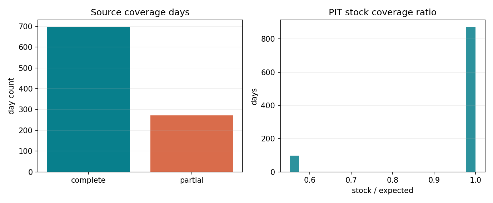

Invalid Feature Stats

Pending / unavailable.

Per-feature invalid counters were not materialized; see Pending Diagnostics.

Model Feature Names

| feature_index | feature_name | normalization |
| --- | --- | --- |
| 0 | ret_1s | train_mean_std |
| 1 | ret_5s | train_mean_std |
| 2 | ret_10s | train_mean_std |
| 3 | ret_30s | train_mean_std |
| 4 | ret_60s | train_mean_std |
| 5 | ret_300s | train_mean_std |
| 6 | ret_600s | train_mean_std |
| 7 | open_gap_1s | train_mean_std |
| 8 | body_return_1s | train_mean_std |
| 9 | range_1s | train_mean_std |
| 10 | upper_wick_1s | train_mean_std |
| 11 | lower_wick_1s | train_mean_std |
| 12 | realized_vol_10s | train_mean_std |
| 13 | realized_vol_60s | train_mean_std |
| 14 | realized_vol_300s | train_mean_std |
| 15 | log_volume_1s | train_mean_std |
| 16 | log_volume_10s | train_mean_std |
| 17 | log_volume_60s | train_mean_std |
| 18 | volume_intensity_10s_60s | train_mean_std |
| 19 | log_seconds_since_trade | train_mean_std |
| 20 | trade_observed | train_mean_std |
| 21 | ret_1s__cs_rank | train_mean_std |
| 22 | ret_1s__cs_zscore | train_mean_std |
| 23 | ret_10s__cs_rank | train_mean_std |
| 24 | ret_10s__cs_zscore | train_mean_std |
| 25 | ret_60s__cs_rank | train_mean_std |
| 26 | ret_60s__cs_zscore | train_mean_std |
| 27 | range_1s__cs_rank | train_mean_std |
| 28 | range_1s__cs_zscore | train_mean_std |
| 29 | realized_vol_60s__cs_rank | train_mean_std |
| 30 | realized_vol_60s__cs_zscore | train_mean_std |
| 31 | log_volume_60s__cs_rank | train_mean_std |
| 32 | log_volume_60s__cs_zscore | train_mean_std |
| 33 | ret_1s__market_median | train_mean_std |
| 34 | ret_1s__market_iqr | train_mean_std |
| 35 | ret_60s__market_median | train_mean_std |
| 36 | ret_60s__market_iqr | train_mean_std |
| 37 | range_1s__market_median | train_mean_std |
| 38 | range_1s__market_iqr | train_mean_std |
| 39 | log_volume_60s__market_median | train_mean_std |
| 40 | log_volume_60s__market_iqr | train_mean_std |
| 41 | history_ready | none |

Dropped Physical Features

No feature projection was configured; physical and model dimensions are both 42.

### 2.3. Cleaning And Sample-Selection Assessment

数据缓存按日构建, rolling, sequence 和 label 不跨午休或交易 session. 训练以标准 full-dataset epoch 采样: 每个 eligible train endpoint 在每轮内无放回且至多出现一次; 本次训练因从 activation step 后明确启用的早停规则在部分 epoch 后结束.  验证 probe 上限为 250,000, 不代表完整 validation population. 

03 · Evaluation

## 主要结果

| 记录项 | 当前解释 |
| --- | --- |
| 实验 | baseline-1s-v2 |
| 报告类型 | full_report_html |
| 历史状态 | 历史成功 |
| 证据 | baseline-1s-v2-full-report-0812 |

Stock1s · PIT CSI 300/500/1000 · OHLCV Only

1 秒因子, 10 秒 cadence, 过去 3,600 秒的 360 步单向 GRU, 以及 10 秒延迟, 10 秒 entry/exit VWAP 的 600 秒可执行收益标签. 报告严格按仓库 research-report-outline 的七章与五个 Evaluation parts 生成. 

`config 0731e8b0cdca` · `artifact commit 893d40de7a93`

01 · Executive Summary

### Evaluation

### 3.1. IC Summary

Checkpoint Validation IC 使用每个磁盘 `*.pt` 文件在同一 seed, 同一 250,000 行 validation probe 上重算的指标, 横轴为真实 global step. 重合的 `best.pt` / `last.pt` 仍在明细表中分别保留. 

Checkpoint Validation IC

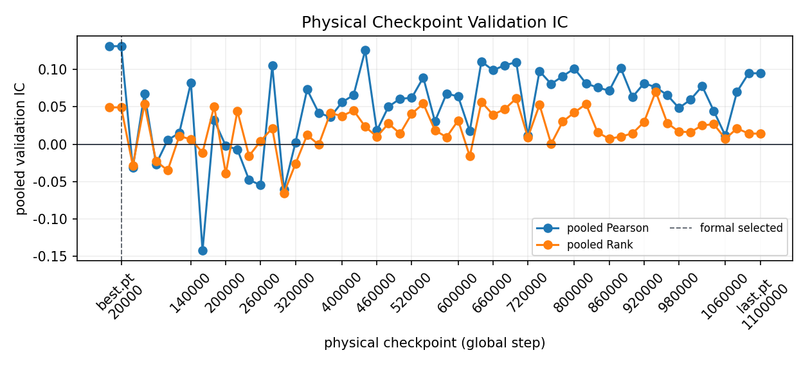

core_ic_metrics.csv

| split | count | mse | mae | pooled_pearson_ic | pooled_rank_ic | timestamp_count | timestamp_pearson_ic_mean | timestamp_rank_ic_mean | timestamp_rank_icir | coverage_fraction |
| --- | --- | --- | --- | --- | --- | --- | --- | --- | --- | --- |
| train | 250000 | 0.000017 | 0.00268 | -0.021621 | 0.003567 | 727 | 0.053277 | 0.055405 | 0.575371 | 0.000467 |
| val | 250000 | 0.000028 | 0.003447 | 0.131383 | 0.04934 | 202 | 0.042886 | 0.04988 | 0.372083 | 0.008116 |
| test | 165740198 | 0.000018 | 0.002757 | 0.009249 | 0.004643 | 118116 | 0.038423 | 0.047697 | 0.397193 | 1.0 |

### 3.2. Signal Quality 1: bucket (10)

主表按完整 test prediction population 的全局 prediction 阈值分十桶; 它不是逐 timestamp 的横截面 rank 分桶. 日度 spread 则在每个交易日内部用 ntile(10) 重分桶. 真正与交易规则对齐的逐 timestamp top/bottom 10% 结果见第 5 章 cohort backtest. 

Signal Bucket Metrics

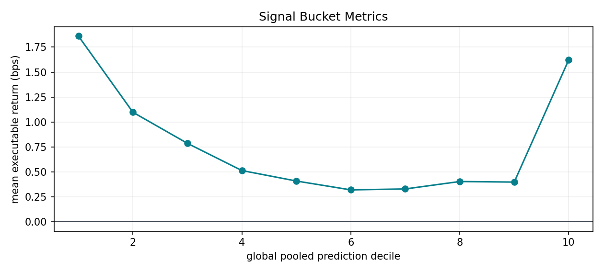

signal_bucket_metrics.csv

| signal_bucket | mean_prediction | mean_label_bps | t_stat | hit_rate | row_count | top_bottom_signal_spread_bps |
| --- | --- | --- | --- | --- | --- | --- |
| 1 | -0.00131 | 1.860629 | 131.276783 | 0.473742 | 16538581 | -0.238009 |
| 2 | -0.000635 | 1.097618 | 100.726865 | 0.468417 | 16552511 | -0.238009 |
| 3 | -0.000448 | 0.786383 | 84.184596 | 0.465237 | 16635947 | -0.238009 |
| 4 | -0.000343 | 0.513914 | 59.973082 | 0.46542 | 16591410 | -0.238009 |
| 5 | -0.000263 | 0.409003 | 49.601505 | 0.467486 | 16570856 | -0.238009 |
| 6 | -0.000188 | 0.320177 | 39.02735 | 0.470504 | 16556767 | -0.238009 |
| 7 | -0.000106 | 0.329619 | 39.224421 | 0.473961 | 16628501 | -0.238009 |
| 8 | 0.000001 | 0.404005 | 45.004978 | 0.476133 | 16507190 | -0.238009 |
| 9 | 0.000184 | 0.398332 | 39.906157 | 0.473205 | 16584597 | -0.238009 |
| 10 | 0.000751 | 1.622621 | 115.255938 | 0.481687 | 16573838 | -0.238009 |

Daily Top-Minus-Bottom Signal Spread

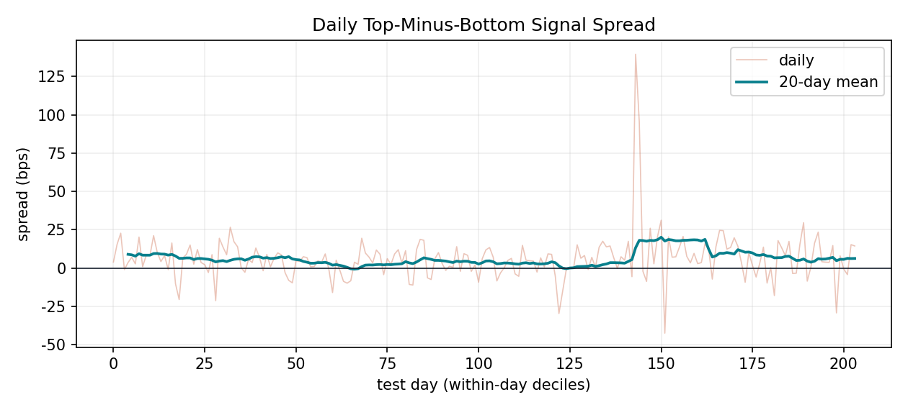

daily_top_bottom_signal_spread.csv

| date | bottom_mean_label_bps | top_mean_label_bps | top_bottom_signal_spread_bps | row_count |
| --- | --- | --- | --- | --- |
| 20240301 | -8.917989 | -5.051734 | 3.866255 | 877240.0 |
| 20240304 | 1.006802 | 16.434349 | 15.427547 | 869914.0 |
| 20240305 | -0.347777 | 22.364908 | 22.712685 | 897451.0 |
| 20240306 | 7.218611 | 6.18433 | -1.034281 | 817387.0 |
| 20240307 | -6.561628 | -3.045615 | 3.516012 | 835988.0 |
| 20240308 | 3.794987 | 10.800213 | 7.005226 | 812108.0 |
| 20240311 | 12.183961 | 14.875553 | 2.691592 | 833908.0 |
| 20240312 | -10.620963 | 9.569994 | 20.190957 | 837525.0 |
| 20240314 | 7.285142 | 8.170464 | 0.885322 | 804290.0 |
| 20240315 | 0.1129 | 8.570619 | 8.457719 | 803725.0 |
| 20240318 | 0.920883 | 9.097641 | 8.176758 | 861906.0 |
| 20240319 | -14.087528 | 7.010653 | 21.098181 | 812680.0 |
| 20240320 | 0.370183 | 10.532486 | 10.162304 | 814871.0 |
| 20240321 | -7.422693 | -3.240204 | 4.182489 | 804433.0 |
| 20240322 | -3.750778 | 4.351308 | 8.102086 | 844253.0 |
| 20240325 | -9.758621 | -10.832537 | -1.073916 | 829685.0 |

Showing 16 of 204 rows; full CSV is persisted.

### 3.3. Signal Quality 2: Important Stock Pool

Pending / unavailable.

Important-pool membership and joined metrics are unavailable in this v2 run. No nonzero/pooled IC tables or prediction-vs-real-return curve are fabricated.

### 3.4. Goodness Of Fit

v2 prediction 与 label 已是 raw executable log return, 不执行 legacy label z-score 反变换. 完整 test population 按 prediction 切为 100 个近似等频段; 图像为正方形, x/y 使用完全相同的 limits 和 equal aspect. 

Goodness Of Fit

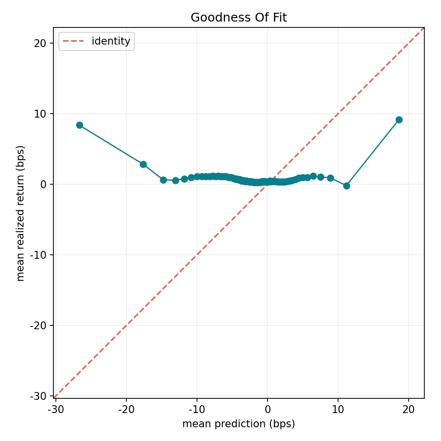

goodness_of_fit_metrics.csv

| split | prediction_bin | mean_prediction | mean_label | mean_label_bps | label_std | label_se | label_p05 | label_p95 | label_ci90_low | label_ci90_high | row_count |
| --- | --- | --- | --- | --- | --- | --- | --- | --- | --- | --- | --- |
| test | 1 | -0.00267 | 0.000839 | 8.393454 | 0.008258 | 0.000006 | -0.010968 | 0.013921 | 0.000829 | 0.00085 | 1622882 |
| test | 2 | -0.001765 | 0.000286 | 2.85918 | 0.006481 | 0.000005 | -0.008449 | 0.010018 | 0.000278 | 0.000294 | 1679106 |
| test | 3 | -0.001482 | 0.000067 | 0.669029 | 0.005878 | 0.000005 | -0.007777 | 0.008785 | 0.000059 | 0.000074 | 1640664 |
| test | 4 | -0.001308 | 0.000056 | 0.557776 | 0.005561 | 0.000004 | -0.007405 | 0.008326 | 0.000049 | 0.000063 | 1682995 |
| test | 5 | -0.001181 | 0.000081 | 0.806141 | 0.005394 | 0.000004 | -0.007145 | 0.008097 | 0.000074 | 0.000088 | 1653956 |
| test | 6 | -0.001082 | 0.0001 | 0.999237 | 0.005258 | 0.000004 | -0.006961 | 0.007905 | 0.000093 | 0.000107 | 1622255 |
| test | 7 | -0.001001 | 0.000109 | 1.09406 | 0.005139 | 0.000004 | -0.006788 | 0.00774 | 0.000103 | 0.000116 | 1678045 |
| test | 8 | -0.000933 | 0.000111 | 1.11473 | 0.005042 | 0.000004 | -0.006684 | 0.007624 | 0.000105 | 0.000118 | 1612399 |
| test | 9 | -0.000871 | 0.00011 | 1.097721 | 0.004939 | 0.000004 | -0.00657 | 0.007533 | 0.000104 | 0.000116 | 1822164 |
| test | 10 | -0.000819 | 0.000113 | 1.132125 | 0.00486 | 0.000004 | -0.006468 | 0.007445 | 0.000107 | 0.00012 | 1524115 |
| test | 11 | -0.000775 | 0.000116 | 1.158399 | 0.004772 | 0.000004 | -0.00635 | 0.007332 | 0.00011 | 0.000122 | 1715217 |
| test | 12 | -0.000734 | 0.00011 | 1.095608 | 0.004703 | 0.000004 | -0.006269 | 0.007214 | 0.000103 | 0.000116 | 1620051 |
| test | 13 | -0.000699 | 0.000119 | 1.189838 | 0.004639 | 0.000004 | -0.006166 | 0.007122 | 0.000113 | 0.000125 | 1596592 |
| test | 14 | -0.000667 | 0.000113 | 1.13266 | 0.004542 | 0.000003 | -0.006064 | 0.007011 | 0.000108 | 0.000119 | 1700332 |
| test | 15 | -0.000638 | 0.000114 | 1.136423 | 0.004462 | 0.000003 | -0.005949 | 0.006901 | 0.000108 | 0.000119 | 1652723 |
| test | 16 | -0.000611 | 0.000109 | 1.091556 | 0.004376 | 0.000003 | -0.005855 | 0.006767 | 0.000104 | 0.000115 | 1636143 |
| test | 17 | -0.000587 | 0.000109 | 1.090518 | 0.004307 | 0.000003 | -0.005758 | 0.006667 | 0.000104 | 0.000114 | 1691403 |
| test | 18 | -0.000565 | 0.000108 | 1.077615 | 0.004235 | 0.000003 | -0.005666 | 0.006552 | 0.000102 | 0.000113 | 1620865 |
| test | 19 | -0.000545 | 0.0001 | 0.9974 | 0.004145 | 0.000003 | -0.005593 | 0.006411 | 0.000095 | 0.000105 | 1721625 |
| test | 20 | -0.000527 | 0.000101 | 1.006818 | 0.004091 | 0.000003 | -0.005505 | 0.006329 | 0.000095 | 0.000106 | 1597560 |
| test | 21 | -0.00051 | 0.000095 | 0.953597 | 0.00404 | 0.000003 | -0.005428 | 0.006247 | 0.00009 | 0.000101 | 1670405 |
| test | 22 | -0.000493 | 0.000092 | 0.921537 | 0.00398 | 0.000003 | -0.005364 | 0.006135 | 0.000087 | 0.000097 | 1675987 |
| test | 23 | -0.000478 | 0.000084 | 0.843326 | 0.003905 | 0.000003 | -0.005306 | 0.006042 | 0.000079 | 0.000089 | 1663956 |
| test | 24 | -0.000464 | 0.000081 | 0.80787 | 0.003878 | 0.000003 | -0.005242 | 0.005946 | 0.000076 | 0.000086 | 1625461 |

Showing 24 of 100 rows; full CSV is persisted.

### 3.5. Liquidity By ADV

Pending / unavailable.

No ADV join, spread, impact or capacity fields were persisted. ADV bucket tables and figures remain pending.

04 · Train Metrics

### Train Metrics

### 4.1. Checkpoint Selection

Selected checkpoint summary

| best_iter | original_best_epoch | selection_metric | selection_rule | selection_value | physical_checkpoint_count | unique_model_state_count | posthoc_sweep_mse_best | test_used_for_selection | checkpoint_selector_source |
| --- | --- | --- | --- | --- | --- | --- | --- | --- | --- |
| best.pt | 1 | mse | min | 0.000028 | 57 | 55 | step_0020000.pt, best.pt | False | [artifact-root]/nn/baseline-1s-0812-full-epoch/evaluation/checkpoint_metrics.csv |

正式模型仍是训练时按固定 validation probe MSE 选出的 `best.pt` ; probe 在每个 checkpoint cadence 和非整周期的 epoch 终点执行. checkpoint sweep 是事后复算诊断, 不会静默改写原始选择或 test/backtest 结果. 

Checkpoint Selection Metrics

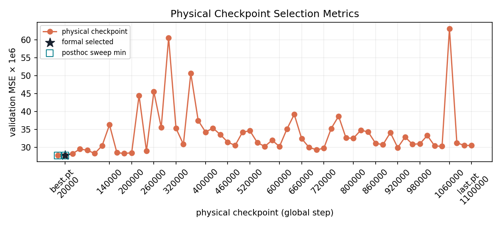

checkpoint_selector_table.csv

| candidate | checkpoint_kind | selected | formal_selected | sweep_mse_best | state_aliases | global_step | epoch | effective_epoch | step_round | train/pooled_mse | metric_name | metric_value | val/mse | val/mae | val/pooled_pearson_ic | val/pooled_rank_ic | val/timestamp_pearson_ic_mean | val/timestamp_rank_ic_mean | val/timestamp_rank_icir | evaluation_count | sample_cap | validation_seed | evaluation_reused_from | model_state_sha256 | checkpoint_file_sha256 | checkpoint_path |
| --- | --- | --- | --- | --- | --- | --- | --- | --- | --- | --- | --- | --- | --- | --- | --- | --- | --- | --- | --- | --- | --- | --- | --- | --- | --- | --- |
| step_0020000.pt | periodic | False | False | True | step_0020000.pt,best.pt | 20000 | 1 | 0.004567 | 20000 | 0.000016 | val/mse | 0.000028 | 0.000028 | 0.003447 | 0.131383 | 0.04934 | 0.042886 | 0.04988 | 0.372083 | 250000 | 250000 | 7 | n/a | f4a823f5d220f19ef42730a763a289f70114c790817fbc6fa08db11918b66f3d | e0a696ba21c526f6bf74feb3597b2074027a00f2896d98b193c56accf78cd0e0 | [artifact-root]/nn/baseline-1s-0812-full-epoch/checkpoints/step_0020000.pt |
| best.pt | best | True | True | True | step_0020000.pt,best.pt | 20000 | 1 | 0.004567 | 20000 | 0.000016 | val/mse | 0.000028 | 0.000028 | 0.003447 | 0.131383 | 0.04934 | 0.042886 | 0.04988 | 0.372083 | 250000 | 250000 | 7 | step_0020000.pt | f4a823f5d220f19ef42730a763a289f70114c790817fbc6fa08db11918b66f3d | 0e8ba9a8fcf41be2bf8cc8a876d3aefaa41ad3a091a9bf37586e1000fbc2a7e6 | [artifact-root]/nn/baseline-1s-0812-full-epoch/checkpoints/best.pt |
| step_0040000.pt | periodic | False | False | False | step_0040000.pt | 40000 | 1 | 0.009133 | 40000 | 0.000015 | val/mse | 0.000028 | 0.000028 | 0.003455 | -0.031703 | -0.02868 | -0.00917 | -0.007065 | -0.067614 | 250000 | 250000 | 7 | n/a | 1866da6fd1397b37d98fcc5ae87c500a9edf18894b1ea376fd1a79260746841b | d407a4427f8072a9818dc9b80c8675765de23413bb2ad70e0f9045d5bef048e9 | [artifact-root]/nn/baseline-1s-0812-full-epoch/checkpoints/step_0040000.pt |
| step_0060000.pt | periodic | False | False | False | step_0060000.pt | 60000 | 1 | 0.013706 | 60000 | 0.000016 | val/mse | 0.00003 | 0.00003 | 0.003635 | 0.067903 | 0.053573 | 0.046152 | 0.053366 | 0.456928 | 250000 | 250000 | 7 | n/a | a8e281c4fe4f947e2355b860982956ac868c1294de808af493aa022323f1c6d8 | 4113d3a70e7160907f47375224f0baab01c0d0a019e82987ff358b62c423a2f0 | [artifact-root]/nn/baseline-1s-0812-full-epoch/checkpoints/step_0060000.pt |
| step_0080000.pt | periodic | False | False | False | step_0080000.pt | 80000 | 1 | 0.018285 | 80000 | 0.000016 | val/mse | 0.000029 | 0.000029 | 0.003558 | -0.026625 | -0.022707 | 0.041993 | 0.048806 | 0.416744 | 250000 | 250000 | 7 | n/a | 44885b67995cd067b9fdb91c2c86187b611c70d8a980bfde3afe97c6e4d90a0c | 9c6b0ce035bc87a4426263a0161d76b05f4feb6cdac4c5a2ec71a477fbdc7469 | [artifact-root]/nn/baseline-1s-0812-full-epoch/checkpoints/step_0080000.pt |
| step_0100000.pt | periodic | False | False | False | step_0100000.pt | 100000 | 1 | 0.02284 | 100000 | 0.000016 | val/mse | 0.000028 | 0.000028 | 0.003464 | 0.00547 | -0.035149 | -0.009965 | -0.009387 | -0.084834 | 250000 | 250000 | 7 | n/a | 17c3215682d8f573d1fec821579a913e36a348c6ef619e53d9355078b996ebd2 | 2cd4215e39341f3bba1383a17d2814fb8fca5a3d3f4251196c5bed04079fed23 | [artifact-root]/nn/baseline-1s-0812-full-epoch/checkpoints/step_0100000.pt |
| step_0120000.pt | periodic | False | False | False | step_0120000.pt | 120000 | 1 | 0.027384 | 120000 | 0.000016 | val/mse | 0.000031 | 0.000031 | 0.003762 | 0.015118 | 0.010801 | 0.040322 | 0.046924 | 0.336541 | 250000 | 250000 | 7 | n/a | 66a726998be964afbcf02eb4f2772f90845af87f7134ebd38ce5a9e51d38cc6b | e66d342c310cf12f6117de9e13bd1f6d51223245b077cc8f9d3f71717aadc511 | [artifact-root]/nn/baseline-1s-0812-full-epoch/checkpoints/step_0120000.pt |
| step_0140000.pt | periodic | False | False | False | step_0140000.pt | 140000 | 1 | 0.031907 | 140000 | 0.000015 | val/mse | 0.000036 | 0.000036 | 0.004355 | 0.082517 | 0.006571 | 0.048463 | 0.055023 | 0.433884 | 250000 | 250000 | 7 | n/a | 5ec30604d89135220fa9189393d3382430ba30387a44b76d4ab0741061c3622e | eb8025ca0c10d6f84560482ad1df5ef50cb619f3594de38567edb61ed3790751 | [artifact-root]/nn/baseline-1s-0812-full-epoch/checkpoints/step_0140000.pt |
| step_0160000.pt | periodic | False | False | False | step_0160000.pt | 160000 | 1 | 0.036431 | 160000 | 0.000016 | val/mse | 0.000029 | 0.000029 | 0.003474 | -0.142723 | -0.011196 | 0.042484 | 0.048722 | 0.490141 | 250000 | 250000 | 7 | n/a | daed66c1c0a6f4c8cba2df38a51a1c74911de217b03f81f44b957e0b01ad298d | 4615619ee16b8bb6bd5bcff8d438ee722675db6e4402b208559c73d5ced0156f | [artifact-root]/nn/baseline-1s-0812-full-epoch/checkpoints/step_0160000.pt |
| step_0180000.pt | periodic | False | False | False | step_0180000.pt | 180000 | 1 | 0.040996 | 180000 | 0.000015 | val/mse | 0.000028 | 0.000028 | 0.003461 | 0.032266 | 0.050839 | -0.001428 | -0.005492 | -0.058762 | 250000 | 250000 | 7 | n/a | f5b60f05174478014a64d3daf99c0239e34f36db64d6e7afb1705040b2555505 | e0a93b34aef526f6ce2ad69c3d11c043d8a80a16f59811e7231b75e8fad06b77 | [artifact-root]/nn/baseline-1s-0812-full-epoch/checkpoints/step_0180000.pt |
| step_0200000.pt | periodic | False | False | False | step_0200000.pt | 200000 | 1 | 0.045517 | 200000 | 0.000015 | val/mse | 0.000029 | 0.000029 | 0.003492 | -0.00222 | -0.03925 | 0.015889 | 0.00952 | 0.084866 | 250000 | 250000 | 7 | n/a | 836c9035767dcbe4762971c6187176448df34727c297d5e531efd8f6fea47a5f | 47819f332bbb2412ce2824feacbf620002d2154ad6d5538399960879912baf1c | [artifact-root]/nn/baseline-1s-0812-full-epoch/checkpoints/step_0200000.pt |
| step_0220000.pt | periodic | False | False | False | step_0220000.pt | 220000 | 1 | 0.050046 | 220000 | 0.000015 | val/mse | 0.000044 | 0.000044 | 0.005119 | -0.007001 | 0.044473 | 0.020436 | 0.025135 | 0.253261 | 250000 | 250000 | 7 | n/a | f85a08fcf988b2241d9222b893acf9259669a3d067cfbcc8ec532fa79c0cec34 | 10c2421a6a9b4854b87362a61542cfe8393994ca13a63970564cdb8fd6ca94ff | [artifact-root]/nn/baseline-1s-0812-full-epoch/checkpoints/step_0220000.pt |
| step_0240000.pt | periodic | False | False | False | step_0240000.pt | 240000 | 1 | 0.054574 | 240000 | 0.000015 | val/mse | 0.000029 | 0.000029 | 0.003508 | -0.047777 | -0.015734 | 0.033102 | 0.032399 | 0.30013 | 250000 | 250000 | 7 | n/a | 729f4eb1c1beb6f8f5c5a8937c8669e7651fa39f1b8e4984eef24cc667eb9721 | 06d36aa6dceb675ce14a9fa76c1dbaec2c719995f8700a7df0d565c22b2e3e24 | [artifact-root]/nn/baseline-1s-0812-full-epoch/checkpoints/step_0240000.pt |
| step_0260000.pt | periodic | False | False | False | step_0260000.pt | 260000 | 1 | 0.059099 | 260000 | 0.000015 | val/mse | 0.000046 | 0.000046 | 0.005006 | -0.054896 | 0.004246 | -0.001 | 0.003404 | 0.032226 | 250000 | 250000 | 7 | n/a | b1dce44bf94fabe789b7e6582ed41e122528b30a59a730b76f98315623894e24 | 8b46fa535cc0034ed6c29cf0d061dc9f906e9052d64ac2eaefed38cef46e0ca9 | [artifact-root]/nn/baseline-1s-0812-full-epoch/checkpoints/step_0260000.pt |
| step_0280000.pt | periodic | False | False | False | step_0280000.pt | 280000 | 1 | 0.06366 | 280000 | 0.000015 | val/mse | 0.000036 | 0.000036 | 0.004129 | 0.105178 | 0.021435 | 0.020736 | 0.00248 | 0.02237 | 250000 | 250000 | 7 | n/a | d46217c5eda734ce5ac2b265eb628764141ed657f8da0b5b70822762cc85546c | 9e0b85a3c776f487f7eae41eaaffc279e4eb5017edacf8beca5bcb51fb98aeb0 | [artifact-root]/nn/baseline-1s-0812-full-epoch/checkpoints/step_0280000.pt |
| step_0300000.pt | periodic | False | False | False | step_0300000.pt | 300000 | 1 | 0.068233 | 300000 | 0.000015 | val/mse | 0.000061 | 0.000061 | 0.006012 | -0.060614 | -0.065675 | 0.011904 | 0.011479 | 0.158556 | 250000 | 250000 | 7 | n/a | 8e3957db25a5a3cfca697c8a2b3867c0fd82727fb6205266eaf870600c32a1b8 | a1ea3a78968059478a0502d6dca33c6541fe0a7c11797c26801cda076cc7cc1a | [artifact-root]/nn/baseline-1s-0812-full-epoch/checkpoints/step_0300000.pt |
| step_0320000.pt | periodic | False | False | False | step_0320000.pt | 320000 | 1 | 0.07277 | 320000 | 0.000014 | val/mse | 0.000035 | 0.000035 | 0.004099 | 0.002275 | -0.026254 | 0.021498 | 0.02762 | 0.278967 | 250000 | 250000 | 7 | n/a | 779a2fcae393b9e36e616d783806589c2672c9197ad6417a6536353e3c9668c5 | 4a10c692ced70b80fb7d2f71c6fd206a103def7d4c16a3bb52480c29a88f58a8 | [artifact-root]/nn/baseline-1s-0812-full-epoch/checkpoints/step_0320000.pt |
| step_0340000.pt | periodic | False | False | False | step_0340000.pt | 340000 | 1 | 0.077335 | 340000 | 0.000014 | val/mse | 0.000031 | 0.000031 | 0.003786 | 0.073291 | 0.012282 | 0.03594 | 0.039008 | 0.329433 | 250000 | 250000 | 7 | n/a | 2a2bb3f7f6842e145a3e5ad6f07e03a04e4d12566ecbf68156691c34d3d66864 | b4bee13923eaa9c55a9ec278871daeaf1cffd68428454c3851e01eff66880728 | [artifact-root]/nn/baseline-1s-0812-full-epoch/checkpoints/step_0340000.pt |
| step_0360000.pt | periodic | False | False | False | step_0360000.pt | 360000 | 1 | 0.081907 | 360000 | 0.000014 | val/mse | 0.000051 | 0.000051 | 0.005234 | 0.041933 | -0.00069 | 0.014696 | 0.020519 | 0.21784 | 250000 | 250000 | 7 | n/a | be3970dfb1add8ee9af423c6a13987dd1b67fe5a1fe6d8ce679127cbf887455d | b4866c5b40ef9b15df5909b4cb288f648d119a55357c8b6fc60771a2d54066f2 | [artifact-root]/nn/baseline-1s-0812-full-epoch/checkpoints/step_0360000.pt |
| step_0380000.pt | periodic | False | False | False | step_0380000.pt | 380000 | 1 | 0.086449 | 380000 | 0.000014 | val/mse | 0.000038 | 0.000038 | 0.004465 | 0.036381 | 0.041725 | 0.020038 | 0.019974 | 0.212937 | 250000 | 250000 | 7 | n/a | 2b4c8a658da3202529d71c258730d14cd7c86313dd7c9659fca7eba0d791e934 | a5382568ee442b36e3c7f60d94a0bc1fa3b7847008ed08b1210c7ccda0a57008 | [artifact-root]/nn/baseline-1s-0812-full-epoch/checkpoints/step_0380000.pt |
| step_0400000.pt | periodic | False | False | False | step_0400000.pt | 400000 | 1 | 0.090994 | 400000 | 0.000013 | val/mse | 0.000034 | 0.000034 | 0.0041 | 0.056194 | 0.037719 | 0.025703 | 0.031799 | 0.3006 | 250000 | 250000 | 7 | n/a | 412f2428048e88c46f85e3dba26e212563814d861257e513c2d061200a0d0480 | 3a30c4f33ee21836a6b1f9f78cb75d1fa64ad37eb6e7b816e7ec20693913d8e0 | [artifact-root]/nn/baseline-1s-0812-full-epoch/checkpoints/step_0400000.pt |
| step_0420000.pt | periodic | False | False | False | step_0420000.pt | 420000 | 1 | 0.095503 | 420000 | 0.000013 | val/mse | 0.000035 | 0.000035 | 0.004132 | 0.065854 | 0.045287 | 0.021327 | 0.021926 | 0.251327 | 250000 | 250000 | 7 | n/a | 2967cf33372c8aa916ec8f39a3c42d5e423fa8300a8ce44ba40905f95fb4428c | b96d61963c107aadf79bd903998ec7b584122501864beb6fdff41f6b3c289859 | [artifact-root]/nn/baseline-1s-0812-full-epoch/checkpoints/step_0420000.pt |
| step_0440000.pt | periodic | False | False | False | step_0440000.pt | 440000 | 1 | 0.100047 | 440000 | 0.000013 | val/mse | 0.000034 | 0.000034 | 0.003979 | 0.126061 | 0.023516 | 0.020609 | 0.017973 | 0.173343 | 250000 | 250000 | 7 | n/a | b93c5011ce600463c030fea41cb99ee80a7eaeb7e83425018e0b2d8a54e5466b | 4742f492081dee4968221f750660f26f760fe159fbe380bde125ede26eae8a00 | [artifact-root]/nn/baseline-1s-0812-full-epoch/checkpoints/step_0440000.pt |
| step_0460000.pt | periodic | False | False | False | step_0460000.pt | 460000 | 1 | 0.104612 | 460000 | 0.000013 | val/mse | 0.000031 | 0.000031 | 0.003764 | 0.018211 | 0.009996 | 0.021657 | 0.019419 | 0.270904 | 250000 | 250000 | 7 | n/a | 112e2959753eb2f9f42dd07339e863faadadc21a229d74081cb4426b9d151b43 | aed0af79c0b6fa180402a339a3072ddae9e3e7d47486181e30d05da36449b6b8 | [artifact-root]/nn/baseline-1s-0812-full-epoch/checkpoints/step_0460000.pt |

Showing 24 of 57 rows; full CSV is persisted.

### 4.2. Model And Method

| field | value |
| --- | --- |
| model_class | Stock1sGru |
| trainable_parameter | 1,840,385 |
| input_tensor | (batch, 360, 42) |
| physical_feature_dim | 42 |
| model_feature_dim | 42 |
| prediction_target | raw executable 600-second log return |
| label_horizon_minutes | 10 |
| label_entry_lag_minutes | 0.166667 |

### 4.2.1. GRU

| field | value |
| --- | --- |
| input_tensor | (batch, 360, 42) |
| input_size | 42 |
| gru_hidden_size | 384 |
| gru_num_layers | 2 |
| gru_bidirectional | false |
| gru_dropout | 0 |

### 4.2.2. MLP

| field | value |
| --- | --- |
| mlp_effective_hidden_width | 512, 512 |
| mlp_dropout | 0 |

### 4.2.3. Method

| field | value |
| --- | --- |
| train_config_source | [artifact-root]/nn/baseline-1s-0812-full-epoch/resolved_config.json |
| eval_only_config_source | same resolved config; no eval-only override |
| optimizer | AdamW |
| learning_rate | 0.0002 |
| initialization | PyTorch module defaults |
| device | cuda |
| mixed_precision | True / float16 |
| batch_size | 128 |
| epoch_semantics | standard full-dataset epoch; every eligible train endpoint appears exactly once without replacement |
| configured_epochs | 1 |
| completed_full_epochs | 0 |
| equivalent_full_epochs | 0.250189 |
| total_step_budget | 1,100,000 |
| early_stopping | enabled at step 900,000; val MSE/min, patience=10 physical checkpoints, min_delta=0; status=early_stopped |
| validation_probe_cadence | every 20,000 optimizer steps and at a non-periodic epoch end |
| validation_probe_sample_cap | 250,000 |
| checkpoint_cadence | 20,000 |
| scheduler | none |
| resume_policy | exact optimizer/scaler/RNG checkpoint state |

### 4.3. Training Monitoring

Train Loss

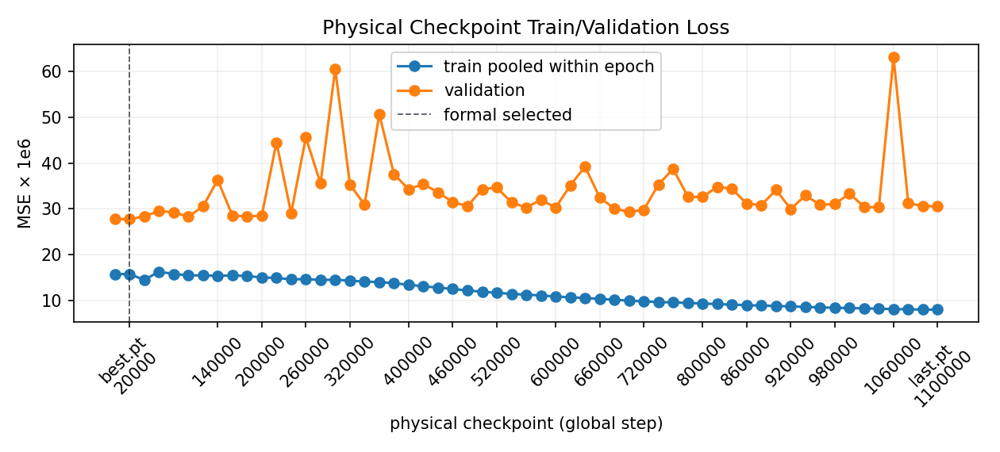

Train Monitoring Curves

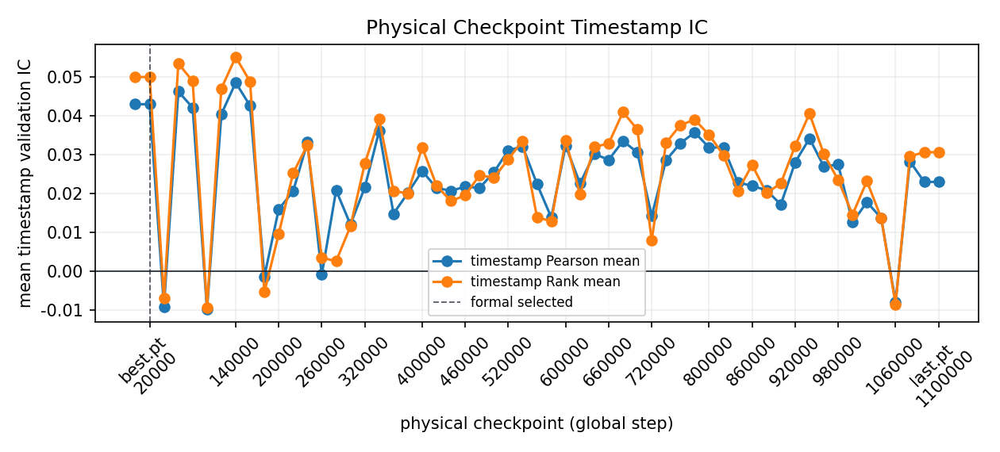

Latest metrics

| candidate | checkpoint_kind | selected | formal_selected | sweep_mse_best | state_aliases | global_step | epoch | effective_epoch | step_round | train/pooled_mse | metric_name | metric_value | val/mse | val/mae | val/pooled_pearson_ic | val/pooled_rank_ic | val/timestamp_pearson_ic_mean | val/timestamp_rank_ic_mean | val/timestamp_rank_icir | evaluation_count | sample_cap | validation_seed | evaluation_reused_from | model_state_sha256 | checkpoint_file_sha256 | checkpoint_path |
| --- | --- | --- | --- | --- | --- | --- | --- | --- | --- | --- | --- | --- | --- | --- | --- | --- | --- | --- | --- | --- | --- | --- | --- | --- | --- | --- |
| step_0020000.pt | periodic | False | False | True | step_0020000.pt,best.pt | 20000 | 1 | 0.004567 | 20000 | 0.000016 | val/mse | 0.000028 | 0.000028 | 0.003447 | 0.131383 | 0.04934 | 0.042886 | 0.04988 | 0.372083 | 250000 | 250000 | 7 | n/a | f4a823f5d220f19ef42730a763a289f70114c790817fbc6fa08db11918b66f3d | e0a696ba21c526f6bf74feb3597b2074027a00f2896d98b193c56accf78cd0e0 | [artifact-root]/nn/baseline-1s-0812-full-epoch/checkpoints/step_0020000.pt |
| best.pt | best | True | True | True | step_0020000.pt,best.pt | 20000 | 1 | 0.004567 | 20000 | 0.000016 | val/mse | 0.000028 | 0.000028 | 0.003447 | 0.131383 | 0.04934 | 0.042886 | 0.04988 | 0.372083 | 250000 | 250000 | 7 | step_0020000.pt | f4a823f5d220f19ef42730a763a289f70114c790817fbc6fa08db11918b66f3d | 0e8ba9a8fcf41be2bf8cc8a876d3aefaa41ad3a091a9bf37586e1000fbc2a7e6 | [artifact-root]/nn/baseline-1s-0812-full-epoch/checkpoints/best.pt |
| step_0040000.pt | periodic | False | False | False | step_0040000.pt | 40000 | 1 | 0.009133 | 40000 | 0.000015 | val/mse | 0.000028 | 0.000028 | 0.003455 | -0.031703 | -0.02868 | -0.00917 | -0.007065 | -0.067614 | 250000 | 250000 | 7 | n/a | 1866da6fd1397b37d98fcc5ae87c500a9edf18894b1ea376fd1a79260746841b | d407a4427f8072a9818dc9b80c8675765de23413bb2ad70e0f9045d5bef048e9 | [artifact-root]/nn/baseline-1s-0812-full-epoch/checkpoints/step_0040000.pt |
| step_0060000.pt | periodic | False | False | False | step_0060000.pt | 60000 | 1 | 0.013706 | 60000 | 0.000016 | val/mse | 0.00003 | 0.00003 | 0.003635 | 0.067903 | 0.053573 | 0.046152 | 0.053366 | 0.456928 | 250000 | 250000 | 7 | n/a | a8e281c4fe4f947e2355b860982956ac868c1294de808af493aa022323f1c6d8 | 4113d3a70e7160907f47375224f0baab01c0d0a019e82987ff358b62c423a2f0 | [artifact-root]/nn/baseline-1s-0812-full-epoch/checkpoints/step_0060000.pt |
| step_0080000.pt | periodic | False | False | False | step_0080000.pt | 80000 | 1 | 0.018285 | 80000 | 0.000016 | val/mse | 0.000029 | 0.000029 | 0.003558 | -0.026625 | -0.022707 | 0.041993 | 0.048806 | 0.416744 | 250000 | 250000 | 7 | n/a | 44885b67995cd067b9fdb91c2c86187b611c70d8a980bfde3afe97c6e4d90a0c | 9c6b0ce035bc87a4426263a0161d76b05f4feb6cdac4c5a2ec71a477fbdc7469 | [artifact-root]/nn/baseline-1s-0812-full-epoch/checkpoints/step_0080000.pt |
| step_0100000.pt | periodic | False | False | False | step_0100000.pt | 100000 | 1 | 0.02284 | 100000 | 0.000016 | val/mse | 0.000028 | 0.000028 | 0.003464 | 0.00547 | -0.035149 | -0.009965 | -0.009387 | -0.084834 | 250000 | 250000 | 7 | n/a | 17c3215682d8f573d1fec821579a913e36a348c6ef619e53d9355078b996ebd2 | 2cd4215e39341f3bba1383a17d2814fb8fca5a3d3f4251196c5bed04079fed23 | [artifact-root]/nn/baseline-1s-0812-full-epoch/checkpoints/step_0100000.pt |
| step_0120000.pt | periodic | False | False | False | step_0120000.pt | 120000 | 1 | 0.027384 | 120000 | 0.000016 | val/mse | 0.000031 | 0.000031 | 0.003762 | 0.015118 | 0.010801 | 0.040322 | 0.046924 | 0.336541 | 250000 | 250000 | 7 | n/a | 66a726998be964afbcf02eb4f2772f90845af87f7134ebd38ce5a9e51d38cc6b | e66d342c310cf12f6117de9e13bd1f6d51223245b077cc8f9d3f71717aadc511 | [artifact-root]/nn/baseline-1s-0812-full-epoch/checkpoints/step_0120000.pt |
| step_0140000.pt | periodic | False | False | False | step_0140000.pt | 140000 | 1 | 0.031907 | 140000 | 0.000015 | val/mse | 0.000036 | 0.000036 | 0.004355 | 0.082517 | 0.006571 | 0.048463 | 0.055023 | 0.433884 | 250000 | 250000 | 7 | n/a | 5ec30604d89135220fa9189393d3382430ba30387a44b76d4ab0741061c3622e | eb8025ca0c10d6f84560482ad1df5ef50cb619f3594de38567edb61ed3790751 | [artifact-root]/nn/baseline-1s-0812-full-epoch/checkpoints/step_0140000.pt |
| step_0160000.pt | periodic | False | False | False | step_0160000.pt | 160000 | 1 | 0.036431 | 160000 | 0.000016 | val/mse | 0.000029 | 0.000029 | 0.003474 | -0.142723 | -0.011196 | 0.042484 | 0.048722 | 0.490141 | 250000 | 250000 | 7 | n/a | daed66c1c0a6f4c8cba2df38a51a1c74911de217b03f81f44b957e0b01ad298d | 4615619ee16b8bb6bd5bcff8d438ee722675db6e4402b208559c73d5ced0156f | [artifact-root]/nn/baseline-1s-0812-full-epoch/checkpoints/step_0160000.pt |
| step_0180000.pt | periodic | False | False | False | step_0180000.pt | 180000 | 1 | 0.040996 | 180000 | 0.000015 | val/mse | 0.000028 | 0.000028 | 0.003461 | 0.032266 | 0.050839 | -0.001428 | -0.005492 | -0.058762 | 250000 | 250000 | 7 | n/a | f5b60f05174478014a64d3daf99c0239e34f36db64d6e7afb1705040b2555505 | e0a93b34aef526f6ce2ad69c3d11c043d8a80a16f59811e7231b75e8fad06b77 | [artifact-root]/nn/baseline-1s-0812-full-epoch/checkpoints/step_0180000.pt |
| step_0200000.pt | periodic | False | False | False | step_0200000.pt | 200000 | 1 | 0.045517 | 200000 | 0.000015 | val/mse | 0.000029 | 0.000029 | 0.003492 | -0.00222 | -0.03925 | 0.015889 | 0.00952 | 0.084866 | 250000 | 250000 | 7 | n/a | 836c9035767dcbe4762971c6187176448df34727c297d5e531efd8f6fea47a5f | 47819f332bbb2412ce2824feacbf620002d2154ad6d5538399960879912baf1c | [artifact-root]/nn/baseline-1s-0812-full-epoch/checkpoints/step_0200000.pt |
| step_0220000.pt | periodic | False | False | False | step_0220000.pt | 220000 | 1 | 0.050046 | 220000 | 0.000015 | val/mse | 0.000044 | 0.000044 | 0.005119 | -0.007001 | 0.044473 | 0.020436 | 0.025135 | 0.253261 | 250000 | 250000 | 7 | n/a | f85a08fcf988b2241d9222b893acf9259669a3d067cfbcc8ec532fa79c0cec34 | 10c2421a6a9b4854b87362a61542cfe8393994ca13a63970564cdb8fd6ca94ff | [artifact-root]/nn/baseline-1s-0812-full-epoch/checkpoints/step_0220000.pt |
| step_0240000.pt | periodic | False | False | False | step_0240000.pt | 240000 | 1 | 0.054574 | 240000 | 0.000015 | val/mse | 0.000029 | 0.000029 | 0.003508 | -0.047777 | -0.015734 | 0.033102 | 0.032399 | 0.30013 | 250000 | 250000 | 7 | n/a | 729f4eb1c1beb6f8f5c5a8937c8669e7651fa39f1b8e4984eef24cc667eb9721 | 06d36aa6dceb675ce14a9fa76c1dbaec2c719995f8700a7df0d565c22b2e3e24 | [artifact-root]/nn/baseline-1s-0812-full-epoch/checkpoints/step_0240000.pt |
| step_0260000.pt | periodic | False | False | False | step_0260000.pt | 260000 | 1 | 0.059099 | 260000 | 0.000015 | val/mse | 0.000046 | 0.000046 | 0.005006 | -0.054896 | 0.004246 | -0.001 | 0.003404 | 0.032226 | 250000 | 250000 | 7 | n/a | b1dce44bf94fabe789b7e6582ed41e122528b30a59a730b76f98315623894e24 | 8b46fa535cc0034ed6c29cf0d061dc9f906e9052d64ac2eaefed38cef46e0ca9 | [artifact-root]/nn/baseline-1s-0812-full-epoch/checkpoints/step_0260000.pt |
| step_0280000.pt | periodic | False | False | False | step_0280000.pt | 280000 | 1 | 0.06366 | 280000 | 0.000015 | val/mse | 0.000036 | 0.000036 | 0.004129 | 0.105178 | 0.021435 | 0.020736 | 0.00248 | 0.02237 | 250000 | 250000 | 7 | n/a | d46217c5eda734ce5ac2b265eb628764141ed657f8da0b5b70822762cc85546c | 9e0b85a3c776f487f7eae41eaaffc279e4eb5017edacf8beca5bcb51fb98aeb0 | [artifact-root]/nn/baseline-1s-0812-full-epoch/checkpoints/step_0280000.pt |
| step_0300000.pt | periodic | False | False | False | step_0300000.pt | 300000 | 1 | 0.068233 | 300000 | 0.000015 | val/mse | 0.000061 | 0.000061 | 0.006012 | -0.060614 | -0.065675 | 0.011904 | 0.011479 | 0.158556 | 250000 | 250000 | 7 | n/a | 8e3957db25a5a3cfca697c8a2b3867c0fd82727fb6205266eaf870600c32a1b8 | a1ea3a78968059478a0502d6dca33c6541fe0a7c11797c26801cda076cc7cc1a | [artifact-root]/nn/baseline-1s-0812-full-epoch/checkpoints/step_0300000.pt |
| step_0320000.pt | periodic | False | False | False | step_0320000.pt | 320000 | 1 | 0.07277 | 320000 | 0.000014 | val/mse | 0.000035 | 0.000035 | 0.004099 | 0.002275 | -0.026254 | 0.021498 | 0.02762 | 0.278967 | 250000 | 250000 | 7 | n/a | 779a2fcae393b9e36e616d783806589c2672c9197ad6417a6536353e3c9668c5 | 4a10c692ced70b80fb7d2f71c6fd206a103def7d4c16a3bb52480c29a88f58a8 | [artifact-root]/nn/baseline-1s-0812-full-epoch/checkpoints/step_0320000.pt |
| step_0340000.pt | periodic | False | False | False | step_0340000.pt | 340000 | 1 | 0.077335 | 340000 | 0.000014 | val/mse | 0.000031 | 0.000031 | 0.003786 | 0.073291 | 0.012282 | 0.03594 | 0.039008 | 0.329433 | 250000 | 250000 | 7 | n/a | 2a2bb3f7f6842e145a3e5ad6f07e03a04e4d12566ecbf68156691c34d3d66864 | b4bee13923eaa9c55a9ec278871daeaf1cffd68428454c3851e01eff66880728 | [artifact-root]/nn/baseline-1s-0812-full-epoch/checkpoints/step_0340000.pt |
| step_0360000.pt | periodic | False | False | False | step_0360000.pt | 360000 | 1 | 0.081907 | 360000 | 0.000014 | val/mse | 0.000051 | 0.000051 | 0.005234 | 0.041933 | -0.00069 | 0.014696 | 0.020519 | 0.21784 | 250000 | 250000 | 7 | n/a | be3970dfb1add8ee9af423c6a13987dd1b67fe5a1fe6d8ce679127cbf887455d | b4866c5b40ef9b15df5909b4cb288f648d119a55357c8b6fc60771a2d54066f2 | [artifact-root]/nn/baseline-1s-0812-full-epoch/checkpoints/step_0360000.pt |
| step_0380000.pt | periodic | False | False | False | step_0380000.pt | 380000 | 1 | 0.086449 | 380000 | 0.000014 | val/mse | 0.000038 | 0.000038 | 0.004465 | 0.036381 | 0.041725 | 0.020038 | 0.019974 | 0.212937 | 250000 | 250000 | 7 | n/a | 2b4c8a658da3202529d71c258730d14cd7c86313dd7c9659fca7eba0d791e934 | a5382568ee442b36e3c7f60d94a0bc1fa3b7847008ed08b1210c7ccda0a57008 | [artifact-root]/nn/baseline-1s-0812-full-epoch/checkpoints/step_0380000.pt |
| step_0400000.pt | periodic | False | False | False | step_0400000.pt | 400000 | 1 | 0.090994 | 400000 | 0.000013 | val/mse | 0.000034 | 0.000034 | 0.0041 | 0.056194 | 0.037719 | 0.025703 | 0.031799 | 0.3006 | 250000 | 250000 | 7 | n/a | 412f2428048e88c46f85e3dba26e212563814d861257e513c2d061200a0d0480 | 3a30c4f33ee21836a6b1f9f78cb75d1fa64ad37eb6e7b816e7ec20693913d8e0 | [artifact-root]/nn/baseline-1s-0812-full-epoch/checkpoints/step_0400000.pt |
| step_0420000.pt | periodic | False | False | False | step_0420000.pt | 420000 | 1 | 0.095503 | 420000 | 0.000013 | val/mse | 0.000035 | 0.000035 | 0.004132 | 0.065854 | 0.045287 | 0.021327 | 0.021926 | 0.251327 | 250000 | 250000 | 7 | n/a | 2967cf33372c8aa916ec8f39a3c42d5e423fa8300a8ce44ba40905f95fb4428c | b96d61963c107aadf79bd903998ec7b584122501864beb6fdff41f6b3c289859 | [artifact-root]/nn/baseline-1s-0812-full-epoch/checkpoints/step_0420000.pt |
| step_0440000.pt | periodic | False | False | False | step_0440000.pt | 440000 | 1 | 0.100047 | 440000 | 0.000013 | val/mse | 0.000034 | 0.000034 | 0.003979 | 0.126061 | 0.023516 | 0.020609 | 0.017973 | 0.173343 | 250000 | 250000 | 7 | n/a | b93c5011ce600463c030fea41cb99ee80a7eaeb7e83425018e0b2d8a54e5466b | 4742f492081dee4968221f750660f26f760fe159fbe380bde125ede26eae8a00 | [artifact-root]/nn/baseline-1s-0812-full-epoch/checkpoints/step_0440000.pt |
| step_0460000.pt | periodic | False | False | False | step_0460000.pt | 460000 | 1 | 0.104612 | 460000 | 0.000013 | val/mse | 0.000031 | 0.000031 | 0.003764 | 0.018211 | 0.009996 | 0.021657 | 0.019419 | 0.270904 | 250000 | 250000 | 7 | n/a | 112e2959753eb2f9f42dd07339e863faadadc21a229d74081cb4426b9d151b43 | aed0af79c0b6fa180402a339a3072ddae9e3e7d47486181e30d05da36449b6b8 | [artifact-root]/nn/baseline-1s-0812-full-epoch/checkpoints/step_0460000.pt |

Showing 24 of 57 rows; full CSV is persisted.

MLflow

Pending / unavailable.

No MLflow run id, name or tracking URI is persisted.

### 4.4. Fit And Generalization Assessment

Best epoch 1 lowered validation MSE to 0.000028, while formal test pooled Pearson and timestamp rank IC were 0.009249 and 0.047697. Train and validation are bounded probes; only test is full coverage.

05 · Trading And Cost

### Trading And Cost

### 5.0. Cost Model Status

Cost model artifact status

| field | value |
| --- | --- |
| cost_sweep_root | n/a |
| selected_candidate | fixed top/bottom 10% cohort rule |
| top_fraction | 0.1 |
| cost_bps | 10 |
| spread_impact_capacity_fields | not persisted |

### 5.1. Validation Selection And Final Test

Pending / unavailable.

Validation strategy sweep and validation-selected trading candidate are not available; the table below is the fixed final-test diagnostic only.

selected_test_metrics.csv

| annualized_sharpe | backtest_git_commit | config_sha256 | cost_bps | cumulative_gross_return | cumulative_net_return | daily_hit_rate | date_count | event_count | git_commit | git_commits | interpretation | maximum_drawdown | mean_event_turnover | minimum_positions | prediction_rows | schema | test_coverage_fraction | top_fraction |
| --- | --- | --- | --- | --- | --- | --- | --- | --- | --- | --- | --- | --- | --- | --- | --- | --- | --- | --- |
| -92.549297 | 410982c825ba91fd304056b28f685ef555f7e3b4 | 0731e8b0cdcac2f2a684c2c0e1bfedf7a1b5129ef1fef5c9f501e20d3c31b7d9 | 10.0 | 0.434647 | -0.951362 | 0.004902 | 204 | 118116 | 893d40de7a93427d30132ddf1ece08691d62d134 | [893d40de7a93427d30132ddf1ece08691d62d134, ce4e2d49241d113ae7108694e9302e8339a6ee65, 78ce06c076d5ec543007bc2addad65bbe2d67de1, 5d74bb99aac9fe05647bbc59a971f6a7d396e935, 7dce3c97c5d40c25a0c6ed8de7556109f7645eb2, 06162c069e68ff3cdd9d782469c2cc1a272a3651, fd0df22c76acbc958d62866f6758ff402683b4ae, 16aaf779b1dc019a9087620147a1debe9e9a3147, 410982c825ba91fd304056b28f685ef555f7e3b4] | signal diagnostic; 60 equal-capital non-overlapping 600s cohorts | -0.950762 | 1.7191 | 5 | 165740198 | stock1s_v2_cohort_backtest_v2 | 1.0 | 0.1 |

### 5.2. Selected Test Equity And Cost

Selected Cumulative Gross/Net Returns

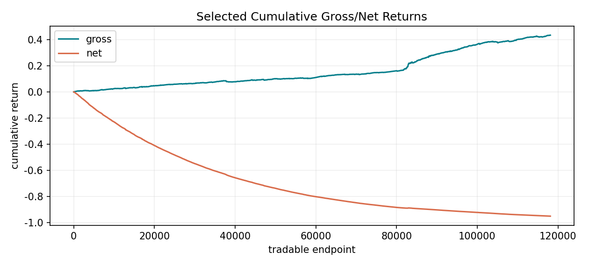

Selected Cost Decomposition

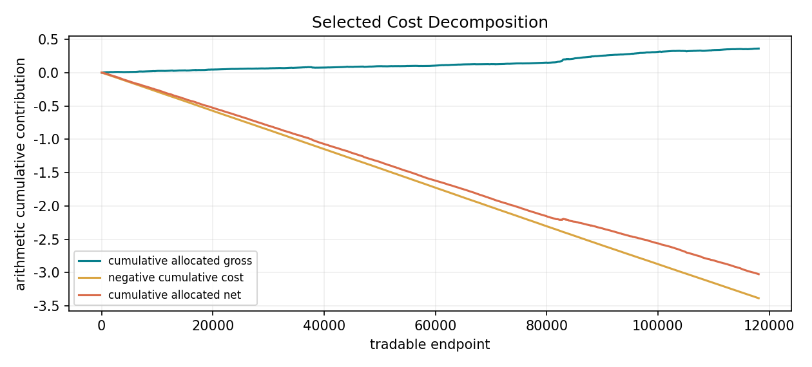

Validation/final selection audit

Checkpoint was selected on validation MSE. Trading rules were not selected on test, but no validation trading sweep artifact exists.

### 5.3. Trading Return Distribution And Capacity

Trade Return Distribution

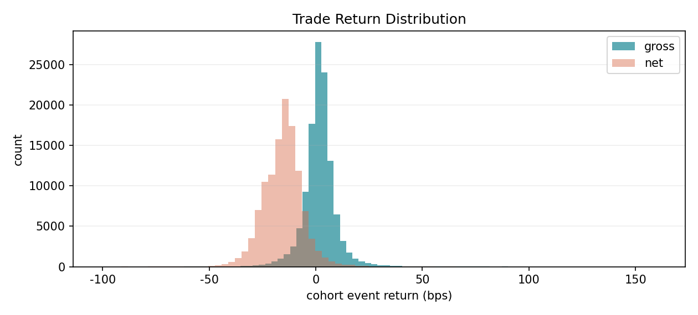

trade_return_distribution.csv

| metric | quantile | value | row_count |
| --- | --- | --- | --- |
| gross_return | 0.01 | -0.002055 | 118116 |
| gross_return | 0.05 | -0.001011 | 118116 |
| gross_return | 0.5 | 0.00018 | 118116 |
| gross_return | 0.95 | 0.001326 | 118116 |
| gross_return | 0.99 | 0.002624 | 118116 |
| net_return | 0.01 | -0.003954 | 118116 |
| net_return | 0.05 | -0.003016 | 118116 |
| net_return | 0.5 | -0.001499 | 118116 |
| net_return | 0.95 | -0.00011 | 118116 |
| net_return | 0.99 | 0.001083 | 118116 |
| turnover | 0.01 | 1.0 | 118116 |
| turnover | 0.05 | 1.0 | 118116 |
| turnover | 0.5 | 1.65 | 118116 |
| turnover | 0.95 | 2.69863 | 118116 |
| turnover | 0.99 | 2.780822 | 118116 |

### 5.4. Capacity Sensitivity

Pending / unavailable.

True capacity sensitivity requires ADV, spread, impact, lot and fill artifacts. The figure below is a cost-only sensitivity diagnostic, not capacity evidence.

Cost Sensitivity

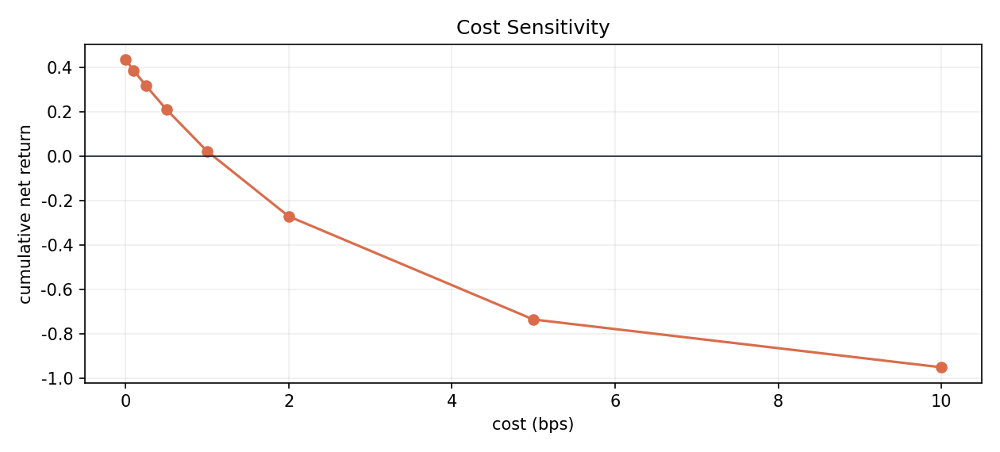

cost_sensitivity.csv

| cost_bps | cumulative_net_return | annualized_sharpe | daily_hit_rate | mean_event_net_bps |
| --- | --- | --- | --- | --- |
| 0.0 | 0.434647 | 10.804401 | 0.823529 | 1.833442 |
| 0.1 | 0.386908 | 9.793518 | 0.803922 | 1.661532 |
| 0.25 | 0.318262 | 8.276337 | 0.75 | 1.403667 |
| 0.5 | 0.211317 | 5.74544 | 0.661765 | 0.973892 |
| 1.0 | 0.022753 | 0.675288 | 0.490196 | 0.114342 |
| 2.0 | -0.270886 | -9.497434 | 0.191176 | -1.604758 |
| 5.0 | -0.73584 | -40.253326 | 0.009804 | -6.762058 |
| 10.0 | -0.951362 | -92.153172 | 0.004902 | -15.357558 |

### 5.5. Integrated Economics Summary

| field | value |
| --- | --- |
| cumulative_gross_return | 0.434647 |
| cumulative_net_return | -0.951362 |
| daily_hit_rate | 0.00490196 |
| annualized_sharpe | -92.5493 |
| mean_event_turnover | 1.7191 |
| maximum_drawdown | -0.950762 |

### 5.6. Trading Rule And Cost Diagnosis

每个 timestamp 对预测最高/最低 10% 股票等权做多/做空, 60 个 cohort 分摊资金并各自持有 600 秒. 成本按 weight turnover × 10.0 bps 扣除; 该实现不包含订单簿冲击, 涨跌停排队或逐笔 fill ledger. 

06 · Robustness Diagnostics

### Robustness Diagnostics

### 6.1. Leakage And Split Controls

| field | value |
| --- | --- |
| train_range | 20210104–20231229 |
| val_range | 20240102–20240229 |
| test_range | 20240301–20241231 |
| purge | date-disjoint splits; labels remain inside each session/day |
| row_availability_lag_seconds | 1 |
| entry_delay_seconds | 10 |
| test_used_for_selection | false |
| overlap_control | history and label windows cannot cross midday/session boundaries |

### 6.2. Price And Volatility Bucket IC

Pending / unavailable.

Aligned price/volatility feature chunks are not persisted with formal predictions.

### 6.3. Intraday IC

横轴显示真实北京时间; SecondIndex 的午休压缩映射为 09:30–11:30, 13:00–15:00, 且上午, 下午曲线分开绘制, 不跨午休连线. 

Intraday IC

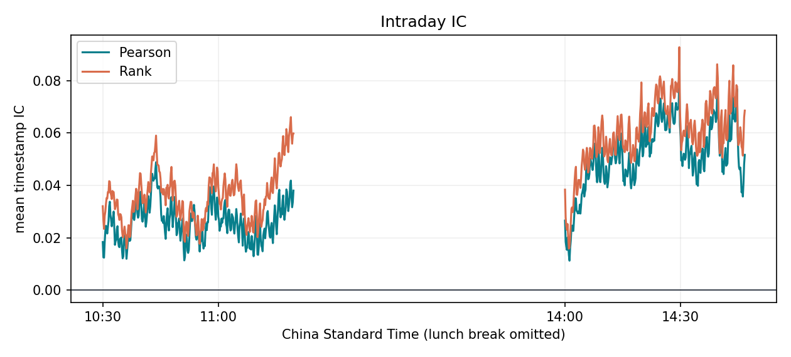

intraday_ic.csv head

| split | second_index | timestamp_count | pearson_ic | rank_ic | mean_count |
| --- | --- | --- | --- | --- | --- |
| train | 3610 | 1 | 0.057569 | 0.208063 | 344.0 |
| train | 3620 | 2 | 0.104553 | 0.026142 | 344.0 |
| train | 3630 | 1 | 0.033449 | 0.075341 | 344.0 |
| train | 3640 | 1 | 0.099015 | -0.008287 | 344.0 |
| train | 3660 | 2 | -0.066995 | -0.085211 | 344.0 |
| train | 3670 | 1 | 0.072067 | 0.027643 | 344.0 |
| train | 3680 | 1 | 0.221279 | 0.222138 | 344.0 |
| train | 3690 | 1 | 0.076734 | 0.152754 | 344.0 |
| train | 3700 | 2 | 0.05506 | 0.056535 | 344.0 |
| train | 3710 | 2 | 0.061128 | 0.030743 | 344.0 |
| train | 3730 | 1 | -0.052306 | -0.073255 | 344.0 |
| train | 3740 | 1 | -0.042969 | -0.025987 | 344.0 |
| train | 3750 | 2 | 0.164552 | 0.183956 | 344.0 |
| train | 3760 | 1 | -0.017597 | 0.04529 | 344.0 |
| train | 3780 | 3 | -0.068061 | -0.072722 | 344.0 |
| train | 3800 | 2 | 0.10065 | 0.122386 | 343.5 |
| train | 3810 | 2 | 0.129444 | 0.000987 | 344.0 |
| train | 3820 | 2 | 0.007724 | -0.012415 | 343.5 |

Showing 18 of 1,163 rows; full CSV is persisted.

### 6.4. Monthly IC And Rank IC

Monthly IC And Rank IC

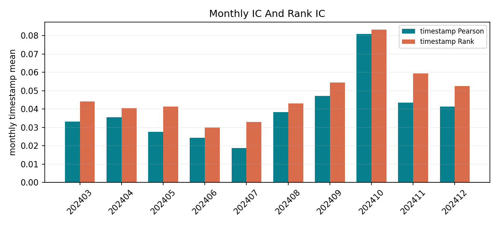

monthly_ic_rank_ic.csv

| split | month | day_count | pooled_pearson_ic | pooled_rank_ic | timestamp_pearson_ic | timestamp_rank_ic |
| --- | --- | --- | --- | --- | --- | --- |
| train | 202101 | 20 | n/a | n/a | 0.06113 | 0.071611 |
| train | 202102 | 15 | n/a | n/a | 0.03139 | 0.031654 |
| train | 202103 | 23 | n/a | n/a | 0.058363 | 0.079748 |
| train | 202104 | 21 | n/a | n/a | 0.097117 | 0.069884 |
| train | 202105 | 18 | n/a | n/a | 0.045738 | 0.036274 |
| train | 202106 | 21 | n/a | n/a | 0.070357 | 0.044964 |
| train | 202107 | 22 | n/a | n/a | 0.056585 | 0.039255 |
| train | 202108 | 22 | n/a | n/a | 0.072359 | 0.074266 |
| train | 202109 | 20 | n/a | n/a | 0.061492 | 0.039532 |
| train | 202110 | 16 | n/a | n/a | 0.022355 | 0.033637 |
| train | 202111 | 22 | n/a | n/a | 0.05848 | 0.057068 |
| train | 202112 | 23 | n/a | n/a | 0.061917 | 0.053801 |
| train | 202201 | 19 | n/a | n/a | 0.06631 | 0.060497 |
| train | 202202 | 16 | n/a | n/a | 0.099477 | 0.100881 |
| train | 202203 | 23 | n/a | n/a | 0.086191 | 0.073246 |
| train | 202204 | 19 | n/a | n/a | -0.003046 | 0.037119 |
| train | 202205 | 19 | n/a | n/a | 0.036768 | 0.03496 |
| train | 202206 | 21 | n/a | n/a | 0.049466 | 0.075489 |
| train | 202207 | 21 | n/a | n/a | 0.082738 | 0.092307 |
| train | 202208 | 23 | n/a | n/a | 0.072732 | 0.076126 |
| train | 202209 | 21 | n/a | n/a | 0.04809 | 0.05077 |
| train | 202210 | 16 | n/a | n/a | 0.00271 | 0.020286 |
| train | 202211 | 22 | n/a | n/a | 0.024793 | 0.040375 |
| train | 202212 | 22 | n/a | n/a | 0.022918 | 0.027743 |

Showing 24 of 48 rows; full CSV is persisted.

### 6.5. Return Realization

完整 test prediction 最高 5% 样本按 1–20 分钟展示 executable VWAP-to-VWAP return. 对齐只使用同一连续 session 内已持久化的 prediction entry/exit VWAP 与 day-cache endpoint VWAP; 越长 horizon 的可用行数可以下降. 

Return Realization

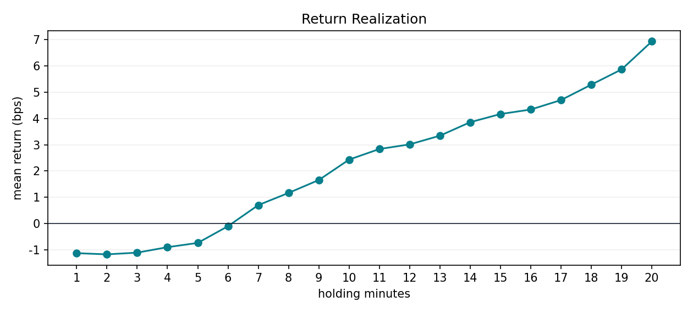

return_realization.csv

| holding_minutes | mean_return | mean_return_bps | row_count | prediction_p95 | source |
| --- | --- | --- | --- | --- | --- |
| 1 | -0.000113 | -1.129005 | 7884312 | 0.000604 | [artifact-root]/nn/baseline-1s-0812-full-epoch/evaluation/test_predictions.parquet + [artifact-root]/nn/baseline-1s-0810/cache/days/&lt;Date&gt;/endpoint_*_vwap.npy |
| 2 | -0.000117 | -1.174146 | 7873108 | 0.000604 | [artifact-root]/nn/baseline-1s-0812-full-epoch/evaluation/test_predictions.parquet + [artifact-root]/nn/baseline-1s-0810/cache/days/&lt;Date&gt;/endpoint_*_vwap.npy |
| 3 | -0.000111 | -1.109408 | 7867642 | 0.000604 | [artifact-root]/nn/baseline-1s-0812-full-epoch/evaluation/test_predictions.parquet + [artifact-root]/nn/baseline-1s-0810/cache/days/&lt;Date&gt;/endpoint_*_vwap.npy |
| 4 | -0.00009 | -0.900949 | 7860645 | 0.000604 | [artifact-root]/nn/baseline-1s-0812-full-epoch/evaluation/test_predictions.parquet + [artifact-root]/nn/baseline-1s-0810/cache/days/&lt;Date&gt;/endpoint_*_vwap.npy |
| 5 | -0.000074 | -0.739607 | 7856394 | 0.000604 | [artifact-root]/nn/baseline-1s-0812-full-epoch/evaluation/test_predictions.parquet + [artifact-root]/nn/baseline-1s-0810/cache/days/&lt;Date&gt;/endpoint_*_vwap.npy |
| 6 | -0.00001 | -0.101429 | 7849396 | 0.000604 | [artifact-root]/nn/baseline-1s-0812-full-epoch/evaluation/test_predictions.parquet + [artifact-root]/nn/baseline-1s-0810/cache/days/&lt;Date&gt;/endpoint_*_vwap.npy |
| 7 | 0.00007 | 0.700475 | 7853102 | 0.000604 | [artifact-root]/nn/baseline-1s-0812-full-epoch/evaluation/test_predictions.parquet + [artifact-root]/nn/baseline-1s-0810/cache/days/&lt;Date&gt;/endpoint_*_vwap.npy |
| 8 | 0.000116 | 1.164094 | 7853434 | 0.000604 | [artifact-root]/nn/baseline-1s-0812-full-epoch/evaluation/test_predictions.parquet + [artifact-root]/nn/baseline-1s-0810/cache/days/&lt;Date&gt;/endpoint_*_vwap.npy |
| 9 | 0.000166 | 1.655827 | 7851721 | 0.000604 | [artifact-root]/nn/baseline-1s-0812-full-epoch/evaluation/test_predictions.parquet + [artifact-root]/nn/baseline-1s-0810/cache/days/&lt;Date&gt;/endpoint_*_vwap.npy |
| 10 | 0.000243 | 2.432509 | 8265080 | 0.000604 | [artifact-root]/nn/baseline-1s-0812-full-epoch/evaluation/test_predictions.parquet + [artifact-root]/nn/baseline-1s-0810/cache/days/&lt;Date&gt;/endpoint_*_vwap.npy |
| 11 | 0.000284 | 2.835653 | 7701481 | 0.000604 | [artifact-root]/nn/baseline-1s-0812-full-epoch/evaluation/test_predictions.parquet + [artifact-root]/nn/baseline-1s-0810/cache/days/&lt;Date&gt;/endpoint_*_vwap.npy |
| 12 | 0.000301 | 3.011624 | 7542431 | 0.000604 | [artifact-root]/nn/baseline-1s-0812-full-epoch/evaluation/test_predictions.parquet + [artifact-root]/nn/baseline-1s-0810/cache/days/&lt;Date&gt;/endpoint_*_vwap.npy |
| 13 | 0.000334 | 3.342758 | 7389842 | 0.000604 | [artifact-root]/nn/baseline-1s-0812-full-epoch/evaluation/test_predictions.parquet + [artifact-root]/nn/baseline-1s-0810/cache/days/&lt;Date&gt;/endpoint_*_vwap.npy |
| 14 | 0.000386 | 3.85656 | 7176291 | 0.000604 | [artifact-root]/nn/baseline-1s-0812-full-epoch/evaluation/test_predictions.parquet + [artifact-root]/nn/baseline-1s-0810/cache/days/&lt;Date&gt;/endpoint_*_vwap.npy |
| 15 | 0.000417 | 4.167537 | 6994040 | 0.000604 | [artifact-root]/nn/baseline-1s-0812-full-epoch/evaluation/test_predictions.parquet + [artifact-root]/nn/baseline-1s-0810/cache/days/&lt;Date&gt;/endpoint_*_vwap.npy |
| 16 | 0.000434 | 4.3386 | 6832831 | 0.000604 | [artifact-root]/nn/baseline-1s-0812-full-epoch/evaluation/test_predictions.parquet + [artifact-root]/nn/baseline-1s-0810/cache/days/&lt;Date&gt;/endpoint_*_vwap.npy |
| 17 | 0.00047 | 4.699277 | 6687750 | 0.000604 | [artifact-root]/nn/baseline-1s-0812-full-epoch/evaluation/test_predictions.parquet + [artifact-root]/nn/baseline-1s-0810/cache/days/&lt;Date&gt;/endpoint_*_vwap.npy |
| 18 | 0.000529 | 5.285995 | 6549467 | 0.000604 | [artifact-root]/nn/baseline-1s-0812-full-epoch/evaluation/test_predictions.parquet + [artifact-root]/nn/baseline-1s-0810/cache/days/&lt;Date&gt;/endpoint_*_vwap.npy |
| 19 | 0.000587 | 5.865404 | 6407920 | 0.000604 | [artifact-root]/nn/baseline-1s-0812-full-epoch/evaluation/test_predictions.parquet + [artifact-root]/nn/baseline-1s-0810/cache/days/&lt;Date&gt;/endpoint_*_vwap.npy |
| 20 | 0.000693 | 6.932345 | 6252777 | 0.000604 | [artifact-root]/nn/baseline-1s-0812-full-epoch/evaluation/test_predictions.parquet + [artifact-root]/nn/baseline-1s-0810/cache/days/&lt;Date&gt;/endpoint_*_vwap.npy |

### 6.6. Top-k% Robustness

k% = 1, 2, 3, 4, 5, 6, 7, 8, 9, 10, 15, 20, 50; 阈值均从完整 test population 的全局 prediction 分位数计算. 

Top-k% Robustness

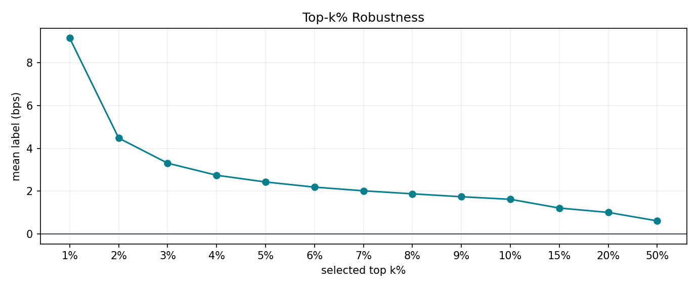

topk_robustness.csv

| split | selection_method | k_pct | universe_count | selected_count | selected_fraction | prediction_threshold | mean_label_bps | median_label_bps | label_std_bps | hit_rate | day_count | timestamp_count |
| --- | --- | --- | --- | --- | --- | --- | --- | --- | --- | --- | --- | --- |
| test | approx_quantile_threshold | 1.0 | 165740198 | 1654926 | 0.009985 | 0.001297 | 9.156289 | 1.073451 | 101.941606 | 0.509422 | 204 | 46434 |
| test | approx_quantile_threshold | 2.0 | 165740198 | 3314784 | 0.02 | 0.000979 | 4.484662 | 0.0 | 84.761266 | 0.495158 | 204 | 68271 |
| test | approx_quantile_threshold | 3.0 | 165740198 | 4939352 | 0.029802 | 0.00081 | 3.311076 | 0.0 | 76.539925 | 0.491373 | 204 | 81533 |
| test | approx_quantile_threshold | 4.0 | 165740198 | 6598875 | 0.039815 | 0.000693 | 2.747009 | 0.0 | 71.11881 | 0.48874 | 204 | 91040 |
| test | approx_quantile_threshold | 5.0 | 165740198 | 8265080 | 0.049868 | 0.000604 | 2.432509 | 0.0 | 67.259886 | 0.486958 | 204 | 97655 |
| test | approx_quantile_threshold | 6.0 | 165740198 | 9942770 | 0.05999 | 0.000531 | 2.191452 | 0.0 | 64.339263 | 0.485523 | 204 | 102389 |
| test | approx_quantile_threshold | 7.0 | 165740198 | 11589395 | 0.069925 | 0.000471 | 2.020081 | 0.0 | 62.073436 | 0.484506 | 204 | 105588 |
| test | approx_quantile_threshold | 8.0 | 165740198 | 13223980 | 0.079787 | 0.000419 | 1.879188 | 0.0 | 60.232789 | 0.4835 | 204 | 107892 |
| test | approx_quantile_threshold | 9.0 | 165740198 | 14913557 | 0.089982 | 0.000371 | 1.74247 | 0.0 | 58.653389 | 0.482546 | 204 | 109591 |
| test | approx_quantile_threshold | 10.0 | 165740198 | 16573838 | 0.099999 | 0.00033 | 1.622621 | 0.0 | 57.314591 | 0.481687 | 204 | 110837 |
| test | approx_quantile_threshold | 15.0 | 165740198 | 24807605 | 0.149678 | 0.000176 | 1.214478 | 0.0 | 52.705452 | 0.47852 | 204 | 113731 |
| test | approx_quantile_threshold | 20.0 | 165740198 | 33158435 | 0.200063 | 0.000072 | 1.010278 | 0.0 | 49.686934 | 0.477445 | 204 | 114840 |
| test | approx_quantile_threshold | 50.0 | 165740198 | 82850893 | 0.499884 | -0.000226 | 0.614965 | 0.0 | 41.371014 | 0.475097 | 204 | 116567 |

### 6.7. Robustness Artifact Coverage

Pending robustness diagnostics

| diagnostic | status | reason |
| --- | --- | --- |
| per-feature invalid stats | unavailable | day cache does not persist per-feature invalid counters |
| important stock pool | unavailable | v2 run has no point-in-time important-pool joined artifact |
| ADV liquidity buckets | unavailable | v2 run does not persist an ADV join or capacity artifact |
| validation strategy sweep | unavailable | backtest artifact contains only the fixed final-test rule |
| capacity sensitivity | unavailable | spread, impact, fill and capital-capacity fields were not persisted |
| price and volatility bucket IC | unavailable | formal predictions do not include aligned price/volatility features |
| train top-k robustness | unavailable | bounded train predictions are not a formal full-population top-k artifact |
| order, lot and fill ledger | unavailable | cohort backtest records target returns and turnover, not an order ledger |
| MLflow metadata | unavailable | training result does not persist an MLflow run id or tracking URI |

07 · Appendix Diagnostics

## 限制与适用边界

独立42D OHLCV-only v2 完成全量165740198个 test endpoint. pooled IC/RankIC 为0.009249/0.004643; 固定10 bps回测净累计收益−95.14%, 不支持部署. 当前artifact可得性只影响复现, 不作为历史成功/失败判据. 只有matched合同内的结果可以直接比较.

## 结论

本次归档保留上述历史事实. 研究结论, 推广门槛和执行限制分别解释, 不把模型无增益或净收益为负改写成实验流程失败.

## 附录

### Appendix Diagnostics

Artifact Paths

| field | value |
| --- | --- |
| resolved_config | [artifact-root]/nn/baseline-1s-0812-full-epoch/resolved_config.json |
| prepare_result | [artifact-root]/nn/baseline-1s-0812-full-epoch/prepare_result.json |
| normalization | [artifact-root]/nn/baseline-1s-0812-full-epoch/normalization/train_stats.npz |
| training_result | [artifact-root]/nn/baseline-1s-0812-full-epoch/training_result.json |
| checkpoint_metrics | [artifact-root]/nn/baseline-1s-0812-full-epoch/evaluation/checkpoint_metrics.csv |
| checkpoint_metrics_manifest | [artifact-root]/nn/baseline-1s-0812-full-epoch/evaluation/checkpoint_metrics.json |
| best_checkpoint | [artifact-root]/nn/baseline-1s-0812-full-epoch/checkpoints/best.pt |
| evaluation_metrics | [artifact-root]/nn/baseline-1s-0812-full-epoch/evaluation/metrics.json |
| test_manifest | [artifact-root]/nn/baseline-1s-0812-full-epoch/evaluation/test_manifest.json |
| test_predictions | [artifact-root]/nn/baseline-1s-0812-full-epoch/evaluation/test_predictions.parquet |
| day_cache_endpoint_vwaps | [artifact-root]/nn/baseline-1s-0810/cache/days/&lt;Date&gt;/endpoint_*_vwap.npy |
| backtest_summary | [artifact-root]/nn/baseline-1s-0812-full-epoch/backtest/summary.json |
| backtest_events | [artifact-root]/nn/baseline-1s-0812-full-epoch/backtest/events.parquet |
| stable_html | [artifact-root]/nn/baseline-1s-0812-full-epoch/report/index.html |
| timestamped_html | [artifact-root]/nn/baseline-1s-0812-full-epoch/report/20260812175254_baseline-1s-v2_full_evaluation_report.html |
| run_mirror | [artifact-root]/nn/baseline-1s-0812-full-epoch/train_report.html |
| repo_mirror | report/index.html |
| report_manifest | [artifact-root]/nn/baseline-1s-0812-full-epoch/report/report_manifest.json |

Extreme Value Metrics

| metric | value | source |
| --- | --- | --- |
| prediction_min | -0.007057 | [artifact-root]/nn/baseline-1s-0812-full-epoch/evaluation/test_predictions.parquet |
| prediction_max | 0.007404 | [artifact-root]/nn/baseline-1s-0812-full-epoch/evaluation/test_predictions.parquet |
| label_min | -0.166922 | [artifact-root]/nn/baseline-1s-0812-full-epoch/evaluation/test_predictions.parquet |
| label_max | 0.207819 | [artifact-root]/nn/baseline-1s-0812-full-epoch/evaluation/test_predictions.parquet |
| prediction_mean | -0.000236 | [artifact-root]/nn/baseline-1s-0812-full-epoch/evaluation/test_predictions.parquet |
| prediction_std | 0.000563 | [artifact-root]/nn/baseline-1s-0812-full-epoch/evaluation/test_predictions.parquet |
| label_mean | 0.000077 | [artifact-root]/nn/baseline-1s-0812-full-epoch/evaluation/test_predictions.parquet |
| label_std | 0.0042 | [artifact-root]/nn/baseline-1s-0812-full-epoch/evaluation/test_predictions.parquet |

Label Availability Coverage

| split | day_count | raw_rows | candidate_endpoints | valid_endpoints | written_endpoints | label_coverage_on_endpoints | feature_rows_before_cadence | materialized_feature_rows |
| --- | --- | --- | --- | --- | --- | --- | --- | --- |
| train | 727 | 733183704 | 733183704 | 535758591 | 250000 | 0.730729 | n/a | n/a |
| val | 37 | 39693600 | 39693600 | 30802986 | 250000 | 0.776019 | n/a | n/a |
| test | 204 | 218766568 | 218766568 | 165740198 | 165740198 | 0.757612 | n/a | n/a |

Field Explanations

| field | explanation |
| --- | --- |
| benchmark | 实验标识.  |
| selected_checkpoint | 最终用于 evaluation 的 checkpoint iteration.  |
| train_pooled_ic | train split 上把所有样本合并后计算的 Pearson IC.  |
| test_pooled_ic | test split 上把所有样本合并后计算的 Pearson IC.  |
| top_prediction_return_bps | 完整 test 全局最高 prediction decile 的 mean label, 单位 bps.  |
| top95_hit | test split 中按 prediction 从高到低排序后取最高 5% 样本, 即 prediction >= test prediction 的 95% 分位; 该子样本内 target > 0 的比例.  |
| feature_dim | 模型输入 feature 维度.  |
| feature_normalization | 41 个连续输入 channel 的 mean/std 仅由 train split 拟合; history_ready 二值 channel 不标准化.  |
| label_normalization | none; v2 训练与评估直接使用 raw executable log return.  |
| signal_bucket | 完整 test prediction population 按全局 prediction 阈值从低到高分十桶; 不是逐 timestamp 横截面 rank.  |
| mean_prediction | 分组内 prediction 均值.  |
| mean_label | 分组内 target 均值, 保持原始 target 单位.  |
| mean_label_bps | 分组内 target 均值, 单位 bps.  |
| t_stat | 分组 mean_label_bps 相对 0 的 t-stat.  |
| hit_rate | 分组内 target > 0 的比例.  |
| row_count | 分组内有限 prediction/target 样本数.  |
| top_bottom_signal_spread_bps | Top bucket 平均 target return 减 bottom bucket 平均 target return, 单位 bps.  |
| Daily top-minus-bottom signal spread | 每天内部按 prediction 排序并用 ntile(10) 分桶; 日内最高桶 mean label 减最低桶 mean label, 单位 bps.  |
| Goodness Of Fit | 完整 test prediction population 按 prediction 全局切为 100 个近似等频段; prediction 与 label 均为 raw executable log return, 不执行 legacy z-score 反变换.  |
| prediction_bin | 按 prediction 从低到高排序后的等频分段编号, 1 为最低 prediction 段.  |
| label_std | 分组内 target 的样本标准差.  |
| label_se | 分组 mean_label 的标准误, 计算为 label_std / sqrt(row_count).  |
| label_p05 | 分组内 target 的 5% 分位, 用作中间 90% 散点位置阴影下界.  |
| label_p95 | 分组内 target 的 95% 分位, 用作中间 90% 散点位置阴影上界.  |
| label_ci90_low | mean_label 的 90% 正态近似置信区间下界, mean_label - 1.64485 * label_se.  |
| label_ci90_high | mean_label 的 90% 正态近似置信区间上界, mean_label + 1.64485 * label_se.  |
| Return Realization | 完整 test 中 prediction 最高 5% 样本在 1–20 分钟 horizon 的 executable VWAP-to-VWAP return; 使用已持久化 prediction entry/exit VWAP 与同一连续 session 的 day-cache endpoint VWAP 对齐.  |
| holding_minutes | 持仓分钟数; 交易分布中表示同一个 trade_id 覆盖的分钟行数, 6.5 中表示 future holding horizon.  |
| prediction_p95 | test split finite prediction 的 95% 分位阈值; 6.5 只保留 prediction >= prediction_p95 的样本.  |
| Top-k Robustness | train/test 各自样本池内用近似 prediction 分位阈值选择最高 k% 样本, 检查集中高 prediction 样本的 realized return.  |
| selection_method | Top-k% 使用 DuckDB approx_quantile 得到完整 test population 的全局 prediction 阈值.  |
| k_pct | 按 prediction 全局降序选择的样本池顶部百分比.  |
| universe_count | 该 split 中 finite prediction/target 样本总数.  |
| selected_count | 该 split,k_pct 下 prediction >= prediction_threshold 的实际入选样本数.  |
| selected_fraction | selected_count / universe_count; 近似阈值口径下可能略偏离 k_pct / 100.  |
| prediction_threshold | DuckDB approx_quantile(prediction, 1 - k_pct / 100) 得到的近似入选阈值.  |
| median_label_bps | Top-k% 样本 target 近似中位数, 使用 DuckDB approx_quantile(target, 0.5), 单位 bps.  |
| label_std_bps | Top-k% 样本 target 样本标准差, 单位 bps.  |
| day_count | 入选样本覆盖的交易日数量.  |
| timestamp_count | 入选样本覆盖的 date,time 截面数量.  |

Pending Diagnostics

| diagnostic | status | reason |
| --- | --- | --- |
| per-feature invalid stats | unavailable | day cache does not persist per-feature invalid counters |
| important stock pool | unavailable | v2 run has no point-in-time important-pool joined artifact |
| ADV liquidity buckets | unavailable | v2 run does not persist an ADV join or capacity artifact |
| validation strategy sweep | unavailable | backtest artifact contains only the fixed final-test rule |
| capacity sensitivity | unavailable | spread, impact, fill and capital-capacity fields were not persisted |
| price and volatility bucket IC | unavailable | formal predictions do not include aligned price/volatility features |
| train top-k robustness | unavailable | bounded train predictions are not a formal full-population top-k artifact |
| order, lot and fill ledger | unavailable | cohort backtest records target returns and turnover, not an order ledger |
| MLflow metadata | unavailable | training result does not persist an MLflow run id or tracking URI |

Report Manifest

| field | value |
| --- | --- |
| schema | stock1s_v2_research_report_v1 |
| path | [artifact-root]/nn/baseline-1s-0812-full-epoch/report/report_manifest.json |
| generated_artifact_groups | CSV, PNG, section HTML, evaluation-part HTML, stable/timestamped/run/repo-mirror HTML |

### Frozen Baseline Context

冻结旧版 commit

11824116d063

的 test pooled/rank IC 为 0.003008/-0.007392; 当前表面差值为 0.006241/0.012035. 日期, 特征, 采样和训练预算不同, 只作上下文. 
