## 摘要

L2 衍生特征相对 Stock1m baseline 的多实验消融对比。

### 1. Executive Summary

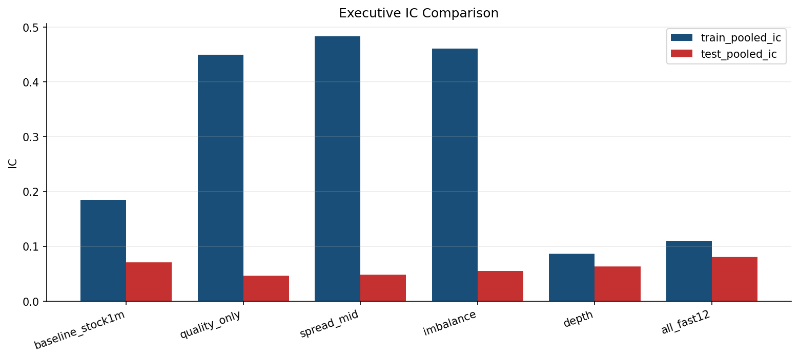

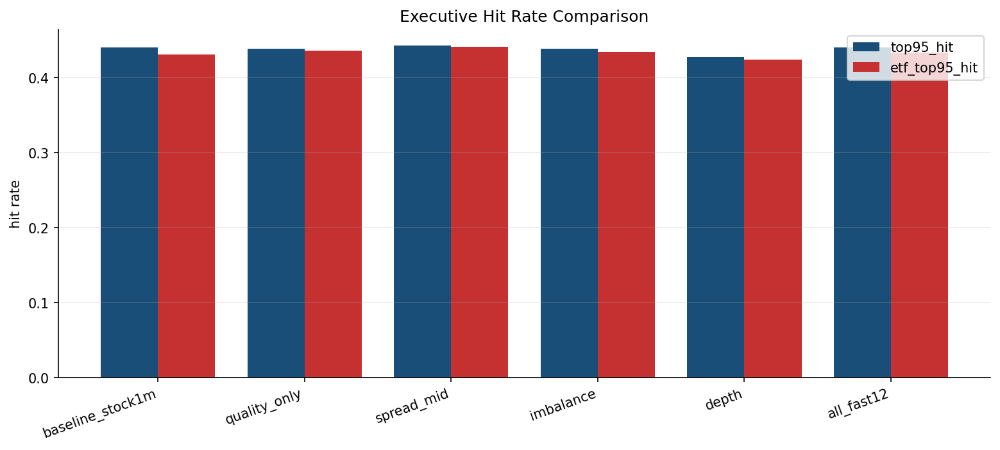

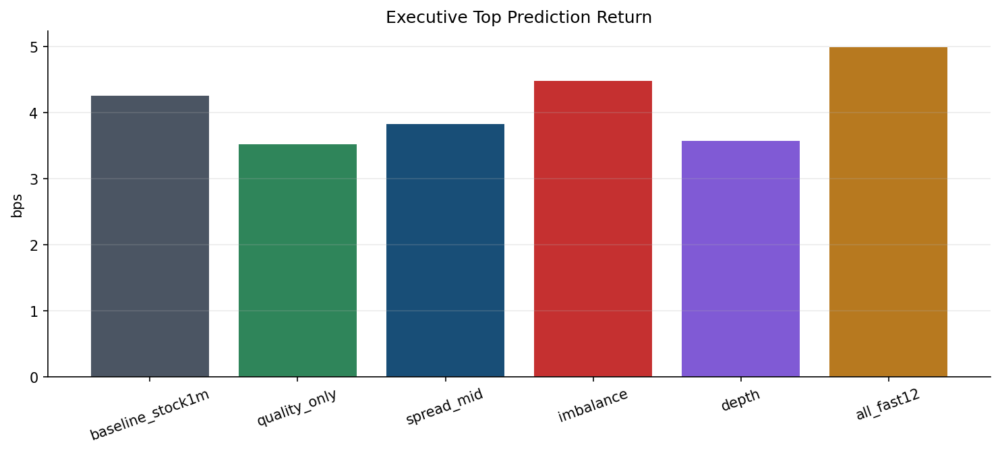

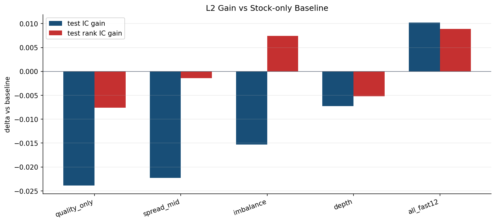

### Baseline Gain Vs Stock-only

| experiment | test_pooled_ic_gain_vs_baseline | test_pooled_ic_gain_pct_vs_baseline | test_pooled_rank_ic_gain_vs_baseline | test_pooled_rank_ic_gain_pct_vs_baseline | top_prediction_return_gain_bps_vs_baseline | top_bottom_signal_spread_gain_bps_vs_baseline | important_pool_avg_rank_ic_gain_vs_baseline | return_holding_5_gain_bps_vs_baseline | portfolio_cost0_avg_final_return_gain_vs_baseline |
| --- | --- | --- | --- | --- | --- | --- | --- | --- | --- |
| all_fast12 | 0.0102 | 14.49% | 0.0089 | 17.31% | 0.73 | 0.62 | 0.0171 | 1.61 | -1.43% |
| depth | -0.0073 | -10.33% | -0.0052 | -10.09% | -0.68 | -1.86 | 0.0042 | -0.13 | -1.19% |
| imbalance | -0.0153 | -21.79% | 0.0074 | 14.48% | 0.22 | -0.03 | 0.0161 | -0.02 | -2.66% |
| spread_mid | -0.0223 | -31.73% | -0.0014 | -2.79% | -0.43 | -1.67 | 0.0058 | -0.60 | -2.72% |
| quality_only | -0.0239 | -33.94% | -0.0076 | -14.87% | -0.74 | -2.56 | 0.0007 | -1.07 | -2.48% |

### Main Comparison Table

| experiment | selected_checkpoint | train_pooled_ic | test_pooled_ic | test_pooled_ic_gain_vs_baseline | top_prediction_return_bps | top95_hit | etf_top95_hit | overfit_variance_ratio |
| --- | --- | --- | --- | --- | --- | --- | --- | --- |
| all_fast12 | 100,000 | 0.1097 | 0.0805 | 0.0102 | 4.99 | 44.05% | 43.35% | n/a |
| baseline_stock1m | 20,000 | 0.1847 | 0.0703 | 0.0000 | 4.25 | 44.10% | 43.09% | n/a |
| depth | 100,000 | 0.0869 | 0.0631 | -0.0073 | 3.57 | 42.78% | 42.47% | n/a |
| imbalance | 100,000 | 0.4606 | 0.0550 | -0.0153 | 4.48 | 43.85% | 43.47% | n/a |
| spread_mid | 100,000 | 0.4825 | 0.0480 | -0.0223 | 3.82 | 44.27% | 44.15% | n/a |
| quality_only | 100,000 | 0.4496 | 0.0465 | -0.0239 | 3.51 | 43.89% | 43.66% | n/a |

### Field Definitions

| field | explanation |
| --- | --- |
| experiment | 实验标识。 |
| selected_checkpoint | 最终用于 evaluation 的 checkpoint iteration。 |
| train_pooled_ic | train split 上把所有样本合并后计算的 Pearson IC。 |
| test_pooled_ic | test split 上把所有样本合并后计算的 Pearson IC。 |
| test_pooled_ic_gain_vs_baseline | 相对 stock-only baseline 的 test pooled IC 绝对增量。 |
| top_prediction_return_bps | 最高 prediction 分组的平均 realized target，单位 bps。 |
| top95_hit | test split 中 prediction 最高 5% 样本内 target > 0 的比例。 |
| etf_top95_hit | important pool prediction top 5% bin 内 ETF realized return > 0 的平均比例。 |
| overfit_variance_ratio | test split prediction 方差 / target 方差；当前 L2 单实验 artifact 未稳定输出时为 n/a。 |

## 研究背景与目标

本页是历史研究报告的统一模板版本。研究问题、实验定义、数据口径、表格和图像证据均沿用已校验的历史原版。

## 数据与方法

### 2. Experiment Setup And Data Pipeline

### 2.1. Experiment Setup

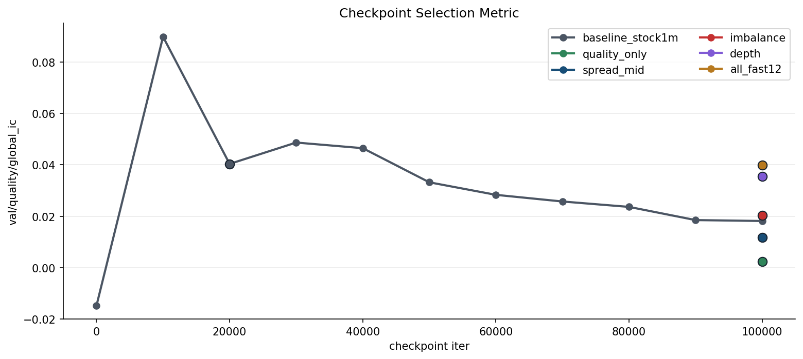

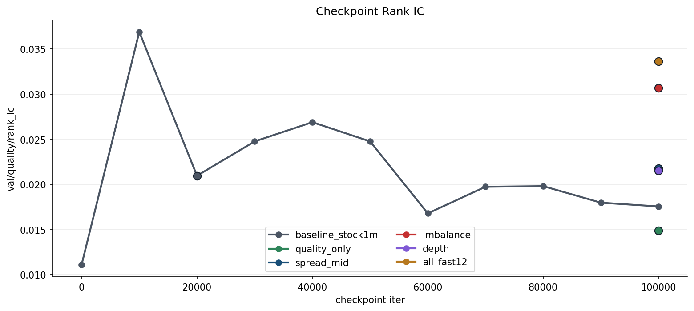

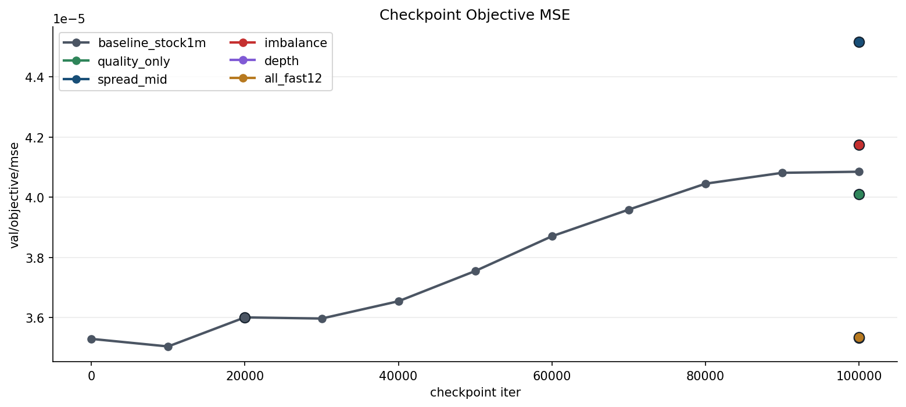

| experiment | best_iter | selection_value | checkpoint_sha256 | candidate_count | mlflow_run_id | mlflow_tracking_uri |
| --- | --- | --- | --- | --- | --- | --- |
| baseline_stock1m | 20,000 | 0.048036 | 4e77b3b6b9990bd9 | 11 | 075e57cbf1c74d3c | http://192.168.0.102:5000 |
| quality_only | 100,000 | 0.017450 | 0aff4f7c6976bdea | 1 | 97e0d02b367d49ae | http://192.168.0.102:5000 |
| spread_mid | 100,000 | 0.027110 | e8c3532ea4b15739 | 1 | 72a28fbc463b4856 | http://192.168.0.102:5000 |
| imbalance | 100,000 | 0.035774 | 1d9a40c925de7b26 | 1 | 529062a29b9a4dac | http://192.168.0.102:5000 |
| depth | 100,000 | 0.027725 | 52ec1f8482ff23f7 | 1 | 91a81bbc24ca483f | http://192.168.0.102:5000 |
| all_fast12 | 100,000 | 0.034750 | f1f12462fa4028d9 | 1 | 9a1e63fd20a94508 | http://192.168.0.102:5000 |

### 2.2. Data Basics

| experiment | train_rows | val_rows | test_rows | feature_dim | features | label_horizon_minutes | label_entry_lag_minutes |
| --- | --- | --- | --- | --- | --- | --- | --- |
| baseline_stock1m | 768,564,829 | 43,553,840 | 241,788,800 | 14 | ret_1m, ret_5m, ret_2m, ret_3m, ret_10m, hl, oc, log_vol, log_amount, vol_10m, log_vol_5m_mean, log_amount_5m_mean, minute_norm, session_minute_norm | 10 | 1 |
| quality_only | 768,564,829 | 43,553,840 | 241,788,800 | 17 | ret_1m, ret_5m, ret_2m, ret_3m, ret_10m, hl, oc, log_vol, log_amount, vol_10m, log_vol_5m_mean, log_amount_5m_mean, l2_obs_count, l2_missing_ratio, l2_stale_seconds, minute_norm, session_minute_norm | 10 | 1 |
| spread_mid | 768,564,829 | 43,553,840 | 241,788,800 | 18 | ret_1m, ret_5m, ret_2m, ret_3m, ret_10m, hl, oc, log_vol, log_amount, vol_10m, log_vol_5m_mean, log_amount_5m_mean, spread_bps_last, spread_bps_mean_60s, mid_ret_60s, mid_rv_60s, minute_norm, session_minute_norm | 10 | 1 |
| imbalance | 768,564,829 | 43,553,840 | 241,788,800 | 17 | ret_1m, ret_5m, ret_2m, ret_3m, ret_10m, hl, oc, log_vol, log_amount, vol_10m, log_vol_5m_mean, log_amount_5m_mean, imb1_last, imb5_last, imb5_mean_60s, minute_norm, session_minute_norm | 10 | 1 |
| depth | 768,564,829 | 43,553,840 | 241,788,800 | 16 | ret_1m, ret_5m, ret_2m, ret_3m, ret_10m, hl, oc, log_vol, log_amount, vol_10m, log_vol_5m_mean, log_amount_5m_mean, bid_depth10_log1p, ask_depth10_log1p, minute_norm, session_minute_norm | 10 | 1 |
| all_fast12 | 768,564,829 | 43,553,840 | 241,788,800 | 26 | ret_1m, ret_5m, ret_2m, ret_3m, ret_10m, hl, oc, log_vol, log_amount, vol_10m, log_vol_5m_mean, log_amount_5m_mean, l2_obs_count, l2_missing_ratio, l2_stale_seconds, spread_bps_last, spread_bps_mean_60s, mid_ret_60s, mid_rv_60s, imb1_last, imb5_last, imb5_mean_60s, bid_depth10_log1p, ask_depth10_log1p, minute_norm, session_minute_norm | 10 | 1 |

| experiment | stock_features | l2_features | time_features |
| --- | --- | --- | --- |
| baseline_stock1m | ret_1m, ret_5m, ret_2m, ret_3m, ret_10m, hl, oc, log_vol, log_amount, vol_10m, log_vol_5m_mean, log_amount_5m_mean |  | minute_norm, session_minute_norm |
| quality_only | ret_1m, ret_5m, ret_2m, ret_3m, ret_10m, hl, oc, log_vol, log_amount, vol_10m, log_vol_5m_mean, log_amount_5m_mean | l2_obs_count, l2_missing_ratio, l2_stale_seconds | minute_norm, session_minute_norm |
| spread_mid | ret_1m, ret_5m, ret_2m, ret_3m, ret_10m, hl, oc, log_vol, log_amount, vol_10m, log_vol_5m_mean, log_amount_5m_mean | spread_bps_last, spread_bps_mean_60s, mid_ret_60s, mid_rv_60s | minute_norm, session_minute_norm |
| imbalance | ret_1m, ret_5m, ret_2m, ret_3m, ret_10m, hl, oc, log_vol, log_amount, vol_10m, log_vol_5m_mean, log_amount_5m_mean | imb1_last, imb5_last, imb5_mean_60s | minute_norm, session_minute_norm |
| depth | ret_1m, ret_5m, ret_2m, ret_3m, ret_10m, hl, oc, log_vol, log_amount, vol_10m, log_vol_5m_mean, log_amount_5m_mean | bid_depth10_log1p, ask_depth10_log1p | minute_norm, session_minute_norm |
| all_fast12 | ret_1m, ret_5m, ret_2m, ret_3m, ret_10m, hl, oc, log_vol, log_amount, vol_10m, log_vol_5m_mean, log_amount_5m_mean | l2_obs_count, l2_missing_ratio, l2_stale_seconds, spread_bps_last, spread_bps_mean_60s, mid_ret_60s, mid_rv_60s, imb1_last, imb5_last, imb5_mean_60s, bid_depth10_log1p, ask_depth10_log1p | minute_norm, session_minute_norm |

### 2.3. Data Normalization And Cleaning

| experiment | feature_normalization | label_normalization | train_kept_rate | val_kept_rate | test_kept_rate | max_invalid_ratio |
| --- | --- | --- | --- | --- | --- | --- |
| baseline_stock1m | pooled_zscore | pooled_zscore | 90.98% | 90.76% | 90.76% | 4.3478% |
| quality_only | pooled_zscore | pooled_zscore | 90.98% | 90.76% | 90.76% | 4.3478% |
| spread_mid | pooled_zscore | pooled_zscore | 90.98% | 90.76% | 90.76% | 4.3478% |
| imbalance | pooled_zscore | pooled_zscore | 90.98% | 90.76% | 90.76% | 4.3478% |
| depth | pooled_zscore | pooled_zscore | 90.98% | 90.76% | 90.76% | 4.3478% |
| all_fast12 | pooled_zscore | pooled_zscore | 90.98% | 90.76% | 90.76% | 4.3478% |

## 主要结果

### 3. Signal Quality Comparison

### 3.1. IC Summary

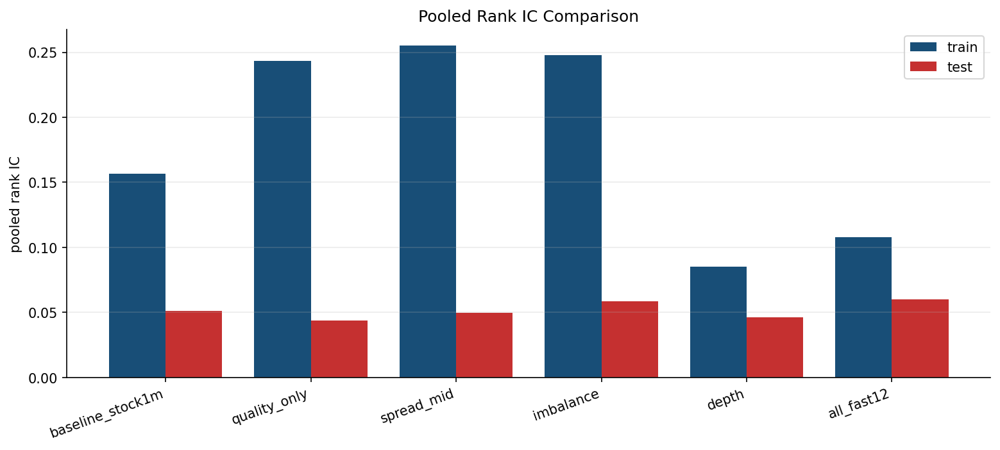

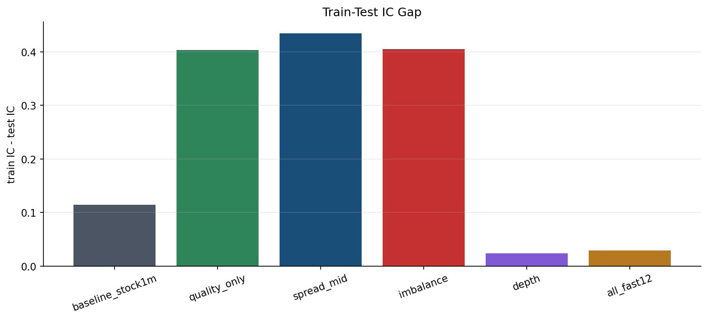

| experiment | split | pooled_ic | pooled_rank_ic | count |
| --- | --- | --- | --- | --- |
| all_fast12 | test | 0.0805 | 0.0601 | 176,945,440 |
| all_fast12 | train | 0.1097 | 0.1077 | 7,968,768 |
| baseline_stock1m | test | 0.0703 | 0.0512 | 176,945,440 |
| baseline_stock1m | train | 0.1847 | 0.1568 | 7,968,768 |
| depth | test | 0.0631 | 0.0461 | 176,945,440 |
| depth | train | 0.0869 | 0.0854 | 7,968,768 |
| imbalance | test | 0.0550 | 0.0587 | 176,945,440 |
| imbalance | train | 0.4606 | 0.2479 | 7,968,768 |
| quality_only | test | 0.0465 | 0.0436 | 176,945,440 |
| quality_only | train | 0.4496 | 0.2434 | 7,968,768 |
| spread_mid | test | 0.0480 | 0.0498 | 176,945,440 |
| spread_mid | train | 0.4825 | 0.2550 | 7,968,768 |

| field | explanation |
| --- | --- |
| split | 数据 split。 |
| pooled_ic | 合并样本后计算的 Pearson IC。 |
| pooled_rank_ic | 合并样本后计算的 Rank IC。 |
| count | 参与计算的样本数。 |

### 3.2. Prediction Bucket Quality

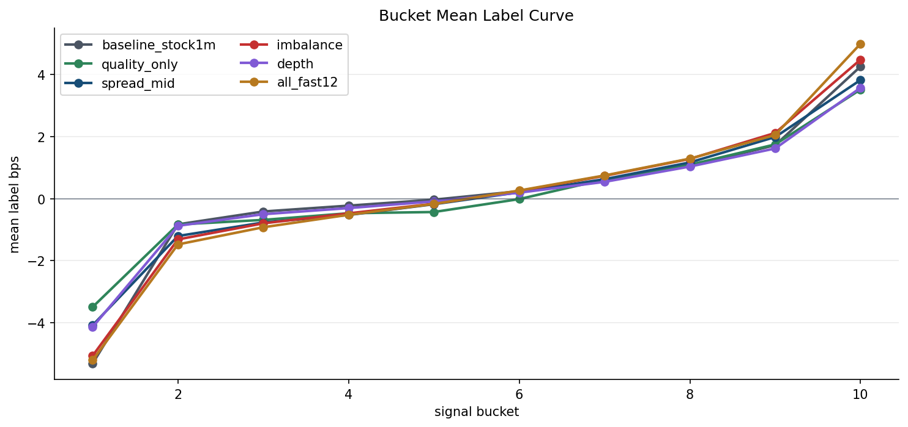

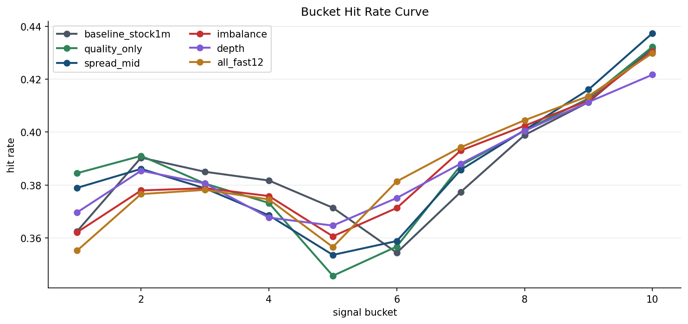

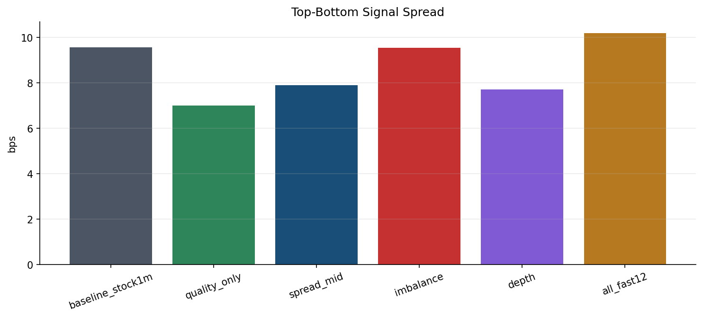

| experiment | signal_bucket | mean_prediction | mean_label_bps | t_stat | hit_rate | row_count | top_bottom_signal_spread_bps |
| --- | --- | --- | --- | --- | --- | --- | --- |
| all_fast12 | 1 | -0.000778 | -5.20 | -364.49 | 35.51% | 17,694,544 | 10.19 |
| all_fast12 | 2 | -0.000333 | -1.47 | -153.37 | 37.65% | 17,694,544 | 10.19 |
| all_fast12 | 3 | -0.000199 | -0.92 | -101.79 | 37.81% | 17,694,544 | 10.19 |
| all_fast12 | 4 | -0.000103 | -0.52 | -59.09 | 37.45% | 17,694,544 | 10.19 |
| all_fast12 | 5 | -0.000025 | -0.17 | -20.05 | 35.65% | 17,694,544 | 10.19 |
| all_fast12 | 6 | 0.000050 | 0.26 | 30.08 | 38.13% | 17,694,544 | 10.19 |
| all_fast12 | 7 | 0.000131 | 0.75 | 84.42 | 39.42% | 17,694,544 | 10.19 |
| all_fast12 | 8 | 0.000225 | 1.29 | 140.95 | 40.45% | 17,694,544 | 10.19 |
| all_fast12 | 9 | 0.000354 | 2.05 | 210.58 | 41.36% | 17,694,544 | 10.19 |
| all_fast12 | 10 | 0.000764 | 4.99 | 387.43 | 43.00% | 17,694,544 | 10.19 |
| baseline_stock1m | 1 | -0.001177 | -5.31 | -354.17 | 36.25% | 17,694,544 | 9.56 |
| baseline_stock1m | 2 | -0.000441 | -0.83 | -84.23 | 39.03% | 17,694,544 | 9.56 |
| baseline_stock1m | 3 | -0.000283 | -0.41 | -46.32 | 38.50% | 17,694,544 | 9.56 |
| baseline_stock1m | 4 | -0.000169 | -0.23 | -26.31 | 38.17% | 17,694,544 | 9.56 |
| baseline_stock1m | 5 | -0.000071 | -0.03 | -4.05 | 37.14% | 17,694,544 | 9.56 |
| baseline_stock1m | 6 | 0.000014 | 0.24 | 29.75 | 35.43% | 17,694,544 | 9.56 |
| baseline_stock1m | 7 | 0.000105 | 0.59 | 70.42 | 37.73% | 17,694,544 | 9.56 |
| baseline_stock1m | 8 | 0.000224 | 1.06 | 119.03 | 39.89% | 17,694,544 | 9.56 |
| baseline_stock1m | 9 | 0.000400 | 1.72 | 177.67 | 41.14% | 17,694,544 | 9.56 |
| baseline_stock1m | 10 | 0.001038 | 4.25 | 319.87 | 43.18% | 17,694,544 | 9.56 |
| depth | 1 | -0.000646 | -4.13 | -286.69 | 36.96% | 17,694,544 | 7.70 |
| depth | 2 | -0.000257 | -0.87 | -89.01 | 38.54% | 17,694,544 | 7.70 |
| depth | 3 | -0.000150 | -0.50 | -54.84 | 38.06% | 17,694,544 | 7.70 |
| depth | 4 | -0.000077 | -0.30 | -34.84 | 36.76% | 17,694,544 | 7.70 |
| depth | 5 | -0.000016 | -0.09 | -10.29 | 36.46% | 17,694,544 | 7.70 |
| depth | 6 | 0.000043 | 0.19 | 22.18 | 37.51% | 17,694,544 | 7.70 |
| depth | 7 | 0.000105 | 0.54 | 61.26 | 38.80% | 17,694,544 | 7.70 |
| depth | 8 | 0.000177 | 1.03 | 113.41 | 40.05% | 17,694,544 | 7.70 |
| depth | 9 | 0.000275 | 1.62 | 167.79 | 41.14% | 17,694,544 | 7.70 |
| depth | 10 | 0.000593 | 3.57 | 282.17 | 42.17% | 17,694,544 | 7.70 |
| imbalance | 1 | -0.001896 | -5.06 | -322.48 | 36.21% | 17,694,544 | 9.54 |
| imbalance | 2 | -0.000555 | -1.31 | -135.70 | 37.79% | 17,694,544 | 9.54 |
| imbalance | 3 | -0.000323 | -0.80 | -90.10 | 37.88% | 17,694,544 | 9.54 |
| imbalance | 4 | -0.000166 | -0.47 | -57.59 | 37.58% | 17,694,544 | 9.54 |
| imbalance | 5 | -0.000052 | -0.16 | -20.91 | 36.05% | 17,694,544 | 9.54 |
| imbalance | 6 | 0.000052 | 0.25 | 31.16 | 37.13% | 17,694,544 | 9.54 |
| imbalance | 7 | 0.000168 | 0.73 | 88.85 | 39.30% | 17,694,544 | 9.54 |
| imbalance | 8 | 0.000308 | 1.28 | 150.63 | 40.24% | 17,694,544 | 9.54 |
| imbalance | 9 | 0.000522 | 2.12 | 228.60 | 41.20% | 17,694,544 | 9.54 |
| imbalance | 10 | 0.001828 | 4.48 | 325.52 | 43.07% | 17,694,544 | 9.54 |
| quality_only | 1 | -0.001660 | -3.49 | -227.69 | 38.45% | 17,694,544 | 7.00 |
| quality_only | 2 | -0.000450 | -0.83 | -84.32 | 39.10% | 17,694,544 | 7.00 |
| quality_only | 3 | -0.000252 | -0.68 | -77.59 | 38.05% | 17,694,544 | 7.00 |
| quality_only | 4 | -0.000130 | -0.47 | -55.76 | 37.32% | 17,694,544 | 7.00 |
| quality_only | 5 | -0.000038 | -0.43 | -52.80 | 34.56% | 17,694,544 | 7.00 |
| quality_only | 6 | 0.000037 | -0.01 | -1.79 | 35.67% | 17,694,544 | 7.00 |
| quality_only | 7 | 0.000129 | 0.62 | 74.14 | 38.74% | 17,694,544 | 7.00 |
| quality_only | 8 | 0.000255 | 1.09 | 126.57 | 40.06% | 17,694,544 | 7.00 |
| quality_only | 9 | 0.000445 | 1.75 | 187.72 | 41.28% | 17,694,544 | 7.00 |
| quality_only | 10 | 0.001589 | 3.51 | 261.00 | 43.23% | 17,694,544 | 7.00 |
| spread_mid | 1 | -0.001899 | -4.08 | -260.21 | 37.89% | 17,694,544 | 7.90 |
| spread_mid | 2 | -0.000500 | -1.20 | -124.11 | 38.61% | 17,694,544 | 7.90 |
| spread_mid | 3 | -0.000283 | -0.77 | -87.92 | 37.87% | 17,694,544 | 7.90 |
| spread_mid | 4 | -0.000152 | -0.53 | -64.19 | 36.85% | 17,694,544 | 7.90 |
| spread_mid | 5 | -0.000053 | -0.18 | -22.99 | 35.35% | 17,694,544 | 7.90 |
| spread_mid | 6 | 0.000036 | 0.21 | 26.38 | 35.88% | 17,694,544 | 7.90 |
| spread_mid | 7 | 0.000138 | 0.63 | 77.93 | 38.57% | 17,694,544 | 7.90 |
| spread_mid | 8 | 0.000268 | 1.17 | 138.37 | 40.08% | 17,694,544 | 7.90 |
| spread_mid | 9 | 0.000478 | 1.98 | 212.63 | 41.61% | 17,694,544 | 7.90 |
| spread_mid | 10 | 0.001984 | 3.82 | 270.72 | 43.75% | 17,694,544 | 7.90 |

### 3.3. Goodness Of Fit

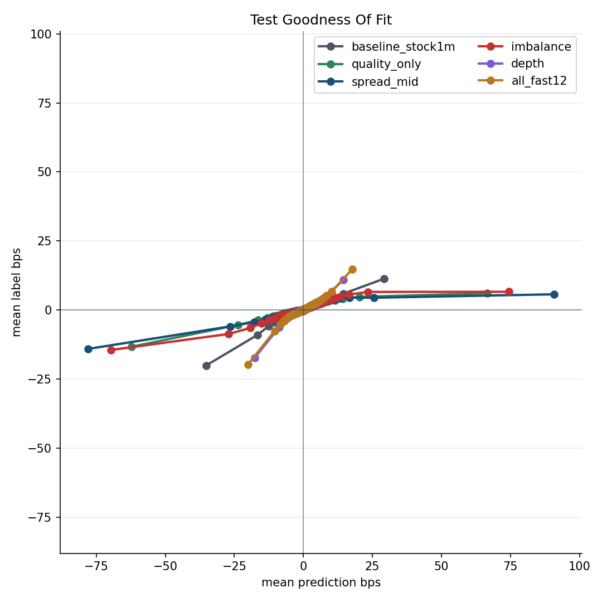

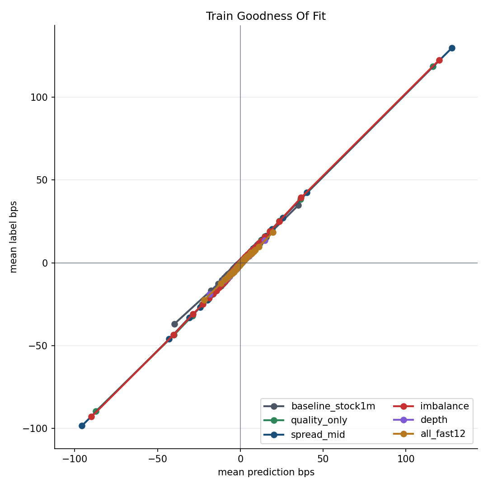

| experiment | split | prediction_bin | mean_prediction_bps | mean_label_bps | label_p05_bps | label_p95_bps | row_count |
| --- | --- | --- | --- | --- | --- | --- | --- |
| all_fast12 | test | 1 | -20.10 | -19.77 | -165.25 | 129.32 | 1,769,455 |
| all_fast12 | test | 2 | -10.42 | -7.59 | -98.72 | 86.44 | 1,769,455 |
| all_fast12 | test | 3 | -8.31 | -5.21 | -84.38 | 75.87 | 1,769,455 |
| all_fast12 | test | 4 | -7.18 | -3.96 | -76.83 | 70.46 | 1,769,455 |
| all_fast12 | test | 5 | -6.42 | -3.35 | -72.52 | 67.41 | 1,769,455 |
| all_fast12 | test | 6 | -5.85 | -2.99 | -69.27 | 64.66 | 1,769,455 |
| all_fast12 | test | 7 | -5.40 | -2.56 | -66.87 | 63.36 | 1,769,455 |
| all_fast12 | test | 8 | -5.02 | -2.29 | -65.12 | 62.37 | 1,769,455 |
| all_fast12 | test | 9 | -4.70 | -2.17 | -63.48 | 61.26 | 1,769,455 |
| all_fast12 | test | 10 | -4.42 | -2.09 | -62.33 | 60.20 | 1,769,455 |
| all_fast12 | test | 11 | -4.17 | -1.84 | -61.00 | 59.51 | 1,769,455 |
| all_fast12 | test | 12 | -3.94 | -1.78 | -60.42 | 59.01 | 1,769,455 |
| all_fast12 | test | 13 | -3.73 | -1.71 | -59.59 | 58.29 | 1,769,455 |
| all_fast12 | test | 14 | -3.54 | -1.57 | -58.98 | 58.10 | 1,769,455 |
| all_fast12 | test | 15 | -3.37 | -1.45 | -58.21 | 57.68 | 1,769,455 |
| all_fast12 | test | 16 | -3.20 | -1.43 | -57.56 | 56.99 | 1,769,455 |
| all_fast12 | test | 17 | -3.04 | -1.33 | -56.99 | 56.80 | 1,769,455 |
| all_fast12 | test | 18 | -2.90 | -1.28 | -56.65 | 56.69 | 1,769,455 |
| all_fast12 | test | 19 | -2.75 | -1.18 | -56.30 | 56.34 | 1,769,455 |
| all_fast12 | test | 20 | -2.62 | -1.17 | -55.92 | 56.04 | 1,769,455 |
| all_fast12 | test | 21 | -2.49 | -1.11 | -55.62 | 56.00 | 1,769,455 |
| all_fast12 | test | 22 | -2.37 | -1.12 | -55.35 | 55.66 | 1,769,455 |
| all_fast12 | test | 23 | -2.25 | -1.00 | -54.82 | 55.44 | 1,769,455 |
| all_fast12 | test | 24 | -2.14 | -1.03 | -54.66 | 55.16 | 1,769,455 |
| all_fast12 | test | 25 | -2.03 | -0.95 | -54.40 | 55.20 | 1,769,455 |
| all_fast12 | test | 26 | -1.92 | -0.90 | -54.13 | 55.01 | 1,769,455 |
| all_fast12 | test | 27 | -1.81 | -0.92 | -53.94 | 54.74 | 1,769,455 |
| all_fast12 | test | 28 | -1.71 | -0.81 | -53.79 | 54.78 | 1,769,455 |
| all_fast12 | test | 29 | -1.61 | -0.70 | -53.29 | 54.78 | 1,769,455 |
| all_fast12 | test | 30 | -1.52 | -0.69 | -53.22 | 54.66 | 1,769,455 |
| all_fast12 | test | 31 | -1.42 | -0.66 | -53.14 | 54.63 | 1,769,455 |
| all_fast12 | test | 32 | -1.33 | -0.68 | -52.91 | 54.28 | 1,769,455 |
| all_fast12 | test | 33 | -1.24 | -0.60 | -52.53 | 54.21 | 1,769,455 |
| all_fast12 | test | 34 | -1.15 | -0.55 | -52.38 | 54.21 | 1,769,455 |
| all_fast12 | test | 35 | -1.07 | -0.56 | -52.53 | 54.24 | 1,769,455 |
| all_fast12 | test | 36 | -0.98 | -0.52 | -52.15 | 54.09 | 1,769,455 |
| all_fast12 | test | 37 | -0.90 | -0.43 | -52.07 | 53.86 | 1,769,455 |
| all_fast12 | test | 38 | -0.81 | -0.39 | -51.77 | 54.03 | 1,769,455 |
| all_fast12 | test | 39 | -0.73 | -0.44 | -51.84 | 53.67 | 1,769,455 |
| all_fast12 | test | 40 | -0.65 | -0.39 | -51.61 | 53.60 | 1,769,455 |
| all_fast12 | test | 41 | -0.58 | -0.44 | -50.20 | 51.50 | 1,769,454 |
| all_fast12 | test | 42 | -0.50 | -0.38 | -50.85 | 52.72 | 1,769,454 |
| all_fast12 | test | 43 | -0.43 | -0.29 | -50.74 | 52.91 | 1,769,454 |
| all_fast12 | test | 44 | -0.36 | -0.16 | -49.63 | 51.54 | 1,769,454 |
| all_fast12 | test | 45 | -0.28 | -0.16 | -50.13 | 52.64 | 1,769,454 |
| all_fast12 | test | 46 | -0.21 | -0.17 | -50.43 | 52.49 | 1,769,454 |
| all_fast12 | test | 47 | -0.14 | -0.11 | -50.05 | 52.49 | 1,769,454 |
| all_fast12 | test | 48 | -0.07 | -0.07 | -50.54 | 53.33 | 1,769,454 |
| all_fast12 | test | 49 | 0.01 | 0.02 | -50.66 | 53.90 | 1,769,454 |
| all_fast12 | test | 50 | 0.08 | 0.08 | -50.66 | 54.05 | 1,769,454 |
| all_fast12 | test | 51 | 0.16 | 0.08 | -50.81 | 54.05 | 1,769,454 |
| all_fast12 | test | 52 | 0.24 | 0.15 | -50.77 | 54.21 | 1,769,454 |
| all_fast12 | test | 53 | 0.31 | 0.15 | -50.74 | 54.28 | 1,769,454 |
| all_fast12 | test | 54 | 0.39 | 0.25 | -50.66 | 54.47 | 1,769,454 |
| all_fast12 | test | 55 | 0.46 | 0.25 | -50.77 | 54.47 | 1,769,454 |
| all_fast12 | test | 56 | 0.54 | 0.28 | -50.89 | 54.89 | 1,769,454 |
| all_fast12 | test | 57 | 0.62 | 0.34 | -51.19 | 54.78 | 1,769,454 |
| all_fast12 | test | 58 | 0.70 | 0.36 | -51.00 | 54.97 | 1,769,454 |
| all_fast12 | test | 59 | 0.78 | 0.32 | -51.24 | 55.20 | 1,769,454 |
| all_fast12 | test | 60 | 0.86 | 0.42 | -51.08 | 55.39 | 1,769,454 |
| all_fast12 | test | 61 | 0.94 | 0.54 | -51.00 | 55.58 | 1,769,454 |
| all_fast12 | test | 62 | 1.02 | 0.58 | -51.12 | 55.85 | 1,769,454 |
| all_fast12 | test | 63 | 1.10 | 0.60 | -51.31 | 55.92 | 1,769,454 |
| all_fast12 | test | 64 | 1.18 | 0.67 | -51.27 | 56.23 | 1,769,454 |
| all_fast12 | test | 65 | 1.26 | 0.76 | -51.42 | 56.38 | 1,769,454 |
| all_fast12 | test | 66 | 1.35 | 0.74 | -51.54 | 56.50 | 1,769,454 |
| all_fast12 | test | 67 | 1.44 | 0.86 | -51.50 | 56.99 | 1,769,454 |
| all_fast12 | test | 68 | 1.52 | 0.88 | -51.65 | 57.00 | 1,769,454 |
| all_fast12 | test | 69 | 1.61 | 0.88 | -51.65 | 57.07 | 1,769,454 |
| all_fast12 | test | 70 | 1.70 | 0.95 | -51.88 | 57.33 | 1,769,454 |
| all_fast12 | test | 71 | 1.79 | 1.07 | -51.88 | 57.60 | 1,769,454 |
| all_fast12 | test | 72 | 1.89 | 1.04 | -51.96 | 57.68 | 1,769,454 |
| all_fast12 | test | 73 | 1.99 | 1.13 | -52.19 | 58.14 | 1,769,454 |
| all_fast12 | test | 74 | 2.08 | 1.17 | -52.38 | 58.29 | 1,769,454 |
| all_fast12 | test | 75 | 2.19 | 1.21 | -52.53 | 58.56 | 1,769,454 |
| all_fast12 | test | 76 | 2.29 | 1.26 | -52.60 | 58.63 | 1,769,454 |
| all_fast12 | test | 77 | 2.40 | 1.48 | -52.80 | 59.51 | 1,769,454 |
| all_fast12 | test | 78 | 2.51 | 1.51 | -53.02 | 59.55 | 1,769,454 |
| all_fast12 | test | 79 | 2.62 | 1.48 | -53.25 | 59.70 | 1,769,454 |
| all_fast12 | test | 80 | 2.74 | 1.54 | -53.52 | 60.23 | 1,769,454 |
| all_fast12 | test | 81 | 2.87 | 1.58 | -53.75 | 60.62 | 1,769,454 |
| all_fast12 | test | 82 | 2.99 | 1.72 | -53.98 | 61.34 | 1,769,454 |
| all_fast12 | test | 83 | 3.13 | 1.84 | -54.05 | 61.72 | 1,769,454 |
| all_fast12 | test | 84 | 3.27 | 1.90 | -54.63 | 62.33 | 1,769,454 |
| all_fast12 | test | 85 | 3.42 | 1.99 | -55.01 | 62.79 | 1,769,454 |
| all_fast12 | test | 86 | 3.58 | 2.06 | -55.39 | 63.13 | 1,769,454 |
| all_fast12 | test | 87 | 3.75 | 2.18 | -55.73 | 64.13 | 1,769,454 |
| all_fast12 | test | 88 | 3.94 | 2.22 | -56.65 | 65.12 | 1,769,454 |
| all_fast12 | test | 89 | 4.14 | 2.45 | -56.95 | 65.80 | 1,769,454 |
| all_fast12 | test | 90 | 4.35 | 2.55 | -57.64 | 66.87 | 1,769,454 |
| all_fast12 | test | 91 | 4.60 | 2.54 | -58.75 | 67.98 | 1,769,454 |
| all_fast12 | test | 92 | 4.87 | 2.84 | -59.59 | 69.47 | 1,769,454 |
| all_fast12 | test | 93 | 5.18 | 2.96 | -60.81 | 70.69 | 1,769,454 |
| all_fast12 | test | 94 | 5.54 | 3.26 | -62.10 | 72.75 | 1,769,454 |
| all_fast12 | test | 95 | 5.98 | 3.44 | -64.09 | 74.88 | 1,769,454 |
| all_fast12 | test | 96 | 6.54 | 3.92 | -66.34 | 77.74 | 1,769,454 |
| all_fast12 | test | 97 | 7.28 | 4.27 | -69.24 | 81.56 | 1,769,454 |
| all_fast12 | test | 98 | 8.37 | 5.18 | -73.09 | 86.59 | 1,769,454 |
| all_fast12 | test | 99 | 10.29 | 6.66 | -78.96 | 94.83 | 1,769,454 |
| all_fast12 | test | 100 | 17.72 | 14.81 | -93.46 | 131.15 | 1,769,454 |
| all_fast12 | train | 1 | -21.74 | -22.50 | -161.74 | 122.22 | 79,688 |
| all_fast12 | train | 2 | -11.80 | -12.34 | -106.58 | 89.19 | 79,688 |
| all_fast12 | train | 3 | -9.42 | -10.17 | -94.38 | 77.82 | 79,688 |
| all_fast12 | train | 4 | -8.13 | -9.09 | -88.12 | 73.62 | 79,688 |
| all_fast12 | train | 5 | -7.26 | -8.33 | -83.92 | 69.89 | 79,688 |
| all_fast12 | train | 6 | -6.62 | -7.63 | -80.49 | 67.75 | 79,688 |
| all_fast12 | train | 7 | -6.11 | -6.98 | -78.09 | 67.10 | 79,688 |
| all_fast12 | train | 8 | -5.68 | -6.64 | -77.06 | 65.73 | 79,688 |
| all_fast12 | train | 9 | -5.31 | -6.50 | -75.00 | 64.35 | 79,688 |
| all_fast12 | train | 10 | -4.99 | -6.27 | -73.32 | 63.48 | 79,688 |
| all_fast12 | train | 11 | -4.71 | -6.09 | -73.01 | 63.44 | 79,688 |
| all_fast12 | train | 12 | -4.45 | -5.74 | -71.68 | 63.02 | 79,688 |
| all_fast12 | train | 13 | -4.22 | -5.28 | -70.38 | 62.68 | 79,688 |
| all_fast12 | train | 14 | -4.00 | -5.09 | -70.00 | 62.68 | 79,688 |
| all_fast12 | train | 15 | -3.80 | -5.47 | -69.96 | 61.06 | 79,688 |
| all_fast12 | train | 16 | -3.61 | -4.68 | -68.70 | 61.87 | 79,688 |
| all_fast12 | train | 17 | -3.43 | -4.46 | -68.44 | 61.91 | 79,688 |
| all_fast12 | train | 18 | -3.27 | -4.40 | -67.94 | 61.19 | 79,688 |
| all_fast12 | train | 19 | -3.11 | -4.59 | -67.60 | 61.19 | 79,688 |
| all_fast12 | train | 20 | -2.96 | -4.24 | -67.56 | 61.45 | 79,688 |
| all_fast12 | train | 21 | -2.82 | -4.11 | -66.57 | 61.30 | 79,688 |
| all_fast12 | train | 22 | -2.68 | -3.92 | -66.15 | 60.23 | 79,688 |
| all_fast12 | train | 23 | -2.55 | -3.79 | -66.11 | 60.73 | 79,688 |
| all_fast12 | train | 24 | -2.42 | -3.50 | -65.35 | 60.58 | 79,688 |
| all_fast12 | train | 25 | -2.30 | -3.18 | -64.85 | 60.50 | 79,688 |
| all_fast12 | train | 26 | -2.18 | -3.31 | -64.74 | 59.85 | 79,688 |
| all_fast12 | train | 27 | -2.06 | -3.23 | -64.13 | 59.51 | 79,688 |
| all_fast12 | train | 28 | -1.95 | -3.15 | -63.67 | 59.78 | 79,688 |
| all_fast12 | train | 29 | -1.84 | -3.02 | -63.71 | 60.16 | 79,688 |
| all_fast12 | train | 30 | -1.73 | -2.58 | -62.62 | 60.31 | 79,688 |
| all_fast12 | train | 31 | -1.63 | -2.77 | -63.13 | 59.89 | 79,688 |
| all_fast12 | train | 32 | -1.53 | -2.47 | -62.71 | 60.23 | 79,688 |
| all_fast12 | train | 33 | -1.43 | -2.29 | -62.48 | 59.66 | 79,688 |
| all_fast12 | train | 34 | -1.33 | -2.39 | -62.52 | 59.70 | 79,688 |
| all_fast12 | train | 35 | -1.24 | -1.96 | -61.23 | 60.23 | 79,688 |
| all_fast12 | train | 36 | -1.15 | -1.98 | -61.23 | 59.47 | 79,688 |
| all_fast12 | train | 37 | -1.05 | -1.86 | -60.54 | 60.34 | 79,688 |
| all_fast12 | train | 38 | -0.96 | -1.87 | -60.72 | 60.14 | 79,688 |
| all_fast12 | train | 39 | -0.88 | -1.61 | -61.08 | 60.65 | 79,688 |
| all_fast12 | train | 40 | -0.79 | -1.55 | -60.16 | 59.39 | 79,688 |
| all_fast12 | train | 41 | -0.70 | -1.53 | -59.62 | 58.75 | 79,688 |
| all_fast12 | train | 42 | -0.62 | -1.65 | -60.08 | 57.93 | 79,688 |
| all_fast12 | train | 43 | -0.54 | -1.55 | -58.67 | 57.45 | 79,688 |
| all_fast12 | train | 44 | -0.46 | -1.15 | -58.98 | 59.32 | 79,688 |
| all_fast12 | train | 45 | -0.38 | -1.11 | -58.67 | 57.79 | 79,688 |
| all_fast12 | train | 46 | -0.30 | -0.74 | -57.33 | 58.29 | 79,688 |
| all_fast12 | train | 47 | -0.23 | -0.99 | -58.73 | 58.75 | 79,688 |
| all_fast12 | train | 48 | -0.15 | -0.75 | -58.52 | 59.09 | 79,688 |
| all_fast12 | train | 49 | -0.07 | -0.85 | -58.98 | 59.89 | 79,688 |
| all_fast12 | train | 50 | 0.01 | -0.62 | -58.98 | 61.07 | 79,688 |
| all_fast12 | train | 51 | 0.10 | -0.62 | -58.71 | 61.34 | 79,688 |
| all_fast12 | train | 52 | 0.18 | -0.57 | -59.13 | 60.54 | 79,688 |
| all_fast12 | train | 53 | 0.26 | -0.47 | -58.67 | 61.04 | 79,688 |
| all_fast12 | train | 54 | 0.34 | -0.54 | -58.98 | 61.26 | 79,688 |
| all_fast12 | train | 55 | 0.42 | -0.16 | -58.52 | 61.19 | 79,688 |
| all_fast12 | train | 56 | 0.51 | -0.18 | -59.36 | 62.17 | 79,688 |
| all_fast12 | train | 57 | 0.59 | 0.06 | -58.86 | 63.69 | 79,688 |
| all_fast12 | train | 58 | 0.67 | 0.03 | -58.75 | 62.56 | 79,688 |
| all_fast12 | train | 59 | 0.76 | 0.13 | -58.78 | 62.45 | 79,688 |
| all_fast12 | train | 60 | 0.84 | 0.04 | -59.55 | 63.10 | 79,688 |
| all_fast12 | train | 61 | 0.93 | 0.35 | -58.90 | 64.05 | 79,688 |
| all_fast12 | train | 62 | 1.02 | 0.51 | -58.86 | 64.24 | 79,688 |
| all_fast12 | train | 63 | 1.11 | 0.49 | -58.56 | 63.78 | 79,688 |
| all_fast12 | train | 64 | 1.20 | 0.30 | -59.13 | 63.48 | 79,688 |
| all_fast12 | train | 65 | 1.29 | 0.63 | -59.32 | 64.13 | 79,688 |
| all_fast12 | train | 66 | 1.38 | 0.80 | -59.36 | 65.27 | 79,688 |
| all_fast12 | train | 67 | 1.47 | 0.82 | -59.55 | 64.93 | 79,688 |
| all_fast12 | train | 68 | 1.57 | 0.98 | -59.01 | 65.77 | 79,688 |
| all_fast12 | train | 69 | 1.66 | 1.07 | -59.43 | 65.88 | 79,687 |
| all_fast12 | train | 70 | 1.76 | 1.19 | -59.24 | 65.42 | 79,687 |
| all_fast12 | train | 71 | 1.86 | 1.60 | -58.29 | 67.33 | 79,687 |
| all_fast12 | train | 72 | 1.96 | 1.50 | -58.94 | 66.87 | 79,687 |
| all_fast12 | train | 73 | 2.07 | 1.70 | -59.62 | 67.09 | 79,687 |
| all_fast12 | train | 74 | 2.17 | 1.71 | -59.70 | 67.63 | 79,687 |
| all_fast12 | train | 75 | 2.28 | 1.61 | -60.27 | 67.14 | 79,687 |
| all_fast12 | train | 76 | 2.39 | 1.85 | -59.59 | 67.85 | 79,687 |
| all_fast12 | train | 77 | 2.51 | 1.76 | -60.12 | 68.02 | 79,687 |
| all_fast12 | train | 78 | 2.63 | 2.43 | -59.13 | 68.41 | 79,687 |
| all_fast12 | train | 79 | 2.76 | 2.45 | -59.70 | 70.15 | 79,687 |
| all_fast12 | train | 80 | 2.89 | 2.61 | -59.98 | 70.38 | 79,687 |
| all_fast12 | train | 81 | 3.02 | 2.61 | -61.00 | 70.34 | 79,687 |
| all_fast12 | train | 82 | 3.16 | 2.40 | -61.41 | 70.84 | 79,687 |
| all_fast12 | train | 83 | 3.31 | 3.08 | -60.35 | 71.68 | 79,687 |
| all_fast12 | train | 84 | 3.46 | 3.16 | -61.11 | 72.63 | 79,687 |
| all_fast12 | train | 85 | 3.62 | 3.48 | -61.26 | 73.70 | 79,687 |
| all_fast12 | train | 86 | 3.80 | 3.28 | -62.85 | 73.70 | 79,687 |
| all_fast12 | train | 87 | 3.98 | 3.75 | -62.26 | 74.01 | 79,687 |
| all_fast12 | train | 88 | 4.18 | 3.83 | -63.13 | 75.30 | 79,687 |
| all_fast12 | train | 89 | 4.40 | 3.91 | -63.82 | 75.65 | 79,687 |
| all_fast12 | train | 90 | 4.64 | 4.37 | -63.82 | 77.32 | 79,687 |
| all_fast12 | train | 91 | 4.91 | 4.27 | -65.19 | 78.43 | 79,687 |
| all_fast12 | train | 92 | 5.20 | 4.58 | -65.46 | 79.04 | 79,687 |
| all_fast12 | train | 93 | 5.54 | 4.69 | -66.68 | 80.80 | 79,687 |
| all_fast12 | train | 94 | 5.94 | 5.17 | -67.83 | 83.31 | 79,687 |
| all_fast12 | train | 95 | 6.42 | 6.26 | -68.47 | 85.68 | 79,687 |
| all_fast12 | train | 96 | 7.03 | 5.91 | -71.68 | 88.12 | 79,687 |
| all_fast12 | train | 97 | 7.84 | 6.62 | -73.89 | 91.02 | 79,687 |
| all_fast12 | train | 98 | 9.05 | 7.68 | -78.08 | 96.21 | 79,687 |
| all_fast12 | train | 99 | 11.21 | 9.65 | -84.51 | 103.13 | 79,687 |
| all_fast12 | train | 100 | 19.61 | 18.38 | -98.50 | 138.32 | 79,687 |
| baseline_stock1m | test | 1 | -35.20 | -20.10 | -165.25 | 130.62 | 1,769,455 |
| baseline_stock1m | test | 2 | -16.56 | -9.00 | -106.05 | 95.29 | 1,769,455 |
| baseline_stock1m | test | 3 | -12.49 | -5.79 | -91.32 | 86.06 | 1,769,455 |
| baseline_stock1m | test | 4 | -10.46 | -4.34 | -83.92 | 80.95 | 1,769,455 |
| baseline_stock1m | test | 5 | -9.11 | -3.32 | -78.74 | 77.40 | 1,769,455 |
| baseline_stock1m | test | 6 | -8.08 | -2.83 | -75.34 | 74.39 | 1,769,455 |
| baseline_stock1m | test | 7 | -7.26 | -2.46 | -72.21 | 71.75 | 1,769,455 |
| baseline_stock1m | test | 8 | -6.62 | -2.08 | -68.70 | 68.74 | 1,769,455 |
| baseline_stock1m | test | 9 | -6.14 | -1.66 | -66.22 | 66.53 | 1,769,455 |
| baseline_stock1m | test | 10 | -5.77 | -1.52 | -64.58 | 64.89 | 1,769,455 |
| baseline_stock1m | test | 11 | -5.44 | -1.24 | -63.06 | 64.01 | 1,769,455 |
| baseline_stock1m | test | 12 | -5.16 | -1.22 | -61.91 | 62.48 | 1,769,455 |
| baseline_stock1m | test | 13 | -4.90 | -1.01 | -61.04 | 62.18 | 1,769,455 |
| baseline_stock1m | test | 14 | -4.67 | -0.84 | -59.81 | 61.42 | 1,769,455 |
| baseline_stock1m | test | 15 | -4.45 | -0.79 | -58.98 | 60.68 | 1,769,455 |
| baseline_stock1m | test | 16 | -4.26 | -0.66 | -58.48 | 60.16 | 1,769,455 |
| baseline_stock1m | test | 17 | -4.07 | -0.71 | -57.79 | 59.32 | 1,769,455 |
| baseline_stock1m | test | 18 | -3.89 | -0.63 | -57.26 | 59.05 | 1,769,455 |
| baseline_stock1m | test | 19 | -3.73 | -0.55 | -56.72 | 58.56 | 1,769,455 |
| baseline_stock1m | test | 20 | -3.57 | -0.63 | -56.19 | 57.87 | 1,769,455 |
| baseline_stock1m | test | 21 | -3.42 | -0.60 | -55.73 | 57.45 | 1,769,455 |
| baseline_stock1m | test | 22 | -3.28 | -0.46 | -55.31 | 57.22 | 1,769,455 |
| baseline_stock1m | test | 23 | -3.14 | -0.43 | -54.66 | 57.14 | 1,769,455 |
| baseline_stock1m | test | 24 | -3.00 | -0.46 | -54.47 | 56.53 | 1,769,455 |
| baseline_stock1m | test | 25 | -2.87 | -0.52 | -53.71 | 55.39 | 1,769,455 |
| baseline_stock1m | test | 26 | -2.75 | -0.40 | -53.67 | 56.04 | 1,769,455 |
| baseline_stock1m | test | 27 | -2.63 | -0.31 | -53.37 | 55.69 | 1,769,455 |
| baseline_stock1m | test | 28 | -2.51 | -0.26 | -52.91 | 55.58 | 1,769,455 |
| baseline_stock1m | test | 29 | -2.40 | -0.40 | -52.91 | 55.08 | 1,769,455 |
| baseline_stock1m | test | 30 | -2.28 | -0.29 | -52.64 | 55.20 | 1,769,455 |
| baseline_stock1m | test | 31 | -2.17 | -0.26 | -52.53 | 54.86 | 1,769,455 |
| baseline_stock1m | test | 32 | -2.06 | -0.35 | -52.22 | 54.47 | 1,769,455 |
| baseline_stock1m | test | 33 | -1.95 | -0.28 | -51.96 | 54.66 | 1,769,455 |
| baseline_stock1m | test | 34 | -1.85 | -0.24 | -51.69 | 54.36 | 1,769,455 |
| baseline_stock1m | test | 35 | -1.74 | -0.24 | -51.54 | 54.13 | 1,769,455 |
| baseline_stock1m | test | 36 | -1.64 | -0.17 | -51.38 | 54.21 | 1,769,455 |
| baseline_stock1m | test | 37 | -1.53 | -0.28 | -51.23 | 54.02 | 1,769,455 |
| baseline_stock1m | test | 38 | -1.43 | -0.12 | -51.04 | 53.83 | 1,769,455 |
| baseline_stock1m | test | 39 | -1.33 | -0.21 | -50.85 | 53.63 | 1,769,455 |
| baseline_stock1m | test | 40 | -1.23 | -0.11 | -50.54 | 53.44 | 1,769,455 |
| baseline_stock1m | test | 41 | -1.13 | -0.09 | -50.20 | 53.18 | 1,769,454 |
| baseline_stock1m | test | 42 | -1.04 | -0.13 | -50.09 | 52.76 | 1,769,454 |
| baseline_stock1m | test | 43 | -0.94 | -0.10 | -49.63 | 52.60 | 1,769,454 |
| baseline_stock1m | test | 44 | -0.85 | -0.03 | -49.59 | 52.38 | 1,769,454 |
| baseline_stock1m | test | 45 | -0.75 | -0.02 | -49.29 | 52.38 | 1,769,454 |
| baseline_stock1m | test | 46 | -0.66 | -0.04 | -49.02 | 51.96 | 1,769,454 |
| baseline_stock1m | test | 47 | -0.57 | 0.03 | -48.71 | 51.80 | 1,769,454 |
| baseline_stock1m | test | 48 | -0.48 | -0.01 | -48.52 | 51.38 | 1,769,454 |
| baseline_stock1m | test | 49 | -0.40 | -0.01 | -48.33 | 51.38 | 1,769,454 |
| baseline_stock1m | test | 50 | -0.31 | 0.07 | -47.91 | 51.16 | 1,769,454 |
| baseline_stock1m | test | 51 | -0.23 | 0.11 | -47.95 | 51.16 | 1,769,454 |
| baseline_stock1m | test | 52 | -0.15 | 0.12 | -47.80 | 51.04 | 1,769,454 |
| baseline_stock1m | test | 53 | -0.07 | 0.19 | -47.42 | 50.62 | 1,769,454 |
| baseline_stock1m | test | 54 | 0.02 | 0.17 | -47.34 | 50.51 | 1,769,454 |
| baseline_stock1m | test | 55 | 0.10 | 0.20 | -47.42 | 50.70 | 1,769,454 |
| baseline_stock1m | test | 56 | 0.18 | 0.28 | -47.26 | 50.58 | 1,769,454 |
| baseline_stock1m | test | 57 | 0.26 | 0.30 | -47.49 | 51.16 | 1,769,454 |
| baseline_stock1m | test | 58 | 0.35 | 0.31 | -47.04 | 50.43 | 1,769,454 |
| baseline_stock1m | test | 59 | 0.43 | 0.34 | -47.49 | 51.16 | 1,769,454 |
| baseline_stock1m | test | 60 | 0.52 | 0.36 | -47.49 | 51.08 | 1,769,454 |
| baseline_stock1m | test | 61 | 0.61 | 0.44 | -47.61 | 51.54 | 1,769,454 |
| baseline_stock1m | test | 62 | 0.70 | 0.41 | -47.72 | 51.31 | 1,769,454 |
| baseline_stock1m | test | 63 | 0.79 | 0.52 | -48.18 | 52.30 | 1,769,454 |
| baseline_stock1m | test | 64 | 0.89 | 0.50 | -48.41 | 52.76 | 1,769,454 |
| baseline_stock1m | test | 65 | 0.98 | 0.59 | -48.52 | 52.76 | 1,769,454 |
| baseline_stock1m | test | 66 | 1.09 | 0.55 | -49.02 | 53.41 | 1,769,454 |
| baseline_stock1m | test | 67 | 1.19 | 0.64 | -49.17 | 53.75 | 1,769,454 |
| baseline_stock1m | test | 68 | 1.30 | 0.71 | -49.44 | 54.05 | 1,769,454 |
| baseline_stock1m | test | 69 | 1.41 | 0.75 | -49.71 | 54.63 | 1,769,454 |
| baseline_stock1m | test | 70 | 1.52 | 0.74 | -50.13 | 55.08 | 1,769,454 |
| baseline_stock1m | test | 71 | 1.64 | 0.78 | -50.13 | 55.39 | 1,769,454 |
| baseline_stock1m | test | 72 | 1.76 | 0.82 | -50.39 | 55.69 | 1,769,454 |
| baseline_stock1m | test | 73 | 1.88 | 0.95 | -50.62 | 56.23 | 1,769,454 |
| baseline_stock1m | test | 74 | 2.01 | 1.00 | -51.00 | 56.76 | 1,769,454 |
| baseline_stock1m | test | 75 | 2.15 | 1.10 | -51.23 | 57.33 | 1,769,454 |
| baseline_stock1m | test | 76 | 2.29 | 1.06 | -51.69 | 57.68 | 1,769,454 |
| baseline_stock1m | test | 77 | 2.43 | 1.21 | -51.84 | 58.14 | 1,769,454 |
| baseline_stock1m | test | 78 | 2.58 | 1.12 | -52.30 | 58.48 | 1,769,454 |
| baseline_stock1m | test | 79 | 2.74 | 1.26 | -52.53 | 59.24 | 1,769,454 |
| baseline_stock1m | test | 80 | 2.90 | 1.28 | -52.87 | 59.78 | 1,769,454 |
| baseline_stock1m | test | 81 | 3.07 | 1.33 | -53.25 | 60.23 | 1,769,454 |
| baseline_stock1m | test | 82 | 3.24 | 1.43 | -53.60 | 60.62 | 1,769,454 |
| baseline_stock1m | test | 83 | 3.43 | 1.45 | -53.94 | 61.23 | 1,769,454 |
| baseline_stock1m | test | 84 | 3.62 | 1.63 | -54.40 | 62.18 | 1,769,454 |
| baseline_stock1m | test | 85 | 3.83 | 1.61 | -54.86 | 62.68 | 1,769,454 |
| baseline_stock1m | test | 86 | 4.05 | 1.77 | -55.27 | 63.36 | 1,769,454 |
| baseline_stock1m | test | 87 | 4.29 | 1.80 | -55.73 | 64.01 | 1,769,454 |
| baseline_stock1m | test | 88 | 4.54 | 1.94 | -56.27 | 64.93 | 1,769,454 |
| baseline_stock1m | test | 89 | 4.82 | 2.07 | -56.88 | 65.57 | 1,769,454 |
| baseline_stock1m | test | 90 | 5.12 | 2.17 | -57.53 | 66.53 | 1,769,454 |
| baseline_stock1m | test | 91 | 5.45 | 2.27 | -58.17 | 67.18 | 1,769,454 |
| baseline_stock1m | test | 92 | 5.83 | 2.48 | -58.67 | 67.86 | 1,769,454 |
| baseline_stock1m | test | 93 | 6.26 | 2.70 | -59.70 | 69.43 | 1,769,454 |
| baseline_stock1m | test | 94 | 6.77 | 2.83 | -60.69 | 70.69 | 1,769,454 |
| baseline_stock1m | test | 95 | 7.38 | 3.06 | -62.18 | 72.75 | 1,769,454 |
| baseline_stock1m | test | 96 | 8.16 | 3.41 | -64.35 | 75.57 | 1,769,454 |
| baseline_stock1m | test | 97 | 9.26 | 3.95 | -68.63 | 81.10 | 1,769,454 |
| baseline_stock1m | test | 98 | 11.04 | 4.67 | -74.81 | 90.18 | 1,769,454 |
| baseline_stock1m | test | 99 | 14.43 | 5.88 | -83.62 | 102.92 | 1,769,454 |
| baseline_stock1m | test | 100 | 29.20 | 11.31 | -106.12 | 145.19 | 1,769,454 |
| baseline_stock1m | train | 1 | -39.91 | -37.01 | -188.75 | 112.30 | 5,624,497 |
| baseline_stock1m | train | 2 | -17.72 | -16.73 | -114.52 | 90.56 | 5,624,497 |
| baseline_stock1m | train | 3 | -13.39 | -12.71 | -98.95 | 81.25 | 5,624,497 |
| baseline_stock1m | train | 4 | -11.26 | -10.57 | -90.33 | 76.41 | 5,624,497 |
| baseline_stock1m | train | 5 | -9.86 | -9.06 | -84.99 | 73.39 | 5,624,497 |
| baseline_stock1m | train | 6 | -8.80 | -8.02 | -80.72 | 70.61 | 5,624,497 |
| baseline_stock1m | train | 7 | -7.94 | -7.30 | -77.51 | 68.51 | 5,624,497 |
| baseline_stock1m | train | 8 | -7.22 | -6.71 | -74.73 | 66.26 | 5,624,497 |
| baseline_stock1m | train | 9 | -6.64 | -6.33 | -71.68 | 63.48 | 5,624,497 |
| baseline_stock1m | train | 10 | -6.19 | -5.77 | -69.01 | 61.53 | 5,624,497 |
| baseline_stock1m | train | 11 | -5.82 | -5.50 | -67.33 | 60.12 | 5,624,497 |
| baseline_stock1m | train | 12 | -5.50 | -5.04 | -65.88 | 59.51 | 5,624,497 |
| baseline_stock1m | train | 13 | -5.22 | -4.86 | -64.74 | 58.63 | 5,624,497 |
| baseline_stock1m | train | 14 | -4.96 | -4.40 | -63.63 | 58.52 | 5,624,497 |
| baseline_stock1m | train | 15 | -4.72 | -4.21 | -62.71 | 57.56 | 5,624,497 |
| baseline_stock1m | train | 16 | -4.50 | -3.96 | -61.34 | 56.99 | 5,624,497 |
| baseline_stock1m | train | 17 | -4.30 | -3.70 | -60.58 | 56.53 | 5,624,497 |
| baseline_stock1m | train | 18 | -4.11 | -3.52 | -59.81 | 55.89 | 5,624,497 |
| baseline_stock1m | train | 19 | -3.93 | -3.39 | -58.98 | 55.39 | 5,624,497 |
| baseline_stock1m | train | 20 | -3.76 | -3.08 | -58.17 | 55.31 | 5,624,497 |
| baseline_stock1m | train | 21 | -3.59 | -3.05 | -57.72 | 54.55 | 5,624,497 |
| baseline_stock1m | train | 22 | -3.44 | -2.79 | -56.88 | 54.32 | 5,624,497 |
| baseline_stock1m | train | 23 | -3.29 | -2.66 | -56.30 | 54.13 | 5,624,497 |
| baseline_stock1m | train | 24 | -3.14 | -2.59 | -55.92 | 53.75 | 5,624,497 |
| baseline_stock1m | train | 25 | -3.01 | -2.34 | -55.24 | 53.83 | 5,624,497 |
| baseline_stock1m | train | 26 | -2.87 | -2.30 | -54.21 | 51.69 | 5,624,497 |
| baseline_stock1m | train | 27 | -2.75 | -2.17 | -54.36 | 52.83 | 5,624,497 |
| baseline_stock1m | train | 28 | -2.62 | -2.07 | -53.94 | 52.45 | 5,624,497 |
| baseline_stock1m | train | 29 | -2.50 | -1.96 | -53.52 | 52.49 | 5,624,497 |
| baseline_stock1m | train | 30 | -2.38 | -1.76 | -53.06 | 52.49 | 5,624,497 |
| baseline_stock1m | train | 31 | -2.26 | -1.71 | -52.53 | 51.80 | 5,624,497 |
| baseline_stock1m | train | 32 | -2.15 | -1.55 | -52.15 | 51.92 | 5,624,497 |
| baseline_stock1m | train | 33 | -2.04 | -1.45 | -51.99 | 51.99 | 5,624,497 |
| baseline_stock1m | train | 34 | -1.92 | -1.40 | -51.54 | 51.57 | 5,624,497 |
| baseline_stock1m | train | 35 | -1.81 | -1.28 | -51.27 | 51.38 | 5,624,497 |
| baseline_stock1m | train | 36 | -1.71 | -1.12 | -50.85 | 51.31 | 5,624,497 |
| baseline_stock1m | train | 37 | -1.60 | -1.06 | -50.62 | 51.35 | 5,624,497 |
| baseline_stock1m | train | 38 | -1.50 | -1.02 | -50.32 | 51.27 | 5,624,497 |
| baseline_stock1m | train | 39 | -1.39 | -0.87 | -50.16 | 51.31 | 5,624,497 |
| baseline_stock1m | train | 40 | -1.29 | -0.85 | -49.90 | 50.89 | 5,624,497 |
| baseline_stock1m | train | 41 | -1.19 | -0.76 | -49.40 | 50.70 | 5,624,497 |
| baseline_stock1m | train | 42 | -1.09 | -0.66 | -49.06 | 50.43 | 5,624,497 |
| baseline_stock1m | train | 43 | -0.99 | -0.63 | -48.90 | 50.20 | 5,624,497 |
| baseline_stock1m | train | 44 | -0.89 | -0.53 | -48.41 | 49.93 | 5,624,497 |
| baseline_stock1m | train | 45 | -0.80 | -0.34 | -48.07 | 50.13 | 5,624,497 |
| baseline_stock1m | train | 46 | -0.71 | -0.30 | -47.84 | 49.74 | 5,624,497 |
| baseline_stock1m | train | 47 | -0.62 | -0.24 | -47.26 | 49.21 | 5,624,497 |
| baseline_stock1m | train | 48 | -0.53 | -0.10 | -46.84 | 49.21 | 5,624,497 |
| baseline_stock1m | train | 49 | -0.44 | -0.08 | -46.46 | 48.87 | 5,624,497 |
| baseline_stock1m | train | 50 | -0.36 | 0.04 | -46.01 | 48.64 | 5,624,497 |
| baseline_stock1m | train | 51 | -0.28 | 0.03 | -45.89 | 48.33 | 5,624,497 |
| baseline_stock1m | train | 52 | -0.19 | 0.18 | -45.78 | 48.64 | 5,624,497 |
| baseline_stock1m | train | 53 | -0.11 | 0.23 | -45.55 | 48.45 | 5,624,497 |
| baseline_stock1m | train | 54 | -0.03 | 0.25 | -45.13 | 47.99 | 5,624,497 |
| baseline_stock1m | train | 55 | 0.05 | 0.40 | -45.13 | 48.64 | 5,624,497 |
| baseline_stock1m | train | 56 | 0.13 | 0.37 | -45.13 | 48.41 | 5,624,497 |
| baseline_stock1m | train | 57 | 0.21 | 0.53 | -45.28 | 49.02 | 5,624,497 |
| baseline_stock1m | train | 58 | 0.29 | 0.60 | -45.20 | 49.13 | 5,624,497 |
| baseline_stock1m | train | 59 | 0.38 | 0.59 | -44.75 | 48.56 | 5,624,497 |
| baseline_stock1m | train | 60 | 0.46 | 0.65 | -45.36 | 49.36 | 5,624,497 |
| baseline_stock1m | train | 61 | 0.55 | 0.76 | -45.09 | 49.29 | 5,624,497 |
| baseline_stock1m | train | 62 | 0.64 | 0.80 | -45.55 | 49.97 | 5,624,497 |
| baseline_stock1m | train | 63 | 0.73 | 0.99 | -45.20 | 50.24 | 5,624,497 |
| baseline_stock1m | train | 64 | 0.82 | 0.99 | -45.97 | 51.16 | 5,624,497 |
| baseline_stock1m | train | 65 | 0.91 | 1.14 | -45.97 | 51.73 | 5,624,497 |
| baseline_stock1m | train | 66 | 1.01 | 1.20 | -46.16 | 51.92 | 5,624,497 |
| baseline_stock1m | train | 67 | 1.11 | 1.28 | -46.35 | 52.22 | 5,624,497 |
| baseline_stock1m | train | 68 | 1.21 | 1.36 | -46.73 | 52.99 | 5,624,497 |
| baseline_stock1m | train | 69 | 1.32 | 1.46 | -46.96 | 53.60 | 5,624,497 |
| baseline_stock1m | train | 70 | 1.43 | 1.60 | -47.19 | 54.02 | 5,624,497 |
| baseline_stock1m | train | 71 | 1.54 | 1.76 | -47.49 | 54.89 | 5,624,497 |
| baseline_stock1m | train | 72 | 1.66 | 1.85 | -47.80 | 55.39 | 5,624,497 |
| baseline_stock1m | train | 73 | 1.78 | 1.97 | -48.10 | 56.34 | 5,624,497 |
| baseline_stock1m | train | 74 | 1.91 | 2.04 | -48.48 | 56.72 | 5,624,497 |
| baseline_stock1m | train | 75 | 2.04 | 2.16 | -48.75 | 57.49 | 5,624,497 |
| baseline_stock1m | train | 76 | 2.18 | 2.28 | -49.40 | 58.29 | 5,624,497 |
| baseline_stock1m | train | 77 | 2.32 | 2.49 | -49.40 | 59.09 | 5,624,497 |
| baseline_stock1m | train | 78 | 2.47 | 2.61 | -49.82 | 59.55 | 5,624,497 |
| baseline_stock1m | train | 79 | 2.63 | 2.60 | -50.20 | 60.08 | 5,624,497 |
| baseline_stock1m | train | 80 | 2.79 | 2.80 | -50.39 | 61.00 | 5,624,497 |
| baseline_stock1m | train | 81 | 2.96 | 3.00 | -50.74 | 61.68 | 5,624,497 |
| baseline_stock1m | train | 82 | 3.14 | 3.25 | -51.12 | 62.87 | 5,624,497 |
| baseline_stock1m | train | 83 | 3.33 | 3.34 | -51.42 | 63.36 | 5,624,497 |
| baseline_stock1m | train | 84 | 3.53 | 3.61 | -51.96 | 64.51 | 5,624,497 |
| baseline_stock1m | train | 85 | 3.74 | 3.80 | -52.30 | 65.12 | 5,624,497 |
| baseline_stock1m | train | 86 | 3.96 | 3.95 | -52.80 | 66.11 | 5,624,497 |
| baseline_stock1m | train | 87 | 4.21 | 4.19 | -53.33 | 67.14 | 5,624,496 |
| baseline_stock1m | train | 88 | 4.47 | 4.42 | -53.71 | 68.21 | 5,624,496 |
| baseline_stock1m | train | 89 | 4.75 | 4.66 | -54.36 | 69.43 | 5,624,496 |
| baseline_stock1m | train | 90 | 5.06 | 5.02 | -54.93 | 70.69 | 5,624,496 |
| baseline_stock1m | train | 91 | 5.41 | 5.37 | -55.54 | 71.68 | 5,624,496 |
| baseline_stock1m | train | 92 | 5.80 | 5.75 | -56.30 | 73.66 | 5,624,496 |
| baseline_stock1m | train | 93 | 6.25 | 6.21 | -56.95 | 75.04 | 5,624,496 |
| baseline_stock1m | train | 94 | 6.79 | 6.88 | -57.79 | 77.36 | 5,624,496 |
| baseline_stock1m | train | 95 | 7.44 | 7.54 | -59.36 | 80.57 | 5,624,496 |
| baseline_stock1m | train | 96 | 8.29 | 8.27 | -61.84 | 84.30 | 5,624,496 |
| baseline_stock1m | train | 97 | 9.52 | 9.56 | -65.92 | 91.86 | 5,624,496 |
| baseline_stock1m | train | 98 | 11.53 | 11.75 | -71.68 | 103.15 | 5,624,496 |
| baseline_stock1m | train | 99 | 15.50 | 15.43 | -78.58 | 118.79 | 5,624,496 |
| baseline_stock1m | train | 100 | 34.97 | 34.69 | -89.11 | 185.09 | 5,624,496 |
| depth | test | 1 | -17.57 | -17.25 | -161.44 | 128.94 | 1,769,455 |
| depth | test | 2 | -8.81 | -6.33 | -98.80 | 88.58 | 1,769,455 |
| depth | test | 3 | -6.91 | -4.04 | -85.07 | 79.88 | 1,769,455 |
| depth | test | 4 | -5.89 | -3.07 | -77.93 | 74.31 | 1,769,455 |
| depth | test | 5 | -5.21 | -2.41 | -73.55 | 71.18 | 1,769,455 |
| depth | test | 6 | -4.71 | -2.05 | -70.38 | 68.74 | 1,769,455 |
| depth | test | 7 | -4.31 | -1.91 | -68.13 | 66.72 | 1,769,455 |
| depth | test | 8 | -3.99 | -1.62 | -66.30 | 65.35 | 1,769,455 |
| depth | test | 9 | -3.72 | -1.35 | -64.39 | 64.28 | 1,769,455 |
| depth | test | 10 | -3.48 | -1.30 | -62.98 | 62.90 | 1,769,455 |
| depth | test | 11 | -3.27 | -1.21 | -61.68 | 61.99 | 1,769,455 |
| depth | test | 12 | -3.08 | -0.99 | -60.69 | 61.45 | 1,769,455 |
| depth | test | 13 | -2.90 | -1.08 | -59.89 | 60.42 | 1,769,455 |
| depth | test | 14 | -2.75 | -0.91 | -59.17 | 60.08 | 1,769,455 |
| depth | test | 15 | -2.60 | -0.86 | -58.40 | 59.51 | 1,769,455 |
| depth | test | 16 | -2.47 | -0.75 | -57.64 | 59.05 | 1,769,455 |
| depth | test | 17 | -2.34 | -0.84 | -57.26 | 58.29 | 1,769,455 |
| depth | test | 18 | -2.22 | -0.77 | -56.72 | 58.14 | 1,769,455 |
| depth | test | 19 | -2.11 | -0.66 | -56.27 | 57.72 | 1,769,455 |
| depth | test | 20 | -2.00 | -0.66 | -55.69 | 57.33 | 1,769,455 |
| depth | test | 21 | -1.90 | -0.64 | -55.39 | 57.18 | 1,769,455 |
| depth | test | 22 | -1.80 | -0.55 | -54.86 | 56.99 | 1,769,455 |
| depth | test | 23 | -1.71 | -0.58 | -54.70 | 56.57 | 1,769,455 |
| depth | test | 24 | -1.62 | -0.53 | -54.36 | 56.46 | 1,769,455 |
| depth | test | 25 | -1.53 | -0.50 | -54.05 | 56.04 | 1,769,455 |
| depth | test | 26 | -1.45 | -0.47 | -53.71 | 55.85 | 1,769,455 |
| depth | test | 27 | -1.37 | -0.41 | -53.48 | 55.77 | 1,769,455 |
| depth | test | 28 | -1.29 | -0.49 | -53.25 | 55.35 | 1,769,455 |
| depth | test | 29 | -1.21 | -0.41 | -53.02 | 55.43 | 1,769,455 |
| depth | test | 30 | -1.13 | -0.43 | -52.80 | 54.93 | 1,769,455 |
| depth | test | 31 | -1.06 | -0.43 | -52.60 | 54.97 | 1,769,455 |
| depth | test | 32 | -0.99 | -0.34 | -52.53 | 54.70 | 1,769,455 |
| depth | test | 33 | -0.92 | -0.42 | -51.23 | 52.83 | 1,769,455 |
| depth | test | 34 | -0.86 | -0.41 | -51.77 | 53.56 | 1,769,455 |
| depth | test | 35 | -0.79 | -0.33 | -51.42 | 53.86 | 1,769,455 |
| depth | test | 36 | -0.73 | -0.26 | -51.54 | 54.21 | 1,769,455 |
| depth | test | 37 | -0.67 | -0.19 | -51.27 | 53.98 | 1,769,455 |
| depth | test | 38 | -0.60 | -0.22 | -51.27 | 53.98 | 1,769,455 |
| depth | test | 39 | -0.54 | -0.21 | -51.12 | 53.79 | 1,769,455 |
| depth | test | 40 | -0.48 | -0.25 | -50.85 | 53.56 | 1,769,455 |
| depth | test | 41 | -0.42 | -0.21 | -50.96 | 53.60 | 1,769,454 |
| depth | test | 42 | -0.36 | -0.13 | -50.81 | 53.75 | 1,769,454 |
| depth | test | 43 | -0.30 | -0.11 | -50.66 | 53.67 | 1,769,454 |
| depth | test | 44 | -0.24 | -0.06 | -50.51 | 53.60 | 1,769,454 |
| depth | test | 45 | -0.18 | -0.09 | -49.74 | 52.53 | 1,769,454 |
| depth | test | 46 | -0.13 | -0.16 | -50.35 | 53.06 | 1,769,454 |
| depth | test | 47 | -0.07 | -0.11 | -50.28 | 53.29 | 1,769,454 |
| depth | test | 48 | -0.01 | 0.02 | -50.28 | 53.56 | 1,769,454 |
| depth | test | 49 | 0.05 | 0.01 | -50.32 | 53.60 | 1,769,454 |
| depth | test | 50 | 0.10 | -0.04 | -50.13 | 53.33 | 1,769,454 |
| depth | test | 51 | 0.16 | 0.11 | -50.39 | 53.75 | 1,769,454 |
| depth | test | 52 | 0.22 | 0.04 | -50.39 | 53.83 | 1,769,454 |
| depth | test | 53 | 0.28 | 0.11 | -50.51 | 54.09 | 1,769,454 |
| depth | test | 54 | 0.34 | 0.18 | -50.35 | 54.09 | 1,769,454 |
| depth | test | 55 | 0.39 | 0.16 | -50.51 | 54.28 | 1,769,454 |
| depth | test | 56 | 0.45 | 0.16 | -50.62 | 54.36 | 1,769,454 |
| depth | test | 57 | 0.51 | 0.29 | -50.39 | 54.47 | 1,769,454 |
| depth | test | 58 | 0.57 | 0.29 | -50.58 | 54.55 | 1,769,454 |
| depth | test | 59 | 0.63 | 0.31 | -50.58 | 54.47 | 1,769,454 |
| depth | test | 60 | 0.69 | 0.26 | -50.81 | 54.78 | 1,769,454 |
| depth | test | 61 | 0.76 | 0.34 | -51.00 | 54.93 | 1,769,454 |
| depth | test | 62 | 0.82 | 0.37 | -51.04 | 55.20 | 1,769,454 |
| depth | test | 63 | 0.88 | 0.42 | -51.19 | 55.54 | 1,769,454 |
| depth | test | 64 | 0.94 | 0.52 | -51.12 | 55.47 | 1,769,454 |
| depth | test | 65 | 1.01 | 0.58 | -51.23 | 55.81 | 1,769,454 |
| depth | test | 66 | 1.07 | 0.55 | -51.42 | 55.89 | 1,769,454 |
| depth | test | 67 | 1.14 | 0.64 | -51.42 | 56.23 | 1,769,454 |
| depth | test | 68 | 1.21 | 0.62 | -51.54 | 56.34 | 1,769,454 |
| depth | test | 69 | 1.28 | 0.65 | -51.69 | 56.53 | 1,769,454 |
| depth | test | 70 | 1.35 | 0.71 | -51.84 | 56.69 | 1,769,454 |
| depth | test | 71 | 1.42 | 0.83 | -52.07 | 56.99 | 1,769,454 |
| depth | test | 72 | 1.49 | 0.89 | -51.96 | 57.33 | 1,769,454 |
| depth | test | 73 | 1.57 | 0.86 | -52.38 | 57.33 | 1,769,454 |
| depth | test | 74 | 1.64 | 0.92 | -52.41 | 57.64 | 1,769,454 |
| depth | test | 75 | 1.72 | 0.92 | -52.45 | 57.79 | 1,769,454 |
| depth | test | 76 | 1.80 | 1.09 | -52.76 | 58.17 | 1,769,454 |
| depth | test | 77 | 1.88 | 1.10 | -52.91 | 58.40 | 1,769,454 |
| depth | test | 78 | 1.97 | 1.16 | -53.06 | 58.71 | 1,769,454 |
| depth | test | 79 | 2.05 | 1.22 | -53.22 | 58.98 | 1,769,454 |
| depth | test | 80 | 2.15 | 1.34 | -53.52 | 59.32 | 1,769,454 |
| depth | test | 81 | 2.24 | 1.31 | -53.94 | 59.66 | 1,769,454 |
| depth | test | 82 | 2.34 | 1.48 | -53.75 | 60.08 | 1,769,454 |
| depth | test | 83 | 2.44 | 1.41 | -54.36 | 60.20 | 1,769,454 |
| depth | test | 84 | 2.55 | 1.57 | -54.47 | 60.84 | 1,769,454 |
| depth | test | 85 | 2.66 | 1.52 | -55.24 | 61.49 | 1,769,454 |
| depth | test | 86 | 2.78 | 1.58 | -55.69 | 61.95 | 1,769,454 |
| depth | test | 87 | 2.90 | 1.75 | -55.85 | 62.68 | 1,769,454 |
| depth | test | 88 | 3.04 | 1.79 | -56.38 | 63.48 | 1,769,454 |
| depth | test | 89 | 3.19 | 1.80 | -56.99 | 64.28 | 1,769,454 |
| depth | test | 90 | 3.35 | 1.94 | -57.75 | 65.27 | 1,769,454 |
| depth | test | 91 | 3.53 | 1.93 | -58.98 | 66.53 | 1,769,454 |
| depth | test | 92 | 3.73 | 2.04 | -59.70 | 67.60 | 1,769,454 |
| depth | test | 93 | 3.95 | 2.13 | -60.92 | 69.35 | 1,769,454 |
| depth | test | 94 | 4.22 | 2.32 | -62.33 | 70.95 | 1,769,454 |
| depth | test | 95 | 4.55 | 2.35 | -64.13 | 73.20 | 1,769,454 |
| depth | test | 96 | 4.96 | 2.62 | -66.53 | 75.68 | 1,769,454 |
| depth | test | 97 | 5.52 | 3.00 | -69.54 | 79.19 | 1,769,454 |
| depth | test | 98 | 6.37 | 3.55 | -73.55 | 83.69 | 1,769,454 |
| depth | test | 99 | 7.93 | 4.93 | -79.50 | 92.09 | 1,769,454 |
| depth | test | 100 | 14.54 | 10.82 | -95.67 | 123.37 | 1,769,454 |
| depth | train | 1 | -18.60 | -19.08 | -156.96 | 124.28 | 79,688 |
| depth | train | 2 | -9.95 | -10.77 | -106.17 | 93.43 | 79,688 |
| depth | train | 3 | -7.81 | -9.02 | -94.76 | 82.32 | 79,688 |
| depth | train | 4 | -6.64 | -8.18 | -88.88 | 76.94 | 79,688 |
| depth | train | 5 | -5.85 | -7.12 | -84.61 | 74.22 | 79,688 |
| depth | train | 6 | -5.28 | -6.45 | -81.79 | 73.20 | 79,688 |
| depth | train | 7 | -4.83 | -6.35 | -80.18 | 69.81 | 79,688 |
| depth | train | 8 | -4.46 | -5.80 | -76.75 | 68.24 | 79,688 |
| depth | train | 9 | -4.15 | -5.18 | -74.96 | 69.20 | 79,688 |
| depth | train | 10 | -3.88 | -4.95 | -74.35 | 67.41 | 79,688 |
| depth | train | 11 | -3.64 | -4.57 | -72.56 | 65.99 | 79,688 |
| depth | train | 12 | -3.43 | -4.70 | -71.98 | 65.35 | 79,688 |
| depth | train | 13 | -3.23 | -4.29 | -70.19 | 65.27 | 79,688 |
| depth | train | 14 | -3.06 | -4.17 | -70.42 | 64.85 | 79,688 |
| depth | train | 15 | -2.89 | -4.11 | -69.39 | 64.39 | 79,688 |
| depth | train | 16 | -2.74 | -3.50 | -68.21 | 64.20 | 79,688 |
| depth | train | 17 | -2.60 | -3.58 | -67.52 | 63.78 | 79,688 |
| depth | train | 18 | -2.47 | -3.59 | -68.21 | 63.31 | 79,688 |
| depth | train | 19 | -2.35 | -3.28 | -66.18 | 63.44 | 79,688 |
| depth | train | 20 | -2.23 | -3.79 | -67.33 | 62.48 | 79,688 |
| depth | train | 21 | -2.12 | -3.10 | -65.99 | 63.25 | 79,688 |
| depth | train | 22 | -2.01 | -3.20 | -65.99 | 62.08 | 79,688 |
| depth | train | 23 | -1.90 | -2.85 | -64.96 | 62.33 | 79,688 |
| depth | train | 24 | -1.81 | -2.72 | -64.20 | 61.29 | 79,688 |
| depth | train | 25 | -1.71 | -2.65 | -64.74 | 61.91 | 79,688 |
| depth | train | 26 | -1.62 | -2.76 | -64.16 | 61.04 | 79,688 |
| depth | train | 27 | -1.53 | -2.31 | -63.25 | 61.26 | 79,688 |
| depth | train | 28 | -1.44 | -2.30 | -62.94 | 61.68 | 79,688 |
| depth | train | 29 | -1.36 | -2.24 | -62.79 | 60.81 | 79,688 |
| depth | train | 30 | -1.28 | -2.23 | -62.33 | 60.88 | 79,688 |
| depth | train | 31 | -1.20 | -2.04 | -62.00 | 61.11 | 79,688 |
| depth | train | 32 | -1.12 | -2.02 | -61.26 | 59.93 | 79,688 |
| depth | train | 33 | -1.05 | -1.78 | -61.14 | 60.96 | 79,688 |
| depth | train | 34 | -0.98 | -2.07 | -61.65 | 59.76 | 79,688 |
| depth | train | 35 | -0.91 | -1.38 | -59.66 | 58.63 | 79,688 |
| depth | train | 36 | -0.84 | -1.52 | -59.17 | 58.98 | 79,688 |
| depth | train | 37 | -0.77 | -1.58 | -60.08 | 60.12 | 79,688 |
| depth | train | 38 | -0.70 | -1.35 | -59.47 | 59.55 | 79,688 |
| depth | train | 39 | -0.64 | -1.33 | -60.12 | 59.20 | 79,688 |
| depth | train | 40 | -0.57 | -1.36 | -59.84 | 59.55 | 79,688 |
| depth | train | 41 | -0.51 | -1.08 | -59.47 | 59.89 | 79,688 |
| depth | train | 42 | -0.44 | -1.37 | -59.81 | 59.70 | 79,688 |
| depth | train | 43 | -0.38 | -1.03 | -58.63 | 59.51 | 79,688 |
| depth | train | 44 | -0.31 | -0.96 | -58.98 | 60.23 | 79,688 |
| depth | train | 45 | -0.25 | -1.13 | -59.32 | 59.85 | 79,688 |
| depth | train | 46 | -0.19 | -0.77 | -57.64 | 58.52 | 79,688 |
| depth | train | 47 | -0.13 | -0.74 | -58.24 | 59.66 | 79,688 |
| depth | train | 48 | -0.07 | -0.70 | -58.40 | 59.89 | 79,688 |
| depth | train | 49 | -0.01 | -0.56 | -58.02 | 59.78 | 79,688 |
| depth | train | 50 | 0.05 | -0.31 | -57.98 | 61.04 | 79,688 |
| depth | train | 51 | 0.11 | -0.49 | -58.15 | 60.79 | 79,688 |
| depth | train | 52 | 0.18 | -0.51 | -58.44 | 60.88 | 79,688 |
| depth | train | 53 | 0.24 | -0.47 | -58.89 | 61.04 | 79,688 |
| depth | train | 54 | 0.30 | -0.06 | -58.06 | 61.06 | 79,688 |
| depth | train | 55 | 0.36 | 0.07 | -57.64 | 61.91 | 79,688 |
| depth | train | 56 | 0.43 | -0.03 | -58.52 | 63.13 | 79,688 |
| depth | train | 57 | 0.49 | -0.06 | -58.78 | 61.87 | 79,688 |
| depth | train | 58 | 0.55 | 0.18 | -58.02 | 62.10 | 79,688 |
| depth | train | 59 | 0.62 | 0.16 | -58.33 | 63.36 | 79,688 |
| depth | train | 60 | 0.68 | 0.04 | -59.32 | 63.18 | 79,688 |
| depth | train | 61 | 0.75 | -0.05 | -59.59 | 62.81 | 79,688 |
| depth | train | 62 | 0.81 | 0.29 | -58.29 | 63.29 | 79,688 |
| depth | train | 63 | 0.88 | 0.33 | -59.32 | 64.00 | 79,688 |
| depth | train | 64 | 0.95 | 0.50 | -58.78 | 64.05 | 79,688 |
| depth | train | 65 | 1.02 | 0.25 | -59.20 | 63.44 | 79,688 |
| depth | train | 66 | 1.09 | 0.42 | -59.32 | 64.20 | 79,688 |
| depth | train | 67 | 1.16 | 0.56 | -58.75 | 64.35 | 79,688 |
| depth | train | 68 | 1.23 | 0.59 | -59.06 | 64.81 | 79,688 |
| depth | train | 69 | 1.31 | 0.69 | -60.27 | 65.04 | 79,687 |
| depth | train | 70 | 1.38 | 0.76 | -60.27 | 65.37 | 79,687 |
| depth | train | 71 | 1.46 | 1.05 | -59.70 | 66.26 | 79,687 |
| depth | train | 72 | 1.53 | 0.66 | -59.93 | 65.77 | 79,687 |
| depth | train | 73 | 1.61 | 1.20 | -59.89 | 67.56 | 79,687 |
| depth | train | 74 | 1.70 | 0.87 | -60.54 | 66.90 | 79,687 |
| depth | train | 75 | 1.78 | 1.42 | -60.42 | 68.02 | 79,687 |
| depth | train | 76 | 1.87 | 1.32 | -60.88 | 67.06 | 79,687 |
| depth | train | 77 | 1.95 | 1.42 | -61.19 | 67.33 | 79,687 |
| depth | train | 78 | 2.04 | 1.47 | -60.92 | 68.64 | 79,687 |
| depth | train | 79 | 2.14 | 1.47 | -61.38 | 68.66 | 79,687 |
| depth | train | 80 | 2.23 | 1.64 | -61.34 | 69.20 | 79,687 |
| depth | train | 81 | 2.33 | 1.99 | -61.84 | 70.43 | 79,687 |
| depth | train | 82 | 2.44 | 1.74 | -62.14 | 70.03 | 79,687 |
| depth | train | 83 | 2.54 | 2.27 | -61.45 | 71.03 | 79,687 |
| depth | train | 84 | 2.66 | 2.16 | -61.84 | 71.18 | 79,687 |
| depth | train | 85 | 2.78 | 2.37 | -62.29 | 71.68 | 79,687 |
| depth | train | 86 | 2.90 | 2.45 | -63.48 | 73.00 | 79,687 |
| depth | train | 87 | 3.04 | 2.62 | -64.09 | 73.24 | 79,687 |
| depth | train | 88 | 3.18 | 2.58 | -65.12 | 74.54 | 79,687 |
| depth | train | 89 | 3.34 | 3.10 | -64.74 | 75.45 | 79,687 |
| depth | train | 90 | 3.51 | 3.01 | -65.35 | 75.76 | 79,687 |
| depth | train | 91 | 3.70 | 3.28 | -66.36 | 77.59 | 79,687 |
| depth | train | 92 | 3.91 | 3.41 | -67.48 | 78.81 | 79,687 |
| depth | train | 93 | 4.16 | 3.48 | -68.69 | 79.65 | 79,687 |
| depth | train | 94 | 4.44 | 3.94 | -69.85 | 81.71 | 79,687 |
| depth | train | 95 | 4.79 | 3.90 | -71.68 | 83.98 | 79,687 |
| depth | train | 96 | 5.23 | 4.06 | -72.21 | 85.14 | 79,687 |
| depth | train | 97 | 5.82 | 4.98 | -75.80 | 89.42 | 79,687 |
| depth | train | 98 | 6.71 | 5.35 | -78.43 | 90.94 | 79,687 |
| depth | train | 99 | 8.35 | 7.05 | -82.78 | 97.79 | 79,687 |
| depth | train | 100 | 14.84 | 13.63 | -96.59 | 126.24 | 79,687 |
| imbalance | test | 1 | -69.76 | -14.52 | -172.42 | 167.85 | 1,769,455 |
| imbalance | test | 2 | -27.10 | -8.69 | -111.24 | 105.67 | 1,769,455 |
| imbalance | test | 3 | -19.16 | -6.52 | -94.45 | 89.72 | 1,769,455 |
| imbalance | test | 4 | -15.19 | -4.84 | -86.06 | 83.47 | 1,769,455 |
| imbalance | test | 5 | -12.66 | -3.77 | -80.41 | 78.89 | 1,769,455 |
| imbalance | test | 6 | -11.01 | -3.17 | -75.23 | 73.78 | 1,769,455 |
| imbalance | test | 7 | -9.87 | -2.75 | -71.98 | 71.14 | 1,769,455 |
| imbalance | test | 8 | -8.98 | -2.37 | -69.35 | 68.74 | 1,769,455 |
| imbalance | test | 9 | -8.25 | -2.10 | -67.29 | 67.29 | 1,769,455 |
| imbalance | test | 10 | -7.64 | -1.85 | -65.46 | 65.88 | 1,769,455 |
| imbalance | test | 11 | -7.12 | -1.81 | -63.82 | 63.90 | 1,769,455 |
| imbalance | test | 12 | -6.67 | -1.60 | -62.33 | 62.83 | 1,769,455 |
| imbalance | test | 13 | -6.27 | -1.47 | -61.19 | 61.65 | 1,769,455 |
| imbalance | test | 14 | -5.92 | -1.37 | -60.08 | 60.77 | 1,769,455 |
| imbalance | test | 15 | -5.59 | -1.31 | -58.98 | 59.70 | 1,769,455 |
| imbalance | test | 16 | -5.30 | -1.25 | -57.95 | 58.78 | 1,769,455 |
| imbalance | test | 17 | -5.03 | -1.15 | -57.30 | 58.29 | 1,769,455 |
| imbalance | test | 18 | -4.78 | -1.11 | -56.53 | 57.64 | 1,769,455 |
| imbalance | test | 19 | -4.54 | -1.06 | -55.85 | 57.07 | 1,769,455 |
| imbalance | test | 20 | -4.32 | -1.01 | -55.77 | 57.03 | 1,769,455 |
| imbalance | test | 21 | -4.10 | -0.91 | -55.05 | 56.50 | 1,769,455 |
| imbalance | test | 22 | -3.89 | -0.99 | -54.63 | 55.92 | 1,769,455 |
| imbalance | test | 23 | -3.69 | -0.88 | -54.40 | 56.04 | 1,769,455 |
| imbalance | test | 24 | -3.50 | -0.82 | -53.98 | 55.69 | 1,769,455 |
| imbalance | test | 25 | -3.31 | -0.84 | -53.60 | 55.31 | 1,769,455 |
| imbalance | test | 26 | -3.12 | -0.85 | -53.71 | 55.24 | 1,769,455 |
| imbalance | test | 27 | -2.94 | -0.75 | -53.10 | 54.86 | 1,769,455 |
| imbalance | test | 28 | -2.77 | -0.65 | -52.99 | 55.01 | 1,769,455 |
| imbalance | test | 29 | -2.60 | -0.63 | -52.45 | 54.47 | 1,769,455 |
| imbalance | test | 30 | -2.43 | -0.63 | -52.22 | 54.21 | 1,769,455 |
| imbalance | test | 31 | -2.27 | -0.50 | -51.69 | 53.75 | 1,769,455 |
| imbalance | test | 32 | -2.12 | -0.64 | -51.42 | 53.29 | 1,769,455 |
| imbalance | test | 33 | -1.98 | -0.54 | -50.32 | 52.41 | 1,769,455 |
| imbalance | test | 34 | -1.84 | -0.59 | -50.28 | 52.07 | 1,769,455 |
| imbalance | test | 35 | -1.70 | -0.54 | -49.97 | 51.77 | 1,769,455 |
| imbalance | test | 36 | -1.57 | -0.46 | -49.67 | 51.69 | 1,769,455 |
| imbalance | test | 37 | -1.45 | -0.44 | -49.17 | 51.04 | 1,769,455 |
| imbalance | test | 38 | -1.33 | -0.36 | -49.02 | 51.27 | 1,769,455 |
| imbalance | test | 39 | -1.21 | -0.38 | -48.79 | 50.85 | 1,769,455 |
| imbalance | test | 40 | -1.10 | -0.30 | -48.60 | 50.93 | 1,769,455 |
| imbalance | test | 41 | -0.99 | -0.31 | -48.33 | 50.43 | 1,769,454 |
| imbalance | test | 42 | -0.88 | -0.31 | -48.07 | 50.01 | 1,769,454 |
| imbalance | test | 43 | -0.77 | -0.20 | -47.87 | 50.35 | 1,769,454 |
| imbalance | test | 44 | -0.67 | -0.22 | -47.80 | 49.97 | 1,769,454 |
| imbalance | test | 45 | -0.56 | -0.19 | -47.72 | 50.13 | 1,769,454 |
| imbalance | test | 46 | -0.46 | -0.05 | -47.38 | 49.97 | 1,769,454 |
| imbalance | test | 47 | -0.36 | -0.22 | -47.45 | 49.74 | 1,769,454 |
| imbalance | test | 48 | -0.26 | -0.08 | -46.92 | 49.44 | 1,769,454 |
| imbalance | test | 49 | -0.16 | -0.06 | -46.42 | 48.64 | 1,769,454 |
| imbalance | test | 50 | -0.06 | 0.01 | -47.00 | 49.59 | 1,769,454 |
| imbalance | test | 51 | 0.04 | 0.09 | -46.69 | 49.48 | 1,769,454 |
| imbalance | test | 52 | 0.15 | 0.04 | -47.49 | 50.24 | 1,769,454 |
| imbalance | test | 53 | 0.25 | 0.17 | -47.15 | 50.51 | 1,769,454 |
| imbalance | test | 54 | 0.35 | 0.13 | -47.45 | 50.62 | 1,769,454 |
| imbalance | test | 55 | 0.46 | 0.24 | -47.65 | 51.16 | 1,769,454 |
| imbalance | test | 56 | 0.57 | 0.19 | -48.14 | 51.19 | 1,769,454 |
| imbalance | test | 57 | 0.68 | 0.35 | -47.91 | 51.69 | 1,769,454 |
| imbalance | test | 58 | 0.79 | 0.38 | -48.18 | 51.99 | 1,769,454 |
| imbalance | test | 59 | 0.90 | 0.50 | -48.07 | 52.49 | 1,769,454 |
| imbalance | test | 60 | 1.02 | 0.38 | -48.41 | 52.15 | 1,769,454 |
| imbalance | test | 61 | 1.13 | 0.50 | -48.60 | 52.72 | 1,769,454 |
| imbalance | test | 62 | 1.25 | 0.57 | -48.56 | 53.06 | 1,769,454 |
| imbalance | test | 63 | 1.37 | 0.63 | -48.68 | 53.33 | 1,769,454 |
| imbalance | test | 64 | 1.49 | 0.64 | -48.90 | 53.37 | 1,769,454 |
| imbalance | test | 65 | 1.61 | 0.73 | -48.90 | 53.75 | 1,769,454 |
| imbalance | test | 66 | 1.73 | 0.74 | -49.06 | 53.90 | 1,769,454 |
| imbalance | test | 67 | 1.86 | 0.73 | -49.25 | 53.90 | 1,769,454 |
| imbalance | test | 68 | 1.99 | 0.90 | -49.21 | 54.28 | 1,769,454 |
| imbalance | test | 69 | 2.12 | 0.94 | -48.94 | 54.24 | 1,769,454 |
| imbalance | test | 70 | 2.25 | 0.95 | -49.44 | 54.66 | 1,769,454 |
| imbalance | test | 71 | 2.39 | 1.02 | -49.17 | 54.66 | 1,769,454 |
| imbalance | test | 72 | 2.53 | 1.01 | -49.51 | 54.86 | 1,769,454 |
| imbalance | test | 73 | 2.68 | 1.20 | -49.36 | 55.20 | 1,769,454 |
| imbalance | test | 74 | 2.82 | 1.18 | -49.59 | 55.24 | 1,769,454 |
| imbalance | test | 75 | 2.98 | 1.26 | -49.51 | 55.58 | 1,769,454 |
| imbalance | test | 76 | 3.13 | 1.23 | -49.90 | 55.89 | 1,769,454 |
| imbalance | test | 77 | 3.30 | 1.35 | -49.82 | 55.92 | 1,769,454 |
| imbalance | test | 78 | 3.47 | 1.50 | -49.93 | 56.61 | 1,769,454 |
| imbalance | test | 79 | 3.65 | 1.56 | -50.20 | 56.72 | 1,769,454 |
| imbalance | test | 80 | 3.83 | 1.46 | -50.39 | 56.99 | 1,769,454 |
| imbalance | test | 81 | 4.03 | 1.63 | -50.62 | 57.49 | 1,769,454 |
| imbalance | test | 82 | 4.24 | 1.69 | -51.00 | 57.95 | 1,769,454 |
| imbalance | test | 83 | 4.47 | 1.80 | -51.42 | 58.59 | 1,769,454 |
| imbalance | test | 84 | 4.71 | 1.89 | -51.99 | 59.47 | 1,769,454 |
| imbalance | test | 85 | 4.97 | 2.01 | -52.41 | 60.12 | 1,769,454 |
| imbalance | test | 86 | 5.25 | 2.15 | -53.33 | 61.26 | 1,769,454 |
| imbalance | test | 87 | 5.57 | 2.29 | -54.21 | 62.71 | 1,769,454 |
| imbalance | test | 88 | 5.92 | 2.42 | -55.08 | 64.13 | 1,769,454 |
| imbalance | test | 89 | 6.31 | 2.59 | -56.04 | 65.50 | 1,769,454 |
| imbalance | test | 90 | 6.76 | 2.70 | -57.33 | 66.76 | 1,769,454 |
| imbalance | test | 91 | 7.26 | 2.84 | -58.33 | 68.24 | 1,769,454 |
| imbalance | test | 92 | 7.84 | 3.09 | -59.47 | 70.15 | 1,769,454 |
| imbalance | test | 93 | 8.52 | 3.29 | -60.81 | 72.10 | 1,769,454 |
| imbalance | test | 94 | 9.34 | 3.64 | -62.33 | 74.20 | 1,769,454 |
| imbalance | test | 95 | 10.34 | 3.86 | -64.54 | 76.90 | 1,769,454 |
| imbalance | test | 96 | 11.65 | 4.39 | -66.87 | 80.87 | 1,769,454 |
| imbalance | test | 97 | 13.49 | 4.92 | -70.27 | 85.83 | 1,769,454 |
| imbalance | test | 98 | 16.52 | 5.62 | -76.07 | 93.54 | 1,769,454 |
| imbalance | test | 99 | 23.43 | 6.53 | -87.59 | 109.71 | 1,769,454 |
| imbalance | test | 100 | 74.35 | 6.59 | -119.17 | 155.56 | 1,769,454 |
| imbalance | train | 1 | -89.89 | -92.95 | -228.12 | 12.85 | 79,688 |
| imbalance | train | 2 | -40.36 | -43.53 | -133.29 | 43.18 | 79,688 |
| imbalance | train | 3 | -28.65 | -31.03 | -116.35 | 55.39 | 79,688 |
| imbalance | train | 4 | -22.62 | -25.03 | -105.97 | 58.10 | 79,688 |
| imbalance | train | 5 | -18.89 | -21.26 | -99.23 | 59.62 | 79,688 |
| imbalance | train | 6 | -16.29 | -18.64 | -94.68 | 60.81 | 79,688 |
| imbalance | train | 7 | -14.32 | -16.74 | -91.32 | 61.53 | 79,688 |
| imbalance | train | 8 | -12.78 | -14.84 | -86.82 | 61.19 | 79,688 |
| imbalance | train | 9 | -11.59 | -13.60 | -83.69 | 59.17 | 79,688 |
| imbalance | train | 10 | -10.65 | -12.54 | -80.95 | 59.39 | 79,688 |
| imbalance | train | 11 | -9.87 | -11.47 | -78.96 | 59.00 | 79,688 |
| imbalance | train | 12 | -9.20 | -11.04 | -77.51 | 57.91 | 79,688 |
| imbalance | train | 13 | -8.61 | -10.48 | -75.80 | 57.79 | 79,688 |
| imbalance | train | 14 | -8.09 | -9.72 | -74.35 | 57.40 | 79,688 |
| imbalance | train | 15 | -7.62 | -9.35 | -72.75 | 56.69 | 79,688 |
| imbalance | train | 16 | -7.20 | -8.72 | -71.33 | 56.50 | 79,688 |
| imbalance | train | 17 | -6.82 | -8.24 | -69.73 | 56.69 | 79,688 |
| imbalance | train | 18 | -6.47 | -7.35 | -68.70 | 56.34 | 79,688 |
| imbalance | train | 19 | -6.14 | -7.34 | -68.02 | 56.23 | 79,688 |
| imbalance | train | 20 | -5.83 | -7.02 | -67.51 | 55.85 | 79,688 |
| imbalance | train | 21 | -5.55 | -6.74 | -66.34 | 54.36 | 79,688 |
| imbalance | train | 22 | -5.28 | -6.18 | -65.46 | 55.69 | 79,688 |
| imbalance | train | 23 | -5.03 | -6.09 | -65.12 | 55.06 | 79,688 |
| imbalance | train | 24 | -4.79 | -5.64 | -64.39 | 54.73 | 79,688 |
| imbalance | train | 25 | -4.56 | -5.21 | -63.29 | 55.35 | 79,688 |
| imbalance | train | 26 | -4.34 | -4.88 | -62.41 | 54.89 | 79,688 |
| imbalance | train | 27 | -4.13 | -4.89 | -62.18 | 54.31 | 79,688 |
| imbalance | train | 28 | -3.92 | -4.38 | -60.92 | 54.93 | 79,688 |
| imbalance | train | 29 | -3.72 | -4.36 | -61.00 | 54.66 | 79,688 |
| imbalance | train | 30 | -3.52 | -3.94 | -60.01 | 54.28 | 79,688 |
| imbalance | train | 31 | -3.33 | -3.59 | -60.35 | 55.91 | 79,688 |
| imbalance | train | 32 | -3.14 | -3.79 | -59.75 | 54.47 | 79,688 |
| imbalance | train | 33 | -2.95 | -3.27 | -58.67 | 54.74 | 79,688 |
| imbalance | train | 34 | -2.77 | -3.42 | -59.24 | 54.47 | 79,688 |
| imbalance | train | 35 | -2.59 | -2.87 | -58.44 | 55.68 | 79,688 |
| imbalance | train | 36 | -2.42 | -2.85 | -58.21 | 55.31 | 79,688 |
| imbalance | train | 37 | -2.25 | -2.50 | -57.18 | 54.78 | 79,688 |
| imbalance | train | 38 | -2.09 | -2.36 | -56.30 | 54.21 | 79,688 |
| imbalance | train | 39 | -1.93 | -2.30 | -56.04 | 53.33 | 79,688 |
| imbalance | train | 40 | -1.78 | -1.89 | -54.89 | 53.86 | 79,688 |
| imbalance | train | 41 | -1.64 | -1.86 | -54.33 | 54.28 | 79,688 |
| imbalance | train | 42 | -1.50 | -1.74 | -53.94 | 52.76 | 79,688 |
| imbalance | train | 43 | -1.36 | -1.25 | -53.06 | 53.79 | 79,688 |
| imbalance | train | 44 | -1.23 | -1.27 | -52.73 | 53.06 | 79,688 |
| imbalance | train | 45 | -1.10 | -1.15 | -52.60 | 52.72 | 79,688 |
| imbalance | train | 46 | -0.97 | -0.91 | -51.73 | 52.64 | 79,688 |
| imbalance | train | 47 | -0.85 | -0.60 | -51.12 | 52.76 | 79,688 |
| imbalance | train | 48 | -0.73 | -0.54 | -51.04 | 52.49 | 79,688 |
| imbalance | train | 49 | -0.61 | -0.65 | -51.23 | 52.64 | 79,688 |
| imbalance | train | 50 | -0.49 | -0.54 | -51.31 | 52.49 | 79,688 |
| imbalance | train | 51 | -0.37 | -0.25 | -50.77 | 52.49 | 79,688 |
| imbalance | train | 52 | -0.26 | -0.37 | -50.39 | 51.69 | 79,688 |
| imbalance | train | 53 | -0.14 | -0.01 | -49.82 | 52.15 | 79,688 |
| imbalance | train | 54 | -0.03 | 0.18 | -50.05 | 53.06 | 79,688 |
| imbalance | train | 55 | 0.09 | 0.23 | -49.90 | 53.06 | 79,688 |
| imbalance | train | 56 | 0.21 | 0.52 | -49.90 | 54.51 | 79,688 |
| imbalance | train | 57 | 0.33 | 0.35 | -50.38 | 53.52 | 79,688 |
| imbalance | train | 58 | 0.45 | 0.60 | -50.87 | 54.97 | 79,688 |
| imbalance | train | 59 | 0.58 | 0.62 | -50.89 | 54.78 | 79,688 |
| imbalance | train | 60 | 0.71 | 0.94 | -50.09 | 55.69 | 79,688 |
| imbalance | train | 61 | 0.84 | 0.93 | -51.50 | 56.72 | 79,688 |
| imbalance | train | 62 | 0.97 | 1.36 | -50.80 | 56.76 | 79,688 |
| imbalance | train | 63 | 1.11 | 1.13 | -51.96 | 57.41 | 79,688 |
| imbalance | train | 64 | 1.25 | 1.87 | -50.89 | 58.48 | 79,688 |
| imbalance | train | 65 | 1.39 | 1.72 | -51.38 | 58.94 | 79,688 |
| imbalance | train | 66 | 1.53 | 1.66 | -51.54 | 58.63 | 79,688 |
| imbalance | train | 67 | 1.68 | 2.00 | -50.74 | 59.50 | 79,688 |
| imbalance | train | 68 | 1.83 | 1.78 | -51.69 | 59.08 | 79,688 |
| imbalance | train | 69 | 1.98 | 2.23 | -51.12 | 59.51 | 79,687 |
| imbalance | train | 70 | 2.14 | 2.51 | -51.50 | 61.07 | 79,687 |
| imbalance | train | 71 | 2.29 | 2.51 | -51.54 | 60.88 | 79,687 |
| imbalance | train | 72 | 2.46 | 2.72 | -50.88 | 60.71 | 79,687 |
| imbalance | train | 73 | 2.63 | 3.23 | -50.81 | 61.76 | 79,687 |
| imbalance | train | 74 | 2.80 | 2.91 | -51.46 | 61.72 | 79,687 |
| imbalance | train | 75 | 2.98 | 3.37 | -51.50 | 62.48 | 79,687 |
| imbalance | train | 76 | 3.17 | 3.61 | -51.61 | 63.78 | 79,687 |
| imbalance | train | 77 | 3.37 | 3.90 | -50.89 | 63.44 | 79,687 |
| imbalance | train | 78 | 3.58 | 4.05 | -51.12 | 64.28 | 79,687 |
| imbalance | train | 79 | 3.79 | 4.23 | -51.69 | 64.93 | 79,687 |
| imbalance | train | 80 | 4.03 | 4.33 | -51.77 | 65.31 | 79,687 |
| imbalance | train | 81 | 4.27 | 4.53 | -51.54 | 65.57 | 79,687 |
| imbalance | train | 82 | 4.53 | 5.09 | -51.77 | 67.33 | 79,687 |
| imbalance | train | 83 | 4.82 | 5.17 | -52.14 | 68.24 | 79,687 |
| imbalance | train | 84 | 5.13 | 5.49 | -52.80 | 69.43 | 79,687 |
| imbalance | train | 85 | 5.46 | 6.01 | -53.22 | 71.68 | 79,687 |
| imbalance | train | 86 | 5.83 | 6.37 | -54.17 | 72.75 | 79,687 |
| imbalance | train | 87 | 6.25 | 6.60 | -54.40 | 73.93 | 79,687 |
| imbalance | train | 88 | 6.71 | 7.02 | -55.27 | 75.45 | 79,687 |
| imbalance | train | 89 | 7.22 | 7.42 | -55.77 | 77.82 | 79,687 |
| imbalance | train | 90 | 7.81 | 8.15 | -56.92 | 80.34 | 79,687 |
| imbalance | train | 91 | 8.48 | 8.67 | -56.95 | 81.56 | 79,687 |
| imbalance | train | 92 | 9.25 | 9.57 | -58.33 | 85.14 | 79,687 |
| imbalance | train | 93 | 10.19 | 10.37 | -58.98 | 86.06 | 79,687 |
| imbalance | train | 94 | 11.33 | 11.80 | -59.55 | 90.94 | 79,687 |
| imbalance | train | 95 | 12.81 | 13.27 | -60.27 | 94.45 | 79,687 |
| imbalance | train | 96 | 14.82 | 15.65 | -60.96 | 99.56 | 79,687 |
| imbalance | train | 97 | 17.90 | 18.91 | -62.32 | 106.66 | 79,687 |
| imbalance | train | 98 | 23.50 | 25.03 | -59.57 | 117.57 | 79,687 |
| imbalance | train | 99 | 36.72 | 39.32 | -47.68 | 137.56 | 79,687 |
| imbalance | train | 100 | 120.09 | 122.45 | -8.31 | 332.95 | 79,687 |
| quality_only | test | 1 | -62.24 | -13.32 | -166.17 | 159.15 | 1,769,455 |
| quality_only | test | 2 | -23.76 | -5.42 | -105.21 | 104.90 | 1,769,455 |
| quality_only | test | 3 | -16.43 | -3.68 | -89.65 | 89.80 | 1,769,455 |
| quality_only | test | 4 | -12.98 | -2.80 | -81.79 | 82.24 | 1,769,455 |
| quality_only | test | 5 | -10.90 | -2.20 | -76.41 | 77.25 | 1,769,455 |
| quality_only | test | 6 | -9.57 | -1.92 | -72.25 | 72.94 | 1,769,455 |
| quality_only | test | 7 | -8.60 | -1.73 | -70.00 | 71.07 | 1,769,455 |
| quality_only | test | 8 | -7.81 | -1.43 | -67.94 | 69.20 | 1,769,455 |
| quality_only | test | 9 | -7.15 | -1.24 | -66.57 | 68.24 | 1,769,455 |
| quality_only | test | 10 | -6.57 | -1.14 | -65.31 | 67.21 | 1,769,455 |
| quality_only | test | 11 | -6.06 | -0.98 | -64.28 | 66.22 | 1,769,455 |
| quality_only | test | 12 | -5.60 | -1.06 | -63.48 | 64.85 | 1,769,455 |
| quality_only | test | 13 | -5.18 | -1.02 | -62.14 | 63.48 | 1,769,455 |
| quality_only | test | 14 | -4.81 | -0.82 | -60.54 | 62.48 | 1,769,455 |
| quality_only | test | 15 | -4.48 | -0.72 | -59.17 | 60.88 | 1,769,455 |
| quality_only | test | 16 | -4.20 | -0.73 | -57.75 | 59.24 | 1,769,455 |
| quality_only | test | 17 | -3.96 | -0.74 | -56.65 | 57.95 | 1,769,455 |
| quality_only | test | 18 | -3.75 | -0.73 | -55.73 | 57.07 | 1,769,455 |
| quality_only | test | 19 | -3.56 | -0.75 | -55.08 | 56.69 | 1,769,455 |
| quality_only | test | 20 | -3.38 | -0.78 | -54.63 | 56.38 | 1,769,455 |
| quality_only | test | 21 | -3.20 | -0.75 | -54.44 | 56.00 | 1,769,455 |
| quality_only | test | 22 | -3.03 | -0.72 | -54.05 | 55.81 | 1,769,455 |
| quality_only | test | 23 | -2.87 | -0.74 | -53.90 | 55.35 | 1,769,455 |
| quality_only | test | 24 | -2.72 | -0.77 | -53.60 | 54.89 | 1,769,455 |
| quality_only | test | 25 | -2.57 | -0.78 | -53.25 | 54.70 | 1,769,455 |
| quality_only | test | 26 | -2.43 | -0.71 | -53.02 | 54.21 | 1,769,455 |
| quality_only | test | 27 | -2.29 | -0.69 | -52.68 | 53.90 | 1,769,455 |
| quality_only | test | 28 | -2.16 | -0.64 | -52.38 | 53.79 | 1,769,455 |
| quality_only | test | 29 | -2.03 | -0.57 | -52.11 | 53.67 | 1,769,455 |
| quality_only | test | 30 | -1.91 | -0.48 | -51.73 | 53.60 | 1,769,455 |
| quality_only | test | 31 | -1.78 | -0.52 | -51.69 | 53.14 | 1,769,455 |
| quality_only | test | 32 | -1.67 | -0.56 | -51.54 | 53.06 | 1,769,455 |
| quality_only | test | 33 | -1.55 | -0.53 | -51.38 | 52.83 | 1,769,455 |
| quality_only | test | 34 | -1.44 | -0.45 | -51.19 | 52.76 | 1,769,455 |
| quality_only | test | 35 | -1.34 | -0.53 | -51.00 | 52.68 | 1,769,455 |
| quality_only | test | 36 | -1.23 | -0.42 | -50.77 | 52.69 | 1,769,455 |
| quality_only | test | 37 | -1.13 | -0.45 | -50.85 | 52.38 | 1,769,455 |
| quality_only | test | 38 | -1.03 | -0.41 | -50.62 | 52.72 | 1,769,455 |
| quality_only | test | 39 | -0.93 | -0.44 | -50.66 | 52.22 | 1,769,455 |
| quality_only | test | 40 | -0.84 | -0.38 | -50.39 | 52.22 | 1,769,455 |
| quality_only | test | 41 | -0.75 | -0.42 | -50.39 | 51.84 | 1,769,454 |
| quality_only | test | 42 | -0.66 | -0.48 | -50.13 | 51.38 | 1,769,454 |
| quality_only | test | 43 | -0.57 | -0.44 | -49.93 | 51.27 | 1,769,454 |
| quality_only | test | 44 | -0.49 | -0.40 | -49.82 | 51.16 | 1,769,454 |
| quality_only | test | 45 | -0.41 | -0.45 | -49.36 | 50.28 | 1,769,454 |
| quality_only | test | 46 | -0.34 | -0.48 | -48.90 | 49.90 | 1,769,454 |
| quality_only | test | 47 | -0.26 | -0.40 | -48.94 | 50.01 | 1,769,454 |
| quality_only | test | 48 | -0.19 | -0.44 | -49.25 | 50.35 | 1,769,454 |
| quality_only | test | 49 | -0.12 | -0.43 | -49.40 | 50.62 | 1,769,454 |
| quality_only | test | 50 | -0.05 | -0.36 | -49.25 | 50.47 | 1,769,454 |
| quality_only | test | 51 | 0.03 | -0.27 | -49.02 | 50.43 | 1,769,454 |
| quality_only | test | 52 | 0.10 | -0.19 | -49.25 | 50.81 | 1,769,454 |
| quality_only | test | 53 | 0.17 | -0.17 | -49.25 | 51.16 | 1,769,454 |
| quality_only | test | 54 | 0.25 | -0.15 | -49.21 | 51.16 | 1,769,454 |
| quality_only | test | 55 | 0.32 | -0.09 | -49.36 | 51.50 | 1,769,454 |
| quality_only | test | 56 | 0.40 | 0.02 | -49.36 | 51.92 | 1,769,454 |
| quality_only | test | 57 | 0.48 | 0.06 | -49.74 | 52.16 | 1,769,454 |
| quality_only | test | 58 | 0.56 | 0.13 | -49.67 | 52.49 | 1,769,454 |
| quality_only | test | 59 | 0.65 | 0.23 | -49.67 | 52.76 | 1,769,454 |
| quality_only | test | 60 | 0.74 | 0.30 | -49.63 | 52.95 | 1,769,454 |
| quality_only | test | 61 | 0.83 | 0.37 | -49.63 | 53.29 | 1,769,454 |
| quality_only | test | 62 | 0.93 | 0.44 | -49.48 | 53.44 | 1,769,454 |
| quality_only | test | 63 | 1.02 | 0.46 | -49.67 | 53.47 | 1,769,454 |
| quality_only | test | 64 | 1.12 | 0.55 | -49.63 | 53.60 | 1,769,454 |
| quality_only | test | 65 | 1.23 | 0.59 | -49.63 | 53.90 | 1,769,454 |
| quality_only | test | 66 | 1.33 | 0.67 | -49.71 | 54.21 | 1,769,454 |
| quality_only | test | 67 | 1.44 | 0.65 | -49.71 | 54.09 | 1,769,454 |
| quality_only | test | 68 | 1.56 | 0.81 | -49.63 | 54.51 | 1,769,454 |
| quality_only | test | 69 | 1.68 | 0.80 | -49.63 | 54.66 | 1,769,454 |
| quality_only | test | 70 | 1.80 | 0.84 | -49.90 | 54.89 | 1,769,454 |
| quality_only | test | 71 | 1.92 | 0.89 | -49.93 | 55.16 | 1,769,454 |
| quality_only | test | 72 | 2.05 | 0.96 | -50.13 | 55.47 | 1,769,454 |
| quality_only | test | 73 | 2.18 | 0.97 | -50.16 | 55.81 | 1,769,454 |
| quality_only | test | 74 | 2.31 | 1.01 | -50.35 | 56.00 | 1,769,454 |
| quality_only | test | 75 | 2.45 | 1.07 | -50.39 | 56.34 | 1,769,454 |
| quality_only | test | 76 | 2.60 | 1.14 | -50.54 | 56.69 | 1,769,454 |
| quality_only | test | 77 | 2.75 | 1.12 | -50.85 | 56.80 | 1,769,454 |
| quality_only | test | 78 | 2.91 | 1.22 | -50.89 | 57.41 | 1,769,454 |
| quality_only | test | 79 | 3.07 | 1.25 | -51.23 | 57.79 | 1,769,454 |
| quality_only | test | 80 | 3.24 | 1.28 | -51.50 | 58.29 | 1,769,454 |
| quality_only | test | 81 | 3.42 | 1.33 | -51.96 | 58.78 | 1,769,454 |
| quality_only | test | 82 | 3.61 | 1.36 | -52.19 | 59.28 | 1,769,454 |
| quality_only | test | 83 | 3.81 | 1.54 | -52.53 | 60.08 | 1,769,454 |
| quality_only | test | 84 | 4.02 | 1.61 | -52.80 | 60.62 | 1,769,454 |
| quality_only | test | 85 | 4.25 | 1.71 | -53.33 | 61.26 | 1,769,454 |
| quality_only | test | 86 | 4.49 | 1.74 | -53.52 | 61.80 | 1,769,454 |
| quality_only | test | 87 | 4.76 | 1.85 | -54.05 | 62.56 | 1,769,454 |
| quality_only | test | 88 | 5.05 | 1.97 | -54.66 | 63.48 | 1,769,454 |
| quality_only | test | 89 | 5.37 | 2.05 | -55.35 | 64.28 | 1,769,454 |
| quality_only | test | 90 | 5.72 | 2.29 | -56.04 | 65.61 | 1,769,454 |
| quality_only | test | 91 | 6.13 | 2.24 | -56.95 | 66.45 | 1,769,454 |
| quality_only | test | 92 | 6.60 | 2.45 | -58.02 | 67.90 | 1,769,454 |
| quality_only | test | 93 | 7.16 | 2.70 | -59.09 | 69.58 | 1,769,454 |
| quality_only | test | 94 | 7.84 | 2.94 | -60.81 | 71.95 | 1,769,454 |
| quality_only | test | 95 | 8.70 | 3.14 | -62.98 | 74.65 | 1,769,454 |
| quality_only | test | 96 | 9.85 | 3.35 | -65.92 | 78.01 | 1,769,454 |
| quality_only | test | 97 | 11.53 | 3.53 | -69.69 | 83.31 | 1,769,454 |
| quality_only | test | 98 | 14.28 | 4.02 | -75.45 | 90.71 | 1,769,454 |
| quality_only | test | 99 | 20.36 | 4.72 | -85.60 | 104.14 | 1,769,454 |
| quality_only | test | 100 | 66.49 | 6.05 | -116.96 | 149.99 | 1,769,454 |
| quality_only | train | 1 | -87.27 | -89.69 | -225.22 | 15.50 | 79,688 |
| quality_only | train | 2 | -39.94 | -43.50 | -133.29 | 43.02 | 79,688 |
| quality_only | train | 3 | -29.00 | -32.11 | -117.31 | 54.05 | 79,688 |
| quality_only | train | 4 | -23.06 | -25.30 | -106.89 | 59.14 | 79,688 |
| quality_only | train | 5 | -19.19 | -21.64 | -100.63 | 61.53 | 79,688 |
| quality_only | train | 6 | -16.50 | -18.85 | -95.14 | 61.34 | 79,688 |
| quality_only | train | 7 | -14.51 | -16.87 | -90.71 | 60.12 | 79,688 |
| quality_only | train | 8 | -12.97 | -14.86 | -87.66 | 61.72 | 79,688 |
| quality_only | train | 9 | -11.73 | -13.98 | -85.22 | 61.04 | 79,688 |
| quality_only | train | 10 | -10.72 | -12.51 | -81.41 | 60.42 | 79,688 |
| quality_only | train | 11 | -9.91 | -11.58 | -78.96 | 59.08 | 79,688 |
| quality_only | train | 12 | -9.23 | -10.89 | -76.94 | 58.81 | 79,688 |
| quality_only | train | 13 | -8.63 | -9.99 | -75.26 | 58.75 | 79,688 |
| quality_only | train | 14 | -8.09 | -9.56 | -74.92 | 58.48 | 79,688 |
| quality_only | train | 15 | -7.60 | -9.24 | -73.78 | 57.79 | 79,688 |
| quality_only | train | 16 | -7.15 | -8.34 | -71.83 | 58.71 | 79,688 |
| quality_only | train | 17 | -6.73 | -7.79 | -70.69 | 58.14 | 79,688 |
| quality_only | train | 18 | -6.34 | -7.23 | -69.47 | 59.32 | 79,688 |
| quality_only | train | 19 | -5.97 | -7.19 | -70.00 | 58.29 | 79,688 |
| quality_only | train | 20 | -5.62 | -6.53 | -68.70 | 58.63 | 79,688 |
| quality_only | train | 21 | -5.29 | -6.12 | -67.33 | 58.68 | 79,688 |
| quality_only | train | 22 | -4.98 | -5.99 | -66.76 | 57.14 | 79,688 |
| quality_only | train | 23 | -4.69 | -5.53 | -65.00 | 57.49 | 79,688 |
| quality_only | train | 24 | -4.42 | -5.29 | -64.43 | 56.30 | 79,688 |
| quality_only | train | 25 | -4.18 | -4.90 | -63.27 | 55.58 | 79,688 |
| quality_only | train | 26 | -3.96 | -4.74 | -62.10 | 54.66 | 79,688 |
| quality_only | train | 27 | -3.77 | -4.26 | -60.95 | 54.47 | 79,688 |
| quality_only | train | 28 | -3.58 | -4.03 | -59.42 | 54.21 | 79,688 |
| quality_only | train | 29 | -3.41 | -3.91 | -58.92 | 53.06 | 79,688 |
| quality_only | train | 30 | -3.24 | -3.51 | -58.63 | 53.44 | 79,688 |
| quality_only | train | 31 | -3.07 | -3.41 | -58.20 | 53.33 | 79,688 |
| quality_only | train | 32 | -2.91 | -3.45 | -58.21 | 53.75 | 79,688 |
| quality_only | train | 33 | -2.75 | -2.95 | -56.95 | 53.33 | 79,688 |
| quality_only | train | 34 | -2.59 | -2.89 | -56.65 | 53.06 | 79,688 |
| quality_only | train | 35 | -2.44 | -2.50 | -56.04 | 53.67 | 79,688 |
| quality_only | train | 36 | -2.30 | -2.39 | -55.67 | 52.76 | 79,688 |
| quality_only | train | 37 | -2.16 | -2.24 | -55.05 | 53.33 | 79,688 |
| quality_only | train | 38 | -2.02 | -2.23 | -55.50 | 52.99 | 79,688 |
| quality_only | train | 39 | -1.88 | -1.95 | -54.70 | 53.52 | 79,688 |
| quality_only | train | 40 | -1.75 | -1.78 | -53.94 | 52.68 | 79,688 |
| quality_only | train | 41 | -1.61 | -1.65 | -54.02 | 53.29 | 79,688 |
| quality_only | train | 42 | -1.48 | -1.39 | -53.35 | 52.91 | 79,688 |
| quality_only | train | 43 | -1.36 | -1.21 | -53.06 | 53.06 | 79,688 |
| quality_only | train | 44 | -1.23 | -1.08 | -52.87 | 53.43 | 79,688 |
| quality_only | train | 45 | -1.11 | -0.98 | -52.63 | 53.41 | 79,688 |
| quality_only | train | 46 | -0.99 | -1.02 | -53.06 | 52.97 | 79,688 |
| quality_only | train | 47 | -0.87 | -0.51 | -51.65 | 52.81 | 79,688 |
| quality_only | train | 48 | -0.75 | -0.46 | -51.50 | 52.87 | 79,688 |
| quality_only | train | 49 | -0.64 | -0.38 | -51.00 | 52.26 | 79,688 |
| quality_only | train | 50 | -0.53 | -0.28 | -50.34 | 51.66 | 79,688 |
| quality_only | train | 51 | -0.42 | -0.13 | -49.17 | 51.50 | 79,688 |
| quality_only | train | 52 | -0.31 | -0.25 | -48.70 | 49.78 | 79,688 |
| quality_only | train | 53 | -0.21 | 0.02 | -48.41 | 50.70 | 79,688 |
| quality_only | train | 54 | -0.11 | 0.25 | -48.52 | 50.74 | 79,688 |
| quality_only | train | 55 | -0.01 | 0.38 | -48.33 | 51.96 | 79,688 |
| quality_only | train | 56 | 0.10 | 0.52 | -48.52 | 51.80 | 79,688 |
| quality_only | train | 57 | 0.21 | 0.47 | -48.90 | 52.38 | 79,688 |
| quality_only | train | 58 | 0.31 | 0.62 | -49.21 | 53.26 | 79,688 |
| quality_only | train | 59 | 0.43 | 0.73 | -49.63 | 53.44 | 79,688 |
| quality_only | train | 60 | 0.54 | 0.78 | -49.97 | 54.78 | 79,688 |
| quality_only | train | 61 | 0.66 | 0.81 | -50.77 | 55.69 | 79,688 |
| quality_only | train | 62 | 0.79 | 1.14 | -50.62 | 55.69 | 79,688 |
| quality_only | train | 63 | 0.91 | 1.08 | -50.74 | 56.23 | 79,688 |
| quality_only | train | 64 | 1.04 | 1.19 | -51.07 | 56.69 | 79,688 |
| quality_only | train | 65 | 1.18 | 1.22 | -51.42 | 57.64 | 79,688 |
| quality_only | train | 66 | 1.32 | 1.56 | -51.38 | 58.06 | 79,688 |
| quality_only | train | 67 | 1.46 | 1.86 | -50.85 | 59.32 | 79,688 |
| quality_only | train | 68 | 1.60 | 1.88 | -51.29 | 58.94 | 79,688 |
| quality_only | train | 69 | 1.75 | 1.99 | -51.73 | 60.35 | 79,687 |
| quality_only | train | 70 | 1.90 | 2.17 | -51.65 | 60.65 | 79,687 |
| quality_only | train | 71 | 2.06 | 2.36 | -52.53 | 61.72 | 79,687 |
| quality_only | train | 72 | 2.22 | 2.44 | -51.84 | 61.62 | 79,687 |
| quality_only | train | 73 | 2.39 | 2.78 | -51.99 | 62.40 | 79,687 |
| quality_only | train | 74 | 2.56 | 2.87 | -52.64 | 63.02 | 79,687 |
| quality_only | train | 75 | 2.74 | 2.99 | -51.96 | 62.68 | 79,687 |
| quality_only | train | 76 | 2.93 | 3.17 | -53.06 | 64.62 | 79,687 |
| quality_only | train | 77 | 3.12 | 3.64 | -52.07 | 65.27 | 79,687 |
| quality_only | train | 78 | 3.32 | 3.67 | -52.57 | 65.77 | 79,687 |
| quality_only | train | 79 | 3.54 | 3.90 | -52.64 | 66.58 | 79,687 |
| quality_only | train | 80 | 3.76 | 4.02 | -52.80 | 66.22 | 79,687 |
| quality_only | train | 81 | 4.00 | 4.48 | -52.57 | 68.05 | 79,687 |
| quality_only | train | 82 | 4.26 | 4.76 | -53.01 | 68.66 | 79,687 |
| quality_only | train | 83 | 4.53 | 5.00 | -53.33 | 69.62 | 79,687 |
| quality_only | train | 84 | 4.82 | 5.24 | -53.79 | 70.50 | 79,687 |
| quality_only | train | 85 | 5.14 | 5.63 | -54.47 | 71.68 | 79,687 |
| quality_only | train | 86 | 5.49 | 5.81 | -54.21 | 72.17 | 79,687 |
| quality_only | train | 87 | 5.87 | 6.11 | -55.01 | 73.93 | 79,687 |
| quality_only | train | 88 | 6.30 | 6.97 | -55.50 | 75.68 | 79,687 |
| quality_only | train | 89 | 6.79 | 7.19 | -56.88 | 76.64 | 79,687 |
| quality_only | train | 90 | 7.35 | 7.88 | -57.41 | 79.27 | 79,687 |
| quality_only | train | 91 | 8.01 | 8.44 | -58.48 | 81.33 | 79,687 |
| quality_only | train | 92 | 8.80 | 9.41 | -58.67 | 83.44 | 79,687 |
| quality_only | train | 93 | 9.77 | 10.38 | -59.70 | 87.81 | 79,687 |
| quality_only | train | 94 | 10.99 | 11.54 | -61.57 | 90.56 | 79,687 |
| quality_only | train | 95 | 12.57 | 13.83 | -61.84 | 96.82 | 79,687 |
| quality_only | train | 96 | 14.75 | 15.86 | -62.87 | 101.47 | 79,687 |
| quality_only | train | 97 | 18.00 | 19.21 | -63.17 | 108.11 | 79,687 |
| quality_only | train | 98 | 23.59 | 25.16 | -59.24 | 117.16 | 79,687 |
| quality_only | train | 99 | 36.41 | 38.30 | -49.48 | 137.33 | 79,687 |
| quality_only | train | 100 | 116.38 | 118.52 | -11.73 | 327.76 | 79,687 |
| spread_mid | test | 1 | -78.00 | -14.11 | -174.26 | 175.63 | 1,769,455 |
| spread_mid | test | 2 | -26.58 | -5.96 | -107.80 | 109.56 | 1,769,455 |
| spread_mid | test | 3 | -17.78 | -4.39 | -91.55 | 92.32 | 1,769,455 |
| spread_mid | test | 4 | -13.87 | -3.50 | -82.86 | 83.39 | 1,769,455 |
| spread_mid | test | 5 | -11.64 | -2.80 | -77.21 | 77.78 | 1,769,455 |
| spread_mid | test | 6 | -10.15 | -2.47 | -73.55 | 73.80 | 1,769,455 |
| spread_mid | test | 7 | -9.08 | -2.22 | -70.69 | 71.07 | 1,769,455 |
| spread_mid | test | 8 | -8.24 | -1.93 | -68.44 | 68.74 | 1,769,455 |
| spread_mid | test | 9 | -7.56 | -1.76 | -66.57 | 67.06 | 1,769,455 |
| spread_mid | test | 10 | -6.99 | -1.62 | -64.96 | 65.35 | 1,769,455 |
| spread_mid | test | 11 | -6.50 | -1.49 | -63.48 | 64.24 | 1,769,455 |
| spread_mid | test | 12 | -6.08 | -1.43 | -62.26 | 63.02 | 1,769,455 |
| spread_mid | test | 13 | -5.70 | -1.38 | -61.57 | 61.99 | 1,769,455 |
| spread_mid | test | 14 | -5.35 | -1.29 | -60.27 | 61.26 | 1,769,455 |
| spread_mid | test | 15 | -5.04 | -1.24 | -59.55 | 60.50 | 1,769,455 |
| spread_mid | test | 16 | -4.75 | -1.12 | -58.56 | 59.62 | 1,769,455 |
| spread_mid | test | 17 | -4.49 | -1.12 | -58.10 | 59.09 | 1,769,455 |
| spread_mid | test | 18 | -4.24 | -1.00 | -57.33 | 58.56 | 1,769,455 |
| spread_mid | test | 19 | -4.01 | -0.95 | -56.65 | 58.06 | 1,769,455 |
| spread_mid | test | 20 | -3.79 | -1.02 | -56.08 | 57.22 | 1,769,455 |
| spread_mid | test | 21 | -3.59 | -0.92 | -55.69 | 56.92 | 1,769,455 |
| spread_mid | test | 22 | -3.40 | -0.87 | -55.24 | 56.53 | 1,769,455 |
| spread_mid | test | 23 | -3.22 | -0.87 | -54.78 | 55.92 | 1,769,455 |
| spread_mid | test | 24 | -3.04 | -0.80 | -54.21 | 55.58 | 1,769,455 |
| spread_mid | test | 25 | -2.88 | -0.76 | -53.75 | 55.39 | 1,769,455 |
| spread_mid | test | 26 | -2.72 | -0.77 | -53.33 | 54.74 | 1,769,455 |
| spread_mid | test | 27 | -2.57 | -0.73 | -53.02 | 54.44 | 1,769,455 |
| spread_mid | test | 28 | -2.42 | -0.66 | -52.41 | 53.98 | 1,769,455 |
| spread_mid | test | 29 | -2.29 | -0.66 | -51.99 | 53.60 | 1,769,455 |
| spread_mid | test | 30 | -2.16 | -0.65 | -51.84 | 53.22 | 1,769,455 |
| spread_mid | test | 31 | -2.03 | -0.71 | -51.54 | 52.83 | 1,769,455 |
| spread_mid | test | 32 | -1.91 | -0.62 | -51.12 | 52.68 | 1,769,455 |
| spread_mid | test | 33 | -1.79 | -0.58 | -50.81 | 52.38 | 1,769,455 |
| spread_mid | test | 34 | -1.67 | -0.54 | -50.51 | 52.22 | 1,769,455 |
| spread_mid | test | 35 | -1.56 | -0.56 | -50.39 | 51.84 | 1,769,455 |
| spread_mid | test | 36 | -1.45 | -0.50 | -49.97 | 51.57 | 1,769,455 |
| spread_mid | test | 37 | -1.34 | -0.49 | -49.93 | 51.50 | 1,769,455 |
| spread_mid | test | 38 | -1.24 | -0.51 | -49.63 | 51.16 | 1,769,455 |
| spread_mid | test | 39 | -1.14 | -0.40 | -49.06 | 51.16 | 1,769,455 |
| spread_mid | test | 40 | -1.04 | -0.35 | -48.79 | 50.70 | 1,769,455 |
| spread_mid | test | 41 | -0.94 | -0.36 | -48.79 | 50.62 | 1,769,454 |
| spread_mid | test | 42 | -0.85 | -0.33 | -48.41 | 50.39 | 1,769,454 |
| spread_mid | test | 43 | -0.75 | -0.22 | -48.07 | 50.20 | 1,769,454 |
| spread_mid | test | 44 | -0.66 | -0.26 | -48.03 | 49.97 | 1,769,454 |
| spread_mid | test | 45 | -0.57 | -0.19 | -47.72 | 49.93 | 1,769,454 |
| spread_mid | test | 46 | -0.48 | -0.13 | -47.49 | 49.51 | 1,769,454 |
| spread_mid | test | 47 | -0.39 | -0.14 | -47.23 | 49.55 | 1,769,454 |
| spread_mid | test | 48 | -0.30 | -0.07 | -46.84 | 49.13 | 1,769,454 |
| spread_mid | test | 49 | -0.21 | -0.04 | -46.65 | 48.87 | 1,769,454 |
| spread_mid | test | 50 | -0.13 | -0.04 | -47.04 | 49.25 | 1,769,454 |
| spread_mid | test | 51 | -0.04 | -0.00 | -46.65 | 49.10 | 1,769,454 |
| spread_mid | test | 52 | 0.05 | 0.10 | -46.27 | 48.98 | 1,769,454 |
| spread_mid | test | 53 | 0.13 | 0.07 | -46.54 | 49.10 | 1,769,454 |
| spread_mid | test | 54 | 0.22 | 0.17 | -46.84 | 49.55 | 1,769,454 |
| spread_mid | test | 55 | 0.31 | 0.14 | -47.00 | 49.82 | 1,769,454 |
| spread_mid | test | 56 | 0.40 | 0.22 | -46.81 | 50.01 | 1,769,454 |
| spread_mid | test | 57 | 0.50 | 0.24 | -46.96 | 50.39 | 1,769,454 |
| spread_mid | test | 58 | 0.59 | 0.34 | -47.26 | 50.89 | 1,769,454 |
| spread_mid | test | 59 | 0.69 | 0.37 | -47.26 | 50.96 | 1,769,454 |
| spread_mid | test | 60 | 0.79 | 0.40 | -47.49 | 51.16 | 1,769,454 |
| spread_mid | test | 61 | 0.89 | 0.37 | -47.61 | 51.31 | 1,769,454 |
| spread_mid | test | 62 | 0.99 | 0.49 | -47.72 | 51.69 | 1,769,454 |
| spread_mid | test | 63 | 1.10 | 0.55 | -47.84 | 51.96 | 1,769,454 |
| spread_mid | test | 64 | 1.20 | 0.56 | -47.91 | 52.03 | 1,769,454 |
| spread_mid | test | 65 | 1.31 | 0.58 | -47.95 | 52.22 | 1,769,454 |
| spread_mid | test | 66 | 1.42 | 0.67 | -48.14 | 52.53 | 1,769,454 |
| spread_mid | test | 67 | 1.54 | 0.64 | -48.33 | 52.76 | 1,769,454 |
| spread_mid | test | 68 | 1.65 | 0.77 | -48.18 | 53.06 | 1,769,454 |
| spread_mid | test | 69 | 1.77 | 0.81 | -48.48 | 53.33 | 1,769,454 |
| spread_mid | test | 70 | 1.90 | 0.82 | -48.52 | 53.60 | 1,769,454 |
| spread_mid | test | 71 | 2.02 | 0.90 | -48.68 | 53.83 | 1,769,454 |
| spread_mid | test | 72 | 2.15 | 0.91 | -48.94 | 54.21 | 1,769,454 |
| spread_mid | test | 73 | 2.29 | 0.94 | -48.94 | 54.21 | 1,769,454 |
| spread_mid | test | 74 | 2.43 | 1.01 | -49.25 | 54.78 | 1,769,454 |
| spread_mid | test | 75 | 2.58 | 1.09 | -49.48 | 55.31 | 1,769,454 |
| spread_mid | test | 76 | 2.73 | 1.24 | -49.59 | 55.89 | 1,769,454 |
| spread_mid | test | 77 | 2.89 | 1.27 | -49.93 | 56.27 | 1,769,454 |
| spread_mid | test | 78 | 3.05 | 1.35 | -50.13 | 56.50 | 1,769,454 |
| spread_mid | test | 79 | 3.23 | 1.41 | -50.51 | 57.33 | 1,769,454 |
| spread_mid | test | 80 | 3.41 | 1.54 | -50.77 | 57.95 | 1,769,454 |
| spread_mid | test | 81 | 3.61 | 1.45 | -51.38 | 58.14 | 1,769,454 |
| spread_mid | test | 82 | 3.82 | 1.57 | -51.88 | 58.94 | 1,769,454 |
| spread_mid | test | 83 | 4.04 | 1.74 | -52.11 | 59.62 | 1,769,454 |
| spread_mid | test | 84 | 4.28 | 1.79 | -52.68 | 60.50 | 1,769,454 |
| spread_mid | test | 85 | 4.54 | 1.88 | -53.22 | 60.88 | 1,769,454 |
| spread_mid | test | 86 | 4.81 | 2.05 | -53.75 | 62.33 | 1,769,454 |
| spread_mid | test | 87 | 5.12 | 2.12 | -54.36 | 63.25 | 1,769,454 |
| spread_mid | test | 88 | 5.46 | 2.23 | -55.08 | 64.28 | 1,769,454 |
| spread_mid | test | 89 | 5.83 | 2.41 | -56.04 | 65.65 | 1,769,454 |
| spread_mid | test | 90 | 6.25 | 2.60 | -56.95 | 67.10 | 1,769,454 |
| spread_mid | test | 91 | 6.74 | 2.73 | -58.02 | 68.66 | 1,769,454 |
| spread_mid | test | 92 | 7.30 | 2.88 | -59.43 | 70.69 | 1,769,454 |
| spread_mid | test | 93 | 7.97 | 3.08 | -61.04 | 72.63 | 1,769,454 |
| spread_mid | test | 94 | 8.79 | 3.33 | -62.83 | 75.11 | 1,769,454 |
| spread_mid | test | 95 | 9.83 | 3.56 | -65.12 | 77.78 | 1,769,454 |
| spread_mid | test | 96 | 11.22 | 3.76 | -68.36 | 81.71 | 1,769,454 |
| spread_mid | test | 97 | 13.25 | 4.23 | -72.56 | 86.98 | 1,769,454 |
| spread_mid | test | 98 | 16.78 | 4.52 | -79.27 | 95.37 | 1,769,454 |
| spread_mid | test | 99 | 25.69 | 4.43 | -93.00 | 112.46 | 1,769,454 |
| spread_mid | test | 100 | 90.83 | 5.67 | -124.74 | 159.45 | 1,769,454 |
| spread_mid | train | 1 | -95.70 | -98.46 | -229.80 | 0.00 | 79,688 |
| spread_mid | train | 2 | -43.00 | -46.07 | -132.22 | 37.36 | 79,688 |
| spread_mid | train | 3 | -30.71 | -33.04 | -115.20 | 51.38 | 79,688 |
| spread_mid | train | 4 | -24.18 | -26.84 | -106.28 | 55.77 | 79,688 |
| spread_mid | train | 5 | -19.99 | -22.37 | -99.41 | 58.63 | 79,688 |
| spread_mid | train | 6 | -17.05 | -18.92 | -94.07 | 60.62 | 79,688 |
| spread_mid | train | 7 | -14.90 | -16.97 | -90.26 | 61.00 | 79,688 |
| spread_mid | train | 8 | -13.28 | -15.24 | -86.98 | 60.20 | 79,688 |
| spread_mid | train | 9 | -12.00 | -13.96 | -83.92 | 60.39 | 79,688 |
| spread_mid | train | 10 | -10.96 | -13.06 | -81.63 | 58.91 | 79,688 |
| spread_mid | train | 11 | -10.09 | -12.10 | -79.50 | 58.48 | 79,688 |
| spread_mid | train | 12 | -9.37 | -11.39 | -77.23 | 57.72 | 79,688 |
| spread_mid | train | 13 | -8.73 | -10.33 | -75.68 | 58.29 | 79,688 |
| spread_mid | train | 14 | -8.17 | -9.87 | -74.35 | 57.49 | 79,688 |
| spread_mid | train | 15 | -7.67 | -9.10 | -72.24 | 56.92 | 79,688 |
| spread_mid | train | 16 | -7.22 | -8.67 | -70.84 | 56.94 | 79,688 |
| spread_mid | train | 17 | -6.81 | -7.95 | -69.73 | 56.69 | 79,688 |
| spread_mid | train | 18 | -6.44 | -7.64 | -68.51 | 55.91 | 79,688 |
| spread_mid | train | 19 | -6.09 | -7.23 | -68.44 | 56.00 | 79,688 |
| spread_mid | train | 20 | -5.77 | -6.67 | -66.99 | 56.50 | 79,688 |
| spread_mid | train | 21 | -5.46 | -6.46 | -65.73 | 55.69 | 79,688 |
| spread_mid | train | 22 | -5.18 | -6.06 | -65.42 | 55.85 | 79,688 |
| spread_mid | train | 23 | -4.91 | -5.63 | -64.32 | 55.39 | 79,688 |
| spread_mid | train | 24 | -4.66 | -5.45 | -64.05 | 55.69 | 79,688 |
| spread_mid | train | 25 | -4.42 | -4.93 | -62.79 | 55.69 | 79,688 |
| spread_mid | train | 26 | -4.19 | -4.77 | -62.51 | 55.08 | 79,688 |
| spread_mid | train | 27 | -3.97 | -4.39 | -61.61 | 55.58 | 79,688 |
| spread_mid | train | 28 | -3.75 | -4.25 | -61.00 | 54.74 | 79,688 |
| spread_mid | train | 29 | -3.55 | -4.26 | -60.12 | 54.24 | 79,688 |
| spread_mid | train | 30 | -3.36 | -3.78 | -59.34 | 54.21 | 79,688 |
| spread_mid | train | 31 | -3.17 | -3.74 | -59.13 | 54.05 | 79,688 |
| spread_mid | train | 32 | -2.99 | -3.46 | -58.56 | 54.21 | 79,688 |
| spread_mid | train | 33 | -2.82 | -3.23 | -58.29 | 53.90 | 79,688 |
| spread_mid | train | 34 | -2.65 | -3.05 | -57.41 | 53.86 | 79,688 |
| spread_mid | train | 35 | -2.49 | -2.65 | -57.11 | 53.44 | 79,688 |
| spread_mid | train | 36 | -2.33 | -2.56 | -56.27 | 53.16 | 79,688 |
| spread_mid | train | 37 | -2.18 | -2.53 | -56.04 | 53.33 | 79,688 |
| spread_mid | train | 38 | -2.04 | -2.10 | -55.05 | 53.33 | 79,688 |
| spread_mid | train | 39 | -1.90 | -2.13 | -54.89 | 52.49 | 79,688 |
| spread_mid | train | 40 | -1.76 | -1.83 | -54.13 | 52.64 | 79,688 |
| spread_mid | train | 41 | -1.62 | -1.44 | -53.44 | 53.18 | 79,688 |
| spread_mid | train | 42 | -1.49 | -1.32 | -52.91 | 52.76 | 79,688 |
| spread_mid | train | 43 | -1.37 | -1.20 | -52.60 | 52.40 | 79,688 |
| spread_mid | train | 44 | -1.24 | -1.27 | -52.41 | 52.22 | 79,688 |
| spread_mid | train | 45 | -1.12 | -1.08 | -52.11 | 52.22 | 79,688 |
| spread_mid | train | 46 | -1.00 | -0.80 | -51.88 | 52.49 | 79,688 |
| spread_mid | train | 47 | -0.88 | -0.51 | -50.77 | 52.38 | 79,688 |
| spread_mid | train | 48 | -0.76 | -0.67 | -51.04 | 52.07 | 79,688 |
| spread_mid | train | 49 | -0.65 | -0.45 | -50.39 | 52.38 | 79,688 |
| spread_mid | train | 50 | -0.54 | -0.51 | -50.35 | 51.12 | 79,688 |
| spread_mid | train | 51 | -0.43 | -0.27 | -49.90 | 51.61 | 79,688 |
| spread_mid | train | 52 | -0.32 | -0.23 | -49.67 | 50.56 | 79,688 |
| spread_mid | train | 53 | -0.21 | 0.10 | -48.75 | 51.12 | 79,688 |
| spread_mid | train | 54 | -0.10 | 0.13 | -48.41 | 51.24 | 79,688 |
| spread_mid | train | 55 | 0.00 | 0.13 | -48.60 | 51.52 | 79,688 |
| spread_mid | train | 56 | 0.11 | 0.36 | -48.98 | 51.80 | 79,688 |
| spread_mid | train | 57 | 0.22 | 0.56 | -48.56 | 52.03 | 79,688 |
| spread_mid | train | 58 | 0.33 | 0.49 | -49.17 | 52.68 | 79,688 |
| spread_mid | train | 59 | 0.44 | 0.81 | -48.68 | 53.33 | 79,688 |
| spread_mid | train | 60 | 0.56 | 0.90 | -48.70 | 54.41 | 79,688 |
| spread_mid | train | 61 | 0.68 | 1.00 | -49.51 | 54.47 | 79,688 |
| spread_mid | train | 62 | 0.80 | 1.01 | -49.59 | 54.47 | 79,688 |
| spread_mid | train | 63 | 0.93 | 1.35 | -49.59 | 56.38 | 79,688 |
| spread_mid | train | 64 | 1.06 | 1.09 | -50.51 | 55.66 | 79,688 |
| spread_mid | train | 65 | 1.19 | 1.51 | -50.05 | 56.69 | 79,688 |
| spread_mid | train | 66 | 1.33 | 1.66 | -49.90 | 56.80 | 79,688 |
| spread_mid | train | 67 | 1.47 | 1.82 | -49.90 | 57.72 | 79,688 |
| spread_mid | train | 68 | 1.61 | 1.91 | -49.90 | 58.82 | 79,688 |
| spread_mid | train | 69 | 1.76 | 1.93 | -50.43 | 58.29 | 79,687 |
| spread_mid | train | 70 | 1.91 | 2.00 | -50.89 | 58.36 | 79,687 |
| spread_mid | train | 71 | 2.07 | 2.33 | -50.48 | 58.98 | 79,687 |
| spread_mid | train | 72 | 2.24 | 2.55 | -50.43 | 60.11 | 79,687 |
| spread_mid | train | 73 | 2.41 | 2.62 | -50.43 | 60.71 | 79,687 |
| spread_mid | train | 74 | 2.58 | 2.99 | -50.54 | 61.98 | 79,687 |
| spread_mid | train | 75 | 2.77 | 2.94 | -51.54 | 61.91 | 79,687 |
| spread_mid | train | 76 | 2.96 | 3.27 | -51.69 | 63.71 | 79,687 |
| spread_mid | train | 77 | 3.17 | 3.14 | -51.69 | 63.59 | 79,687 |
| spread_mid | train | 78 | 3.38 | 3.75 | -51.42 | 64.28 | 79,687 |
| spread_mid | train | 79 | 3.61 | 3.96 | -51.54 | 65.08 | 79,687 |
| spread_mid | train | 80 | 3.85 | 3.88 | -52.64 | 65.88 | 79,687 |
| spread_mid | train | 81 | 4.11 | 4.28 | -53.02 | 66.87 | 79,687 |
| spread_mid | train | 82 | 4.39 | 4.47 | -53.09 | 67.21 | 79,687 |
| spread_mid | train | 83 | 4.69 | 4.70 | -53.90 | 68.13 | 79,687 |
| spread_mid | train | 84 | 5.01 | 5.28 | -53.94 | 70.50 | 79,687 |
| spread_mid | train | 85 | 5.36 | 5.57 | -53.60 | 71.02 | 79,687 |
| spread_mid | train | 86 | 5.75 | 6.22 | -54.36 | 72.75 | 79,687 |
| spread_mid | train | 87 | 6.18 | 6.57 | -55.08 | 74.54 | 79,687 |
| spread_mid | train | 88 | 6.66 | 7.16 | -55.08 | 75.68 | 79,687 |
| spread_mid | train | 89 | 7.20 | 7.35 | -57.11 | 77.82 | 79,687 |
| spread_mid | train | 90 | 7.81 | 8.48 | -56.59 | 80.34 | 79,687 |
| spread_mid | train | 91 | 8.52 | 9.12 | -57.72 | 82.63 | 79,687 |
| spread_mid | train | 92 | 9.37 | 9.81 | -58.52 | 85.14 | 79,687 |
| spread_mid | train | 93 | 10.39 | 10.99 | -58.89 | 87.74 | 79,687 |
| spread_mid | train | 94 | 11.65 | 11.97 | -60.42 | 91.32 | 79,687 |
| spread_mid | train | 95 | 13.29 | 14.00 | -60.45 | 94.96 | 79,687 |
| spread_mid | train | 96 | 15.61 | 16.25 | -61.49 | 100.10 | 79,687 |
| spread_mid | train | 97 | 19.19 | 20.40 | -60.76 | 107.80 | 79,687 |
| spread_mid | train | 98 | 25.58 | 27.12 | -56.42 | 117.95 | 79,687 |
| spread_mid | train | 99 | 40.28 | 42.46 | -43.03 | 137.94 | 79,687 |
| spread_mid | train | 100 | 127.72 | 129.71 | 0.00 | 340.27 | 79,687 |

### 3.4. Top-k Robustness

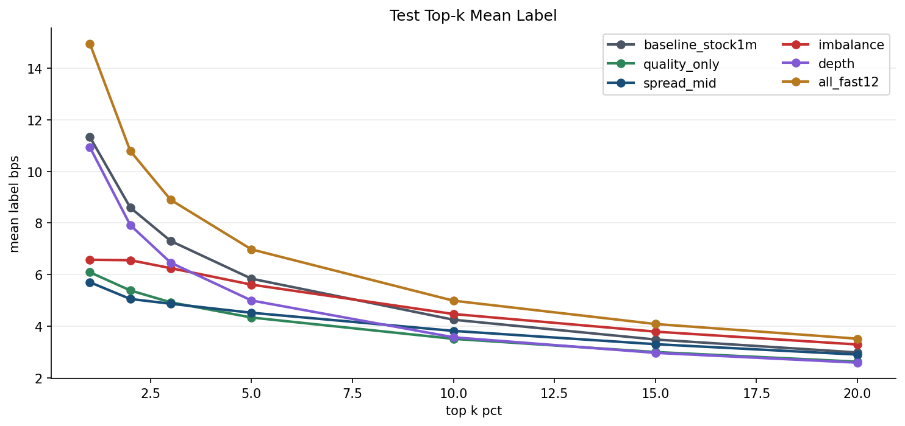

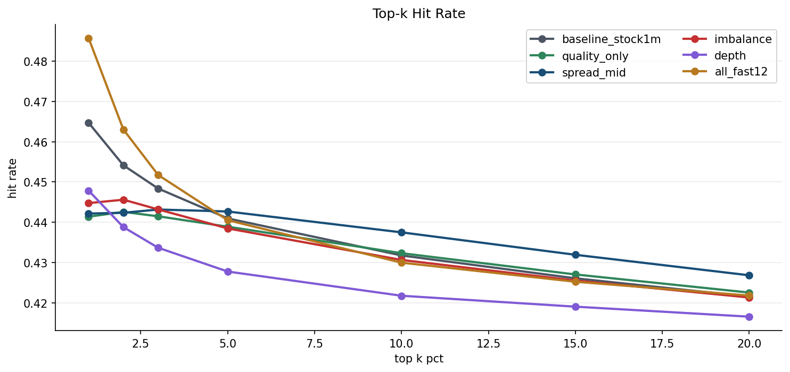

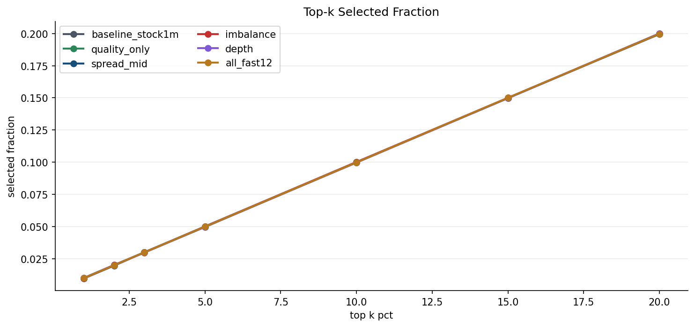

| experiment | split | selection_method | k_pct | universe_count | selected_count | selected_fraction | prediction_threshold | mean_label_bps | median_label_bps | label_std_bps | hit_rate | day_count | timestamp_count |
| --- | --- | --- | --- | --- | --- | --- | --- | --- | --- | --- | --- | --- | --- |
| all_fast12 | test | approx_quantile_threshold | 1 | 176,945,440 | 1,733,375 | 0.98% | 0.001195 | 14.95 | 0.06 | 83.24 | 48.57% | 100 | 16,100 |
| all_fast12 | test | approx_quantile_threshold | 2 | 176,945,440 | 3,500,317 | 1.98% | 0.000915 | 10.79 | 0.00 | 72.87 | 46.30% | 100 | 16,100 |
| all_fast12 | test | approx_quantile_threshold | 3 | 176,945,440 | 5,288,303 | 2.99% | 0.000776 | 8.90 | 0.00 | 67.62 | 45.17% | 100 | 16,100 |
| all_fast12 | test | approx_quantile_threshold | 5 | 176,945,440 | 8,817,481 | 4.98% | 0.000625 | 6.98 | 0.00 | 61.55 | 44.05% | 100 | 16,100 |
| all_fast12 | test | approx_quantile_threshold | 10 | 176,945,440 | 17,660,747 | 9.98% | 0.000448 | 4.99 | 0.00 | 54.17 | 43.00% | 100 | 16,100 |
| all_fast12 | test | approx_quantile_threshold | 15 | 176,945,440 | 26,544,655 | 15.00% | 0.000350 | 4.09 | 0.00 | 50.41 | 42.52% | 100 | 16,100 |
| all_fast12 | test | approx_quantile_threshold | 20 | 176,945,440 | 35,348,993 | 19.98% | 0.000281 | 3.52 | 0.00 | 48.04 | 42.18% | 100 | 16,100 |
| all_fast12 | train | approx_quantile_threshold | 1 | 7,968,768 | 78,446 | 0.98% | 0.001311 | 18.50 | 9.34 | 80.58 | 52.11% | 12 | 1,932 |
| all_fast12 | train | approx_quantile_threshold | 2 | 7,968,768 | 158,295 | 1.99% | 0.000990 | 14.06 | 2.23 | 72.25 | 49.84% | 12 | 1,932 |
| all_fast12 | train | approx_quantile_threshold | 3 | 7,968,768 | 235,619 | 2.96% | 0.000840 | 12.00 | 0.15 | 68.18 | 48.62% | 12 | 1,932 |
| all_fast12 | train | approx_quantile_threshold | 5 | 7,968,768 | 398,343 | 5.00% | 0.000671 | 9.65 | 0.01 | 63.06 | 47.12% | 12 | 1,932 |
| all_fast12 | train | approx_quantile_threshold | 10 | 7,968,768 | 796,311 | 9.99% | 0.000477 | 7.33 | 0.00 | 56.92 | 45.60% | 12 | 1,932 |
| all_fast12 | train | approx_quantile_threshold | 15 | 7,968,768 | 1,193,629 | 14.98% | 0.000371 | 6.16 | 0.00 | 53.79 | 44.79% | 12 | 1,932 |
| all_fast12 | train | approx_quantile_threshold | 20 | 7,968,768 | 1,593,266 | 19.99% | 0.000295 | 5.36 | 0.00 | 51.75 | 44.17% | 12 | 1,932 |
| baseline_stock1m | test | approx_quantile_threshold | 1 | 176,945,440 | 1,756,562 | 0.99% | 0.001736 | 11.33 | 0.00 | 92.15 | 46.47% | 100 | 16,100 |
| baseline_stock1m | test | approx_quantile_threshold | 2 | 176,945,440 | 3,535,881 | 2.00% | 0.001234 | 8.60 | 0.00 | 79.89 | 45.41% | 100 | 16,100 |
| baseline_stock1m | test | approx_quantile_threshold | 3 | 176,945,440 | 5,280,429 | 2.98% | 0.001002 | 7.30 | 0.00 | 73.38 | 44.84% | 100 | 16,100 |
| baseline_stock1m | test | approx_quantile_threshold | 5 | 176,945,440 | 8,844,789 | 5.00% | 0.000773 | 5.84 | 0.00 | 65.18 | 44.10% | 100 | 16,100 |
| baseline_stock1m | test | approx_quantile_threshold | 10 | 176,945,440 | 17,684,146 | 9.99% | 0.000528 | 4.26 | 0.00 | 55.96 | 43.18% | 100 | 16,100 |
| baseline_stock1m | test | approx_quantile_threshold | 15 | 176,945,440 | 26,509,820 | 14.98% | 0.000394 | 3.49 | 0.00 | 51.67 | 42.61% | 100 | 16,100 |
| baseline_stock1m | test | approx_quantile_threshold | 20 | 176,945,440 | 35,400,810 | 20.01% | 0.000298 | 2.99 | 0.00 | 48.95 | 42.16% | 100 | 16,100 |
| baseline_stock1m | train | approx_quantile_threshold | 1 | 562,449,686 | 5,490,515 | 0.98% | 0.001923 | 35.10 | 24.29 | 106.30 | 61.70% | 125 | 20,243 |
| baseline_stock1m | train | approx_quantile_threshold | 2 | 562,449,686 | 11,130,959 | 1.98% | 0.001309 | 25.19 | 16.22 | 89.92 | 57.25% | 125 | 20,243 |
| baseline_stock1m | train | approx_quantile_threshold | 3 | 562,449,686 | 16,737,462 | 2.98% | 0.001038 | 20.70 | 12.32 | 81.60 | 55.04% | 125 | 20,243 |
| baseline_stock1m | train | approx_quantile_threshold | 5 | 562,449,686 | 28,090,410 | 4.99% | 0.000783 | 15.95 | 7.45 | 71.53 | 52.36% | 125 | 20,243 |
| baseline_stock1m | train | approx_quantile_threshold | 10 | 562,449,686 | 56,297,370 | 10.01% | 0.000522 | 11.14 | 0.63 | 60.32 | 49.13% | 125 | 20,243 |
| baseline_stock1m | train | approx_quantile_threshold | 15 | 562,449,686 | 84,341,299 | 15.00% | 0.000385 | 8.91 | 0.00 | 55.08 | 47.30% | 125 | 20,243 |
| baseline_stock1m | train | approx_quantile_threshold | 20 | 562,449,686 | 112,339,073 | 19.97% | 0.000288 | 7.54 | 0.00 | 51.81 | 46.02% | 125 | 20,243 |
| depth | test | approx_quantile_threshold | 1 | 176,945,440 | 1,733,367 | 0.98% | 0.000935 | 10.93 | 0.00 | 82.02 | 44.79% | 100 | 16,099 |
| depth | test | approx_quantile_threshold | 2 | 176,945,440 | 3,502,851 | 1.98% | 0.000699 | 7.92 | 0.00 | 71.38 | 43.88% | 100 | 16,100 |
| depth | test | approx_quantile_threshold | 3 | 176,945,440 | 5,264,998 | 2.98% | 0.000589 | 6.46 | 0.00 | 66.18 | 43.37% | 100 | 16,100 |
| depth | test | approx_quantile_threshold | 5 | 176,945,440 | 8,793,802 | 4.97% | 0.000475 | 5.00 | 0.00 | 60.36 | 42.78% | 100 | 16,100 |
| depth | test | approx_quantile_threshold | 10 | 176,945,440 | 17,634,304 | 9.97% | 0.000344 | 3.58 | 0.00 | 53.25 | 42.18% | 100 | 16,100 |
| depth | test | approx_quantile_threshold | 15 | 176,945,440 | 26,509,132 | 14.98% | 0.000272 | 2.97 | 0.00 | 49.60 | 41.91% | 100 | 16,100 |
| depth | test | approx_quantile_threshold | 20 | 176,945,440 | 35,372,152 | 19.99% | 0.000219 | 2.59 | 0.00 | 47.31 | 41.66% | 100 | 16,100 |
| depth | train | approx_quantile_threshold | 1 | 7,968,768 | 79,247 | 0.99% | 0.000976 | 13.69 | 0.00 | 75.27 | 47.43% | 12 | 1,932 |
| depth | train | approx_quantile_threshold | 2 | 7,968,768 | 157,299 | 1.97% | 0.000738 | 10.39 | 0.00 | 68.40 | 46.25% | 12 | 1,932 |
| depth | train | approx_quantile_threshold | 3 | 7,968,768 | 237,297 | 2.98% | 0.000621 | 8.71 | 0.00 | 64.88 | 45.65% | 12 | 1,932 |
| depth | train | approx_quantile_threshold | 5 | 7,968,768 | 396,976 | 4.98% | 0.000499 | 7.02 | 0.00 | 60.80 | 44.95% | 12 | 1,932 |
| depth | train | approx_quantile_threshold | 10 | 7,968,768 | 795,402 | 9.98% | 0.000361 | 5.31 | 0.00 | 55.67 | 44.18% | 12 | 1,932 |
| depth | train | approx_quantile_threshold | 15 | 7,968,768 | 1,198,179 | 15.04% | 0.000284 | 4.45 | 0.00 | 52.81 | 43.57% | 12 | 1,932 |
| depth | train | approx_quantile_threshold | 20 | 7,968,768 | 1,594,903 | 20.01% | 0.000228 | 3.87 | 0.00 | 50.94 | 43.00% | 12 | 1,932 |
| imbalance | test | approx_quantile_threshold | 1 | 176,945,440 | 1,706,267 | 0.96% | 0.003160 | 6.58 | 0.00 | 99.17 | 44.48% | 100 | 16,100 |
| imbalance | test | approx_quantile_threshold | 2 | 176,945,440 | 3,533,260 | 2.00% | 0.001885 | 6.56 | 0.00 | 84.81 | 44.56% | 100 | 16,100 |
| imbalance | test | approx_quantile_threshold | 3 | 176,945,440 | 5,255,409 | 2.97% | 0.001479 | 6.25 | 0.00 | 77.12 | 44.32% | 100 | 16,100 |
| imbalance | test | approx_quantile_threshold | 5 | 176,945,440 | 8,832,143 | 4.99% | 0.001095 | 5.61 | 0.00 | 68.08 | 43.85% | 100 | 16,100 |
| imbalance | test | approx_quantile_threshold | 10 | 176,945,440 | 17,710,801 | 10.01% | 0.000699 | 4.48 | 0.00 | 57.85 | 43.07% | 100 | 16,100 |
| imbalance | test | approx_quantile_threshold | 15 | 176,945,440 | 26,545,879 | 15.00% | 0.000510 | 3.79 | 0.00 | 52.71 | 42.56% | 100 | 16,100 |
| imbalance | test | approx_quantile_threshold | 20 | 176,945,440 | 35,375,956 | 19.99% | 0.000393 | 3.30 | 0.00 | 49.32 | 42.13% | 100 | 16,100 |
| imbalance | train | approx_quantile_threshold | 1 | 7,968,768 | 77,076 | 0.97% | 0.005133 | 124.82 | 102.17 | 118.13 | 92.16% | 12 | 1,932 |
| imbalance | train | approx_quantile_threshold | 2 | 7,968,768 | 156,310 | 1.96% | 0.002847 | 81.89 | 63.56 | 102.29 | 82.38% | 12 | 1,932 |
| imbalance | train | approx_quantile_threshold | 3 | 7,968,768 | 237,258 | 2.98% | 0.002020 | 62.58 | 46.63 | 93.47 | 75.47% | 12 | 1,932 |
| imbalance | train | approx_quantile_threshold | 5 | 7,968,768 | 395,572 | 4.96% | 0.001376 | 44.49 | 30.95 | 83.01 | 67.53% | 12 | 1,932 |
| imbalance | train | approx_quantile_threshold | 10 | 7,968,768 | 795,898 | 9.99% | 0.000813 | 27.52 | 16.77 | 69.75 | 58.77% | 12 | 1,932 |
| imbalance | train | approx_quantile_threshold | 15 | 7,968,768 | 1,193,052 | 14.97% | 0.000565 | 20.73 | 10.83 | 62.92 | 54.67% | 12 | 1,932 |
| imbalance | train | approx_quantile_threshold | 20 | 7,968,768 | 1,593,554 | 20.00% | 0.000414 | 16.85 | 6.57 | 58.43 | 52.11% | 12 | 1,932 |
| quality_only | test | approx_quantile_threshold | 1 | 176,945,440 | 1,702,575 | 0.96% | 0.002755 | 6.09 | 0.00 | 97.32 | 44.14% | 100 | 16,100 |
| quality_only | test | approx_quantile_threshold | 2 | 176,945,440 | 3,484,949 | 1.97% | 0.001652 | 5.39 | 0.00 | 83.04 | 44.26% | 100 | 16,100 |
| quality_only | test | approx_quantile_threshold | 3 | 176,945,440 | 5,285,700 | 2.99% | 0.001267 | 4.93 | 0.00 | 75.38 | 44.15% | 100 | 16,100 |
| quality_only | test | approx_quantile_threshold | 5 | 176,945,440 | 8,772,348 | 4.96% | 0.000926 | 4.34 | 0.00 | 66.83 | 43.89% | 100 | 16,100 |
| quality_only | test | approx_quantile_threshold | 10 | 176,945,440 | 17,680,957 | 9.99% | 0.000592 | 3.52 | 0.00 | 56.64 | 43.23% | 100 | 16,100 |
| quality_only | test | approx_quantile_threshold | 15 | 176,945,440 | 26,510,481 | 14.98% | 0.000437 | 3.00 | 0.00 | 51.74 | 42.71% | 100 | 16,100 |
| quality_only | test | approx_quantile_threshold | 20 | 176,945,440 | 35,366,804 | 19.99% | 0.000333 | 2.63 | 0.00 | 48.69 | 42.26% | 100 | 16,100 |
| quality_only | train | approx_quantile_threshold | 1 | 7,968,768 | 77,930 | 0.98% | 0.005001 | 120.02 | 97.13 | 117.57 | 91.34% | 12 | 1,932 |
| quality_only | train | approx_quantile_threshold | 2 | 7,968,768 | 157,429 | 1.98% | 0.002827 | 79.02 | 60.65 | 101.59 | 81.90% | 12 | 1,932 |
| quality_only | train | approx_quantile_threshold | 3 | 7,968,768 | 237,022 | 2.97% | 0.002035 | 60.98 | 45.13 | 92.67 | 75.56% | 12 | 1,932 |
| quality_only | train | approx_quantile_threshold | 5 | 7,968,768 | 396,190 | 4.97% | 0.001359 | 43.58 | 30.67 | 82.27 | 68.11% | 12 | 1,932 |
| quality_only | train | approx_quantile_threshold | 10 | 7,968,768 | 794,788 | 9.97% | 0.000768 | 27.12 | 17.01 | 69.44 | 59.50% | 12 | 1,932 |
| quality_only | train | approx_quantile_threshold | 15 | 7,968,768 | 1,195,783 | 15.01% | 0.000531 | 20.30 | 11.20 | 62.66 | 55.21% | 12 | 1,932 |
| quality_only | train | approx_quantile_threshold | 20 | 7,968,768 | 1,594,221 | 20.01% | 0.000388 | 16.48 | 6.87 | 58.37 | 52.48% | 12 | 1,932 |
| spread_mid | test | approx_quantile_threshold | 1 | 176,945,440 | 1,700,218 | 0.96% | 0.003709 | 5.71 | 0.00 | 102.18 | 44.22% | 100 | 16,100 |
| spread_mid | test | approx_quantile_threshold | 2 | 176,945,440 | 3,454,177 | 1.95% | 0.001997 | 5.06 | 0.00 | 88.49 | 44.24% | 100 | 16,100 |
| spread_mid | test | approx_quantile_threshold | 3 | 176,945,440 | 5,298,270 | 2.99% | 0.001464 | 4.87 | 0.00 | 79.93 | 44.32% | 100 | 16,100 |
| spread_mid | test | approx_quantile_threshold | 5 | 176,945,440 | 8,819,010 | 4.98% | 0.001047 | 4.53 | 0.00 | 70.40 | 44.27% | 100 | 16,100 |
| spread_mid | test | approx_quantile_threshold | 10 | 176,945,440 | 17,656,705 | 9.98% | 0.000649 | 3.82 | 0.00 | 59.39 | 43.75% | 100 | 16,100 |
| spread_mid | test | approx_quantile_threshold | 15 | 176,945,440 | 26,530,054 | 14.99% | 0.000467 | 3.31 | 0.00 | 53.83 | 43.19% | 100 | 16,100 |
| spread_mid | test | approx_quantile_threshold | 20 | 176,945,440 | 35,314,760 | 19.96% | 0.000352 | 2.91 | 0.00 | 50.36 | 42.68% | 100 | 16,100 |
| spread_mid | train | approx_quantile_threshold | 1 | 7,968,768 | 78,056 | 0.98% | 0.005559 | 131.19 | 107.33 | 117.47 | 94.30% | 12 | 1,932 |
| spread_mid | train | approx_quantile_threshold | 2 | 7,968,768 | 157,421 | 1.98% | 0.003096 | 86.73 | 67.77 | 102.33 | 85.11% | 12 | 1,932 |
| spread_mid | train | approx_quantile_threshold | 3 | 7,968,768 | 237,856 | 2.98% | 0.002179 | 66.63 | 50.39 | 93.75 | 78.22% | 12 | 1,932 |
| spread_mid | train | approx_quantile_threshold | 5 | 7,968,768 | 394,925 | 4.96% | 0.001440 | 47.46 | 33.96 | 83.67 | 69.95% | 12 | 1,932 |
| spread_mid | train | approx_quantile_threshold | 10 | 7,968,768 | 795,822 | 9.99% | 0.000816 | 29.21 | 18.56 | 70.41 | 60.61% | 12 | 1,932 |
| spread_mid | train | approx_quantile_threshold | 15 | 7,968,768 | 1,197,486 | 15.03% | 0.000554 | 21.81 | 12.27 | 63.49 | 56.14% | 12 | 1,932 |
| spread_mid | train | approx_quantile_threshold | 20 | 7,968,768 | 1,594,624 | 20.01% | 0.000398 | 17.59 | 8.04 | 59.06 | 53.22% | 12 | 1,932 |

### 4. Important Stock Pool And Liquidity

### 4.1. Important Stock Pool

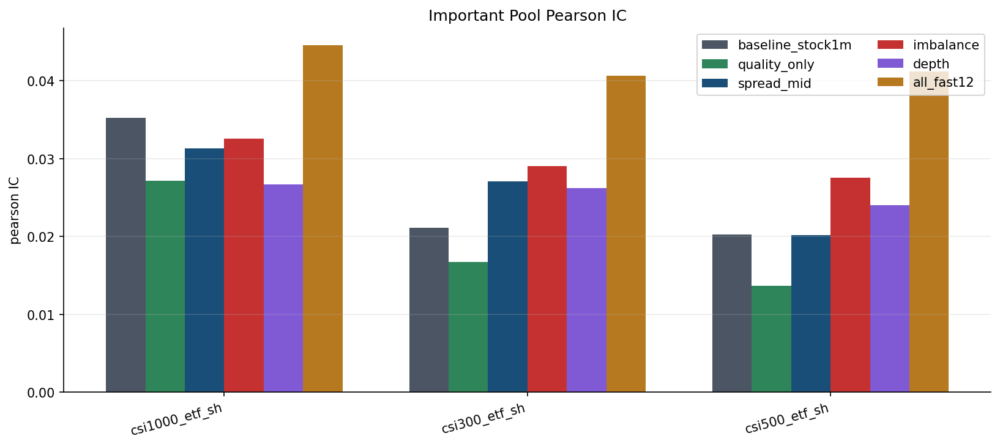

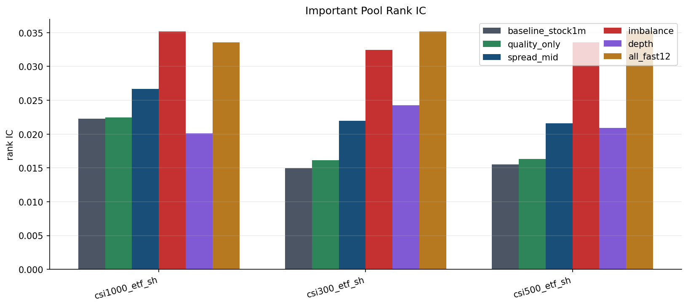

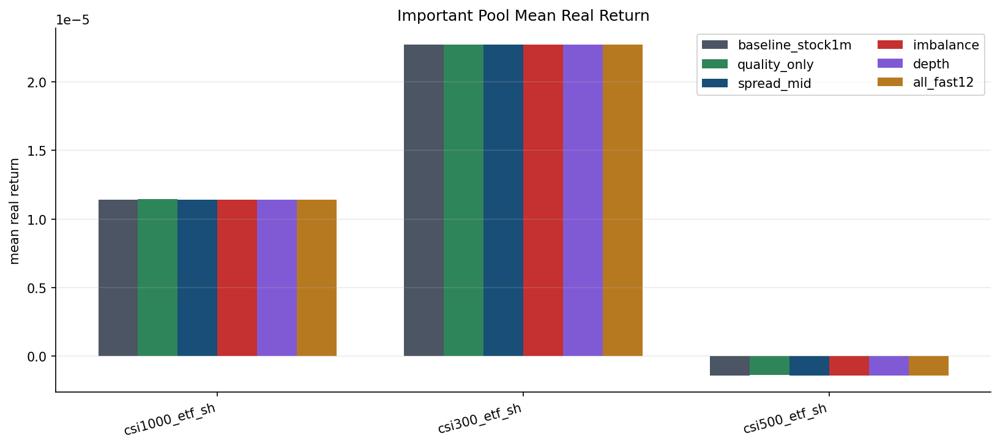

| experiment | pool | display_name | etf_code | index_code | pearson_ic | rank_ic | count |
| --- | --- | --- | --- | --- | --- | --- | --- |
| all_fast12 | csi1000_etf_sh | 1000 ETF | 512100.SH | 000852.SH | 0.0446 | 0.0336 | 33,009,991 |
| baseline_stock1m | csi1000_etf_sh | 1000 ETF | 512100.SH | 000852.SH | 0.0353 | 0.0223 | 33,009,991 |
| depth | csi1000_etf_sh | 1000 ETF | 512100.SH | 000852.SH | 0.0267 | 0.0201 | 33,009,991 |
| imbalance | csi1000_etf_sh | 1000 ETF | 512100.SH | 000852.SH | 0.0325 | 0.0351 | 33,009,991 |
| quality_only | csi1000_etf_sh | 1000 ETF | 512100.SH | 000852.SH | 0.0272 | 0.0225 | 33,009,991 |
| spread_mid | csi1000_etf_sh | 1000 ETF | 512100.SH | 000852.SH | 0.0313 | 0.0267 | 33,009,991 |
| all_fast12 | csi300_etf_sh | 沪深300 ETF（沪） | 510300.SH | 000300.SH | 0.0406 | 0.0352 | 9,903,593 |
| baseline_stock1m | csi300_etf_sh | 沪深300 ETF（沪） | 510300.SH | 000300.SH | 0.0211 | 0.0149 | 9,903,593 |
| depth | csi300_etf_sh | 沪深300 ETF（沪） | 510300.SH | 000300.SH | 0.0262 | 0.0243 | 9,903,593 |
| imbalance | csi300_etf_sh | 沪深300 ETF（沪） | 510300.SH | 000300.SH | 0.0290 | 0.0325 | 9,903,593 |
| quality_only | csi300_etf_sh | 沪深300 ETF（沪） | 510300.SH | 000300.SH | 0.0167 | 0.0161 | 9,903,593 |
| spread_mid | csi300_etf_sh | 沪深300 ETF（沪） | 510300.SH | 000300.SH | 0.0271 | 0.0219 | 9,903,593 |
| all_fast12 | csi500_etf_sh | 中证500 ETF（沪） | 510500.SH | 000905.SH | 0.0412 | 0.0352 | 16,505,559 |
| baseline_stock1m | csi500_etf_sh | 中证500 ETF（沪） | 510500.SH | 000905.SH | 0.0202 | 0.0155 | 16,505,559 |
| depth | csi500_etf_sh | 中证500 ETF（沪） | 510500.SH | 000905.SH | 0.0240 | 0.0209 | 16,505,559 |
| imbalance | csi500_etf_sh | 中证500 ETF（沪） | 510500.SH | 000905.SH | 0.0275 | 0.0336 | 16,505,559 |
| quality_only | csi500_etf_sh | 中证500 ETF（沪） | 510500.SH | 000905.SH | 0.0137 | 0.0163 | 16,505,559 |
| spread_mid | csi500_etf_sh | 中证500 ETF（沪） | 510500.SH | 000905.SH | 0.0201 | 0.0216 | 16,505,559 |

### 4.2. Important Pool Prediction Curve

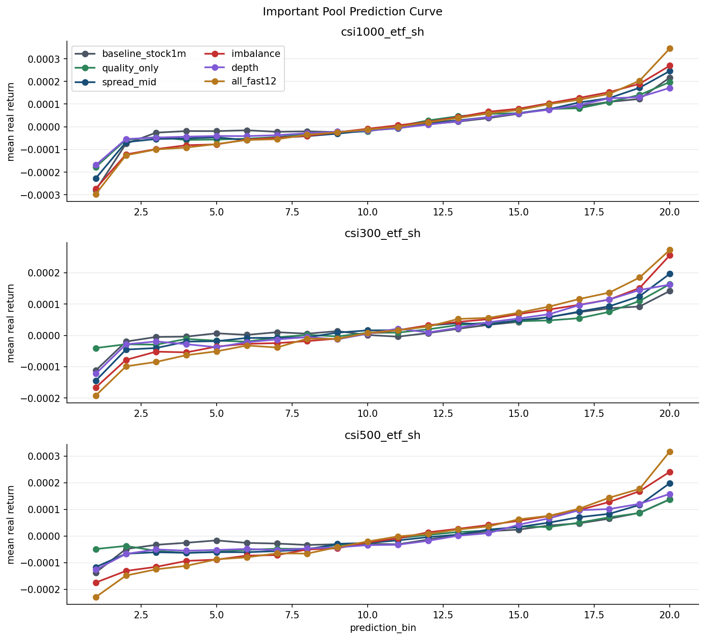

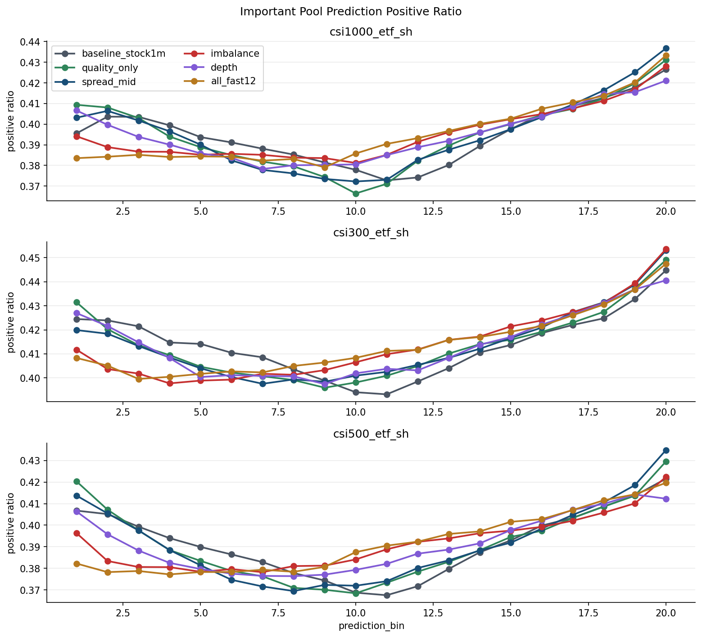

| experiment | pool | prediction_bin | mean_prediction_return | mean_real_return | real_return_positive_ratio | count |
| --- | --- | --- | --- | --- | --- | --- |
| all_fast12 | csi1000_etf_sh | 1 | -0.000748 | -0.000297 | 38.35% | 1,650,361 |
| all_fast12 | csi1000_etf_sh | 2 | -0.000427 | -0.000126 | 38.42% | 1,650,361 |
| all_fast12 | csi1000_etf_sh | 3 | -0.000326 | -0.000100 | 38.51% | 1,650,361 |
| all_fast12 | csi1000_etf_sh | 4 | -0.000257 | -0.000092 | 38.41% | 1,650,361 |
| all_fast12 | csi1000_etf_sh | 5 | -0.000202 | -0.000076 | 38.43% | 1,650,360 |
| all_fast12 | csi1000_etf_sh | 6 | -0.000156 | -0.000058 | 38.42% | 1,650,360 |
| all_fast12 | csi1000_etf_sh | 7 | -0.000114 | -0.000055 | 38.23% | 1,650,360 |
| all_fast12 | csi1000_etf_sh | 8 | -0.000076 | -0.000035 | 38.31% | 1,650,360 |
| all_fast12 | csi1000_etf_sh | 9 | -0.000040 | -0.000024 | 37.91% | 1,650,360 |
| all_fast12 | csi1000_etf_sh | 10 | -0.000005 | -0.000012 | 38.58% | 1,650,360 |
| all_fast12 | csi1000_etf_sh | 11 | 0.000030 | 0.000000 | 39.04% | 1,650,360 |
| all_fast12 | csi1000_etf_sh | 12 | 0.000065 | 0.000020 | 39.32% | 1,650,360 |
| all_fast12 | csi1000_etf_sh | 13 | 0.000101 | 0.000039 | 39.67% | 1,650,360 |
| all_fast12 | csi1000_etf_sh | 14 | 0.000139 | 0.000059 | 40.01% | 1,650,360 |
| all_fast12 | csi1000_etf_sh | 15 | 0.000179 | 0.000074 | 40.27% | 1,650,360 |
| all_fast12 | csi1000_etf_sh | 16 | 0.000225 | 0.000100 | 40.75% | 1,650,360 |
| all_fast12 | csi1000_etf_sh | 17 | 0.000278 | 0.000119 | 41.05% | 1,650,360 |
| all_fast12 | csi1000_etf_sh | 18 | 0.000344 | 0.000145 | 41.38% | 1,650,360 |
| all_fast12 | csi1000_etf_sh | 19 | 0.000442 | 0.000203 | 42.02% | 1,650,360 |
| all_fast12 | csi1000_etf_sh | 20 | 0.000743 | 0.000345 | 43.33% | 1,650,360 |
| baseline_stock1m | csi1000_etf_sh | 1 | -0.001165 | -0.000280 | 39.55% | 1,650,374 |
| baseline_stock1m | csi1000_etf_sh | 2 | -0.000559 | -0.000075 | 40.36% | 1,650,374 |
| baseline_stock1m | csi1000_etf_sh | 3 | -0.000431 | -0.000026 | 40.35% | 1,650,374 |
| baseline_stock1m | csi1000_etf_sh | 4 | -0.000349 | -0.000019 | 39.94% | 1,650,374 |
| baseline_stock1m | csi1000_etf_sh | 5 | -0.000285 | -0.000019 | 39.37% | 1,650,374 |
| baseline_stock1m | csi1000_etf_sh | 6 | -0.000230 | -0.000016 | 39.11% | 1,650,374 |
| baseline_stock1m | csi1000_etf_sh | 7 | -0.000181 | -0.000022 | 38.81% | 1,650,374 |
| baseline_stock1m | csi1000_etf_sh | 8 | -0.000134 | -0.000020 | 38.52% | 1,650,374 |
| baseline_stock1m | csi1000_etf_sh | 9 | -0.000090 | -0.000023 | 38.14% | 1,650,374 |
| baseline_stock1m | csi1000_etf_sh | 10 | -0.000049 | -0.000013 | 37.79% | 1,650,374 |
| baseline_stock1m | csi1000_etf_sh | 11 | -0.000012 | -0.000007 | 37.27% | 1,650,374 |
| baseline_stock1m | csi1000_etf_sh | 12 | 0.000027 | 0.000012 | 37.42% | 1,650,374 |
| baseline_stock1m | csi1000_etf_sh | 13 | 0.000068 | 0.000023 | 38.02% | 1,650,374 |
| baseline_stock1m | csi1000_etf_sh | 14 | 0.000115 | 0.000038 | 38.94% | 1,650,374 |
| baseline_stock1m | csi1000_etf_sh | 15 | 0.000168 | 0.000057 | 39.76% | 1,650,374 |
| baseline_stock1m | csi1000_etf_sh | 16 | 0.000230 | 0.000079 | 40.47% | 1,650,373 |
| baseline_stock1m | csi1000_etf_sh | 17 | 0.000306 | 0.000091 | 40.88% | 1,650,373 |
| baseline_stock1m | csi1000_etf_sh | 18 | 0.000405 | 0.000110 | 41.28% | 1,650,373 |
| baseline_stock1m | csi1000_etf_sh | 19 | 0.000555 | 0.000123 | 41.77% | 1,650,373 |
| baseline_stock1m | csi1000_etf_sh | 20 | 0.001118 | 0.000217 | 42.65% | 1,650,373 |
| depth | csi1000_etf_sh | 1 | -0.000598 | -0.000169 | 40.66% | 1,650,311 |
| depth | csi1000_etf_sh | 2 | -0.000323 | -0.000054 | 39.97% | 1,650,311 |
| depth | csi1000_etf_sh | 3 | -0.000242 | -0.000048 | 39.38% | 1,650,311 |
| depth | csi1000_etf_sh | 4 | -0.000188 | -0.000044 | 39.01% | 1,650,311 |
| depth | csi1000_etf_sh | 5 | -0.000146 | -0.000041 | 38.58% | 1,650,311 |
| depth | csi1000_etf_sh | 6 | -0.000111 | -0.000041 | 38.37% | 1,650,311 |
| depth | csi1000_etf_sh | 7 | -0.000079 | -0.000037 | 37.83% | 1,650,311 |
| depth | csi1000_etf_sh | 8 | -0.000050 | -0.000028 | 38.01% | 1,650,311 |
| depth | csi1000_etf_sh | 9 | -0.000023 | -0.000021 | 38.02% | 1,650,311 |
| depth | csi1000_etf_sh | 10 | 0.000004 | -0.000017 | 38.05% | 1,650,311 |
| depth | csi1000_etf_sh | 11 | 0.000031 | -0.000005 | 38.50% | 1,650,311 |
| depth | csi1000_etf_sh | 12 | 0.000058 | 0.000009 | 38.88% | 1,650,311 |
| depth | csi1000_etf_sh | 13 | 0.000086 | 0.000025 | 39.19% | 1,650,311 |
| depth | csi1000_etf_sh | 14 | 0.000116 | 0.000043 | 39.60% | 1,650,311 |
| depth | csi1000_etf_sh | 15 | 0.000148 | 0.000059 | 40.03% | 1,650,311 |
| depth | csi1000_etf_sh | 16 | 0.000184 | 0.000075 | 40.37% | 1,650,311 |
| depth | csi1000_etf_sh | 17 | 0.000225 | 0.000095 | 40.86% | 1,650,311 |
| depth | csi1000_etf_sh | 18 | 0.000276 | 0.000126 | 41.46% | 1,650,311 |
| depth | csi1000_etf_sh | 19 | 0.000350 | 0.000131 | 41.55% | 1,650,311 |
| depth | csi1000_etf_sh | 20 | 0.000574 | 0.000171 | 42.11% | 1,650,311 |
| imbalance | csi1000_etf_sh | 1 | -0.001965 | -0.000273 | 39.41% | 1,650,444 |
| imbalance | csi1000_etf_sh | 2 | -0.000728 | -0.000122 | 38.89% | 1,650,444 |
| imbalance | csi1000_etf_sh | 3 | -0.000533 | -0.000098 | 38.67% | 1,650,444 |
| imbalance | csi1000_etf_sh | 4 | -0.000416 | -0.000081 | 38.66% | 1,650,444 |
| imbalance | csi1000_etf_sh | 5 | -0.000323 | -0.000078 | 38.52% | 1,650,444 |
| imbalance | csi1000_etf_sh | 6 | -0.000244 | -0.000056 | 38.56% | 1,650,444 |
| imbalance | csi1000_etf_sh | 7 | -0.000179 | -0.000049 | 38.51% | 1,650,444 |
| imbalance | csi1000_etf_sh | 8 | -0.000123 | -0.000040 | 38.38% | 1,650,444 |
| imbalance | csi1000_etf_sh | 9 | -0.000073 | -0.000024 | 38.35% | 1,650,444 |
| imbalance | csi1000_etf_sh | 10 | -0.000025 | -0.000009 | 38.12% | 1,650,444 |
| imbalance | csi1000_etf_sh | 11 | 0.000022 | 0.000006 | 38.51% | 1,650,443 |
| imbalance | csi1000_etf_sh | 12 | 0.000072 | 0.000022 | 39.14% | 1,650,443 |
| imbalance | csi1000_etf_sh | 13 | 0.000125 | 0.000042 | 39.61% | 1,650,443 |
| imbalance | csi1000_etf_sh | 14 | 0.000181 | 0.000066 | 39.97% | 1,650,443 |
| imbalance | csi1000_etf_sh | 15 | 0.000242 | 0.000080 | 40.24% | 1,650,443 |
| imbalance | csi1000_etf_sh | 16 | 0.000311 | 0.000104 | 40.49% | 1,650,443 |
| imbalance | csi1000_etf_sh | 17 | 0.000395 | 0.000127 | 40.76% | 1,650,443 |
| imbalance | csi1000_etf_sh | 18 | 0.000511 | 0.000153 | 41.13% | 1,650,443 |
| imbalance | csi1000_etf_sh | 19 | 0.000715 | 0.000189 | 41.68% | 1,650,443 |
| imbalance | csi1000_etf_sh | 20 | 0.002037 | 0.000269 | 42.81% | 1,650,443 |
| quality_only | csi1000_etf_sh | 1 | -0.001895 | -0.000177 | 40.94% | 1,650,337 |
| quality_only | csi1000_etf_sh | 2 | -0.000680 | -0.000058 | 40.81% | 1,650,337 |
| quality_only | csi1000_etf_sh | 3 | -0.000459 | -0.000046 | 40.30% | 1,650,337 |
| quality_only | csi1000_etf_sh | 4 | -0.000347 | -0.000058 | 39.40% | 1,650,337 |
| quality_only | csi1000_etf_sh | 5 | -0.000270 | -0.000056 | 38.88% | 1,650,337 |
| quality_only | csi1000_etf_sh | 6 | -0.000206 | -0.000052 | 38.50% | 1,650,337 |
| quality_only | csi1000_etf_sh | 7 | -0.000152 | -0.000045 | 38.18% | 1,650,337 |
| quality_only | csi1000_etf_sh | 8 | -0.000104 | -0.000033 | 37.95% | 1,650,337 |
| quality_only | csi1000_etf_sh | 9 | -0.000060 | -0.000025 | 37.43% | 1,650,337 |
| quality_only | csi1000_etf_sh | 10 | -0.000019 | -0.000021 | 36.64% | 1,650,337 |
| quality_only | csi1000_etf_sh | 11 | 0.000021 | 0.000002 | 37.11% | 1,650,337 |
| quality_only | csi1000_etf_sh | 12 | 0.000062 | 0.000028 | 38.23% | 1,650,337 |
| quality_only | csi1000_etf_sh | 13 | 0.000106 | 0.000047 | 38.96% | 1,650,336 |
| quality_only | csi1000_etf_sh | 14 | 0.000157 | 0.000057 | 39.60% | 1,650,336 |
| quality_only | csi1000_etf_sh | 15 | 0.000213 | 0.000060 | 40.00% | 1,650,336 |
| quality_only | csi1000_etf_sh | 16 | 0.000279 | 0.000078 | 40.43% | 1,650,336 |
| quality_only | csi1000_etf_sh | 17 | 0.000360 | 0.000082 | 40.74% | 1,650,336 |
| quality_only | csi1000_etf_sh | 18 | 0.000470 | 0.000109 | 41.25% | 1,650,336 |
| quality_only | csi1000_etf_sh | 19 | 0.000655 | 0.000140 | 41.97% | 1,650,336 |
| quality_only | csi1000_etf_sh | 20 | 0.001899 | 0.000197 | 43.11% | 1,650,336 |
| spread_mid | csi1000_etf_sh | 1 | -0.002127 | -0.000227 | 40.31% | 1,650,383 |
| spread_mid | csi1000_etf_sh | 2 | -0.000712 | -0.000068 | 40.64% | 1,650,383 |
| spread_mid | csi1000_etf_sh | 3 | -0.000502 | -0.000054 | 40.18% | 1,650,383 |
| spread_mid | csi1000_etf_sh | 4 | -0.000378 | -0.000052 | 39.65% | 1,650,383 |
| spread_mid | csi1000_etf_sh | 5 | -0.000289 | -0.000047 | 39.01% | 1,650,383 |
| spread_mid | csi1000_etf_sh | 6 | -0.000219 | -0.000059 | 38.24% | 1,650,383 |
| spread_mid | csi1000_etf_sh | 7 | -0.000162 | -0.000048 | 37.78% | 1,650,383 |
| spread_mid | csi1000_etf_sh | 8 | -0.000112 | -0.000041 | 37.61% | 1,650,383 |
| spread_mid | csi1000_etf_sh | 9 | -0.000067 | -0.000030 | 37.34% | 1,650,382 |
| spread_mid | csi1000_etf_sh | 10 | -0.000023 | -0.000017 | 37.22% | 1,650,382 |
| spread_mid | csi1000_etf_sh | 11 | 0.000019 | -0.000007 | 37.30% | 1,650,382 |
| spread_mid | csi1000_etf_sh | 12 | 0.000062 | 0.000018 | 38.27% | 1,650,382 |
| spread_mid | csi1000_etf_sh | 13 | 0.000108 | 0.000028 | 38.76% | 1,650,382 |
| spread_mid | csi1000_etf_sh | 14 | 0.000158 | 0.000043 | 39.22% | 1,650,382 |
| spread_mid | csi1000_etf_sh | 15 | 0.000214 | 0.000061 | 39.76% | 1,650,382 |
| spread_mid | csi1000_etf_sh | 16 | 0.000281 | 0.000078 | 40.34% | 1,650,382 |
| spread_mid | csi1000_etf_sh | 17 | 0.000364 | 0.000107 | 40.95% | 1,650,382 |
| spread_mid | csi1000_etf_sh | 18 | 0.000481 | 0.000126 | 41.64% | 1,650,382 |
| spread_mid | csi1000_etf_sh | 19 | 0.000682 | 0.000172 | 42.52% | 1,650,382 |
| spread_mid | csi1000_etf_sh | 20 | 0.002149 | 0.000246 | 43.68% | 1,650,382 |
| all_fast12 | csi300_etf_sh | 1 | -0.000526 | -0.000192 | 40.83% | 495,131 |
| all_fast12 | csi300_etf_sh | 2 | -0.000315 | -0.000099 | 40.51% | 495,131 |
| all_fast12 | csi300_etf_sh | 3 | -0.000236 | -0.000085 | 39.96% | 495,131 |
| all_fast12 | csi300_etf_sh | 4 | -0.000182 | -0.000063 | 40.05% | 495,131 |
| all_fast12 | csi300_etf_sh | 5 | -0.000137 | -0.000051 | 40.17% | 495,131 |
| all_fast12 | csi300_etf_sh | 6 | -0.000099 | -0.000032 | 40.27% | 495,131 |
| all_fast12 | csi300_etf_sh | 7 | -0.000064 | -0.000038 | 40.23% | 495,131 |
| all_fast12 | csi300_etf_sh | 8 | -0.000032 | -0.000010 | 40.50% | 495,131 |
| all_fast12 | csi300_etf_sh | 9 | -0.000001 | -0.000011 | 40.64% | 495,131 |
| all_fast12 | csi300_etf_sh | 10 | 0.000029 | 0.000008 | 40.84% | 495,131 |
| all_fast12 | csi300_etf_sh | 11 | 0.000059 | 0.000017 | 41.12% | 495,131 |
| all_fast12 | csi300_etf_sh | 12 | 0.000089 | 0.000028 | 41.17% | 495,131 |
| all_fast12 | csi300_etf_sh | 13 | 0.000120 | 0.000053 | 41.58% | 495,131 |
| all_fast12 | csi300_etf_sh | 14 | 0.000153 | 0.000056 | 41.70% | 495,131 |
| all_fast12 | csi300_etf_sh | 15 | 0.000187 | 0.000072 | 41.92% | 495,130 |
| all_fast12 | csi300_etf_sh | 16 | 0.000225 | 0.000092 | 42.16% | 495,130 |
| all_fast12 | csi300_etf_sh | 17 | 0.000269 | 0.000116 | 42.61% | 495,130 |
| all_fast12 | csi300_etf_sh | 18 | 0.000322 | 0.000137 | 43.05% | 495,130 |
| all_fast12 | csi300_etf_sh | 19 | 0.000397 | 0.000185 | 43.68% | 495,130 |
| all_fast12 | csi300_etf_sh | 20 | 0.000594 | 0.000273 | 44.75% | 495,130 |
| baseline_stock1m | csi300_etf_sh | 1 | -0.000852 | -0.000112 | 42.45% | 495,135 |
| baseline_stock1m | csi300_etf_sh | 2 | -0.000455 | -0.000020 | 42.39% | 495,135 |
| baseline_stock1m | csi300_etf_sh | 3 | -0.000347 | -0.000005 | 42.15% | 495,135 |
| baseline_stock1m | csi300_etf_sh | 4 | -0.000275 | -0.000004 | 41.47% | 495,135 |
| baseline_stock1m | csi300_etf_sh | 5 | -0.000217 | 0.000007 | 41.41% | 495,135 |
| baseline_stock1m | csi300_etf_sh | 6 | -0.000168 | 0.000002 | 41.04% | 495,135 |
| baseline_stock1m | csi300_etf_sh | 7 | -0.000125 | 0.000010 | 40.86% | 495,135 |
| baseline_stock1m | csi300_etf_sh | 8 | -0.000086 | 0.000006 | 40.36% | 495,135 |
| baseline_stock1m | csi300_etf_sh | 9 | -0.000053 | 0.000014 | 39.89% | 495,135 |
| baseline_stock1m | csi300_etf_sh | 10 | -0.000023 | 0.000001 | 39.41% | 495,135 |
| baseline_stock1m | csi300_etf_sh | 11 | 0.000008 | -0.000004 | 39.32% | 495,135 |
| baseline_stock1m | csi300_etf_sh | 12 | 0.000043 | 0.000007 | 39.85% | 495,135 |
| baseline_stock1m | csi300_etf_sh | 13 | 0.000082 | 0.000021 | 40.41% | 495,134 |
| baseline_stock1m | csi300_etf_sh | 14 | 0.000125 | 0.000034 | 41.06% | 495,134 |
| baseline_stock1m | csi300_etf_sh | 15 | 0.000173 | 0.000043 | 41.37% | 495,134 |
| baseline_stock1m | csi300_etf_sh | 16 | 0.000227 | 0.000058 | 41.87% | 495,134 |
| baseline_stock1m | csi300_etf_sh | 17 | 0.000291 | 0.000074 | 42.20% | 495,134 |
| baseline_stock1m | csi300_etf_sh | 18 | 0.000375 | 0.000087 | 42.48% | 495,134 |
| baseline_stock1m | csi300_etf_sh | 19 | 0.000500 | 0.000092 | 43.28% | 495,134 |
| baseline_stock1m | csi300_etf_sh | 20 | 0.000900 | 0.000142 | 44.47% | 495,134 |
| depth | csi300_etf_sh | 1 | -0.000430 | -0.000122 | 42.69% | 495,114 |
| depth | csi300_etf_sh | 2 | -0.000239 | -0.000028 | 42.16% | 495,114 |
| depth | csi300_etf_sh | 3 | -0.000173 | -0.000019 | 41.48% | 495,114 |
| depth | csi300_etf_sh | 4 | -0.000128 | -0.000028 | 40.83% | 495,114 |
| depth | csi300_etf_sh | 5 | -0.000093 | -0.000038 | 40.04% | 495,114 |
| depth | csi300_etf_sh | 6 | -0.000063 | -0.000022 | 40.11% | 495,114 |
| depth | csi300_etf_sh | 7 | -0.000037 | -0.000013 | 40.08% | 495,114 |
| depth | csi300_etf_sh | 8 | -0.000012 | -0.000005 | 40.07% | 495,114 |
| depth | csi300_etf_sh | 9 | 0.000011 | -0.000013 | 39.74% | 495,114 |
| depth | csi300_etf_sh | 10 | 0.000034 | 0.000005 | 40.19% | 495,113 |
| depth | csi300_etf_sh | 11 | 0.000057 | 0.000022 | 40.38% | 495,113 |
| depth | csi300_etf_sh | 12 | 0.000081 | 0.000010 | 40.31% | 495,113 |
| depth | csi300_etf_sh | 13 | 0.000106 | 0.000024 | 40.83% | 495,113 |
| depth | csi300_etf_sh | 14 | 0.000132 | 0.000042 | 41.38% | 495,113 |
| depth | csi300_etf_sh | 15 | 0.000160 | 0.000054 | 41.70% | 495,113 |
| depth | csi300_etf_sh | 16 | 0.000191 | 0.000068 | 42.22% | 495,113 |
| depth | csi300_etf_sh | 17 | 0.000227 | 0.000097 | 42.64% | 495,113 |
| depth | csi300_etf_sh | 18 | 0.000271 | 0.000115 | 43.12% | 495,113 |
| depth | csi300_etf_sh | 19 | 0.000330 | 0.000145 | 43.68% | 495,113 |
| depth | csi300_etf_sh | 20 | 0.000478 | 0.000162 | 44.06% | 495,113 |
| imbalance | csi300_etf_sh | 1 | -0.001283 | -0.000166 | 41.17% | 495,159 |
| imbalance | csi300_etf_sh | 2 | -0.000555 | -0.000078 | 40.37% | 495,159 |
| imbalance | csi300_etf_sh | 3 | -0.000409 | -0.000052 | 40.18% | 495,159 |
| imbalance | csi300_etf_sh | 4 | -0.000311 | -0.000054 | 39.77% | 495,159 |
| imbalance | csi300_etf_sh | 5 | -0.000234 | -0.000036 | 39.89% | 495,159 |
| imbalance | csi300_etf_sh | 6 | -0.000172 | -0.000027 | 39.93% | 495,159 |
| imbalance | csi300_etf_sh | 7 | -0.000120 | -0.000025 | 40.17% | 495,158 |
| imbalance | csi300_etf_sh | 8 | -0.000075 | -0.000018 | 40.13% | 495,158 |
| imbalance | csi300_etf_sh | 9 | -0.000033 | -0.000010 | 40.32% | 495,158 |
| imbalance | csi300_etf_sh | 10 | 0.000008 | 0.000006 | 40.65% | 495,158 |
| imbalance | csi300_etf_sh | 11 | 0.000050 | 0.000017 | 40.99% | 495,158 |
| imbalance | csi300_etf_sh | 12 | 0.000093 | 0.000032 | 41.18% | 495,158 |
| imbalance | csi300_etf_sh | 13 | 0.000137 | 0.000043 | 41.58% | 495,158 |
| imbalance | csi300_etf_sh | 14 | 0.000183 | 0.000052 | 41.72% | 495,158 |
| imbalance | csi300_etf_sh | 15 | 0.000233 | 0.000068 | 42.14% | 495,158 |
| imbalance | csi300_etf_sh | 16 | 0.000289 | 0.000083 | 42.39% | 495,158 |
| imbalance | csi300_etf_sh | 17 | 0.000356 | 0.000098 | 42.73% | 495,158 |
| imbalance | csi300_etf_sh | 18 | 0.000446 | 0.000115 | 43.11% | 495,158 |
| imbalance | csi300_etf_sh | 19 | 0.000597 | 0.000151 | 43.93% | 495,158 |
| imbalance | csi300_etf_sh | 20 | 0.001395 | 0.000256 | 45.35% | 495,158 |
| quality_only | csi300_etf_sh | 1 | -0.001329 | -0.000040 | 43.15% | 495,141 |
| quality_only | csi300_etf_sh | 2 | -0.000558 | -0.000028 | 42.03% | 495,141 |
| quality_only | csi300_etf_sh | 3 | -0.000386 | -0.000029 | 41.36% | 495,141 |
| quality_only | csi300_etf_sh | 4 | -0.000294 | -0.000011 | 40.95% | 495,141 |
| quality_only | csi300_etf_sh | 5 | -0.000223 | -0.000017 | 40.47% | 495,141 |
| quality_only | csi300_etf_sh | 6 | -0.000165 | -0.000020 | 40.22% | 495,141 |
| quality_only | csi300_etf_sh | 7 | -0.000114 | -0.000006 | 40.07% | 495,141 |
| quality_only | csi300_etf_sh | 8 | -0.000068 | 0.000002 | 39.91% | 495,141 |
| quality_only | csi300_etf_sh | 9 | -0.000027 | -0.000003 | 39.59% | 495,141 |
| quality_only | csi300_etf_sh | 10 | 0.000013 | 0.000008 | 39.81% | 495,141 |
| quality_only | csi300_etf_sh | 11 | 0.000052 | 0.000009 | 40.09% | 495,141 |
| quality_only | csi300_etf_sh | 12 | 0.000092 | 0.000019 | 40.49% | 495,141 |
| quality_only | csi300_etf_sh | 13 | 0.000135 | 0.000033 | 41.01% | 495,140 |
| quality_only | csi300_etf_sh | 14 | 0.000180 | 0.000041 | 41.40% | 495,140 |
| quality_only | csi300_etf_sh | 15 | 0.000230 | 0.000045 | 41.59% | 495,140 |
| quality_only | csi300_etf_sh | 16 | 0.000288 | 0.000048 | 41.92% | 495,140 |
| quality_only | csi300_etf_sh | 17 | 0.000358 | 0.000055 | 42.30% | 495,140 |
| quality_only | csi300_etf_sh | 18 | 0.000451 | 0.000075 | 42.75% | 495,140 |
| quality_only | csi300_etf_sh | 19 | 0.000605 | 0.000110 | 43.71% | 495,140 |
| quality_only | csi300_etf_sh | 20 | 0.001418 | 0.000164 | 44.90% | 495,140 |
| spread_mid | csi300_etf_sh | 1 | -0.001377 | -0.000144 | 41.99% | 495,139 |
| spread_mid | csi300_etf_sh | 2 | -0.000559 | -0.000045 | 41.84% | 495,139 |
| spread_mid | csi300_etf_sh | 3 | -0.000394 | -0.000040 | 41.33% | 495,139 |
| spread_mid | csi300_etf_sh | 4 | -0.000293 | -0.000020 | 40.85% | 495,139 |
| spread_mid | csi300_etf_sh | 5 | -0.000220 | -0.000018 | 40.40% | 495,139 |
| spread_mid | csi300_etf_sh | 6 | -0.000163 | -0.000008 | 40.04% | 495,139 |
| spread_mid | csi300_etf_sh | 7 | -0.000115 | -0.000008 | 39.76% | 495,139 |
| spread_mid | csi300_etf_sh | 8 | -0.000071 | -0.000006 | 39.94% | 495,139 |
| spread_mid | csi300_etf_sh | 9 | -0.000031 | 0.000009 | 39.84% | 495,139 |
| spread_mid | csi300_etf_sh | 10 | 0.000007 | 0.000016 | 40.10% | 495,139 |
| spread_mid | csi300_etf_sh | 11 | 0.000046 | 0.000017 | 40.25% | 495,138 |
| spread_mid | csi300_etf_sh | 12 | 0.000085 | 0.000031 | 40.54% | 495,138 |
| spread_mid | csi300_etf_sh | 13 | 0.000126 | 0.000039 | 40.83% | 495,138 |
| spread_mid | csi300_etf_sh | 14 | 0.000171 | 0.000035 | 41.21% | 495,138 |
| spread_mid | csi300_etf_sh | 15 | 0.000220 | 0.000049 | 41.66% | 495,138 |
| spread_mid | csi300_etf_sh | 16 | 0.000276 | 0.000058 | 42.09% | 495,138 |
| spread_mid | csi300_etf_sh | 17 | 0.000346 | 0.000076 | 42.74% | 495,138 |
| spread_mid | csi300_etf_sh | 18 | 0.000441 | 0.000093 | 43.14% | 495,138 |
| spread_mid | csi300_etf_sh | 19 | 0.000596 | 0.000125 | 43.88% | 495,138 |
| spread_mid | csi300_etf_sh | 20 | 0.001430 | 0.000197 | 45.29% | 495,138 |
| all_fast12 | csi500_etf_sh | 1 | -0.000605 | -0.000229 | 38.22% | 825,205 |
| all_fast12 | csi500_etf_sh | 2 | -0.000363 | -0.000148 | 37.83% | 825,205 |
| all_fast12 | csi500_etf_sh | 3 | -0.000276 | -0.000125 | 37.88% | 825,205 |
| all_fast12 | csi500_etf_sh | 4 | -0.000216 | -0.000112 | 37.72% | 825,205 |
| all_fast12 | csi500_etf_sh | 5 | -0.000167 | -0.000087 | 37.83% | 825,205 |
| all_fast12 | csi500_etf_sh | 6 | -0.000126 | -0.000080 | 37.83% | 825,205 |
| all_fast12 | csi500_etf_sh | 7 | -0.000089 | -0.000065 | 37.94% | 825,205 |
| all_fast12 | csi500_etf_sh | 8 | -0.000055 | -0.000066 | 37.84% | 825,205 |
| all_fast12 | csi500_etf_sh | 9 | -0.000022 | -0.000042 | 38.07% | 825,205 |
| all_fast12 | csi500_etf_sh | 10 | 0.000010 | -0.000020 | 38.75% | 825,205 |
| all_fast12 | csi500_etf_sh | 11 | 0.000042 | -0.000002 | 39.05% | 825,205 |
| all_fast12 | csi500_etf_sh | 12 | 0.000074 | 0.000008 | 39.24% | 825,205 |
| all_fast12 | csi500_etf_sh | 13 | 0.000107 | 0.000025 | 39.59% | 825,205 |
| all_fast12 | csi500_etf_sh | 14 | 0.000141 | 0.000036 | 39.71% | 825,204 |
| all_fast12 | csi500_etf_sh | 15 | 0.000179 | 0.000063 | 40.16% | 825,204 |
| all_fast12 | csi500_etf_sh | 16 | 0.000220 | 0.000076 | 40.28% | 825,204 |
| all_fast12 | csi500_etf_sh | 17 | 0.000268 | 0.000102 | 40.71% | 825,204 |
| all_fast12 | csi500_etf_sh | 18 | 0.000328 | 0.000144 | 41.16% | 825,204 |
| all_fast12 | csi500_etf_sh | 19 | 0.000414 | 0.000177 | 41.43% | 825,204 |
| all_fast12 | csi500_etf_sh | 20 | 0.000656 | 0.000317 | 41.96% | 825,204 |
| baseline_stock1m | csi500_etf_sh | 1 | -0.000932 | -0.000137 | 40.68% | 825,206 |
| baseline_stock1m | csi500_etf_sh | 2 | -0.000495 | -0.000049 | 40.51% | 825,206 |
| baseline_stock1m | csi500_etf_sh | 3 | -0.000383 | -0.000033 | 39.93% | 825,206 |
| baseline_stock1m | csi500_etf_sh | 4 | -0.000307 | -0.000025 | 39.40% | 825,206 |
| baseline_stock1m | csi500_etf_sh | 5 | -0.000248 | -0.000016 | 38.99% | 825,206 |
| baseline_stock1m | csi500_etf_sh | 6 | -0.000197 | -0.000026 | 38.64% | 825,206 |
| baseline_stock1m | csi500_etf_sh | 7 | -0.000151 | -0.000028 | 38.29% | 825,206 |
| baseline_stock1m | csi500_etf_sh | 8 | -0.000108 | -0.000033 | 37.78% | 825,206 |
| baseline_stock1m | csi500_etf_sh | 9 | -0.000069 | -0.000031 | 37.44% | 825,205 |
| baseline_stock1m | csi500_etf_sh | 10 | -0.000035 | -0.000029 | 36.87% | 825,205 |
| baseline_stock1m | csi500_etf_sh | 11 | -0.000002 | -0.000031 | 36.75% | 825,205 |
| baseline_stock1m | csi500_etf_sh | 12 | 0.000033 | -0.000013 | 37.17% | 825,205 |
| baseline_stock1m | csi500_etf_sh | 13 | 0.000072 | 0.000004 | 37.97% | 825,205 |
| baseline_stock1m | csi500_etf_sh | 14 | 0.000116 | 0.000018 | 38.75% | 825,205 |
| baseline_stock1m | csi500_etf_sh | 15 | 0.000166 | 0.000024 | 39.30% | 825,205 |
| baseline_stock1m | csi500_etf_sh | 16 | 0.000224 | 0.000039 | 39.98% | 825,205 |
| baseline_stock1m | csi500_etf_sh | 17 | 0.000294 | 0.000048 | 40.34% | 825,205 |
| baseline_stock1m | csi500_etf_sh | 18 | 0.000384 | 0.000065 | 40.87% | 825,205 |
| baseline_stock1m | csi500_etf_sh | 19 | 0.000518 | 0.000087 | 41.37% | 825,205 |
| baseline_stock1m | csi500_etf_sh | 20 | 0.000957 | 0.000138 | 42.15% | 825,205 |
| depth | csi500_etf_sh | 1 | -0.000475 | -0.000126 | 40.64% | 825,182 |
| depth | csi500_etf_sh | 2 | -0.000268 | -0.000067 | 39.58% | 825,182 |
| depth | csi500_etf_sh | 3 | -0.000199 | -0.000050 | 38.83% | 825,182 |
| depth | csi500_etf_sh | 4 | -0.000152 | -0.000055 | 38.25% | 825,182 |
| depth | csi500_etf_sh | 5 | -0.000116 | -0.000052 | 37.97% | 825,181 |
| depth | csi500_etf_sh | 6 | -0.000085 | -0.000048 | 37.75% | 825,181 |
| depth | csi500_etf_sh | 7 | -0.000057 | -0.000053 | 37.65% | 825,181 |
| depth | csi500_etf_sh | 8 | -0.000031 | -0.000046 | 37.64% | 825,181 |
| depth | csi500_etf_sh | 9 | -0.000006 | -0.000042 | 37.71% | 825,181 |
| depth | csi500_etf_sh | 10 | 0.000019 | -0.000034 | 37.93% | 825,181 |
| depth | csi500_etf_sh | 11 | 0.000044 | -0.000033 | 38.21% | 825,181 |
| depth | csi500_etf_sh | 12 | 0.000069 | -0.000018 | 38.68% | 825,181 |
| depth | csi500_etf_sh | 13 | 0.000095 | 0.000001 | 38.87% | 825,181 |
| depth | csi500_etf_sh | 14 | 0.000123 | 0.000011 | 39.16% | 825,181 |
| depth | csi500_etf_sh | 15 | 0.000153 | 0.000042 | 39.78% | 825,181 |
| depth | csi500_etf_sh | 16 | 0.000187 | 0.000066 | 40.21% | 825,181 |
| depth | csi500_etf_sh | 17 | 0.000225 | 0.000097 | 40.71% | 825,181 |
| depth | csi500_etf_sh | 18 | 0.000272 | 0.000101 | 40.99% | 825,181 |
| depth | csi500_etf_sh | 19 | 0.000337 | 0.000121 | 41.42% | 825,181 |
| depth | csi500_etf_sh | 20 | 0.000515 | 0.000158 | 41.23% | 825,181 |
| imbalance | csi500_etf_sh | 1 | -0.001455 | -0.000174 | 39.64% | 825,244 |
| imbalance | csi500_etf_sh | 2 | -0.000617 | -0.000131 | 38.34% | 825,244 |
| imbalance | csi500_etf_sh | 3 | -0.000458 | -0.000115 | 38.06% | 825,244 |
| imbalance | csi500_etf_sh | 4 | -0.000355 | -0.000093 | 38.06% | 825,244 |
| imbalance | csi500_etf_sh | 5 | -0.000272 | -0.000088 | 37.84% | 825,243 |
| imbalance | csi500_etf_sh | 6 | -0.000203 | -0.000073 | 37.96% | 825,243 |
| imbalance | csi500_etf_sh | 7 | -0.000146 | -0.000071 | 37.82% | 825,243 |
| imbalance | csi500_etf_sh | 8 | -0.000097 | -0.000051 | 38.11% | 825,243 |
| imbalance | csi500_etf_sh | 9 | -0.000052 | -0.000046 | 38.12% | 825,243 |
| imbalance | csi500_etf_sh | 10 | -0.000007 | -0.000024 | 38.41% | 825,243 |
| imbalance | csi500_etf_sh | 11 | 0.000037 | -0.000009 | 38.88% | 825,243 |
| imbalance | csi500_etf_sh | 12 | 0.000084 | 0.000014 | 39.23% | 825,243 |
| imbalance | csi500_etf_sh | 13 | 0.000132 | 0.000027 | 39.39% | 825,243 |
| imbalance | csi500_etf_sh | 14 | 0.000183 | 0.000041 | 39.63% | 825,243 |
| imbalance | csi500_etf_sh | 15 | 0.000239 | 0.000057 | 39.75% | 825,243 |
| imbalance | csi500_etf_sh | 16 | 0.000301 | 0.000075 | 39.92% | 825,243 |
| imbalance | csi500_etf_sh | 17 | 0.000376 | 0.000097 | 40.21% | 825,243 |
| imbalance | csi500_etf_sh | 18 | 0.000477 | 0.000128 | 40.58% | 825,243 |
| imbalance | csi500_etf_sh | 19 | 0.000649 | 0.000168 | 41.01% | 825,243 |
| imbalance | csi500_etf_sh | 20 | 0.001572 | 0.000241 | 42.24% | 825,243 |
| quality_only | csi500_etf_sh | 1 | -0.001452 | -0.000049 | 42.03% | 825,198 |
| quality_only | csi500_etf_sh | 2 | -0.000581 | -0.000037 | 40.72% | 825,198 |
| quality_only | csi500_etf_sh | 3 | -0.000397 | -0.000056 | 39.76% | 825,198 |
| quality_only | csi500_etf_sh | 4 | -0.000303 | -0.000063 | 38.85% | 825,198 |
| quality_only | csi500_etf_sh | 5 | -0.000232 | -0.000059 | 38.34% | 825,198 |
| quality_only | csi500_etf_sh | 6 | -0.000174 | -0.000052 | 37.88% | 825,198 |
| quality_only | csi500_etf_sh | 7 | -0.000124 | -0.000048 | 37.63% | 825,198 |
| quality_only | csi500_etf_sh | 8 | -0.000080 | -0.000048 | 37.10% | 825,198 |
| quality_only | csi500_etf_sh | 9 | -0.000040 | -0.000033 | 37.01% | 825,198 |
| quality_only | csi500_etf_sh | 10 | -0.000002 | -0.000029 | 36.84% | 825,198 |
| quality_only | csi500_etf_sh | 11 | 0.000035 | -0.000008 | 37.33% | 825,197 |
| quality_only | csi500_etf_sh | 12 | 0.000074 | 0.000004 | 37.85% | 825,197 |
| quality_only | csi500_etf_sh | 13 | 0.000116 | 0.000015 | 38.31% | 825,197 |
| quality_only | csi500_etf_sh | 14 | 0.000163 | 0.000020 | 38.84% | 825,197 |
| quality_only | csi500_etf_sh | 15 | 0.000215 | 0.000036 | 39.46% | 825,197 |
| quality_only | csi500_etf_sh | 16 | 0.000275 | 0.000034 | 39.74% | 825,197 |
| quality_only | csi500_etf_sh | 17 | 0.000348 | 0.000050 | 40.34% | 825,197 |
| quality_only | csi500_etf_sh | 18 | 0.000446 | 0.000070 | 40.86% | 825,197 |
| quality_only | csi500_etf_sh | 19 | 0.000607 | 0.000086 | 41.37% | 825,197 |
| quality_only | csi500_etf_sh | 20 | 0.001503 | 0.000137 | 42.95% | 825,197 |
| spread_mid | csi500_etf_sh | 1 | -0.001547 | -0.000116 | 41.37% | 825,218 |
| spread_mid | csi500_etf_sh | 2 | -0.000604 | -0.000066 | 40.55% | 825,218 |
| spread_mid | csi500_etf_sh | 3 | -0.000428 | -0.000061 | 39.76% | 825,218 |
| spread_mid | csi500_etf_sh | 4 | -0.000320 | -0.000063 | 38.85% | 825,218 |
| spread_mid | csi500_etf_sh | 5 | -0.000243 | -0.000060 | 38.14% | 825,218 |
| spread_mid | csi500_etf_sh | 6 | -0.000182 | -0.000061 | 37.47% | 825,218 |
| spread_mid | csi500_etf_sh | 7 | -0.000132 | -0.000057 | 37.16% | 825,218 |
| spread_mid | csi500_etf_sh | 8 | -0.000087 | -0.000051 | 36.95% | 825,218 |
| spread_mid | csi500_etf_sh | 9 | -0.000046 | -0.000029 | 37.23% | 825,218 |
| spread_mid | csi500_etf_sh | 10 | -0.000006 | -0.000026 | 37.19% | 825,218 |
| spread_mid | csi500_etf_sh | 11 | 0.000033 | -0.000016 | 37.40% | 825,218 |
| spread_mid | csi500_etf_sh | 12 | 0.000072 | -0.000004 | 38.02% | 825,218 |
| spread_mid | csi500_etf_sh | 13 | 0.000114 | 0.000005 | 38.37% | 825,218 |
| spread_mid | csi500_etf_sh | 14 | 0.000160 | 0.000024 | 38.83% | 825,218 |
| spread_mid | csi500_etf_sh | 15 | 0.000210 | 0.000034 | 39.19% | 825,218 |
| spread_mid | csi500_etf_sh | 16 | 0.000269 | 0.000050 | 39.85% | 825,218 |
| spread_mid | csi500_etf_sh | 17 | 0.000342 | 0.000070 | 40.48% | 825,218 |
| spread_mid | csi500_etf_sh | 18 | 0.000442 | 0.000083 | 41.06% | 825,218 |
| spread_mid | csi500_etf_sh | 19 | 0.000608 | 0.000116 | 41.86% | 825,218 |
| spread_mid | csi500_etf_sh | 20 | 0.001578 | 0.000198 | 43.48% | 825,217 |

### 4.3. Liquidity By ADV

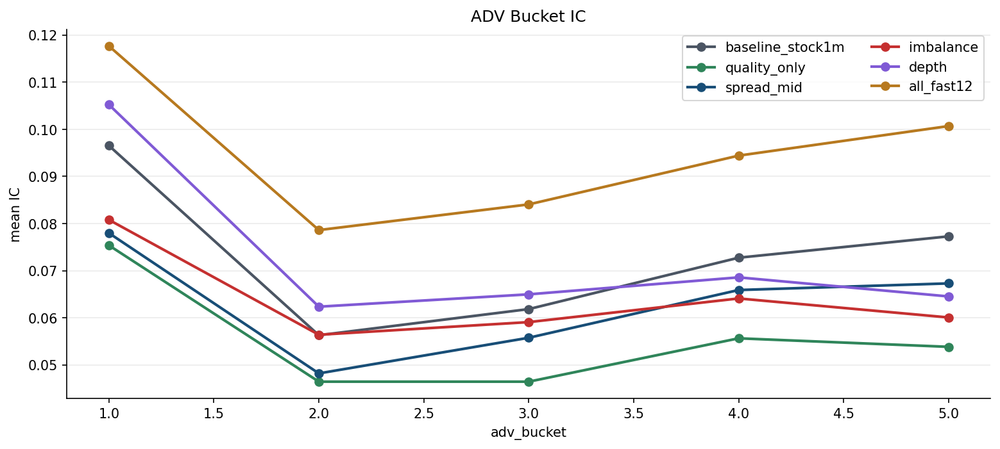

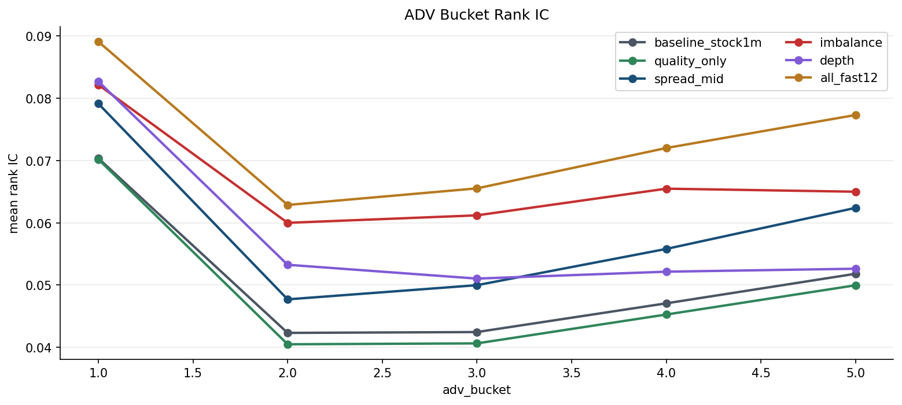

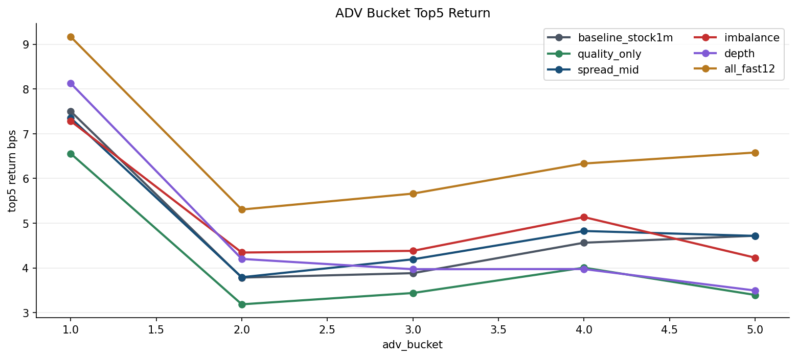

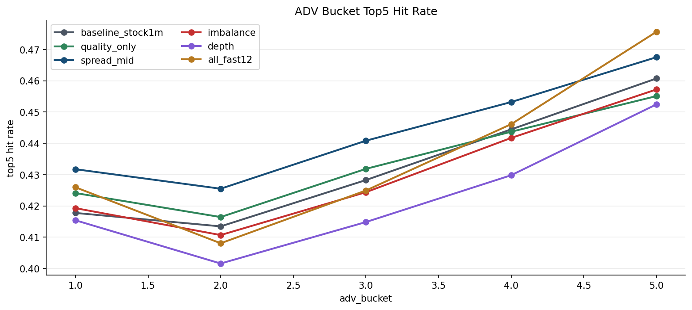

| experiment | adv_bucket | bucket_label | row_count | day_count | mean_adv_amount | median_adv_amount | mean_ic | mean_rank_ic | icir | rank_icir | top5_return_bps | top5_hit_rate | top5_row_count |
| --- | --- | --- | --- | --- | --- | --- | --- | --- | --- | --- | --- | --- | --- |
| all_fast12 | 1 | Bottom20% | 33,213,495 | 100 | 22436.36 | 23206.28 | 0.1177 | 0.0891 | 5.2304 | 6.2479 | 9.17 | 42.60% | 1,667,316 |
| all_fast12 | 2 | 20~40% | 33,714,849 | 100 | 46291.44 | 45970.54 | 0.0786 | 0.0629 | 4.9744 | 5.1229 | 5.31 | 40.81% | 1,693,237 |
| all_fast12 | 3 | 40~60% | 33,822,880 | 100 | 78908.09 | 77696.15 | 0.0841 | 0.0655 | 4.9671 | 4.6459 | 5.66 | 42.49% | 1,698,228 |
| all_fast12 | 4 | 60~80% | 33,743,507 | 100 | 145624.17 | 141032.77 | 0.0944 | 0.0720 | 4.8530 | 4.2275 | 6.33 | 44.61% | 1,694,364 |
| all_fast12 | 5 | Top20% | 33,697,783 | 100 | 553370.17 | 359596.79 | 0.1007 | 0.0773 | 3.8638 | 3.4242 | 6.58 | 47.56% | 1,692,110 |
| baseline_stock1m | 1 | Bottom20% | 33,213,495 | 100 | 22436.36 | 23206.28 | 0.0965 | 0.0704 | 3.9242 | 4.1384 | 7.50 | 41.78% | 1,667,316 |
| baseline_stock1m | 2 | 20~40% | 33,714,849 | 100 | 46291.44 | 45970.54 | 0.0563 | 0.0423 | 2.8731 | 3.0482 | 3.78 | 41.35% | 1,693,237 |
| baseline_stock1m | 3 | 40~60% | 33,822,880 | 100 | 78908.09 | 77696.15 | 0.0618 | 0.0425 | 3.0205 | 2.6884 | 3.88 | 42.83% | 1,698,228 |
| baseline_stock1m | 4 | 60~80% | 33,743,507 | 100 | 145624.17 | 141032.77 | 0.0727 | 0.0471 | 3.4385 | 2.9447 | 4.56 | 44.45% | 1,694,364 |
| baseline_stock1m | 5 | Top20% | 33,697,783 | 100 | 553370.17 | 359596.79 | 0.0773 | 0.0518 | 3.1709 | 2.6256 | 4.72 | 46.07% | 1,692,110 |
| depth | 1 | Bottom20% | 33,213,495 | 100 | 22436.36 | 23206.28 | 0.1052 | 0.0827 | 4.3585 | 4.9968 | 8.13 | 41.54% | 1,667,316 |
| depth | 2 | 20~40% | 33,714,849 | 100 | 46291.44 | 45970.54 | 0.0623 | 0.0533 | 3.6919 | 3.7386 | 4.20 | 40.16% | 1,693,237 |
| depth | 3 | 40~60% | 33,822,880 | 100 | 78908.09 | 77696.15 | 0.0650 | 0.0510 | 3.7757 | 3.2352 | 3.97 | 41.48% | 1,698,228 |
| depth | 4 | 60~80% | 33,743,507 | 100 | 145624.17 | 141032.77 | 0.0686 | 0.0522 | 3.4415 | 2.8237 | 3.97 | 42.98% | 1,694,364 |
| depth | 5 | Top20% | 33,697,783 | 100 | 553370.17 | 359596.79 | 0.0645 | 0.0526 | 2.3973 | 2.2061 | 3.50 | 45.24% | 1,692,110 |
| imbalance | 1 | Bottom20% | 33,213,495 | 100 | 22436.36 | 23206.28 | 0.0808 | 0.0822 | 3.0078 | 5.4649 | 7.28 | 41.93% | 1,667,316 |
| imbalance | 2 | 20~40% | 33,714,849 | 100 | 46291.44 | 45970.54 | 0.0564 | 0.0600 | 2.8174 | 5.2115 | 4.34 | 41.07% | 1,693,237 |
| imbalance | 3 | 40~60% | 33,822,880 | 100 | 78908.09 | 77696.15 | 0.0591 | 0.0612 | 2.9060 | 4.6452 | 4.38 | 42.44% | 1,698,228 |
| imbalance | 4 | 60~80% | 33,743,507 | 100 | 145624.17 | 141032.77 | 0.0641 | 0.0655 | 3.0811 | 4.6325 | 5.14 | 44.17% | 1,694,364 |
| imbalance | 5 | Top20% | 33,697,783 | 100 | 553370.17 | 359596.79 | 0.0601 | 0.0650 | 2.8759 | 3.9035 | 4.23 | 45.72% | 1,692,110 |
| quality_only | 1 | Bottom20% | 33,213,495 | 100 | 22436.36 | 23206.28 | 0.0754 | 0.0702 | 2.7345 | 4.4626 | 6.56 | 42.41% | 1,667,316 |
| quality_only | 2 | 20~40% | 33,714,849 | 100 | 46291.44 | 45970.54 | 0.0464 | 0.0405 | 2.0872 | 3.0818 | 3.19 | 41.64% | 1,693,237 |
| quality_only | 3 | 40~60% | 33,822,880 | 100 | 78908.09 | 77696.15 | 0.0464 | 0.0406 | 2.3083 | 3.0737 | 3.44 | 43.18% | 1,698,228 |
| quality_only | 4 | 60~80% | 33,743,507 | 100 | 145624.17 | 141032.77 | 0.0556 | 0.0453 | 2.7016 | 3.0324 | 4.01 | 44.37% | 1,694,364 |
| quality_only | 5 | Top20% | 33,697,783 | 100 | 553370.17 | 359596.79 | 0.0538 | 0.0500 | 2.5238 | 2.8916 | 3.40 | 45.51% | 1,692,110 |
| spread_mid | 1 | Bottom20% | 33,213,495 | 100 | 22436.36 | 23206.28 | 0.0780 | 0.0792 | 2.7017 | 5.0579 | 7.35 | 43.17% | 1,667,316 |
| spread_mid | 2 | 20~40% | 33,714,849 | 100 | 46291.44 | 45970.54 | 0.0482 | 0.0477 | 1.8840 | 3.4140 | 3.79 | 42.55% | 1,693,237 |
| spread_mid | 3 | 40~60% | 33,822,880 | 100 | 78908.09 | 77696.15 | 0.0558 | 0.0500 | 2.5460 | 3.4795 | 4.19 | 44.08% | 1,698,228 |
| spread_mid | 4 | 60~80% | 33,743,507 | 100 | 145624.17 | 141032.77 | 0.0659 | 0.0558 | 3.2301 | 3.5088 | 4.83 | 45.32% | 1,694,364 |
| spread_mid | 5 | Top20% | 33,697,783 | 100 | 553370.17 | 359596.79 | 0.0673 | 0.0624 | 2.6682 | 3.2633 | 4.72 | 46.75% | 1,692,110 |

### 5. Trading And Cost Proxy

### 5.1. Strategy And Benchmark Summary

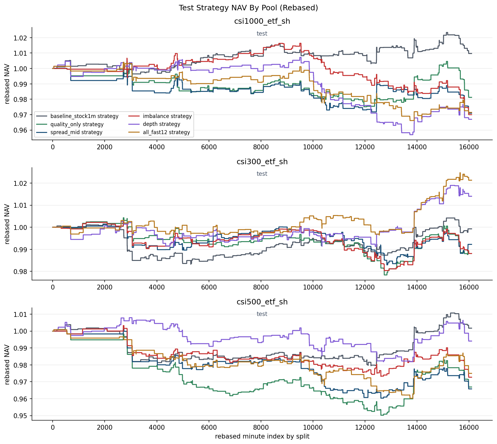

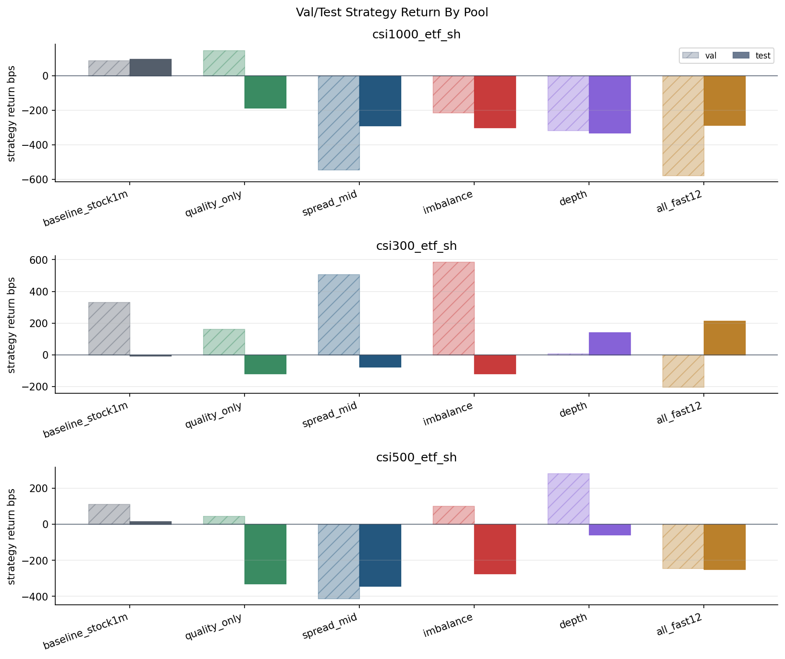

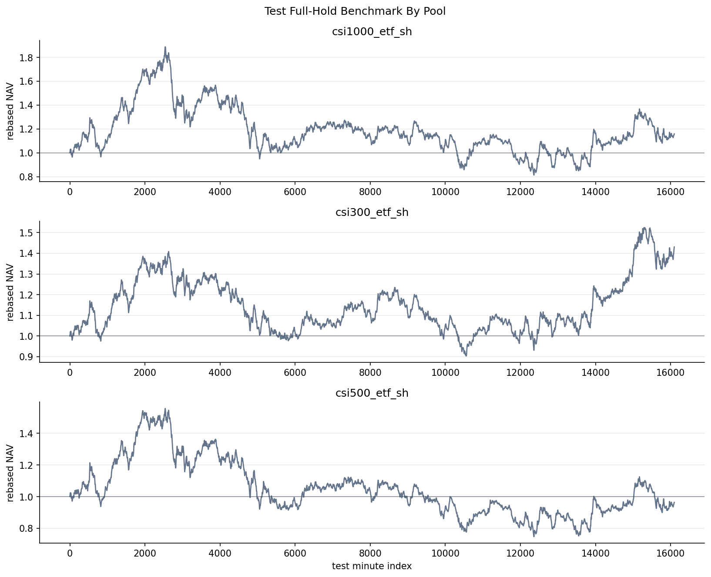

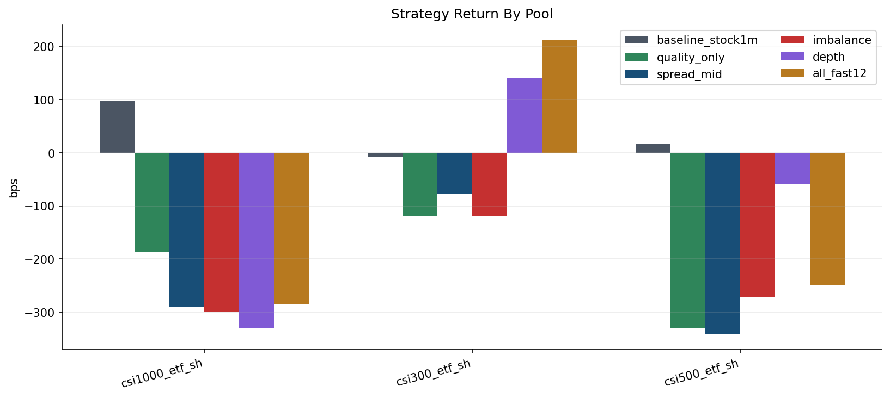

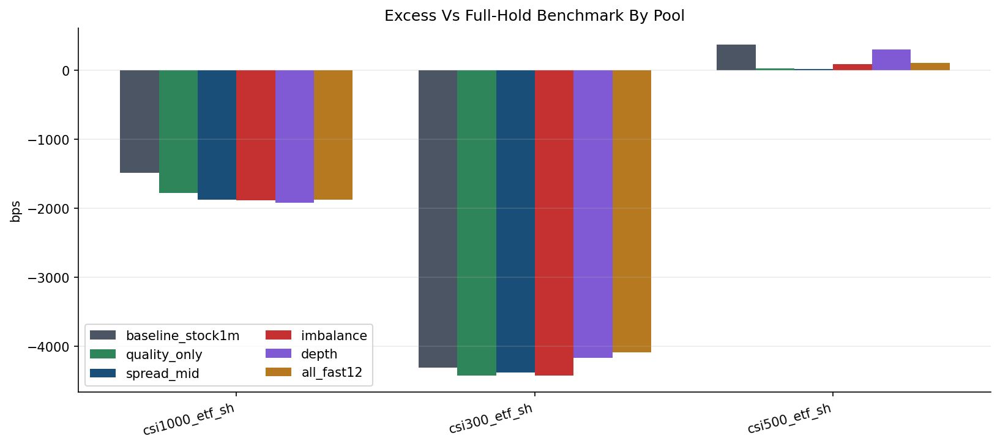

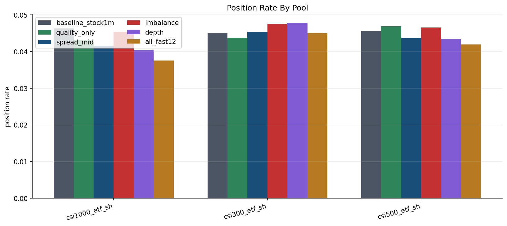

Strategy NAV 只在 test split 内画连续路径，并按 test 首个有效 NAV rebased 到 1.0；val 与 test 不是同一条可交易路径，因此不再把两段拼成一张 NAV 图。Val/Test 对比改用 split 内 strategy_return_bps 柱状图，val 作为验证期诊断，test 作为 OOS 评估。Full-hold benchmark 单独作为 market context 展示。本节表格的 strategy/full-hold benchmark/expected return 均按 test split 的 end/start - 1 计算。excess_vs_full_hold_benchmark_bps 是稀疏持仓策略相对全程持有 benchmark 的差，不应直接解读为 alpha。

| experiment | pool | strategy_return_bps | full_hold_benchmark_return_bps | excess_vs_full_hold_benchmark_bps | expected_return_bps | position_rate | open_count | open_per_day |
| --- | --- | --- | --- | --- | --- | --- | --- | --- |
| all_fast12 | csi1000_etf_sh | -285.33 | 1585.00 | -1870.33 | 397.18 | 3.76% | 84 | 0.84 |
| baseline_stock1m | csi1000_etf_sh | 97.15 | 1585.00 | -1487.85 | 962.73 | 4.63% | 125 | 1.25 |
| depth | csi1000_etf_sh | -330.31 | 1585.00 | -1915.31 | 468.26 | 4.04% | 95 | 0.95 |
| imbalance | csi1000_etf_sh | -300.05 | 1585.00 | -1885.04 | 855.12 | 4.53% | 119 | 1.19 |
| quality_only | csi1000_etf_sh | -187.70 | 1585.00 | -1772.69 | 837.51 | 4.32% | 110 | 1.10 |
| spread_mid | csi1000_etf_sh | -290.41 | 1585.00 | -1875.41 | 801.31 | 4.16% | 106 | 1.06 |
| all_fast12 | csi300_etf_sh | 213.16 | 4304.38 | -4091.22 | 409.37 | 4.50% | 108 | 1.08 |
| baseline_stock1m | csi300_etf_sh | -7.23 | 4304.38 | -4311.61 | 774.99 | 4.50% | 127 | 1.27 |
| depth | csi300_etf_sh | 140.34 | 4304.38 | -4164.04 | 478.66 | 4.78% | 116 | 1.16 |
| imbalance | csi300_etf_sh | -118.84 | 4304.38 | -4423.22 | 718.57 | 4.75% | 130 | 1.30 |
| quality_only | csi300_etf_sh | -118.86 | 4304.38 | -4423.24 | 760.61 | 4.38% | 125 | 1.25 |
| spread_mid | csi300_etf_sh | -77.52 | 4304.38 | -4381.90 | 722.06 | 4.53% | 129 | 1.29 |
| all_fast12 | csi500_etf_sh | -250.26 | -361.75 | 111.49 | 400.92 | 4.19% | 98 | 0.98 |
| baseline_stock1m | csi500_etf_sh | 17.28 | -361.75 | 379.03 | 858.70 | 4.57% | 125 | 1.25 |
| depth | csi500_etf_sh | -59.03 | -361.75 | 302.72 | 468.39 | 4.35% | 105 | 1.05 |
| imbalance | csi500_etf_sh | -272.87 | -361.75 | 88.88 | 789.78 | 4.66% | 123 | 1.23 |
| quality_only | csi500_etf_sh | -330.95 | -361.75 | 30.81 | 819.07 | 4.69% | 126 | 1.26 |
| spread_mid | csi500_etf_sh | -342.12 | -361.75 | 19.64 | 720.94 | 4.38% | 116 | 1.16 |

### 5.2. Cost Sensitivity

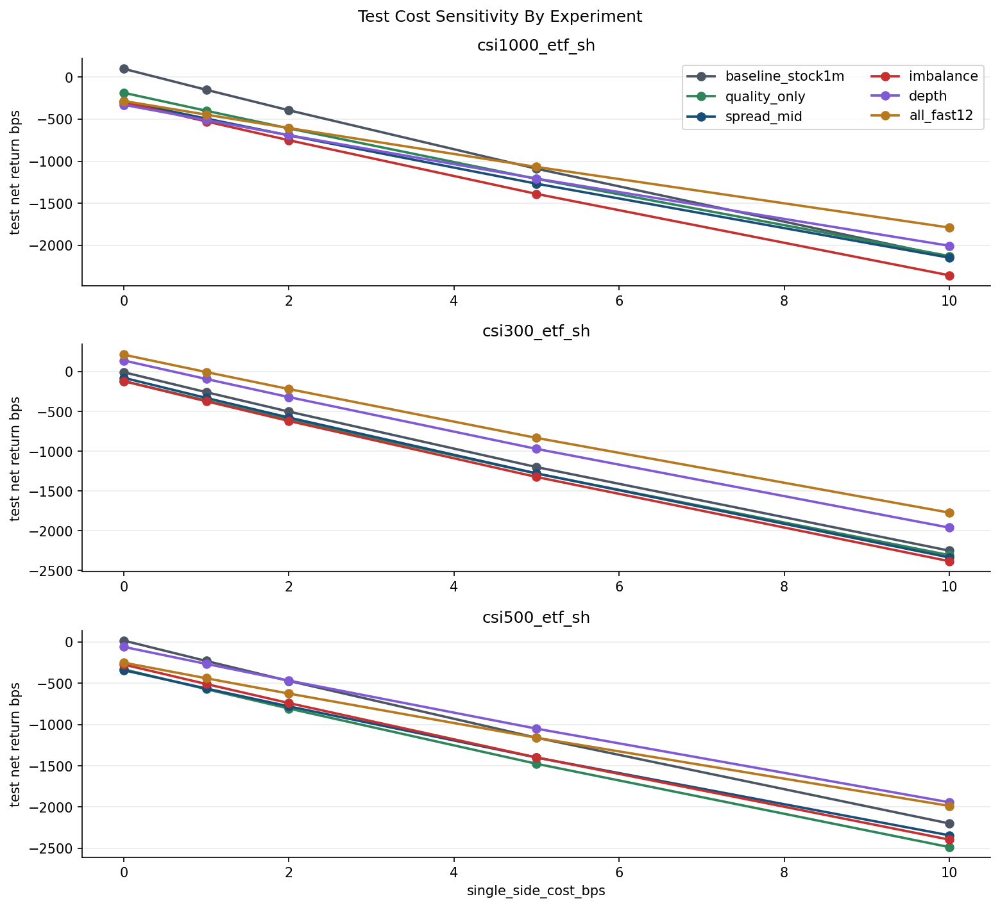

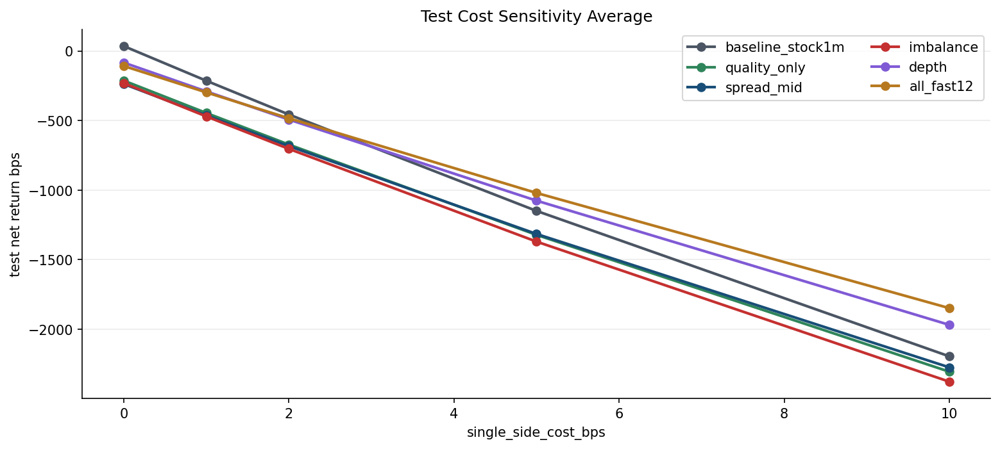

Cost sensitivity 使用 test-only cost sensitivity artifact；0 bps cost 的 test_net_strategy_return_bps 与 5.1 的 test strategy_return_bps 口径一致。

| experiment | pool | single_side_cost_bps | test_net_strategy_return_bps |
| --- | --- | --- | --- |
| all_fast12 | csi1000_etf_sh | 0.0 | -285.33 |
| baseline_stock1m | csi1000_etf_sh | 0.0 | 97.15 |
| depth | csi1000_etf_sh | 0.0 | -330.31 |
| imbalance | csi1000_etf_sh | 0.0 | -300.05 |
| quality_only | csi1000_etf_sh | 0.0 | -187.70 |
| spread_mid | csi1000_etf_sh | 0.0 | -290.41 |
| all_fast12 | csi1000_etf_sh | 1.0 | -447.19 |
| baseline_stock1m | csi1000_etf_sh | 1.0 | -152.14 |
| depth | csi1000_etf_sh | 1.0 | -512.33 |
| imbalance | csi1000_etf_sh | 1.0 | -528.20 |
| quality_only | csi1000_etf_sh | 1.0 | -401.21 |
| spread_mid | csi1000_etf_sh | 1.0 | -494.12 |
| all_fast12 | csi1000_etf_sh | 2.0 | -606.37 |
| baseline_stock1m | csi1000_etf_sh | 2.0 | -395.30 |
| depth | csi1000_etf_sh | 2.0 | -690.93 |
| imbalance | csi1000_etf_sh | 2.0 | -751.00 |
| quality_only | csi1000_etf_sh | 2.0 | -610.11 |
| spread_mid | csi1000_etf_sh | 2.0 | -693.57 |
| all_fast12 | csi1000_etf_sh | 5.0 | -1068.26 |
| baseline_stock1m | csi1000_etf_sh | 5.0 | -1089.49 |
| depth | csi1000_etf_sh | 5.0 | -1206.92 |
| imbalance | csi1000_etf_sh | 5.0 | -1388.59 |
| quality_only | csi1000_etf_sh | 5.0 | -1210.02 |
| spread_mid | csi1000_etf_sh | 5.0 | -1267.28 |
| all_fast12 | csi1000_etf_sh | 10.0 | -1788.43 |
| baseline_stock1m | csi1000_etf_sh | 10.0 | -2137.17 |
| depth | csi1000_etf_sh | 10.0 | -2004.44 |
| imbalance | csi1000_etf_sh | 10.0 | -2355.44 |
| quality_only | csi1000_etf_sh | 10.0 | -2126.26 |
| spread_mid | csi1000_etf_sh | 10.0 | -2146.28 |
| all_fast12 | csi300_etf_sh | 0.0 | 213.16 |
| baseline_stock1m | csi300_etf_sh | 0.0 | -7.23 |
| depth | csi300_etf_sh | 0.0 | 140.34 |
| imbalance | csi300_etf_sh | 0.0 | -118.84 |
| quality_only | csi300_etf_sh | 0.0 | -118.86 |
| spread_mid | csi300_etf_sh | 0.0 | -77.52 |
| all_fast12 | csi300_etf_sh | 1.0 | -5.09 |
| baseline_stock1m | csi300_etf_sh | 1.0 | -257.86 |
| depth | csi300_etf_sh | 1.0 | -92.21 |
| imbalance | csi300_etf_sh | 1.0 | -372.46 |
| quality_only | csi300_etf_sh | 1.0 | -362.85 |
| spread_mid | csi300_etf_sh | 1.0 | -330.25 |
| all_fast12 | csi300_etf_sh | 2.0 | -218.69 |
| baseline_stock1m | csi300_etf_sh | 2.0 | -502.22 |
| depth | csi300_etf_sh | 2.0 | -319.45 |
| imbalance | csi300_etf_sh | 2.0 | -619.59 |
| quality_only | csi300_etf_sh | 2.0 | -600.83 |
| spread_mid | csi300_etf_sh | 2.0 | -576.58 |
| all_fast12 | csi300_etf_sh | 5.0 | -832.61 |
| baseline_stock1m | csi300_etf_sh | 5.0 | -1199.29 |
| depth | csi300_etf_sh | 5.0 | -970.49 |
| imbalance | csi300_etf_sh | 5.0 | -1323.70 |
| quality_only | csi300_etf_sh | 5.0 | -1280.22 |
| spread_mid | csi300_etf_sh | 5.0 | -1278.67 |
| all_fast12 | csi300_etf_sh | 10.0 | -1771.75 |
| baseline_stock1m | csi300_etf_sh | 10.0 | -2249.64 |
| depth | csi300_etf_sh | 10.0 | -1960.11 |
| imbalance | csi300_etf_sh | 10.0 | -2382.14 |
| quality_only | csi300_etf_sh | 10.0 | -2305.56 |
| spread_mid | csi300_etf_sh | 10.0 | -2334.92 |
| all_fast12 | csi500_etf_sh | 0.0 | -250.26 |
| baseline_stock1m | csi500_etf_sh | 0.0 | 17.28 |
| depth | csi500_etf_sh | 0.0 | -59.03 |
| imbalance | csi500_etf_sh | 0.0 | -272.87 |
| quality_only | csi500_etf_sh | 0.0 | -330.95 |
| spread_mid | csi500_etf_sh | 0.0 | -342.12 |
| all_fast12 | csi500_etf_sh | 1.0 | -439.52 |
| baseline_stock1m | csi500_etf_sh | 1.0 | -230.06 |
| depth | csi500_etf_sh | 1.0 | -265.62 |
| imbalance | csi500_etf_sh | 1.0 | -509.27 |
| quality_only | csi500_etf_sh | 1.0 | -571.58 |
| spread_mid | csi500_etf_sh | 1.0 | -563.62 |
| all_fast12 | csi500_etf_sh | 2.0 | -625.12 |
| baseline_stock1m | csi500_etf_sh | 2.0 | -471.31 |
| depth | csi500_etf_sh | 2.0 | -467.93 |
| imbalance | csi500_etf_sh | 2.0 | -739.94 |
| quality_only | csi500_etf_sh | 2.0 | -806.24 |
| spread_mid | csi500_etf_sh | 2.0 | -780.07 |
| all_fast12 | csi500_etf_sh | 5.0 | -1160.68 |
| baseline_stock1m | csi500_etf_sh | 5.0 | -1160.03 |
| depth | csi500_etf_sh | 5.0 | -1050.10 |
| imbalance | csi500_etf_sh | 5.0 | -1398.98 |
| quality_only | csi500_etf_sh | 5.0 | -1475.90 |
| spread_mid | csi500_etf_sh | 5.0 | -1400.20 |
| all_fast12 | csi500_etf_sh | 10.0 | -1986.48 |
| baseline_stock1m | csi500_etf_sh | 10.0 | -2199.46 |
| depth | csi500_etf_sh | 10.0 | -1942.79 |
| imbalance | csi500_etf_sh | 10.0 | -2395.19 |
| quality_only | csi500_etf_sh | 10.0 | -2485.75 |
| spread_mid | csi500_etf_sh | 10.0 | -2342.81 |

### 5.3. Trade Return Distribution

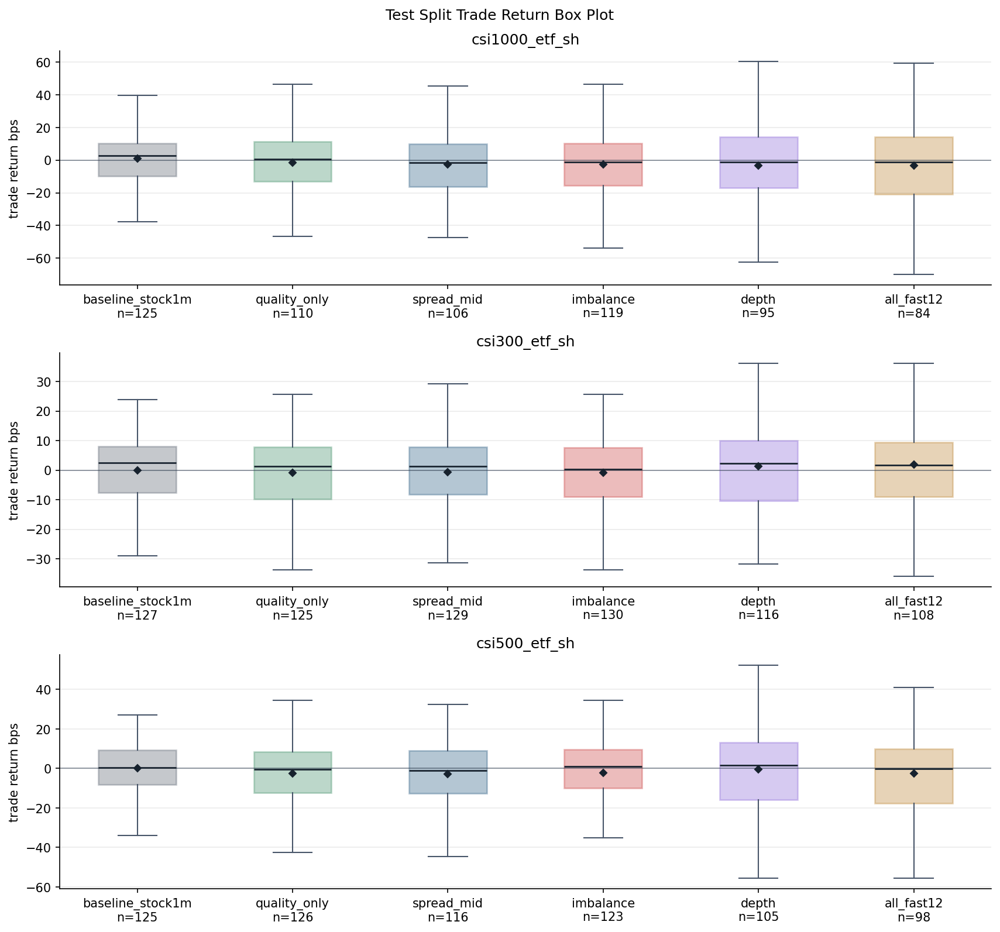

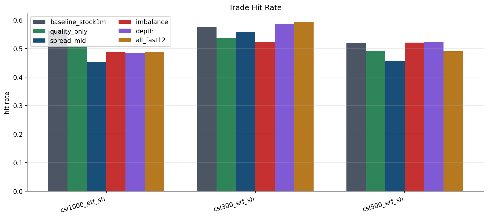

Trade return distribution 图、hit-rate 图和主表均使用 test scope；box plot 隐藏 fliers，菱形 marker 为 mean，x 轴标签中的 n 为 test trades 数量。包含 train_val_test 聚合 scope 的完整 summary 仍保留在 CSV artifact 中。

| experiment | pool | scope | trade_count | mean_trade_return_bps | median_trade_return_bps | hit_rate | p05_trade_return_bps | p95_trade_return_bps |
| --- | --- | --- | --- | --- | --- | --- | --- | --- |
| all_fast12 | csi1000_etf_sh | test | 84 | -3.40 | -1.11 | 48.81% | -57.59 | 39.63 |
| baseline_stock1m | csi1000_etf_sh | test | 125 | 0.80 | 2.80 | 56.00% | -36.20 | 30.49 |
| depth | csi1000_etf_sh | test | 95 | -3.49 | -1.18 | 48.42% | -59.05 | 32.01 |
| imbalance | csi1000_etf_sh | test | 119 | -2.54 | -1.18 | 48.74% | -38.28 | 29.77 |
| quality_only | csi1000_etf_sh | test | 110 | -1.69 | 0.65 | 50.91% | -44.99 | 39.32 |
| spread_mid | csi1000_etf_sh | test | 106 | -2.73 | -1.69 | 45.28% | -46.21 | 37.02 |
| all_fast12 | csi300_etf_sh | test | 108 | 1.97 | 1.70 | 59.26% | -27.68 | 28.42 |
| baseline_stock1m | csi300_etf_sh | test | 127 | -0.04 | 2.56 | 57.48% | -28.97 | 15.74 |
| depth | csi300_etf_sh | test | 116 | 1.22 | 2.33 | 58.62% | -27.20 | 25.68 |
| imbalance | csi300_etf_sh | test | 130 | -0.91 | 0.41 | 52.31% | -27.69 | 18.92 |
| quality_only | csi300_etf_sh | test | 125 | -0.94 | 1.24 | 53.60% | -29.60 | 20.55 |
| spread_mid | csi300_etf_sh | test | 129 | -0.59 | 1.37 | 55.81% | -26.14 | 19.26 |
| all_fast12 | csi500_etf_sh | test | 98 | -2.55 | -0.20 | 48.98% | -43.50 | 32.22 |
| baseline_stock1m | csi500_etf_sh | test | 125 | 0.16 | 0.41 | 52.00% | -28.32 | 22.90 |
| depth | csi500_etf_sh | test | 105 | -0.53 | 1.57 | 52.38% | -37.47 | 37.01 |
| imbalance | csi500_etf_sh | test | 123 | -2.23 | 0.95 | 52.03% | -42.91 | 23.83 |
| quality_only | csi500_etf_sh | test | 126 | -2.64 | -0.34 | 49.21% | -44.19 | 30.25 |
| spread_mid | csi500_etf_sh | test | 116 | -2.98 | -1.04 | 45.69% | -43.08 | 31.05 |

### 6. Robustness Diagnostics

### 6.1. Return Realization

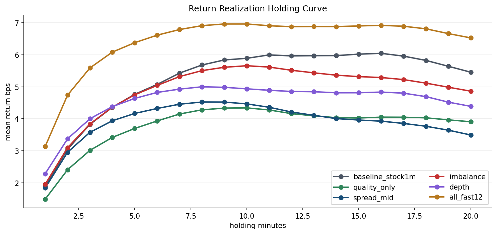

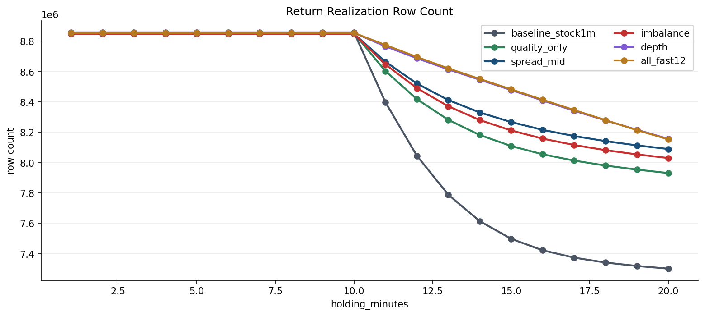

| experiment | holding_minutes | mean_return | mean_return_bps | row_count | prediction_p95 |
| --- | --- | --- | --- | --- | --- |
| all_fast12 | 1 | 0.000313 | 3.13 | 8,854,690 | 0.000624 |
| all_fast12 | 2 | 0.000474 | 4.74 | 8,854,690 | 0.000624 |
| all_fast12 | 3 | 0.000559 | 5.59 | 8,854,690 | 0.000624 |
| all_fast12 | 4 | 0.000609 | 6.09 | 8,854,690 | 0.000624 |
| all_fast12 | 5 | 0.000638 | 6.38 | 8,854,690 | 0.000624 |
| all_fast12 | 6 | 0.000661 | 6.61 | 8,854,690 | 0.000624 |
| all_fast12 | 7 | 0.000679 | 6.79 | 8,854,690 | 0.000624 |
| all_fast12 | 8 | 0.000691 | 6.91 | 8,854,690 | 0.000624 |
| all_fast12 | 9 | 0.000696 | 6.96 | 8,854,690 | 0.000624 |
| all_fast12 | 10 | 0.000696 | 6.96 | 8,854,690 | 0.000624 |
| all_fast12 | 11 | 0.000691 | 6.91 | 8,774,976 | 0.000624 |
| all_fast12 | 12 | 0.000688 | 6.88 | 8,696,082 | 0.000624 |
| all_fast12 | 13 | 0.000688 | 6.88 | 8,620,905 | 0.000624 |
| all_fast12 | 14 | 0.000688 | 6.88 | 8,551,277 | 0.000624 |
| all_fast12 | 15 | 0.000690 | 6.90 | 8,482,852 | 0.000624 |
| all_fast12 | 16 | 0.000692 | 6.92 | 8,414,447 | 0.000624 |
| all_fast12 | 17 | 0.000689 | 6.89 | 8,346,802 | 0.000624 |
| all_fast12 | 18 | 0.000681 | 6.81 | 8,279,961 | 0.000624 |
| all_fast12 | 19 | 0.000666 | 6.66 | 8,214,636 | 0.000624 |
| all_fast12 | 20 | 0.000653 | 6.53 | 8,153,717 | 0.000624 |
| baseline_stock1m | 1 | 0.000189 | 1.89 | 8,858,029 | 0.000773 |
| baseline_stock1m | 2 | 0.000305 | 3.05 | 8,858,029 | 0.000773 |
| baseline_stock1m | 3 | 0.000383 | 3.83 | 8,858,029 | 0.000773 |
| baseline_stock1m | 4 | 0.000436 | 4.36 | 8,858,029 | 0.000773 |
| baseline_stock1m | 5 | 0.000477 | 4.77 | 8,858,029 | 0.000773 |
| baseline_stock1m | 6 | 0.000507 | 5.07 | 8,858,029 | 0.000773 |
| baseline_stock1m | 7 | 0.000543 | 5.43 | 8,858,029 | 0.000773 |
| baseline_stock1m | 8 | 0.000568 | 5.68 | 8,858,029 | 0.000773 |
| baseline_stock1m | 9 | 0.000584 | 5.84 | 8,858,029 | 0.000773 |
| baseline_stock1m | 10 | 0.000589 | 5.89 | 8,858,029 | 0.000773 |
| baseline_stock1m | 11 | 0.000600 | 6.00 | 8,397,772 | 0.000773 |
| baseline_stock1m | 12 | 0.000597 | 5.97 | 8,045,474 | 0.000773 |
| baseline_stock1m | 13 | 0.000597 | 5.97 | 7,788,980 | 0.000773 |
| baseline_stock1m | 14 | 0.000598 | 5.98 | 7,614,977 | 0.000773 |
| baseline_stock1m | 15 | 0.000602 | 6.02 | 7,498,409 | 0.000773 |
| baseline_stock1m | 16 | 0.000605 | 6.05 | 7,422,909 | 0.000773 |
| baseline_stock1m | 17 | 0.000596 | 5.96 | 7,374,549 | 0.000773 |
| baseline_stock1m | 18 | 0.000583 | 5.83 | 7,342,146 | 0.000773 |
| baseline_stock1m | 19 | 0.000564 | 5.64 | 7,319,570 | 0.000773 |
| baseline_stock1m | 20 | 0.000546 | 5.46 | 7,302,169 | 0.000773 |
| depth | 1 | 0.000228 | 2.28 | 8,855,561 | 0.000473 |
| depth | 2 | 0.000337 | 3.37 | 8,855,561 | 0.000473 |
| depth | 3 | 0.000400 | 4.00 | 8,855,561 | 0.000473 |
| depth | 4 | 0.000438 | 4.38 | 8,855,561 | 0.000473 |
| depth | 5 | 0.000464 | 4.64 | 8,855,561 | 0.000473 |
| depth | 6 | 0.000482 | 4.82 | 8,855,561 | 0.000473 |
| depth | 7 | 0.000493 | 4.93 | 8,855,561 | 0.000473 |
| depth | 8 | 0.000500 | 5.00 | 8,855,561 | 0.000473 |
| depth | 9 | 0.000498 | 4.98 | 8,855,561 | 0.000473 |
| depth | 10 | 0.000494 | 4.94 | 8,855,561 | 0.000473 |
| depth | 11 | 0.000489 | 4.89 | 8,766,092 | 0.000473 |
| depth | 12 | 0.000485 | 4.85 | 8,687,996 | 0.000473 |
| depth | 13 | 0.000485 | 4.85 | 8,614,187 | 0.000473 |
| depth | 14 | 0.000481 | 4.81 | 8,546,239 | 0.000473 |
| depth | 15 | 0.000481 | 4.81 | 8,478,270 | 0.000473 |
| depth | 16 | 0.000484 | 4.84 | 8,409,792 | 0.000473 |
| depth | 17 | 0.000480 | 4.80 | 8,341,917 | 0.000473 |
| depth | 18 | 0.000469 | 4.69 | 8,278,459 | 0.000473 |
| depth | 19 | 0.000452 | 4.52 | 8,216,751 | 0.000473 |
| depth | 20 | 0.000439 | 4.39 | 8,156,660 | 0.000473 |
| imbalance | 1 | 0.000195 | 1.95 | 8,847,894 | 0.001094 |
| imbalance | 2 | 0.000310 | 3.10 | 8,847,894 | 0.001094 |
| imbalance | 3 | 0.000384 | 3.84 | 8,847,894 | 0.001094 |
| imbalance | 4 | 0.000437 | 4.37 | 8,847,894 | 0.001094 |
| imbalance | 5 | 0.000475 | 4.75 | 8,847,894 | 0.001094 |
| imbalance | 6 | 0.000504 | 5.04 | 8,847,894 | 0.001094 |
| imbalance | 7 | 0.000532 | 5.32 | 8,847,894 | 0.001094 |
| imbalance | 8 | 0.000551 | 5.51 | 8,847,894 | 0.001094 |
| imbalance | 9 | 0.000561 | 5.61 | 8,847,894 | 0.001094 |
| imbalance | 10 | 0.000566 | 5.66 | 8,847,894 | 0.001094 |
| imbalance | 11 | 0.000562 | 5.62 | 8,647,032 | 0.001094 |
| imbalance | 12 | 0.000552 | 5.52 | 8,490,928 | 0.001094 |
| imbalance | 13 | 0.000544 | 5.44 | 8,371,407 | 0.001094 |
| imbalance | 14 | 0.000536 | 5.36 | 8,280,773 | 0.001094 |
| imbalance | 15 | 0.000532 | 5.32 | 8,212,129 | 0.001094 |
| imbalance | 16 | 0.000529 | 5.29 | 8,158,503 | 0.001094 |
| imbalance | 17 | 0.000523 | 5.23 | 8,116,343 | 0.001094 |
| imbalance | 18 | 0.000511 | 5.11 | 8,082,453 | 0.001094 |
| imbalance | 19 | 0.000499 | 4.99 | 8,054,389 | 0.001094 |
| imbalance | 20 | 0.000486 | 4.86 | 8,030,360 | 0.001094 |
| quality_only | 1 | 0.000149 | 1.49 | 8,852,578 | 0.000921 |
| quality_only | 2 | 0.000241 | 2.41 | 8,852,578 | 0.000921 |
| quality_only | 3 | 0.000301 | 3.01 | 8,852,578 | 0.000921 |
| quality_only | 4 | 0.000342 | 3.42 | 8,852,578 | 0.000921 |
| quality_only | 5 | 0.000370 | 3.70 | 8,852,578 | 0.000921 |
| quality_only | 6 | 0.000393 | 3.93 | 8,852,578 | 0.000921 |
| quality_only | 7 | 0.000415 | 4.15 | 8,852,578 | 0.000921 |
| quality_only | 8 | 0.000428 | 4.28 | 8,852,578 | 0.000921 |
| quality_only | 9 | 0.000433 | 4.33 | 8,852,578 | 0.000921 |
| quality_only | 10 | 0.000434 | 4.34 | 8,852,578 | 0.000921 |
| quality_only | 11 | 0.000428 | 4.28 | 8,603,159 | 0.000921 |
| quality_only | 12 | 0.000416 | 4.16 | 8,418,496 | 0.000921 |
| quality_only | 13 | 0.000409 | 4.09 | 8,281,995 | 0.000921 |
| quality_only | 14 | 0.000403 | 4.03 | 8,182,295 | 0.000921 |
| quality_only | 15 | 0.000403 | 4.03 | 8,109,613 | 0.000921 |
| quality_only | 16 | 0.000405 | 4.05 | 8,055,167 | 0.000921 |
| quality_only | 17 | 0.000405 | 4.05 | 8,013,681 | 0.000921 |
| quality_only | 18 | 0.000403 | 4.03 | 7,980,989 | 0.000921 |
| quality_only | 19 | 0.000397 | 3.97 | 7,954,289 | 0.000921 |
| quality_only | 20 | 0.000391 | 3.91 | 7,931,371 | 0.000921 |
| spread_mid | 1 | 0.000184 | 1.84 | 8,848,521 | 0.001045 |
| spread_mid | 2 | 0.000295 | 2.95 | 8,848,521 | 0.001045 |
| spread_mid | 3 | 0.000358 | 3.58 | 8,848,521 | 0.001045 |
| spread_mid | 4 | 0.000394 | 3.94 | 8,848,521 | 0.001045 |
| spread_mid | 5 | 0.000417 | 4.17 | 8,848,521 | 0.001045 |
| spread_mid | 6 | 0.000432 | 4.32 | 8,848,521 | 0.001045 |
| spread_mid | 7 | 0.000446 | 4.46 | 8,848,521 | 0.001045 |
| spread_mid | 8 | 0.000452 | 4.52 | 8,848,521 | 0.001045 |
| spread_mid | 9 | 0.000452 | 4.52 | 8,848,521 | 0.001045 |
| spread_mid | 10 | 0.000447 | 4.47 | 8,848,521 | 0.001045 |
| spread_mid | 11 | 0.000436 | 4.36 | 8,664,796 | 0.001045 |
| spread_mid | 12 | 0.000421 | 4.21 | 8,521,021 | 0.001045 |
| spread_mid | 13 | 0.000411 | 4.11 | 8,412,543 | 0.001045 |
| spread_mid | 14 | 0.000401 | 4.01 | 8,330,694 | 0.001045 |
| spread_mid | 15 | 0.000396 | 3.96 | 8,267,407 | 0.001045 |
| spread_mid | 16 | 0.000393 | 3.93 | 8,216,220 | 0.001045 |
| spread_mid | 17 | 0.000386 | 3.86 | 8,175,431 | 0.001045 |
| spread_mid | 18 | 0.000377 | 3.77 | 8,141,928 | 0.001045 |
| spread_mid | 19 | 0.000364 | 3.64 | 8,113,846 | 0.001045 |
| spread_mid | 20 | 0.000349 | 3.49 | 8,089,926 | 0.001045 |

### 6.2. Monthly IC

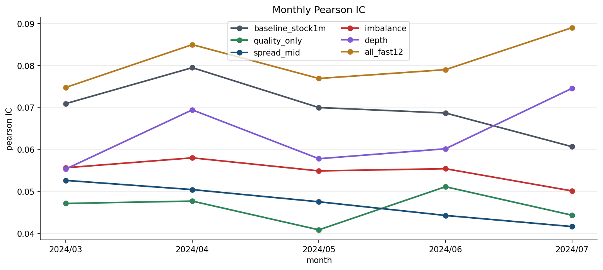

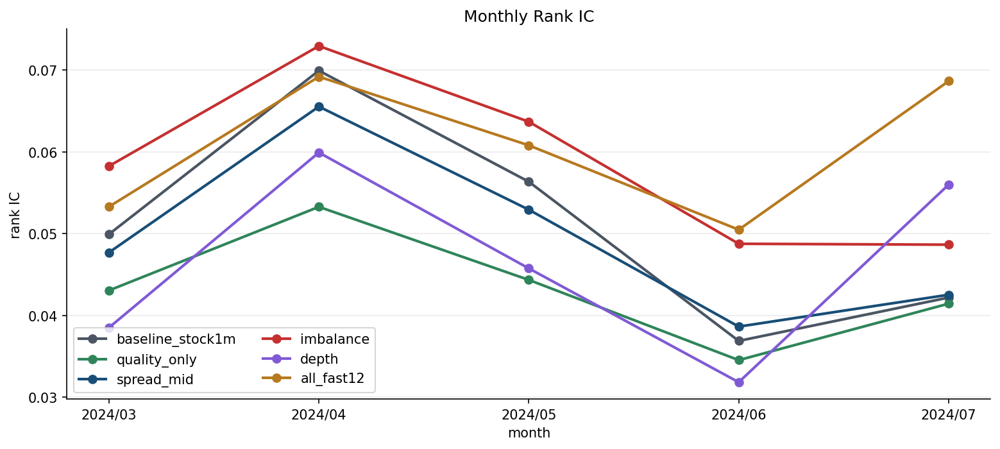

| experiment | month | pearson_ic | rank_ic | sample_count |
| --- | --- | --- | --- | --- |
| all_fast12 | 2024/03 | 0.0748 | 0.0533 | 40,561,535 |
| all_fast12 | 2024/04 | 0.0849 | 0.0692 | 34,533,212 |
| all_fast12 | 2024/05 | 0.0769 | 0.0608 | 34,535,788 |
| all_fast12 | 2024/06 | 0.0790 | 0.0505 | 32,818,884 |
| all_fast12 | 2024/07 | 0.0890 | 0.0687 | 34,496,021 |
| baseline_stock1m | 2024/03 | 0.0709 | 0.0499 | 40,561,535 |
| baseline_stock1m | 2024/04 | 0.0795 | 0.0699 | 34,533,212 |
| baseline_stock1m | 2024/05 | 0.0700 | 0.0564 | 34,535,788 |
| baseline_stock1m | 2024/06 | 0.0687 | 0.0369 | 32,818,884 |
| baseline_stock1m | 2024/07 | 0.0607 | 0.0422 | 34,496,021 |
| depth | 2024/03 | 0.0553 | 0.0385 | 40,561,535 |
| depth | 2024/04 | 0.0694 | 0.0599 | 34,533,212 |
| depth | 2024/05 | 0.0578 | 0.0458 | 34,535,788 |
| depth | 2024/06 | 0.0601 | 0.0318 | 32,818,884 |
| depth | 2024/07 | 0.0745 | 0.0560 | 34,496,021 |
| imbalance | 2024/03 | 0.0556 | 0.0583 | 40,561,535 |
| imbalance | 2024/04 | 0.0580 | 0.0729 | 34,533,212 |
| imbalance | 2024/05 | 0.0549 | 0.0637 | 34,535,788 |
| imbalance | 2024/06 | 0.0554 | 0.0488 | 32,818,884 |
| imbalance | 2024/07 | 0.0501 | 0.0487 | 34,496,021 |
| quality_only | 2024/03 | 0.0471 | 0.0431 | 40,561,535 |
| quality_only | 2024/04 | 0.0477 | 0.0533 | 34,533,212 |
| quality_only | 2024/05 | 0.0408 | 0.0444 | 34,535,788 |
| quality_only | 2024/06 | 0.0511 | 0.0345 | 32,818,884 |
| quality_only | 2024/07 | 0.0443 | 0.0415 | 34,496,021 |
| spread_mid | 2024/03 | 0.0526 | 0.0477 | 40,561,535 |
| spread_mid | 2024/04 | 0.0504 | 0.0655 | 34,533,212 |
| spread_mid | 2024/05 | 0.0475 | 0.0529 | 34,535,788 |
| spread_mid | 2024/06 | 0.0443 | 0.0386 | 32,818,884 |
| spread_mid | 2024/07 | 0.0416 | 0.0425 | 34,496,021 |

### 6.3. Intraday IC

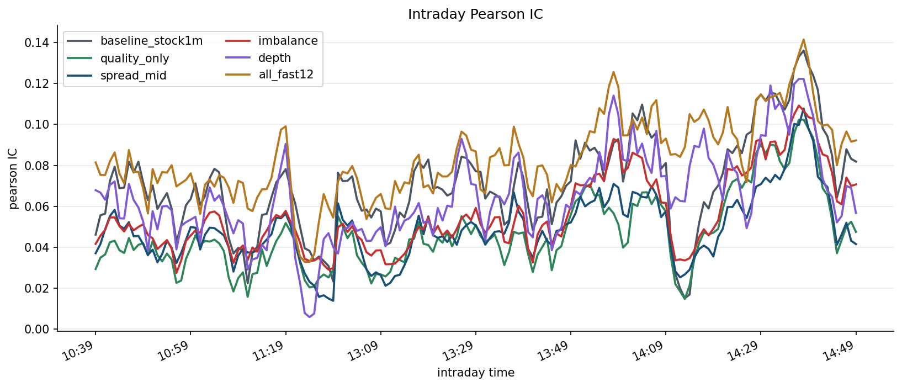

| experiment | split | time_bucket | pearson_ic | rank_ic | sample_count |
| --- | --- | --- | --- | --- | --- |
| all_fast12 | test | 103900.0 | 0.0814 | n/a | 1,099,040 |
| all_fast12 | test | 104000.0 | 0.0753 | n/a | 1,099,040 |
| all_fast12 | test | 104100.0 | 0.0753 | n/a | 1,099,040 |
| all_fast12 | test | 104200.0 | 0.0819 | n/a | 1,099,040 |
| all_fast12 | test | 104300.0 | 0.0863 | n/a | 1,099,040 |
| all_fast12 | test | 104400.0 | 0.0761 | n/a | 1,099,040 |
| all_fast12 | test | 104500.0 | 0.0712 | n/a | 1,099,040 |
| all_fast12 | test | 104600.0 | 0.0875 | n/a | 1,099,040 |
| all_fast12 | test | 104700.0 | 0.0769 | n/a | 1,099,040 |
| all_fast12 | test | 104800.0 | 0.0768 | n/a | 1,099,040 |
| all_fast12 | test | 104900.0 | 0.0686 | n/a | 1,099,040 |
| all_fast12 | test | 105000.0 | 0.0565 | n/a | 1,099,040 |
| all_fast12 | test | 105100.0 | 0.0782 | n/a | 1,099,040 |
| all_fast12 | test | 105200.0 | 0.0713 | n/a | 1,099,040 |
| all_fast12 | test | 105300.0 | 0.0768 | n/a | 1,099,040 |
| all_fast12 | test | 105400.0 | 0.0764 | n/a | 1,099,040 |
| all_fast12 | test | 105500.0 | 0.0801 | n/a | 1,099,040 |
| all_fast12 | test | 105600.0 | 0.0697 | n/a | 1,099,040 |
| all_fast12 | test | 105700.0 | 0.0713 | n/a | 1,099,040 |
| all_fast12 | test | 105800.0 | 0.0729 | n/a | 1,099,040 |
| all_fast12 | test | 105900.0 | 0.0761 | n/a | 1,099,040 |
| all_fast12 | test | 110000.0 | 0.0678 | n/a | 1,099,040 |
| all_fast12 | test | 110100.0 | 0.0563 | n/a | 1,099,040 |
| all_fast12 | test | 110200.0 | 0.0706 | n/a | 1,099,040 |
| all_fast12 | test | 110300.0 | 0.0730 | n/a | 1,099,040 |
| all_fast12 | test | 110400.0 | 0.0696 | n/a | 1,099,040 |
| all_fast12 | test | 110500.0 | 0.0752 | n/a | 1,099,040 |
| all_fast12 | test | 110600.0 | 0.0740 | n/a | 1,099,040 |
| all_fast12 | test | 110700.0 | 0.0693 | n/a | 1,099,040 |
| all_fast12 | test | 110800.0 | 0.0616 | n/a | 1,099,040 |
| all_fast12 | test | 110900.0 | 0.0724 | n/a | 1,099,040 |
| all_fast12 | test | 111000.0 | 0.0714 | n/a | 1,099,040 |
| all_fast12 | test | 111100.0 | 0.0589 | n/a | 1,099,040 |
| all_fast12 | test | 111200.0 | 0.0576 | n/a | 1,099,040 |
| all_fast12 | test | 111300.0 | 0.0643 | n/a | 1,099,040 |
| all_fast12 | test | 111400.0 | 0.0683 | n/a | 1,099,040 |
| all_fast12 | test | 111500.0 | 0.0684 | n/a | 1,099,040 |
| all_fast12 | test | 111600.0 | 0.0739 | n/a | 1,099,040 |
| all_fast12 | test | 111700.0 | 0.0861 | n/a | 1,099,040 |
| all_fast12 | test | 111800.0 | 0.0974 | n/a | 1,099,040 |
| all_fast12 | test | 111900.0 | 0.0991 | n/a | 1,099,040 |
| all_fast12 | test | 112000.0 | 0.0729 | n/a | 1,099,040 |
| all_fast12 | test | 112100.0 | 0.0455 | n/a | 1,099,040 |
| all_fast12 | test | 112200.0 | 0.0355 | n/a | 1,099,040 |
| all_fast12 | test | 112300.0 | 0.0328 | n/a | 1,099,040 |
| all_fast12 | test | 112400.0 | 0.0328 | n/a | 1,099,040 |
| all_fast12 | test | 112500.0 | 0.0365 | n/a | 1,099,040 |
| all_fast12 | test | 112600.0 | 0.0527 | n/a | 1,099,040 |
| all_fast12 | test | 112700.0 | 0.0660 | n/a | 1,099,040 |
| all_fast12 | test | 112800.0 | 0.0595 | n/a | 1,099,040 |
| all_fast12 | test | 112900.0 | 0.0545 | n/a | 1,099,040 |
| all_fast12 | test | 113000.0 | 0.0721 | n/a | 1,099,040 |
| all_fast12 | test | 130100.0 | 0.0769 | n/a | 1,099,040 |
| all_fast12 | test | 130200.0 | 0.0761 | n/a | 1,099,040 |
| all_fast12 | test | 130300.0 | 0.0797 | n/a | 1,099,040 |
| all_fast12 | test | 130400.0 | 0.0738 | n/a | 1,099,040 |
| all_fast12 | test | 130500.0 | 0.0642 | n/a | 1,099,040 |
| all_fast12 | test | 130600.0 | 0.0538 | n/a | 1,099,040 |
| all_fast12 | test | 130700.0 | 0.0594 | n/a | 1,099,040 |
| all_fast12 | test | 130800.0 | 0.0641 | n/a | 1,099,040 |
| all_fast12 | test | 130900.0 | 0.0660 | n/a | 1,099,040 |
| all_fast12 | test | 131000.0 | 0.0590 | n/a | 1,099,040 |
| all_fast12 | test | 131100.0 | 0.0586 | n/a | 1,099,040 |
| all_fast12 | test | 131200.0 | 0.0723 | n/a | 1,099,040 |
| all_fast12 | test | 131300.0 | 0.0666 | n/a | 1,099,040 |
| all_fast12 | test | 131400.0 | 0.0717 | n/a | 1,099,040 |
| all_fast12 | test | 131500.0 | 0.0710 | n/a | 1,099,040 |
| all_fast12 | test | 131600.0 | 0.0821 | n/a | 1,099,040 |
| all_fast12 | test | 131700.0 | 0.0852 | n/a | 1,099,040 |
| all_fast12 | test | 131800.0 | 0.0693 | n/a | 1,099,040 |
| all_fast12 | test | 131900.0 | 0.0703 | n/a | 1,099,040 |
| all_fast12 | test | 132000.0 | 0.0662 | n/a | 1,099,040 |
| all_fast12 | test | 132100.0 | 0.0764 | n/a | 1,099,040 |
| all_fast12 | test | 132200.0 | 0.0746 | n/a | 1,099,040 |
| all_fast12 | test | 132300.0 | 0.0746 | n/a | 1,099,040 |
| all_fast12 | test | 132400.0 | 0.0769 | n/a | 1,099,040 |
| all_fast12 | test | 132500.0 | 0.0882 | n/a | 1,099,040 |
| all_fast12 | test | 132600.0 | 0.0965 | n/a | 1,099,040 |
| all_fast12 | test | 132700.0 | 0.0946 | n/a | 1,099,040 |
| all_fast12 | test | 132800.0 | 0.0876 | n/a | 1,099,040 |
| all_fast12 | test | 132900.0 | 0.0868 | n/a | 1,099,040 |
| all_fast12 | test | 133000.0 | 0.0682 | n/a | 1,099,040 |
| all_fast12 | test | 133100.0 | 0.0663 | n/a | 1,099,040 |
| all_fast12 | test | 133200.0 | 0.0840 | n/a | 1,099,040 |
| all_fast12 | test | 133300.0 | 0.0850 | n/a | 1,099,040 |
| all_fast12 | test | 133400.0 | 0.0884 | n/a | 1,099,040 |
| all_fast12 | test | 133500.0 | 0.0800 | n/a | 1,099,040 |
| all_fast12 | test | 133600.0 | 0.0802 | n/a | 1,099,040 |
| all_fast12 | test | 133700.0 | 0.0989 | n/a | 1,099,040 |
| all_fast12 | test | 133800.0 | 0.0906 | n/a | 1,099,040 |
| all_fast12 | test | 133900.0 | 0.0840 | n/a | 1,099,040 |
| all_fast12 | test | 134000.0 | 0.0691 | n/a | 1,099,040 |
| all_fast12 | test | 134100.0 | 0.0649 | n/a | 1,099,040 |
| all_fast12 | test | 134200.0 | 0.0795 | n/a | 1,099,040 |
| all_fast12 | test | 134300.0 | 0.0800 | n/a | 1,099,040 |
| all_fast12 | test | 134400.0 | 0.0754 | n/a | 1,099,040 |
| all_fast12 | test | 134500.0 | 0.0618 | n/a | 1,099,040 |
| all_fast12 | test | 134600.0 | 0.0709 | n/a | 1,099,040 |
| all_fast12 | test | 134700.0 | 0.0672 | n/a | 1,099,040 |
| all_fast12 | test | 134800.0 | 0.0727 | n/a | 1,099,040 |
| all_fast12 | test | 134900.0 | 0.0802 | n/a | 1,099,040 |
| all_fast12 | test | 135000.0 | 0.0795 | n/a | 1,099,040 |
| all_fast12 | test | 135100.0 | 0.0851 | n/a | 1,099,040 |
| all_fast12 | test | 135200.0 | 0.0891 | n/a | 1,099,040 |
| all_fast12 | test | 135300.0 | 0.0967 | n/a | 1,099,040 |
| all_fast12 | test | 135400.0 | 0.0960 | n/a | 1,099,040 |
| all_fast12 | test | 135500.0 | 0.1080 | n/a | 1,099,040 |
| all_fast12 | test | 135600.0 | 0.1052 | n/a | 1,099,040 |
| all_fast12 | test | 135700.0 | 0.1184 | n/a | 1,099,040 |
| all_fast12 | test | 135800.0 | 0.1256 | n/a | 1,099,040 |
| all_fast12 | test | 135900.0 | 0.1183 | n/a | 1,099,040 |
| all_fast12 | test | 140000.0 | 0.0946 | n/a | 1,099,040 |
| all_fast12 | test | 140100.0 | 0.0947 | n/a | 1,099,040 |
| all_fast12 | test | 140200.0 | 0.1026 | n/a | 1,099,040 |
| all_fast12 | test | 140300.0 | 0.0975 | n/a | 1,099,040 |
| all_fast12 | test | 140400.0 | 0.1033 | n/a | 1,099,040 |
| all_fast12 | test | 140500.0 | 0.0952 | n/a | 1,099,040 |
| all_fast12 | test | 140600.0 | 0.1088 | n/a | 1,099,040 |
| all_fast12 | test | 140700.0 | 0.1119 | n/a | 1,099,040 |
| all_fast12 | test | 140800.0 | 0.0909 | n/a | 1,099,040 |
| all_fast12 | test | 140900.0 | 0.0931 | n/a | 1,099,040 |
| all_fast12 | test | 141000.0 | 0.0852 | n/a | 1,099,040 |
| all_fast12 | test | 141100.0 | 0.0855 | n/a | 1,099,040 |
| all_fast12 | test | 141200.0 | 0.0841 | n/a | 1,099,040 |
| all_fast12 | test | 141300.0 | 0.0889 | n/a | 1,099,040 |
| all_fast12 | test | 141400.0 | 0.1051 | n/a | 1,099,040 |
| all_fast12 | test | 141500.0 | 0.1013 | n/a | 1,099,040 |
| all_fast12 | test | 141600.0 | 0.1029 | n/a | 1,099,040 |
| all_fast12 | test | 141700.0 | 0.1073 | n/a | 1,099,040 |
| all_fast12 | test | 141800.0 | 0.1019 | n/a | 1,099,040 |
| all_fast12 | test | 141900.0 | 0.0938 | n/a | 1,099,040 |
| all_fast12 | test | 142000.0 | 0.0903 | n/a | 1,099,040 |
| all_fast12 | test | 142100.0 | 0.0960 | n/a | 1,099,040 |
| all_fast12 | test | 142200.0 | 0.1085 | n/a | 1,099,040 |
| all_fast12 | test | 142300.0 | 0.0959 | n/a | 1,099,040 |
| all_fast12 | test | 142400.0 | 0.0928 | n/a | 1,099,040 |
| all_fast12 | test | 142500.0 | 0.0800 | n/a | 1,099,040 |
| all_fast12 | test | 142600.0 | 0.0718 | n/a | 1,099,040 |
| all_fast12 | test | 142700.0 | 0.0901 | n/a | 1,099,040 |
| all_fast12 | test | 142800.0 | 0.1121 | n/a | 1,099,040 |
| all_fast12 | test | 142900.0 | 0.1146 | n/a | 1,099,040 |
| all_fast12 | test | 143000.0 | 0.1115 | n/a | 1,099,040 |
| all_fast12 | test | 143100.0 | 0.1133 | n/a | 1,099,040 |
| all_fast12 | test | 143200.0 | 0.1140 | n/a | 1,099,040 |
| all_fast12 | test | 143300.0 | 0.1155 | n/a | 1,099,040 |
| all_fast12 | test | 143400.0 | 0.1088 | n/a | 1,099,040 |
| all_fast12 | test | 143500.0 | 0.1196 | n/a | 1,099,040 |
| all_fast12 | test | 143600.0 | 0.1267 | n/a | 1,099,040 |
| all_fast12 | test | 143700.0 | 0.1346 | n/a | 1,099,040 |
| all_fast12 | test | 143800.0 | 0.1415 | n/a | 1,099,040 |
| all_fast12 | test | 143900.0 | 0.1316 | n/a | 1,099,040 |
| all_fast12 | test | 144000.0 | 0.1155 | n/a | 1,099,040 |
| all_fast12 | test | 144100.0 | 0.1017 | n/a | 1,099,040 |
| all_fast12 | test | 144200.0 | 0.0994 | n/a | 1,099,040 |
| all_fast12 | test | 144300.0 | 0.1000 | n/a | 1,099,040 |
| all_fast12 | test | 144400.0 | 0.0973 | n/a | 1,099,040 |
| all_fast12 | test | 144500.0 | 0.0800 | n/a | 1,099,040 |
| all_fast12 | test | 144600.0 | 0.0905 | n/a | 1,099,040 |
| all_fast12 | test | 144700.0 | 0.0965 | n/a | 1,099,040 |
| all_fast12 | test | 144800.0 | 0.0916 | n/a | 1,099,040 |
| all_fast12 | test | 144900.0 | 0.0922 | n/a | 1,099,040 |
| all_fast12 | train | 103900.0 | 0.1099 | n/a | 49,496 |
| all_fast12 | train | 104000.0 | 0.0782 | n/a | 49,496 |
| all_fast12 | train | 104100.0 | 0.0651 | n/a | 49,496 |
| all_fast12 | train | 104200.0 | 0.0602 | n/a | 49,496 |
| all_fast12 | train | 104300.0 | 0.0674 | n/a | 49,496 |
| all_fast12 | train | 104400.0 | 0.0655 | n/a | 49,496 |
| all_fast12 | train | 104500.0 | 0.0717 | n/a | 49,496 |
| all_fast12 | train | 104600.0 | 0.0876 | n/a | 49,496 |
| all_fast12 | train | 104700.0 | 0.0858 | n/a | 49,496 |
| all_fast12 | train | 104800.0 | 0.0812 | n/a | 49,496 |
| all_fast12 | train | 104900.0 | 0.0915 | n/a | 49,496 |
| all_fast12 | train | 105000.0 | 0.0642 | n/a | 49,496 |
| all_fast12 | train | 105100.0 | 0.0777 | n/a | 49,496 |
| all_fast12 | train | 105200.0 | 0.1073 | n/a | 49,496 |
| all_fast12 | train | 105300.0 | 0.0983 | n/a | 49,496 |
| all_fast12 | train | 105400.0 | 0.1137 | n/a | 49,496 |
| all_fast12 | train | 105500.0 | 0.1263 | n/a | 49,496 |
| all_fast12 | train | 105600.0 | 0.1269 | n/a | 49,496 |
| all_fast12 | train | 105700.0 | 0.1350 | n/a | 49,496 |
| all_fast12 | train | 105800.0 | 0.1469 | n/a | 49,496 |
| all_fast12 | train | 105900.0 | 0.1582 | n/a | 49,496 |
| all_fast12 | train | 110000.0 | 0.1157 | n/a | 49,496 |
| all_fast12 | train | 110100.0 | 0.0987 | n/a | 49,496 |
| all_fast12 | train | 110200.0 | 0.0883 | n/a | 49,496 |
| all_fast12 | train | 110300.0 | 0.0814 | n/a | 49,496 |
| all_fast12 | train | 110400.0 | 0.0784 | n/a | 49,496 |
| all_fast12 | train | 110500.0 | 0.0799 | n/a | 49,496 |
| all_fast12 | train | 110600.0 | 0.0969 | n/a | 49,496 |
| all_fast12 | train | 110700.0 | 0.1230 | n/a | 49,496 |
| all_fast12 | train | 110800.0 | 0.1360 | n/a | 49,496 |
| all_fast12 | train | 110900.0 | 0.1505 | n/a | 49,496 |
| all_fast12 | train | 111000.0 | 0.1208 | n/a | 49,496 |
| all_fast12 | train | 111100.0 | 0.1128 | n/a | 49,496 |
| all_fast12 | train | 111200.0 | 0.1289 | n/a | 49,496 |
| all_fast12 | train | 111300.0 | 0.1323 | n/a | 49,496 |
| all_fast12 | train | 111400.0 | 0.1279 | n/a | 49,496 |
| all_fast12 | train | 111500.0 | 0.1182 | n/a | 49,496 |
| all_fast12 | train | 111600.0 | 0.1190 | n/a | 49,496 |
| all_fast12 | train | 111700.0 | 0.1175 | n/a | 49,496 |
| all_fast12 | train | 111800.0 | 0.1164 | n/a | 49,496 |
| all_fast12 | train | 111900.0 | 0.1083 | n/a | 49,496 |
| all_fast12 | train | 112000.0 | 0.0735 | n/a | 49,496 |
| all_fast12 | train | 112100.0 | 0.0860 | n/a | 49,496 |
| all_fast12 | train | 112200.0 | 0.0952 | n/a | 49,496 |
| all_fast12 | train | 112300.0 | 0.0718 | n/a | 49,496 |
| all_fast12 | train | 112400.0 | 0.0798 | n/a | 49,496 |
| all_fast12 | train | 112500.0 | 0.0780 | n/a | 49,496 |
| all_fast12 | train | 112600.0 | 0.0793 | n/a | 49,496 |
| all_fast12 | train | 112700.0 | 0.0869 | n/a | 49,496 |
| all_fast12 | train | 112800.0 | 0.0818 | n/a | 49,496 |
| all_fast12 | train | 112900.0 | 0.0903 | n/a | 49,496 |
| all_fast12 | train | 113000.0 | 0.0719 | n/a | 49,496 |
| all_fast12 | train | 130100.0 | 0.0723 | n/a | 49,496 |
| all_fast12 | train | 130200.0 | 0.0731 | n/a | 49,496 |
| all_fast12 | train | 130300.0 | 0.0773 | n/a | 49,496 |
| all_fast12 | train | 130400.0 | 0.0735 | n/a | 49,496 |
| all_fast12 | train | 130500.0 | 0.1046 | n/a | 49,496 |
| all_fast12 | train | 130600.0 | 0.1056 | n/a | 49,496 |
| all_fast12 | train | 130700.0 | 0.0913 | n/a | 49,496 |
| all_fast12 | train | 130800.0 | 0.0994 | n/a | 49,496 |
| all_fast12 | train | 130900.0 | 0.0997 | n/a | 49,496 |
| all_fast12 | train | 131000.0 | 0.1088 | n/a | 49,496 |
| all_fast12 | train | 131100.0 | 0.0902 | n/a | 49,496 |
| all_fast12 | train | 131200.0 | 0.0969 | n/a | 49,496 |
| all_fast12 | train | 131300.0 | 0.1022 | n/a | 49,496 |
| all_fast12 | train | 131400.0 | 0.0975 | n/a | 49,496 |
| all_fast12 | train | 131500.0 | 0.0913 | n/a | 49,496 |
| all_fast12 | train | 131600.0 | 0.0858 | n/a | 49,496 |
| all_fast12 | train | 131700.0 | 0.1007 | n/a | 49,496 |
| all_fast12 | train | 131800.0 | 0.0993 | n/a | 49,496 |
| all_fast12 | train | 131900.0 | 0.0933 | n/a | 49,496 |
| all_fast12 | train | 132000.0 | 0.0887 | n/a | 49,496 |
| all_fast12 | train | 132100.0 | 0.0908 | n/a | 49,496 |
| all_fast12 | train | 132200.0 | 0.0889 | n/a | 49,495 |
| all_fast12 | train | 132300.0 | 0.0901 | n/a | 49,495 |
| all_fast12 | train | 132400.0 | 0.0936 | n/a | 49,495 |
| all_fast12 | train | 132500.0 | 0.0923 | n/a | 49,495 |
| all_fast12 | train | 132600.0 | 0.1093 | n/a | 49,495 |
| all_fast12 | train | 132700.0 | 0.1101 | n/a | 49,495 |
| all_fast12 | train | 132800.0 | 0.1111 | n/a | 49,495 |
| all_fast12 | train | 132900.0 | 0.1099 | n/a | 49,495 |
| all_fast12 | train | 133000.0 | 0.0824 | n/a | 49,495 |
| all_fast12 | train | 133100.0 | 0.0767 | n/a | 49,495 |
| all_fast12 | train | 133200.0 | 0.0697 | n/a | 49,495 |
| all_fast12 | train | 133300.0 | 0.1184 | n/a | 49,495 |
| all_fast12 | train | 133400.0 | 0.1075 | n/a | 49,495 |
| all_fast12 | train | 133500.0 | 0.0918 | n/a | 49,495 |
| all_fast12 | train | 133600.0 | 0.0963 | n/a | 49,495 |
| all_fast12 | train | 133700.0 | 0.1103 | n/a | 49,495 |
| all_fast12 | train | 133800.0 | 0.1334 | n/a | 49,495 |
| all_fast12 | train | 133900.0 | 0.1646 | n/a | 49,495 |
| all_fast12 | train | 134000.0 | 0.1429 | n/a | 49,495 |
| all_fast12 | train | 134100.0 | 0.1325 | n/a | 49,495 |
| all_fast12 | train | 134200.0 | 0.1265 | n/a | 49,495 |
| all_fast12 | train | 134300.0 | 0.1366 | n/a | 49,495 |
| all_fast12 | train | 134400.0 | 0.1311 | n/a | 49,495 |
| all_fast12 | train | 134500.0 | 0.1316 | n/a | 49,495 |
| all_fast12 | train | 134600.0 | 0.1304 | n/a | 49,495 |
| all_fast12 | train | 134700.0 | 0.1204 | n/a | 49,495 |
| all_fast12 | train | 134800.0 | 0.1321 | n/a | 49,495 |
| all_fast12 | train | 134900.0 | 0.1578 | n/a | 49,495 |
| all_fast12 | train | 135000.0 | 0.1416 | n/a | 49,495 |
| all_fast12 | train | 135100.0 | 0.1542 | n/a | 49,495 |
| all_fast12 | train | 135200.0 | 0.1594 | n/a | 49,495 |
| all_fast12 | train | 135300.0 | 0.1515 | n/a | 49,495 |
| all_fast12 | train | 135400.0 | 0.1357 | n/a | 49,495 |
| all_fast12 | train | 135500.0 | 0.1253 | n/a | 49,495 |
| all_fast12 | train | 135600.0 | 0.1400 | n/a | 49,495 |
| all_fast12 | train | 135700.0 | 0.1248 | n/a | 49,495 |
| all_fast12 | train | 135800.0 | 0.1182 | n/a | 49,495 |
| all_fast12 | train | 135900.0 | 0.1294 | n/a | 49,495 |
| all_fast12 | train | 140000.0 | 0.0970 | n/a | 49,495 |
| all_fast12 | train | 140100.0 | 0.1244 | n/a | 49,495 |
| all_fast12 | train | 140200.0 | 0.1199 | n/a | 49,495 |
| all_fast12 | train | 140300.0 | 0.0964 | n/a | 49,495 |
| all_fast12 | train | 140400.0 | 0.1053 | n/a | 49,495 |
| all_fast12 | train | 140500.0 | 0.0999 | n/a | 49,495 |
| all_fast12 | train | 140600.0 | 0.0903 | n/a | 49,495 |
| all_fast12 | train | 140700.0 | 0.1011 | n/a | 49,495 |
| all_fast12 | train | 140800.0 | 0.1037 | n/a | 49,495 |
| all_fast12 | train | 140900.0 | 0.1189 | n/a | 49,495 |
| all_fast12 | train | 141000.0 | 0.1391 | n/a | 49,495 |
| all_fast12 | train | 141100.0 | 0.1785 | n/a | 49,495 |
| all_fast12 | train | 141200.0 | 0.2020 | n/a | 49,495 |
| all_fast12 | train | 141300.0 | 0.2093 | n/a | 49,495 |
| all_fast12 | train | 141400.0 | 0.1804 | n/a | 49,495 |
| all_fast12 | train | 141500.0 | 0.1456 | n/a | 49,495 |
| all_fast12 | train | 141600.0 | 0.1233 | n/a | 49,495 |
| all_fast12 | train | 141700.0 | 0.1048 | n/a | 49,495 |
| all_fast12 | train | 141800.0 | 0.0867 | n/a | 49,495 |
| all_fast12 | train | 141900.0 | 0.0880 | n/a | 49,495 |
| all_fast12 | train | 142000.0 | 0.0726 | n/a | 49,495 |
| all_fast12 | train | 142100.0 | 0.0783 | n/a | 49,495 |
| all_fast12 | train | 142200.0 | 0.0876 | n/a | 49,495 |
| all_fast12 | train | 142300.0 | 0.0908 | n/a | 49,495 |
| all_fast12 | train | 142400.0 | 0.0935 | n/a | 49,495 |
| all_fast12 | train | 142500.0 | 0.0686 | n/a | 49,495 |
| all_fast12 | train | 142600.0 | 0.0976 | n/a | 49,495 |
| all_fast12 | train | 142700.0 | 0.0963 | n/a | 49,495 |
| all_fast12 | train | 142800.0 | 0.0914 | n/a | 49,495 |
| all_fast12 | train | 142900.0 | 0.1131 | n/a | 49,495 |
| all_fast12 | train | 143000.0 | 0.0904 | n/a | 49,495 |
| all_fast12 | train | 143100.0 | 0.1107 | n/a | 49,495 |
| all_fast12 | train | 143200.0 | 0.1310 | n/a | 49,495 |
| all_fast12 | train | 143300.0 | 0.1396 | n/a | 49,495 |
| all_fast12 | train | 143400.0 | 0.1606 | n/a | 49,495 |
| all_fast12 | train | 143500.0 | 0.1838 | n/a | 49,495 |
| all_fast12 | train | 143600.0 | 0.1905 | n/a | 49,495 |
| all_fast12 | train | 143700.0 | 0.1937 | n/a | 49,495 |
| all_fast12 | train | 143800.0 | 0.1725 | n/a | 49,495 |
| all_fast12 | train | 143900.0 | 0.1663 | n/a | 49,495 |
| all_fast12 | train | 144000.0 | 0.1446 | n/a | 49,495 |
| all_fast12 | train | 144100.0 | 0.1429 | n/a | 49,495 |
| all_fast12 | train | 144200.0 | 0.1302 | n/a | 49,495 |
| all_fast12 | train | 144300.0 | 0.1389 | n/a | 49,495 |
| all_fast12 | train | 144400.0 | 0.1347 | n/a | 49,495 |
| all_fast12 | train | 144500.0 | 0.0999 | n/a | 49,495 |
| all_fast12 | train | 144600.0 | 0.1123 | n/a | 49,495 |
| all_fast12 | train | 144700.0 | 0.1211 | n/a | 49,495 |
| all_fast12 | train | 144800.0 | 0.1298 | n/a | 49,495 |
| all_fast12 | train | 144900.0 | 0.1317 | n/a | 49,495 |
| baseline_stock1m | test | 103900.0 | 0.0461 | n/a | 1,099,040 |
| baseline_stock1m | test | 104000.0 | 0.0556 | n/a | 1,099,040 |
| baseline_stock1m | test | 104100.0 | 0.0564 | n/a | 1,099,040 |
| baseline_stock1m | test | 104200.0 | 0.0724 | n/a | 1,099,040 |
| baseline_stock1m | test | 104300.0 | 0.0793 | n/a | 1,099,040 |
| baseline_stock1m | test | 104400.0 | 0.0688 | n/a | 1,099,040 |
| baseline_stock1m | test | 104500.0 | 0.0691 | n/a | 1,099,040 |
| baseline_stock1m | test | 104600.0 | 0.0818 | n/a | 1,099,040 |
| baseline_stock1m | test | 104700.0 | 0.0765 | n/a | 1,099,040 |
| baseline_stock1m | test | 104800.0 | 0.0818 | n/a | 1,099,040 |
| baseline_stock1m | test | 104900.0 | 0.0717 | n/a | 1,099,040 |
| baseline_stock1m | test | 105000.0 | 0.0630 | n/a | 1,099,040 |
| baseline_stock1m | test | 105100.0 | 0.0702 | n/a | 1,099,040 |
| baseline_stock1m | test | 105200.0 | 0.0587 | n/a | 1,099,040 |
| baseline_stock1m | test | 105300.0 | 0.0627 | n/a | 1,099,040 |
| baseline_stock1m | test | 105400.0 | 0.0664 | n/a | 1,099,040 |
| baseline_stock1m | test | 105500.0 | 0.0589 | n/a | 1,099,040 |
| baseline_stock1m | test | 105600.0 | 0.0425 | n/a | 1,099,040 |
| baseline_stock1m | test | 105700.0 | 0.0507 | n/a | 1,099,040 |
| baseline_stock1m | test | 105800.0 | 0.0605 | n/a | 1,099,040 |
| baseline_stock1m | test | 105900.0 | 0.0636 | n/a | 1,099,040 |
| baseline_stock1m | test | 110000.0 | 0.0712 | n/a | 1,099,040 |
| baseline_stock1m | test | 110100.0 | 0.0607 | n/a | 1,099,040 |
| baseline_stock1m | test | 110200.0 | 0.0649 | n/a | 1,099,040 |
| baseline_stock1m | test | 110300.0 | 0.0738 | n/a | 1,099,040 |
| baseline_stock1m | test | 110400.0 | 0.0784 | n/a | 1,099,040 |
| baseline_stock1m | test | 110500.0 | 0.0766 | n/a | 1,099,040 |
| baseline_stock1m | test | 110600.0 | 0.0595 | n/a | 1,099,040 |
| baseline_stock1m | test | 110700.0 | 0.0445 | n/a | 1,099,040 |
| baseline_stock1m | test | 110800.0 | 0.0369 | n/a | 1,099,040 |
| baseline_stock1m | test | 110900.0 | 0.0396 | n/a | 1,099,040 |
| baseline_stock1m | test | 111000.0 | 0.0383 | n/a | 1,099,040 |
| baseline_stock1m | test | 111100.0 | 0.0224 | n/a | 1,099,040 |
| baseline_stock1m | test | 111200.0 | 0.0373 | n/a | 1,099,040 |
| baseline_stock1m | test | 111300.0 | 0.0401 | n/a | 1,099,040 |
| baseline_stock1m | test | 111400.0 | 0.0558 | n/a | 1,099,040 |
| baseline_stock1m | test | 111500.0 | 0.0562 | n/a | 1,099,040 |
| baseline_stock1m | test | 111600.0 | 0.0643 | n/a | 1,099,040 |
| baseline_stock1m | test | 111700.0 | 0.0716 | n/a | 1,099,040 |
| baseline_stock1m | test | 111800.0 | 0.0748 | n/a | 1,099,040 |
| baseline_stock1m | test | 111900.0 | 0.0782 | n/a | 1,099,040 |
| baseline_stock1m | test | 112000.0 | 0.0688 | n/a | 1,099,040 |
| baseline_stock1m | test | 112100.0 | 0.0613 | n/a | 1,099,040 |
| baseline_stock1m | test | 112200.0 | 0.0501 | n/a | 1,099,040 |
| baseline_stock1m | test | 112300.0 | 0.0395 | n/a | 1,099,040 |
| baseline_stock1m | test | 112400.0 | 0.0382 | n/a | 1,099,040 |
| baseline_stock1m | test | 112500.0 | 0.0335 | n/a | 1,099,040 |
| baseline_stock1m | test | 112600.0 | 0.0355 | n/a | 1,099,040 |
| baseline_stock1m | test | 112700.0 | 0.0333 | n/a | 1,099,040 |
| baseline_stock1m | test | 112800.0 | 0.0309 | n/a | 1,099,040 |
| baseline_stock1m | test | 112900.0 | 0.0233 | n/a | 1,099,040 |
| baseline_stock1m | test | 113000.0 | 0.0763 | n/a | 1,099,040 |
| baseline_stock1m | test | 130100.0 | 0.0723 | n/a | 1,099,040 |
| baseline_stock1m | test | 130200.0 | 0.0725 | n/a | 1,099,040 |
| baseline_stock1m | test | 130300.0 | 0.0747 | n/a | 1,099,040 |
| baseline_stock1m | test | 130400.0 | 0.0633 | n/a | 1,099,040 |
| baseline_stock1m | test | 130500.0 | 0.0578 | n/a | 1,099,040 |
| baseline_stock1m | test | 130600.0 | 0.0584 | n/a | 1,099,040 |
| baseline_stock1m | test | 130700.0 | 0.0545 | n/a | 1,099,040 |
| baseline_stock1m | test | 130800.0 | 0.0589 | n/a | 1,099,040 |
| baseline_stock1m | test | 130900.0 | 0.0575 | n/a | 1,099,040 |
| baseline_stock1m | test | 131000.0 | 0.0409 | n/a | 1,099,040 |
| baseline_stock1m | test | 131100.0 | 0.0421 | n/a | 1,099,040 |
| baseline_stock1m | test | 131200.0 | 0.0484 | n/a | 1,099,040 |
| baseline_stock1m | test | 131300.0 | 0.0570 | n/a | 1,099,040 |
| baseline_stock1m | test | 131400.0 | 0.0545 | n/a | 1,099,040 |
| baseline_stock1m | test | 131500.0 | 0.0623 | n/a | 1,099,040 |
| baseline_stock1m | test | 131600.0 | 0.0771 | n/a | 1,099,040 |
| baseline_stock1m | test | 131700.0 | 0.0815 | n/a | 1,099,040 |
| baseline_stock1m | test | 131800.0 | 0.0788 | n/a | 1,099,040 |
| baseline_stock1m | test | 131900.0 | 0.0829 | n/a | 1,099,040 |
| baseline_stock1m | test | 132000.0 | 0.0688 | n/a | 1,099,040 |
| baseline_stock1m | test | 132100.0 | 0.0694 | n/a | 1,099,040 |
| baseline_stock1m | test | 132200.0 | 0.0681 | n/a | 1,099,040 |
| baseline_stock1m | test | 132300.0 | 0.0652 | n/a | 1,099,040 |
| baseline_stock1m | test | 132400.0 | 0.0664 | n/a | 1,099,040 |
| baseline_stock1m | test | 132500.0 | 0.0748 | n/a | 1,099,040 |
| baseline_stock1m | test | 132600.0 | 0.0842 | n/a | 1,099,040 |
| baseline_stock1m | test | 132700.0 | 0.0836 | n/a | 1,099,040 |
| baseline_stock1m | test | 132800.0 | 0.0806 | n/a | 1,099,040 |
| baseline_stock1m | test | 132900.0 | 0.0771 | n/a | 1,099,040 |
| baseline_stock1m | test | 133000.0 | 0.0768 | n/a | 1,099,040 |
| baseline_stock1m | test | 133100.0 | 0.0638 | n/a | 1,099,040 |
| baseline_stock1m | test | 133200.0 | 0.0671 | n/a | 1,099,040 |
| baseline_stock1m | test | 133300.0 | 0.0659 | n/a | 1,099,040 |
| baseline_stock1m | test | 133400.0 | 0.0643 | n/a | 1,099,040 |
| baseline_stock1m | test | 133500.0 | 0.0510 | n/a | 1,099,040 |
| baseline_stock1m | test | 133600.0 | 0.0532 | n/a | 1,099,040 |
| baseline_stock1m | test | 133700.0 | 0.0697 | n/a | 1,099,040 |
| baseline_stock1m | test | 133800.0 | 0.0815 | n/a | 1,099,040 |
| baseline_stock1m | test | 133900.0 | 0.0741 | n/a | 1,099,040 |
| baseline_stock1m | test | 134000.0 | 0.0602 | n/a | 1,099,040 |
| baseline_stock1m | test | 134100.0 | 0.0483 | n/a | 1,099,040 |
| baseline_stock1m | test | 134200.0 | 0.0545 | n/a | 1,099,040 |
| baseline_stock1m | test | 134300.0 | 0.0549 | n/a | 1,099,040 |
| baseline_stock1m | test | 134400.0 | 0.0683 | n/a | 1,099,040 |
| baseline_stock1m | test | 134500.0 | 0.0512 | n/a | 1,099,040 |
| baseline_stock1m | test | 134600.0 | 0.0619 | n/a | 1,099,040 |
| baseline_stock1m | test | 134700.0 | 0.0649 | n/a | 1,099,040 |
| baseline_stock1m | test | 134800.0 | 0.0700 | n/a | 1,099,040 |
| baseline_stock1m | test | 134900.0 | 0.0722 | n/a | 1,099,040 |
| baseline_stock1m | test | 135000.0 | 0.0922 | n/a | 1,099,040 |
| baseline_stock1m | test | 135100.0 | 0.0833 | n/a | 1,099,040 |
| baseline_stock1m | test | 135200.0 | 0.0911 | n/a | 1,099,040 |
| baseline_stock1m | test | 135300.0 | 0.0872 | n/a | 1,099,040 |
| baseline_stock1m | test | 135400.0 | 0.0886 | n/a | 1,099,040 |
| baseline_stock1m | test | 135500.0 | 0.0850 | n/a | 1,099,040 |
| baseline_stock1m | test | 135600.0 | 0.0737 | n/a | 1,099,040 |
| baseline_stock1m | test | 135700.0 | 0.0821 | n/a | 1,099,040 |
| baseline_stock1m | test | 135800.0 | 0.0909 | n/a | 1,099,040 |
| baseline_stock1m | test | 135900.0 | 0.0928 | n/a | 1,099,040 |
| baseline_stock1m | test | 140000.0 | 0.0721 | n/a | 1,099,040 |
| baseline_stock1m | test | 140100.0 | 0.0843 | n/a | 1,099,040 |
| baseline_stock1m | test | 140200.0 | 0.1054 | n/a | 1,099,040 |
| baseline_stock1m | test | 140300.0 | 0.1020 | n/a | 1,099,040 |
| baseline_stock1m | test | 140400.0 | 0.1097 | n/a | 1,099,040 |
| baseline_stock1m | test | 140500.0 | 0.0983 | n/a | 1,099,040 |
| baseline_stock1m | test | 140600.0 | 0.0935 | n/a | 1,099,040 |
| baseline_stock1m | test | 140700.0 | 0.0960 | n/a | 1,099,040 |
| baseline_stock1m | test | 140800.0 | 0.0783 | n/a | 1,099,040 |
| baseline_stock1m | test | 140900.0 | 0.0812 | n/a | 1,099,040 |
| baseline_stock1m | test | 141000.0 | 0.0450 | n/a | 1,099,040 |
| baseline_stock1m | test | 141100.0 | 0.0270 | n/a | 1,099,040 |
| baseline_stock1m | test | 141200.0 | 0.0198 | n/a | 1,099,040 |
| baseline_stock1m | test | 141300.0 | 0.0151 | n/a | 1,099,040 |
| baseline_stock1m | test | 141400.0 | 0.0168 | n/a | 1,099,040 |
| baseline_stock1m | test | 141500.0 | 0.0377 | n/a | 1,099,040 |
| baseline_stock1m | test | 141600.0 | 0.0518 | n/a | 1,099,040 |
| baseline_stock1m | test | 141700.0 | 0.0620 | n/a | 1,099,040 |
| baseline_stock1m | test | 141800.0 | 0.0589 | n/a | 1,099,040 |
| baseline_stock1m | test | 141900.0 | 0.0671 | n/a | 1,099,040 |
| baseline_stock1m | test | 142000.0 | 0.0701 | n/a | 1,099,040 |
| baseline_stock1m | test | 142100.0 | 0.0762 | n/a | 1,099,040 |
| baseline_stock1m | test | 142200.0 | 0.0879 | n/a | 1,099,040 |
| baseline_stock1m | test | 142300.0 | 0.0860 | n/a | 1,099,040 |
| baseline_stock1m | test | 142400.0 | 0.0896 | n/a | 1,099,040 |
| baseline_stock1m | test | 142500.0 | 0.0860 | n/a | 1,099,040 |
| baseline_stock1m | test | 142600.0 | 0.0950 | n/a | 1,099,040 |
| baseline_stock1m | test | 142700.0 | 0.0965 | n/a | 1,099,040 |
| baseline_stock1m | test | 142800.0 | 0.1116 | n/a | 1,099,040 |
| baseline_stock1m | test | 142900.0 | 0.1147 | n/a | 1,099,040 |
| baseline_stock1m | test | 143000.0 | 0.1116 | n/a | 1,099,040 |
| baseline_stock1m | test | 143100.0 | 0.1155 | n/a | 1,099,040 |
| baseline_stock1m | test | 143200.0 | 0.1150 | n/a | 1,099,040 |
| baseline_stock1m | test | 143300.0 | 0.1104 | n/a | 1,099,040 |
| baseline_stock1m | test | 143400.0 | 0.1072 | n/a | 1,099,040 |
| baseline_stock1m | test | 143500.0 | 0.1120 | n/a | 1,099,040 |
| baseline_stock1m | test | 143600.0 | 0.1272 | n/a | 1,099,040 |
| baseline_stock1m | test | 143700.0 | 0.1332 | n/a | 1,099,040 |
| baseline_stock1m | test | 143800.0 | 0.1361 | n/a | 1,099,040 |
| baseline_stock1m | test | 143900.0 | 0.1288 | n/a | 1,099,040 |
| baseline_stock1m | test | 144000.0 | 0.1240 | n/a | 1,099,040 |
| baseline_stock1m | test | 144100.0 | 0.1169 | n/a | 1,099,040 |
| baseline_stock1m | test | 144200.0 | 0.0981 | n/a | 1,099,040 |
| baseline_stock1m | test | 144300.0 | 0.0942 | n/a | 1,099,040 |
| baseline_stock1m | test | 144400.0 | 0.0847 | n/a | 1,099,040 |
| baseline_stock1m | test | 144500.0 | 0.0643 | n/a | 1,099,040 |
| baseline_stock1m | test | 144600.0 | 0.0728 | n/a | 1,099,040 |
| baseline_stock1m | test | 144700.0 | 0.0879 | n/a | 1,099,040 |
| baseline_stock1m | test | 144800.0 | 0.0832 | n/a | 1,099,040 |
| baseline_stock1m | test | 144900.0 | 0.0819 | n/a | 1,099,040 |
| baseline_stock1m | train | 103900.0 | 0.1228 | n/a | 3,493,477 |
| baseline_stock1m | train | 104000.0 | 0.1290 | n/a | 3,493,477 |
| baseline_stock1m | train | 104100.0 | 0.1468 | n/a | 3,493,477 |
| baseline_stock1m | train | 104200.0 | 0.1476 | n/a | 3,493,477 |
| baseline_stock1m | train | 104300.0 | 0.1548 | n/a | 3,493,477 |
| baseline_stock1m | train | 104400.0 | 0.1520 | n/a | 3,493,477 |
| baseline_stock1m | train | 104500.0 | 0.1551 | n/a | 3,493,477 |
| baseline_stock1m | train | 104600.0 | 0.1613 | n/a | 3,493,477 |
| baseline_stock1m | train | 104700.0 | 0.1638 | n/a | 3,493,477 |
| baseline_stock1m | train | 104800.0 | 0.1745 | n/a | 3,493,477 |
| baseline_stock1m | train | 104900.0 | 0.1854 | n/a | 3,493,477 |
| baseline_stock1m | train | 105000.0 | 0.1767 | n/a | 3,493,477 |
| baseline_stock1m | train | 105100.0 | 0.1863 | n/a | 3,493,477 |
| baseline_stock1m | train | 105200.0 | 0.1895 | n/a | 3,493,477 |
| baseline_stock1m | train | 105300.0 | 0.1853 | n/a | 3,493,477 |
| baseline_stock1m | train | 105400.0 | 0.1806 | n/a | 3,493,477 |
| baseline_stock1m | train | 105500.0 | 0.1797 | n/a | 3,493,477 |
| baseline_stock1m | train | 105600.0 | 0.1797 | n/a | 3,493,477 |
| baseline_stock1m | train | 105700.0 | 0.1803 | n/a | 3,493,477 |
| baseline_stock1m | train | 105800.0 | 0.1691 | n/a | 3,493,477 |
| baseline_stock1m | train | 105900.0 | 0.1679 | n/a | 3,493,477 |
| baseline_stock1m | train | 110000.0 | 0.1485 | n/a | 3,493,477 |
| baseline_stock1m | train | 110100.0 | 0.1448 | n/a | 3,493,477 |
| baseline_stock1m | train | 110200.0 | 0.1539 | n/a | 3,493,477 |
| baseline_stock1m | train | 110300.0 | 0.1489 | n/a | 3,493,477 |
| baseline_stock1m | train | 110400.0 | 0.1576 | n/a | 3,493,477 |
| baseline_stock1m | train | 110500.0 | 0.1593 | n/a | 3,493,477 |
| baseline_stock1m | train | 110600.0 | 0.1689 | n/a | 3,493,477 |
| baseline_stock1m | train | 110700.0 | 0.1801 | n/a | 3,493,477 |
| baseline_stock1m | train | 110800.0 | 0.1833 | n/a | 3,493,477 |
| baseline_stock1m | train | 110900.0 | 0.1808 | n/a | 3,493,477 |
| baseline_stock1m | train | 111000.0 | 0.1710 | n/a | 3,493,477 |
| baseline_stock1m | train | 111100.0 | 0.1760 | n/a | 3,493,477 |
| baseline_stock1m | train | 111200.0 | 0.1881 | n/a | 3,493,477 |
| baseline_stock1m | train | 111300.0 | 0.1804 | n/a | 3,493,477 |
| baseline_stock1m | train | 111400.0 | 0.1847 | n/a | 3,493,477 |
| baseline_stock1m | train | 111500.0 | 0.1751 | n/a | 3,493,477 |
| baseline_stock1m | train | 111600.0 | 0.1733 | n/a | 3,493,477 |
| baseline_stock1m | train | 111700.0 | 0.1627 | n/a | 3,493,477 |
| baseline_stock1m | train | 111800.0 | 0.1562 | n/a | 3,493,477 |
| baseline_stock1m | train | 111900.0 | 0.1548 | n/a | 3,493,477 |
| baseline_stock1m | train | 112000.0 | 0.1463 | n/a | 3,493,477 |
| baseline_stock1m | train | 112100.0 | 0.1755 | n/a | 3,493,477 |
| baseline_stock1m | train | 112200.0 | 0.1861 | n/a | 3,493,477 |
| baseline_stock1m | train | 112300.0 | 0.1813 | n/a | 3,493,477 |
| baseline_stock1m | train | 112400.0 | 0.1877 | n/a | 3,493,477 |
| baseline_stock1m | train | 112500.0 | 0.1797 | n/a | 3,493,477 |
| baseline_stock1m | train | 112600.0 | 0.1717 | n/a | 3,493,477 |
| baseline_stock1m | train | 112700.0 | 0.1747 | n/a | 3,493,477 |
| baseline_stock1m | train | 112800.0 | 0.1692 | n/a | 3,493,477 |
| baseline_stock1m | train | 112900.0 | 0.1593 | n/a | 3,488,369 |
| baseline_stock1m | train | 113000.0 | 0.1667 | n/a | 3,488,369 |
| baseline_stock1m | train | 130100.0 | 0.1743 | n/a | 3,488,369 |
| baseline_stock1m | train | 130200.0 | 0.1787 | n/a | 3,488,369 |
| baseline_stock1m | train | 130300.0 | 0.1765 | n/a | 3,488,369 |
| baseline_stock1m | train | 130400.0 | 0.1813 | n/a | 3,488,369 |
| baseline_stock1m | train | 130500.0 | 0.1762 | n/a | 3,488,369 |
| baseline_stock1m | train | 130600.0 | 0.1665 | n/a | 3,488,369 |
| baseline_stock1m | train | 130700.0 | 0.1657 | n/a | 3,488,369 |
| baseline_stock1m | train | 130800.0 | 0.1615 | n/a | 3,488,369 |
| baseline_stock1m | train | 130900.0 | 0.1574 | n/a | 3,488,369 |
| baseline_stock1m | train | 131000.0 | 0.1508 | n/a | 3,488,369 |
| baseline_stock1m | train | 131100.0 | 0.1539 | n/a | 3,488,369 |
| baseline_stock1m | train | 131200.0 | 0.1675 | n/a | 3,488,369 |
| baseline_stock1m | train | 131300.0 | 0.1665 | n/a | 3,488,369 |
| baseline_stock1m | train | 131400.0 | 0.1693 | n/a | 3,488,369 |
| baseline_stock1m | train | 131500.0 | 0.1644 | n/a | 3,488,369 |
| baseline_stock1m | train | 131600.0 | 0.1678 | n/a | 3,488,369 |
| baseline_stock1m | train | 131700.0 | 0.1756 | n/a | 3,488,369 |
| baseline_stock1m | train | 131800.0 | 0.1843 | n/a | 3,488,369 |
| baseline_stock1m | train | 131900.0 | 0.1758 | n/a | 3,488,369 |
| baseline_stock1m | train | 132000.0 | 0.1598 | n/a | 3,488,369 |
| baseline_stock1m | train | 132100.0 | 0.1728 | n/a | 3,488,369 |
| baseline_stock1m | train | 132200.0 | 0.1767 | n/a | 3,488,369 |
| baseline_stock1m | train | 132300.0 | 0.1792 | n/a | 3,488,369 |
| baseline_stock1m | train | 132400.0 | 0.1853 | n/a | 3,488,369 |
| baseline_stock1m | train | 132500.0 | 0.1862 | n/a | 3,488,369 |
| baseline_stock1m | train | 132600.0 | 0.1858 | n/a | 3,488,369 |
| baseline_stock1m | train | 132700.0 | 0.1910 | n/a | 3,488,369 |
| baseline_stock1m | train | 132800.0 | 0.1958 | n/a | 3,488,369 |
| baseline_stock1m | train | 132900.0 | 0.1999 | n/a | 3,488,369 |
| baseline_stock1m | train | 133000.0 | 0.1929 | n/a | 3,488,369 |
| baseline_stock1m | train | 133100.0 | 0.2186 | n/a | 3,488,369 |
| baseline_stock1m | train | 133200.0 | 0.2187 | n/a | 3,488,369 |
| baseline_stock1m | train | 133300.0 | 0.2104 | n/a | 3,488,369 |
| baseline_stock1m | train | 133400.0 | 0.2019 | n/a | 3,488,369 |
| baseline_stock1m | train | 133500.0 | 0.2008 | n/a | 3,488,369 |
| baseline_stock1m | train | 133600.0 | 0.1949 | n/a | 3,488,369 |
| baseline_stock1m | train | 133700.0 | 0.1982 | n/a | 3,488,369 |
| baseline_stock1m | train | 133800.0 | 0.2008 | n/a | 3,488,369 |
| baseline_stock1m | train | 133900.0 | 0.1838 | n/a | 3,488,369 |
| baseline_stock1m | train | 134000.0 | 0.1646 | n/a | 3,488,369 |
| baseline_stock1m | train | 134100.0 | 0.1797 | n/a | 3,488,369 |
| baseline_stock1m | train | 134200.0 | 0.2011 | n/a | 3,488,369 |
| baseline_stock1m | train | 134300.0 | 0.1805 | n/a | 3,488,369 |
| baseline_stock1m | train | 134400.0 | 0.1724 | n/a | 3,488,369 |
| baseline_stock1m | train | 134500.0 | 0.1722 | n/a | 3,488,369 |
| baseline_stock1m | train | 134600.0 | 0.1903 | n/a | 3,488,369 |
| baseline_stock1m | train | 134700.0 | 0.1742 | n/a | 3,488,369 |
| baseline_stock1m | train | 134800.0 | 0.1729 | n/a | 3,488,369 |
| baseline_stock1m | train | 134900.0 | 0.1781 | n/a | 3,488,369 |
| baseline_stock1m | train | 135000.0 | 0.1683 | n/a | 3,488,369 |
| baseline_stock1m | train | 135100.0 | 0.1834 | n/a | 3,488,369 |
| baseline_stock1m | train | 135200.0 | 0.1944 | n/a | 3,488,369 |
| baseline_stock1m | train | 135300.0 | 0.1883 | n/a | 3,488,369 |
| baseline_stock1m | train | 135400.0 | 0.1821 | n/a | 3,488,369 |
| baseline_stock1m | train | 135500.0 | 0.1790 | n/a | 3,488,369 |
| baseline_stock1m | train | 135600.0 | 0.1904 | n/a | 3,488,369 |
| baseline_stock1m | train | 135700.0 | 0.1919 | n/a | 3,488,369 |
| baseline_stock1m | train | 135800.0 | 0.1792 | n/a | 3,493,476 |
| baseline_stock1m | train | 135900.0 | 0.1678 | n/a | 3,493,476 |
| baseline_stock1m | train | 140000.0 | 0.1589 | n/a | 3,493,476 |
| baseline_stock1m | train | 140100.0 | 0.1682 | n/a | 3,493,476 |
| baseline_stock1m | train | 140200.0 | 0.1796 | n/a | 3,493,476 |
| baseline_stock1m | train | 140300.0 | 0.1898 | n/a | 3,493,476 |
| baseline_stock1m | train | 140400.0 | 0.1988 | n/a | 3,493,476 |
| baseline_stock1m | train | 140500.0 | 0.2090 | n/a | 3,493,476 |
| baseline_stock1m | train | 140600.0 | 0.2111 | n/a | 3,493,476 |
| baseline_stock1m | train | 140700.0 | 0.2157 | n/a | 3,493,476 |
| baseline_stock1m | train | 140800.0 | 0.2069 | n/a | 3,493,476 |
| baseline_stock1m | train | 140900.0 | 0.2082 | n/a | 3,493,476 |
| baseline_stock1m | train | 141000.0 | 0.2089 | n/a | 3,493,476 |
| baseline_stock1m | train | 141100.0 | 0.2173 | n/a | 3,493,476 |
| baseline_stock1m | train | 141200.0 | 0.2294 | n/a | 3,493,476 |
| baseline_stock1m | train | 141300.0 | 0.2264 | n/a | 3,493,476 |
| baseline_stock1m | train | 141400.0 | 0.2283 | n/a | 3,493,476 |
| baseline_stock1m | train | 141500.0 | 0.2116 | n/a | 3,493,476 |
| baseline_stock1m | train | 141600.0 | 0.2113 | n/a | 3,493,476 |
| baseline_stock1m | train | 141700.0 | 0.2143 | n/a | 3,493,476 |
| baseline_stock1m | train | 141800.0 | 0.2268 | n/a | 3,493,476 |
| baseline_stock1m | train | 141900.0 | 0.2246 | n/a | 3,493,476 |
| baseline_stock1m | train | 142000.0 | 0.2260 | n/a | 3,493,476 |
| baseline_stock1m | train | 142100.0 | 0.2164 | n/a | 3,493,476 |
| baseline_stock1m | train | 142200.0 | 0.2182 | n/a | 3,493,476 |
| baseline_stock1m | train | 142300.0 | 0.2520 | n/a | 3,493,476 |
| baseline_stock1m | train | 142400.0 | 0.2610 | n/a | 3,493,476 |
| baseline_stock1m | train | 142500.0 | 0.2588 | n/a | 3,493,476 |
| baseline_stock1m | train | 142600.0 | 0.2730 | n/a | 3,493,476 |
| baseline_stock1m | train | 142700.0 | 0.2860 | n/a | 3,493,476 |
| baseline_stock1m | train | 142800.0 | 0.2755 | n/a | 3,493,476 |
| baseline_stock1m | train | 142900.0 | 0.2754 | n/a | 3,493,476 |
| baseline_stock1m | train | 143000.0 | 0.2328 | n/a | 3,493,476 |
| baseline_stock1m | train | 143100.0 | 0.2431 | n/a | 3,493,476 |
| baseline_stock1m | train | 143200.0 | 0.2546 | n/a | 3,493,476 |
| baseline_stock1m | train | 143300.0 | 0.2271 | n/a | 3,493,476 |
| baseline_stock1m | train | 143400.0 | 0.2410 | n/a | 3,493,476 |
| baseline_stock1m | train | 143500.0 | 0.2517 | n/a | 3,493,476 |
| baseline_stock1m | train | 143600.0 | 0.2524 | n/a | 3,493,476 |
| baseline_stock1m | train | 143700.0 | 0.2455 | n/a | 3,493,476 |
| baseline_stock1m | train | 143800.0 | 0.2509 | n/a | 3,493,476 |
| baseline_stock1m | train | 143900.0 | 0.2637 | n/a | 3,493,476 |
| baseline_stock1m | train | 144000.0 | 0.2389 | n/a | 3,493,476 |
| baseline_stock1m | train | 144100.0 | 0.2366 | n/a | 3,493,476 |
| baseline_stock1m | train | 144200.0 | 0.2485 | n/a | 3,493,476 |
| baseline_stock1m | train | 144300.0 | 0.2508 | n/a | 3,493,476 |
| baseline_stock1m | train | 144400.0 | 0.2419 | n/a | 3,493,476 |
| baseline_stock1m | train | 144500.0 | 0.2436 | n/a | 3,493,476 |
| baseline_stock1m | train | 144600.0 | 0.2503 | n/a | 3,493,476 |
| baseline_stock1m | train | 144700.0 | 0.2450 | n/a | 3,493,476 |
| baseline_stock1m | train | 144800.0 | 0.2438 | n/a | 3,493,476 |
| baseline_stock1m | train | 144900.0 | 0.2264 | n/a | 3,493,476 |
| depth | test | 103900.0 | 0.0679 | n/a | 1,099,040 |
| depth | test | 104000.0 | 0.0667 | n/a | 1,099,040 |
| depth | test | 104100.0 | 0.0632 | n/a | 1,099,040 |
| depth | test | 104200.0 | 0.0704 | n/a | 1,099,040 |
| depth | test | 104300.0 | 0.0721 | n/a | 1,099,040 |
| depth | test | 104400.0 | 0.0541 | n/a | 1,099,040 |
| depth | test | 104500.0 | 0.0540 | n/a | 1,099,040 |
| depth | test | 104600.0 | 0.0709 | n/a | 1,099,040 |
| depth | test | 104700.0 | 0.0630 | n/a | 1,099,040 |
| depth | test | 104800.0 | 0.0594 | n/a | 1,099,040 |
| depth | test | 104900.0 | 0.0525 | n/a | 1,099,040 |
| depth | test | 105000.0 | 0.0383 | n/a | 1,099,040 |
| depth | test | 105100.0 | 0.0576 | n/a | 1,099,040 |
| depth | test | 105200.0 | 0.0487 | n/a | 1,099,040 |
| depth | test | 105300.0 | 0.0599 | n/a | 1,099,040 |
| depth | test | 105400.0 | 0.0601 | n/a | 1,099,040 |
| depth | test | 105500.0 | 0.0581 | n/a | 1,099,040 |
| depth | test | 105600.0 | 0.0389 | n/a | 1,099,040 |
| depth | test | 105700.0 | 0.0504 | n/a | 1,099,040 |
| depth | test | 105800.0 | 0.0522 | n/a | 1,099,040 |
| depth | test | 105900.0 | 0.0535 | n/a | 1,099,040 |
| depth | test | 110000.0 | 0.0549 | n/a | 1,099,040 |
| depth | test | 110100.0 | 0.0421 | n/a | 1,099,040 |
| depth | test | 110200.0 | 0.0595 | n/a | 1,099,040 |
| depth | test | 110300.0 | 0.0692 | n/a | 1,099,040 |
| depth | test | 110400.0 | 0.0627 | n/a | 1,099,040 |
| depth | test | 110500.0 | 0.0653 | n/a | 1,099,040 |
| depth | test | 110600.0 | 0.0599 | n/a | 1,099,040 |
| depth | test | 110700.0 | 0.0533 | n/a | 1,099,040 |
| depth | test | 110800.0 | 0.0467 | n/a | 1,099,040 |
| depth | test | 110900.0 | 0.0532 | n/a | 1,099,040 |
| depth | test | 111000.0 | 0.0515 | n/a | 1,099,040 |
| depth | test | 111100.0 | 0.0291 | n/a | 1,099,040 |
| depth | test | 111200.0 | 0.0340 | n/a | 1,099,040 |
| depth | test | 111300.0 | 0.0348 | n/a | 1,099,040 |
| depth | test | 111400.0 | 0.0411 | n/a | 1,099,040 |
| depth | test | 111500.0 | 0.0385 | n/a | 1,099,040 |
| depth | test | 111600.0 | 0.0569 | n/a | 1,099,040 |
| depth | test | 111700.0 | 0.0682 | n/a | 1,099,040 |
| depth | test | 111800.0 | 0.0794 | n/a | 1,099,040 |
| depth | test | 111900.0 | 0.0905 | n/a | 1,099,040 |
| depth | test | 112000.0 | 0.0642 | n/a | 1,099,040 |
| depth | test | 112100.0 | 0.0347 | n/a | 1,099,040 |
| depth | test | 112200.0 | 0.0228 | n/a | 1,099,040 |
| depth | test | 112300.0 | 0.0078 | n/a | 1,099,040 |
| depth | test | 112400.0 | 0.0058 | n/a | 1,099,040 |
| depth | test | 112500.0 | 0.0076 | n/a | 1,099,040 |
| depth | test | 112600.0 | 0.0277 | n/a | 1,099,040 |
| depth | test | 112700.0 | 0.0440 | n/a | 1,099,040 |
| depth | test | 112800.0 | 0.0469 | n/a | 1,099,040 |
| depth | test | 112900.0 | 0.0400 | n/a | 1,099,040 |
| depth | test | 113000.0 | 0.0369 | n/a | 1,099,040 |
| depth | test | 130100.0 | 0.0488 | n/a | 1,099,040 |
| depth | test | 130200.0 | 0.0494 | n/a | 1,099,040 |
| depth | test | 130300.0 | 0.0520 | n/a | 1,099,040 |
| depth | test | 130400.0 | 0.0480 | n/a | 1,099,040 |
| depth | test | 130500.0 | 0.0489 | n/a | 1,099,040 |
| depth | test | 130600.0 | 0.0430 | n/a | 1,099,040 |
| depth | test | 130700.0 | 0.0432 | n/a | 1,099,040 |
| depth | test | 130800.0 | 0.0475 | n/a | 1,099,040 |
| depth | test | 130900.0 | 0.0498 | n/a | 1,099,040 |
| depth | test | 131000.0 | 0.0404 | n/a | 1,099,040 |
| depth | test | 131100.0 | 0.0475 | n/a | 1,099,040 |
| depth | test | 131200.0 | 0.0598 | n/a | 1,099,040 |
| depth | test | 131300.0 | 0.0482 | n/a | 1,099,040 |
| depth | test | 131400.0 | 0.0530 | n/a | 1,099,040 |
| depth | test | 131500.0 | 0.0542 | n/a | 1,099,040 |
| depth | test | 131600.0 | 0.0570 | n/a | 1,099,040 |
| depth | test | 131700.0 | 0.0616 | n/a | 1,099,040 |
| depth | test | 131800.0 | 0.0519 | n/a | 1,099,040 |
| depth | test | 131900.0 | 0.0532 | n/a | 1,099,040 |
| depth | test | 132000.0 | 0.0457 | n/a | 1,099,040 |
| depth | test | 132100.0 | 0.0592 | n/a | 1,099,040 |
| depth | test | 132200.0 | 0.0530 | n/a | 1,099,040 |
| depth | test | 132300.0 | 0.0603 | n/a | 1,099,040 |
| depth | test | 132400.0 | 0.0598 | n/a | 1,099,040 |
| depth | test | 132500.0 | 0.0828 | n/a | 1,099,040 |
| depth | test | 132600.0 | 0.0930 | n/a | 1,099,040 |
| depth | test | 132700.0 | 0.0855 | n/a | 1,099,040 |
| depth | test | 132800.0 | 0.0710 | n/a | 1,099,040 |
| depth | test | 132900.0 | 0.0704 | n/a | 1,099,040 |
| depth | test | 133000.0 | 0.0543 | n/a | 1,099,040 |
| depth | test | 133100.0 | 0.0434 | n/a | 1,099,040 |
| depth | test | 133200.0 | 0.0572 | n/a | 1,099,040 |
| depth | test | 133300.0 | 0.0647 | n/a | 1,099,040 |
| depth | test | 133400.0 | 0.0648 | n/a | 1,099,040 |
| depth | test | 133500.0 | 0.0609 | n/a | 1,099,040 |
| depth | test | 133600.0 | 0.0661 | n/a | 1,099,040 |
| depth | test | 133700.0 | 0.0836 | n/a | 1,099,040 |
| depth | test | 133800.0 | 0.0863 | n/a | 1,099,040 |
| depth | test | 133900.0 | 0.0700 | n/a | 1,099,040 |
| depth | test | 134000.0 | 0.0475 | n/a | 1,099,040 |
| depth | test | 134100.0 | 0.0448 | n/a | 1,099,040 |
| depth | test | 134200.0 | 0.0636 | n/a | 1,099,040 |
| depth | test | 134300.0 | 0.0654 | n/a | 1,099,040 |
| depth | test | 134400.0 | 0.0608 | n/a | 1,099,040 |
| depth | test | 134500.0 | 0.0385 | n/a | 1,099,040 |
| depth | test | 134600.0 | 0.0466 | n/a | 1,099,040 |
| depth | test | 134700.0 | 0.0494 | n/a | 1,099,040 |
| depth | test | 134800.0 | 0.0607 | n/a | 1,099,040 |
| depth | test | 134900.0 | 0.0589 | n/a | 1,099,040 |
| depth | test | 135000.0 | 0.0674 | n/a | 1,099,040 |
| depth | test | 135100.0 | 0.0657 | n/a | 1,099,040 |
| depth | test | 135200.0 | 0.0706 | n/a | 1,099,040 |
| depth | test | 135300.0 | 0.0739 | n/a | 1,099,040 |
| depth | test | 135400.0 | 0.0720 | n/a | 1,099,040 |
| depth | test | 135500.0 | 0.0865 | n/a | 1,099,040 |
| depth | test | 135600.0 | 0.0778 | n/a | 1,099,040 |
| depth | test | 135700.0 | 0.1048 | n/a | 1,099,040 |
| depth | test | 135800.0 | 0.1141 | n/a | 1,099,040 |
| depth | test | 135900.0 | 0.1049 | n/a | 1,099,040 |
| depth | test | 140000.0 | 0.0828 | n/a | 1,099,040 |
| depth | test | 140100.0 | 0.0820 | n/a | 1,099,040 |
| depth | test | 140200.0 | 0.1023 | n/a | 1,099,040 |
| depth | test | 140300.0 | 0.0856 | n/a | 1,099,040 |
| depth | test | 140400.0 | 0.0906 | n/a | 1,099,040 |
| depth | test | 140500.0 | 0.0812 | n/a | 1,099,040 |
| depth | test | 140600.0 | 0.0763 | n/a | 1,099,040 |
| depth | test | 140700.0 | 0.0969 | n/a | 1,099,040 |
| depth | test | 140800.0 | 0.0746 | n/a | 1,099,040 |
| depth | test | 140900.0 | 0.0748 | n/a | 1,099,040 |
| depth | test | 141000.0 | 0.0589 | n/a | 1,099,040 |
| depth | test | 141100.0 | 0.0644 | n/a | 1,099,040 |
| depth | test | 141200.0 | 0.0626 | n/a | 1,099,040 |
| depth | test | 141300.0 | 0.0624 | n/a | 1,099,040 |
| depth | test | 141400.0 | 0.0797 | n/a | 1,099,040 |
| depth | test | 141500.0 | 0.0895 | n/a | 1,099,040 |
| depth | test | 141600.0 | 0.0889 | n/a | 1,099,040 |
| depth | test | 141700.0 | 0.0980 | n/a | 1,099,040 |
| depth | test | 141800.0 | 0.0836 | n/a | 1,099,040 |
| depth | test | 141900.0 | 0.0803 | n/a | 1,099,040 |
| depth | test | 142000.0 | 0.0734 | n/a | 1,099,040 |
| depth | test | 142100.0 | 0.0631 | n/a | 1,099,040 |
| depth | test | 142200.0 | 0.0869 | n/a | 1,099,040 |
| depth | test | 142300.0 | 0.0791 | n/a | 1,099,040 |
| depth | test | 142400.0 | 0.0762 | n/a | 1,099,040 |
| depth | test | 142500.0 | 0.0634 | n/a | 1,099,040 |
| depth | test | 142600.0 | 0.0493 | n/a | 1,099,040 |
| depth | test | 142700.0 | 0.0567 | n/a | 1,099,040 |
| depth | test | 142800.0 | 0.0830 | n/a | 1,099,040 |
| depth | test | 142900.0 | 0.0948 | n/a | 1,099,040 |
| depth | test | 143000.0 | 0.0944 | n/a | 1,099,040 |
| depth | test | 143100.0 | 0.1191 | n/a | 1,099,040 |
| depth | test | 143200.0 | 0.1076 | n/a | 1,099,040 |
| depth | test | 143300.0 | 0.1108 | n/a | 1,099,040 |
| depth | test | 143400.0 | 0.1045 | n/a | 1,099,040 |
| depth | test | 143500.0 | 0.0950 | n/a | 1,099,040 |
| depth | test | 143600.0 | 0.1197 | n/a | 1,099,040 |
| depth | test | 143700.0 | 0.1222 | n/a | 1,099,040 |
| depth | test | 143800.0 | 0.1223 | n/a | 1,099,040 |
| depth | test | 143900.0 | 0.1128 | n/a | 1,099,040 |
| depth | test | 144000.0 | 0.1040 | n/a | 1,099,040 |
| depth | test | 144100.0 | 0.0908 | n/a | 1,099,040 |
| depth | test | 144200.0 | 0.0736 | n/a | 1,099,040 |
| depth | test | 144300.0 | 0.0676 | n/a | 1,099,040 |
| depth | test | 144400.0 | 0.0645 | n/a | 1,099,040 |
| depth | test | 144500.0 | 0.0521 | n/a | 1,099,040 |
| depth | test | 144600.0 | 0.0553 | n/a | 1,099,040 |
| depth | test | 144700.0 | 0.0700 | n/a | 1,099,040 |
| depth | test | 144800.0 | 0.0689 | n/a | 1,099,040 |
| depth | test | 144900.0 | 0.0567 | n/a | 1,099,040 |
| depth | train | 103900.0 | 0.0804 | n/a | 49,496 |
| depth | train | 104000.0 | 0.0620 | n/a | 49,496 |
| depth | train | 104100.0 | 0.0440 | n/a | 49,496 |
| depth | train | 104200.0 | 0.0328 | n/a | 49,496 |
| depth | train | 104300.0 | 0.0459 | n/a | 49,496 |
| depth | train | 104400.0 | 0.0267 | n/a | 49,496 |
| depth | train | 104500.0 | 0.0355 | n/a | 49,496 |
| depth | train | 104600.0 | 0.0558 | n/a | 49,496 |
| depth | train | 104700.0 | 0.0621 | n/a | 49,496 |
| depth | train | 104800.0 | 0.0686 | n/a | 49,496 |
| depth | train | 104900.0 | 0.0611 | n/a | 49,496 |
| depth | train | 105000.0 | 0.0271 | n/a | 49,496 |
| depth | train | 105100.0 | 0.0557 | n/a | 49,496 |
| depth | train | 105200.0 | 0.0718 | n/a | 49,496 |
| depth | train | 105300.0 | 0.0775 | n/a | 49,496 |
| depth | train | 105400.0 | 0.0831 | n/a | 49,496 |
| depth | train | 105500.0 | 0.0885 | n/a | 49,496 |
| depth | train | 105600.0 | 0.0950 | n/a | 49,496 |
| depth | train | 105700.0 | 0.1162 | n/a | 49,496 |
| depth | train | 105800.0 | 0.1242 | n/a | 49,496 |
| depth | train | 105900.0 | 0.1379 | n/a | 49,496 |
| depth | train | 110000.0 | 0.0954 | n/a | 49,496 |
| depth | train | 110100.0 | 0.0789 | n/a | 49,496 |
| depth | train | 110200.0 | 0.0578 | n/a | 49,496 |
| depth | train | 110300.0 | 0.0496 | n/a | 49,496 |
| depth | train | 110400.0 | 0.0228 | n/a | 49,496 |
| depth | train | 110500.0 | 0.0366 | n/a | 49,496 |
| depth | train | 110600.0 | 0.0488 | n/a | 49,496 |
| depth | train | 110700.0 | 0.0889 | n/a | 49,496 |
| depth | train | 110800.0 | 0.1170 | n/a | 49,496 |
| depth | train | 110900.0 | 0.1438 | n/a | 49,496 |
| depth | train | 111000.0 | 0.1360 | n/a | 49,496 |
| depth | train | 111100.0 | 0.1077 | n/a | 49,496 |
| depth | train | 111200.0 | 0.1064 | n/a | 49,496 |
| depth | train | 111300.0 | 0.1036 | n/a | 49,496 |
| depth | train | 111400.0 | 0.1129 | n/a | 49,496 |
| depth | train | 111500.0 | 0.0960 | n/a | 49,496 |
| depth | train | 111600.0 | 0.0934 | n/a | 49,496 |
| depth | train | 111700.0 | 0.0830 | n/a | 49,496 |
| depth | train | 111800.0 | 0.0937 | n/a | 49,496 |
| depth | train | 111900.0 | 0.0939 | n/a | 49,496 |
| depth | train | 112000.0 | 0.0579 | n/a | 49,496 |
| depth | train | 112100.0 | 0.0713 | n/a | 49,496 |
| depth | train | 112200.0 | 0.0675 | n/a | 49,496 |
| depth | train | 112300.0 | 0.0603 | n/a | 49,496 |
| depth | train | 112400.0 | 0.0508 | n/a | 49,496 |
| depth | train | 112500.0 | 0.0528 | n/a | 49,496 |
| depth | train | 112600.0 | 0.0486 | n/a | 49,496 |
| depth | train | 112700.0 | 0.0666 | n/a | 49,496 |
| depth | train | 112800.0 | 0.0548 | n/a | 49,496 |
| depth | train | 112900.0 | 0.0718 | n/a | 49,496 |
| depth | train | 113000.0 | 0.0423 | n/a | 49,496 |
| depth | train | 130100.0 | 0.0376 | n/a | 49,496 |
| depth | train | 130200.0 | 0.0407 | n/a | 49,496 |
| depth | train | 130300.0 | 0.0448 | n/a | 49,496 |
| depth | train | 130400.0 | 0.0415 | n/a | 49,496 |
| depth | train | 130500.0 | 0.0481 | n/a | 49,496 |
| depth | train | 130600.0 | 0.0806 | n/a | 49,496 |
| depth | train | 130700.0 | 0.0781 | n/a | 49,496 |
| depth | train | 130800.0 | 0.0892 | n/a | 49,496 |
| depth | train | 130900.0 | 0.0854 | n/a | 49,496 |
| depth | train | 131000.0 | 0.0844 | n/a | 49,496 |
| depth | train | 131100.0 | 0.0886 | n/a | 49,496 |
| depth | train | 131200.0 | 0.0841 | n/a | 49,496 |
| depth | train | 131300.0 | 0.0927 | n/a | 49,496 |
| depth | train | 131400.0 | 0.0862 | n/a | 49,496 |
| depth | train | 131500.0 | 0.0756 | n/a | 49,496 |
| depth | train | 131600.0 | 0.0783 | n/a | 49,496 |
| depth | train | 131700.0 | 0.0745 | n/a | 49,496 |
| depth | train | 131800.0 | 0.0801 | n/a | 49,496 |
| depth | train | 131900.0 | 0.0622 | n/a | 49,496 |
| depth | train | 132000.0 | 0.0539 | n/a | 49,496 |
| depth | train | 132100.0 | 0.0613 | n/a | 49,496 |
| depth | train | 132200.0 | 0.0744 | n/a | 49,495 |
| depth | train | 132300.0 | 0.0723 | n/a | 49,495 |
| depth | train | 132400.0 | 0.0688 | n/a | 49,495 |
| depth | train | 132500.0 | 0.0641 | n/a | 49,495 |
| depth | train | 132600.0 | 0.0790 | n/a | 49,495 |
| depth | train | 132700.0 | 0.0803 | n/a | 49,495 |
| depth | train | 132800.0 | 0.0911 | n/a | 49,495 |
| depth | train | 132900.0 | 0.0912 | n/a | 49,495 |
| depth | train | 133000.0 | 0.0586 | n/a | 49,495 |
| depth | train | 133100.0 | 0.0772 | n/a | 49,495 |
| depth | train | 133200.0 | 0.0514 | n/a | 49,495 |
| depth | train | 133300.0 | 0.0582 | n/a | 49,495 |
| depth | train | 133400.0 | 0.0846 | n/a | 49,495 |
| depth | train | 133500.0 | 0.0764 | n/a | 49,495 |
| depth | train | 133600.0 | 0.0765 | n/a | 49,495 |
| depth | train | 133700.0 | 0.0783 | n/a | 49,495 |
| depth | train | 133800.0 | 0.1049 | n/a | 49,495 |
| depth | train | 133900.0 | 0.1218 | n/a | 49,495 |
| depth | train | 134000.0 | 0.1201 | n/a | 49,495 |
| depth | train | 134100.0 | 0.1147 | n/a | 49,495 |
| depth | train | 134200.0 | 0.1004 | n/a | 49,495 |
| depth | train | 134300.0 | 0.1013 | n/a | 49,495 |
| depth | train | 134400.0 | 0.0898 | n/a | 49,495 |
| depth | train | 134500.0 | 0.0859 | n/a | 49,495 |
| depth | train | 134600.0 | 0.0947 | n/a | 49,495 |
| depth | train | 134700.0 | 0.0919 | n/a | 49,495 |
| depth | train | 134800.0 | 0.0875 | n/a | 49,495 |
| depth | train | 134900.0 | 0.1258 | n/a | 49,495 |
| depth | train | 135000.0 | 0.1242 | n/a | 49,495 |
| depth | train | 135100.0 | 0.1439 | n/a | 49,495 |
| depth | train | 135200.0 | 0.1404 | n/a | 49,495 |
| depth | train | 135300.0 | 0.1474 | n/a | 49,495 |
| depth | train | 135400.0 | 0.1307 | n/a | 49,495 |
| depth | train | 135500.0 | 0.1104 | n/a | 49,495 |
| depth | train | 135600.0 | 0.1081 | n/a | 49,495 |
| depth | train | 135700.0 | 0.1067 | n/a | 49,495 |
| depth | train | 135800.0 | 0.0867 | n/a | 49,495 |
| depth | train | 135900.0 | 0.0896 | n/a | 49,495 |
| depth | train | 140000.0 | 0.0681 | n/a | 49,495 |
| depth | train | 140100.0 | 0.0859 | n/a | 49,495 |
| depth | train | 140200.0 | 0.1033 | n/a | 49,495 |
| depth | train | 140300.0 | 0.0845 | n/a | 49,495 |
| depth | train | 140400.0 | 0.0784 | n/a | 49,495 |
| depth | train | 140500.0 | 0.0822 | n/a | 49,495 |
| depth | train | 140600.0 | 0.0807 | n/a | 49,495 |
| depth | train | 140700.0 | 0.0898 | n/a | 49,495 |
| depth | train | 140800.0 | 0.0859 | n/a | 49,495 |
| depth | train | 140900.0 | 0.0943 | n/a | 49,495 |
| depth | train | 141000.0 | 0.0929 | n/a | 49,495 |
| depth | train | 141100.0 | 0.1445 | n/a | 49,495 |
| depth | train | 141200.0 | 0.1690 | n/a | 49,495 |
| depth | train | 141300.0 | 0.1845 | n/a | 49,495 |
| depth | train | 141400.0 | 0.1939 | n/a | 49,495 |
| depth | train | 141500.0 | 0.1466 | n/a | 49,495 |
| depth | train | 141600.0 | 0.0925 | n/a | 49,495 |
| depth | train | 141700.0 | 0.0812 | n/a | 49,495 |
| depth | train | 141800.0 | 0.0612 | n/a | 49,495 |
| depth | train | 141900.0 | 0.0519 | n/a | 49,495 |
| depth | train | 142000.0 | 0.0428 | n/a | 49,495 |
| depth | train | 142100.0 | 0.0463 | n/a | 49,495 |
| depth | train | 142200.0 | 0.0526 | n/a | 49,495 |
| depth | train | 142300.0 | 0.0622 | n/a | 49,495 |
| depth | train | 142400.0 | 0.0534 | n/a | 49,495 |
| depth | train | 142500.0 | 0.0371 | n/a | 49,495 |
| depth | train | 142600.0 | 0.0634 | n/a | 49,495 |
| depth | train | 142700.0 | 0.0779 | n/a | 49,495 |
| depth | train | 142800.0 | 0.0727 | n/a | 49,495 |
| depth | train | 142900.0 | 0.0719 | n/a | 49,495 |
| depth | train | 143000.0 | 0.0580 | n/a | 49,495 |
| depth | train | 143100.0 | 0.0853 | n/a | 49,495 |
| depth | train | 143200.0 | 0.1196 | n/a | 49,495 |
| depth | train | 143300.0 | 0.1276 | n/a | 49,495 |
| depth | train | 143400.0 | 0.1515 | n/a | 49,495 |
| depth | train | 143500.0 | 0.1841 | n/a | 49,495 |
| depth | train | 143600.0 | 0.1915 | n/a | 49,495 |
| depth | train | 143700.0 | 0.1933 | n/a | 49,495 |
| depth | train | 143800.0 | 0.1805 | n/a | 49,495 |
| depth | train | 143900.0 | 0.1571 | n/a | 49,495 |
| depth | train | 144000.0 | 0.1341 | n/a | 49,495 |
| depth | train | 144100.0 | 0.1304 | n/a | 49,495 |
| depth | train | 144200.0 | 0.1216 | n/a | 49,495 |
| depth | train | 144300.0 | 0.1083 | n/a | 49,495 |
| depth | train | 144400.0 | 0.1184 | n/a | 49,495 |
| depth | train | 144500.0 | 0.0848 | n/a | 49,495 |
| depth | train | 144600.0 | 0.0885 | n/a | 49,495 |
| depth | train | 144700.0 | 0.0931 | n/a | 49,495 |
| depth | train | 144800.0 | 0.0918 | n/a | 49,495 |
| depth | train | 144900.0 | 0.1043 | n/a | 49,495 |
| imbalance | test | 103900.0 | 0.0416 | n/a | 1,099,040 |
| imbalance | test | 104000.0 | 0.0456 | n/a | 1,099,040 |
| imbalance | test | 104100.0 | 0.0485 | n/a | 1,099,040 |
| imbalance | test | 104200.0 | 0.0545 | n/a | 1,099,040 |
| imbalance | test | 104300.0 | 0.0546 | n/a | 1,099,040 |
| imbalance | test | 104400.0 | 0.0503 | n/a | 1,099,040 |
| imbalance | test | 104500.0 | 0.0477 | n/a | 1,099,040 |
| imbalance | test | 104600.0 | 0.0514 | n/a | 1,099,040 |
| imbalance | test | 104700.0 | 0.0482 | n/a | 1,099,040 |
| imbalance | test | 104800.0 | 0.0499 | n/a | 1,099,040 |
| imbalance | test | 104900.0 | 0.0512 | n/a | 1,099,040 |
| imbalance | test | 105000.0 | 0.0459 | n/a | 1,099,040 |
| imbalance | test | 105100.0 | 0.0443 | n/a | 1,099,040 |
| imbalance | test | 105200.0 | 0.0391 | n/a | 1,099,040 |
| imbalance | test | 105300.0 | 0.0413 | n/a | 1,099,040 |
| imbalance | test | 105400.0 | 0.0435 | n/a | 1,099,040 |
| imbalance | test | 105500.0 | 0.0393 | n/a | 1,099,040 |
| imbalance | test | 105600.0 | 0.0274 | n/a | 1,099,040 |
| imbalance | test | 105700.0 | 0.0335 | n/a | 1,099,040 |
| imbalance | test | 105800.0 | 0.0431 | n/a | 1,099,040 |
| imbalance | test | 105900.0 | 0.0457 | n/a | 1,099,040 |
| imbalance | test | 110000.0 | 0.0482 | n/a | 1,099,040 |
| imbalance | test | 110100.0 | 0.0471 | n/a | 1,099,040 |
| imbalance | test | 110200.0 | 0.0533 | n/a | 1,099,040 |
| imbalance | test | 110300.0 | 0.0569 | n/a | 1,099,040 |
| imbalance | test | 110400.0 | 0.0575 | n/a | 1,099,040 |
| imbalance | test | 110500.0 | 0.0555 | n/a | 1,099,040 |
| imbalance | test | 110600.0 | 0.0476 | n/a | 1,099,040 |
| imbalance | test | 110700.0 | 0.0402 | n/a | 1,099,040 |
| imbalance | test | 110800.0 | 0.0323 | n/a | 1,099,040 |
| imbalance | test | 110900.0 | 0.0386 | n/a | 1,099,040 |
| imbalance | test | 111000.0 | 0.0408 | n/a | 1,099,040 |
| imbalance | test | 111100.0 | 0.0337 | n/a | 1,099,040 |
| imbalance | test | 111200.0 | 0.0399 | n/a | 1,099,040 |
| imbalance | test | 111300.0 | 0.0378 | n/a | 1,099,040 |
| imbalance | test | 111400.0 | 0.0446 | n/a | 1,099,040 |
| imbalance | test | 111500.0 | 0.0482 | n/a | 1,099,040 |
| imbalance | test | 111600.0 | 0.0524 | n/a | 1,099,040 |
| imbalance | test | 111700.0 | 0.0557 | n/a | 1,099,040 |
| imbalance | test | 111800.0 | 0.0547 | n/a | 1,099,040 |
| imbalance | test | 111900.0 | 0.0578 | n/a | 1,099,040 |
| imbalance | test | 112000.0 | 0.0524 | n/a | 1,099,040 |
| imbalance | test | 112100.0 | 0.0484 | n/a | 1,099,040 |
| imbalance | test | 112200.0 | 0.0423 | n/a | 1,099,040 |
| imbalance | test | 112300.0 | 0.0343 | n/a | 1,099,040 |
| imbalance | test | 112400.0 | 0.0333 | n/a | 1,099,040 |
| imbalance | test | 112500.0 | 0.0335 | n/a | 1,099,040 |
| imbalance | test | 112600.0 | 0.0349 | n/a | 1,099,040 |
| imbalance | test | 112700.0 | 0.0313 | n/a | 1,099,040 |
| imbalance | test | 112800.0 | 0.0290 | n/a | 1,099,040 |
| imbalance | test | 112900.0 | 0.0298 | n/a | 1,099,040 |
| imbalance | test | 113000.0 | 0.0497 | n/a | 1,099,040 |
| imbalance | test | 130100.0 | 0.0515 | n/a | 1,099,040 |
| imbalance | test | 130200.0 | 0.0474 | n/a | 1,099,040 |
| imbalance | test | 130300.0 | 0.0503 | n/a | 1,099,040 |
| imbalance | test | 130400.0 | 0.0455 | n/a | 1,099,040 |
| imbalance | test | 130500.0 | 0.0435 | n/a | 1,099,040 |
| imbalance | test | 130600.0 | 0.0375 | n/a | 1,099,040 |
| imbalance | test | 130700.0 | 0.0359 | n/a | 1,099,040 |
| imbalance | test | 130800.0 | 0.0384 | n/a | 1,099,040 |
| imbalance | test | 130900.0 | 0.0385 | n/a | 1,099,040 |
| imbalance | test | 131000.0 | 0.0316 | n/a | 1,099,040 |
| imbalance | test | 131100.0 | 0.0317 | n/a | 1,099,040 |
| imbalance | test | 131200.0 | 0.0320 | n/a | 1,099,040 |
| imbalance | test | 131300.0 | 0.0344 | n/a | 1,099,040 |
| imbalance | test | 131400.0 | 0.0368 | n/a | 1,099,040 |
| imbalance | test | 131500.0 | 0.0403 | n/a | 1,099,040 |
| imbalance | test | 131600.0 | 0.0460 | n/a | 1,099,040 |
| imbalance | test | 131700.0 | 0.0499 | n/a | 1,099,040 |
| imbalance | test | 131800.0 | 0.0488 | n/a | 1,099,040 |
| imbalance | test | 131900.0 | 0.0545 | n/a | 1,099,040 |
| imbalance | test | 132000.0 | 0.0465 | n/a | 1,099,040 |
| imbalance | test | 132100.0 | 0.0504 | n/a | 1,099,040 |
| imbalance | test | 132200.0 | 0.0456 | n/a | 1,099,040 |
| imbalance | test | 132300.0 | 0.0482 | n/a | 1,099,040 |
| imbalance | test | 132400.0 | 0.0447 | n/a | 1,099,040 |
| imbalance | test | 132500.0 | 0.0490 | n/a | 1,099,040 |
| imbalance | test | 132600.0 | 0.0542 | n/a | 1,099,040 |
| imbalance | test | 132700.0 | 0.0560 | n/a | 1,099,040 |
| imbalance | test | 132800.0 | 0.0533 | n/a | 1,099,040 |
| imbalance | test | 132900.0 | 0.0592 | n/a | 1,099,040 |
| imbalance | test | 133000.0 | 0.0512 | n/a | 1,099,040 |
| imbalance | test | 133100.0 | 0.0471 | n/a | 1,099,040 |
| imbalance | test | 133200.0 | 0.0501 | n/a | 1,099,040 |
| imbalance | test | 133300.0 | 0.0546 | n/a | 1,099,040 |
| imbalance | test | 133400.0 | 0.0547 | n/a | 1,099,040 |
| imbalance | test | 133500.0 | 0.0427 | n/a | 1,099,040 |
| imbalance | test | 133600.0 | 0.0419 | n/a | 1,099,040 |
| imbalance | test | 133700.0 | 0.0514 | n/a | 1,099,040 |
| imbalance | test | 133800.0 | 0.0603 | n/a | 1,099,040 |
| imbalance | test | 133900.0 | 0.0566 | n/a | 1,099,040 |
| imbalance | test | 134000.0 | 0.0393 | n/a | 1,099,040 |
| imbalance | test | 134100.0 | 0.0325 | n/a | 1,099,040 |
| imbalance | test | 134200.0 | 0.0461 | n/a | 1,099,040 |
| imbalance | test | 134300.0 | 0.0507 | n/a | 1,099,040 |
| imbalance | test | 134400.0 | 0.0526 | n/a | 1,099,040 |
| imbalance | test | 134500.0 | 0.0411 | n/a | 1,099,040 |
| imbalance | test | 134600.0 | 0.0466 | n/a | 1,099,040 |
| imbalance | test | 134700.0 | 0.0452 | n/a | 1,099,040 |
| imbalance | test | 134800.0 | 0.0531 | n/a | 1,099,040 |
| imbalance | test | 134900.0 | 0.0601 | n/a | 1,099,040 |
| imbalance | test | 135000.0 | 0.0712 | n/a | 1,099,040 |
| imbalance | test | 135100.0 | 0.0702 | n/a | 1,099,040 |
| imbalance | test | 135200.0 | 0.0704 | n/a | 1,099,040 |
| imbalance | test | 135300.0 | 0.0695 | n/a | 1,099,040 |
| imbalance | test | 135400.0 | 0.0754 | n/a | 1,099,040 |
| imbalance | test | 135500.0 | 0.0759 | n/a | 1,099,040 |
| imbalance | test | 135600.0 | 0.0722 | n/a | 1,099,040 |
| imbalance | test | 135700.0 | 0.0852 | n/a | 1,099,040 |
| imbalance | test | 135800.0 | 0.0929 | n/a | 1,099,040 |
| imbalance | test | 135900.0 | 0.0916 | n/a | 1,099,040 |
| imbalance | test | 140000.0 | 0.0766 | n/a | 1,099,040 |
| imbalance | test | 140100.0 | 0.0788 | n/a | 1,099,040 |
| imbalance | test | 140200.0 | 0.0862 | n/a | 1,099,040 |
| imbalance | test | 140300.0 | 0.0849 | n/a | 1,099,040 |
| imbalance | test | 140400.0 | 0.0836 | n/a | 1,099,040 |
| imbalance | test | 140500.0 | 0.0726 | n/a | 1,099,040 |
| imbalance | test | 140600.0 | 0.0692 | n/a | 1,099,040 |
| imbalance | test | 140700.0 | 0.0732 | n/a | 1,099,040 |
| imbalance | test | 140800.0 | 0.0618 | n/a | 1,099,040 |
| imbalance | test | 140900.0 | 0.0616 | n/a | 1,099,040 |
| imbalance | test | 141000.0 | 0.0458 | n/a | 1,099,040 |
| imbalance | test | 141100.0 | 0.0336 | n/a | 1,099,040 |
| imbalance | test | 141200.0 | 0.0340 | n/a | 1,099,040 |
| imbalance | test | 141300.0 | 0.0335 | n/a | 1,099,040 |
| imbalance | test | 141400.0 | 0.0346 | n/a | 1,099,040 |
| imbalance | test | 141500.0 | 0.0385 | n/a | 1,099,040 |
| imbalance | test | 141600.0 | 0.0449 | n/a | 1,099,040 |
| imbalance | test | 141700.0 | 0.0488 | n/a | 1,099,040 |
| imbalance | test | 141800.0 | 0.0457 | n/a | 1,099,040 |
| imbalance | test | 141900.0 | 0.0491 | n/a | 1,099,040 |
| imbalance | test | 142000.0 | 0.0529 | n/a | 1,099,040 |
| imbalance | test | 142100.0 | 0.0640 | n/a | 1,099,040 |
| imbalance | test | 142200.0 | 0.0783 | n/a | 1,099,040 |
| imbalance | test | 142300.0 | 0.0777 | n/a | 1,099,040 |
| imbalance | test | 142400.0 | 0.0796 | n/a | 1,099,040 |
| imbalance | test | 142500.0 | 0.0751 | n/a | 1,099,040 |
| imbalance | test | 142600.0 | 0.0764 | n/a | 1,099,040 |
| imbalance | test | 142700.0 | 0.0790 | n/a | 1,099,040 |
| imbalance | test | 142800.0 | 0.0919 | n/a | 1,099,040 |
| imbalance | test | 142900.0 | 0.0927 | n/a | 1,099,040 |
| imbalance | test | 143000.0 | 0.0829 | n/a | 1,099,040 |
| imbalance | test | 143100.0 | 0.0914 | n/a | 1,099,040 |
| imbalance | test | 143200.0 | 0.0917 | n/a | 1,099,040 |
| imbalance | test | 143300.0 | 0.0851 | n/a | 1,099,040 |
| imbalance | test | 143400.0 | 0.0876 | n/a | 1,099,040 |
| imbalance | test | 143500.0 | 0.0990 | n/a | 1,099,040 |
| imbalance | test | 143600.0 | 0.1050 | n/a | 1,099,040 |
| imbalance | test | 143700.0 | 0.1092 | n/a | 1,099,040 |
| imbalance | test | 143800.0 | 0.1067 | n/a | 1,099,040 |
| imbalance | test | 143900.0 | 0.1036 | n/a | 1,099,040 |
| imbalance | test | 144000.0 | 0.1028 | n/a | 1,099,040 |
| imbalance | test | 144100.0 | 0.0914 | n/a | 1,099,040 |
| imbalance | test | 144200.0 | 0.0854 | n/a | 1,099,040 |
| imbalance | test | 144300.0 | 0.0844 | n/a | 1,099,040 |
| imbalance | test | 144400.0 | 0.0762 | n/a | 1,099,040 |
| imbalance | test | 144500.0 | 0.0624 | n/a | 1,099,040 |
| imbalance | test | 144600.0 | 0.0610 | n/a | 1,099,040 |
| imbalance | test | 144700.0 | 0.0741 | n/a | 1,099,040 |
| imbalance | test | 144800.0 | 0.0699 | n/a | 1,099,040 |
| imbalance | test | 144900.0 | 0.0707 | n/a | 1,099,040 |
| imbalance | train | 103900.0 | 0.3989 | n/a | 49,496 |
| imbalance | train | 104000.0 | 0.4241 | n/a | 49,496 |
| imbalance | train | 104100.0 | 0.4195 | n/a | 49,496 |
| imbalance | train | 104200.0 | 0.4332 | n/a | 49,496 |
| imbalance | train | 104300.0 | 0.4393 | n/a | 49,496 |
| imbalance | train | 104400.0 | 0.4442 | n/a | 49,496 |
| imbalance | train | 104500.0 | 0.4512 | n/a | 49,496 |
| imbalance | train | 104600.0 | 0.4550 | n/a | 49,496 |
| imbalance | train | 104700.0 | 0.4410 | n/a | 49,496 |
| imbalance | train | 104800.0 | 0.4409 | n/a | 49,496 |
| imbalance | train | 104900.0 | 0.4499 | n/a | 49,496 |
| imbalance | train | 105000.0 | 0.4450 | n/a | 49,496 |
| imbalance | train | 105100.0 | 0.4427 | n/a | 49,496 |
| imbalance | train | 105200.0 | 0.4512 | n/a | 49,496 |
| imbalance | train | 105300.0 | 0.4386 | n/a | 49,496 |
| imbalance | train | 105400.0 | 0.4394 | n/a | 49,496 |
| imbalance | train | 105500.0 | 0.4388 | n/a | 49,496 |
| imbalance | train | 105600.0 | 0.4424 | n/a | 49,496 |
| imbalance | train | 105700.0 | 0.4471 | n/a | 49,496 |
| imbalance | train | 105800.0 | 0.4463 | n/a | 49,496 |
| imbalance | train | 105900.0 | 0.4637 | n/a | 49,496 |
| imbalance | train | 110000.0 | 0.4509 | n/a | 49,496 |
| imbalance | train | 110100.0 | 0.4375 | n/a | 49,496 |
| imbalance | train | 110200.0 | 0.4332 | n/a | 49,496 |
| imbalance | train | 110300.0 | 0.4239 | n/a | 49,496 |
| imbalance | train | 110400.0 | 0.4178 | n/a | 49,496 |
| imbalance | train | 110500.0 | 0.4072 | n/a | 49,496 |
| imbalance | train | 110600.0 | 0.4099 | n/a | 49,496 |
| imbalance | train | 110700.0 | 0.4156 | n/a | 49,496 |
| imbalance | train | 110800.0 | 0.4300 | n/a | 49,496 |
| imbalance | train | 110900.0 | 0.4435 | n/a | 49,496 |
| imbalance | train | 111000.0 | 0.4329 | n/a | 49,496 |
| imbalance | train | 111100.0 | 0.4347 | n/a | 49,496 |
| imbalance | train | 111200.0 | 0.4478 | n/a | 49,496 |
| imbalance | train | 111300.0 | 0.4410 | n/a | 49,496 |
| imbalance | train | 111400.0 | 0.4494 | n/a | 49,496 |
| imbalance | train | 111500.0 | 0.4481 | n/a | 49,496 |
| imbalance | train | 111600.0 | 0.4516 | n/a | 49,496 |
| imbalance | train | 111700.0 | 0.4461 | n/a | 49,496 |
| imbalance | train | 111800.0 | 0.4556 | n/a | 49,496 |
| imbalance | train | 111900.0 | 0.4582 | n/a | 49,496 |
| imbalance | train | 112000.0 | 0.4527 | n/a | 49,496 |
| imbalance | train | 112100.0 | 0.4817 | n/a | 49,496 |
| imbalance | train | 112200.0 | 0.4825 | n/a | 49,496 |
| imbalance | train | 112300.0 | 0.4788 | n/a | 49,496 |
| imbalance | train | 112400.0 | 0.4884 | n/a | 49,496 |
| imbalance | train | 112500.0 | 0.4959 | n/a | 49,496 |
| imbalance | train | 112600.0 | 0.5004 | n/a | 49,496 |
| imbalance | train | 112700.0 | 0.4988 | n/a | 49,496 |
| imbalance | train | 112800.0 | 0.4881 | n/a | 49,496 |
| imbalance | train | 112900.0 | 0.4766 | n/a | 49,496 |
| imbalance | train | 113000.0 | 0.4466 | n/a | 49,496 |
| imbalance | train | 130100.0 | 0.4461 | n/a | 49,496 |
| imbalance | train | 130200.0 | 0.4548 | n/a | 49,496 |
| imbalance | train | 130300.0 | 0.4593 | n/a | 49,496 |
| imbalance | train | 130400.0 | 0.4698 | n/a | 49,496 |
| imbalance | train | 130500.0 | 0.4701 | n/a | 49,496 |
| imbalance | train | 130600.0 | 0.4807 | n/a | 49,496 |
| imbalance | train | 130700.0 | 0.5010 | n/a | 49,496 |
| imbalance | train | 130800.0 | 0.5024 | n/a | 49,496 |
| imbalance | train | 130900.0 | 0.4891 | n/a | 49,496 |
| imbalance | train | 131000.0 | 0.4746 | n/a | 49,496 |
| imbalance | train | 131100.0 | 0.4646 | n/a | 49,496 |
| imbalance | train | 131200.0 | 0.4818 | n/a | 49,496 |
| imbalance | train | 131300.0 | 0.4779 | n/a | 49,496 |
| imbalance | train | 131400.0 | 0.4797 | n/a | 49,496 |
| imbalance | train | 131500.0 | 0.4683 | n/a | 49,496 |
| imbalance | train | 131600.0 | 0.4557 | n/a | 49,496 |
| imbalance | train | 131700.0 | 0.4642 | n/a | 49,496 |
| imbalance | train | 131800.0 | 0.4651 | n/a | 49,496 |
| imbalance | train | 131900.0 | 0.4609 | n/a | 49,496 |
| imbalance | train | 132000.0 | 0.4557 | n/a | 49,496 |
| imbalance | train | 132100.0 | 0.4637 | n/a | 49,496 |
| imbalance | train | 132200.0 | 0.4532 | n/a | 49,495 |
| imbalance | train | 132300.0 | 0.4672 | n/a | 49,495 |
| imbalance | train | 132400.0 | 0.4794 | n/a | 49,495 |
| imbalance | train | 132500.0 | 0.4688 | n/a | 49,495 |
| imbalance | train | 132600.0 | 0.4738 | n/a | 49,495 |
| imbalance | train | 132700.0 | 0.4722 | n/a | 49,495 |
| imbalance | train | 132800.0 | 0.4748 | n/a | 49,495 |
| imbalance | train | 132900.0 | 0.4842 | n/a | 49,495 |
| imbalance | train | 133000.0 | 0.4602 | n/a | 49,495 |
| imbalance | train | 133100.0 | 0.4568 | n/a | 49,495 |
| imbalance | train | 133200.0 | 0.4480 | n/a | 49,495 |
| imbalance | train | 133300.0 | 0.4443 | n/a | 49,495 |
| imbalance | train | 133400.0 | 0.4499 | n/a | 49,495 |
| imbalance | train | 133500.0 | 0.4508 | n/a | 49,495 |
| imbalance | train | 133600.0 | 0.4461 | n/a | 49,495 |
| imbalance | train | 133700.0 | 0.4453 | n/a | 49,495 |
| imbalance | train | 133800.0 | 0.4531 | n/a | 49,495 |
| imbalance | train | 133900.0 | 0.4505 | n/a | 49,495 |
| imbalance | train | 134000.0 | 0.4531 | n/a | 49,495 |
| imbalance | train | 134100.0 | 0.4469 | n/a | 49,495 |
| imbalance | train | 134200.0 | 0.4467 | n/a | 49,495 |
| imbalance | train | 134300.0 | 0.4435 | n/a | 49,495 |
| imbalance | train | 134400.0 | 0.4424 | n/a | 49,495 |
| imbalance | train | 134500.0 | 0.4453 | n/a | 49,495 |
| imbalance | train | 134600.0 | 0.4379 | n/a | 49,495 |
| imbalance | train | 134700.0 | 0.4404 | n/a | 49,495 |
| imbalance | train | 134800.0 | 0.4351 | n/a | 49,495 |
| imbalance | train | 134900.0 | 0.4234 | n/a | 49,495 |
| imbalance | train | 135000.0 | 0.4404 | n/a | 49,495 |
| imbalance | train | 135100.0 | 0.4562 | n/a | 49,495 |
| imbalance | train | 135200.0 | 0.4560 | n/a | 49,495 |
| imbalance | train | 135300.0 | 0.4665 | n/a | 49,495 |
| imbalance | train | 135400.0 | 0.4394 | n/a | 49,495 |
| imbalance | train | 135500.0 | 0.4228 | n/a | 49,495 |
| imbalance | train | 135600.0 | 0.4256 | n/a | 49,495 |
| imbalance | train | 135700.0 | 0.4195 | n/a | 49,495 |
| imbalance | train | 135800.0 | 0.4139 | n/a | 49,495 |
| imbalance | train | 135900.0 | 0.4053 | n/a | 49,495 |
| imbalance | train | 140000.0 | 0.4144 | n/a | 49,495 |
| imbalance | train | 140100.0 | 0.4218 | n/a | 49,495 |
| imbalance | train | 140200.0 | 0.4288 | n/a | 49,495 |
| imbalance | train | 140300.0 | 0.4451 | n/a | 49,495 |
| imbalance | train | 140400.0 | 0.4508 | n/a | 49,495 |
| imbalance | train | 140500.0 | 0.4514 | n/a | 49,495 |
| imbalance | train | 140600.0 | 0.4442 | n/a | 49,495 |
| imbalance | train | 140700.0 | 0.4440 | n/a | 49,495 |
| imbalance | train | 140800.0 | 0.4570 | n/a | 49,495 |
| imbalance | train | 140900.0 | 0.4370 | n/a | 49,495 |
| imbalance | train | 141000.0 | 0.4446 | n/a | 49,495 |
| imbalance | train | 141100.0 | 0.4710 | n/a | 49,495 |
| imbalance | train | 141200.0 | 0.4926 | n/a | 49,495 |
| imbalance | train | 141300.0 | 0.5226 | n/a | 49,495 |
| imbalance | train | 141400.0 | 0.5254 | n/a | 49,495 |
| imbalance | train | 141500.0 | 0.4988 | n/a | 49,495 |
| imbalance | train | 141600.0 | 0.5038 | n/a | 49,495 |
| imbalance | train | 141700.0 | 0.5003 | n/a | 49,495 |
| imbalance | train | 141800.0 | 0.4997 | n/a | 49,495 |
| imbalance | train | 141900.0 | 0.4849 | n/a | 49,495 |
| imbalance | train | 142000.0 | 0.4598 | n/a | 49,495 |
| imbalance | train | 142100.0 | 0.4761 | n/a | 49,495 |
| imbalance | train | 142200.0 | 0.4973 | n/a | 49,495 |
| imbalance | train | 142300.0 | 0.5085 | n/a | 49,495 |
| imbalance | train | 142400.0 | 0.5137 | n/a | 49,495 |
| imbalance | train | 142500.0 | 0.5187 | n/a | 49,495 |
| imbalance | train | 142600.0 | 0.5282 | n/a | 49,495 |
| imbalance | train | 142700.0 | 0.5227 | n/a | 49,495 |
| imbalance | train | 142800.0 | 0.5120 | n/a | 49,495 |
| imbalance | train | 142900.0 | 0.4966 | n/a | 49,495 |
| imbalance | train | 143000.0 | 0.4574 | n/a | 49,495 |
| imbalance | train | 143100.0 | 0.4451 | n/a | 49,495 |
| imbalance | train | 143200.0 | 0.4496 | n/a | 49,495 |
| imbalance | train | 143300.0 | 0.4551 | n/a | 49,495 |
| imbalance | train | 143400.0 | 0.4501 | n/a | 49,495 |
| imbalance | train | 143500.0 | 0.4654 | n/a | 49,495 |
| imbalance | train | 143600.0 | 0.4802 | n/a | 49,495 |
| imbalance | train | 143700.0 | 0.4793 | n/a | 49,495 |
| imbalance | train | 143800.0 | 0.4572 | n/a | 49,495 |
| imbalance | train | 143900.0 | 0.4556 | n/a | 49,495 |
| imbalance | train | 144000.0 | 0.4383 | n/a | 49,495 |
| imbalance | train | 144100.0 | 0.4399 | n/a | 49,495 |
| imbalance | train | 144200.0 | 0.4495 | n/a | 49,495 |
| imbalance | train | 144300.0 | 0.4468 | n/a | 49,495 |
| imbalance | train | 144400.0 | 0.4511 | n/a | 49,495 |
| imbalance | train | 144500.0 | 0.4377 | n/a | 49,495 |
| imbalance | train | 144600.0 | 0.4407 | n/a | 49,495 |
| imbalance | train | 144700.0 | 0.4373 | n/a | 49,495 |
| imbalance | train | 144800.0 | 0.4325 | n/a | 49,495 |
| imbalance | train | 144900.0 | 0.4112 | n/a | 49,495 |
| quality_only | test | 103900.0 | 0.0293 | n/a | 1,099,040 |
| quality_only | test | 104000.0 | 0.0349 | n/a | 1,099,040 |
| quality_only | test | 104100.0 | 0.0364 | n/a | 1,099,040 |
| quality_only | test | 104200.0 | 0.0424 | n/a | 1,099,040 |
| quality_only | test | 104300.0 | 0.0432 | n/a | 1,099,040 |
| quality_only | test | 104400.0 | 0.0385 | n/a | 1,099,040 |
| quality_only | test | 104500.0 | 0.0372 | n/a | 1,099,040 |
| quality_only | test | 104600.0 | 0.0445 | n/a | 1,099,040 |
| quality_only | test | 104700.0 | 0.0386 | n/a | 1,099,040 |
| quality_only | test | 104800.0 | 0.0412 | n/a | 1,099,040 |
| quality_only | test | 104900.0 | 0.0419 | n/a | 1,099,040 |
| quality_only | test | 105000.0 | 0.0360 | n/a | 1,099,040 |
| quality_only | test | 105100.0 | 0.0430 | n/a | 1,099,040 |
| quality_only | test | 105200.0 | 0.0361 | n/a | 1,099,040 |
| quality_only | test | 105300.0 | 0.0331 | n/a | 1,099,040 |
| quality_only | test | 105400.0 | 0.0369 | n/a | 1,099,040 |
| quality_only | test | 105500.0 | 0.0340 | n/a | 1,099,040 |
| quality_only | test | 105600.0 | 0.0226 | n/a | 1,099,040 |
| quality_only | test | 105700.0 | 0.0237 | n/a | 1,099,040 |
| quality_only | test | 105800.0 | 0.0342 | n/a | 1,099,040 |
| quality_only | test | 105900.0 | 0.0396 | n/a | 1,099,040 |
| quality_only | test | 110000.0 | 0.0458 | n/a | 1,099,040 |
| quality_only | test | 110100.0 | 0.0410 | n/a | 1,099,040 |
| quality_only | test | 110200.0 | 0.0431 | n/a | 1,099,040 |
| quality_only | test | 110300.0 | 0.0427 | n/a | 1,099,040 |
| quality_only | test | 110400.0 | 0.0437 | n/a | 1,099,040 |
| quality_only | test | 110500.0 | 0.0419 | n/a | 1,099,040 |
| quality_only | test | 110600.0 | 0.0381 | n/a | 1,099,040 |
| quality_only | test | 110700.0 | 0.0253 | n/a | 1,099,040 |
| quality_only | test | 110800.0 | 0.0183 | n/a | 1,099,040 |
| quality_only | test | 110900.0 | 0.0249 | n/a | 1,099,040 |
| quality_only | test | 111000.0 | 0.0277 | n/a | 1,099,040 |
| quality_only | test | 111100.0 | 0.0157 | n/a | 1,099,040 |
| quality_only | test | 111200.0 | 0.0268 | n/a | 1,099,040 |
| quality_only | test | 111300.0 | 0.0275 | n/a | 1,099,040 |
| quality_only | test | 111400.0 | 0.0389 | n/a | 1,099,040 |
| quality_only | test | 111500.0 | 0.0308 | n/a | 1,099,040 |
| quality_only | test | 111600.0 | 0.0372 | n/a | 1,099,040 |
| quality_only | test | 111700.0 | 0.0429 | n/a | 1,099,040 |
| quality_only | test | 111800.0 | 0.0466 | n/a | 1,099,040 |
| quality_only | test | 111900.0 | 0.0518 | n/a | 1,099,040 |
| quality_only | test | 112000.0 | 0.0477 | n/a | 1,099,040 |
| quality_only | test | 112100.0 | 0.0426 | n/a | 1,099,040 |
| quality_only | test | 112200.0 | 0.0326 | n/a | 1,099,040 |
| quality_only | test | 112300.0 | 0.0238 | n/a | 1,099,040 |
| quality_only | test | 112400.0 | 0.0204 | n/a | 1,099,040 |
| quality_only | test | 112500.0 | 0.0208 | n/a | 1,099,040 |
| quality_only | test | 112600.0 | 0.0248 | n/a | 1,099,040 |
| quality_only | test | 112700.0 | 0.0267 | n/a | 1,099,040 |
| quality_only | test | 112800.0 | 0.0252 | n/a | 1,099,040 |
| quality_only | test | 112900.0 | 0.0290 | n/a | 1,099,040 |
| quality_only | test | 113000.0 | 0.0552 | n/a | 1,099,040 |
| quality_only | test | 130100.0 | 0.0501 | n/a | 1,099,040 |
| quality_only | test | 130200.0 | 0.0444 | n/a | 1,099,040 |
| quality_only | test | 130300.0 | 0.0479 | n/a | 1,099,040 |
| quality_only | test | 130400.0 | 0.0360 | n/a | 1,099,040 |
| quality_only | test | 130500.0 | 0.0324 | n/a | 1,099,040 |
| quality_only | test | 130600.0 | 0.0294 | n/a | 1,099,040 |
| quality_only | test | 130700.0 | 0.0223 | n/a | 1,099,040 |
| quality_only | test | 130800.0 | 0.0268 | n/a | 1,099,040 |
| quality_only | test | 130900.0 | 0.0267 | n/a | 1,099,040 |
| quality_only | test | 131000.0 | 0.0257 | n/a | 1,099,040 |
| quality_only | test | 131100.0 | 0.0279 | n/a | 1,099,040 |
| quality_only | test | 131200.0 | 0.0348 | n/a | 1,099,040 |
| quality_only | test | 131300.0 | 0.0337 | n/a | 1,099,040 |
| quality_only | test | 131400.0 | 0.0326 | n/a | 1,099,040 |
| quality_only | test | 131500.0 | 0.0438 | n/a | 1,099,040 |
| quality_only | test | 131600.0 | 0.0441 | n/a | 1,099,040 |
| quality_only | test | 131700.0 | 0.0523 | n/a | 1,099,040 |
| quality_only | test | 131800.0 | 0.0416 | n/a | 1,099,040 |
| quality_only | test | 131900.0 | 0.0411 | n/a | 1,099,040 |
| quality_only | test | 132000.0 | 0.0377 | n/a | 1,099,040 |
| quality_only | test | 132100.0 | 0.0445 | n/a | 1,099,040 |
| quality_only | test | 132200.0 | 0.0422 | n/a | 1,099,040 |
| quality_only | test | 132300.0 | 0.0473 | n/a | 1,099,040 |
| quality_only | test | 132400.0 | 0.0404 | n/a | 1,099,040 |
| quality_only | test | 132500.0 | 0.0453 | n/a | 1,099,040 |
| quality_only | test | 132600.0 | 0.0552 | n/a | 1,099,040 |
| quality_only | test | 132700.0 | 0.0511 | n/a | 1,099,040 |
| quality_only | test | 132800.0 | 0.0464 | n/a | 1,099,040 |
| quality_only | test | 132900.0 | 0.0509 | n/a | 1,099,040 |
| quality_only | test | 133000.0 | 0.0454 | n/a | 1,099,040 |
| quality_only | test | 133100.0 | 0.0426 | n/a | 1,099,040 |
| quality_only | test | 133200.0 | 0.0440 | n/a | 1,099,040 |
| quality_only | test | 133300.0 | 0.0461 | n/a | 1,099,040 |
| quality_only | test | 133400.0 | 0.0400 | n/a | 1,099,040 |
| quality_only | test | 133500.0 | 0.0312 | n/a | 1,099,040 |
| quality_only | test | 133600.0 | 0.0376 | n/a | 1,099,040 |
| quality_only | test | 133700.0 | 0.0475 | n/a | 1,099,040 |
| quality_only | test | 133800.0 | 0.0466 | n/a | 1,099,040 |
| quality_only | test | 133900.0 | 0.0472 | n/a | 1,099,040 |
| quality_only | test | 134000.0 | 0.0367 | n/a | 1,099,040 |
| quality_only | test | 134100.0 | 0.0278 | n/a | 1,099,040 |
| quality_only | test | 134200.0 | 0.0362 | n/a | 1,099,040 |
| quality_only | test | 134300.0 | 0.0401 | n/a | 1,099,040 |
| quality_only | test | 134400.0 | 0.0441 | n/a | 1,099,040 |
| quality_only | test | 134500.0 | 0.0287 | n/a | 1,099,040 |
| quality_only | test | 134600.0 | 0.0386 | n/a | 1,099,040 |
| quality_only | test | 134700.0 | 0.0404 | n/a | 1,099,040 |
| quality_only | test | 134800.0 | 0.0492 | n/a | 1,099,040 |
| quality_only | test | 134900.0 | 0.0560 | n/a | 1,099,040 |
| quality_only | test | 135000.0 | 0.0625 | n/a | 1,099,040 |
| quality_only | test | 135100.0 | 0.0644 | n/a | 1,099,040 |
| quality_only | test | 135200.0 | 0.0693 | n/a | 1,099,040 |
| quality_only | test | 135300.0 | 0.0706 | n/a | 1,099,040 |
| quality_only | test | 135400.0 | 0.0653 | n/a | 1,099,040 |
| quality_only | test | 135500.0 | 0.0655 | n/a | 1,099,040 |
| quality_only | test | 135600.0 | 0.0562 | n/a | 1,099,040 |
| quality_only | test | 135700.0 | 0.0593 | n/a | 1,099,040 |
| quality_only | test | 135800.0 | 0.0566 | n/a | 1,099,040 |
| quality_only | test | 135900.0 | 0.0512 | n/a | 1,099,040 |
| quality_only | test | 140000.0 | 0.0398 | n/a | 1,099,040 |
| quality_only | test | 140100.0 | 0.0423 | n/a | 1,099,040 |
| quality_only | test | 140200.0 | 0.0612 | n/a | 1,099,040 |
| quality_only | test | 140300.0 | 0.0601 | n/a | 1,099,040 |
| quality_only | test | 140400.0 | 0.0667 | n/a | 1,099,040 |
| quality_only | test | 140500.0 | 0.0669 | n/a | 1,099,040 |
| quality_only | test | 140600.0 | 0.0611 | n/a | 1,099,040 |
| quality_only | test | 140700.0 | 0.0652 | n/a | 1,099,040 |
| quality_only | test | 140800.0 | 0.0606 | n/a | 1,099,040 |
| quality_only | test | 140900.0 | 0.0574 | n/a | 1,099,040 |
| quality_only | test | 141000.0 | 0.0362 | n/a | 1,099,040 |
| quality_only | test | 141100.0 | 0.0220 | n/a | 1,099,040 |
| quality_only | test | 141200.0 | 0.0184 | n/a | 1,099,040 |
| quality_only | test | 141300.0 | 0.0147 | n/a | 1,099,040 |
| quality_only | test | 141400.0 | 0.0213 | n/a | 1,099,040 |
| quality_only | test | 141500.0 | 0.0343 | n/a | 1,099,040 |
| quality_only | test | 141600.0 | 0.0419 | n/a | 1,099,040 |
| quality_only | test | 141700.0 | 0.0472 | n/a | 1,099,040 |
| quality_only | test | 141800.0 | 0.0463 | n/a | 1,099,040 |
| quality_only | test | 141900.0 | 0.0471 | n/a | 1,099,040 |
| quality_only | test | 142000.0 | 0.0489 | n/a | 1,099,040 |
| quality_only | test | 142100.0 | 0.0589 | n/a | 1,099,040 |
| quality_only | test | 142200.0 | 0.0671 | n/a | 1,099,040 |
| quality_only | test | 142300.0 | 0.0719 | n/a | 1,099,040 |
| quality_only | test | 142400.0 | 0.0733 | n/a | 1,099,040 |
| quality_only | test | 142500.0 | 0.0690 | n/a | 1,099,040 |
| quality_only | test | 142600.0 | 0.0732 | n/a | 1,099,040 |
| quality_only | test | 142700.0 | 0.0716 | n/a | 1,099,040 |
| quality_only | test | 142800.0 | 0.0860 | n/a | 1,099,040 |
| quality_only | test | 142900.0 | 0.0903 | n/a | 1,099,040 |
| quality_only | test | 143000.0 | 0.0857 | n/a | 1,099,040 |
| quality_only | test | 143100.0 | 0.0902 | n/a | 1,099,040 |
| quality_only | test | 143200.0 | 0.0897 | n/a | 1,099,040 |
| quality_only | test | 143300.0 | 0.0820 | n/a | 1,099,040 |
| quality_only | test | 143400.0 | 0.0782 | n/a | 1,099,040 |
| quality_only | test | 143500.0 | 0.0812 | n/a | 1,099,040 |
| quality_only | test | 143600.0 | 0.0956 | n/a | 1,099,040 |
| quality_only | test | 143700.0 | 0.1023 | n/a | 1,099,040 |
| quality_only | test | 143800.0 | 0.1024 | n/a | 1,099,040 |
| quality_only | test | 143900.0 | 0.0979 | n/a | 1,099,040 |
| quality_only | test | 144000.0 | 0.0935 | n/a | 1,099,040 |
| quality_only | test | 144100.0 | 0.0830 | n/a | 1,099,040 |
| quality_only | test | 144200.0 | 0.0688 | n/a | 1,099,040 |
| quality_only | test | 144300.0 | 0.0654 | n/a | 1,099,040 |
| quality_only | test | 144400.0 | 0.0531 | n/a | 1,099,040 |
| quality_only | test | 144500.0 | 0.0370 | n/a | 1,099,040 |
| quality_only | test | 144600.0 | 0.0436 | n/a | 1,099,040 |
| quality_only | test | 144700.0 | 0.0501 | n/a | 1,099,040 |
| quality_only | test | 144800.0 | 0.0525 | n/a | 1,099,040 |
| quality_only | test | 144900.0 | 0.0475 | n/a | 1,099,040 |
| quality_only | train | 103900.0 | 0.3750 | n/a | 49,496 |
| quality_only | train | 104000.0 | 0.4088 | n/a | 49,496 |
| quality_only | train | 104100.0 | 0.3997 | n/a | 49,496 |
| quality_only | train | 104200.0 | 0.4087 | n/a | 49,496 |
| quality_only | train | 104300.0 | 0.4200 | n/a | 49,496 |
| quality_only | train | 104400.0 | 0.4290 | n/a | 49,496 |
| quality_only | train | 104500.0 | 0.4321 | n/a | 49,496 |
| quality_only | train | 104600.0 | 0.4422 | n/a | 49,496 |
| quality_only | train | 104700.0 | 0.4372 | n/a | 49,496 |
| quality_only | train | 104800.0 | 0.4387 | n/a | 49,496 |
| quality_only | train | 104900.0 | 0.4373 | n/a | 49,496 |
| quality_only | train | 105000.0 | 0.4359 | n/a | 49,496 |
| quality_only | train | 105100.0 | 0.4339 | n/a | 49,496 |
| quality_only | train | 105200.0 | 0.4393 | n/a | 49,496 |
| quality_only | train | 105300.0 | 0.4209 | n/a | 49,496 |
| quality_only | train | 105400.0 | 0.4155 | n/a | 49,496 |
| quality_only | train | 105500.0 | 0.4104 | n/a | 49,496 |
| quality_only | train | 105600.0 | 0.4147 | n/a | 49,496 |
| quality_only | train | 105700.0 | 0.4146 | n/a | 49,496 |
| quality_only | train | 105800.0 | 0.4134 | n/a | 49,496 |
| quality_only | train | 105900.0 | 0.4202 | n/a | 49,496 |
| quality_only | train | 110000.0 | 0.4117 | n/a | 49,496 |
| quality_only | train | 110100.0 | 0.3940 | n/a | 49,496 |
| quality_only | train | 110200.0 | 0.3928 | n/a | 49,496 |
| quality_only | train | 110300.0 | 0.3799 | n/a | 49,496 |
| quality_only | train | 110400.0 | 0.3761 | n/a | 49,496 |
| quality_only | train | 110500.0 | 0.3727 | n/a | 49,496 |
| quality_only | train | 110600.0 | 0.3822 | n/a | 49,496 |
| quality_only | train | 110700.0 | 0.3900 | n/a | 49,496 |
| quality_only | train | 110800.0 | 0.4071 | n/a | 49,496 |
| quality_only | train | 110900.0 | 0.4195 | n/a | 49,496 |
| quality_only | train | 111000.0 | 0.4171 | n/a | 49,496 |
| quality_only | train | 111100.0 | 0.4150 | n/a | 49,496 |
| quality_only | train | 111200.0 | 0.4344 | n/a | 49,496 |
| quality_only | train | 111300.0 | 0.4314 | n/a | 49,496 |
| quality_only | train | 111400.0 | 0.4421 | n/a | 49,496 |
| quality_only | train | 111500.0 | 0.4358 | n/a | 49,496 |
| quality_only | train | 111600.0 | 0.4372 | n/a | 49,496 |
| quality_only | train | 111700.0 | 0.4367 | n/a | 49,496 |
| quality_only | train | 111800.0 | 0.4464 | n/a | 49,496 |
| quality_only | train | 111900.0 | 0.4480 | n/a | 49,496 |
| quality_only | train | 112000.0 | 0.4385 | n/a | 49,496 |
| quality_only | train | 112100.0 | 0.4775 | n/a | 49,496 |
| quality_only | train | 112200.0 | 0.4731 | n/a | 49,496 |
| quality_only | train | 112300.0 | 0.4735 | n/a | 49,496 |
| quality_only | train | 112400.0 | 0.4802 | n/a | 49,496 |
| quality_only | train | 112500.0 | 0.4787 | n/a | 49,496 |
| quality_only | train | 112600.0 | 0.4852 | n/a | 49,496 |
| quality_only | train | 112700.0 | 0.4831 | n/a | 49,496 |
| quality_only | train | 112800.0 | 0.4708 | n/a | 49,496 |
| quality_only | train | 112900.0 | 0.4531 | n/a | 49,496 |
| quality_only | train | 113000.0 | 0.4284 | n/a | 49,496 |
| quality_only | train | 130100.0 | 0.4312 | n/a | 49,496 |
| quality_only | train | 130200.0 | 0.4401 | n/a | 49,496 |
| quality_only | train | 130300.0 | 0.4541 | n/a | 49,496 |
| quality_only | train | 130400.0 | 0.4625 | n/a | 49,496 |
| quality_only | train | 130500.0 | 0.4711 | n/a | 49,496 |
| quality_only | train | 130600.0 | 0.4751 | n/a | 49,496 |
| quality_only | train | 130700.0 | 0.4984 | n/a | 49,496 |
| quality_only | train | 130800.0 | 0.4986 | n/a | 49,496 |
| quality_only | train | 130900.0 | 0.4846 | n/a | 49,496 |
| quality_only | train | 131000.0 | 0.4825 | n/a | 49,496 |
| quality_only | train | 131100.0 | 0.4780 | n/a | 49,496 |
| quality_only | train | 131200.0 | 0.4915 | n/a | 49,496 |
| quality_only | train | 131300.0 | 0.4868 | n/a | 49,496 |
| quality_only | train | 131400.0 | 0.4779 | n/a | 49,496 |
| quality_only | train | 131500.0 | 0.4601 | n/a | 49,496 |
| quality_only | train | 131600.0 | 0.4327 | n/a | 49,496 |
| quality_only | train | 131700.0 | 0.4451 | n/a | 49,496 |
| quality_only | train | 131800.0 | 0.4417 | n/a | 49,496 |
| quality_only | train | 131900.0 | 0.4406 | n/a | 49,496 |
| quality_only | train | 132000.0 | 0.4321 | n/a | 49,496 |
| quality_only | train | 132100.0 | 0.4390 | n/a | 49,496 |
| quality_only | train | 132200.0 | 0.4321 | n/a | 49,495 |
| quality_only | train | 132300.0 | 0.4517 | n/a | 49,495 |
| quality_only | train | 132400.0 | 0.4549 | n/a | 49,495 |
| quality_only | train | 132500.0 | 0.4480 | n/a | 49,495 |
| quality_only | train | 132600.0 | 0.4587 | n/a | 49,495 |
| quality_only | train | 132700.0 | 0.4564 | n/a | 49,495 |
| quality_only | train | 132800.0 | 0.4576 | n/a | 49,495 |
| quality_only | train | 132900.0 | 0.4729 | n/a | 49,495 |
| quality_only | train | 133000.0 | 0.4522 | n/a | 49,495 |
| quality_only | train | 133100.0 | 0.4560 | n/a | 49,495 |
| quality_only | train | 133200.0 | 0.4561 | n/a | 49,495 |
| quality_only | train | 133300.0 | 0.4552 | n/a | 49,495 |
| quality_only | train | 133400.0 | 0.4693 | n/a | 49,495 |
| quality_only | train | 133500.0 | 0.4639 | n/a | 49,495 |
| quality_only | train | 133600.0 | 0.4406 | n/a | 49,495 |
| quality_only | train | 133700.0 | 0.4381 | n/a | 49,495 |
| quality_only | train | 133800.0 | 0.4512 | n/a | 49,495 |
| quality_only | train | 133900.0 | 0.4542 | n/a | 49,495 |
| quality_only | train | 134000.0 | 0.4436 | n/a | 49,495 |
| quality_only | train | 134100.0 | 0.4374 | n/a | 49,495 |
| quality_only | train | 134200.0 | 0.4464 | n/a | 49,495 |
| quality_only | train | 134300.0 | 0.4434 | n/a | 49,495 |
| quality_only | train | 134400.0 | 0.4457 | n/a | 49,495 |
| quality_only | train | 134500.0 | 0.4487 | n/a | 49,495 |
| quality_only | train | 134600.0 | 0.4383 | n/a | 49,495 |
| quality_only | train | 134700.0 | 0.4417 | n/a | 49,495 |
| quality_only | train | 134800.0 | 0.4381 | n/a | 49,495 |
| quality_only | train | 134900.0 | 0.4332 | n/a | 49,495 |
| quality_only | train | 135000.0 | 0.4498 | n/a | 49,495 |
| quality_only | train | 135100.0 | 0.4648 | n/a | 49,495 |
| quality_only | train | 135200.0 | 0.4682 | n/a | 49,495 |
| quality_only | train | 135300.0 | 0.4742 | n/a | 49,495 |
| quality_only | train | 135400.0 | 0.4437 | n/a | 49,495 |
| quality_only | train | 135500.0 | 0.4278 | n/a | 49,495 |
| quality_only | train | 135600.0 | 0.4250 | n/a | 49,495 |
| quality_only | train | 135700.0 | 0.4125 | n/a | 49,495 |
| quality_only | train | 135800.0 | 0.3999 | n/a | 49,495 |
| quality_only | train | 135900.0 | 0.3876 | n/a | 49,495 |
| quality_only | train | 140000.0 | 0.4053 | n/a | 49,495 |
| quality_only | train | 140100.0 | 0.4153 | n/a | 49,495 |
| quality_only | train | 140200.0 | 0.4220 | n/a | 49,495 |
| quality_only | train | 140300.0 | 0.4396 | n/a | 49,495 |
| quality_only | train | 140400.0 | 0.4565 | n/a | 49,495 |
| quality_only | train | 140500.0 | 0.4562 | n/a | 49,495 |
| quality_only | train | 140600.0 | 0.4381 | n/a | 49,495 |
| quality_only | train | 140700.0 | 0.4343 | n/a | 49,495 |
| quality_only | train | 140800.0 | 0.4368 | n/a | 49,495 |
| quality_only | train | 140900.0 | 0.4167 | n/a | 49,495 |
| quality_only | train | 141000.0 | 0.4255 | n/a | 49,495 |
| quality_only | train | 141100.0 | 0.4536 | n/a | 49,495 |
| quality_only | train | 141200.0 | 0.4817 | n/a | 49,495 |
| quality_only | train | 141300.0 | 0.5154 | n/a | 49,495 |
| quality_only | train | 141400.0 | 0.5290 | n/a | 49,495 |
| quality_only | train | 141500.0 | 0.5138 | n/a | 49,495 |
| quality_only | train | 141600.0 | 0.5027 | n/a | 49,495 |
| quality_only | train | 141700.0 | 0.4999 | n/a | 49,495 |
| quality_only | train | 141800.0 | 0.4855 | n/a | 49,495 |
| quality_only | train | 141900.0 | 0.4624 | n/a | 49,495 |
| quality_only | train | 142000.0 | 0.4317 | n/a | 49,495 |
| quality_only | train | 142100.0 | 0.4400 | n/a | 49,495 |
| quality_only | train | 142200.0 | 0.4657 | n/a | 49,495 |
| quality_only | train | 142300.0 | 0.4902 | n/a | 49,495 |
| quality_only | train | 142400.0 | 0.4908 | n/a | 49,495 |
| quality_only | train | 142500.0 | 0.4978 | n/a | 49,495 |
| quality_only | train | 142600.0 | 0.5054 | n/a | 49,495 |
| quality_only | train | 142700.0 | 0.5060 | n/a | 49,495 |
| quality_only | train | 142800.0 | 0.4992 | n/a | 49,495 |
| quality_only | train | 142900.0 | 0.4861 | n/a | 49,495 |
| quality_only | train | 143000.0 | 0.4452 | n/a | 49,495 |
| quality_only | train | 143100.0 | 0.4412 | n/a | 49,495 |
| quality_only | train | 143200.0 | 0.4457 | n/a | 49,495 |
| quality_only | train | 143300.0 | 0.4407 | n/a | 49,495 |
| quality_only | train | 143400.0 | 0.4413 | n/a | 49,495 |
| quality_only | train | 143500.0 | 0.4516 | n/a | 49,495 |
| quality_only | train | 143600.0 | 0.4702 | n/a | 49,495 |
| quality_only | train | 143700.0 | 0.4728 | n/a | 49,495 |
| quality_only | train | 143800.0 | 0.4494 | n/a | 49,495 |
| quality_only | train | 143900.0 | 0.4387 | n/a | 49,495 |
| quality_only | train | 144000.0 | 0.4293 | n/a | 49,495 |
| quality_only | train | 144100.0 | 0.4298 | n/a | 49,495 |
| quality_only | train | 144200.0 | 0.4368 | n/a | 49,495 |
| quality_only | train | 144300.0 | 0.4317 | n/a | 49,495 |
| quality_only | train | 144400.0 | 0.4386 | n/a | 49,495 |
| quality_only | train | 144500.0 | 0.4228 | n/a | 49,495 |
| quality_only | train | 144600.0 | 0.4272 | n/a | 49,495 |
| quality_only | train | 144700.0 | 0.4145 | n/a | 49,495 |
| quality_only | train | 144800.0 | 0.4092 | n/a | 49,495 |
| quality_only | train | 144900.0 | 0.3897 | n/a | 49,495 |
| spread_mid | test | 103900.0 | 0.0370 | n/a | 1,099,040 |
| spread_mid | test | 104000.0 | 0.0415 | n/a | 1,099,040 |
| spread_mid | test | 104100.0 | 0.0488 | n/a | 1,099,040 |
| spread_mid | test | 104200.0 | 0.0552 | n/a | 1,099,040 |
| spread_mid | test | 104300.0 | 0.0583 | n/a | 1,099,040 |
| spread_mid | test | 104400.0 | 0.0505 | n/a | 1,099,040 |
| spread_mid | test | 104500.0 | 0.0490 | n/a | 1,099,040 |
| spread_mid | test | 104600.0 | 0.0522 | n/a | 1,099,040 |
| spread_mid | test | 104700.0 | 0.0453 | n/a | 1,099,040 |
| spread_mid | test | 104800.0 | 0.0455 | n/a | 1,099,040 |
| spread_mid | test | 104900.0 | 0.0415 | n/a | 1,099,040 |
| spread_mid | test | 105000.0 | 0.0362 | n/a | 1,099,040 |
| spread_mid | test | 105100.0 | 0.0388 | n/a | 1,099,040 |
| spread_mid | test | 105200.0 | 0.0326 | n/a | 1,099,040 |
| spread_mid | test | 105300.0 | 0.0366 | n/a | 1,099,040 |
| spread_mid | test | 105400.0 | 0.0432 | n/a | 1,099,040 |
| spread_mid | test | 105500.0 | 0.0396 | n/a | 1,099,040 |
| spread_mid | test | 105600.0 | 0.0322 | n/a | 1,099,040 |
| spread_mid | test | 105700.0 | 0.0372 | n/a | 1,099,040 |
| spread_mid | test | 105800.0 | 0.0435 | n/a | 1,099,040 |
| spread_mid | test | 105900.0 | 0.0498 | n/a | 1,099,040 |
| spread_mid | test | 110000.0 | 0.0495 | n/a | 1,099,040 |
| spread_mid | test | 110100.0 | 0.0389 | n/a | 1,099,040 |
| spread_mid | test | 110200.0 | 0.0461 | n/a | 1,099,040 |
| spread_mid | test | 110300.0 | 0.0495 | n/a | 1,099,040 |
| spread_mid | test | 110400.0 | 0.0493 | n/a | 1,099,040 |
| spread_mid | test | 110500.0 | 0.0476 | n/a | 1,099,040 |
| spread_mid | test | 110600.0 | 0.0457 | n/a | 1,099,040 |
| spread_mid | test | 110700.0 | 0.0399 | n/a | 1,099,040 |
| spread_mid | test | 110800.0 | 0.0281 | n/a | 1,099,040 |
| spread_mid | test | 110900.0 | 0.0359 | n/a | 1,099,040 |
| spread_mid | test | 111000.0 | 0.0393 | n/a | 1,099,040 |
| spread_mid | test | 111100.0 | 0.0374 | n/a | 1,099,040 |
| spread_mid | test | 111200.0 | 0.0375 | n/a | 1,099,040 |
| spread_mid | test | 111300.0 | 0.0383 | n/a | 1,099,040 |
| spread_mid | test | 111400.0 | 0.0412 | n/a | 1,099,040 |
| spread_mid | test | 111500.0 | 0.0437 | n/a | 1,099,040 |
| spread_mid | test | 111600.0 | 0.0463 | n/a | 1,099,040 |
| spread_mid | test | 111700.0 | 0.0544 | n/a | 1,099,040 |
| spread_mid | test | 111800.0 | 0.0541 | n/a | 1,099,040 |
| spread_mid | test | 111900.0 | 0.0564 | n/a | 1,099,040 |
| spread_mid | test | 112000.0 | 0.0508 | n/a | 1,099,040 |
| spread_mid | test | 112100.0 | 0.0414 | n/a | 1,099,040 |
| spread_mid | test | 112200.0 | 0.0333 | n/a | 1,099,040 |
| spread_mid | test | 112300.0 | 0.0272 | n/a | 1,099,040 |
| spread_mid | test | 112400.0 | 0.0231 | n/a | 1,099,040 |
| spread_mid | test | 112500.0 | 0.0212 | n/a | 1,099,040 |
| spread_mid | test | 112600.0 | 0.0157 | n/a | 1,099,040 |
| spread_mid | test | 112700.0 | 0.0165 | n/a | 1,099,040 |
| spread_mid | test | 112800.0 | 0.0149 | n/a | 1,099,040 |
| spread_mid | test | 112900.0 | 0.0138 | n/a | 1,099,040 |
| spread_mid | test | 113000.0 | 0.0614 | n/a | 1,099,040 |
| spread_mid | test | 130100.0 | 0.0534 | n/a | 1,099,040 |
| spread_mid | test | 130200.0 | 0.0505 | n/a | 1,099,040 |
| spread_mid | test | 130300.0 | 0.0531 | n/a | 1,099,040 |
| spread_mid | test | 130400.0 | 0.0451 | n/a | 1,099,040 |
| spread_mid | test | 130500.0 | 0.0373 | n/a | 1,099,040 |
| spread_mid | test | 130600.0 | 0.0291 | n/a | 1,099,040 |
| spread_mid | test | 130700.0 | 0.0259 | n/a | 1,099,040 |
| spread_mid | test | 130800.0 | 0.0277 | n/a | 1,099,040 |
| spread_mid | test | 130900.0 | 0.0262 | n/a | 1,099,040 |
| spread_mid | test | 131000.0 | 0.0211 | n/a | 1,099,040 |
| spread_mid | test | 131100.0 | 0.0226 | n/a | 1,099,040 |
| spread_mid | test | 131200.0 | 0.0259 | n/a | 1,099,040 |
| spread_mid | test | 131300.0 | 0.0265 | n/a | 1,099,040 |
| spread_mid | test | 131400.0 | 0.0313 | n/a | 1,099,040 |
| spread_mid | test | 131500.0 | 0.0366 | n/a | 1,099,040 |
| spread_mid | test | 131600.0 | 0.0469 | n/a | 1,099,040 |
| spread_mid | test | 131700.0 | 0.0554 | n/a | 1,099,040 |
| spread_mid | test | 131800.0 | 0.0463 | n/a | 1,099,040 |
| spread_mid | test | 131900.0 | 0.0551 | n/a | 1,099,040 |
| spread_mid | test | 132000.0 | 0.0458 | n/a | 1,099,040 |
| spread_mid | test | 132100.0 | 0.0446 | n/a | 1,099,040 |
| spread_mid | test | 132200.0 | 0.0453 | n/a | 1,099,040 |
| spread_mid | test | 132300.0 | 0.0425 | n/a | 1,099,040 |
| spread_mid | test | 132400.0 | 0.0458 | n/a | 1,099,040 |
| spread_mid | test | 132500.0 | 0.0412 | n/a | 1,099,040 |
| spread_mid | test | 132600.0 | 0.0482 | n/a | 1,099,040 |
| spread_mid | test | 132700.0 | 0.0508 | n/a | 1,099,040 |
| spread_mid | test | 132800.0 | 0.0523 | n/a | 1,099,040 |
| spread_mid | test | 132900.0 | 0.0506 | n/a | 1,099,040 |
| spread_mid | test | 133000.0 | 0.0467 | n/a | 1,099,040 |
| spread_mid | test | 133100.0 | 0.0412 | n/a | 1,099,040 |
| spread_mid | test | 133200.0 | 0.0446 | n/a | 1,099,040 |
| spread_mid | test | 133300.0 | 0.0475 | n/a | 1,099,040 |
| spread_mid | test | 133400.0 | 0.0478 | n/a | 1,099,040 |
| spread_mid | test | 133500.0 | 0.0466 | n/a | 1,099,040 |
| spread_mid | test | 133600.0 | 0.0521 | n/a | 1,099,040 |
| spread_mid | test | 133700.0 | 0.0668 | n/a | 1,099,040 |
| spread_mid | test | 133800.0 | 0.0574 | n/a | 1,099,040 |
| spread_mid | test | 133900.0 | 0.0537 | n/a | 1,099,040 |
| spread_mid | test | 134000.0 | 0.0393 | n/a | 1,099,040 |
| spread_mid | test | 134100.0 | 0.0350 | n/a | 1,099,040 |
| spread_mid | test | 134200.0 | 0.0427 | n/a | 1,099,040 |
| spread_mid | test | 134300.0 | 0.0480 | n/a | 1,099,040 |
| spread_mid | test | 134400.0 | 0.0431 | n/a | 1,099,040 |
| spread_mid | test | 134500.0 | 0.0409 | n/a | 1,099,040 |
| spread_mid | test | 134600.0 | 0.0480 | n/a | 1,099,040 |
| spread_mid | test | 134700.0 | 0.0485 | n/a | 1,099,040 |
| spread_mid | test | 134800.0 | 0.0513 | n/a | 1,099,040 |
| spread_mid | test | 134900.0 | 0.0521 | n/a | 1,099,040 |
| spread_mid | test | 135000.0 | 0.0566 | n/a | 1,099,040 |
| spread_mid | test | 135100.0 | 0.0648 | n/a | 1,099,040 |
| spread_mid | test | 135200.0 | 0.0600 | n/a | 1,099,040 |
| spread_mid | test | 135300.0 | 0.0617 | n/a | 1,099,040 |
| spread_mid | test | 135400.0 | 0.0629 | n/a | 1,099,040 |
| spread_mid | test | 135500.0 | 0.0690 | n/a | 1,099,040 |
| spread_mid | test | 135600.0 | 0.0595 | n/a | 1,099,040 |
| spread_mid | test | 135700.0 | 0.0631 | n/a | 1,099,040 |
| spread_mid | test | 135800.0 | 0.0709 | n/a | 1,099,040 |
| spread_mid | test | 135900.0 | 0.0692 | n/a | 1,099,040 |
| spread_mid | test | 140000.0 | 0.0562 | n/a | 1,099,040 |
| spread_mid | test | 140100.0 | 0.0548 | n/a | 1,099,040 |
| spread_mid | test | 140200.0 | 0.0670 | n/a | 1,099,040 |
| spread_mid | test | 140300.0 | 0.0662 | n/a | 1,099,040 |
| spread_mid | test | 140400.0 | 0.0646 | n/a | 1,099,040 |
| spread_mid | test | 140500.0 | 0.0642 | n/a | 1,099,040 |
| spread_mid | test | 140600.0 | 0.0698 | n/a | 1,099,040 |
| spread_mid | test | 140700.0 | 0.0656 | n/a | 1,099,040 |
| spread_mid | test | 140800.0 | 0.0547 | n/a | 1,099,040 |
| spread_mid | test | 140900.0 | 0.0575 | n/a | 1,099,040 |
| spread_mid | test | 141000.0 | 0.0405 | n/a | 1,099,040 |
| spread_mid | test | 141100.0 | 0.0282 | n/a | 1,099,040 |
| spread_mid | test | 141200.0 | 0.0252 | n/a | 1,099,040 |
| spread_mid | test | 141300.0 | 0.0267 | n/a | 1,099,040 |
| spread_mid | test | 141400.0 | 0.0290 | n/a | 1,099,040 |
| spread_mid | test | 141500.0 | 0.0350 | n/a | 1,099,040 |
| spread_mid | test | 141600.0 | 0.0391 | n/a | 1,099,040 |
| spread_mid | test | 141700.0 | 0.0408 | n/a | 1,099,040 |
| spread_mid | test | 141800.0 | 0.0392 | n/a | 1,099,040 |
| spread_mid | test | 141900.0 | 0.0354 | n/a | 1,099,040 |
| spread_mid | test | 142000.0 | 0.0450 | n/a | 1,099,040 |
| spread_mid | test | 142100.0 | 0.0491 | n/a | 1,099,040 |
| spread_mid | test | 142200.0 | 0.0597 | n/a | 1,099,040 |
| spread_mid | test | 142300.0 | 0.0597 | n/a | 1,099,040 |
| spread_mid | test | 142400.0 | 0.0632 | n/a | 1,099,040 |
| spread_mid | test | 142500.0 | 0.0584 | n/a | 1,099,040 |
| spread_mid | test | 142600.0 | 0.0542 | n/a | 1,099,040 |
| spread_mid | test | 142700.0 | 0.0612 | n/a | 1,099,040 |
| spread_mid | test | 142800.0 | 0.0696 | n/a | 1,099,040 |
| spread_mid | test | 142900.0 | 0.0708 | n/a | 1,099,040 |
| spread_mid | test | 143000.0 | 0.0740 | n/a | 1,099,040 |
| spread_mid | test | 143100.0 | 0.0717 | n/a | 1,099,040 |
| spread_mid | test | 143200.0 | 0.0754 | n/a | 1,099,040 |
| spread_mid | test | 143300.0 | 0.0731 | n/a | 1,099,040 |
| spread_mid | test | 143400.0 | 0.0782 | n/a | 1,099,040 |
| spread_mid | test | 143500.0 | 0.0879 | n/a | 1,099,040 |
| spread_mid | test | 143600.0 | 0.1002 | n/a | 1,099,040 |
| spread_mid | test | 143700.0 | 0.0997 | n/a | 1,099,040 |
| spread_mid | test | 143800.0 | 0.1078 | n/a | 1,099,040 |
| spread_mid | test | 143900.0 | 0.0982 | n/a | 1,099,040 |
| spread_mid | test | 144000.0 | 0.0921 | n/a | 1,099,040 |
| spread_mid | test | 144100.0 | 0.0744 | n/a | 1,099,040 |
| spread_mid | test | 144200.0 | 0.0718 | n/a | 1,099,040 |
| spread_mid | test | 144300.0 | 0.0694 | n/a | 1,099,040 |
| spread_mid | test | 144400.0 | 0.0569 | n/a | 1,099,040 |
| spread_mid | test | 144500.0 | 0.0412 | n/a | 1,099,040 |
| spread_mid | test | 144600.0 | 0.0462 | n/a | 1,099,040 |
| spread_mid | test | 144700.0 | 0.0519 | n/a | 1,099,040 |
| spread_mid | test | 144800.0 | 0.0431 | n/a | 1,099,040 |
| spread_mid | test | 144900.0 | 0.0415 | n/a | 1,099,040 |
| spread_mid | train | 103900.0 | 0.4301 | n/a | 49,496 |
| spread_mid | train | 104000.0 | 0.4487 | n/a | 49,496 |
| spread_mid | train | 104100.0 | 0.4415 | n/a | 49,496 |
| spread_mid | train | 104200.0 | 0.4515 | n/a | 49,496 |
| spread_mid | train | 104300.0 | 0.4613 | n/a | 49,496 |
| spread_mid | train | 104400.0 | 0.4626 | n/a | 49,496 |
| spread_mid | train | 104500.0 | 0.4677 | n/a | 49,496 |
| spread_mid | train | 104600.0 | 0.4710 | n/a | 49,496 |
| spread_mid | train | 104700.0 | 0.4613 | n/a | 49,496 |
| spread_mid | train | 104800.0 | 0.4598 | n/a | 49,496 |
| spread_mid | train | 104900.0 | 0.4597 | n/a | 49,496 |
| spread_mid | train | 105000.0 | 0.4607 | n/a | 49,496 |
| spread_mid | train | 105100.0 | 0.4531 | n/a | 49,496 |
| spread_mid | train | 105200.0 | 0.4578 | n/a | 49,496 |
| spread_mid | train | 105300.0 | 0.4451 | n/a | 49,496 |
| spread_mid | train | 105400.0 | 0.4506 | n/a | 49,496 |
| spread_mid | train | 105500.0 | 0.4521 | n/a | 49,496 |
| spread_mid | train | 105600.0 | 0.4602 | n/a | 49,496 |
| spread_mid | train | 105700.0 | 0.4605 | n/a | 49,496 |
| spread_mid | train | 105800.0 | 0.4640 | n/a | 49,496 |
| spread_mid | train | 105900.0 | 0.4759 | n/a | 49,496 |
| spread_mid | train | 110000.0 | 0.4622 | n/a | 49,496 |
| spread_mid | train | 110100.0 | 0.4487 | n/a | 49,496 |
| spread_mid | train | 110200.0 | 0.4482 | n/a | 49,496 |
| spread_mid | train | 110300.0 | 0.4443 | n/a | 49,496 |
| spread_mid | train | 110400.0 | 0.4447 | n/a | 49,496 |
| spread_mid | train | 110500.0 | 0.4356 | n/a | 49,496 |
| spread_mid | train | 110600.0 | 0.4448 | n/a | 49,496 |
| spread_mid | train | 110700.0 | 0.4437 | n/a | 49,496 |
| spread_mid | train | 110800.0 | 0.4572 | n/a | 49,496 |
| spread_mid | train | 110900.0 | 0.4722 | n/a | 49,496 |
| spread_mid | train | 111000.0 | 0.4627 | n/a | 49,496 |
| spread_mid | train | 111100.0 | 0.4656 | n/a | 49,496 |
| spread_mid | train | 111200.0 | 0.4792 | n/a | 49,496 |
| spread_mid | train | 111300.0 | 0.4834 | n/a | 49,496 |
| spread_mid | train | 111400.0 | 0.4840 | n/a | 49,496 |
| spread_mid | train | 111500.0 | 0.4828 | n/a | 49,496 |
| spread_mid | train | 111600.0 | 0.4821 | n/a | 49,496 |
| spread_mid | train | 111700.0 | 0.4772 | n/a | 49,496 |
| spread_mid | train | 111800.0 | 0.4839 | n/a | 49,496 |
| spread_mid | train | 111900.0 | 0.4786 | n/a | 49,496 |
| spread_mid | train | 112000.0 | 0.4680 | n/a | 49,496 |
| spread_mid | train | 112100.0 | 0.4959 | n/a | 49,496 |
| spread_mid | train | 112200.0 | 0.4992 | n/a | 49,496 |
| spread_mid | train | 112300.0 | 0.4983 | n/a | 49,496 |
| spread_mid | train | 112400.0 | 0.5070 | n/a | 49,496 |
| spread_mid | train | 112500.0 | 0.5068 | n/a | 49,496 |
| spread_mid | train | 112600.0 | 0.5101 | n/a | 49,496 |
| spread_mid | train | 112700.0 | 0.5055 | n/a | 49,496 |
| spread_mid | train | 112800.0 | 0.4925 | n/a | 49,496 |
| spread_mid | train | 112900.0 | 0.4726 | n/a | 49,496 |
| spread_mid | train | 113000.0 | 0.4592 | n/a | 49,496 |
| spread_mid | train | 130100.0 | 0.4549 | n/a | 49,496 |
| spread_mid | train | 130200.0 | 0.4582 | n/a | 49,496 |
| spread_mid | train | 130300.0 | 0.4698 | n/a | 49,496 |
| spread_mid | train | 130400.0 | 0.4850 | n/a | 49,496 |
| spread_mid | train | 130500.0 | 0.5027 | n/a | 49,496 |
| spread_mid | train | 130600.0 | 0.5074 | n/a | 49,496 |
| spread_mid | train | 130700.0 | 0.5257 | n/a | 49,496 |
| spread_mid | train | 130800.0 | 0.5313 | n/a | 49,496 |
| spread_mid | train | 130900.0 | 0.5170 | n/a | 49,496 |
| spread_mid | train | 131000.0 | 0.5100 | n/a | 49,496 |
| spread_mid | train | 131100.0 | 0.4995 | n/a | 49,496 |
| spread_mid | train | 131200.0 | 0.5108 | n/a | 49,496 |
| spread_mid | train | 131300.0 | 0.5038 | n/a | 49,496 |
| spread_mid | train | 131400.0 | 0.4957 | n/a | 49,496 |
| spread_mid | train | 131500.0 | 0.4855 | n/a | 49,496 |
| spread_mid | train | 131600.0 | 0.4639 | n/a | 49,496 |
| spread_mid | train | 131700.0 | 0.4716 | n/a | 49,496 |
| spread_mid | train | 131800.0 | 0.4716 | n/a | 49,496 |
| spread_mid | train | 131900.0 | 0.4707 | n/a | 49,496 |
| spread_mid | train | 132000.0 | 0.4761 | n/a | 49,496 |
| spread_mid | train | 132100.0 | 0.4829 | n/a | 49,496 |
| spread_mid | train | 132200.0 | 0.4749 | n/a | 49,495 |
| spread_mid | train | 132300.0 | 0.4873 | n/a | 49,495 |
| spread_mid | train | 132400.0 | 0.4931 | n/a | 49,495 |
| spread_mid | train | 132500.0 | 0.4884 | n/a | 49,495 |
| spread_mid | train | 132600.0 | 0.4984 | n/a | 49,495 |
| spread_mid | train | 132700.0 | 0.4998 | n/a | 49,495 |
| spread_mid | train | 132800.0 | 0.4944 | n/a | 49,495 |
| spread_mid | train | 132900.0 | 0.5077 | n/a | 49,495 |
| spread_mid | train | 133000.0 | 0.4865 | n/a | 49,495 |
| spread_mid | train | 133100.0 | 0.4779 | n/a | 49,495 |
| spread_mid | train | 133200.0 | 0.4780 | n/a | 49,495 |
| spread_mid | train | 133300.0 | 0.4907 | n/a | 49,495 |
| spread_mid | train | 133400.0 | 0.4873 | n/a | 49,495 |
| spread_mid | train | 133500.0 | 0.4865 | n/a | 49,495 |
| spread_mid | train | 133600.0 | 0.4750 | n/a | 49,495 |
| spread_mid | train | 133700.0 | 0.4739 | n/a | 49,495 |
| spread_mid | train | 133800.0 | 0.4856 | n/a | 49,495 |
| spread_mid | train | 133900.0 | 0.5023 | n/a | 49,495 |
| spread_mid | train | 134000.0 | 0.4932 | n/a | 49,495 |
| spread_mid | train | 134100.0 | 0.4829 | n/a | 49,495 |
| spread_mid | train | 134200.0 | 0.4718 | n/a | 49,495 |
| spread_mid | train | 134300.0 | 0.4706 | n/a | 49,495 |
| spread_mid | train | 134400.0 | 0.4700 | n/a | 49,495 |
| spread_mid | train | 134500.0 | 0.4733 | n/a | 49,495 |
| spread_mid | train | 134600.0 | 0.4728 | n/a | 49,495 |
| spread_mid | train | 134700.0 | 0.4706 | n/a | 49,495 |
| spread_mid | train | 134800.0 | 0.4641 | n/a | 49,495 |
| spread_mid | train | 134900.0 | 0.4746 | n/a | 49,495 |
| spread_mid | train | 135000.0 | 0.4776 | n/a | 49,495 |
| spread_mid | train | 135100.0 | 0.4962 | n/a | 49,495 |
| spread_mid | train | 135200.0 | 0.5026 | n/a | 49,495 |
| spread_mid | train | 135300.0 | 0.5124 | n/a | 49,495 |
| spread_mid | train | 135400.0 | 0.4794 | n/a | 49,495 |
| spread_mid | train | 135500.0 | 0.4617 | n/a | 49,495 |
| spread_mid | train | 135600.0 | 0.4581 | n/a | 49,495 |
| spread_mid | train | 135700.0 | 0.4446 | n/a | 49,495 |
| spread_mid | train | 135800.0 | 0.4300 | n/a | 49,495 |
| spread_mid | train | 135900.0 | 0.4146 | n/a | 49,495 |
| spread_mid | train | 140000.0 | 0.4359 | n/a | 49,495 |
| spread_mid | train | 140100.0 | 0.4423 | n/a | 49,495 |
| spread_mid | train | 140200.0 | 0.4450 | n/a | 49,495 |
| spread_mid | train | 140300.0 | 0.4611 | n/a | 49,495 |
| spread_mid | train | 140400.0 | 0.4828 | n/a | 49,495 |
| spread_mid | train | 140500.0 | 0.4824 | n/a | 49,495 |
| spread_mid | train | 140600.0 | 0.4792 | n/a | 49,495 |
| spread_mid | train | 140700.0 | 0.4734 | n/a | 49,495 |
| spread_mid | train | 140800.0 | 0.4751 | n/a | 49,495 |
| spread_mid | train | 140900.0 | 0.4632 | n/a | 49,495 |
| spread_mid | train | 141000.0 | 0.4737 | n/a | 49,495 |
| spread_mid | train | 141100.0 | 0.5023 | n/a | 49,495 |
| spread_mid | train | 141200.0 | 0.5255 | n/a | 49,495 |
| spread_mid | train | 141300.0 | 0.5591 | n/a | 49,495 |
| spread_mid | train | 141400.0 | 0.5660 | n/a | 49,495 |
| spread_mid | train | 141500.0 | 0.5445 | n/a | 49,495 |
| spread_mid | train | 141600.0 | 0.5380 | n/a | 49,495 |
| spread_mid | train | 141700.0 | 0.5287 | n/a | 49,495 |
| spread_mid | train | 141800.0 | 0.5222 | n/a | 49,495 |
| spread_mid | train | 141900.0 | 0.5038 | n/a | 49,495 |
| spread_mid | train | 142000.0 | 0.4852 | n/a | 49,495 |
| spread_mid | train | 142100.0 | 0.4984 | n/a | 49,495 |
| spread_mid | train | 142200.0 | 0.5134 | n/a | 49,495 |
| spread_mid | train | 142300.0 | 0.5178 | n/a | 49,495 |
| spread_mid | train | 142400.0 | 0.5226 | n/a | 49,495 |
| spread_mid | train | 142500.0 | 0.5298 | n/a | 49,495 |
| spread_mid | train | 142600.0 | 0.5352 | n/a | 49,495 |
| spread_mid | train | 142700.0 | 0.5308 | n/a | 49,495 |
| spread_mid | train | 142800.0 | 0.5203 | n/a | 49,495 |
| spread_mid | train | 142900.0 | 0.5004 | n/a | 49,495 |
| spread_mid | train | 143000.0 | 0.4672 | n/a | 49,495 |
| spread_mid | train | 143100.0 | 0.4718 | n/a | 49,495 |
| spread_mid | train | 143200.0 | 0.4757 | n/a | 49,495 |
| spread_mid | train | 143300.0 | 0.4728 | n/a | 49,495 |
| spread_mid | train | 143400.0 | 0.4677 | n/a | 49,495 |
| spread_mid | train | 143500.0 | 0.4799 | n/a | 49,495 |
| spread_mid | train | 143600.0 | 0.4959 | n/a | 49,495 |
| spread_mid | train | 143700.0 | 0.5048 | n/a | 49,495 |
| spread_mid | train | 143800.0 | 0.4824 | n/a | 49,495 |
| spread_mid | train | 143900.0 | 0.4755 | n/a | 49,495 |
| spread_mid | train | 144000.0 | 0.4551 | n/a | 49,495 |
| spread_mid | train | 144100.0 | 0.4589 | n/a | 49,495 |
| spread_mid | train | 144200.0 | 0.4620 | n/a | 49,495 |
| spread_mid | train | 144300.0 | 0.4630 | n/a | 49,495 |
| spread_mid | train | 144400.0 | 0.4612 | n/a | 49,495 |
| spread_mid | train | 144500.0 | 0.4483 | n/a | 49,495 |
| spread_mid | train | 144600.0 | 0.4502 | n/a | 49,495 |
| spread_mid | train | 144700.0 | 0.4436 | n/a | 49,495 |
| spread_mid | train | 144800.0 | 0.4365 | n/a | 49,495 |
| spread_mid | train | 144900.0 | 0.4163 | n/a | 49,495 |

## 限制与适用边界

解释边界与可比性限制沿用历史原版中的原始说明。

## 结论

结论与后续事项以历史原版已记录的结果为准，本次迁移不新增研究判断。

## 附录

### 7. Appendix

### 7.1. Source Artifacts

| experiment | artifact | path | exists | row_count | mtime |
| --- | --- | --- | --- | --- | --- |
| all_fast12 | adv_liquidity_bucket_metrics | [artifact-root]/nn/l2-features/formal/all_fast12_l2/research_report/liquidity_by_adv/adv_liquidity_bucket_metrics.csv | True | 5 | 2026-07-02 03:37:53 |
| all_fast12 | best_checkpoint_yaml | [artifact-root]/nn/l2-features/formal/all_fast12_l2/date_ranges/run/checkpoint_metadata/best_checkpoint.yaml | True | n/a | 2026-07-02 03:13:26 |
| all_fast12 | checkpoint_selector_table | [artifact-root]/nn/l2-features/formal/all_fast12_l2/research_report/checkpoint_selector_table.csv | True | 1 | 2026-07-02 03:35:51 |
| all_fast12 | core_ic_metrics | [artifact-root]/nn/l2-features/formal/all_fast12_l2/research_report/core_ic_metrics.csv | True | 2 | 2026-07-02 03:36:22 |
| all_fast12 | goodness_of_fit_metrics | [artifact-root]/nn/l2-features/formal/all_fast12_l2/research_report/signal_quality/goodness_of_fit_metrics.csv | True | 200 | 2026-07-02 03:36:37 |
| all_fast12 | important_pool_cost_sensitivity | [artifact-root]/nn/l2-features/formal/all_fast12_l2/research_report/important_pool/important_pool_test_cost_sensitivity_returns.csv | True | 241,500 | 2026-07-02 03:38:01 |
| all_fast12 | important_pool_cumulative_returns | [artifact-root]/nn/l2-features/formal/all_fast12_l2/research_report/important_pool/important_pool_train_val_test_cumulative_returns.csv | True | 71,967 | 2026-07-02 03:36:06 |
| all_fast12 | important_pool_pooled_ic | [artifact-root]/nn/l2-features/formal/all_fast12_l2/research_report/important_pool/important_pool_pooled_ic.csv | True | 3 | 2026-07-02 03:35:23 |
| all_fast12 | important_pool_prediction_curve | [artifact-root]/nn/l2-features/formal/all_fast12_l2/research_report/important_pool/prediction_real_return_curve.csv | True | 60 | 2026-07-02 03:35:50 |
| all_fast12 | important_pool_trade_return_distribution | [artifact-root]/nn/l2-features/formal/all_fast12_l2/research_report/important_pool/important_pool_trade_return_distribution.csv | True | 686 | 2026-07-02 03:38:04 |
| all_fast12 | meta_yaml | [artifact-root]/nn/l2-features/formal/all_fast12_l2/date_ranges/artifacts/npz/meta.yaml | True | n/a | 2026-07-01 21:09:07 |
| all_fast12 | monthly_ic_rank_ic | [artifact-root]/nn/l2-features/formal/all_fast12_l2/research_report/robustness/monthly_ic_rank_ic.csv | True | 5 | 2026-07-02 03:39:07 |
| all_fast12 | perf_audit_yaml | [artifact-root]/nn/l2-features/formal/all_fast12_l2/date_ranges/perf_audit.yaml | True | n/a | 2026-07-02 03:33:23 |
| all_fast12 | return_realization | [artifact-root]/nn/l2-features/formal/all_fast12_l2/research_report/robustness/return_realization.csv | True | 20 | 2026-07-02 03:41:57 |
| all_fast12 | signal_bucket_metrics | [artifact-root]/nn/l2-features/formal/all_fast12_l2/research_report/signal_quality/signal_bucket_metrics.csv | True | 10 | 2026-07-02 03:36:26 |
| all_fast12 | single_report_html | [artifact-root]/nn/l2-features/formal/all_fast12_l2/research_report/070203_all_fast12_l2_full_evaluation_report.html | True | n/a | 2026-07-02 03:42:04 |
| all_fast12 | topk_robustness | [artifact-root]/nn/l2-features/formal/all_fast12_l2/research_report/robustness/topk_robustness.csv | True | 14 | 2026-07-02 03:42:04 |
| all_fast12 | train_test_intraday_ic | [artifact-root]/nn/l2-features/formal/all_fast12_l2/research_report/robustness/train_test_intraday_ic.csv | True | 161 | 2026-07-02 03:38:49 |
| baseline_stock1m | adv_liquidity_bucket_metrics | [artifact-root]/nn/baseline-current-b7fda87-testfull/research_report/liquidity_by_adv/adv_liquidity_bucket_metrics.csv | True | 5 | 2026-07-01 10:25:09 |
| baseline_stock1m | best_checkpoint_yaml | [artifact-root]/nn/baseline-current-b7fda87-testfull/date_ranges/run/checkpoint_metadata/best_checkpoint.yaml | True | n/a | 2026-07-01 09:12:46 |
| baseline_stock1m | checkpoint_selector_table | [artifact-root]/nn/baseline-current-b7fda87-testfull/research_report/checkpoint_selector_table.csv | True | 11 | 2026-07-01 10:22:44 |
| baseline_stock1m | core_ic_metrics | [artifact-root]/nn/baseline-current-b7fda87-testfull/research_report/core_ic_metrics.csv | True | 2 | 2026-07-01 10:23:18 |
| baseline_stock1m | goodness_of_fit_metrics | [artifact-root]/nn/baseline-current-b7fda87-testfull/research_report/signal_quality/goodness_of_fit_metrics.csv | True | 200 | 2026-07-01 10:23:51 |
| baseline_stock1m | important_pool_cost_sensitivity | [artifact-root]/nn/baseline-current-b7fda87-testfull/research_report/important_pool/important_pool_test_cost_sensitivity_returns.csv | True | 241,500 | 2026-07-01 10:25:18 |
| baseline_stock1m | important_pool_cumulative_returns | [artifact-root]/nn/baseline-current-b7fda87-testfull/research_report/important_pool/important_pool_train_val_test_cumulative_returns.csv | True | 126,900 | 2026-07-01 10:23:05 |
| baseline_stock1m | important_pool_pooled_ic | [artifact-root]/nn/baseline-current-b7fda87-testfull/research_report/important_pool/important_pool_pooled_ic.csv | True | 3 | 2026-07-01 10:22:17 |
| baseline_stock1m | important_pool_prediction_curve | [artifact-root]/nn/baseline-current-b7fda87-testfull/research_report/important_pool/prediction_real_return_curve.csv | True | 60 | 2026-07-01 10:22:43 |
| baseline_stock1m | important_pool_trade_return_distribution | [artifact-root]/nn/baseline-current-b7fda87-testfull/research_report/important_pool/important_pool_trade_return_distribution.csv | True | 1,293 | 2026-07-01 10:25:22 |
| baseline_stock1m | meta_yaml | [artifact-root]/nn/baseline-current-b7fda87-testfull/date_ranges/artifacts/npz/meta.yaml | True | n/a | 2026-07-01 04:19:43 |
| baseline_stock1m | monthly_ic_rank_ic | [artifact-root]/nn/baseline-current-b7fda87-testfull/research_report/robustness/monthly_ic_rank_ic.csv | True | 5 | 2026-07-01 10:27:58 |
| baseline_stock1m | perf_audit_yaml | [artifact-root]/nn/baseline-current-b7fda87-testfull/date_ranges/perf_audit.yaml | True | n/a | 2026-07-01 10:21:02 |
| baseline_stock1m | return_realization | [artifact-root]/nn/baseline-current-b7fda87-testfull/research_report/robustness/return_realization.csv | True | 20 | 2026-07-01 10:29:52 |
| baseline_stock1m | signal_bucket_metrics | [artifact-root]/nn/baseline-current-b7fda87-testfull/research_report/signal_quality/signal_bucket_metrics.csv | True | 10 | 2026-07-01 10:23:23 |
| baseline_stock1m | single_report_html | [artifact-root]/nn/baseline-current-b7fda87-testfull/research_report/070110_baseline-current-b7fda87-testfull_full_evaluation_report.html | True | n/a | 2026-07-01 10:30:16 |
| baseline_stock1m | topk_robustness | [artifact-root]/nn/baseline-current-b7fda87-testfull/research_report/robustness/topk_robustness.csv | True | 14 | 2026-07-01 10:30:16 |
| baseline_stock1m | train_test_intraday_ic | [artifact-root]/nn/baseline-current-b7fda87-testfull/research_report/robustness/train_test_intraday_ic.csv | True | 161 | 2026-07-01 10:27:41 |
| depth | adv_liquidity_bucket_metrics | [artifact-root]/nn/l2-features/formal/depth_l2/research_report/liquidity_by_adv/adv_liquidity_bucket_metrics.csv | True | 5 | 2026-07-02 03:25:32 |
| depth | best_checkpoint_yaml | [artifact-root]/nn/l2-features/formal/depth_l2/date_ranges/run/checkpoint_metadata/best_checkpoint.yaml | True | n/a | 2026-07-02 03:02:25 |
| depth | checkpoint_selector_table | [artifact-root]/nn/l2-features/formal/depth_l2/research_report/checkpoint_selector_table.csv | True | 1 | 2026-07-02 03:23:28 |
| depth | core_ic_metrics | [artifact-root]/nn/l2-features/formal/depth_l2/research_report/core_ic_metrics.csv | True | 2 | 2026-07-02 03:23:59 |
| depth | goodness_of_fit_metrics | [artifact-root]/nn/l2-features/formal/depth_l2/research_report/signal_quality/goodness_of_fit_metrics.csv | True | 200 | 2026-07-02 03:24:14 |
| depth | important_pool_cost_sensitivity | [artifact-root]/nn/l2-features/formal/depth_l2/research_report/important_pool/important_pool_test_cost_sensitivity_returns.csv | True | 241,500 | 2026-07-02 03:25:40 |
| depth | important_pool_cumulative_returns | [artifact-root]/nn/l2-features/formal/depth_l2/research_report/important_pool/important_pool_train_val_test_cumulative_returns.csv | True | 71,967 | 2026-07-02 03:23:43 |
| depth | important_pool_pooled_ic | [artifact-root]/nn/l2-features/formal/depth_l2/research_report/important_pool/important_pool_pooled_ic.csv | True | 3 | 2026-07-02 03:22:59 |
| depth | important_pool_prediction_curve | [artifact-root]/nn/l2-features/formal/depth_l2/research_report/important_pool/prediction_real_return_curve.csv | True | 60 | 2026-07-02 03:23:27 |
| depth | important_pool_trade_return_distribution | [artifact-root]/nn/l2-features/formal/depth_l2/research_report/important_pool/important_pool_trade_return_distribution.csv | True | 732 | 2026-07-02 03:25:43 |
| depth | meta_yaml | [artifact-root]/nn/l2-features/formal/depth_l2/date_ranges/artifacts/npz/meta.yaml | True | n/a | 2026-07-01 20:42:09 |
| depth | monthly_ic_rank_ic | [artifact-root]/nn/l2-features/formal/depth_l2/research_report/robustness/monthly_ic_rank_ic.csv | True | 5 | 2026-07-02 03:26:42 |
| depth | perf_audit_yaml | [artifact-root]/nn/l2-features/formal/depth_l2/date_ranges/perf_audit.yaml | True | n/a | 2026-07-02 03:21:09 |
| depth | return_realization | [artifact-root]/nn/l2-features/formal/depth_l2/research_report/robustness/return_realization.csv | True | 20 | 2026-07-02 03:28:46 |
| depth | signal_bucket_metrics | [artifact-root]/nn/l2-features/formal/depth_l2/research_report/signal_quality/signal_bucket_metrics.csv | True | 10 | 2026-07-02 03:24:04 |
| depth | single_report_html | [artifact-root]/nn/l2-features/formal/depth_l2/research_report/070203_depth_l2_full_evaluation_report.html | True | n/a | 2026-07-02 03:28:54 |
| depth | topk_robustness | [artifact-root]/nn/l2-features/formal/depth_l2/research_report/robustness/topk_robustness.csv | True | 14 | 2026-07-02 03:28:53 |
| depth | train_test_intraday_ic | [artifact-root]/nn/l2-features/formal/depth_l2/research_report/robustness/train_test_intraday_ic.csv | True | 161 | 2026-07-02 03:26:25 |
| imbalance | adv_liquidity_bucket_metrics | [artifact-root]/nn/l2-features/formal/imbalance_l2/research_report/liquidity_by_adv/adv_liquidity_bucket_metrics.csv | True | 5 | 2026-07-02 03:59:29 |
| imbalance | best_checkpoint_yaml | [artifact-root]/nn/l2-features/formal/imbalance_l2/date_ranges/run/checkpoint_metadata/best_checkpoint.yaml | True | n/a | 2026-07-02 03:35:49 |
| imbalance | checkpoint_selector_table | [artifact-root]/nn/l2-features/formal/imbalance_l2/research_report/checkpoint_selector_table.csv | True | 1 | 2026-07-02 03:57:11 |
| imbalance | core_ic_metrics | [artifact-root]/nn/l2-features/formal/imbalance_l2/research_report/core_ic_metrics.csv | True | 2 | 2026-07-02 03:57:39 |
| imbalance | goodness_of_fit_metrics | [artifact-root]/nn/l2-features/formal/imbalance_l2/research_report/signal_quality/goodness_of_fit_metrics.csv | True | 200 | 2026-07-02 03:57:54 |
| imbalance | important_pool_cost_sensitivity | [artifact-root]/nn/l2-features/formal/imbalance_l2/research_report/important_pool/important_pool_test_cost_sensitivity_returns.csv | True | 241,500 | 2026-07-02 03:59:36 |
| imbalance | important_pool_cumulative_returns | [artifact-root]/nn/l2-features/formal/imbalance_l2/research_report/important_pool/important_pool_train_val_test_cumulative_returns.csv | True | 71,967 | 2026-07-02 03:57:27 |
| imbalance | important_pool_pooled_ic | [artifact-root]/nn/l2-features/formal/imbalance_l2/research_report/important_pool/important_pool_pooled_ic.csv | True | 3 | 2026-07-02 03:56:42 |
| imbalance | important_pool_prediction_curve | [artifact-root]/nn/l2-features/formal/imbalance_l2/research_report/important_pool/prediction_real_return_curve.csv | True | 60 | 2026-07-02 03:57:10 |
| imbalance | important_pool_trade_return_distribution | [artifact-root]/nn/l2-features/formal/imbalance_l2/research_report/important_pool/important_pool_trade_return_distribution.csv | True | 822 | 2026-07-02 03:59:39 |
| imbalance | meta_yaml | [artifact-root]/nn/l2-features/formal/imbalance_l2/date_ranges/artifacts/npz/meta.yaml | True | n/a | 2026-07-01 23:29:53 |
| imbalance | monthly_ic_rank_ic | [artifact-root]/nn/l2-features/formal/imbalance_l2/research_report/robustness/monthly_ic_rank_ic.csv | True | 5 | 2026-07-02 04:00:40 |
| imbalance | perf_audit_yaml | [artifact-root]/nn/l2-features/formal/imbalance_l2/date_ranges/perf_audit.yaml | True | n/a | 2026-07-02 03:55:18 |
| imbalance | return_realization | [artifact-root]/nn/l2-features/formal/imbalance_l2/research_report/robustness/return_realization.csv | True | 20 | 2026-07-02 04:03:16 |
| imbalance | signal_bucket_metrics | [artifact-root]/nn/l2-features/formal/imbalance_l2/research_report/signal_quality/signal_bucket_metrics.csv | True | 10 | 2026-07-02 03:57:44 |
| imbalance | single_report_html | [artifact-root]/nn/l2-features/formal/imbalance_l2/research_report/070204_imbalance_l2_full_evaluation_report.html | True | n/a | 2026-07-02 04:03:23 |
| imbalance | topk_robustness | [artifact-root]/nn/l2-features/formal/imbalance_l2/research_report/robustness/topk_robustness.csv | True | 14 | 2026-07-02 04:03:23 |
| imbalance | train_test_intraday_ic | [artifact-root]/nn/l2-features/formal/imbalance_l2/research_report/robustness/train_test_intraday_ic.csv | True | 161 | 2026-07-02 04:00:22 |
| quality_only | adv_liquidity_bucket_metrics | [artifact-root]/nn/l2-features/formal/quality_only_l2/research_report/liquidity_by_adv/adv_liquidity_bucket_metrics.csv | True | 5 | 2026-07-02 08:42:57 |
| quality_only | best_checkpoint_yaml | [artifact-root]/nn/l2-features/formal/quality_only_l2/date_ranges/run/checkpoint_metadata/best_checkpoint.yaml | True | n/a | 2026-07-02 08:16:38 |
| quality_only | checkpoint_selector_table | [artifact-root]/nn/l2-features/formal/quality_only_l2/research_report/checkpoint_selector_table.csv | True | 1 | 2026-07-02 08:39:24 |
| quality_only | core_ic_metrics | [artifact-root]/nn/l2-features/formal/quality_only_l2/research_report/core_ic_metrics.csv | True | 2 | 2026-07-02 08:40:49 |
| quality_only | goodness_of_fit_metrics | [artifact-root]/nn/l2-features/formal/quality_only_l2/research_report/signal_quality/goodness_of_fit_metrics.csv | True | 200 | 2026-07-02 08:41:08 |
| quality_only | important_pool_cost_sensitivity | [artifact-root]/nn/l2-features/formal/quality_only_l2/research_report/important_pool/important_pool_test_cost_sensitivity_returns.csv | True | 241,500 | 2026-07-02 08:43:08 |
| quality_only | important_pool_cumulative_returns | [artifact-root]/nn/l2-features/formal/quality_only_l2/research_report/important_pool/important_pool_train_val_test_cumulative_returns.csv | True | 71,967 | 2026-07-02 08:40:29 |
| quality_only | important_pool_pooled_ic | [artifact-root]/nn/l2-features/formal/quality_only_l2/research_report/important_pool/important_pool_pooled_ic.csv | True | 3 | 2026-07-02 08:38:52 |
| quality_only | important_pool_prediction_curve | [artifact-root]/nn/l2-features/formal/quality_only_l2/research_report/important_pool/prediction_real_return_curve.csv | True | 60 | 2026-07-02 08:39:23 |
| quality_only | important_pool_trade_return_distribution | [artifact-root]/nn/l2-features/formal/quality_only_l2/research_report/important_pool/important_pool_trade_return_distribution.csv | True | 812 | 2026-07-02 08:43:11 |
| quality_only | meta_yaml | [artifact-root]/nn/l2-features/formal/quality_only_l2/date_ranges/artifacts/npz/meta.yaml | True | n/a | 2026-07-02 04:08:50 |
| quality_only | monthly_ic_rank_ic | [artifact-root]/nn/l2-features/formal/quality_only_l2/research_report/robustness/monthly_ic_rank_ic.csv | True | 5 | 2026-07-02 08:44:17 |
| quality_only | perf_audit_yaml | [artifact-root]/nn/l2-features/formal/quality_only_l2/date_ranges/perf_audit.yaml | True | n/a | 2026-07-02 08:36:52 |
| quality_only | return_realization | [artifact-root]/nn/l2-features/formal/quality_only_l2/research_report/robustness/return_realization.csv | True | 20 | 2026-07-02 08:47:46 |
| quality_only | signal_bucket_metrics | [artifact-root]/nn/l2-features/formal/quality_only_l2/research_report/signal_quality/signal_bucket_metrics.csv | True | 10 | 2026-07-02 08:40:55 |
| quality_only | single_report_html | [artifact-root]/nn/l2-features/formal/quality_only_l2/research_report/070208_quality_only_l2_full_evaluation_report.html | True | n/a | 2026-07-02 08:47:59 |
| quality_only | topk_robustness | [artifact-root]/nn/l2-features/formal/quality_only_l2/research_report/robustness/topk_robustness.csv | True | 14 | 2026-07-02 08:47:55 |
| quality_only | train_test_intraday_ic | [artifact-root]/nn/l2-features/formal/quality_only_l2/research_report/robustness/train_test_intraday_ic.csv | True | 161 | 2026-07-02 08:43:59 |
| spread_mid | adv_liquidity_bucket_metrics | [artifact-root]/nn/l2-features/formal/spread_mid_l2/research_report/liquidity_by_adv/adv_liquidity_bucket_metrics.csv | True | 5 | 2026-07-02 09:19:34 |
| spread_mid | best_checkpoint_yaml | [artifact-root]/nn/l2-features/formal/spread_mid_l2/date_ranges/run/checkpoint_metadata/best_checkpoint.yaml | True | n/a | 2026-07-02 08:43:21 |
| spread_mid | checkpoint_selector_table | [artifact-root]/nn/l2-features/formal/spread_mid_l2/research_report/checkpoint_selector_table.csv | True | 1 | 2026-07-02 09:16:41 |
| spread_mid | core_ic_metrics | [artifact-root]/nn/l2-features/formal/spread_mid_l2/research_report/core_ic_metrics.csv | True | 2 | 2026-07-02 09:17:51 |
| spread_mid | goodness_of_fit_metrics | [artifact-root]/nn/l2-features/formal/spread_mid_l2/research_report/signal_quality/goodness_of_fit_metrics.csv | True | 200 | 2026-07-02 09:18:06 |
| spread_mid | important_pool_cost_sensitivity | [artifact-root]/nn/l2-features/formal/spread_mid_l2/research_report/important_pool/important_pool_test_cost_sensitivity_returns.csv | True | 241,500 | 2026-07-02 09:19:42 |
| spread_mid | important_pool_cumulative_returns | [artifact-root]/nn/l2-features/formal/spread_mid_l2/research_report/important_pool/important_pool_train_val_test_cumulative_returns.csv | True | 71,967 | 2026-07-02 09:17:24 |
| spread_mid | important_pool_pooled_ic | [artifact-root]/nn/l2-features/formal/spread_mid_l2/research_report/important_pool/important_pool_pooled_ic.csv | True | 3 | 2026-07-02 09:16:12 |
| spread_mid | important_pool_prediction_curve | [artifact-root]/nn/l2-features/formal/spread_mid_l2/research_report/important_pool/prediction_real_return_curve.csv | True | 60 | 2026-07-02 09:16:41 |
| spread_mid | important_pool_trade_return_distribution | [artifact-root]/nn/l2-features/formal/spread_mid_l2/research_report/important_pool/important_pool_trade_return_distribution.csv | True | 794 | 2026-07-02 09:19:45 |
| spread_mid | meta_yaml | [artifact-root]/nn/l2-features/formal/spread_mid_l2/date_ranges/artifacts/npz/meta.yaml | True | n/a | 2026-07-02 04:24:29 |
| spread_mid | monthly_ic_rank_ic | [artifact-root]/nn/l2-features/formal/spread_mid_l2/research_report/robustness/monthly_ic_rank_ic.csv | True | 5 | 2026-07-02 09:20:54 |
| spread_mid | perf_audit_yaml | [artifact-root]/nn/l2-features/formal/spread_mid_l2/date_ranges/perf_audit.yaml | True | n/a | 2026-07-02 09:14:28 |
| spread_mid | return_realization | [artifact-root]/nn/l2-features/formal/spread_mid_l2/research_report/robustness/return_realization.csv | True | 20 | 2026-07-02 09:23:43 |
| spread_mid | signal_bucket_metrics | [artifact-root]/nn/l2-features/formal/spread_mid_l2/research_report/signal_quality/signal_bucket_metrics.csv | True | 10 | 2026-07-02 09:17:56 |
| spread_mid | single_report_html | [artifact-root]/nn/l2-features/formal/spread_mid_l2/research_report/070209_spread_mid_l2_full_evaluation_report.html | True | n/a | 2026-07-02 09:23:50 |
| spread_mid | topk_robustness | [artifact-root]/nn/l2-features/formal/spread_mid_l2/research_report/robustness/topk_robustness.csv | True | 14 | 2026-07-02 09:23:50 |
| spread_mid | train_test_intraday_ic | [artifact-root]/nn/l2-features/formal/spread_mid_l2/research_report/robustness/train_test_intraday_ic.csv | True | 161 | 2026-07-02 09:20:36 |

### 7.2. Generated Artifacts

| artifact | path | description |
| --- | --- | --- |
| comparison_report_html | [artifact-root]/nn/l2-features/formal/comparison_report/070213_l2_ablation_vs_baseline_comparison_report.html | 完整对比报告。 |
| timestamped_report_html | [artifact-root]/nn/l2-features/formal/comparison_report/070213_l2_ablation_vs_baseline_comparison_report.html | 带 timestamp 的完整对比报告。 |
| repo_report_html | [local-workspace]/exp-nn/l2-features/report/070213_l2_ablation_vs_baseline_comparison_report.html | repo mirror。 |
| repo_timestamped_report_html | [local-workspace]/exp-nn/l2-features/report/070213_l2_ablation_vs_baseline_comparison_report.html | 带 timestamp 的 repo mirror。 |
| section_html_root | [artifact-root]/nn/l2-features/formal/comparison_report/section_html | standalone section HTML。 |
| comparison_artifact_root | [artifact-root]/nn/l2-features/formal/comparison_report/artifacts | comparison-only CSV artifacts。 |
| figure_root | [artifact-root]/nn/l2-features/formal/comparison_report/figures | generated comparison figures。 |
| checkpoint_selector_comparison | [artifact-root]/nn/l2-features/formal/comparison_report/artifacts/checkpoint_selector_comparison.csv | generated CSV artifact |
| core_ic_comparison | [artifact-root]/nn/l2-features/formal/comparison_report/artifacts/core_ic_comparison.csv | generated CSV artifact |
| experiment_summary | [artifact-root]/nn/l2-features/formal/comparison_report/artifacts/experiment_summary.csv | generated CSV artifact |
| goodness_of_fit_comparison | [artifact-root]/nn/l2-features/formal/comparison_report/artifacts/goodness_of_fit_comparison.csv | generated CSV artifact |
| important_pool_comparison | [artifact-root]/nn/l2-features/formal/comparison_report/artifacts/important_pool_comparison.csv | generated CSV artifact |
| important_pool_prediction_curve_comparison | [artifact-root]/nn/l2-features/formal/comparison_report/artifacts/important_pool_prediction_curve_comparison.csv | generated CSV artifact |
| intraday_ic_comparison | [artifact-root]/nn/l2-features/formal/comparison_report/artifacts/intraday_ic_comparison.csv | generated CSV artifact |
| liquidity_by_adv_comparison | [artifact-root]/nn/l2-features/formal/comparison_report/artifacts/liquidity_by_adv_comparison.csv | generated CSV artifact |
| monthly_ic_comparison | [artifact-root]/nn/l2-features/formal/comparison_report/artifacts/monthly_ic_comparison.csv | generated CSV artifact |
| portfolio_cost_comparison | [artifact-root]/nn/l2-features/formal/comparison_report/artifacts/portfolio_cost_comparison.csv | generated CSV artifact |
| return_realization_comparison | [artifact-root]/nn/l2-features/formal/comparison_report/artifacts/return_realization_comparison.csv | generated CSV artifact |
| setup_checkpoint_mlflow | [artifact-root]/nn/l2-features/formal/comparison_report/artifacts/setup_checkpoint_mlflow.csv | generated CSV artifact |
| setup_data_contract | [artifact-root]/nn/l2-features/formal/comparison_report/artifacts/setup_data_contract.csv | generated CSV artifact |
| setup_feature_groups | [artifact-root]/nn/l2-features/formal/comparison_report/artifacts/setup_feature_groups.csv | generated CSV artifact |
| signal_bucket_comparison | [artifact-root]/nn/l2-features/formal/comparison_report/artifacts/signal_bucket_comparison.csv | generated CSV artifact |
| source_artifacts | [artifact-root]/nn/l2-features/formal/comparison_report/artifacts/source_artifacts.csv | generated CSV artifact |
| strategy_benchmark_summary | [artifact-root]/nn/l2-features/formal/comparison_report/artifacts/strategy_benchmark_summary.csv | generated CSV artifact |
| topk_robustness_comparison | [artifact-root]/nn/l2-features/formal/comparison_report/artifacts/topk_robustness_comparison.csv | generated CSV artifact |
| trade_return_distribution_summary | [artifact-root]/nn/l2-features/formal/comparison_report/artifacts/trade_return_distribution_summary.csv | generated CSV artifact |

### Template Provenance
