## 摘要

一分钟输入下 GRU 与 MLP 结构、容量和 checkpoint 表现的筛选研究。

### 1. Executive Summary

本报告比较 GRU hidden_size {128,192,256} × layers {1,2} × MLP hidden_dims {[], [128], [256]} 的 18 个小容量候选，并加入同协议 `baseline_current` 控制组。排序指标为 validation checkpoint-selection score，不是 test/full evaluation。

最优 arm 是 `gru128_l1_mlpnone` ，score=0.053298，相对 baseline_current 的同协议 delta=+0.012096。第二名 `gru192_l2_mlpnone` 与第一名差距很小，且两者都没有 MLP hidden layer。

## 研究背景与目标

本页是历史研究报告的统一模板版本。研究问题、实验定义、数据口径、表格和图像证据均沿用已校验的历史原版。

## 数据与方法

### 2. Experiment Setup And Data Pipeline

| field | value |
| --- | --- |
| date ranges | start=20210104 train_days=727 val_days=37 test_days=205 end=20241231 |
| label contract | vwap_vwap horizon=10 entry_lag=1 filter=paired_vwap_valid |
| feature_dim/features | 14: ret_1m, ret_5m, ret_2m, ret_3m, ret_10m, hl, oc, log_vol, log_amount, vol_10m, log_vol_5m_mean, log_amount_5m_mean, minute_norm, session_minute_norm |
| rows train/val/test | 696,407,167 / 41,098,436 / 221,224,041 |
| normalization | feature=pooled_zscore scope=train_only label=pooled_zscore label_scope=train_only |

### Template data-clean figures

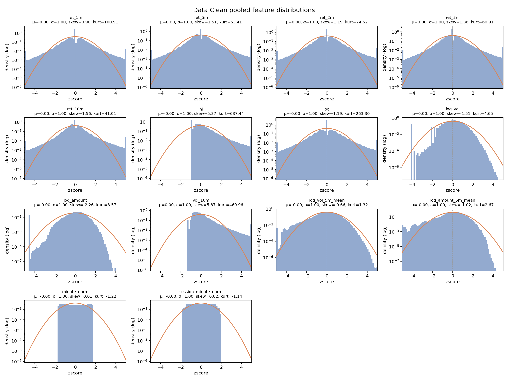

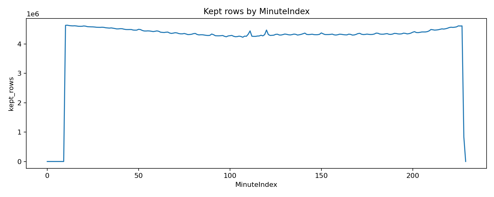

### 5. Model And Method Audit

每个 best checkpoint 的 metadata 均记录了 effective architecture 和真实 trainable parameter count。当前最佳 arm 只有 55,425 参数，baseline_current 有 1,808,129 参数。

| arm_id | model_class | representation | input_shape | trainable_parameters | gru_hidden_size | gru_num_layers | hidden_dims | stopped_reason | best_iter | best_target_iter |
| --- | --- | --- | --- | --- | --- | --- | --- | --- | --- | --- |
| gru128_l1_mlpnone | GruMlpRegressor | last_hidden of final GRU layer | (B, T=60, F=14) | 55425 | 128 | 1 | [] | early_stop | 20000 | 30000 |
| gru192_l2_mlpnone | GruMlpRegressor | last_hidden of final GRU layer | (B, T=60, F=14) | 342337 | 192 | 2 | [] | early_stop | 10000 | 20000 |
| gru128_l2_mlpnone | GruMlpRegressor | last_hidden of final GRU layer | (B, T=60, F=14) | 154497 | 128 | 2 | [] | early_stop | 10000 | 20000 |
| gru256_l1_mlp256 | GruMlpRegressor | last_hidden of final GRU layer | (B, T=60, F=14) | 274945 | 256 | 1 | [256] | early_stop | 10000 | 20000 |
| gru192_l1_mlp128 | GruMlpRegressor | last_hidden of final GRU layer | (B, T=60, F=14) | 144641 | 192 | 1 | [128] | early_stop | 10000 | 20000 |
| gru192_l2_mlp128 | GruMlpRegressor | last_hidden of final GRU layer | (B, T=60, F=14) | 366977 | 192 | 2 | [128] | early_stop | 20000 | 30000 |
| gru256_l2_mlp128 | GruMlpRegressor | last_hidden of final GRU layer | (B, T=60, F=14) | 636673 | 256 | 2 | [128] | early_stop | 10000 | 20000 |
| gru256_l1_mlp128 | GruMlpRegressor | last_hidden of final GRU layer | (B, T=60, F=14) | 241921 | 256 | 1 | [128] | early_stop | 30000 | 40000 |
| gru128_l1_mlp256 | GruMlpRegressor | last_hidden of final GRU layer | (B, T=60, F=14) | 88577 | 128 | 1 | [256] | early_stop | 20000 | 30000 |
| gru192_l2_mlp256 | GruMlpRegressor | last_hidden of final GRU layer | (B, T=60, F=14) | 391809 | 192 | 2 | [256] | early_stop | 20000 | 30000 |
| gru128_l2_mlp256 | GruMlpRegressor | last_hidden of final GRU layer | (B, T=60, F=14) | 187649 | 128 | 2 | [256] | early_stop | 20000 | 30000 |
| baseline_current | GruMlpRegressor | last_hidden of final GRU layer | (B, T=60, F=14) | 1808129 | 384 | 2 | [512, 512] | early_stop | 30000 | 40000 |
| gru192_l1_mlp256 | GruMlpRegressor | last_hidden of final GRU layer | (B, T=60, F=14) | 169473 | 192 | 1 | [256] | early_stop | 10000 | 20000 |
| gru128_l2_mlp128 | GruMlpRegressor | last_hidden of final GRU layer | (B, T=60, F=14) | 171009 | 128 | 2 | [128] | early_stop | 10000 | 20000 |
| gru256_l2_mlpnone | GruMlpRegressor | last_hidden of final GRU layer | (B, T=60, F=14) | 603905 | 256 | 2 | [] | early_stop | 10000 | 20000 |
| gru256_l2_mlp256 | GruMlpRegressor | last_hidden of final GRU layer | (B, T=60, F=14) | 669697 | 256 | 2 | [256] | early_stop | 20000 | 30000 |
| gru256_l1_mlpnone | GruMlpRegressor | last_hidden of final GRU layer | (B, T=60, F=14) | 209153 | 256 | 1 | [] | max_iter | 50000 | 60000 |
| gru128_l1_mlp128 | GruMlpRegressor | last_hidden of final GRU layer | (B, T=60, F=14) | 71937 | 128 | 1 | [128] | max_iter | 50000 | 60000 |
| gru192_l1_mlpnone | GruMlpRegressor | last_hidden of final GRU layer | (B, T=60, F=14) | 120001 | 192 | 1 | [] | max_iter | 50000 | 60000 |

## 主要结果

### 3. Architecture Ranking And Signal Quality

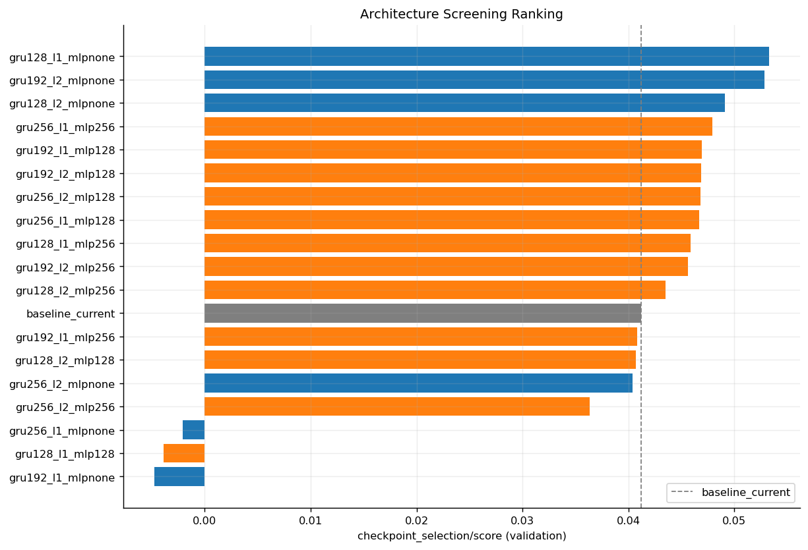

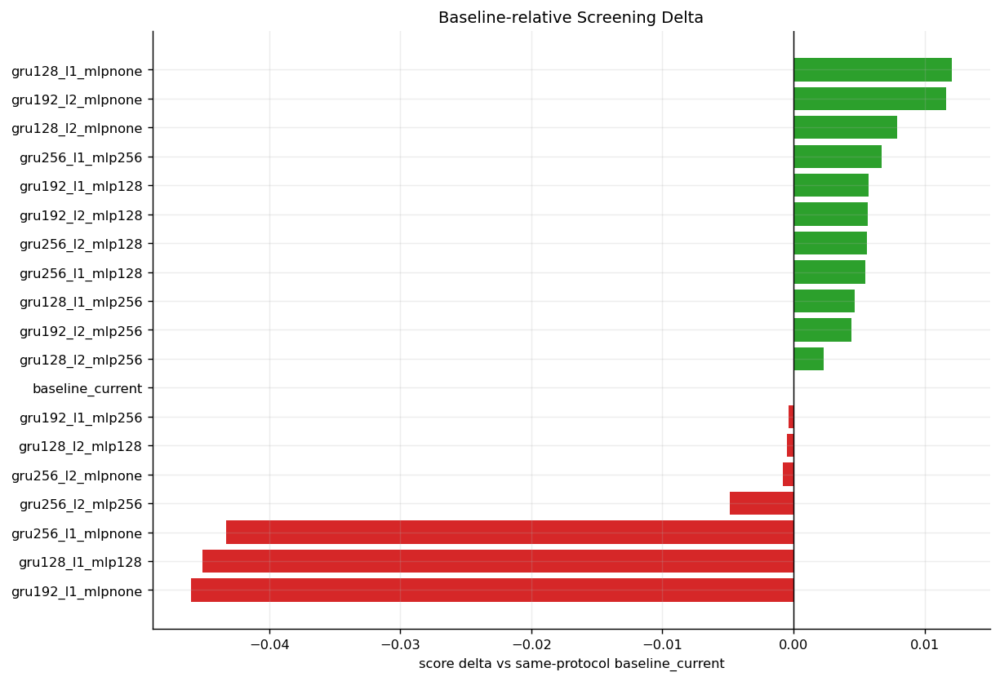

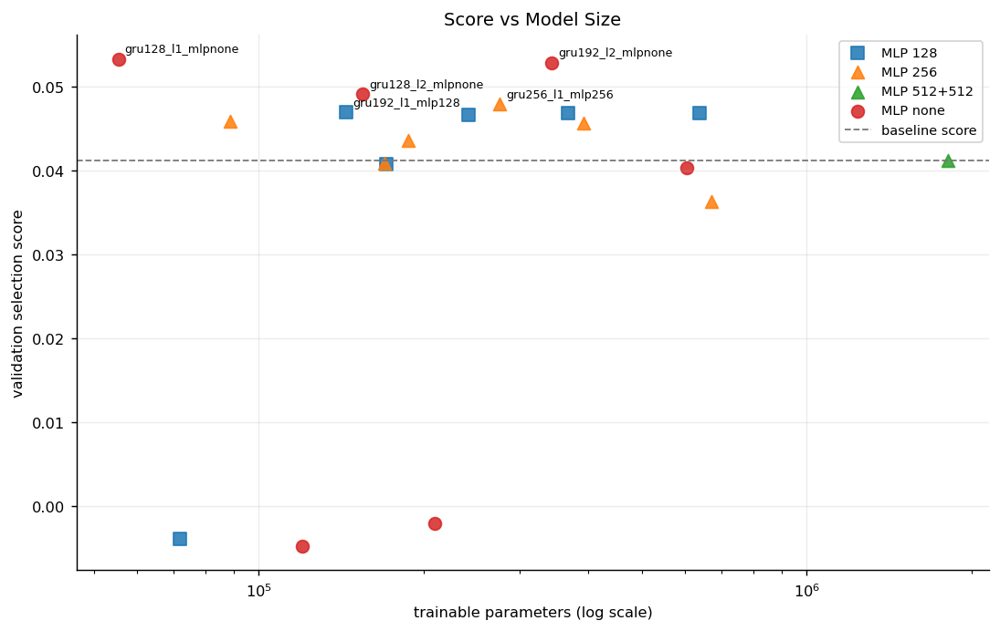

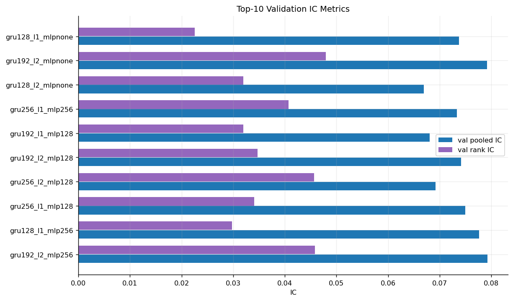

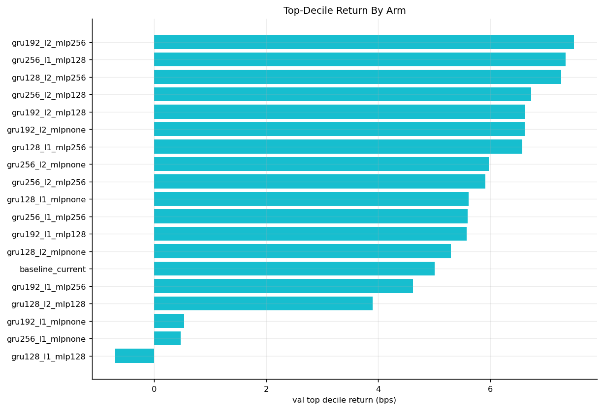

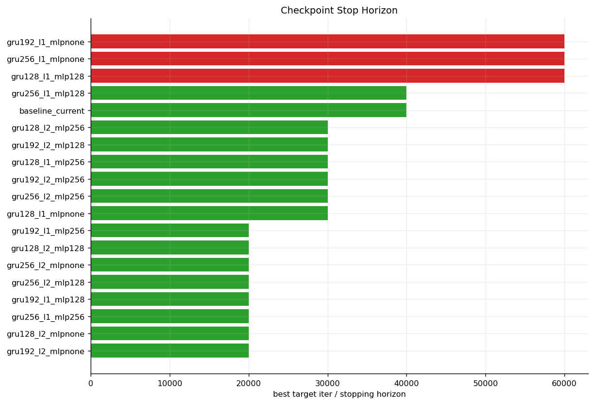

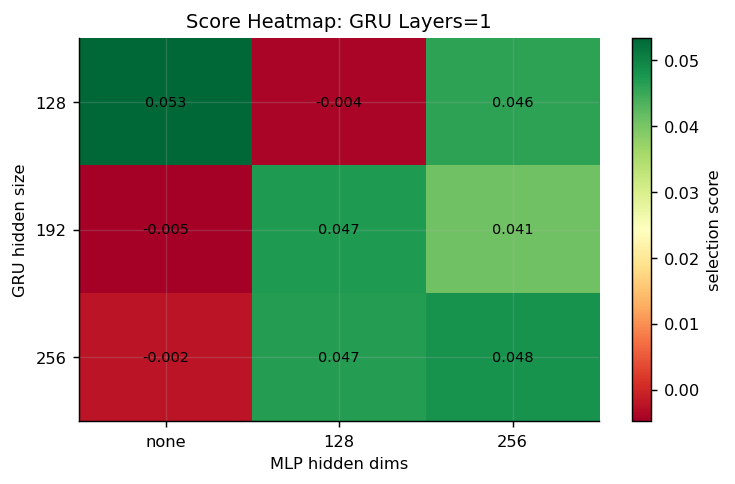

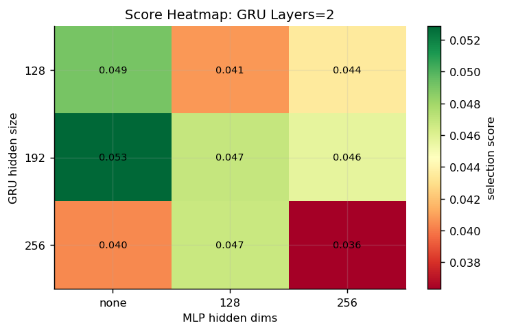

### Detailed ranking table

| rank | arm_id | role | gru_hidden_size | gru_num_layers | hidden_dims | trainable_parameters | stopped_reason | best_score | delta_vs_baseline_score | best_iter | best_target_iter | val_pooled_ic | val_rank_ic | val_top_decile_return_bps | val_top10_hit_rate |
| --- | --- | --- | --- | --- | --- | --- | --- | --- | --- | --- | --- | --- | --- | --- | --- |
| 1 | gru128_l1_mlpnone | screening_candidate | 128 | 1 | [] | 55425 | early_stop | 0.053298 | 0.012096 | 20000 | 30000 | 0.073729 | 0.022572 | 5.616499 | 0.494496 |
| 2 | gru192_l2_mlpnone | screening_candidate | 192 | 2 | [] | 342337 | early_stop | 0.052873 | 0.011671 | 10000 | 20000 | 0.079203 | 0.047946 | 6.609865 | 0.502223 |
| 3 | gru128_l2_mlpnone | screening_candidate | 128 | 2 | [] | 154497 | early_stop | 0.049113 | 0.007912 | 10000 | 20000 | 0.066896 | 0.031981 | 5.299078 | 0.496108 |
| 4 | gru256_l1_mlp256 | screening_candidate | 256 | 1 | [256] | 274945 | early_stop | 0.047906 | 0.006704 | 10000 | 20000 | 0.073348 | 0.040706 | 5.594972 | 0.496339 |
| 5 | gru192_l1_mlp128 | screening_candidate | 192 | 1 | [128] | 144641 | early_stop | 0.046947 | 0.005746 | 10000 | 20000 | 0.068071 | 0.032004 | 5.575529 | 0.493731 |
| 6 | gru192_l2_mlp128 | screening_candidate | 192 | 2 | [128] | 366977 | early_stop | 0.046885 | 0.005683 | 20000 | 30000 | 0.074181 | 0.034750 | 6.624649 | 0.502774 |
| 7 | gru256_l2_mlp128 | screening_candidate | 256 | 2 | [128] | 636673 | early_stop | 0.046794 | 0.005593 | 10000 | 20000 | 0.069223 | 0.045693 | 6.730357 | 0.504412 |
| 8 | gru256_l1_mlp128 | screening_candidate | 256 | 1 | [128] | 241921 | early_stop | 0.046652 | 0.005451 | 30000 | 40000 | 0.074928 | 0.034100 | 7.343633 | 0.504211 |
| 9 | gru128_l1_mlp256 | screening_candidate | 128 | 1 | [256] | 88577 | early_stop | 0.045845 | 0.004644 | 20000 | 30000 | 0.077636 | 0.029802 | 6.574421 | 0.498738 |
| 10 | gru192_l2_mlp256 | screening_candidate | 192 | 2 | [256] | 391809 | early_stop | 0.045650 | 0.004449 | 20000 | 30000 | 0.079269 | 0.045860 | 7.494939 | 0.507937 |
| 11 | gru128_l2_mlp256 | screening_candidate | 128 | 2 | [256] | 187649 | early_stop | 0.043534 | 0.002333 | 20000 | 30000 | 0.077549 | 0.046768 | 7.266849 | 0.504029 |
| 12 | baseline_current | baseline_control | 384 | 2 | [512, 512] | 1808129 | early_stop | 0.041201 | 0.000000 | 30000 | 40000 | 0.063214 | 0.025863 | 5.005648 | 0.491358 |
| 13 | gru192_l1_mlp256 | screening_candidate | 192 | 1 | [256] | 169473 | early_stop | 0.040807 | -0.000394 | 10000 | 20000 | 0.068795 | 0.026231 | 4.618936 | 0.485372 |
| 14 | gru128_l2_mlp128 | screening_candidate | 128 | 2 | [128] | 171009 | early_stop | 0.040721 | -0.000480 | 10000 | 20000 | 0.068653 | 0.024160 | 3.896069 | 0.484077 |
| 15 | gru256_l2_mlpnone | screening_candidate | 256 | 2 | [] | 603905 | early_stop | 0.040364 | -0.000838 | 10000 | 20000 | 0.073556 | 0.032739 | 5.974122 | 0.497370 |
| 16 | gru256_l2_mlp256 | screening_candidate | 256 | 2 | [256] | 669697 | early_stop | 0.036324 | -0.004877 | 20000 | 30000 | 0.057820 | 0.027207 | 5.915640 | 0.495160 |
| 17 | gru256_l1_mlpnone | screening_candidate | 256 | 1 | [] | 209153 | max_iter | -0.002085 | -0.043286 | 50000 | 60000 | -0.010347 | -0.000790 | 0.476033 | 0.478934 |
| 18 | gru128_l1_mlp128 | screening_candidate | 128 | 1 | [128] | 71937 | max_iter | -0.003917 | -0.045118 | 50000 | 60000 | -0.013111 | -0.005763 | -0.697293 | 0.471183 |
| 19 | gru192_l1_mlpnone | screening_candidate | 192 | 1 | [] | 120001 | max_iter | -0.004785 | -0.045987 | 50000 | 60000 | -0.013012 | -0.000816 | 0.534340 | 0.478473 |

### 4. Checkpoint Selection Diagnostics

本节对应模板中的 Train Metrics / Checkpoint Selection：使用每个 run 的 `checkpoint_brief_index.csv` 和 screening status 重建 checkpoint curves。空心 marker 表示该 arm 的 selected/best checkpoint。

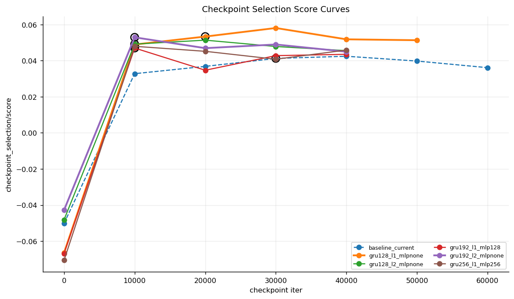

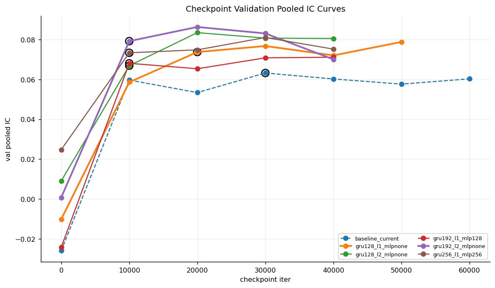

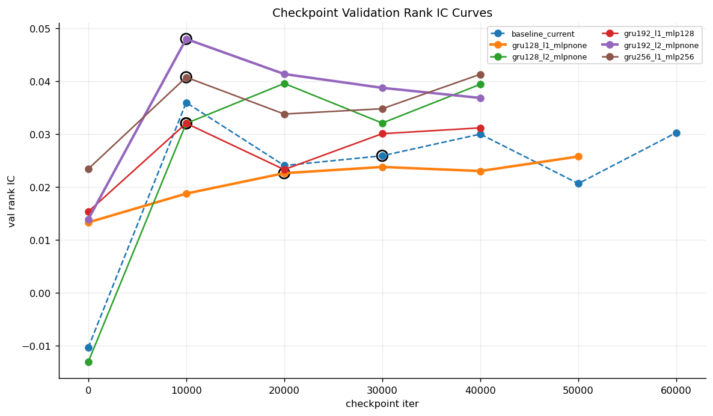

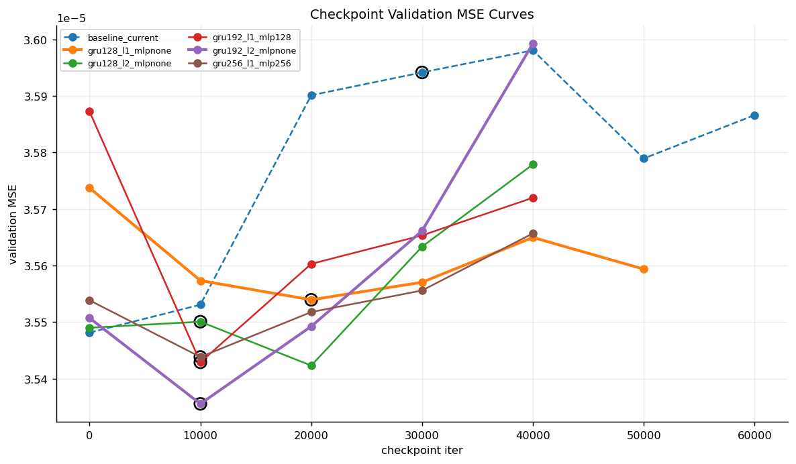

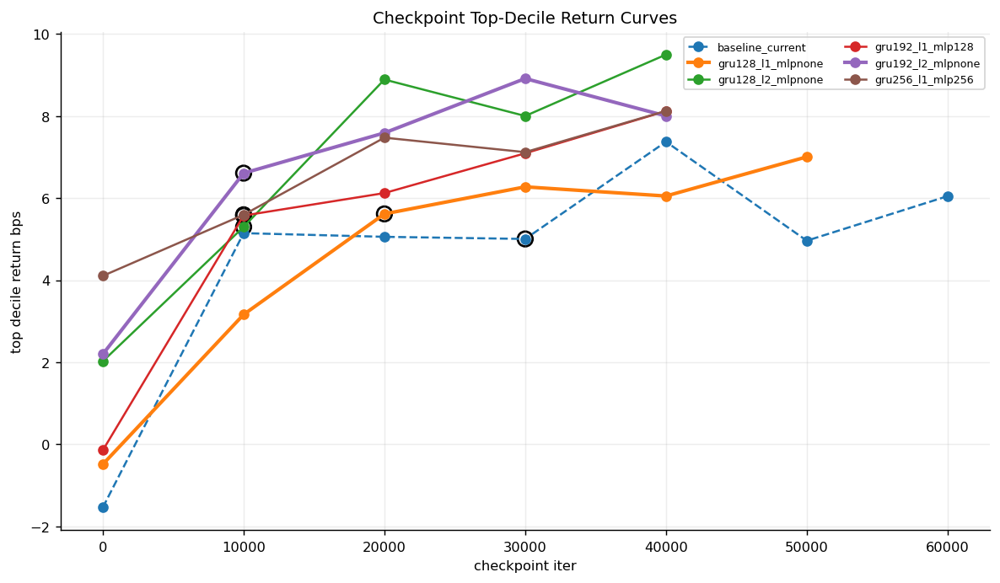

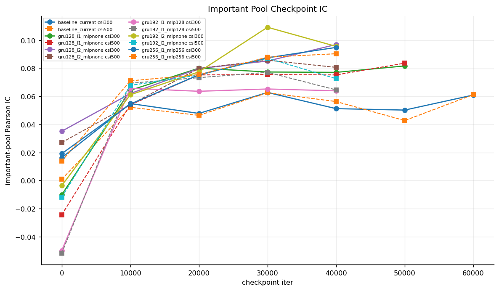

### Checkpoint curve rows: top candidates + baseline

| arm_id | iter | selected | selection_value | val_pooled_ic | val_rank_ic | val_mse | val_top_decile_return_bps | val_top10_hit_rate | val_csi300_pearson_ic | val_csi500_pearson_ic |
| --- | --- | --- | --- | --- | --- | --- | --- | --- | --- | --- |
| baseline_current | 0 | False | -0.050104 | -0.025899 | -0.010434 | 0.000035 | -1.540227 | 0.450716 | 0.016288 | 0.000887 |
| baseline_current | 10000 | False | 0.032743 | 0.059670 | 0.035922 | 0.000036 | 5.147152 | 0.496357 | 0.054918 | 0.052261 |
| baseline_current | 20000 | False | 0.036785 | 0.053389 | 0.024015 | 0.000036 | 5.057570 | 0.491219 | 0.047875 | 0.046494 |
| baseline_current | 30000 | True | 0.041201 | 0.063214 | 0.025863 | 0.000036 | 5.005648 | 0.491358 | 0.062817 | 0.062634 |
| baseline_current | 40000 | False | 0.042395 | 0.060230 | 0.029956 | 0.000036 | 7.375635 | 0.505221 | 0.051278 | 0.056343 |
| baseline_current | 50000 | False | 0.039738 | 0.057638 | 0.020607 | 0.000036 | 4.962986 | 0.489933 | 0.050262 | 0.042794 |
| baseline_current | 60000 | False | 0.036073 | 0.060284 | 0.030236 | 0.000036 | 6.048611 | 0.499194 | 0.060982 | 0.061255 |
| gru128_l1_mlpnone | 0 | False | -0.066436 | -0.010134 | 0.013262 | 0.000036 | -0.489607 | 0.471090 | -0.010219 | -0.024426 |
| gru128_l1_mlpnone | 10000 | False | 0.048887 | 0.058610 | 0.018713 | 0.000036 | 3.162211 | 0.486663 | 0.064396 | 0.053988 |
| gru128_l1_mlpnone | 20000 | True | 0.053298 | 0.073729 | 0.022572 | 0.000036 | 5.616499 | 0.494496 | 0.080140 | 0.075319 |
| gru128_l1_mlpnone | 30000 | False | 0.058038 | 0.076749 | 0.023749 | 0.000036 | 6.275705 | 0.496251 | 0.077414 | 0.075605 |
| gru128_l1_mlpnone | 40000 | False | 0.051770 | 0.072034 | 0.022978 | 0.000036 | 6.052217 | 0.494745 | 0.077147 | 0.075331 |
| gru128_l1_mlpnone | 50000 | False | 0.051271 | 0.078792 | 0.025721 | 0.000036 | 7.006698 | 0.498188 | 0.081745 | 0.083705 |
| gru128_l2_mlpnone | 0 | False | -0.048137 | 0.009099 | -0.013136 | 0.000035 | 2.023579 | 0.461711 | 0.035159 | 0.027123 |
| gru128_l2_mlpnone | 10000 | True | 0.049113 | 0.066896 | 0.031981 | 0.000036 | 5.299078 | 0.496108 | 0.062038 | 0.054170 |
| gru128_l2_mlpnone | 20000 | False | 0.051308 | 0.083455 | 0.039537 | 0.000035 | 8.892368 | 0.509794 | 0.079907 | 0.079973 |
| gru128_l2_mlpnone | 30000 | False | 0.047794 | 0.080723 | 0.032049 | 0.000036 | 8.003811 | 0.504809 | 0.085224 | 0.085829 |
| gru128_l2_mlpnone | 40000 | False | 0.045501 | 0.080506 | 0.039371 | 0.000036 | 9.500505 | 0.511288 | 0.097014 | 0.080721 |
| gru192_l1_mlp128 | 0 | False | -0.066829 | -0.024169 | 0.015279 | 0.000036 | -0.146615 | 0.451165 | -0.049928 | -0.051840 |
| gru192_l1_mlp128 | 10000 | True | 0.046947 | 0.068071 | 0.032004 | 0.000035 | 5.575529 | 0.493731 | 0.065806 | 0.069443 |
| gru192_l1_mlp128 | 20000 | False | 0.034649 | 0.065348 | 0.023252 | 0.000036 | 6.124142 | 0.496446 | 0.063662 | 0.073376 |
| gru192_l1_mlp128 | 30000 | False | 0.042738 | 0.070816 | 0.030039 | 0.000036 | 7.094166 | 0.498678 | 0.065298 | 0.077178 |
| gru192_l1_mlp128 | 40000 | False | 0.043474 | 0.071133 | 0.031139 | 0.000036 | 8.122427 | 0.504611 | 0.063996 | 0.064645 |
| gru192_l2_mlpnone | 0 | False | -0.042801 | 0.000770 | 0.013813 | 0.000036 | 2.195422 | 0.466510 | -0.003561 | -0.011977 |
| gru192_l2_mlpnone | 10000 | True | 0.052873 | 0.079203 | 0.047946 | 0.000035 | 6.609865 | 0.502223 | 0.061167 | 0.067853 |
| gru192_l2_mlpnone | 20000 | False | 0.046881 | 0.086301 | 0.041313 | 0.000035 | 7.591030 | 0.506260 | 0.077513 | 0.075245 |
| gru192_l2_mlpnone | 30000 | False | 0.048911 | 0.083066 | 0.038703 | 0.000036 | 8.916454 | 0.508494 | 0.109317 | 0.087218 |
| gru192_l2_mlpnone | 40000 | False | 0.044906 | 0.070048 | 0.036798 | 0.000036 | 8.005159 | 0.503546 | 0.095681 | 0.072660 |
| gru256_l1_mlp256 | 0 | False | -0.070565 | 0.024748 | 0.023358 | 0.000036 | 4.105384 | 0.491588 | 0.019155 | 0.013865 |
| gru256_l1_mlp256 | 10000 | True | 0.047906 | 0.073348 | 0.040706 | 0.000035 | 5.594972 | 0.496339 | 0.054552 | 0.071090 |
| gru256_l1_mlp256 | 20000 | False | 0.045126 | 0.074830 | 0.033754 | 0.000036 | 7.475224 | 0.501625 | 0.075378 | 0.075528 |
| gru256_l1_mlp256 | 30000 | False | 0.040744 | 0.081019 | 0.034757 | 0.000036 | 7.121752 | 0.499111 | 0.087557 | 0.087967 |
| gru256_l1_mlp256 | 40000 | False | 0.045820 | 0.075204 | 0.041267 | 0.000036 | 8.128162 | 0.506138 | 0.094947 | 0.090433 |

## 限制与适用边界

### 6. Comparability And Missing Template Sections

- 本轮只做 validation screening，没有 test/full evaluation。因此模板中的 Monthly IC、Goodness of Fit、Trading And Cost、ADV liquidity、portfolio cost sensitivity 等 test/report-only 图表没有新生成，不能从本轮 artifacts 直接写 test 结论。
- 报告保留 checkpoint selection、validation IC/RankIC、top-decile return、important-pool checkpoint IC、data-clean overview、model/method cards 这些与 screening 直接相关的模板图表。
- min_delta=0.0 会让弱 arm 因微幅改善跑到 max_iter；max_iter 不等于模型更好。

## 结论

结论与后续事项以历史原版已记录的结果为准，本次迁移不新增研究判断。

## 附录

### 7. Cleanup Manifest

报告生成后，以下缓存可删除而不影响本报告和 compact summary 写作。删除会影响重跑 data prep、resume、追加 per-row/daily 细分分析。

| category | size_gib | path | reason | impact |
| --- | --- | --- | --- | --- |
| prepared_npz_source | 166.726 | /scratch/maomao/model-structure-1min-runs/gru128_l1_mlpnone-seed7/date_ranges/artifacts/npz | shared prepared train/val/test tensors; report now uses compact summaries | resume/re-eval needs data prep rerun |
| raw_cache | 55.168 | /scratch/maomao/model-structure-1min-runs/raw_cache_vwap_paired_model_structure_1min | raw daily cache used to speed data prep only | rebuild needed if data prep reruns |
| tmp_failed_or_interrupted | 1.386 | /tmp/model-structure-1min-runs-bad-20260723150845 | old failed/interrupted scratch output | no impact on current report |
| eval_val_predictions | 1.189 | /scratch/maomao/model-structure-1min-runs/gru256_l1_mlpnone-seed7/date_ranges/run/eval_val | per-checkpoint validation prediction feather files; checkpoint metrics are already compacted | fine-grained per-row/daily re-analysis would need re-eval |
| eval_val_predictions | 1.188 | /scratch/maomao/model-structure-1min-runs/gru192_l1_mlpnone-seed7/date_ranges/run/eval_val | per-checkpoint validation prediction feather files; checkpoint metrics are already compacted | fine-grained per-row/daily re-analysis would need re-eval |
| eval_val_predictions | 1.184 | /scratch/maomao/model-structure-1min-runs/gru128_l1_mlp128-seed7/date_ranges/run/eval_val | per-checkpoint validation prediction feather files; checkpoint metrics are already compacted | fine-grained per-row/daily re-analysis would need re-eval |
| eval_val_predictions | 1.179 | /scratch/maomao/model-structure-1min-runs/gru256_l1_mlp128-seed7/date_ranges/run/eval_val | per-checkpoint validation prediction feather files; checkpoint metrics are already compacted | fine-grained per-row/daily re-analysis would need re-eval |
| eval_val_predictions | 1.172 | /scratch/maomao/model-structure-1min-runs/baseline_current-seed7/date_ranges/run/eval_val | per-checkpoint validation prediction feather files; checkpoint metrics are already compacted | fine-grained per-row/daily re-analysis would need re-eval |
| eval_val_predictions | 1.020 | /scratch/maomao/model-structure-1min-runs/gru128_l1_mlpnone-seed7/date_ranges/run/eval_val | per-checkpoint validation prediction feather files; checkpoint metrics are already compacted | fine-grained per-row/daily re-analysis would need re-eval |
| eval_val_predictions | 1.015 | /scratch/maomao/model-structure-1min-runs/gru128_l1_mlp256-seed7/date_ranges/run/eval_val | per-checkpoint validation prediction feather files; checkpoint metrics are already compacted | fine-grained per-row/daily re-analysis would need re-eval |
| eval_val_predictions | 1.003 | /scratch/maomao/model-structure-1min-runs/gru192_l2_mlp128-seed7/date_ranges/run/eval_val | per-checkpoint validation prediction feather files; checkpoint metrics are already compacted | fine-grained per-row/daily re-analysis would need re-eval |
| eval_val_predictions | 1.001 | /scratch/maomao/model-structure-1min-runs/gru128_l2_mlp256-seed7/date_ranges/run/eval_val | per-checkpoint validation prediction feather files; checkpoint metrics are already compacted | fine-grained per-row/daily re-analysis would need re-eval |
| eval_val_predictions | 0.999 | /scratch/maomao/model-structure-1min-runs/gru192_l2_mlp256-seed7/date_ranges/run/eval_val | per-checkpoint validation prediction feather files; checkpoint metrics are already compacted | fine-grained per-row/daily re-analysis would need re-eval |
| eval_val_predictions | 0.998 | /scratch/maomao/model-structure-1min-runs/gru256_l2_mlp256-seed7/date_ranges/run/eval_val | per-checkpoint validation prediction feather files; checkpoint metrics are already compacted | fine-grained per-row/daily re-analysis would need re-eval |
| eval_val_predictions | 0.850 | /scratch/maomao/model-structure-1min-runs/gru192_l2_mlpnone-seed7/date_ranges/run/eval_val | per-checkpoint validation prediction feather files; checkpoint metrics are already compacted | fine-grained per-row/daily re-analysis would need re-eval |
| eval_val_predictions | 0.848 | /scratch/maomao/model-structure-1min-runs/gru256_l2_mlpnone-seed7/date_ranges/run/eval_val | per-checkpoint validation prediction feather files; checkpoint metrics are already compacted | fine-grained per-row/daily re-analysis would need re-eval |
| eval_val_predictions | 0.846 | /scratch/maomao/model-structure-1min-runs/gru128_l2_mlpnone-seed7/date_ranges/run/eval_val | per-checkpoint validation prediction feather files; checkpoint metrics are already compacted | fine-grained per-row/daily re-analysis would need re-eval |
| eval_val_predictions | 0.842 | /scratch/maomao/model-structure-1min-runs/gru256_l1_mlp256-seed7/date_ranges/run/eval_val | per-checkpoint validation prediction feather files; checkpoint metrics are already compacted | fine-grained per-row/daily re-analysis would need re-eval |
| eval_val_predictions | 0.841 | /scratch/maomao/model-structure-1min-runs/gru192_l1_mlp256-seed7/date_ranges/run/eval_val | per-checkpoint validation prediction feather files; checkpoint metrics are already compacted | fine-grained per-row/daily re-analysis would need re-eval |
| eval_val_predictions | 0.840 | /scratch/maomao/model-structure-1min-runs/gru128_l2_mlp128-seed7/date_ranges/run/eval_val | per-checkpoint validation prediction feather files; checkpoint metrics are already compacted | fine-grained per-row/daily re-analysis would need re-eval |
| eval_val_predictions | 0.836 | /scratch/maomao/model-structure-1min-runs/gru192_l1_mlp128-seed7/date_ranges/run/eval_val | per-checkpoint validation prediction feather files; checkpoint metrics are already compacted | fine-grained per-row/daily re-analysis would need re-eval |
| eval_val_predictions | 0.829 | /scratch/maomao/model-structure-1min-runs/gru256_l2_mlp128-seed7/date_ranges/run/eval_val | per-checkpoint validation prediction feather files; checkpoint metrics are already compacted | fine-grained per-row/daily re-analysis would need re-eval |
| tmp_failed_or_interrupted | 0.529 | /tmp/model-structure-1min-runs-home-bad-20260723151321 | old failed/interrupted scratch output | no impact on current report |
| tmp_failed_or_interrupted | 0.495 | /tmp/model-structure-1min-interrupted-eval-20260723190524 | old failed/interrupted scratch output | no impact on current report |
| old_queue_logs | 0.001 | /scratch/maomao/model-structure-1min-runs/queue | superseded queue directories from failed/old launches | no impact; v3 queue logs retained |
| old_queue_logs | 0.000 | /scratch/maomao/model-structure-1min-runs/queue-gpu2-256-baseline | superseded queue directories from failed/old launches | no impact; v3 queue logs retained |
| old_queue_logs | 0.000 | /scratch/maomao/model-structure-1min-runs/queue-gpu1-192 | superseded queue directories from failed/old launches | no impact; v3 queue logs retained |
| old_queue_logs | 0.000 | /scratch/maomao/model-structure-1min-runs/queue-gpu0-128 | superseded queue directories from failed/old launches | no impact; v3 queue logs retained |
| old_queue_logs | 0.000 | /scratch/maomao/model-structure-1min-runs/queue-gpu0-128-v2 | superseded queue directories from failed/old launches | no impact; v3 queue logs retained |
| old_queue_logs | 0.000 | /scratch/maomao/model-structure-1min-runs/queue-gpu2-256-baseline-v2 | superseded queue directories from failed/old launches | no impact; v3 queue logs retained |
| old_queue_logs | 0.000 | /scratch/maomao/model-structure-1min-runs/queue-gpu1-192-v2 | superseded queue directories from failed/old launches | no impact; v3 queue logs retained |
| prepared_npz_symlink | 0.000 | /scratch/maomao/model-structure-1min-runs/gru192_l2_mlp128-seed7/date_ranges/artifacts/npz | symlink to deleted prepared npz source | no impact on compact report |
| prepared_npz_symlink | 0.000 | /scratch/maomao/model-structure-1min-runs/gru256_l2_mlp256-seed7/date_ranges/artifacts/npz | symlink to deleted prepared npz source | no impact on compact report |
| prepared_npz_symlink | 0.000 | /scratch/maomao/model-structure-1min-runs/gru256_l2_mlp128-seed7/date_ranges/artifacts/npz | symlink to deleted prepared npz source | no impact on compact report |
| prepared_npz_symlink | 0.000 | /scratch/maomao/model-structure-1min-runs/gru256_l1_mlpnone-seed7/date_ranges/artifacts/npz | symlink to deleted prepared npz source | no impact on compact report |
| prepared_npz_symlink | 0.000 | /scratch/maomao/model-structure-1min-runs/gru256_l1_mlp256-seed7/date_ranges/artifacts/npz | symlink to deleted prepared npz source | no impact on compact report |
| prepared_npz_symlink | 0.000 | /scratch/maomao/model-structure-1min-runs/gru256_l1_mlp128-seed7/date_ranges/artifacts/npz | symlink to deleted prepared npz source | no impact on compact report |
| prepared_npz_symlink | 0.000 | /scratch/maomao/model-structure-1min-runs/gru192_l2_mlpnone-seed7/date_ranges/artifacts/npz | symlink to deleted prepared npz source | no impact on compact report |
| prepared_npz_symlink | 0.000 | /scratch/maomao/model-structure-1min-runs/gru192_l2_mlp256-seed7/date_ranges/artifacts/npz | symlink to deleted prepared npz source | no impact on compact report |
| prepared_npz_symlink | 0.000 | /scratch/maomao/model-structure-1min-runs/gru192_l1_mlp128-seed7/date_ranges/artifacts/npz | symlink to deleted prepared npz source | no impact on compact report |
| prepared_npz_symlink | 0.000 | /scratch/maomao/model-structure-1min-runs/gru192_l1_mlpnone-seed7/date_ranges/artifacts/npz | symlink to deleted prepared npz source | no impact on compact report |
| prepared_npz_symlink | 0.000 | /scratch/maomao/model-structure-1min-runs/gru192_l1_mlp256-seed7/date_ranges/artifacts/npz | symlink to deleted prepared npz source | no impact on compact report |
| prepared_npz_symlink | 0.000 | /scratch/maomao/model-structure-1min-runs/gru128_l2_mlpnone-seed7/date_ranges/artifacts/npz | symlink to deleted prepared npz source | no impact on compact report |
| prepared_npz_symlink | 0.000 | /scratch/maomao/model-structure-1min-runs/gru128_l2_mlp256-seed7/date_ranges/artifacts/npz | symlink to deleted prepared npz source | no impact on compact report |
| prepared_npz_symlink | 0.000 | /scratch/maomao/model-structure-1min-runs/gru128_l2_mlp128-seed7/date_ranges/artifacts/npz | symlink to deleted prepared npz source | no impact on compact report |
| prepared_npz_symlink | 0.000 | /scratch/maomao/model-structure-1min-runs/gru128_l1_mlp256-seed7/date_ranges/artifacts/npz | symlink to deleted prepared npz source | no impact on compact report |
| prepared_npz_symlink | 0.000 | /scratch/maomao/model-structure-1min-runs/gru128_l1_mlp128-seed7/date_ranges/artifacts/npz | symlink to deleted prepared npz source | no impact on compact report |
| prepared_npz_symlink | 0.000 | /scratch/maomao/model-structure-1min-runs/baseline_current-seed7/date_ranges/artifacts/npz | symlink to deleted prepared npz source | no impact on compact report |
| prepared_npz_symlink | 0.000 | /scratch/maomao/model-structure-1min-runs/gru256_l2_mlpnone-seed7/date_ranges/artifacts/npz | symlink to deleted prepared npz source | no impact on compact report |

### Cleanup Executed

Cleanup was executed after report generation with the guarded manifest deletion script. Deleted rows: **49** ; deleted size: **242.985 GiB** ; post-cleanup run-root size: **519M** . The after-delete manifest is `tables/cleanup_manifest_after_delete.csv` .

Post-cleanup validation retained 19 `screening_status.yaml` , 19 `best_checkpoint.yaml` , 19 `checkpoint_brief_index.csv` , and 111 `run/ckpt/iter_*.pt` checkpoint files. Remaining deleted-cache counts are 0 `eval_val` , 0 `artifacts/npz` , and 0 raw-cache directories.

### 8. Artifact Appendix

- Detailed ranking CSV: tables/architecture_ranking_detailed.csv
- Checkpoint curve CSV: tables/checkpoint_curve_long.csv
- Early-stop history CSV: tables/early_stop_history_long.csv
- Cleanup manifest CSV: tables/cleanup_manifest_before_delete.csv
