## 摘要

feature_superset_v1 在不同切分和月份上的覆盖、分布与稳定性诊断。

### Health 状态

| status | split | FAIL | PASS | WARN |
| --- | --- | --- | --- | --- |
|  | train | 1 | 76 | 1 |
|  | val | 1 | 76 | 1 |
|  | test | 1 | 76 | 1 |

### 非 PASS 项

| split | feature | group | raw_mean_est | raw_std_est | raw_min | raw_max | bound_violation_rate | status | warnings |
| --- | --- | --- | --- | --- | --- | --- | --- | --- | --- |
| train | path_efficiency_60s | trade_core_v2 | 0.046932 | 0.293617 | 2.048118e-10 | 90.194268 | 0.005899 | FAIL | bound_violation_rate=0.0058985 |
| train | quote_present | quote_quality | 1.000000 | 0.000000 | 1.000000e+00 | 1.000000 | 0.000000 | WARN | near_constant |
| val | path_efficiency_60s | trade_core_v2 | 0.038158 | 0.252591 | 2.048118e-10 | 111.852955 | 0.004859 | FAIL | bound_violation_rate=0.004859 |
| val | quote_present | quote_quality | 1.000000 | 0.000000 | 1.000000e+00 | 1.000000 | 0.000000 | WARN | near_constant |
| test | path_efficiency_60s | trade_core_v2 | 0.044758 | 0.273953 | 2.048118e-10 | 200.099117 | 0.005008 | FAIL | bound_violation_rate=0.005008 |
| test | quote_present | quote_quality | 1.000000 | 0.000000 | 1.000000e+00 | 1.000000 | 0.000000 | WARN | near_constant |

## 研究背景与目标

本页是历史研究报告的统一模板版本。研究问题、实验定义、数据口径、表格和图像证据均沿用已校验的历史原版。

## 数据与方法

### 输入与 Split

| split | rows | endpoints | x_gb | months |
| --- | --- | --- | --- | --- |
| train | None | None | None |  |
| val | None | None | None |  |
| test | None | None | None |  |

## 主要结果

本 HTML 已内嵌全部 PNG 图片；可以单文件打开或移动。

本报告基于 `[artifact-root]/nn/baseline-1s-0720/feature_superset_v1_day_shard6_20260728T165004Z/fold_000/feature_health_all_splits_monthly` 生成。当前输入 78 维，health status 为 **FAIL** 。

核心结论：full 78 维可以作为模型上限实验；同时应做 clean/dedup ablation，优先处理 `path_efficiency_60s` 越界和 `quote_present` 常数问题。

### 分组统计

| group | feature_count | stats_fail_count | stats_warn_count | mean_finite_rate | max_abs_split_shift_z | max_abs_month_shift_z | mean_abs_month_shift_z |
| --- | --- | --- | --- | --- | --- | --- | --- |
| trade_core_v2 | 33 | 3 | 0 | 1.0 | 0.183604 | 0.429127 | 0.072779 |
| quote_state | 19 | 0 | 0 | 1.0 | 0.180243 | 0.432459 | 0.086739 |
| quote_quality | 7 | 0 | 3 | 1.0 | 0.128700 | 0.376646 | 0.082304 |
| order_cancel_flow | 19 | 0 | 0 | 1.0 | 0.165307 | 0.452949 | 0.081788 |

### 总览图

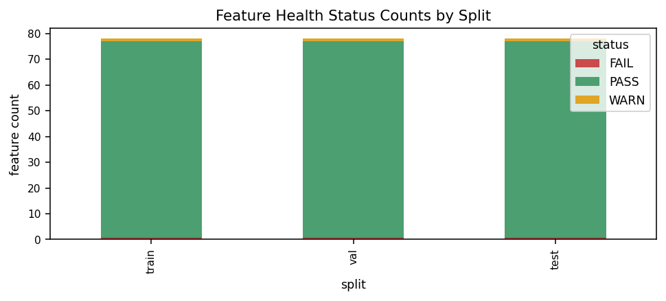

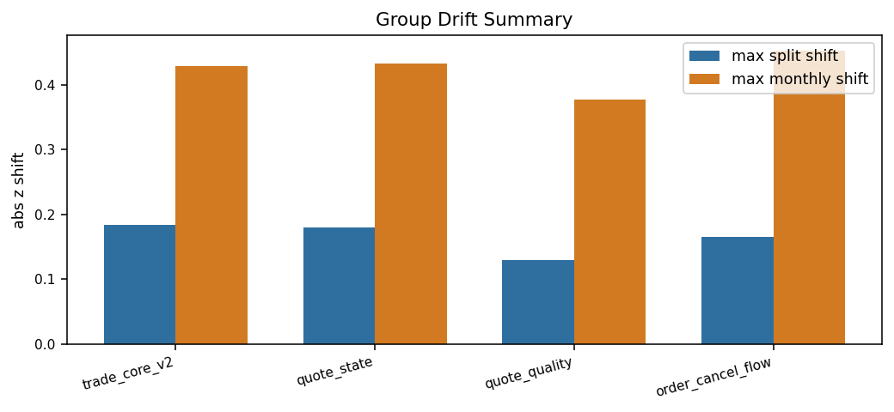

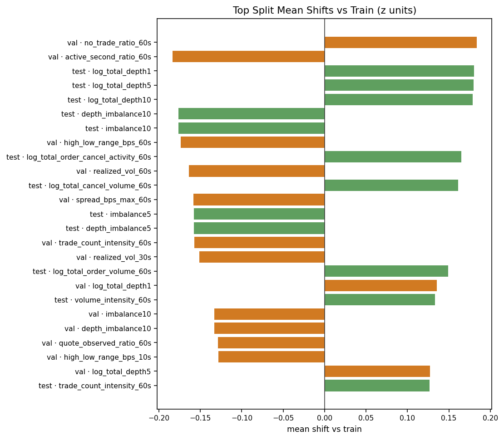

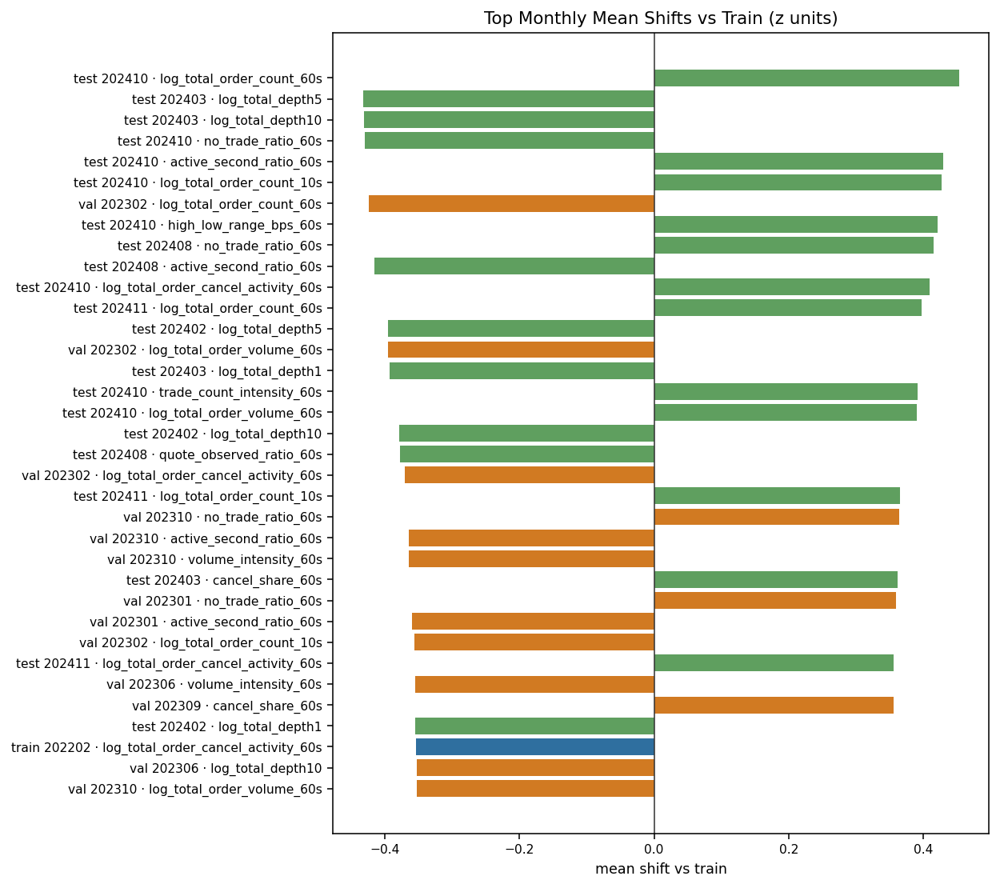

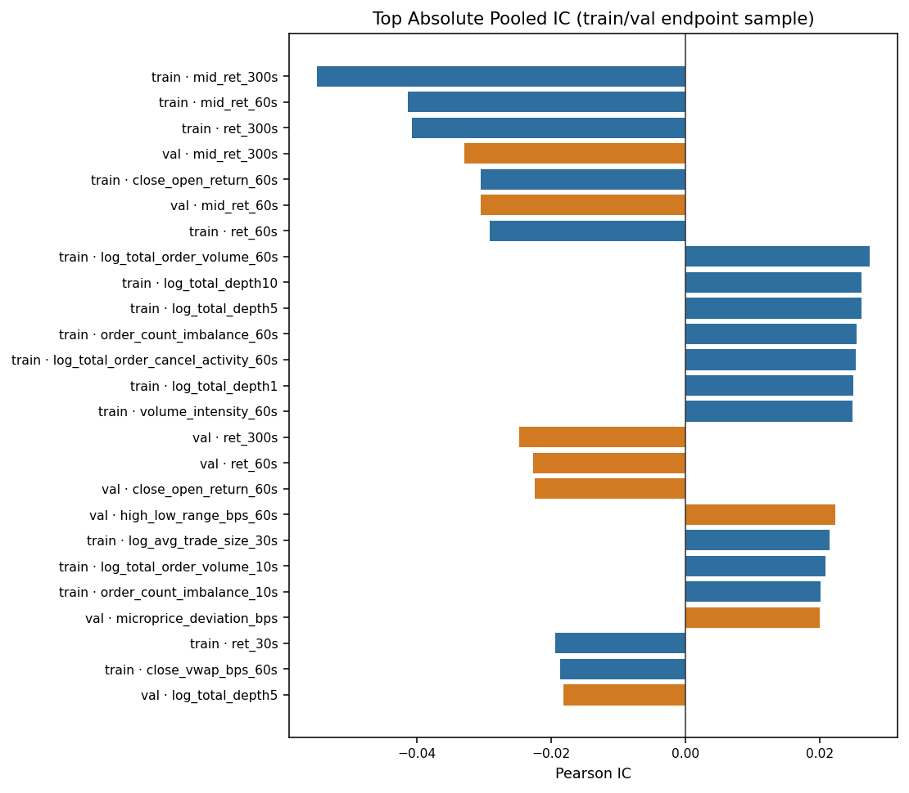

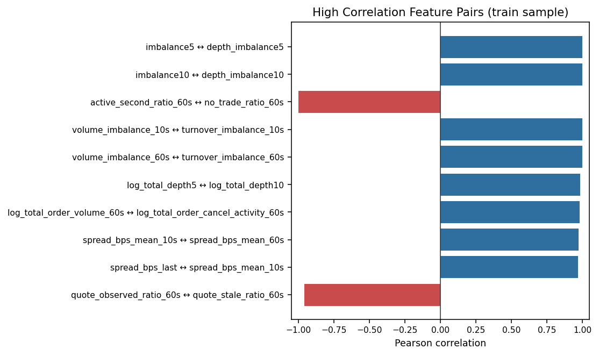

### 分组分布与月度漂移

### trade_core_v2

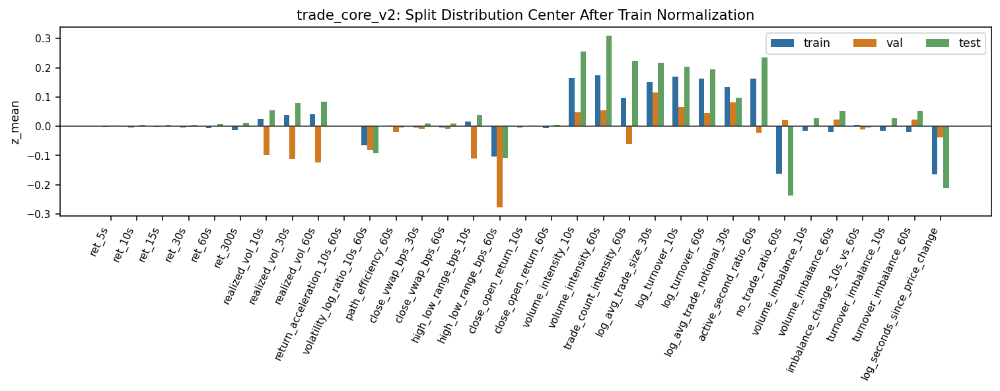

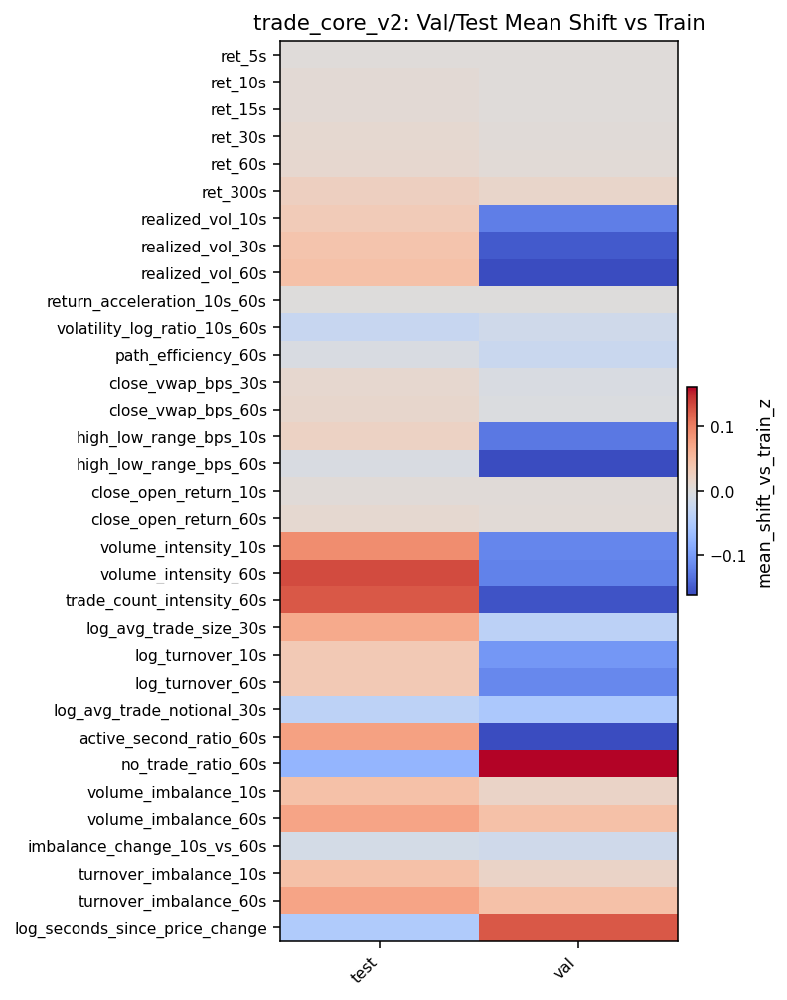

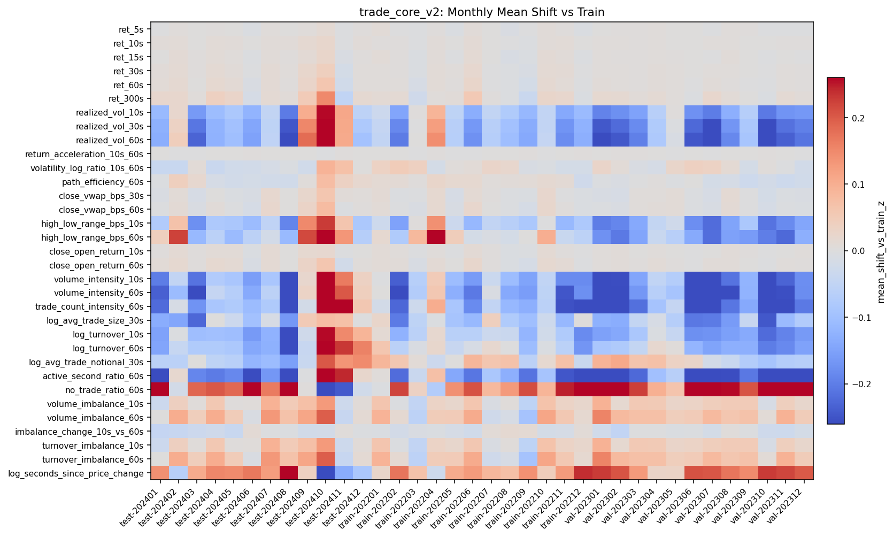

### quote_state

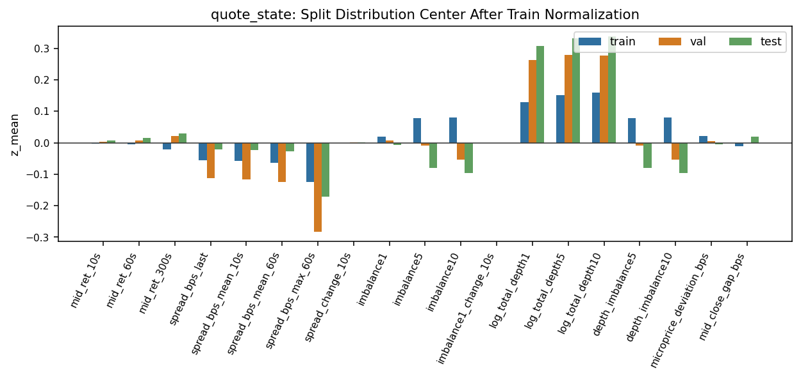

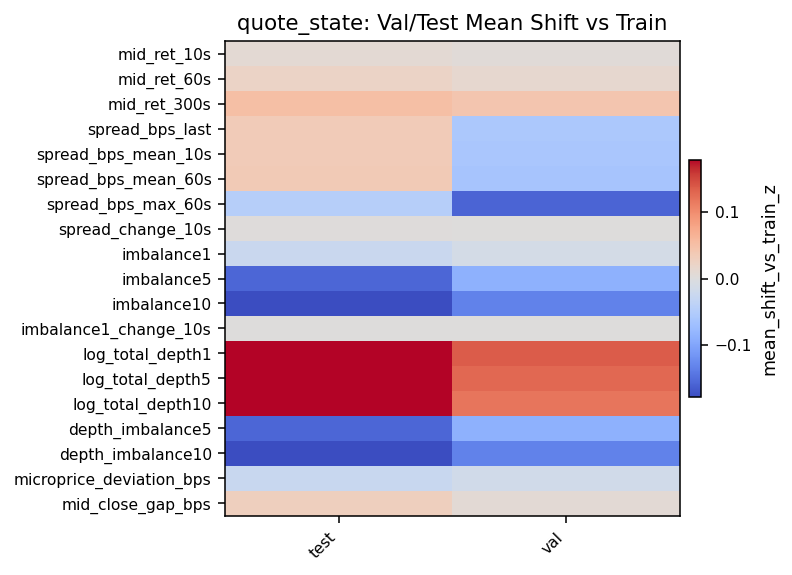

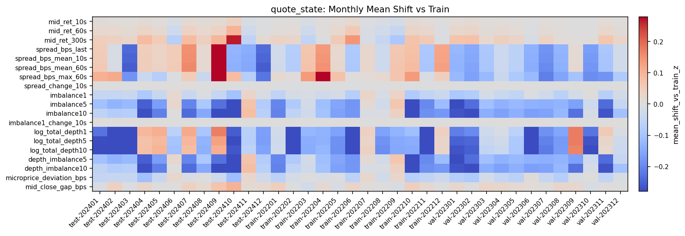

### quote_quality

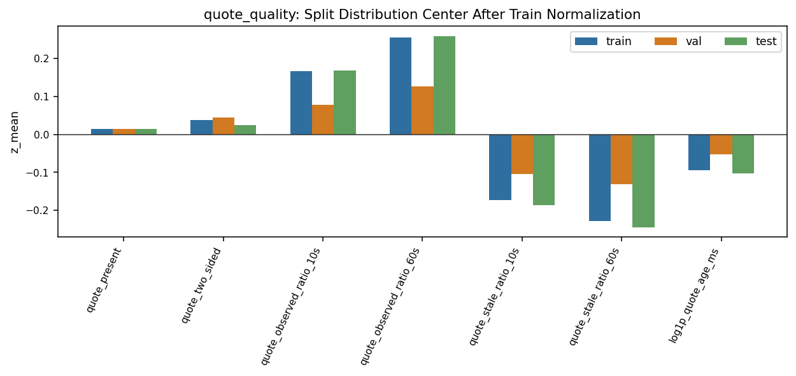

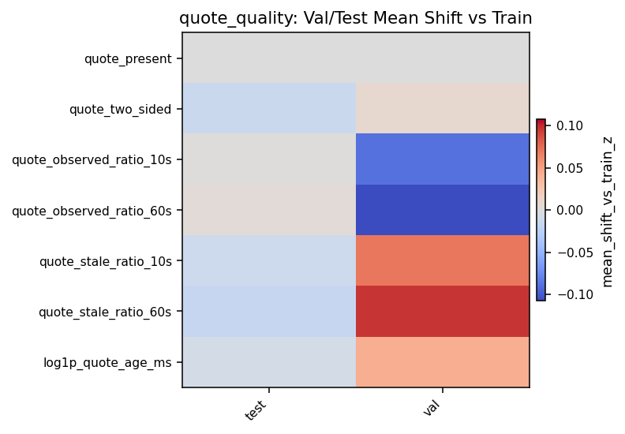

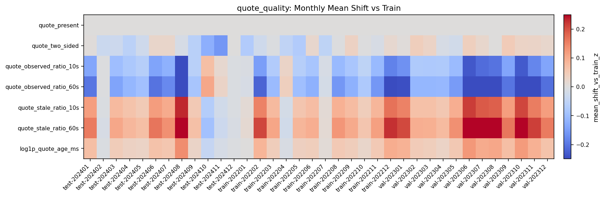

### order_cancel_flow

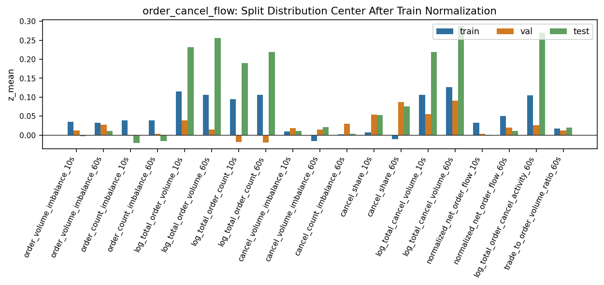

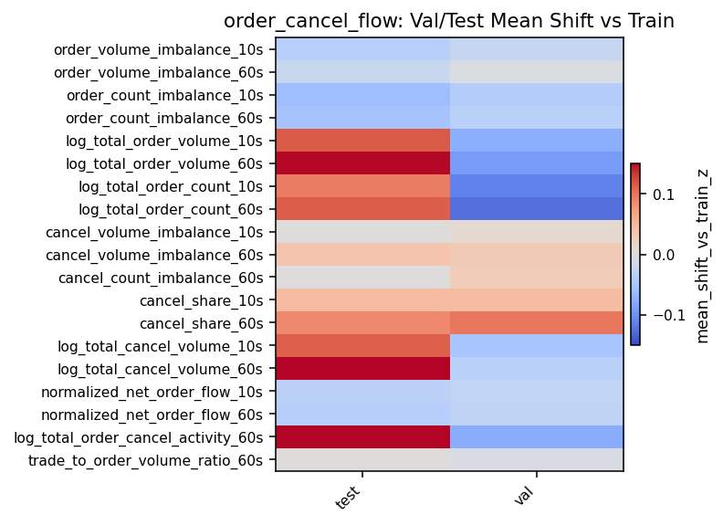

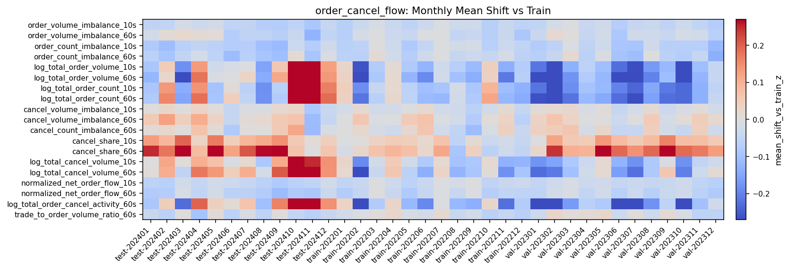

### 单特征分布图

")

")

")

")

")

")

")

")

")

")

")

")

")

")

")

")

")

")

")

")

")

")

")

")

")

")

")

")

")

")

")

")

")

")

")

")

")

")

")

")

")

")

")

")

")

")

")

")

")

")

")

")

")

")

")

")

")

")

")

")

")

")

")

")

")

")

")

")

")

")

")

")

")

")

")

")

")

")

### Train/Val/Test 差异

| split | feature | group | sample_rows | mean_shift_vs_train_z | abs_mean_shift_vs_train_z | std_ratio_vs_train |
| --- | --- | --- | --- | --- | --- | --- |
| val | no_trade_ratio_60s | trade_core_v2 | 2000000 | 0.183604 | 0.183604 | 0.929859 |
| val | active_second_ratio_60s | trade_core_v2 | 2000000 | -0.183604 | 0.183604 | 0.929859 |
| test | log_total_depth1 | quote_state | 2000000 | 0.180243 | 0.180243 | 0.983358 |
| test | log_total_depth5 | quote_state | 2000000 | 0.179628 | 0.179628 | 0.969574 |
| test | log_total_depth10 | quote_state | 2000000 | 0.178911 | 0.178911 | 0.962543 |
| test | depth_imbalance10 | quote_state | 2000000 | -0.176474 | 0.176474 | 0.928847 |
| test | imbalance10 | quote_state | 2000000 | -0.176474 | 0.176474 | 0.928847 |
| val | high_low_range_bps_60s | trade_core_v2 | 2000000 | -0.173585 | 0.173585 | 0.866643 |
| test | log_total_order_cancel_activity_60s | order_cancel_flow | 2000000 | 0.165307 | 0.165307 | 0.938678 |
| val | realized_vol_60s | trade_core_v2 | 2000000 | -0.164124 | 0.164124 | 0.854796 |
| test | log_total_cancel_volume_60s | order_cancel_flow | 2000000 | 0.161307 | 0.161307 | 0.947726 |
| val | spread_bps_max_60s | quote_state | 2000000 | -0.158308 | 0.158308 | 0.927857 |
| test | imbalance5 | quote_state | 2000000 | -0.157809 | 0.157809 | 0.948973 |
| test | depth_imbalance5 | quote_state | 2000000 | -0.157809 | 0.157809 | 0.948973 |
| val | trade_count_intensity_60s | trade_core_v2 | 2000000 | -0.157037 | 0.157037 | 0.935432 |
| val | realized_vol_30s | trade_core_v2 | 2000000 | -0.151464 | 0.151464 | 0.857595 |
| test | log_total_order_volume_60s | order_cancel_flow | 2000000 | 0.148910 | 0.148910 | 0.921001 |
| val | log_total_depth1 | quote_state | 2000000 | 0.135663 | 0.135663 | 1.028921 |
| test | volume_intensity_60s | trade_core_v2 | 2000000 | 0.133439 | 0.133439 | 0.960136 |
| val | imbalance10 | quote_state | 2000000 | -0.133243 | 0.133243 | 0.962951 |

### 逐月差异

| split | month | feature | group | sample_rows | mean_shift_vs_train_z | abs_mean_shift_vs_train_z | std_ratio_vs_train |
| --- | --- | --- | --- | --- | --- | --- | --- |
| test | 202410 | log_total_order_count_60s | order_cancel_flow | 250000 | 0.452949 | 0.452949 | 0.992803 |
| test | 202403 | log_total_depth5 | quote_state | 250000 | -0.432459 | 0.432459 | 1.015712 |
| test | 202403 | log_total_depth10 | quote_state | 250000 | -0.430985 | 0.430985 | 1.019087 |
| test | 202410 | no_trade_ratio_60s | trade_core_v2 | 250000 | -0.429127 | 0.429127 | 1.148859 |
| test | 202410 | active_second_ratio_60s | trade_core_v2 | 250000 | 0.429127 | 0.429127 | 1.148859 |
| test | 202410 | log_total_order_count_10s | order_cancel_flow | 250000 | 0.426435 | 0.426435 | 1.020254 |
| val | 202302 | log_total_order_count_60s | order_cancel_flow | 250000 | -0.423267 | 0.423267 | 0.975217 |
| test | 202410 | high_low_range_bps_60s | trade_core_v2 | 250000 | 0.421281 | 0.421281 | 1.600401 |
| test | 202408 | no_trade_ratio_60s | trade_core_v2 | 250000 | 0.415128 | 0.415128 | 0.850704 |
| test | 202408 | active_second_ratio_60s | trade_core_v2 | 250000 | -0.415128 | 0.415128 | 0.850704 |
| test | 202410 | log_total_order_cancel_activity_60s | order_cancel_flow | 250000 | 0.408805 | 0.408805 | 1.037499 |
| test | 202411 | log_total_order_count_60s | order_cancel_flow | 250000 | 0.396682 | 0.396682 | 1.031032 |
| test | 202402 | log_total_depth5 | quote_state | 250000 | -0.395506 | 0.395506 | 0.918357 |
| val | 202302 | log_total_order_volume_60s | order_cancel_flow | 250000 | -0.394647 | 0.394647 | 1.116662 |
| test | 202403 | log_total_depth1 | quote_state | 250000 | -0.393159 | 0.393159 | 0.993178 |
| test | 202410 | trade_count_intensity_60s | trade_core_v2 | 250000 | 0.391710 | 0.391710 | 1.189204 |
| test | 202410 | log_total_order_volume_60s | order_cancel_flow | 250000 | 0.390118 | 0.390118 | 1.027393 |
| test | 202402 | log_total_depth10 | quote_state | 250000 | -0.378562 | 0.378562 | 0.919760 |
| test | 202408 | quote_observed_ratio_60s | quote_quality | 250000 | -0.376646 | 0.376646 | 1.305039 |
| val | 202302 | log_total_order_cancel_activity_60s | order_cancel_flow | 250000 | -0.369807 | 0.369807 | 1.117289 |

### Feature-Label IC

| split | feature | group | sample_rows | pooled_pearson_ic |
| --- | --- | --- | --- | --- |
| train | mid_ret_300s | quote_state | 2000000 | -0.054897 |
| train | mid_ret_60s | quote_state | 2000000 | -0.041283 |
| train | ret_300s | trade_core_v2 | 2000000 | -0.040728 |
| val | mid_ret_300s | quote_state | 2000000 | -0.032936 |
| train | close_open_return_60s | trade_core_v2 | 2000000 | -0.030538 |
| val | mid_ret_60s | quote_state | 2000000 | -0.030465 |
| train | ret_60s | trade_core_v2 | 2000000 | -0.029198 |
| train | log_total_order_volume_60s | order_cancel_flow | 2000000 | 0.027447 |
| train | log_total_depth10 | quote_state | 2000000 | 0.026200 |
| train | log_total_depth5 | quote_state | 2000000 | 0.026199 |
| train | order_count_imbalance_60s | order_cancel_flow | 2000000 | 0.025447 |
| train | log_total_order_cancel_activity_60s | order_cancel_flow | 2000000 | 0.025337 |
| train | log_total_depth1 | quote_state | 2000000 | 0.024968 |
| train | volume_intensity_60s | trade_core_v2 | 2000000 | 0.024833 |
| val | ret_300s | trade_core_v2 | 2000000 | -0.024746 |
| val | ret_60s | trade_core_v2 | 2000000 | -0.022671 |
| val | close_open_return_60s | trade_core_v2 | 2000000 | -0.022478 |
| val | high_low_range_bps_60s | trade_core_v2 | 2000000 | 0.022263 |
| train | log_avg_trade_size_30s | trade_core_v2 | 2000000 | 0.021484 |
| train | log_total_order_volume_10s | order_cancel_flow | 2000000 | 0.020803 |

### 高相关与冗余

| split | scope | feature_left | group_left | feature_right | group_right | pearson_corr | abs_pearson_corr |
| --- | --- | --- | --- | --- | --- | --- | --- |
| train | endpoint_block_sample:200000 | imbalance5 | quote_state | depth_imbalance5 | quote_state | 1.000000 | 1.000000 |
| train | endpoint_block_sample:200000 | imbalance10 | quote_state | depth_imbalance10 | quote_state | 1.000000 | 1.000000 |
| train | endpoint_block_sample:200000 | active_second_ratio_60s | trade_core_v2 | no_trade_ratio_60s | trade_core_v2 | -1.000000 | 1.000000 |
| train | endpoint_block_sample:200000 | volume_imbalance_10s | trade_core_v2 | turnover_imbalance_10s | trade_core_v2 | 1.000000 | 1.000000 |
| train | endpoint_block_sample:200000 | volume_imbalance_60s | trade_core_v2 | turnover_imbalance_60s | trade_core_v2 | 1.000000 | 1.000000 |
| train | endpoint_block_sample:200000 | log_total_depth5 | quote_state | log_total_depth10 | quote_state | 0.983994 | 0.983994 |
| train | endpoint_block_sample:200000 | log_total_order_volume_60s | order_cancel_flow | log_total_order_cancel_activity_60s | order_cancel_flow | 0.982733 | 0.982733 |
| train | endpoint_block_sample:200000 | spread_bps_mean_10s | quote_state | spread_bps_mean_60s | quote_state | 0.972154 | 0.972154 |
| train | endpoint_block_sample:200000 | spread_bps_last | quote_state | spread_bps_mean_10s | quote_state | 0.970301 | 0.970301 |
| train | endpoint_block_sample:200000 | quote_observed_ratio_60s | quote_quality | quote_stale_ratio_60s | quote_quality | -0.957342 | 0.957342 |

## 限制与适用边界

解释边界与可比性限制沿用历史原版中的原始说明。

## 结论

### 增删建议

完整 CSV： recommendations.csv

| priority | action | feature_or_group | reason | suggested_ablation |
| --- | --- | --- | --- | --- |
| P0 | fix_or_drop | path_efficiency_60s | 理论范围应为 [0,1]，但 sampled raw_max train/val/test 分别达到约 90/112/200，说明早窗或缺失填充下分母可能过小。 | 先训练 without path_efficiency_60s；并另起修复版 clip 到 [0,1] 后比较。 |
| P0 | drop_audit_only | quote_present | endpoint 抽样中 raw_mean=1、raw_std=0，信息量近似为零。 | 从模型输入删除，保留在离线质量审计中。 |
| P1 | deduplicate | imbalance5 vs depth_imbalance5 | train high-corr=1.0，完全重复。 | 保留源字段 imbalance5 或自算 depth_imbalance5 二选一。 |
| P1 | deduplicate | imbalance10 vs depth_imbalance10 | train high-corr=1.0，完全重复。 | 保留源字段 imbalance10 或自算 depth_imbalance10 二选一。 |
| P1 | deduplicate | active_second_ratio_60s vs no_trade_ratio_60s | 完全互补，相关系数 -1.0。 | 保留 active_second_ratio_60s，删除 no_trade_ratio_60s，或反之保持语义一致。 |
| P1 | deduplicate | volume_imbalance_* vs turnover_imbalance_* | 10s/60s 相关系数均为 1.0，当前数据中成交量和成交额不平衡给出同一信号。 | 每个窗口保留一种，优先保留 volume_imbalance 以减少价格水平耦合。 |
| P2 | compress | log_total_depth5 vs log_total_depth10 | train corr=0.984，信息高度重叠。 | 保留 depth5，另加 depth10-depth5 或 depth slope 替代总量重复项。 |
| P2 | compress | spread_bps_last/mean_10s/mean_60s | spread_last 与 spread_mean_10s corr=0.970，mean_10s 与 mean_60s corr=0.972。 | 保留 last + mean_60s 或改成 spread_change/volatility，减少重复均值。 |
| P2 | compress | quote_observed_ratio_60s vs quote_stale_ratio_60s | corr=-0.957，基本互补。 | 保留 observed 或 stale 之一；若保留两者需验证模型是否利用非线性缺口。 |
| P2 | add | market/context returns | 当前 78 维主要是单股票微观结构，缺少大盘/行业同步状态，难以区分个股 alpha 与市场 beta。 | 加入指数/行业/横截面市场 ret_10s/60s/300s 和 beta-adjusted ret。 |
| P2 | add | time-of-day seasonality | 1s 盘口和成交强烈受日内 U 型流动性影响，当前特征大多未显式去季节性。 | 加入 session progress、开盘/收盘距离、per-stock intraday zscore。 |
| P3 | add | stock liquidity baselines | 原始深度/成交/委托规模跨股票差异大，模型可学习但泛化压力更高。 | 加入 ADV/median spread/depth bucket 或对关键规模特征做 stock-day 历史 zscore。 |
| P3 | add | order-flow decay/burst | order_cancel_flow 当前是 10/60 秒 rolling sum，缺少半衰期和 burst persistence 表达。 | 加入 EWMA 5/20/120s、recent-max/current ratio、order/cancel burst flags。 |

## 附录

### 78 维特征目录、公式、含义和统计

完整 CSV： feature_catalog.csv

| order | group | feature | formula | meaning | unit_or_range | train_mean | train_std | train_p01 | train_p50 | train_p99 | val_mean | test_mean | max_abs_split_shift_z | max_abs_month_shift_z | train_ic | val_ic | status_summary |
| --- | --- | --- | --- | --- | --- | --- | --- | --- | --- | --- | --- | --- | --- | --- | --- | --- | --- |
| 1 | trade_core_v2 | ret_5s | log(Close_t) - log(Close_{t-5}) | 5 秒收盘价对数收益，反映短期价格动量/反转。 | log return | 5.128e-07 | 0.000455 | -0.001668 | -4.366e-14 | 0.001622 | 1.859e-06 | 2.306e-06 | 0.003641 | 0.012524 | -0.004262 | -0.004299 | PASS |
| 2 | trade_core_v2 | ret_10s | log(Close_t) - log(Close_{t-10}) | 10 秒收盘价对数收益，反映短期价格动量/反转。 | log return | -9.569e-07 | 0.000495 | -0.001723 | 4.392e-15 | 0.001775 | 8.805e-07 | 3.269e-06 | 0.007354 | 0.022964 | -0.0069 | -0.00626 | PASS |
| 3 | trade_core_v2 | ret_15s | log(Close_t) - log(Close_{t-15}) | 15 秒收盘价对数收益，反映短期价格动量/反转。 | log return | 2.847e-07 | 0.000536 | -0.001916 | 2.889e-14 | 0.001955 | 2.529e-06 | 5.113e-06 | 0.007441 | 0.026063 | -0.011771 | -0.008726 | PASS |
| 4 | trade_core_v2 | ret_30s | log(Close_t) - log(Close_{t-30}) | 30 秒收盘价对数收益，反映短期价格动量/反转。 | log return | -4.528e-07 | 0.000656 | -0.002247 | 1.617e-13 | 0.00237 | 2.959e-06 | 8.465e-06 | 0.010338 | 0.04269 | -0.019428 | -0.015923 | PASS |
| 5 | trade_core_v2 | ret_60s | log(Close_t) - log(Close_{t-60}) | 60 秒收盘价对数收益，反映短期价格动量/反转。 | log return | 2.439e-07 | 0.000852 | -0.002878 | -1.707e-13 | 0.003053 | 6.341e-06 | 1.498e-05 | 0.012668 | 0.059791 | -0.029198 | -0.022671 | PASS |
| 6 | trade_core_v2 | ret_300s | log(Close_t) - log(Close_{t-300}) | 300 秒收盘价对数收益，反映短期价格动量/反转。 | log return | -8.139e-06 | 0.001647 | -0.005957 | 9.830e-14 | 0.005896 | 2.683e-05 | 4.624e-05 | 0.024219 | 0.149184 | -0.040728 | -0.024746 | PASS |
| 7 | trade_core_v2 | realized_vol_10s | sqrt(sum(ret_1s^2, 10s)) | 10 秒内 1 秒收益平方和的平方根，度量短窗已实现波动。 | log-return vol | 0.000658 | 0.001162 | -2.158e-11 | -2.158e-11 | 0.004914 | 0.000507 | 0.000695 | 0.123557 | 0.258168 | 0.006129 | 0.004871 | PASS |
| 8 | trade_core_v2 | realized_vol_30s | sqrt(sum(ret_1s^2, 30s)) | 30 秒内 1 秒收益平方和的平方根，度量短窗已实现波动。 | log-return vol | 0.001434 | 0.001814 | 3.472e-11 | 0.001179 | 0.007737 | 0.00114 | 0.001512 | 0.151464 | 0.28606 | 0.007135 | 0.005786 | PASS |
| 9 | trade_core_v2 | realized_vol_60s | sqrt(sum(ret_1s^2, 60s)) | 60 秒内 1 秒收益平方和的平方根，度量短窗已实现波动。 | log-return vol | 0.002221 | 0.002402 | -4.103e-11 | 0.00189 | 0.010531 | 0.001795 | 0.002336 | 0.164124 | 0.297459 | 0.007271 | 0.006149 | PASS |
| 10 | trade_core_v2 | return_acceleration_10s_60s | ret_10s - ret_60s / 6 | 10 秒收益相对 60 秒均速收益的加速度，捕捉局部价格加速。 | log return | -7.727e-07 | 0.00036 | -0.001314 | -2.163e-15 | 0.001323 | -5.458e-07 | -5.147e-07 | 0.000616 | 0.003772 | 0.001361 | 0.001389 | PASS |
| 11 | trade_core_v2 | volatility_log_ratio_10s_60s | 0.5 * log((sum(ret_1s^2,10)/10 + 1e-12) / (sum(ret_1s^2,60)/60 + 1e-12)) | 10 秒单位时间波动相对 60 秒单位时间波动的对数比，捕捉波动突增/收缩。 | log ratio | -2.026301 | 2.717923 | -6.718528 | -0.127394 | 0.89587 | -2.06674 | -2.092671 | 0.025045 | 0.093131 | 0.002633 | 0.003212 | PASS |
| 12 | trade_core_v2 | path_efficiency_60s | abs(ret_60s) / sum(abs(ret_1s), 60s) | 60 秒净位移相对路径长度；理论上应在 [0,1]，当前体检显示极少数越界，需修复或剔除。 | [0,1] expected | 0.046932 | 0.293617 | 2.048e-10 | 2.048e-10 | 0.699954 | 0.038158 | 0.044758 | 0.02234 | 0.076383 | -0.005425 | 0.003007 | train:FAIL; val:FAIL; test:FAIL |
| 13 | trade_core_v2 | close_vwap_bps_30s | (Close_t / VWAP_30s - 1) * 10000, VWAP=sum(Turnover,30)/sum(Volume,30) | 当前收盘价相对 30 秒成交 VWAP 的偏离，单位 bps。 | bps | 0.117559 | 5.673432 | -16.981073 | 3.789e-09 | 18.703279 | 0.082754 | 0.201758 | 0.012677 | 0.060651 | -0.010066 | -0.00876 | PASS |
| 14 | trade_core_v2 | close_vwap_bps_60s | (Close_t / VWAP_60s - 1) * 10000, VWAP=sum(Turnover,60)/sum(Volume,60) | 当前收盘价相对 60 秒成交 VWAP 的偏离，单位 bps。 | bps | 0.146061 | 6.787122 | -19.982991 | -2.374e-09 | 21.892558 | 0.120511 | 0.274305 | 0.015008 | 0.078517 | -0.018611 | -0.015945 | PASS |
| 15 | trade_core_v2 | high_low_range_bps_10s | log(max(High,10) / min(Low,10)) * 10000 | 10 秒价格振幅，度量短窗内高低价区间。 | bps | 8.993034 | 10.777714 | -1.353e-07 | 7.150682 | 40.678571 | 7.43906 | 9.253124 | 0.128283 | 0.229737 | 0.004994 | 0.007578 | PASS |
| 16 | trade_core_v2 | high_low_range_bps_60s | log(max(High,60) / min(Low,60)) * 10000 | 60 秒价格振幅，度量短窗内高低价区间。 | bps | 21.426147 | 15.006749 | -4.662e-07 | 17.123684 | 71.956638 | 17.834046 | 21.3091 | 0.173585 | 0.421281 | -0.008212 | 0.022263 | PASS |
| 17 | trade_core_v2 | close_open_return_10s | log(Close_t) - log(Open_{t-9}) | 10 秒 bar 首开到末收的对数收益。 | log return | -6.627e-07 | 0.000488 | -0.001685 | -1.084e-14 | 0.001723 | 1.740e-06 | 2.077e-06 | 0.004872 | 0.019313 | -0.010793 | -0.005747 | PASS |
| 18 | trade_core_v2 | close_open_return_60s | log(Close_t) - log(Open_{t-59}) | 60 秒 bar 首开到末收的对数收益。 | log return | -1.842e-07 | 0.00084 | -0.002837 | -1.093e-13 | 0.003006 | 6.892e-06 | 1.207e-05 | 0.010695 | 0.060679 | -0.030538 | -0.022478 | PASS |
| 19 | trade_core_v2 | volume_intensity_10s | log1p(sum(Volume,10) / 10) | 10 秒平均每秒成交量强度。 | log shares/sec | 5.58533 | 2.299534 | -4.010e-08 | 6.447306 | 10.03412 | 5.274397 | 5.824956 | 0.117548 | 0.308851 | 0.017498 | 0.003346 | PASS |
| 20 | trade_core_v2 | volume_intensity_60s | log1p(sum(Volume,60) / 60) | 60 秒平均每秒成交量强度。 | log shares/sec | 6.362205 | 1.472501 | 3.753418 | 6.866239 | 9.852515 | 6.145547 | 6.601759 | 0.133439 | 0.364001 | 0.024833 | 0.004064 | PASS |
| 21 | trade_core_v2 | trade_count_intensity_60s | log1p(sum(TradeCount,60) / 60) | 60 秒平均每秒成交笔数强度。 | log trades/sec | 0.836879 | 0.542276 | 0.080043 | 0.882389 | 2.657937 | 0.743107 | 0.912534 | 0.157037 | 0.39171 | 0.013757 | 0.008405 | PASS |
| 22 | trade_core_v2 | log_avg_trade_size_30s | log1p(sum(Volume,30) / sum(TradeCount,30)) | 30 秒平均每笔成交股数。 | log shares/trade | 6.220809 | 1.051759 | 4.61512 | 6.480477 | 8.596395 | 6.168611 | 6.31667 | 0.066054 | 0.244531 | 0.021484 | -0.002355 | PASS |
| 23 | trade_core_v2 | log_turnover_10s | log1p(sum(Turnover,10)) | 10 秒成交额规模。 | log notional | 10.162485 | 3.382829 | 3.029e-07 | 11.363578 | 14.955693 | 9.734489 | 10.301293 | 0.103299 | 0.271912 | 0.007635 | 0.00514 | PASS |
| 24 | trade_core_v2 | log_turnover_60s | log1p(sum(Turnover,60)) | 60 秒成交额规模。 | log notional | 13.101172 | 1.518269 | 9.989941 | 13.517227 | 16.544788 | 12.841974 | 13.175039 | 0.116123 | 0.341417 | 0.008755 | 0.00969 | PASS |
| 25 | trade_core_v2 | log_avg_trade_notional_30s | log1p(sum(Turnover,30) / sum(TradeCount,30)) | 30 秒平均每笔成交额。 | log notional/trade | 8.853237 | 1.178857 | 6.768401 | 9.113255 | 10.762014 | 8.756778 | 8.787429 | 0.051906 | 0.202139 | -4.983e-05 | 0.005409 | PASS |
| 26 | trade_core_v2 | active_second_ratio_60s | sum(Volume>0 or TradeCount>0, 60) / 60 | 60 秒内有成交秒数占比，度量成交连续性。 | [0,1] | 0.398472 | 0.219685 | 0.066667 | 0.416667 | 0.983333 | 0.354174 | 0.416416 | 0.183604 | 0.429127 | 0.015958 | 0.008743 | PASS |
| 27 | trade_core_v2 | no_trade_ratio_60s | 1 - active_second_ratio_60s | 60 秒内无成交秒数占比，与 active_second_ratio_60s 完全互补。 | [0,1] | 0.601528 | 0.219685 | 0.016667 | 0.583333 | 0.933333 | 0.645826 | 0.583584 | 0.183604 | 0.429127 | -0.015958 | -0.008743 | PASS |
| 28 | trade_core_v2 | volume_imbalance_10s | (sum(BuyVolume,10) - sum(SellVolume,10)) / (sum(BuyVolume,10) + sum(SellVolume,10)) | 10 秒主动买卖成交量不平衡。 | [-1,1] | -0.039296 | 0.717356 | -1 | -1.246e-09 | 1 | -0.026011 | -0.008877 | 0.043219 | 0.129523 | 0.003171 | -0.000272 | PASS |
| 29 | trade_core_v2 | volume_imbalance_60s | (sum(BuyVolume,60) - sum(SellVolume,60)) / (sum(BuyVolume,60) + sum(SellVolume,60)) | 60 秒主动买卖成交量不平衡。 | [-1,1] | -0.070195 | 0.533291 | -1 | -0.084101 | 0.988555 | -0.046339 | -0.030339 | 0.072237 | 0.195971 | -0.00458 | -0.00168 | PASS |
| 30 | trade_core_v2 | imbalance_change_10s_vs_60s | volume_imbalance_10s - volume_imbalance_60s | 短窗成交量不平衡相对长窗不平衡的变化。 | difference | 0.025576 | 0.658681 | -1.613818 | -3.607e-11 | 1.657131 | 0.015325 | 0.018526 | 0.015955 | 0.047245 | 0.007802 | 0.001327 | PASS |
| 31 | trade_core_v2 | turnover_imbalance_10s | (sum(BuyTurnover,10) - sum(SellTurnover,10)) / (sum(BuyTurnover,10) + sum(SellTurnover,10)) | 10 秒主动买卖成交额不平衡。 | [-1,1] | -0.039115 | 0.717361 | -1 | 9.932e-10 | 1 | -0.02585 | -0.008683 | 0.043237 | 0.129536 | 0.003173 | -0.000272 | PASS |
| 32 | trade_core_v2 | turnover_imbalance_60s | (sum(BuyTurnover,60) - sum(SellTurnover,60)) / (sum(BuyTurnover,60) + sum(SellTurnover,60)) | 60 秒主动买卖成交额不平衡。 | [-1,1] | -0.069885 | 0.533306 | -1 | -0.083664 | 0.988576 | -0.046037 | -0.030017 | 0.072258 | 0.195876 | -0.004573 | -0.001681 | PASS |
| 33 | trade_core_v2 | log_seconds_since_price_change | log1p(min(seconds_since_price_change, 3600)) | 距离上一次价格变化的秒数，截断到 3600 后取 log1p，反映价格停滞时间。 | log seconds | 2.643911 | 1.55374 | 8.801e-08 | 2.397895 | 6.638581 | 2.862669 | 2.561541 | 0.126259 | 0.306425 | -0.009712 | -0.006677 | PASS |
| 34 | quote_state | mid_ret_10s | log(MidPrice_t) - log(MidPrice_{t-10}) | 10 秒盘口中间价对数收益，比成交价收益更接近 quote state。 | log return | -1.846e-06 | 0.000574 | -0.001733 | 9.993e-15 | 0.001791 | 1.985e-06 | 4.211e-06 | 0.008416 | 0.038166 | -0.014706 | -0.010368 | PASS |
| 35 | quote_state | mid_ret_60s | log(MidPrice_t) - log(MidPrice_{t-60}) | 60 秒盘口中间价对数收益，比成交价收益更接近 quote state。 | log return | -1.035e-05 | 0.00128 | -0.003385 | -8.163e-15 | 0.003745 | 1.198e-05 | 2.524e-05 | 0.021256 | 0.098371 | -0.041283 | -0.030465 | PASS |
| 36 | quote_state | mid_ret_300s | log(MidPrice_t) - log(MidPrice_{t-300}) | 300 秒盘口中间价对数收益，比成交价收益更接近 quote state。 | log return | -8.307e-05 | 0.002715 | -0.007299 | 3.737e-13 | 0.007709 | 6.472e-05 | 9.546e-05 | 0.051573 | 0.266289 | -0.054897 | -0.032936 | PASS |
| 37 | quote_state | spread_bps_last | SpreadBps_t when quote_two_sided else missing/fill | 当前一档买卖价差，单位 bps。 | bps | 12.624855 | 9.77927 | 2.187e-07 | 9.751564 | 39.920116 | 12.032423 | 12.976194 | 0.057015 | 0.277705 | 0.005942 | 0.001503 | PASS |
| 38 | quote_state | spread_bps_mean_10s | sum(valid SpreadBps,10) / count(valid two-sided quotes,10) | 10 秒有效双边盘口价差均值。 | bps | 12.63391 | 9.562088 | 1.518e-07 | 9.732583 | 39.920117 | 12.037552 | 12.980231 | 0.059161 | 0.28616 | 0.005957 | 0.001374 | PASS |
| 39 | quote_state | spread_bps_mean_60s | sum(valid SpreadBps,60) / count(valid two-sided quotes,60) | 60 秒有效双边盘口价差均值。 | bps | 12.650584 | 9.297275 | 2.092e-07 | 9.72312 | 39.920117 | 12.047081 | 12.98969 | 0.062239 | 0.297916 | 0.006115 | 0.001365 | PASS |
| 40 | quote_state | spread_bps_max_60s | max(valid SpreadBps, 60s) | 60 秒有效双边盘口最大价差，捕捉流动性瞬时恶化。 | bps | 16.67461 | 10.604471 | 2.492e-07 | 13.324121 | 50.632865 | 14.735848 | 16.108673 | 0.158308 | 0.30521 | -0.004219 | 0.015569 | PASS |
| 41 | quote_state | spread_change_10s | SpreadBps_t - SpreadBps_{t-10} | 当前价差相对 10 秒前的变化。 | bps | -0.012682 | 4.049749 | -11.992191 | 5.819e-11 | 12.338335 | -0.00763 | -0.004755 | 0.001567 | 0.00474 | -0.000145 | -0.000464 | PASS |
| 42 | quote_state | imbalance1 | Imbalance1_t when quote_present else missing/fill | 盘口 1 档买卖深度不平衡，来自源数据字段。 | [-1,1] | 0.042968 | 0.60359 | -0.986143 | 1.016e-09 | 1 | 0.036239 | 0.028084 | 0.02491 | 0.100687 | -0.003304 | 0.005558 | PASS |
| 43 | quote_state | imbalance5 | Imbalance5_t when quote_present else missing/fill | 盘口 5 档买卖深度不平衡，来自源数据字段。 | [-1,1] | 0.118078 | 0.423848 | -0.820339 | -0.003015 | 1 | 0.08193 | 0.052393 | 0.157809 | 0.345316 | 0.001592 | 0.006362 | PASS |
| 44 | quote_state | imbalance10 | Imbalance10_t when quote_present else missing/fill | 盘口 10 档买卖深度不平衡，来自源数据字段。 | [-1,1] | 0.104127 | 0.395832 | -0.784779 | -0.019556 | 1 | 0.053652 | 0.037275 | 0.176474 | 0.337851 | 0.008769 | 0.01136 | PASS |
| 45 | quote_state | imbalance1_change_10s | imbalance1_t - imbalance1_{t-10} | 一档盘口不平衡相对 10 秒前的变化。 | difference | -0.00019 | 0.61954 | -1.776846 | 9.920e-14 | 1.786932 | 2.491e-05 | 1.608e-05 | 0.000349 | 0.001647 | 0.001816 | 0.001659 | PASS |
| 46 | quote_state | log_total_depth1 | log1p(BidVolume1 + AskVolume1) | 一档总挂单深度规模。 | log shares | 10.285633 | 2.307557 | 5.993961 | 10.938468 | 15.927267 | 10.605713 | 10.710894 | 0.180243 | 0.393159 | 0.024968 | -0.016397 | PASS |
| 47 | quote_state | log_total_depth5 | log1p(BidDepth5 + AskDepth5) | 5 档累计总深度规模。 | log shares | 12.433731 | 2.107911 | 8.594339 | 13.200437 | 17.222844 | 12.71143 | 12.82501 | 0.179628 | 0.432459 | 0.026199 | -0.018126 | PASS |
| 48 | quote_state | log_total_depth10 | log1p(BidDepth10 + AskDepth10) | 10 档累计总深度规模。 | log shares | 13.162256 | 1.99004 | 9.457278 | 13.961972 | 17.628219 | 13.406547 | 13.532306 | 0.178911 | 0.430985 | 0.0262 | -0.017829 | PASS |
| 49 | quote_state | depth_imbalance5 | (BidDepth5 - AskDepth5) / (BidDepth5 + AskDepth5) | 5 档累计深度不平衡；当前与源 Imbalance5 完全相关。 | [-1,1] | 0.118078 | 0.423848 | -0.820339 | -0.003015 | 1 | 0.08193 | 0.052393 | 0.157809 | 0.345316 | 0.001592 | 0.006362 | PASS |
| 50 | quote_state | depth_imbalance10 | (BidDepth10 - AskDepth10) / (BidDepth10 + AskDepth10) | 10 档累计深度不平衡；当前与源 Imbalance10 完全相关。 | [-1,1] | 0.104127 | 0.395832 | -0.784779 | -0.019556 | 1 | 0.053652 | 0.037275 | 0.176474 | 0.337851 | 0.008769 | 0.01136 | PASS |
| 51 | quote_state | microprice_deviation_bps | ((AskPrice1*BidVolume1 + BidPrice1*AskVolume1)/(BidVolume1+AskVolume1)/MidPrice - 1) * 10000 | 基于一档深度加权 microprice 相对 mid price 的偏离。 | bps | 0.297328 | 4.596963 | -12.772514 | -3.557e-09 | 10.73311 | 0.220291 | 0.174449 | 0.025686 | 0.110267 | 0.008113 | 0.019993 | PASS |
| 52 | quote_state | mid_close_gap_bps | (Close_t / MidPrice_t - 1) * 10000 | 当前成交收盘价相对盘口中间价的偏离。 | bps | -0.050736 | 5.251921 | -15.552455 | 1.193e-10 | 15.905404 | -0.005174 | 0.10619 | 0.028806 | 0.101422 | -0.000645 | -0.000282 | PASS |
| 53 | quote_quality | quote_present | 1{QuotePresent} | 当前秒是否有 quote；endpoint 样本中近似常数。 | 0/1 | 1 | 0 | 1 | 1 | 1 | 1 | 1 | 0 | 7.806e-17 | -7.147e-10 | 1.798e-09 | train:WARN; val:WARN; test:WARN |
| 54 | quote_quality | quote_two_sided | 1{QuoteTwoSided} | 当前秒是否有有效双边一档报价。 | 0/1 | 0.996085 | 0.062443 | -2.280e-08 | 1 | 1 | 0.996719 | 0.99494 | 0.013684 | 0.159087 | 0.007695 | 0.004396 | PASS |
| 55 | quote_quality | quote_observed_ratio_10s | sum(QuoteObserved,10) / 10 | 10 秒内 quote 被观测到的比例。 | [0,1] | 0.313525 | 0.070116 | 0.1 | 0.3 | 0.4 | 0.305996 | 0.31359 | 0.088812 | 0.259073 | 0.001865 | 0.000872 | PASS |
| 56 | quote_quality | quote_observed_ratio_60s | sum(QuoteObserved,60) / 60 | 60 秒内 quote 被观测到的比例。 | [0,1] | 0.313333 | 0.038757 | 0.183333 | 0.333333 | 0.333333 | 0.305888 | 0.313555 | 0.1287 | 0.376646 | 0.002831 | 0.000983 | PASS |
| 57 | quote_quality | quote_stale_ratio_10s | sum(QuoteStale,10) / 10 | 10 秒内 quote stale 的比例。 | [0,1] | 0.031516 | 0.112356 | 1.026e-09 | 1.026e-09 | 0.4 | 0.043017 | 0.02949 | 0.069928 | 0.232494 | -0.002183 | -0.000679 | PASS |
| 58 | quote_quality | quote_stale_ratio_60s | sum(QuoteStale,60) / 60 | 60 秒内 quote stale 的比例。 | [0,1] | 0.031749 | 0.077398 | -1.458e-09 | -1.458e-09 | 0.283333 | 0.043372 | 0.02968 | 0.095782 | 0.316142 | -0.002126 | -0.000651 | PASS |
| 59 | quote_quality | log1p_quote_age_ms | log1p(QuoteAgeMs) | quote age 的 log1p 变换，用于衡量盘口新鲜度。 | log ms | 7.58053 | 0.537529 | 6.908755 | 7.601402 | 8.853808 | 7.606104 | 7.575897 | 0.041435 | 0.138092 | -0.000996 | -0.000422 | PASS |
| 60 | order_cancel_flow | order_volume_imbalance_10s | (sum(BuyOrderVolume,10) - sum(SellOrderVolume,10)) / (sum(BuyOrderVolume,10) + sum(SellOrderVolume,10)) | 10 秒委托量买卖不平衡。 | [-1,1] | 0.036767 | 0.638772 | -1 | -0.021739 | 1 | 0.022171 | 0.011745 | 0.038371 | 0.088547 | 0.006707 | 0.008247 | PASS |
| 61 | order_cancel_flow | order_volume_imbalance_60s | (sum(BuyOrderVolume,60) - sum(SellOrderVolume,60)) / (sum(BuyOrderVolume,60) + sum(SellOrderVolume,60)) | 60 秒委托量买卖不平衡。 | [-1,1] | 0.016728 | 0.431422 | -0.830563 | -0.028728 | 0.831243 | 0.014634 | 0.007382 | 0.020789 | 0.126469 | -0.003356 | 0.003043 | PASS |
| 62 | order_cancel_flow | order_count_imbalance_10s | (sum(BuyOrderCount,10) - sum(SellOrderCount,10)) / (sum(BuyOrderCount,10) + sum(SellOrderCount,10)) | 10 秒委托笔数买卖不平衡。 | [-1,1] | 0.052201 | 0.548161 | -1 | 1.043e-09 | 1 | 0.028495 | 0.018179 | 0.059633 | 0.116863 | 0.020112 | 0.012566 | PASS |
| 63 | order_cancel_flow | order_count_imbalance_60s | (sum(BuyOrderCount,60) - sum(SellOrderCount,60)) / (sum(BuyOrderCount,60) + sum(SellOrderCount,60)) | 60 秒委托笔数买卖不平衡。 | [-1,1] | 0.037928 | 0.397 | -0.772727 | 0.029412 | 0.801653 | 0.023187 | 0.01549 | 0.054142 | 0.133768 | 0.025447 | 0.014778 | PASS |
| 64 | order_cancel_flow | log_total_order_volume_10s | log1p(sum(BuyOrderVolume+SellOrderVolume,10)) | 10 秒总委托量规模。 | log shares | 9.199347 | 2.128756 | 5.70711 | 10.126671 | 13.21385 | 9.008165 | 9.493265 | 0.116158 | 0.309591 | 0.020803 | 0.005943 | PASS |
| 65 | order_cancel_flow | log_total_order_volume_60s | log1p(sum(BuyOrderVolume+SellOrderVolume,60)) | 60 秒总委托量规模。 | log shares | 11.485686 | 1.370531 | 9.546884 | 12.135119 | 14.874953 | 11.340626 | 11.719787 | 0.14891 | 0.394647 | 0.027447 | 0.007165 | PASS |
| 66 | order_cancel_flow | log_total_order_count_10s | log1p(sum(BuyOrderCount+SellOrderCount,10)) | 10 秒总委托笔数规模。 | log count | 2.527002 | 1.043686 | 0.693147 | 2.944439 | 5.267858 | 2.396337 | 2.638124 | 0.112142 | 0.426435 | 0.014809 | 0.012489 | PASS |
| 67 | order_cancel_flow | log_total_order_count_60s | log1p(sum(BuyOrderCount+SellOrderCount,60)) | 60 秒总委托笔数规模。 | log count | 4.374722 | 0.966809 | 2.772589 | 4.85203 | 6.83627 | 4.234551 | 4.501597 | 0.125181 | 0.452949 | 0.014645 | 0.013853 | PASS |
| 68 | order_cancel_flow | cancel_volume_imbalance_10s | (sum(BuyCancelVolume,10) - sum(SellCancelVolume,10)) / (sum(BuyCancelVolume,10) + sum(SellCancelVolume,10)) | 10 秒撤单量买卖侧不平衡。 | [-1,1] | 0.029806 | 0.748897 | -1 | 6.458e-10 | 1 | 0.036062 | 0.030525 | 0.008514 | 0.085178 | -0.00667 | -0.007509 | PASS |
| 69 | order_cancel_flow | cancel_volume_imbalance_60s | (sum(BuyCancelVolume,60) - sum(SellCancelVolume,60)) / (sum(BuyCancelVolume,60) + sum(SellCancelVolume,60)) | 60 秒撤单量买卖侧不平衡。 | [-1,1] | 0.014804 | 0.575566 | -1 | 0.017215 | 1 | 0.03233 | 0.036628 | 0.037091 | 0.124177 | -0.011492 | -0.010537 | PASS |
| 70 | order_cancel_flow | cancel_count_imbalance_60s | (sum(BuyCancelCount,60) - sum(SellCancelCount,60)) / (sum(BuyCancelCount,60) + sum(SellCancelCount,60)) | 60 秒撤单笔数买卖侧不平衡。 | [-1,1] | 0.025324 | 0.49506 | -1 | 0.030303 | 1 | 0.039682 | 0.025633 | 0.027775 | 0.114998 | -0.003819 | -0.009591 | PASS |
| 71 | order_cancel_flow | cancel_share_10s | total_cancel_volume_10s / (total_order_volume_10s + total_cancel_volume_10s) | 10 秒撤单量占委托+撤单活动量比例。 | [0,1] | 0.253847 | 0.248205 | 4.108e-10 | 0.149004 | 0.909091 | 0.265689 | 0.265477 | 0.045906 | 0.197243 | -0.008744 | -0.006568 | PASS |
| 72 | order_cancel_flow | cancel_share_60s | total_cancel_volume_60s / (total_order_volume_60s + total_cancel_volume_60s) | 60 秒撤单量占委托+撤单活动量比例。 | [0,1] | 0.264376 | 0.146924 | 0.026895 | 0.192607 | 0.63964 | 0.279526 | 0.27771 | 0.097822 | 0.361785 | -0.017035 | -0.011272 | PASS |
| 73 | order_cancel_flow | log_total_cancel_volume_10s | log1p(total_cancel_volume_10s) | 10 秒总撤单量规模。 | log shares | 7.199438 | 3.219059 | -1.346e-07 | 8.434029 | 12.157418 | 7.019191 | 7.596373 | 0.11254 | 0.321893 | 0.008648 | 0.001108 | PASS |
| 74 | order_cancel_flow | log_total_cancel_volume_60s | log1p(total_cancel_volume_60s) | 60 秒总撤单量规模。 | log shares | 10.303087 | 1.565336 | 7.438971 | 10.71666 | 13.725074 | 10.231151 | 10.629045 | 0.161307 | 0.349215 | 0.014441 | -0.000435 | PASS |
| 75 | order_cancel_flow | normalized_net_order_flow_10s | (BuyOrderVolume-SellOrderVolume-BuyCancelVolume+SellCancelVolume)_10s / (total_order_volume_10s+total_cancel_volume_10s) | 10 秒归一化净订单流，买单和卖侧撤单为正。 | [-1,1] approx | 0.019696 | 0.561123 | -1 | -0.022556 | 1 | 0.002828 | -0.000334 | 0.034703 | 0.078487 | 0.008574 | 0.010327 | PASS |
| 76 | order_cancel_flow | normalized_net_order_flow_60s | (BuyOrderVolume-SellOrderVolume-BuyCancelVolume+SellCancelVolume)_60s / (total_order_volume_60s+total_cancel_volume_60s) | 60 秒归一化净订单流，买单和卖侧撤单为正。 | [-1,1] approx | 0.008383 | 0.324674 | -0.743932 | -0.026329 | 0.682355 | -0.001694 | -0.004868 | 0.039161 | 0.111379 | 0.001733 | 0.008689 | PASS |
| 77 | order_cancel_flow | log_total_order_cancel_activity_60s | log1p(total_order_volume_60s + total_cancel_volume_60s) | 60 秒委托+撤单活动总规模。 | log shares | 11.820288 | 1.337336 | 9.867912 | 12.385059 | 15.109565 | 11.700616 | 12.07157 | 0.165307 | 0.408805 | 0.025337 | 0.005314 | PASS |
| 78 | order_cancel_flow | trade_to_order_volume_ratio_60s | sum(Volume,60) / total_order_volume_60s | 60 秒成交量相对委托量比例，近似成交转化强度。 | ratio | 0.459445 | 0.716756 | 0.04588 | 0.334607 | 0.717807 | 0.451091 | 0.462998 | 0.005354 | 0.095519 | -0.002238 | -0.003168 | PASS |
