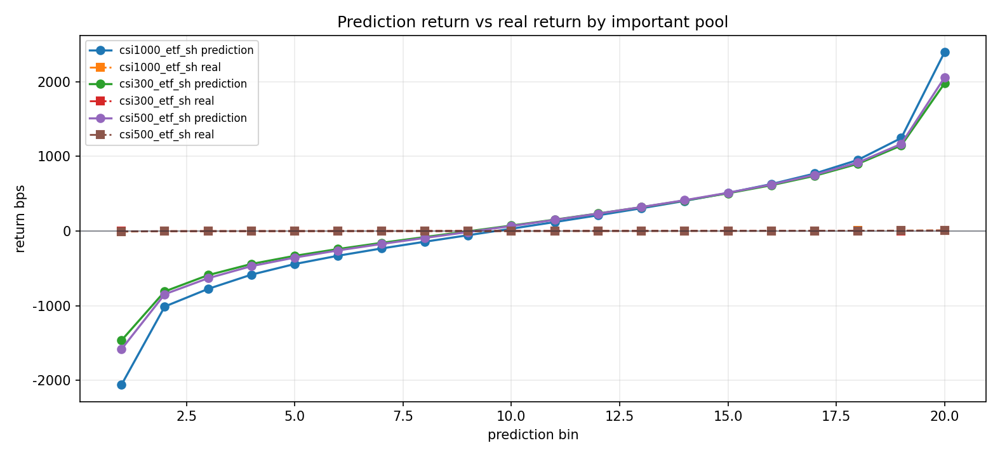
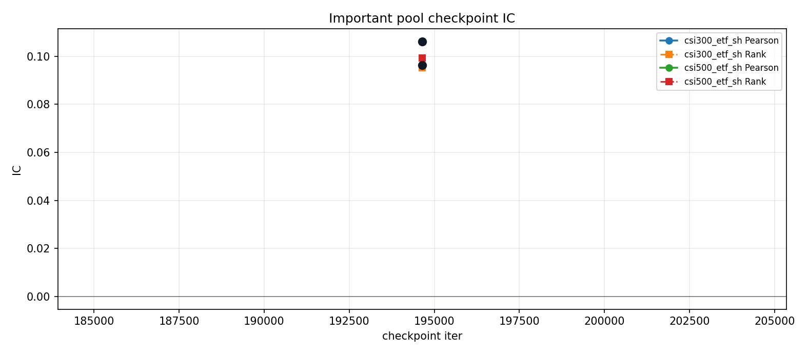
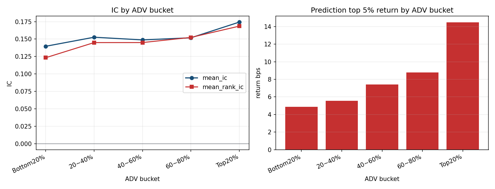

## 摘要

Stock1s fold0 去重特征、GRU384 与双层 MLP512 的正式评估结果。

### 1. Executive Summary

### 1.0. Integrated Finding

### 1.1. Selection Policy

| field | explanation |
| --- | --- |
| benchmark | 实验标识。 |
| selected_checkpoint | 最终用于 evaluation 的 checkpoint iteration。 |
| train_pooled_ic | train split 上把所有样本合并后计算的 Pearson IC。 |
| test_pooled_ic | test split 上把所有样本合并后计算的 Pearson IC。 |
| top_prediction_return_bps | 最高 prediction 分组的平均 prediction return, 单位 bps。 |
| top95_hit | test split 中按 prediction 从高到低排序后取最高 5% 样本，即 prediction >= test prediction 的 95% 分位；该子样本内 target > 0 的比例。 |
| etf_top95_hit | test split 中先按重要股票池合成 ETF minute-level prediction/real return，再按 etf_prediction 从高到低排序后取最高 5% 样本；该子样本内 etf_real_return > 0 的比例。 |
| overfit_variance_ratio | test split 中 prediction 样本方差 / target 样本方差，用作 overfit 系数；数值越大表示 prediction 方差相对 label 越高。 |
| model_class | 模型类名。 |
| train_range | 训练集交易日范围。 |
| val_range | 验证集交易日范围。 |
| test_range | 测试集交易日范围。 |

## 研究背景与目标

本页是历史研究报告的统一模板版本。研究问题、实验定义、数据口径、表格和图像证据均沿用已校验的历史原版。

## 数据与方法

### 2. Data Pipeline

### 2.1. Data Basics

| split | rows | endpoints | feature_dim | label_coverage | file_bytes |
| --- | --- | --- | --- | --- | --- |
| train | 987,536,160 | 298,966,485 | 78 | n/a | n/a |
| val | 155,348,640 | 47,925,108 | 78 | n/a | n/a |
| test | 152,844,480 | 47,228,496 | 78 | n/a | n/a |

| field | explanation |
| --- | --- |
| features | 模型输入 feature 列表。 |
| feature_dim | 模型输入 feature 维度。 |
| label_horizon_minutes | label forward horizon, 单位 minutes。 |
| label_entry_lag_minutes | label entry lag, 单位 minutes。 |

### 2.2. Data Normalization

| index | feature |
| --- | --- |
| 0 | ret_5s |
| 1 | ret_10s |
| 2 | ret_15s |
| 3 | ret_30s |
| 4 | ret_60s |
| 5 | ret_300s |
| 6 | realized_vol_10s |
| 7 | realized_vol_30s |
| 8 | realized_vol_60s |
| 9 | return_acceleration_10s_60s |
| 10 | volatility_log_ratio_10s_60s |
| 11 | path_efficiency_60s |
| 12 | close_vwap_bps_30s |
| 13 | close_vwap_bps_60s |
| 14 | high_low_range_bps_10s |
| 15 | high_low_range_bps_60s |
| 16 | close_open_return_10s |
| 17 | close_open_return_60s |
| 18 | volume_intensity_10s |
| 19 | volume_intensity_60s |
| 20 | trade_count_intensity_60s |
| 21 | log_avg_trade_size_30s |
| 22 | log_turnover_10s |
| 23 | log_turnover_60s |
| 24 | log_avg_trade_notional_30s |
| 25 | active_second_ratio_60s |
| 26 | no_trade_ratio_60s |
| 27 | volume_imbalance_10s |
| 28 | volume_imbalance_60s |
| 29 | imbalance_change_10s_vs_60s |
| 30 | turnover_imbalance_10s |
| 31 | turnover_imbalance_60s |
| 32 | log_seconds_since_price_change |
| 33 | mid_ret_10s |
| 34 | mid_ret_60s |
| 35 | mid_ret_300s |
| 36 | spread_bps_last |
| 37 | spread_bps_mean_10s |
| 38 | spread_bps_mean_60s |
| 39 | spread_bps_max_60s |
| 40 | spread_change_10s |
| 41 | imbalance1 |
| 42 | imbalance5 |
| 43 | imbalance10 |
| 44 | imbalance1_change_10s |
| 45 | log_total_depth1 |
| 46 | log_total_depth5 |
| 47 | log_total_depth10 |
| 48 | depth_imbalance5 |
| 49 | depth_imbalance10 |
| 50 | microprice_deviation_bps |
| 51 | mid_close_gap_bps |
| 52 | quote_present |
| 53 | quote_two_sided |
| 54 | quote_observed_ratio_10s |
| 55 | quote_observed_ratio_60s |
| 56 | quote_stale_ratio_10s |
| 57 | quote_stale_ratio_60s |
| 58 | log1p_quote_age_ms |
| 59 | order_volume_imbalance_10s |
| 60 | order_volume_imbalance_60s |
| 61 | order_count_imbalance_10s |
| 62 | order_count_imbalance_60s |
| 63 | log_total_order_volume_10s |
| 64 | log_total_order_volume_60s |
| 65 | log_total_order_count_10s |
| 66 | log_total_order_count_60s |
| 67 | cancel_volume_imbalance_10s |
| 68 | cancel_volume_imbalance_60s |
| 69 | cancel_count_imbalance_60s |
| 70 | cancel_share_10s |
| 71 | cancel_share_60s |
| 72 | log_total_cancel_volume_10s |
| 73 | log_total_cancel_volume_60s |
| 74 | normalized_net_order_flow_10s |
| 75 | normalized_net_order_flow_60s |
| 76 | log_total_order_cancel_activity_60s |
| 77 | trade_to_order_volume_ratio_60s |

| field | explanation |
| --- | --- |
| feature_normalization | feature normalization 方法和 fit scope。 |
| label_normalization | label normalization 方法和 fit scope。 |
| kept_rate | 清洗后保留样本数 / 清洗前样本数。 |
| max_invalid_ratio | 单个字段中 invalid 样本占比的最大值。 |

### 2.3. Cleaning And Sample-Selection Assessment

| metric | value | assessment |
| --- | --- | --- |
| train_valid_endpoint_rate | 0.302740 | 298,966,485 of 987,536,160 candidate endpoints retained |
| val_valid_endpoint_rate | 0.308500 | 47,925,108 of 155,348,640 candidate endpoints retained |
| test_valid_endpoint_rate | 0.308997 | 47,228,496 of 152,844,480 candidate endpoints retained |
| overall_valid_endpoint_rate | 0.304169 | material sample-selection filter |
| rejected_history_window_rate | 0.500000 | one-hour lookback |
| rejected_entry_window_rate | 0.002778 | entry/session boundary |
| rejected_exit_window_rate | 0.083333 | horizon/session boundary |
| rejected_entry_vwap_rate | 0.062032 | entry VWAP availability |
| rejected_exit_vwap_rate | 0.047688 | exit VWAP availability |

## 主要结果

### 3. Evaluation

### 3.1. IC Summary

| split | pooled_ic | pooled_rank_ic | count |
| --- | --- | --- | --- |
| train | 0.219727 | 0.146856 | 2,000,000 |
| val | 0.113619 | 0.101375 | 8,108,123 |
| test | 0.098415 | 0.094686 | 7,947,567 |

### core_ic_metrics.csv

| split | pooled_ic | pooled_rank_ic | count |
| --- | --- | --- | --- |
| train | 0.219727 | 0.146856 | 2,000,000 |
| val | 0.113619 | 0.101375 | 8,108,123 |
| test | 0.098415 | 0.094686 | 7,947,567 |

| field | explanation |
| --- | --- |
| pooled_ic | 合并样本后计算的 Pearson IC。 |
| pooled_rank_ic | 合并样本后计算的 Rank IC。 |
| pearson_ic | corr(prediction, target)。 |
| rank_ic | corr(rank(prediction), rank(target))。 |

### 3.2. Signal Quality 1: bucket (10)

| split | leg | mean_daily_return | mean_daily_return_bps | annualized_sharpe | t_stat | cum_return | max_drawdown | positive_day_ratio | day_count |
| --- | --- | --- | --- | --- | --- | --- | --- | --- | --- |
| val | gross | 0.005921 | 59.2146 | 85.2010 | 41.5738 | 0.425046 | 0.000e+00 | 1.0000 | 60.0000 |
| val | net_10m | -0.002152 | -21.5245 | -26.4885 | -12.9251 | -0.121321 | -0.118463 | 0.033333 | 60.0000 |
| test | gross | 0.004657 | 46.5712 | 76.4331 | 36.9834 | 0.315353 | 0.000e+00 | 1.0000 | 59.0000 |
| test | net_10m | -0.003299 | -32.9885 | -48.5714 | -23.5021 | -0.177155 | -0.174973 | 0.000e+00 | 59.0000 |

| field | explanation |
| --- | --- |
| signal_bucket | 按 prediction 从低到高切分的分组编号。 |
| mean_prediction | 分组内 prediction 均值。 |
| mean_label_bps | 分组内 target 均值, 单位 bps。 |
| t_stat | 分组 mean_label_bps 相对 0 的 t-stat。 |
| hit_rate | 分组内 target > 0 的比例。 |
| top_bottom_signal_spread_bps | Top bucket 平均 target return 减 bottom bucket 平均 target return, 单位 bps。 |

### 3.3. Signal Quality 2: Important Stock Pool

### important_pool_nonzero_metrics.csv

| pool | display_name | etf_code | index_code | pearson_ic | rank_ic | mean_prediction_return | mean_real_return | real_return_positive_ratio | prediction_positive_ratio | count |
| --- | --- | --- | --- | --- | --- | --- | --- | --- | --- | --- |
| csi1000_etf_sh | 1000 ETF | 512100.SH | 000852.SH | 0.103486 | 0.096678 | 0.009586 | 1.464e-05 | 0.455792 | 0.542269 | 3,947,099 |
| csi300_etf_sh | 沪深300 ETF（沪） | 510300.SH | 000300.SH | 0.082777 | 0.088907 | 0.014648 | 1.209e-05 | 0.480303 | 0.571696 | 1,605,336 |
| csi500_etf_sh | 中证500 ETF（沪） | 510500.SH | 000905.SH | 0.096586 | 0.095001 | 0.013835 | 8.684e-07 | 0.462681 | 0.566340 | 2,395,131 |

### important_pool_pooled_ic.csv

| pool | display_name | etf_code | index_code | index_trade_date_min | index_trade_date_max | pearson_ic | rank_ic | count |
| --- | --- | --- | --- | --- | --- | --- | --- | --- |
| csi1000_etf_sh | 1000 ETF | 512100.SH | 000852.SH | 20,221,230 | 20,230,331 | 0.103486 | 0.096678 | 3,947,100 |
| csi300_etf_sh | 沪深300 ETF（沪） | 510300.SH | 000300.SH | 20,221,230 | 20,230,331 | 0.082777 | 0.088907 | 1,605,336 |
| csi500_etf_sh | 中证500 ETF（沪） | 510500.SH | 000905.SH | 20,221,230 | 20,230,331 | 0.096586 | 0.095001 | 2,395,131 |

### prediction_real_return_curve.csv edge bins

| pool | display_name | etf_code | index_code | prediction_bin | mean_prediction_return | mean_real_return | real_return_positive_ratio | count |
| --- | --- | --- | --- | --- | --- | --- | --- | --- |
| csi1000_etf_sh | 1000 ETF | 512100.SH | 000852.SH | 1 | -0.206113 | -8.054e-04 | 0.379377 | 197,355 |
| csi1000_etf_sh | 1000 ETF | 512100.SH | 000852.SH | 2 | -0.101179 | -3.855e-04 | 0.397127 | 197,355 |
| csi1000_etf_sh | 1000 ETF | 512100.SH | 000852.SH | 3 | -0.077590 | -2.834e-04 | 0.409708 | 197,355 |
| csi1000_etf_sh | 1000 ETF | 512100.SH | 000852.SH | 18 | 0.095162 | 3.612e-04 | 0.510577 | 197,355 |
| csi1000_etf_sh | 1000 ETF | 512100.SH | 000852.SH | 19 | 0.124444 | 4.521e-04 | 0.523513 | 197,355 |
| csi1000_etf_sh | 1000 ETF | 512100.SH | 000852.SH | 20 | 0.239435 | 7.072e-04 | 0.535416 | 197,355 |
| csi300_etf_sh | 沪深300 ETF（沪） | 510300.SH | 000300.SH | 1 | -0.146634 | -5.046e-04 | 0.408113 | 80,267 |
| csi300_etf_sh | 沪深300 ETF（沪） | 510300.SH | 000300.SH | 2 | -0.080960 | -2.894e-04 | 0.423948 | 80,267 |
| csi300_etf_sh | 沪深300 ETF（沪） | 510300.SH | 000300.SH | 3 | -0.059160 | -2.263e-04 | 0.432083 | 80,267 |
| csi300_etf_sh | 沪深300 ETF（沪） | 510300.SH | 000300.SH | 18 | 0.089903 | 2.685e-04 | 0.531732 | 80,266 |
| csi300_etf_sh | 沪深300 ETF（沪） | 510300.SH | 000300.SH | 19 | 0.114455 | 3.333e-04 | 0.542459 | 80,266 |
| csi300_etf_sh | 沪深300 ETF（沪） | 510300.SH | 000300.SH | 20 | 0.197751 | 5.065e-04 | 0.550420 | 80,266 |
| csi500_etf_sh | 中证500 ETF（沪） | 510500.SH | 000905.SH | 1 | -0.158364 | -5.914e-04 | 0.391242 | 119,757 |
| csi500_etf_sh | 中证500 ETF（沪） | 510500.SH | 000905.SH | 2 | -0.084668 | -3.623e-04 | 0.403317 | 119,757 |
| csi500_etf_sh | 中证500 ETF（沪） | 510500.SH | 000905.SH | 3 | -0.063295 | -2.865e-04 | 0.410097 | 119,757 |
| csi500_etf_sh | 中证500 ETF（沪） | 510500.SH | 000905.SH | 18 | 0.091558 | 2.955e-04 | 0.517444 | 119,756 |
| csi500_etf_sh | 中证500 ETF（沪） | 510500.SH | 000905.SH | 19 | 0.116585 | 3.903e-04 | 0.530253 | 119,756 |
| csi500_etf_sh | 中证500 ETF（沪） | 510500.SH | 000905.SH | 20 | 0.205522 | 6.273e-04 | 0.548749 | 119,756 |

### checkpoint_important_pool_ic.csv

| pool | display_name | etf_code | index_code | pearson_ic | rank_ic | count | component_count_min | component_count_max | iter | selected |
| --- | --- | --- | --- | --- | --- | --- | --- | --- | --- | --- |
| csi300_etf_sh | 沪深300 ETF（沪） | 510300.SH | 000300.SH | 0.096246 | 0.095304 | 1,629,338 | 294 | 300 | 194,640 | True |
| csi500_etf_sh | 中证500 ETF（沪） | 510500.SH | 000905.SH | 0.106207 | 0.099382 | 2,431,971 | 497 | 500 | 194,640 | True |

| field | explanation |
| --- | --- |
| prediction != 0 metrics | Stock1s test prediction parquet rows joined to important-pool membership, filtered to finite prediction/target and prediction != 0. |
| Prediction Return vs Real Return 图 | Stock1s important-pool samples are sorted by prediction within pool and split into 20 bins; stored y is converted back to raw target before averaging. |
| pearson_ic | corr(prediction, target)。 |
| rank_ic | corr(rank(prediction), rank(target))。 |
| mean_prediction_return | prediction 的样本均值。 |
| mean_real_return | target 的样本均值。 |
| real_return_positive_ratio | target > 0 的样本占比。 |
| prediction_positive_ratio | prediction > 0 的样本占比。 |

### 3.4. Goodness Of Fit

| split | rows | mse | mae | prediction_mean | prediction_std | target_mean | target_std |
| --- | --- | --- | --- | --- | --- | --- | --- |
| train | 2,000,000 | 0.948922 | 0.655039 | -0.005558 | 0.237098 | 2.006e-04 | 0.998346 |
| val | 8,108,123 | 0.732168 | 0.578609 | 0.006246 | 0.106911 | 0.024133 | 0.861008 |
| test | 7,947,567 | 0.523091 | 0.482761 | 0.011889 | 0.089924 | 0.003729 | 0.726496 |

### goodness_of_fit_metrics.csv

| split | prediction_bin | mean_prediction | mean_label | mean_label_bps | label_std | label_se | label_p05 | label_p95 | label_ci90_low | label_ci90_high | row_count |
| --- | --- | --- | --- | --- | --- | --- | --- | --- | --- | --- | --- |
| train | summary | -0.005558 | 2.006e-04 | 2.0058 | 0.998346 | n/a | n/a | n/a | n/a | n/a | 2,000,000 |
| val | summary | 0.006246 | 0.024133 | 241.3316 | 0.861008 | n/a | n/a | n/a | n/a | n/a | 8,108,123 |
| test | summary | 0.011889 | 0.003729 | 37.2949 | 0.726496 | n/a | n/a | n/a | n/a | n/a | 7,947,567 |

| field | explanation |
| --- | --- |
| Goodness Of Fit | 按 split 全局对 prediction 从低到高排序并切成 100 个等频分段，检查每段 mean_prediction 与 mean_label 是否接近。 |
| mean_prediction | 分组内 prediction 均值。 |
| mean_label | 分组内 target 均值，保持原始 target 单位。 |
| label_std | 分组内 target 的样本标准差。 |
| row_count | 分组内有限 prediction/target 样本数。 |

### 3.5. Liquidity By ADV

### adv_liquidity_bucket_metrics.csv

| adv_bucket | bucket_label | row_count | day_count | mean_adv_amount | median_adv_amount | mean_ic | mean_rank_ic | icir | rank_icir | top5_return_bps | top5_hit_rate | top5_row_count |
| --- | --- | --- | --- | --- | --- | --- | --- | --- | --- | --- | --- | --- |
| 1 | Bottom20% | 162,550 | 59 | 44,447,540 | 45,503,315 | 0.139656 | 0.123258 | 3.6068 | 3.3594 | 4.8691 | 0.510244 | 10,836 |
| 2 | 20~40% | 228,259 | 59 | 91,008,153 | 90,187,915 | 0.152632 | 0.144952 | 3.7040 | 4.0932 | 5.5567 | 0.531383 | 14,084 |
| 3 | 40~60% | 287,075 | 59 | 157,021,803 | 155,042,714 | 0.148792 | 0.144985 | 3.9568 | 4.7278 | 7.4267 | 0.547593 | 17,051 |
| 4 | 60~80% | 373,060 | 59 | 287,048,661 | 278,495,582 | 0.151810 | 0.152357 | 4.7079 | 5.4976 | 8.7801 | 0.566117 | 21,356 |
| 5 | Top20% | 530,684 | 59 | 1,017,688,008 | 693,227,587 | 0.174315 | 0.168542 | 4.5723 | 5.7831 | 14.4720 | 0.583419 | 29,250 |

### strategy_summary.yaml auxiliary capacity/execution fields

| split | group | metric | value |
| --- | --- | --- | --- |
| val | turnover | mean_daily_planned_turnover | 7.5779 |
| val | turnover | mean_daily_turnover | 7.5779 |
| val | turnover | p50_daily_turnover | 7.5870 |
| val | turnover | p95_daily_turnover | 7.7519 |
| val | execution | mean_cash_buffer | 1.002e-15 |
| val | execution | mean_executed_gross_exposure | 1.000000 |
| val | execution | mean_fill_ratio | 1.0000 |
| val | capacity | capacity_at_10bps | 918,782,799 |
| val | capacity | capacity_at_20bps | 3,675,131,194 |
| test | turnover | mean_daily_planned_turnover | 7.6099 |
| test | turnover | mean_daily_turnover | 7.6099 |
| test | turnover | p50_daily_turnover | 7.6410 |
| test | turnover | p95_daily_turnover | 7.7411 |
| test | execution | mean_cash_buffer | 1.013e-15 |
| test | execution | mean_executed_gross_exposure | 1.000000 |
| test | execution | mean_fill_ratio | 1.0000 |
| test | capacity | capacity_at_10bps | 1,225,681,440 |
| test | capacity | capacity_at_20bps | 4,902,725,762 |

| field | explanation |
| --- | --- |
| Liquidity By ADV | Stock1s report scope is final test backtest target_positions.parquet; date-code adv_amount rows are globally split into five buckets, then IC and top 5% return are computed within date,time,adv_bucket. |
| row_count | 分组内有限 prediction/target 样本数。 |
| day_count | 入选样本覆盖的交易日数量。 |
| mean_ic | 当前 ADV 桶内先按 date,time 横截面计算 Pearson IC，再按 date 聚合后的均值。 |
| mean_rank_ic | 当前 ADV 桶内先按 date,time 横截面计算 Rank IC，再按 date 聚合后的均值。 |
| icir | 当前 ADV 桶 daily IC 的 mean/std。 |
| rank_icir | 当前 ADV 桶 daily Rank IC 的 mean/std。 |
| top5_return_bps | 当前 ADV 桶内每个 date,time 截面 prediction 最高 5% 样本的平均 target return, 单位 bps。 |
| top5_hit_rate | 当前 ADV 桶内 prediction 最高 5% 样本 target > 0 的比例。 |
| top5_row_count | 当前 ADV 桶内进入 prediction top 5% return 统计的样本数。 |

### 4. Train Metrics

### 4.1. Checkpoint Selection

| key | value |
| --- | --- |
| best_iter | 194,640 |
| selection_metric | val/timestamp_pearson_ic_mean |
| selection_rule | max |
| selection_value | 0.116671 |
| candidate_count | 1 |
| test_used_for_selection | False |

| candidate | selected | global_step | epoch | metric_name | metric_value | val_pooled_ic | val_rank_ic |
| --- | --- | --- | --- | --- | --- | --- | --- |
| eval_only_resume | True | 194,640 | 0.083333 | val/timestamp_pearson_ic_mean | 0.116671 | nan | nan |

### 4.2. Model And Method

### Model

### 4.2.3. Method

| field | value |
| --- | --- |
| device | cuda:0 |
| mixed_precision | True |
| batch_size | 128 |
| eval_batch_size | 4,096 |
| epochs | 0.000e+00 |
| steps_per_epoch | 2,335,676 |
| total_train_steps | 0 |
| checkpoint_target_count | 12 |
| resume_argument | --resume-from |
| optimizer_state | True |

| field | explanation |
| --- | --- |
| model_class | 模型类名。 |
| trainable_parameter | 可训练参数数量。 |
| gru_bidirectional | GRU 是否使用 bidirectional 结构。 |
| parameter_initialization | 模型参数初始化方式。 |
| selected_checkpoint | 最终用于 evaluation 的 checkpoint iteration。 |

### 4.3. Training Monitoring

| metric | value | source |
| --- | --- | --- |
| epoch | 0.216667 | latest metrics.csv row |
| global_step | 506,064 | latest metrics.csv row |
| phase | probe_eval | latest metrics.csv row |
| train/batch_mse | 0.956558 | latest metrics.csv row |
| train/mse | 0.948922 | latest metrics.csv row |
| train/pooled_pearson_ic | 0.219727 | latest metrics.csv row |
| val/mse | 0.743844 | latest metrics.csv row |
| val/pooled_pearson_ic | 0.105954 | latest metrics.csv row |
| val/pooled_rank_ic | 0.099809 | latest metrics.csv row |
| elapsed_seconds | 38,224 | latest metrics.csv row |

| field | explanation |
| --- | --- |
| Train loss | 读取 TensorBoard scalar parquet，过滤 step > 0，删除最高 10% loss outlier，用 rolling(window=200, min_periods=20, center=True) 计算 smoothed_loss，y-axis 使用 log scale。 |
| val/objective/mse | validation split 上的 objective MSE。 |
| val/quality/global_ic | validation split 上的 global Pearson IC。 |
| val/quality/rank_ic | validation split 上的 rank IC。 |

### 4.4. Fit And Generalization Assessment

| split | pooled_pearson_ic | pooled_rank_ic | timestamp_pearson_ic | timestamp_rank_ic | r2_like |
| --- | --- | --- | --- | --- | --- |
| validation | 0.113619 | 0.101375 | 0.114103 | 0.102861 | 0.013142 |
| test | 0.098415 | 0.094686 | 0.104233 | 0.095668 | 0.008942 |

| effective_epoch | global_step | train_ic | val_ic | status |
| --- | --- | --- | --- | --- |
| 0.200000 | 77,856 | 0.132374 | 0.094643 | continued |
| 0.300000 | 116,784 | 0.148896 | 0.106143 | continued |
| 0.400000 | 155,712 | 0.165865 | 0.108623 | continued |
| 0.500000 | 194,640 | 0.176384 | 0.112214 | selected checkpoint |
| 0.600000 | 233,568 | 0.184789 | 0.107675 | continued |
| 0.700000 | 272,496 | 0.189447 | 0.104226 | continued |
| 0.800000 | 311,424 | 0.201111 | 0.113156 | continued |
| 0.900000 | 350,352 | 0.202396 | 0.104336 | continued |
| 1.0000 | 389,280 | 0.211956 | 0.103330 | continued |
| 1.1000 | 428,208 | 0.214875 | 0.109862 | continued |
| 1.2000 | 467,136 | 0.216368 | 0.100049 | continued |
| 1.3000 | 506,064 | 0.219727 | 0.107065 | early stop |

### 5. Trading And Cost

### 5.0. Cost Model Status

### 5.1. Validation Selection And Final Test

| split | leg | mean_daily_return | mean_daily_return_bps | annualized_sharpe | t_stat | cum_return | max_drawdown | positive_day_ratio | day_count |
| --- | --- | --- | --- | --- | --- | --- | --- | --- | --- |
| val | gross | 0.005921 | 59.2146 | 85.2010 | 41.5738 | 0.425046 | 0.000e+00 | 1.0000 | 60.0000 |
| val | net_10m | -0.002152 | -21.5245 | -26.4885 | -12.9251 | -0.121321 | -0.118463 | 0.033333 | 60.0000 |
| test | gross | 0.004657 | 46.5712 | 76.4331 | 36.9834 | 0.315353 | 0.000e+00 | 1.0000 | 59.0000 |
| test | net_10m | -0.003299 | -32.9885 | -48.5714 | -23.5021 | -0.177155 | -0.174973 | 0.000e+00 | 59.0000 |

### 5.2. Selected Top-5% Test Economics

### Signal-level 100-share proxy

| side | signals | directional_win_rate | signed_return_bps | gross_rmb | spread_rmb | after_spread_rmb |
| --- | --- | --- | --- | --- | --- | --- |
| all | 793,582 | 0.555241 | 6.1478 | 1.9425 | 2.7539 | -0.811336 |
| long | 396,791 | 0.544178 | 6.6430 | 1.9959 | 2.0493 | -0.053399 |
| short | 396,791 | 0.566303 | 5.6525 | 1.8892 | 3.4584 | -1.5693 |

### Monthly stability

| month | days | gross_bps/day | net_bps/day | net_positive_day_ratio |
| --- | --- | --- | --- | --- |
| 2023-01 | 16 | 58.4911 | -21.7019 | 0.000e+00 |
| 2023-02 | 20 | 57.2608 | -20.7851 | 0.050000 |
| 2023-03 | 23 | 63.4166 | -9.9229 | 0.304348 |

### 5.3. Trading Rule And Cost Diagnosis

### 6. Robustness Diagnostics

### 6.1. Leakage And Split Controls

### 6.2. Robustness Artifact Coverage

### 6.3. Interpretation Limits

## 限制与适用边界

解释边界与可比性限制沿用历史原版中的原始说明。

## 结论

结论与后续事项以历史原版已记录的结果为准，本次迁移不新增研究判断。

## 附录

### 7. Appendix Diagnostics
