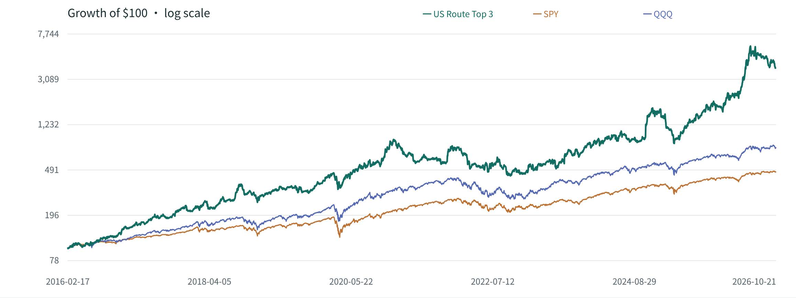
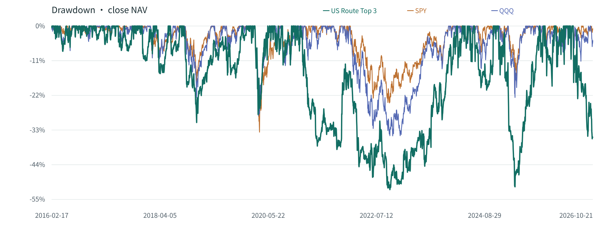

## 摘要

2016-02-17 open → 2026-10-21 close. 38 个当前配置 Core 按历史数据可用性动态纳入, 每日评估 Top 3, 共 2,686 个持仓 session.

- 累计收益 3816.79%
- CAGR 40.99%
- Max drawdown -52.10%
- 换股次数 942

相对 SPY CAGR 差 +25.25 pp, 相对 QQQ CAGR 差 +19.82 pp. 这些是同区间 buy-and-hold 对比, 不代表 risk-adjusted alpha.

年度收益为负的区间: 2021, 2022. 最差年度 2022, Gross return -40.55%. 最长连续 underwater 776 个 session. 历史最高单股 close 权重 77.34%, 对应 2026-07-28 的 AAPL. 仅替换离场仓位的规则保留了资金路径, 三只持仓数量并不保证风险分散.

## 研究背景与目标

检验现有 Route 的 30-session trend score 转换为 US Core Top 3 动态持仓后的历史表现, 并在同一建仓时点与估值区间比较 SPY、QQQ. 该组合是独立研究规则, 现有 daily route 的 Best Hold 输出保持原样.

## 数据与方法

唯一行情源: Alpaca. feed=sip, timeframe=1Day, adjustment=all. 未使用 yfinance. 完整数据 snapshot 包含 52 个 symbol, 从 2016 年开始获取; 缺失持仓执行/估值 bar 时立即失败. 请求按完整 universe 分页, 保存每个成功 page, 最快 1 request/second, 单页 bounded retry. 重跑复用同一个 request snapshot, 不重复下载历史数据.

每个 signal 仅使用截至该 close 的最近 30 个交易所 session. Core symbol 须在这 30 个 session 全部有有效 adjusted close 才能参与. 当前 window 完整前不纳入新股. 30 点按首点归一化, 取最后 25 点对 x=0..24 做 OLS, score = slope × r²³, 稳定排序沿用生产配置中的 symbol 顺序. 即使所有 score 都为负, 仍选择 Top 3. Satellite 不进入持仓, SPY/QQQ 仅作 benchmark.

首次三只各投入 100/3, 允许 fractional shares. 每日收盘 signal 在次日 open 执行. Top 3 集合不变, 包括名次交换时, 完全不交易. 若发生替换, 未离场 shares 不动; 离场股按上一 signal rank 排序, 入场股按新 signal rank 排序, 一一转移离场仓位全部市值. 不重新等权, 权重自然漂移, 因而可能逐渐集中. 不加杠杆、不设 cash filter.

Alpaca adjustment=all 的 OHLC 比例包含 corporate-action 调整. 使用 adjusted units 计算持仓和收益, 不另发 dividend cash, 不把 adjusted shares 解释为历史实际股数. 这种处理是 corporate-action-adjusted return proxy, 不是独立 dividend cash ledger.

## 主要结果

### 净值与回撤

初始资金归一化为 $100. 首个点为共同建仓 open, 后续点为每个 session 的 close. Growth curve 使用 log scale, drawdown 使用 linear scale.



下图保留相同三组策略的 close NAV drawdown, 使用 linear scale.



### 收益与风险

| 指标 | US Route Top 3 | SPY | QQQ |
| --- | --- | --- | --- |
| 累计收益 | 3816.79% | 376.30% | 677.03% |
| CAGR | 40.99% | 15.74% | 21.17% |
| Annualized volatility | 38.57% | 17.36% | 22.12% |
| Sharpe · rf=0 | 1.08 | 0.93 | 0.98 |
| Max drawdown | -52.10% | -33.79% | -35.00% |
| 最长 underwater sessions | 776 | 488 | 492 |
| Calmar | 0.79 | 0.47 | 0.60 |
| 日收益 > 0 比例 | 54.65% | 54.99% | 56.40% |
| Ending NAV | 3,916.79 | 476.30 | 777.03 |

CAGR 使用实际 calendar days / 365.25, 包含首个持仓日. Volatility 和 Sharpe 使用 252 sessions/year 与 sample standard deviation. 首个 daily return 为入场 open→close, 后续为 close→close. Sharpe risk-free rate=0. 无波动或无 drawdown 时相关比率为 n/a.

### 年度表现

| 年份 | US Route Top 3 | SPY | QQQ |
| --- | --- | --- | --- |
| 2016 * | 52.55% | 18.82% | 18.63% |
| 2017 | 39.24% | 21.75% | 32.62% |
| 2018 | 32.55% | -4.96% | -0.12% |
| 2019 | 41.23% | 31.14% | 38.96% |
| 2020 | 112.33% | 18.45% | 48.62% |
| 2021 | -8.41% | 28.60% | 27.42% |
| 2022 | -40.55% | -18.18% | -32.46% |
| 2023 | 79.41% | 26.18% | 54.85% |
| 2024 | 83.72% | 24.89% | 25.58% |
| 2025 | 5.54% | 17.72% | 20.77% |
| 2026 * | 144.92% | 14.26% | 18.45% |

\* 首年和末年为边界区间. 年度收益从上年最后 close 起算, 首年从首次入场 open 起算.

### 调仓与期末持仓

共有 901 个交易日发生买卖, 包含首次建仓. 买卖订单 1,887 笔. Gross turnover 总计 604.62×, 定义为每日双边成交 notional / 前一 close NAV, 初次买入分母为 100. 已结束仓位平均持有 8.54 sessions.

| 期末持仓 | 市值 | 权重 |
| --- | --- | --- |
| COST | 954.53 | 24.37% |
| MSFT | 2733.32 | 69.78% |
| V | 228.94 | 5.85% |

最新 signal (2026-10-21 close): COST, MSFT, V . 这组目标只在下一 session open 执行, 未提前计入收益.

### 全部成交记录

以下保留源报告全部 1,887 笔买卖记录. Adjusted open 与 Notional 为美元计价, 持有 sessions 为交易所 session 数.

| Signal date | Execution date | Side | Symbol | 资金来源 | Adjusted open | Notional | 持有 sessions |
| --- | --- | --- | --- | --- | --- | --- | --- |
| 2016-02-16 | 2016-02-17 | BUY | COHR | CASH | 20.2400 | 33.33 | — |
| 2016-02-16 | 2016-02-17 | BUY | TSM | CASH | 18.9000 | 33.33 | — |
| 2016-02-16 | 2016-02-17 | BUY | WMT | CASH | 18.2500 | 33.33 | — |
| 2016-02-18 | 2016-02-19 | SELL | WMT | WMT | 17.6400 | 32.22 | 2 |
| 2016-02-18 | 2016-02-19 | BUY | MRVL | WMT | 8.5400 | 32.22 | — |
| 2016-03-03 | 2016-03-04 | SELL | COHR | COHR | 21.5000 | 35.41 | 12 |
| 2016-03-03 | 2016-03-04 | BUY | NVDA | COHR | 0.8036 | 35.41 | — |
| 2016-03-04 | 2016-03-07 | SELL | MRVL | MRVL | 9.1820 | 34.64 | 11 |
| 2016-03-04 | 2016-03-07 | BUY | AMAT | MRVL | 17.1300 | 34.64 | — |
| 2016-03-07 | 2016-03-08 | SELL | TSM | TSM | 19.7100 | 34.76 | 14 |
| 2016-03-07 | 2016-03-08 | BUY | MRVL | TSM | 8.9990 | 34.76 | — |
| 2016-03-08 | 2016-03-09 | SELL | MRVL | MRVL | 9.0810 | 35.08 | 1 |
| 2016-03-08 | 2016-03-09 | BUY | MELI | MRVL | 109.4800 | 35.08 | — |
| 2016-03-11 | 2016-03-14 | SELL | NVDA | NVDA | 0.7833 | 34.51 | 6 |
| 2016-03-11 | 2016-03-14 | BUY | NOW | NVDA | 12.5700 | 34.51 | — |
| 2016-03-14 | 2016-03-15 | SELL | AMAT | AMAT | 17.6700 | 35.73 | 6 |
| 2016-03-14 | 2016-03-15 | BUY | AMD | AMAT | 2.6700 | 35.73 | — |
| 2016-03-15 | 2016-03-16 | SELL | NOW | NOW | 12.2700 | 33.69 | 2 |
| 2016-03-15 | 2016-03-16 | BUY | AVGO | NOW | 11.4100 | 33.69 | — |
| 2016-03-24 | 2016-03-28 | SELL | MELI | MELI | 112.6000 | 36.08 | 12 |
| 2016-03-24 | 2016-03-28 | BUY | LRCX | MELI | 6.9080 | 36.08 | — |
| 2016-04-07 | 2016-04-08 | SELL | AMD | AMD | 2.7000 | 36.13 | 17 |
| 2016-04-07 | 2016-04-08 | BUY | NVDA | AMD | 0.8724 | 36.13 | — |
| 2016-04-11 | 2016-04-12 | SELL | AVGO | AVGO | 12.0700 | 35.64 | 18 |
| 2016-04-11 | 2016-04-12 | BUY | V | AVGO | 72.2100 | 35.64 | — |
| 2016-04-12 | 2016-04-13 | SELL | LRCX | LRCX | 7.1440 | 37.31 | 12 |
| 2016-04-12 | 2016-04-13 | BUY | AAPL | LRCX | 25.0500 | 37.31 | — |
| 2016-04-18 | 2016-04-19 | SELL | AAPL | AAPL | 24.3900 | 36.33 | 4 |
| 2016-04-18 | 2016-04-19 | BUY | ANET | AAPL | 3.9460 | 36.33 | — |
| 2016-04-19 | 2016-04-20 | SELL | ANET | ANET | 3.9300 | 36.18 | 1 |
| 2016-04-19 | 2016-04-20 | BUY | AMZN | ANET | 31.5000 | 36.18 | — |
| 2016-04-20 | 2016-04-21 | SELL | NVDA | NVDA | 0.8905 | 36.88 | 9 |
| 2016-04-20 | 2016-04-21 | BUY | MELI | NVDA | 129.2500 | 36.88 | — |
| 2016-04-21 | 2016-04-22 | SELL | MELI | MELI | 124.6400 | 35.57 | 1 |
| 2016-04-21 | 2016-04-22 | BUY | LLY | MELI | 65.0800 | 35.57 | — |
| 2016-04-25 | 2016-04-26 | SELL | V | V | 72.8500 | 35.95 | 10 |
| 2016-04-25 | 2016-04-26 | BUY | MELI | V | 124.3200 | 35.95 | — |
| 2016-04-27 | 2016-04-28 | SELL | AMZN | AMZN | 30.7800 | 35.35 | 6 |
| 2016-04-27 | 2016-04-28 | BUY | NOW | AMZN | 14.6200 | 35.35 | — |
| 2016-04-28 | 2016-04-29 | SELL | MELI | MELI | 123.7300 | 35.78 | 3 |
| 2016-04-28 | 2016-04-29 | BUY | JPM | MELI | 47.9000 | 35.78 | — |
| 2016-05-03 | 2016-05-04 | SELL | LLY | LLY | 63.4500 | 34.68 | 8 |
| 2016-05-03 | 2016-05-04 | BUY | AMD | LLY | 3.5400 | 34.68 | — |
| 2016-05-04 | 2016-05-05 | SELL | JPM | JPM | 46.7700 | 34.94 | 4 |
| 2016-05-04 | 2016-05-05 | BUY | AMZN | JPM | 33.6700 | 34.94 | — |
| 2016-05-10 | 2016-05-11 | SELL | NOW | NOW | 13.7000 | 33.13 | 9 |
| 2016-05-10 | 2016-05-11 | BUY | META | NOW | 119.2700 | 33.13 | — |
| 2016-05-20 | 2016-05-23 | SELL | META | META | 116.3100 | 32.31 | 8 |
| 2016-05-20 | 2016-05-23 | BUY | NVDA | META | 1.0870 | 32.31 | — |
| 2016-05-25 | 2016-05-26 | SELL | AMD | AMD | 4.1900 | 41.05 | 16 |
| 2016-05-25 | 2016-05-26 | BUY | MELI | AMD | 133.3500 | 41.05 | — |
| 2016-05-27 | 2016-05-31 | SELL | AMZN | AMZN | 35.6200 | 36.96 | 17 |
| 2016-05-27 | 2016-05-31 | BUY | AMD | AMZN | 4.6700 | 36.96 | — |
| 2016-06-02 | 2016-06-03 | SELL | MELI | MELI | 135.6000 | 41.74 | 5 |
| 2016-06-02 | 2016-06-03 | BUY | ANET | MELI | 4.6810 | 41.74 | — |
| 2016-06-06 | 2016-06-07 | SELL | ANET | ANET | 4.6660 | 41.60 | 2 |
| 2016-06-06 | 2016-06-07 | BUY | AMAT | ANET | 21.7800 | 41.60 | — |
| 2016-06-07 | 2016-06-08 | SELL | AMAT | AMAT | 21.6800 | 41.41 | 1 |
| 2016-06-07 | 2016-06-08 | BUY | MU | AMAT | 12.7500 | 41.41 | — |
| 2016-06-08 | 2016-06-09 | SELL | AMD | AMD | 4.4100 | 34.91 | 7 |
| 2016-06-08 | 2016-06-09 | BUY | AMAT | AMD | 21.5200 | 34.91 | — |
| 2016-06-09 | 2016-06-10 | SELL | AMAT | AMAT | 21.8600 | 35.46 | 1 |
| 2016-06-09 | 2016-06-10 | BUY | AMD | AMAT | 4.4000 | 35.46 | — |
| 2016-06-10 | 2016-06-13 | SELL | AMD | AMD | 4.3200 | 34.81 | 1 |
| 2016-06-10 | 2016-06-13 | BUY | AMAT | AMD | 21.4800 | 34.81 | — |
| 2016-06-13 | 2016-06-14 | SELL | NVDA | NVDA | 1.1430 | 33.97 | 15 |
| 2016-06-13 | 2016-06-14 | BUY | AMD | NVDA | 4.4000 | 33.97 | — |
| 2016-06-14 | 2016-06-15 | SELL | AMAT | AMAT | 21.3500 | 34.60 | 2 |
| 2016-06-14 | 2016-06-15 | BUY | AVGO | AMAT | 12.3200 | 34.60 | — |
| 2016-06-15 | 2016-06-16 | SELL | AMD | AMD | 4.5000 | 34.74 | 2 |
| 2016-06-15 | 2016-06-16 | BUY | TSM | AMD | 20.6400 | 34.74 | — |
| 2016-06-16 | 2016-06-17 | SELL | MU | MU | 11.6700 | 37.91 | 7 |
| 2016-06-16 | 2016-06-17 | BUY | AMD | MU | 4.7500 | 37.91 | — |
| 2016-06-17 | 2016-06-20 | SELL | AVGO | AVGO | 12.2900 | 34.52 | 3 |
| 2016-06-17 | 2016-06-20 | BUY | COST | AVGO | 132.5900 | 34.52 | — |
| 2016-07-05 | 2016-07-06 | SELL | COST | COST | 130.7600 | 34.04 | 11 |
| 2016-07-05 | 2016-07-06 | BUY | WMT | COST | 20.5300 | 34.04 | — |
| 2016-07-11 | 2016-07-12 | SELL | TSM | TSM | 22.6600 | 38.14 | 17 |
| 2016-07-11 | 2016-07-12 | BUY | LLY | TSM | 67.6600 | 38.14 | — |
| 2016-07-12 | 2016-07-13 | SELL | AMD | AMD | 5.1400 | 41.02 | 17 |
| 2016-07-12 | 2016-07-13 | BUY | ORCL | AMD | 35.6600 | 41.02 | — |
| 2016-07-14 | 2016-07-15 | SELL | ORCL | ORCL | 35.9600 | 41.36 | 2 |
| 2016-07-14 | 2016-07-15 | BUY | TSM | ORCL | 22.6500 | 41.36 | — |
| 2016-07-15 | 2016-07-18 | SELL | WMT | WMT | 20.6300 | 34.21 | 8 |
| 2016-07-15 | 2016-07-18 | BUY | MELI | WMT | 148.5000 | 34.21 | — |
| 2016-07-20 | 2016-07-21 | SELL | TSM | TSM | 23.0500 | 42.09 | 4 |
| 2016-07-20 | 2016-07-21 | BUY | NVDA | TSM | 1.3250 | 42.09 | — |
| 2016-07-22 | 2016-07-25 | SELL | LLY | LLY | 69.3300 | 39.08 | 9 |
| 2016-07-22 | 2016-07-25 | BUY | AMAT | LLY | 23.6800 | 39.08 | — |
| 2016-07-27 | 2016-07-28 | SELL | MELI | MELI | 150.8800 | 34.76 | 8 |
| 2016-07-27 | 2016-07-28 | BUY | MSFT | MELI | 49.4200 | 34.76 | — |
| 2016-07-29 | 2016-08-01 | SELL | AMAT | AMAT | 23.6600 | 39.05 | 5 |
| 2016-07-29 | 2016-08-01 | SELL | MSFT | MSFT | 49.9500 | 35.13 | 2 |
| 2016-07-29 | 2016-08-01 | BUY | MRVL | AMAT | 10.9500 | 39.05 | — |
| 2016-07-29 | 2016-08-01 | BUY | ASML | MSFT | 101.2100 | 35.13 | — |
| 2016-08-01 | 2016-08-02 | SELL | ASML | ASML | 101.1600 | 35.11 | 1 |
| 2016-08-01 | 2016-08-02 | BUY | AMD | ASML | 6.5600 | 35.11 | — |
| 2016-08-02 | 2016-08-03 | SELL | AMD | AMD | 6.1800 | 33.08 | 1 |
| 2016-08-02 | 2016-08-03 | BUY | ASML | AMD | 99.6600 | 33.08 | — |
| 2016-08-03 | 2016-08-04 | SELL | ASML | ASML | 101.2800 | 33.61 | 1 |
| 2016-08-03 | 2016-08-04 | BUY | AMD | ASML | 6.3900 | 33.61 | — |
| 2016-08-05 | 2016-08-08 | SELL | MRVL | MRVL | 10.6400 | 37.95 | 5 |
| 2016-08-05 | 2016-08-08 | BUY | GOOGL | MRVL | 39.9200 | 37.95 | — |
| 2016-08-15 | 2016-08-16 | SELL | AMD | AMD | 6.9400 | 36.51 | 8 |
| 2016-08-15 | 2016-08-16 | BUY | AAPL | AMD | 25.0700 | 36.51 | — |
| 2016-08-18 | 2016-08-19 | SELL | GOOGL | GOOGL | 39.6100 | 37.65 | 9 |
| 2016-08-18 | 2016-08-19 | BUY | MU | GOOGL | 15.7600 | 37.65 | — |
| 2016-08-22 | 2016-08-23 | SELL | AAPL | AAPL | 24.8300 | 36.16 | 5 |
| 2016-08-22 | 2016-08-23 | BUY | COHR | AAPL | 21.5500 | 36.16 | — |
| 2016-08-23 | 2016-08-24 | SELL | COHR | COHR | 21.9000 | 36.75 | 1 |
| 2016-08-23 | 2016-08-24 | BUY | AVGO | COHR | 13.7800 | 36.75 | — |
| 2016-08-24 | 2016-08-25 | SELL | AVGO | AVGO | 13.6200 | 36.32 | 1 |
| 2016-08-24 | 2016-08-25 | BUY | ANET | AVGO | 4.8190 | 36.32 | — |
| 2016-08-30 | 2016-08-31 | SELL | NVDA | NVDA | 1.5150 | 48.13 | 29 |
| 2016-08-30 | 2016-08-31 | BUY | AMAT | NVDA | 26.8700 | 48.13 | — |
| 2016-09-02 | 2016-09-06 | SELL | ANET | ANET | 5.0590 | 38.13 | 7 |
| 2016-09-02 | 2016-09-06 | BUY | AMD | ANET | 7.5600 | 38.13 | — |
| 2016-09-06 | 2016-09-07 | SELL | AMD | AMD | 7.0500 | 35.56 | 1 |
| 2016-09-06 | 2016-09-07 | BUY | ANET | AMD | 5.0550 | 35.56 | — |
| 2016-09-07 | 2016-09-08 | SELL | ANET | ANET | 5.0780 | 35.72 | 1 |
| 2016-09-07 | 2016-09-08 | BUY | MRVL | ANET | 11.6800 | 35.72 | — |
| 2016-09-12 | 2016-09-13 | SELL | AMAT | AMAT | 26.3300 | 47.16 | 8 |
| 2016-09-12 | 2016-09-13 | BUY | ANET | AMAT | 5.0310 | 47.16 | — |
| 2016-09-20 | 2016-09-21 | SELL | MRVL | MRVL | 11.7900 | 36.05 | 9 |
| 2016-09-20 | 2016-09-21 | BUY | META | MRVL | 127.9000 | 36.05 | — |
| 2016-09-22 | 2016-09-23 | SELL | META | META | 126.3500 | 35.62 | 2 |
| 2016-09-22 | 2016-09-23 | BUY | MELI | META | 190.6600 | 35.62 | — |
| 2016-09-28 | 2016-09-29 | SELL | MELI | MELI | 186.0100 | 34.75 | 4 |
| 2016-09-28 | 2016-09-29 | BUY | COHR | MELI | 23.5000 | 34.75 | — |
| 2016-09-30 | 2016-10-03 | SELL | MU | MU | 17.5400 | 41.90 | 30 |
| 2016-09-30 | 2016-10-03 | BUY | AAPL | MU | 25.7800 | 41.90 | — |
| 2016-10-03 | 2016-10-04 | SELL | AAPL | AAPL | 25.8600 | 42.03 | 1 |
| 2016-10-03 | 2016-10-04 | BUY | NVDA | AAPL | 1.6820 | 42.03 | — |
| 2016-10-05 | 2016-10-06 | SELL | ANET | ANET | 5.3190 | 49.86 | 17 |
| 2016-10-05 | 2016-10-06 | BUY | AMZN | ANET | 42.1900 | 49.86 | — |
| 2016-10-12 | 2016-10-13 | SELL | NVDA | NVDA | 1.6110 | 40.26 | 7 |
| 2016-10-12 | 2016-10-13 | BUY | AMD | NVDA | 6.5000 | 40.26 | — |
| 2016-10-17 | 2016-10-18 | SELL | AMD | AMD | 6.7600 | 41.87 | 3 |
| 2016-10-17 | 2016-10-18 | BUY | LRCX | AMD | 8.6700 | 41.87 | — |
| 2016-10-19 | 2016-10-20 | SELL | AMZN | AMZN | 40.7000 | 48.10 | 10 |
| 2016-10-19 | 2016-10-20 | BUY | AMD | AMZN | 6.8100 | 48.10 | — |
| 2016-10-20 | 2016-10-21 | SELL | AMD | AMD | 6.5000 | 45.91 | 1 |
| 2016-10-20 | 2016-10-21 | BUY | KLAC | AMD | 6.4010 | 45.91 | — |
| 2016-10-25 | 2016-10-26 | SELL | LRCX | LRCX | 8.5550 | 41.31 | 6 |
| 2016-10-25 | 2016-10-26 | BUY | AAPL | LRCX | 26.1000 | 41.31 | — |
| 2016-10-27 | 2016-10-28 | SELL | AAPL | AAPL | 26.0700 | 41.27 | 2 |
| 2016-10-27 | 2016-10-28 | BUY | JPM | AAPL | 53.5900 | 41.27 | — |
| 2016-11-03 | 2016-11-04 | SELL | JPM | JPM | 52.7800 | 40.64 | 5 |
| 2016-11-03 | 2016-11-04 | BUY | MSFT | JPM | 52.0700 | 40.64 | — |
| 2016-11-04 | 2016-11-07 | SELL | MSFT | MSFT | 53.0900 | 41.44 | 1 |
| 2016-11-04 | 2016-11-07 | BUY | NOW | MSFT | 16.9500 | 41.44 | — |
| 2016-11-11 | 2016-11-14 | SELL | KLAC | KLAC | 6.5170 | 46.74 | 16 |
| 2016-11-11 | 2016-11-14 | BUY | WMT | KLAC | 20.0700 | 46.74 | — |
| 2016-11-14 | 2016-11-15 | SELL | WMT | WMT | 19.9700 | 46.51 | 1 |
| 2016-11-14 | 2016-11-15 | BUY | KLAC | WMT | 6.5650 | 46.51 | — |
| 2016-11-16 | 2016-11-17 | SELL | NOW | NOW | 17.1500 | 41.93 | 8 |
| 2016-11-16 | 2016-11-17 | BUY | JPM | NOW | 60.0600 | 41.93 | — |
| 2016-11-17 | 2016-11-18 | SELL | KLAC | KLAC | 6.7950 | 48.14 | 3 |
| 2016-11-17 | 2016-11-18 | BUY | NVDA | KLAC | 2.2670 | 48.14 | — |
| 2016-12-01 | 2016-12-02 | SELL | COHR | COHR | 29.4000 | 43.47 | 45 |
| 2016-12-01 | 2016-12-02 | BUY | AMD | COHR | 8.4000 | 43.47 | — |
| 2016-12-09 | 2016-12-12 | SELL | NVDA | NVDA | 2.2090 | 46.91 | 15 |
| 2016-12-09 | 2016-12-12 | BUY | ANET | NVDA | 5.8750 | 46.91 | — |
| 2016-12-12 | 2016-12-13 | SELL | ANET | ANET | 5.8280 | 46.53 | 1 |
| 2016-12-12 | 2016-12-13 | BUY | AMAT | ANET | 28.8900 | 46.53 | — |
| 2016-12-19 | 2016-12-20 | SELL | AMAT | AMAT | 29.5300 | 47.56 | 5 |
| 2016-12-19 | 2016-12-20 | BUY | COST | AMAT | 139.2400 | 47.56 | — |
| 2016-12-28 | 2016-12-29 | SELL | COST | COST | 136.1300 | 46.50 | 6 |
| 2016-12-28 | 2016-12-29 | BUY | NVDA | COST | 2.5720 | 46.50 | — |
| 2017-01-03 | 2017-01-04 | SELL | JPM | JPM | 67.3900 | 47.05 | 31 |
| 2017-01-03 | 2017-01-04 | BUY | MU | JPM | 22.0900 | 47.05 | — |
| 2017-01-05 | 2017-01-06 | SELL | NVDA | NVDA | 2.5180 | 45.52 | 5 |
| 2017-01-05 | 2017-01-06 | BUY | LLY | NVDA | 64.9500 | 45.52 | — |
| 2017-01-09 | 2017-01-10 | SELL | MU | MU | 21.8000 | 46.43 | 4 |
| 2017-01-09 | 2017-01-10 | BUY | ASML | MU | 104.0200 | 46.43 | — |
| 2017-01-11 | 2017-01-12 | SELL | AMD | AMD | 11.0000 | 56.93 | 27 |
| 2017-01-11 | 2017-01-12 | BUY | MU | AMD | 21.9000 | 56.93 | — |
| 2017-01-13 | 2017-01-17 | SELL | MU | MU | 21.3300 | 55.45 | 2 |
| 2017-01-13 | 2017-01-17 | BUY | MELI | MU | 176.6000 | 55.45 | — |
| 2017-01-24 | 2017-01-25 | SELL | LLY | LLY | 64.6300 | 45.30 | 12 |
| 2017-01-24 | 2017-01-25 | BUY | META | LLY | 128.7700 | 45.30 | — |
| 2017-01-27 | 2017-01-30 | SELL | ASML | ASML | 111.6300 | 49.82 | 13 |
| 2017-01-27 | 2017-01-30 | BUY | NOW | ASML | 17.9200 | 49.82 | — |
| 2017-02-02 | 2017-02-03 | SELL | META | META | 129.9900 | 45.73 | 7 |
| 2017-02-02 | 2017-02-03 | BUY | COHR | META | 36.4000 | 45.73 | — |
| 2017-02-03 | 2017-02-06 | SELL | MELI | MELI | 188.7200 | 59.25 | 14 |
| 2017-02-03 | 2017-02-06 | BUY | AVGO | MELI | 16.1400 | 59.25 | — |
| 2017-02-07 | 2017-02-08 | SELL | NOW | NOW | 17.9500 | 49.91 | 7 |
| 2017-02-07 | 2017-02-08 | BUY | MELI | NOW | 191.4200 | 49.91 | — |
| 2017-02-14 | 2017-02-15 | SELL | AVGO | AVGO | 16.1100 | 59.14 | 7 |
| 2017-02-14 | 2017-02-15 | BUY | AAPL | AVGO | 31.2900 | 59.14 | — |
| 2017-02-15 | 2017-02-16 | SELL | AAPL | AAPL | 31.3200 | 59.20 | 1 |
| 2017-02-15 | 2017-02-16 | BUY | AMD | AAPL | 13.2500 | 59.20 | — |
| 2017-02-17 | 2017-02-21 | SELL | MELI | MELI | 199.9600 | 52.13 | 8 |
| 2017-02-17 | 2017-02-21 | BUY | AAPL | MELI | 31.4500 | 52.13 | — |
| 2017-02-22 | 2017-02-23 | SELL | COHR | COHR | 38.4500 | 48.31 | 13 |
| 2017-02-22 | 2017-02-23 | BUY | MELI | COHR | 201.9400 | 48.31 | — |
| 2017-02-27 | 2017-02-28 | SELL | MELI | MELI | 207.3000 | 49.59 | 3 |
| 2017-02-27 | 2017-02-28 | BUY | ANET | MELI | 7.4980 | 49.59 | — |
| 2017-02-28 | 2017-03-01 | SELL | AAPL | AAPL | 31.8400 | 52.78 | 6 |
| 2017-02-28 | 2017-03-01 | BUY | MELI | AAPL | 212.5000 | 52.78 | — |
| 2017-03-03 | 2017-03-06 | SELL | AMD | AMD | 13.0100 | 58.13 | 11 |
| 2017-03-03 | 2017-03-06 | BUY | LLY | AMD | 72.1400 | 58.13 | — |
| 2017-03-14 | 2017-03-15 | SELL | LLY | LLY | 73.1600 | 58.95 | 7 |
| 2017-03-14 | 2017-03-15 | BUY | AVGO | LLY | 17.5700 | 58.95 | — |
| 2017-03-16 | 2017-03-17 | SELL | MELI | MELI | 211.1700 | 52.45 | 12 |
| 2017-03-16 | 2017-03-17 | BUY | AMAT | MELI | 35.5600 | 52.45 | — |
| 2017-03-20 | 2017-03-21 | SELL | AVGO | AVGO | 17.4800 | 58.65 | 4 |
| 2017-03-20 | 2017-03-21 | BUY | MU | AVGO | 25.7200 | 58.65 | — |
| 2017-03-22 | 2017-03-23 | SELL | ANET | ANET | 8.1490 | 53.89 | 17 |
| 2017-03-22 | 2017-03-23 | BUY | KLAC | ANET | 8.2700 | 53.89 | — |
| 2017-03-24 | 2017-03-27 | SELL | KLAC | KLAC | 8.3150 | 54.19 | 2 |
| 2017-03-24 | 2017-03-27 | BUY | ANET | KLAC | 8.2090 | 54.19 | — |
| 2017-03-28 | 2017-03-29 | SELL | AMAT | AMAT | 35.1000 | 51.77 | 8 |
| 2017-03-28 | 2017-03-29 | BUY | KLAC | AMAT | 8.2580 | 51.77 | — |
| 2017-03-30 | 2017-03-31 | SELL | KLAC | KLAC | 8.2530 | 51.74 | 2 |
| 2017-03-30 | 2017-03-31 | BUY | LRCX | KLAC | 11.3200 | 51.74 | — |
| 2017-04-04 | 2017-04-05 | SELL | LRCX | LRCX | 11.4000 | 52.11 | 3 |
| 2017-04-04 | 2017-04-05 | BUY | ASML | LRCX | 121.5000 | 52.11 | — |
| 2017-04-10 | 2017-04-11 | SELL | ASML | ASML | 119.6900 | 51.33 | 4 |
| 2017-04-10 | 2017-04-11 | BUY | LRCX | ASML | 11.3300 | 51.33 | — |
| 2017-04-12 | 2017-04-13 | SELL | LRCX | LRCX | 11.1000 | 50.29 | 2 |
| 2017-04-12 | 2017-04-13 | BUY | AMZN | LRCX | 44.5700 | 50.29 | — |
| 2017-04-13 | 2017-04-17 | SELL | ANET | ANET | 8.2130 | 54.21 | 14 |
| 2017-04-13 | 2017-04-17 | SELL | MU | MU | 26.2400 | 59.83 | 18 |
| 2017-04-13 | 2017-04-17 | BUY | WMT | ANET | 20.9400 | 54.21 | — |
| 2017-04-13 | 2017-04-17 | BUY | MCD | MU | 104.7800 | 59.83 | — |
| 2017-04-24 | 2017-04-25 | SELL | MCD | MCD | 110.2900 | 62.98 | 6 |
| 2017-04-24 | 2017-04-25 | BUY | MELI | MCD | 226.6600 | 62.98 | — |
| 2017-04-26 | 2017-04-27 | SELL | AMZN | AMZN | 45.7200 | 51.59 | 9 |
| 2017-04-26 | 2017-04-27 | BUY | LRCX | AMZN | 12.9100 | 51.59 | — |
| 2017-05-03 | 2017-05-04 | SELL | MELI | MELI | 235.3000 | 65.38 | 7 |
| 2017-05-03 | 2017-05-04 | BUY | MCD | MELI | 113.8600 | 65.38 | — |
| 2017-05-04 | 2017-05-05 | SELL | WMT | WMT | 21.8700 | 56.62 | 14 |
| 2017-05-04 | 2017-05-05 | BUY | MELI | WMT | 256.0800 | 56.62 | — |
| 2017-05-05 | 2017-05-08 | SELL | MELI | MELI | 274.5600 | 60.71 | 1 |
| 2017-05-05 | 2017-05-08 | BUY | NOW | MELI | 19.5400 | 60.71 | — |
| 2017-05-09 | 2017-05-10 | SELL | MCD | MCD | 114.8500 | 65.95 | 4 |
| 2017-05-09 | 2017-05-10 | BUY | GOOGL | MCD | 47.3600 | 65.95 | — |
| 2017-05-12 | 2017-05-15 | SELL | LRCX | LRCX | 13.2400 | 52.90 | 12 |
| 2017-05-12 | 2017-05-15 | BUY | MELI | LRCX | 289.3200 | 52.90 | — |
| 2017-05-17 | 2017-05-18 | SELL | GOOGL | GOOGL | 46.7200 | 65.06 | 6 |
| 2017-05-17 | 2017-05-18 | BUY | AMAT | GOOGL | 38.9700 | 65.06 | — |
| 2017-05-18 | 2017-05-19 | SELL | AMAT | AMAT | 40.7400 | 68.01 | 1 |
| 2017-05-18 | 2017-05-19 | BUY | NVDA | AMAT | 3.3740 | 68.01 | — |
| 2017-05-30 | 2017-05-31 | SELL | MELI | MELI | 281.1800 | 51.42 | 11 |
| 2017-05-30 | 2017-05-31 | BUY | AMAT | MELI | 41.3800 | 51.42 | — |
| 2017-06-01 | 2017-06-02 | SELL | NOW | NOW | 21.3100 | 66.21 | 18 |
| 2017-06-01 | 2017-06-02 | BUY | MRVL | NOW | 16.7000 | 66.21 | — |
| 2017-06-05 | 2017-06-06 | SELL | AMAT | AMAT | 42.2100 | 52.45 | 4 |
| 2017-06-05 | 2017-06-06 | BUY | NOW | AMAT | 21.4200 | 52.45 | — |
| 2017-06-13 | 2017-06-14 | SELL | NOW | NOW | 20.5500 | 50.32 | 6 |
| 2017-06-13 | 2017-06-14 | BUY | COST | NOW | 160.3200 | 50.32 | — |
| 2017-06-16 | 2017-06-19 | SELL | COST | COST | 148.1000 | 46.48 | 3 |
| 2017-06-16 | 2017-06-19 | BUY | MU | COST | 29.7500 | 46.48 | — |
| 2017-06-20 | 2017-06-21 | SELL | MRVL | MRVL | 16.5800 | 65.73 | 13 |
| 2017-06-20 | 2017-06-21 | BUY | LLY | MRVL | 72.5200 | 65.73 | — |
| 2017-06-21 | 2017-06-22 | SELL | MU | MU | 31.2400 | 48.81 | 3 |
| 2017-06-21 | 2017-06-22 | BUY | ANET | MU | 9.8750 | 48.81 | — |
| 2017-06-22 | 2017-06-23 | SELL | ANET | ANET | 9.9430 | 49.15 | 1 |
| 2017-06-22 | 2017-06-23 | BUY | COHR | ANET | 34.1500 | 49.15 | — |
| 2017-06-23 | 2017-06-26 | SELL | COHR | COHR | 35.4000 | 50.95 | 1 |
| 2017-06-23 | 2017-06-26 | BUY | AMD | COHR | 14.3900 | 50.95 | — |
| 2017-06-27 | 2017-06-28 | SELL | NVDA | NVDA | 3.6770 | 74.12 | 27 |
| 2017-06-27 | 2017-06-28 | BUY | COHR | NVDA | 33.9500 | 74.12 | — |
| 2017-06-30 | 2017-07-03 | SELL | AMD | AMD | 12.5700 | 44.50 | 5 |
| 2017-06-30 | 2017-07-03 | BUY | JPM | AMD | 71.7500 | 44.50 | — |
| 2017-07-05 | 2017-07-06 | SELL | LLY | LLY | 71.7900 | 65.07 | 10 |
| 2017-07-05 | 2017-07-06 | BUY | ORCL | LLY | 42.7700 | 65.07 | — |
| 2017-07-18 | 2017-07-19 | SELL | ORCL | ORCL | 43.9900 | 66.92 | 9 |
| 2017-07-18 | 2017-07-19 | BUY | NOW | ORCL | 22.2000 | 66.92 | — |
| 2017-07-19 | 2017-07-20 | SELL | NOW | NOW | 22.0400 | 66.44 | 1 |
| 2017-07-19 | 2017-07-20 | BUY | ASML | NOW | 141.7100 | 66.44 | — |
| 2017-07-21 | 2017-07-24 | SELL | JPM | JPM | 71.2800 | 44.21 | 14 |
| 2017-07-21 | 2017-07-24 | BUY | META | JPM | 163.0800 | 44.21 | — |
| 2017-07-26 | 2017-07-27 | SELL | META | META | 173.0400 | 46.91 | 3 |
| 2017-07-26 | 2017-07-27 | BUY | LRCX | META | 14.9500 | 46.91 | — |
| 2017-07-28 | 2017-07-31 | SELL | COHR | COHR | 37.8000 | 82.52 | 22 |
| 2017-07-28 | 2017-07-31 | BUY | META | COHR | 170.3700 | 82.52 | — |
| 2017-08-01 | 2017-08-02 | SELL | LRCX | LRCX | 14.0700 | 44.15 | 4 |
| 2017-08-01 | 2017-08-02 | BUY | MELI | LRCX | 293.3900 | 44.15 | — |
| 2017-08-04 | 2017-08-07 | SELL | MELI | MELI | 257.7900 | 38.79 | 3 |
| 2017-08-04 | 2017-08-07 | BUY | V | MELI | 94.6000 | 38.79 | — |
| 2017-08-08 | 2017-08-09 | SELL | V | V | 94.4500 | 38.73 | 2 |
| 2017-08-08 | 2017-08-09 | BUY | WMT | V | 23.5200 | 38.73 | — |
| 2017-08-10 | 2017-08-11 | SELL | ASML | ASML | 139.0500 | 65.19 | 16 |
| 2017-08-10 | 2017-08-11 | BUY | AAPL | ASML | 36.4400 | 65.19 | — |
| 2017-08-16 | 2017-08-17 | SELL | META | META | 167.7300 | 81.24 | 13 |
| 2017-08-16 | 2017-08-17 | BUY | V | META | 97.0000 | 81.24 | — |
| 2017-08-22 | 2017-08-23 | SELL | WMT | WMT | 23.3000 | 38.37 | 10 |
| 2017-08-22 | 2017-08-23 | BUY | ANET | WMT | 10.9000 | 38.37 | — |
| 2017-08-31 | 2017-09-01 | SELL | V | V | 97.6700 | 81.81 | 11 |
| 2017-08-31 | 2017-09-01 | SELL | AAPL | AAPL | 38.3500 | 68.61 | 15 |
| 2017-08-31 | 2017-09-01 | BUY | MU | V | 31.3300 | 81.81 | — |
| 2017-08-31 | 2017-09-01 | BUY | MCD | AAPL | 129.2000 | 68.61 | — |
| 2017-09-01 | 2017-09-05 | SELL | MCD | MCD | 128.4900 | 68.23 | 1 |
| 2017-09-01 | 2017-09-05 | BUY | MRVL | MCD | 16.6200 | 68.23 | — |
| 2017-09-05 | 2017-09-06 | SELL | ANET | ANET | 10.9700 | 38.61 | 9 |
| 2017-09-05 | 2017-09-06 | BUY | MCD | ANET | 128.6800 | 38.61 | — |
| 2017-09-06 | 2017-09-07 | SELL | MCD | MCD | 128.0600 | 38.43 | 1 |
| 2017-09-06 | 2017-09-07 | BUY | LRCX | MCD | 14.6300 | 38.43 | — |
| 2017-09-08 | 2017-09-11 | SELL | LRCX | LRCX | 14.8200 | 38.93 | 2 |
| 2017-09-08 | 2017-09-11 | BUY | NOW | LRCX | 23.5400 | 38.93 | — |
| 2017-09-15 | 2017-09-18 | SELL | NOW | NOW | 23.3300 | 38.58 | 5 |
| 2017-09-15 | 2017-09-18 | BUY | MELI | NOW | 282.6600 | 38.58 | — |
| 2017-09-21 | 2017-09-22 | SELL | MRVL | MRVL | 16.8900 | 69.34 | 13 |
| 2017-09-21 | 2017-09-22 | BUY | COHR | MRVL | 39.9000 | 69.34 | — |
| 2017-09-26 | 2017-09-27 | SELL | MELI | MELI | 269.8000 | 36.83 | 7 |
| 2017-09-26 | 2017-09-27 | BUY | KLAC | MELI | 8.7820 | 36.83 | — |
| 2017-10-05 | 2017-10-06 | SELL | KLAC | KLAC | 8.9100 | 37.36 | 7 |
| 2017-10-05 | 2017-10-06 | BUY | AMAT | KLAC | 46.5100 | 37.36 | — |
| 2017-10-11 | 2017-10-12 | SELL | COHR | COHR | 41.1000 | 71.43 | 14 |
| 2017-10-11 | 2017-10-12 | BUY | JPM | COHR | 76.7000 | 71.43 | — |
| 2017-10-12 | 2017-10-13 | SELL | JPM | JPM | 75.2600 | 70.09 | 1 |
| 2017-10-12 | 2017-10-13 | BUY | ANET | JPM | 12.0600 | 70.09 | — |
| 2017-10-13 | 2017-10-16 | SELL | ANET | ANET | 12.0100 | 69.80 | 1 |
| 2017-10-13 | 2017-10-16 | BUY | LRCX | ANET | 16.9500 | 69.80 | — |
| 2017-10-18 | 2017-10-19 | SELL | LRCX | LRCX | 17.6000 | 72.47 | 3 |
| 2017-10-18 | 2017-10-19 | BUY | GOOGL | LRCX | 49.7600 | 72.47 | — |
| 2017-10-19 | 2017-10-20 | SELL | GOOGL | GOOGL | 49.8800 | 72.65 | 1 |
| 2017-10-19 | 2017-10-20 | BUY | LRCX | GOOGL | 17.9700 | 72.65 | — |
| 2017-10-25 | 2017-10-26 | SELL | MU | MU | 40.1400 | 104.81 | 38 |
| 2017-10-25 | 2017-10-26 | BUY | NVDA | MU | 4.8050 | 104.81 | — |
| 2017-10-30 | 2017-10-31 | SELL | AMAT | AMAT | 50.9100 | 40.90 | 17 |
| 2017-10-30 | 2017-10-31 | BUY | TSM | AMAT | 36.0500 | 40.90 | — |
| 2017-11-03 | 2017-11-06 | SELL | TSM | TSM | 36.0600 | 40.91 | 4 |
| 2017-11-03 | 2017-11-06 | BUY | MSFT | TSM | 76.5700 | 40.91 | — |
| 2017-11-10 | 2017-11-13 | SELL | LRCX | LRCX | 18.2200 | 73.66 | 16 |
| 2017-11-10 | 2017-11-13 | BUY | AAPL | LRCX | 40.5200 | 73.66 | — |
| 2017-11-15 | 2017-11-16 | SELL | AAPL | AAPL | 39.9800 | 72.68 | 3 |
| 2017-11-15 | 2017-11-16 | SELL | MSFT | MSFT | 75.9500 | 40.58 | 8 |
| 2017-11-15 | 2017-11-16 | BUY | AMZN | AAPL | 56.5100 | 72.68 | — |
| 2017-11-15 | 2017-11-16 | BUY | ANET | MSFT | 14.1800 | 40.58 | — |
| 2017-11-16 | 2017-11-17 | SELL | NVDA | NVDA | 5.2730 | 115.02 | 16 |
| 2017-11-16 | 2017-11-17 | BUY | MU | NVDA | 45.3800 | 115.02 | — |
| 2017-11-20 | 2017-11-21 | SELL | AMZN | AMZN | 56.6400 | 72.84 | 3 |
| 2017-11-20 | 2017-11-21 | BUY | COST | AMZN | 154.2900 | 72.84 | — |
| 2017-11-22 | 2017-11-24 | SELL | COST | COST | 153.7700 | 72.60 | 2 |
| 2017-11-22 | 2017-11-24 | BUY | MRVL | COST | 22.5600 | 72.60 | — |
| 2017-11-29 | 2017-11-30 | SELL | MU | MU | 43.0600 | 109.14 | 8 |
| 2017-11-29 | 2017-11-30 | BUY | COST | MU | 160.9500 | 109.14 | — |
| 2017-11-30 | 2017-12-01 | SELL | COST | COST | 163.4700 | 110.85 | 1 |
| 2017-11-30 | 2017-12-01 | BUY | WMT | COST | 28.3000 | 110.85 | — |
| 2017-12-04 | 2017-12-05 | SELL | ANET | ANET | 13.0000 | 37.20 | 12 |
| 2017-12-04 | 2017-12-05 | BUY | COST | ANET | 169.1900 | 37.20 | — |
| 2017-12-08 | 2017-12-11 | SELL | MRVL | MRVL | 20.8400 | 67.06 | 11 |
| 2017-12-08 | 2017-12-11 | BUY | LLY | MRVL | 76.3600 | 67.06 | — |
| 2017-12-11 | 2017-12-12 | SELL | WMT | WMT | 28.2300 | 110.57 | 7 |
| 2017-12-11 | 2017-12-12 | BUY | JPM | WMT | 83.4900 | 110.57 | — |
| 2017-12-18 | 2017-12-19 | SELL | LLY | LLY | 75.9900 | 66.74 | 6 |
| 2017-12-18 | 2017-12-19 | BUY | MELI | LLY | 325.8800 | 66.74 | — |
| 2017-12-27 | 2017-12-28 | SELL | COST | COST | 166.4300 | 36.59 | 16 |
| 2017-12-27 | 2017-12-28 | BUY | WMT | COST | 28.9900 | 36.59 | — |
| 2018-01-02 | 2018-01-03 | SELL | JPM | JPM | 85.0200 | 112.60 | 14 |
| 2018-01-02 | 2018-01-03 | BUY | NOW | JPM | 26.4000 | 112.60 | — |
| 2018-01-05 | 2018-01-08 | SELL | WMT | WMT | 29.2200 | 36.88 | 6 |
| 2018-01-05 | 2018-01-08 | BUY | COHR | WMT | 50.2000 | 36.88 | — |
| 2018-01-11 | 2018-01-12 | SELL | MELI | MELI | 342.6300 | 70.17 | 16 |
| 2018-01-11 | 2018-01-12 | BUY | AMD | MELI | 11.8200 | 70.17 | — |
| 2018-01-16 | 2018-01-17 | SELL | COHR | COHR | 50.7500 | 37.29 | 6 |
| 2018-01-16 | 2018-01-17 | BUY | NVDA | COHR | 5.4440 | 37.29 | — |
| 2018-01-18 | 2018-01-19 | SELL | NOW | NOW | 28.2500 | 120.49 | 11 |
| 2018-01-18 | 2018-01-19 | BUY | COHR | NOW | 52.0500 | 120.49 | — |
| 2018-01-22 | 2018-01-23 | SELL | COHR | COHR | 48.7000 | 112.73 | 2 |
| 2018-01-22 | 2018-01-23 | BUY | NOW | COHR | 28.9200 | 112.73 | — |
| 2018-01-24 | 2018-01-25 | SELL | AMD | AMD | 12.7800 | 75.87 | 8 |
| 2018-01-24 | 2018-01-25 | BUY | AMZN | AMD | 68.4000 | 75.87 | — |
| 2018-01-26 | 2018-01-29 | SELL | NOW | NOW | 29.9500 | 116.75 | 4 |
| 2018-01-26 | 2018-01-29 | BUY | ANET | NOW | 17.7200 | 116.75 | — |
| 2018-02-01 | 2018-02-02 | SELL | ANET | ANET | 17.0000 | 112.00 | 4 |
| 2018-02-01 | 2018-02-02 | BUY | NOW | ANET | 30.0100 | 112.00 | — |
| 2018-02-02 | 2018-02-05 | SELL | NVDA | NVDA | 5.5990 | 38.35 | 13 |
| 2018-02-02 | 2018-02-05 | BUY | MELI | NVDA | 363.1000 | 38.35 | — |
| 2018-02-05 | 2018-02-06 | SELL | MELI | MELI | 345.0900 | 36.45 | 1 |
| 2018-02-05 | 2018-02-06 | BUY | ANET | MELI | 15.8300 | 36.45 | — |
| 2018-02-20 | 2018-02-21 | SELL | ANET | ANET | 15.5600 | 35.83 | 10 |
| 2018-02-20 | 2018-02-21 | BUY | MELI | ANET | 380.0000 | 35.83 | — |
| 2018-02-23 | 2018-02-26 | SELL | MELI | MELI | 388.6600 | 36.64 | 3 |
| 2018-02-23 | 2018-02-26 | BUY | MU | MELI | 45.7900 | 36.64 | — |
| 2018-03-05 | 2018-03-06 | SELL | AMZN | AMZN | 76.6600 | 85.03 | 27 |
| 2018-03-05 | 2018-03-06 | BUY | AAPL | AMZN | 41.7200 | 85.03 | — |
| 2018-03-06 | 2018-03-07 | SELL | AAPL | AAPL | 41.0200 | 83.60 | 1 |
| 2018-03-06 | 2018-03-07 | BUY | AMAT | AAPL | 53.9200 | 83.60 | — |
| 2018-03-12 | 2018-03-13 | SELL | NOW | NOW | 35.2000 | 131.38 | 26 |
| 2018-03-12 | 2018-03-13 | BUY | LRCX | NOW | 20.5200 | 131.38 | — |
| 2018-03-13 | 2018-03-14 | SELL | AMAT | AMAT | 54.6300 | 84.70 | 5 |
| 2018-03-13 | 2018-03-14 | BUY | NOW | AMAT | 35.0700 | 84.70 | — |
| 2018-03-22 | 2018-03-23 | SELL | NOW | NOW | 33.8000 | 81.64 | 7 |
| 2018-03-22 | 2018-03-23 | BUY | COHR | NOW | 44.8000 | 81.64 | — |
| 2018-04-03 | 2018-04-04 | SELL | LRCX | LRCX | 16.9900 | 108.77 | 15 |
| 2018-04-03 | 2018-04-04 | BUY | MCD | LRCX | 129.6300 | 108.77 | — |
| 2018-04-06 | 2018-04-09 | SELL | MU | MU | 47.9000 | 38.33 | 29 |
| 2018-04-06 | 2018-04-09 | BUY | KO | MU | 33.9600 | 38.33 | — |
| 2018-04-13 | 2018-04-16 | SELL | COHR | COHR | 43.5000 | 79.27 | 15 |
| 2018-04-13 | 2018-04-16 | BUY | LLY | COHR | 71.5900 | 79.27 | — |
| 2018-04-16 | 2018-04-17 | SELL | LLY | LLY | 71.6900 | 79.38 | 1 |
| 2018-04-16 | 2018-04-17 | BUY | COST | LLY | 175.0000 | 79.38 | — |
| 2018-04-20 | 2018-04-23 | SELL | MCD | MCD | 130.0500 | 109.13 | 13 |
| 2018-04-20 | 2018-04-23 | BUY | MSFT | MCD | 87.9100 | 109.13 | — |
| 2018-04-23 | 2018-04-24 | SELL | MSFT | MSFT | 88.3700 | 109.70 | 1 |
| 2018-04-23 | 2018-04-24 | BUY | LLY | MSFT | 72.2300 | 109.70 | — |
| 2018-04-24 | 2018-04-25 | SELL | KO | KO | 32.9600 | 37.20 | 12 |
| 2018-04-24 | 2018-04-25 | BUY | MSFT | KO | 85.6700 | 37.20 | — |
| 2018-04-26 | 2018-04-27 | SELL | MSFT | MSFT | 89.6200 | 38.92 | 2 |
| 2018-04-26 | 2018-04-27 | BUY | V | MSFT | 119.1100 | 38.92 | — |
| 2018-04-30 | 2018-05-01 | SELL | V | V | 119.5000 | 39.04 | 2 |
| 2018-04-30 | 2018-05-01 | BUY | META | V | 170.3700 | 39.04 | — |
| 2018-05-01 | 2018-05-02 | SELL | LLY | LLY | 70.0100 | 106.33 | 6 |
| 2018-05-01 | 2018-05-02 | BUY | V | LLY | 120.4700 | 106.33 | — |
| 2018-05-02 | 2018-05-03 | SELL | COST | COST | 173.4400 | 78.67 | 12 |
| 2018-05-02 | 2018-05-03 | BUY | AMZN | COST | 78.0000 | 78.67 | — |
| 2018-05-04 | 2018-05-07 | SELL | V | V | 120.9900 | 106.79 | 3 |
| 2018-05-04 | 2018-05-07 | BUY | AMD | V | 11.3200 | 106.79 | — |
| 2018-05-09 | 2018-05-10 | SELL | META | META | 181.4100 | 41.57 | 7 |
| 2018-05-09 | 2018-05-10 | BUY | V | META | 123.6800 | 41.57 | — |
| 2018-05-15 | 2018-05-16 | SELL | AMZN | AMZN | 78.9000 | 79.58 | 9 |
| 2018-05-15 | 2018-05-16 | BUY | META | AMZN | 181.9500 | 79.58 | — |
| 2018-05-22 | 2018-05-23 | SELL | V | V | 122.7200 | 41.25 | 9 |
| 2018-05-22 | 2018-05-23 | BUY | AAPL | V | 43.8700 | 41.25 | — |
| 2018-05-23 | 2018-05-24 | SELL | META | META | 184.1200 | 80.53 | 6 |
| 2018-05-23 | 2018-05-24 | BUY | KLAC | META | 10.0900 | 80.53 | — |
| 2018-05-25 | 2018-05-29 | SELL | AAPL | AAPL | 44.1600 | 41.52 | 3 |
| 2018-05-25 | 2018-05-29 | BUY | MU | AAPL | 59.8300 | 41.52 | — |
| 2018-06-07 | 2018-06-08 | SELL | KLAC | KLAC | 10.2000 | 81.41 | 10 |
| 2018-06-07 | 2018-06-08 | BUY | LLY | KLAC | 76.9000 | 81.41 | — |
| 2018-06-13 | 2018-06-14 | SELL | MU | MU | 59.0400 | 40.98 | 12 |
| 2018-06-13 | 2018-06-14 | BUY | AVGO | MU | 21.3000 | 40.98 | — |
| 2018-06-15 | 2018-06-18 | SELL | LLY | LLY | 77.0500 | 81.56 | 6 |
| 2018-06-15 | 2018-06-18 | BUY | AMZN | LLY | 85.3100 | 81.56 | — |
| 2018-06-18 | 2018-06-19 | SELL | AMZN | AMZN | 85.4500 | 81.70 | 1 |
| 2018-06-18 | 2018-06-19 | BUY | ANET | AMZN | 17.0900 | 81.70 | — |
| 2018-06-19 | 2018-06-20 | SELL | ANET | ANET | 17.2900 | 82.65 | 1 |
| 2018-06-19 | 2018-06-20 | BUY | AMZN | ANET | 87.1300 | 82.65 | — |
| 2018-06-20 | 2018-06-21 | SELL | AVGO | AVGO | 21.1700 | 40.73 | 5 |
| 2018-06-20 | 2018-06-21 | BUY | ANET | AVGO | 17.7700 | 40.73 | — |
| 2018-06-22 | 2018-06-25 | SELL | ANET | ANET | 16.7800 | 38.46 | 2 |
| 2018-06-22 | 2018-06-25 | BUY | GOOGL | ANET | 57.2100 | 38.46 | — |
| 2018-06-25 | 2018-06-26 | SELL | GOOGL | GOOGL | 56.6700 | 38.09 | 1 |
| 2018-06-25 | 2018-06-26 | BUY | META | GOOGL | 195.7300 | 38.09 | — |
| 2018-06-26 | 2018-06-27 | SELL | AMZN | AMZN | 85.4100 | 81.02 | 5 |
| 2018-06-26 | 2018-06-27 | BUY | COST | AMZN | 188.8200 | 81.02 | — |
| 2018-07-02 | 2018-07-03 | SELL | AMD | AMD | 15.2100 | 143.48 | 40 |
| 2018-07-02 | 2018-07-03 | BUY | AMZN | AMD | 86.2000 | 143.48 | — |
| 2018-07-03 | 2018-07-05 | SELL | AMZN | AMZN | 85.2700 | 141.93 | 1 |
| 2018-07-03 | 2018-07-05 | BUY | KO | AMZN | 34.3600 | 141.93 | — |
| 2018-07-13 | 2018-07-16 | SELL | KO | KO | 34.8100 | 143.79 | 7 |
| 2018-07-13 | 2018-07-16 | BUY | WMT | KO | 25.8500 | 143.79 | — |
| 2018-07-17 | 2018-07-18 | SELL | META | META | 207.8300 | 40.45 | 15 |
| 2018-07-17 | 2018-07-18 | BUY | MELI | META | 360.2300 | 40.45 | — |
| 2018-07-19 | 2018-07-20 | SELL | COST | COST | 194.6400 | 83.52 | 16 |
| 2018-07-19 | 2018-07-20 | BUY | KO | COST | 35.0300 | 83.52 | — |
| 2018-07-20 | 2018-07-23 | SELL | WMT | WMT | 25.8600 | 143.85 | 5 |
| 2018-07-20 | 2018-07-23 | BUY | ORCL | WMT | 43.0600 | 143.85 | — |
| 2018-07-26 | 2018-07-27 | SELL | KO | KO | 36.0300 | 85.90 | 5 |
| 2018-07-26 | 2018-07-27 | BUY | MSFT | KO | 101.6100 | 85.90 | — |
| 2018-07-30 | 2018-07-31 | SELL | ORCL | ORCL | 42.4200 | 141.71 | 6 |
| 2018-07-30 | 2018-07-31 | SELL | MSFT | MSFT | 98.2100 | 83.03 | 2 |
| 2018-07-30 | 2018-07-31 | BUY | TSM | ORCL | 36.2700 | 141.71 | — |
| 2018-07-30 | 2018-07-31 | BUY | JPM | MSFT | 93.7500 | 83.03 | — |
| 2018-08-01 | 2018-08-02 | SELL | MELI | MELI | 343.0900 | 38.52 | 11 |
| 2018-08-01 | 2018-08-02 | BUY | LLY | MELI | 87.7600 | 38.52 | — |
| 2018-08-08 | 2018-08-09 | SELL | TSM | TSM | 36.8700 | 144.05 | 7 |
| 2018-08-08 | 2018-08-09 | BUY | AMD | TSM | 19.5800 | 144.05 | — |
| 2018-08-13 | 2018-08-14 | SELL | JPM | JPM | 91.4400 | 80.98 | 10 |
| 2018-08-13 | 2018-08-14 | BUY | AAPL | JPM | 49.6500 | 80.98 | — |
| 2018-08-30 | 2018-08-31 | SELL | LLY | LLY | 94.8500 | 41.64 | 21 |
| 2018-08-30 | 2018-08-31 | BUY | COHR | LLY | 50.3500 | 41.64 | — |
| 2018-09-07 | 2018-09-10 | SELL | COHR | COHR | 47.3000 | 39.11 | 5 |
| 2018-09-07 | 2018-09-10 | BUY | COST | COHR | 218.5200 | 39.11 | — |
| 2018-09-13 | 2018-09-14 | SELL | AAPL | AAPL | 53.3300 | 86.99 | 22 |
| 2018-09-13 | 2018-09-14 | BUY | TSM | AAPL | 38.7000 | 86.99 | — |
| 2018-09-17 | 2018-09-18 | SELL | COST | COST | 208.6100 | 37.34 | 6 |
| 2018-09-17 | 2018-09-18 | BUY | AVGO | COST | 19.1600 | 37.34 | — |
| 2018-09-25 | 2018-09-26 | SELL | TSM | TSM | 38.9000 | 87.44 | 8 |
| 2018-09-25 | 2018-09-26 | BUY | MSFT | TSM | 105.9700 | 87.44 | — |
| 2018-09-28 | 2018-10-01 | SELL | MSFT | MSFT | 106.2300 | 87.65 | 3 |
| 2018-09-28 | 2018-10-01 | BUY | ORCL | MSFT | 45.3600 | 87.65 | — |
| 2018-10-04 | 2018-10-05 | SELL | AMD | AMD | 28.0700 | 206.52 | 40 |
| 2018-10-04 | 2018-10-05 | BUY | MSFT | AMD | 104.2700 | 206.52 | — |
| 2018-10-08 | 2018-10-09 | SELL | ORCL | ORCL | 43.4900 | 84.04 | 6 |
| 2018-10-08 | 2018-10-09 | BUY | LLY | ORCL | 103.6800 | 84.04 | — |
| 2018-10-09 | 2018-10-10 | SELL | MSFT | MSFT | 102.9800 | 203.96 | 3 |
| 2018-10-09 | 2018-10-10 | BUY | MELI | MSFT | 336.3900 | 203.96 | — |
| 2018-10-11 | 2018-10-12 | SELL | AVGO | AVGO | 19.1400 | 37.30 | 18 |
| 2018-10-11 | 2018-10-12 | BUY | MCD | AVGO | 135.8000 | 37.30 | — |
| 2018-10-15 | 2018-10-16 | SELL | MELI | MELI | 297.2000 | 180.20 | 4 |
| 2018-10-15 | 2018-10-16 | BUY | AVGO | MELI | 19.2400 | 180.20 | — |
| 2018-10-16 | 2018-10-17 | SELL | AVGO | AVGO | 19.5500 | 183.10 | 1 |
| 2018-10-16 | 2018-10-17 | BUY | AAPL | AVGO | 52.5200 | 183.10 | — |
| 2018-10-17 | 2018-10-18 | SELL | AAPL | AAPL | 51.4700 | 179.44 | 1 |
| 2018-10-17 | 2018-10-18 | BUY | WMT | AAPL | 28.6100 | 179.44 | — |
| 2018-10-30 | 2018-10-31 | SELL | LLY | LLY | 98.7300 | 80.03 | 16 |
| 2018-10-30 | 2018-10-31 | BUY | KO | LLY | 37.2800 | 80.03 | — |
| 2018-11-16 | 2018-11-19 | SELL | WMT | WMT | 29.0700 | 182.33 | 22 |
| 2018-11-16 | 2018-11-19 | BUY | ORCL | WMT | 45.3900 | 182.33 | — |
| 2018-11-21 | 2018-11-23 | SELL | ORCL | ORCL | 42.7200 | 171.60 | 3 |
| 2018-11-21 | 2018-11-23 | BUY | KLAC | ORCL | 8.5230 | 171.60 | — |
| 2018-11-27 | 2018-11-28 | SELL | KLAC | KLAC | 8.7990 | 177.16 | 3 |
| 2018-11-27 | 2018-11-28 | BUY | LLY | KLAC | 103.8800 | 177.16 | — |
| 2018-11-28 | 2018-11-29 | SELL | KO | KO | 38.9800 | 83.67 | 20 |
| 2018-11-28 | 2018-11-29 | SELL | MCD | MCD | 158.0000 | 43.40 | 33 |
| 2018-11-28 | 2018-11-29 | BUY | AMAT | KO | 34.0200 | 83.67 | — |
| 2018-11-28 | 2018-11-29 | BUY | KLAC | MCD | 8.8780 | 43.40 | — |
| 2018-11-29 | 2018-11-30 | SELL | KLAC | KLAC | 8.7310 | 42.68 | 1 |
| 2018-11-29 | 2018-11-30 | BUY | MCD | KLAC | 156.9900 | 42.68 | — |
| 2018-12-03 | 2018-12-04 | SELL | MCD | MCD | 154.8600 | 42.10 | 2 |
| 2018-12-03 | 2018-12-04 | BUY | KLAC | MCD | 8.9790 | 42.10 | — |
| 2018-12-04 | 2018-12-06 | SELL | KLAC | KLAC | 8.5260 | 39.98 | 1 |
| 2018-12-04 | 2018-12-06 | BUY | MCD | KLAC | 152.3200 | 39.98 | — |
| 2018-12-07 | 2018-12-10 | SELL | AMAT | AMAT | 31.1000 | 76.49 | 6 |
| 2018-12-07 | 2018-12-10 | BUY | KLAC | AMAT | 8.3460 | 76.49 | — |
| 2018-12-10 | 2018-12-11 | SELL | KLAC | KLAC | 8.5320 | 78.20 | 1 |
| 2018-12-10 | 2018-12-11 | BUY | AMAT | KLAC | 32.1400 | 78.20 | — |
| 2018-12-11 | 2018-12-12 | SELL | MCD | MCD | 153.3100 | 40.24 | 4 |
| 2018-12-11 | 2018-12-12 | SELL | AMAT | AMAT | 31.9800 | 77.81 | 1 |
| 2018-12-11 | 2018-12-12 | BUY | MELI | MCD | 359.6500 | 40.24 | — |
| 2018-12-11 | 2018-12-12 | BUY | AVGO | AMAT | 20.5800 | 77.81 | — |
| 2018-12-14 | 2018-12-17 | SELL | LLY | LLY | 100.6900 | 171.72 | 12 |
| 2018-12-14 | 2018-12-17 | BUY | NOW | LLY | 36.0000 | 171.72 | — |
| 2018-12-18 | 2018-12-19 | SELL | MELI | MELI | 312.7800 | 34.99 | 5 |
| 2018-12-18 | 2018-12-19 | BUY | META | MELI | 139.8700 | 34.99 | — |
| 2019-01-02 | 2019-01-03 | SELL | META | META | 133.4100 | 33.38 | 9 |
| 2019-01-02 | 2019-01-03 | BUY | MRVL | META | 15.5200 | 33.38 | — |
| 2019-01-04 | 2019-01-07 | SELL | NOW | NOW | 36.1500 | 172.44 | 13 |
| 2019-01-04 | 2019-01-07 | BUY | LLY | NOW | 101.7400 | 172.44 | — |
| 2019-01-11 | 2019-01-14 | SELL | AVGO | AVGO | 20.4400 | 77.28 | 21 |
| 2019-01-11 | 2019-01-14 | BUY | WMT | AVGO | 28.1900 | 77.28 | — |
| 2019-01-24 | 2019-01-25 | SELL | LLY | LLY | 104.4400 | 177.01 | 13 |
| 2019-01-24 | 2019-01-25 | BUY | AMZN | LLY | 83.5300 | 177.01 | — |
| 2019-01-25 | 2019-01-28 | SELL | WMT | WMT | 28.7900 | 78.92 | 9 |
| 2019-01-25 | 2019-01-28 | SELL | MRVL | MRVL | 17.2400 | 37.08 | 16 |
| 2019-01-25 | 2019-01-28 | SELL | AMZN | AMZN | 82.1800 | 174.15 | 1 |
| 2019-01-25 | 2019-01-28 | BUY | NVDA | WMT | 3.3770 | 78.92 | — |
| 2019-01-25 | 2019-01-28 | BUY | ANET | MRVL | 13.9700 | 37.08 | — |
| 2019-01-25 | 2019-01-28 | BUY | META | AMZN | 146.6500 | 174.15 | — |
| 2019-01-28 | 2019-01-29 | SELL | NVDA | NVDA | 3.3680 | 78.71 | 1 |
| 2019-01-28 | 2019-01-29 | SELL | ANET | ANET | 13.4500 | 35.70 | 1 |
| 2019-01-28 | 2019-01-29 | SELL | META | META | 146.5700 | 174.06 | 1 |
| 2019-01-28 | 2019-01-29 | BUY | AMAT | NVDA | 36.3100 | 78.71 | — |
| 2019-01-28 | 2019-01-29 | BUY | MELI | ANET | 354.7000 | 35.70 | — |
| 2019-01-28 | 2019-01-29 | BUY | ORCL | META | 44.0900 | 174.06 | — |
| 2019-02-01 | 2019-02-04 | SELL | MELI | MELI | 361.8500 | 36.42 | 4 |
| 2019-02-01 | 2019-02-04 | BUY | LRCX | MELI | 15.6800 | 36.42 | — |
| 2019-02-04 | 2019-02-05 | SELL | ORCL | ORCL | 45.7100 | 180.45 | 5 |
| 2019-02-04 | 2019-02-05 | BUY | MU | ORCL | 38.2600 | 180.45 | — |
| 2019-02-05 | 2019-02-06 | SELL | MU | MU | 39.3900 | 185.78 | 1 |
| 2019-02-05 | 2019-02-06 | BUY | KLAC | MU | 9.6980 | 185.78 | — |
| 2019-02-08 | 2019-02-11 | SELL | KLAC | KLAC | 9.6100 | 184.09 | 3 |
| 2019-02-08 | 2019-02-11 | BUY | ASML | KLAC | 168.2600 | 184.09 | — |
| 2019-02-11 | 2019-02-12 | SELL | ASML | ASML | 169.1100 | 185.02 | 1 |
| 2019-02-11 | 2019-02-12 | BUY | KLAC | ASML | 9.6670 | 185.02 | — |
| 2019-02-13 | 2019-02-14 | SELL | KLAC | KLAC | 9.7290 | 186.21 | 2 |
| 2019-02-13 | 2019-02-14 | BUY | NOW | KLAC | 46.2900 | 186.21 | — |
| 2019-02-15 | 2019-02-19 | SELL | AMAT | AMAT | 36.0600 | 78.17 | 14 |
| 2019-02-15 | 2019-02-19 | BUY | MU | AMAT | 40.6600 | 78.17 | — |
| 2019-02-22 | 2019-02-25 | SELL | LRCX | LRCX | 16.5800 | 38.51 | 14 |
| 2019-02-22 | 2019-02-25 | BUY | COHR | LRCX | 42.4000 | 38.51 | — |
| 2019-02-25 | 2019-02-26 | SELL | MU | MU | 41.2900 | 79.38 | 5 |
| 2019-02-25 | 2019-02-26 | BUY | KLAC | MU | 10.5600 | 79.38 | — |
| 2019-02-26 | 2019-02-27 | SELL | KLAC | KLAC | 10.5300 | 79.16 | 1 |
| 2019-02-26 | 2019-02-27 | BUY | ANET | KLAC | 17.5300 | 79.16 | — |
| 2019-02-28 | 2019-03-01 | SELL | NOW | NOW | 48.4600 | 194.94 | 10 |
| 2019-02-28 | 2019-03-01 | BUY | KLAC | NOW | 10.6300 | 194.94 | — |
| 2019-03-06 | 2019-03-07 | SELL | COHR | COHR | 38.9900 | 35.41 | 8 |
| 2019-03-06 | 2019-03-07 | BUY | MELI | COHR | 460.0000 | 35.41 | — |
| 2019-03-14 | 2019-03-15 | SELL | KLAC | KLAC | 10.7600 | 197.32 | 10 |
| 2019-03-14 | 2019-03-15 | BUY | V | KLAC | 145.7800 | 197.32 | — |
| 2019-03-19 | 2019-03-20 | SELL | V | V | 146.3700 | 198.12 | 3 |
| 2019-03-19 | 2019-03-20 | BUY | COST | V | 214.2300 | 198.12 | — |
| 2019-03-21 | 2019-03-22 | SELL | ANET | ANET | 19.5100 | 88.10 | 17 |
| 2019-03-21 | 2019-03-22 | BUY | GOOGL | ANET | 60.8600 | 88.10 | — |
| 2019-03-25 | 2019-03-26 | SELL | GOOGL | GOOGL | 59.6900 | 86.40 | 2 |
| 2019-03-25 | 2019-03-26 | BUY | AAPL | GOOGL | 45.6300 | 86.40 | — |
| 2019-03-28 | 2019-03-29 | SELL | AAPL | AAPL | 45.1900 | 85.57 | 3 |
| 2019-03-28 | 2019-03-29 | BUY | NVDA | AAPL | 4.4550 | 85.57 | — |
| 2019-03-29 | 2019-04-01 | SELL | MELI | MELI | 516.2800 | 39.74 | 17 |
| 2019-03-29 | 2019-04-01 | BUY | AAPL | MELI | 45.6300 | 39.74 | — |
| 2019-04-01 | 2019-04-02 | SELL | AAPL | AAPL | 45.4900 | 39.62 | 1 |
| 2019-04-01 | 2019-04-02 | BUY | ANET | AAPL | 19.9300 | 39.62 | — |
| 2019-04-03 | 2019-04-04 | SELL | COST | COST | 218.8800 | 202.42 | 11 |
| 2019-04-03 | 2019-04-04 | BUY | AAPL | COST | 46.3800 | 202.42 | — |
| 2019-04-04 | 2019-04-05 | SELL | AAPL | AAPL | 46.7700 | 204.13 | 1 |
| 2019-04-04 | 2019-04-05 | BUY | AVGO | AAPL | 25.2700 | 204.13 | — |
| 2019-04-05 | 2019-04-08 | SELL | AVGO | AVGO | 25.2800 | 204.21 | 1 |
| 2019-04-05 | 2019-04-08 | BUY | AMD | AVGO | 28.6900 | 204.21 | — |
| 2019-04-12 | 2019-04-15 | SELL | ANET | ANET | 20.3100 | 40.38 | 9 |
| 2019-04-12 | 2019-04-15 | BUY | TSM | ANET | 37.4500 | 40.38 | — |
| 2019-04-15 | 2019-04-16 | SELL | AMD | AMD | 27.7200 | 197.30 | 6 |
| 2019-04-15 | 2019-04-16 | BUY | ANET | AMD | 20.5900 | 197.30 | — |
| 2019-04-17 | 2019-04-18 | SELL | NVDA | NVDA | 4.6440 | 89.20 | 14 |
| 2019-04-17 | 2019-04-18 | BUY | MRVL | NVDA | 24.0200 | 89.20 | — |
| 2019-04-18 | 2019-04-22 | SELL | TSM | TSM | 39.3800 | 42.46 | 4 |
| 2019-04-18 | 2019-04-22 | SELL | ANET | ANET | 20.1900 | 193.47 | 3 |
| 2019-04-18 | 2019-04-22 | BUY | AVGO | TSM | 26.3800 | 42.46 | — |
| 2019-04-18 | 2019-04-22 | BUY | META | ANET | 176.5600 | 193.47 | — |
| 2019-04-22 | 2019-04-23 | SELL | AVGO | AVGO | 26.3300 | 42.38 | 1 |
| 2019-04-22 | 2019-04-23 | BUY | TSM | AVGO | 39.6900 | 42.38 | — |
| 2019-04-24 | 2019-04-25 | SELL | META | META | 195.1100 | 213.80 | 3 |
| 2019-04-24 | 2019-04-25 | BUY | JPM | META | 92.5700 | 213.80 | — |
| 2019-04-26 | 2019-04-29 | SELL | TSM | TSM | 38.5500 | 41.16 | 4 |
| 2019-04-26 | 2019-04-29 | BUY | META | TSM | 189.1400 | 41.16 | — |
| 2019-05-08 | 2019-05-09 | SELL | MRVL | MRVL | 22.7200 | 84.37 | 14 |
| 2019-05-08 | 2019-05-09 | BUY | NOW | MRVL | 52.4700 | 84.37 | — |
| 2019-05-10 | 2019-05-13 | SELL | JPM | JPM | 90.1700 | 208.25 | 12 |
| 2019-05-10 | 2019-05-13 | BUY | MCD | JPM | 166.0900 | 208.25 | — |
| 2019-05-14 | 2019-05-15 | SELL | META | META | 178.7100 | 38.89 | 12 |
| 2019-05-14 | 2019-05-15 | BUY | KO | META | 38.8300 | 38.89 | — |
| 2019-05-15 | 2019-05-16 | SELL | KO | KO | 39.3300 | 39.39 | 1 |
| 2019-05-15 | 2019-05-16 | BUY | MELI | KO | 573.5700 | 39.39 | — |
| 2019-05-24 | 2019-05-28 | SELL | MCD | MCD | 166.3300 | 208.55 | 10 |
| 2019-05-24 | 2019-05-28 | BUY | KO | MCD | 39.5700 | 208.55 | — |
| 2019-05-29 | 2019-05-30 | SELL | NOW | NOW | 53.0800 | 85.35 | 14 |
| 2019-05-29 | 2019-05-30 | BUY | COST | NOW | 219.4500 | 85.35 | — |
| 2019-05-31 | 2019-06-03 | SELL | COST | COST | 217.3000 | 84.52 | 2 |
| 2019-05-31 | 2019-06-03 | BUY | MCD | COST | 167.3700 | 84.52 | — |
| 2019-06-04 | 2019-06-05 | SELL | MCD | MCD | 168.8200 | 85.25 | 2 |
| 2019-06-04 | 2019-06-05 | BUY | WMT | MCD | 30.9900 | 85.25 | — |
| 2019-06-07 | 2019-06-10 | SELL | MELI | MELI | 625.8900 | 42.98 | 16 |
| 2019-06-07 | 2019-06-10 | BUY | AMD | MELI | 33.5300 | 42.98 | — |
| 2019-06-20 | 2019-06-21 | SELL | AMD | AMD | 29.6500 | 38.01 | 9 |
| 2019-06-20 | 2019-06-21 | BUY | MRVL | AMD | 23.1400 | 38.01 | — |
| 2019-06-24 | 2019-06-25 | SELL | KO | KO | 41.8100 | 220.36 | 20 |
| 2019-06-24 | 2019-06-25 | BUY | AAPL | KO | 47.4200 | 220.36 | — |
| 2019-06-25 | 2019-06-26 | SELL | MRVL | MRVL | 22.9700 | 37.73 | 3 |
| 2019-06-25 | 2019-06-26 | BUY | COST | MRVL | 241.4700 | 37.73 | — |
| 2019-06-27 | 2019-06-28 | SELL | COST | COST | 240.6100 | 37.60 | 2 |
| 2019-06-27 | 2019-06-28 | BUY | COHR | COST | 35.6700 | 37.60 | — |
| 2019-06-28 | 2019-07-01 | SELL | WMT | WMT | 33.5700 | 92.35 | 18 |
| 2019-06-28 | 2019-07-01 | BUY | KLAC | WMT | 11.1800 | 92.35 | — |
| 2019-07-01 | 2019-07-02 | SELL | AAPL | AAPL | 48.1400 | 223.71 | 5 |
| 2019-07-01 | 2019-07-02 | BUY | NVDA | AAPL | 4.1020 | 223.71 | — |
| 2019-07-05 | 2019-07-08 | SELL | KLAC | KLAC | 10.7300 | 88.63 | 4 |
| 2019-07-05 | 2019-07-08 | BUY | META | KLAC | 193.3400 | 88.63 | — |
| 2019-07-08 | 2019-07-09 | SELL | NVDA | NVDA | 3.8550 | 210.24 | 4 |
| 2019-07-08 | 2019-07-09 | BUY | ORCL | NVDA | 53.0900 | 210.24 | — |
| 2019-07-10 | 2019-07-11 | SELL | COHR | COHR | 36.3500 | 38.31 | 8 |
| 2019-07-10 | 2019-07-11 | BUY | MU | COHR | 42.1400 | 38.31 | — |
| 2019-07-15 | 2019-07-16 | SELL | ORCL | ORCL | 53.2700 | 210.95 | 5 |
| 2019-07-15 | 2019-07-16 | BUY | ANET | ORCL | 17.2500 | 210.95 | — |
| 2019-07-18 | 2019-07-19 | SELL | META | META | 200.2600 | 91.80 | 9 |
| 2019-07-18 | 2019-07-19 | BUY | KLAC | META | 12.2500 | 91.80 | — |
| 2019-07-25 | 2019-07-26 | SELL | ANET | ANET | 16.8000 | 205.44 | 8 |
| 2019-07-25 | 2019-07-26 | BUY | MRVL | ANET | 26.5300 | 205.44 | — |
| 2019-07-26 | 2019-07-29 | SELL | MRVL | MRVL | 26.4100 | 204.52 | 1 |
| 2019-07-26 | 2019-07-29 | BUY | CRWD | MRVL | 23.4200 | 204.52 | — |
| 2019-08-05 | 2019-08-06 | SELL | MU | MU | 41.6000 | 37.82 | 18 |
| 2019-08-05 | 2019-08-06 | BUY | LRCX | MU | 18.1500 | 37.82 | — |
| 2019-08-09 | 2019-08-12 | SELL | LRCX | LRCX | 17.8900 | 37.28 | 4 |
| 2019-08-09 | 2019-08-12 | BUY | GOOGL | LRCX | 58.4400 | 37.28 | — |
| 2019-08-14 | 2019-08-15 | SELL | GOOGL | GOOGL | 57.8700 | 36.92 | 3 |
| 2019-08-14 | 2019-08-15 | BUY | LLY | GOOGL | 101.6500 | 36.92 | — |
| 2019-08-15 | 2019-08-16 | SELL | KLAC | KLAC | 12.2700 | 91.95 | 20 |
| 2019-08-15 | 2019-08-16 | BUY | MCD | KLAC | 184.9300 | 91.95 | — |
| 2019-08-27 | 2019-08-28 | SELL | CRWD | CRWD | 20.9500 | 182.95 | 22 |
| 2019-08-27 | 2019-08-28 | BUY | KO | CRWD | 43.9500 | 182.95 | — |
| 2019-08-29 | 2019-08-30 | SELL | LLY | LLY | 103.8600 | 37.72 | 11 |
| 2019-08-29 | 2019-08-30 | BUY | KLAC | LLY | 13.6600 | 37.72 | — |
| 2019-08-30 | 2019-09-03 | SELL | MCD | MCD | 184.8500 | 91.91 | 11 |
| 2019-08-30 | 2019-09-03 | BUY | COST | MCD | 265.7300 | 91.91 | — |
| 2019-09-06 | 2019-09-09 | SELL | KO | KO | 44.2500 | 184.20 | 7 |
| 2019-09-06 | 2019-09-09 | BUY | WMT | KO | 34.7000 | 184.20 | — |
| 2019-09-09 | 2019-09-10 | SELL | WMT | WMT | 35.1400 | 186.53 | 1 |
| 2019-09-09 | 2019-09-10 | BUY | LRCX | WMT | 21.1300 | 186.53 | — |
| 2019-09-11 | 2019-09-12 | SELL | COST | COST | 263.7100 | 91.21 | 7 |
| 2019-09-11 | 2019-09-12 | BUY | MU | COST | 49.5300 | 91.21 | — |
| 2019-09-17 | 2019-09-18 | SELL | KLAC | KLAC | 14.0800 | 38.88 | 12 |
| 2019-09-17 | 2019-09-18 | BUY | ASML | KLAC | 235.5200 | 38.88 | — |
| 2019-09-23 | 2019-09-24 | SELL | MU | MU | 48.5000 | 89.32 | 8 |
| 2019-09-23 | 2019-09-24 | BUY | JPM | MU | 97.9600 | 89.32 | — |
| 2019-09-25 | 2019-09-26 | SELL | JPM | JPM | 97.2400 | 88.66 | 2 |
| 2019-09-25 | 2019-09-26 | BUY | KLAC | JPM | 14.8500 | 88.66 | — |
| 2019-10-01 | 2019-10-02 | SELL | LRCX | LRCX | 21.0100 | 185.47 | 16 |
| 2019-10-01 | 2019-10-02 | BUY | TSM | LRCX | 42.3400 | 185.47 | — |
| 2019-10-04 | 2019-10-07 | SELL | ASML | ASML | 234.2900 | 38.67 | 13 |
| 2019-10-04 | 2019-10-07 | BUY | AAPL | ASML | 54.2800 | 38.67 | — |
| 2019-10-16 | 2019-10-17 | SELL | KLAC | KLAC | 15.0200 | 89.68 | 15 |
| 2019-10-16 | 2019-10-17 | BUY | ORCL | KLAC | 50.6500 | 89.68 | — |
| 2019-10-21 | 2019-10-22 | SELL | ORCL | ORCL | 49.9400 | 88.42 | 3 |
| 2019-10-21 | 2019-10-22 | BUY | NVDA | ORCL | 4.9200 | 88.42 | — |
| 2019-10-31 | 2019-11-01 | SELL | TSM | TSM | 47.0500 | 206.10 | 22 |
| 2019-10-31 | 2019-11-01 | BUY | AMD | TSM | 34.3700 | 206.10 | — |
| 2019-11-05 | 2019-11-06 | SELL | AAPL | AAPL | 61.6000 | 43.89 | 22 |
| 2019-11-05 | 2019-11-06 | BUY | JPM | AAPL | 107.0100 | 43.89 | — |
| 2019-11-06 | 2019-11-07 | SELL | NVDA | NVDA | 5.2380 | 94.13 | 12 |
| 2019-11-06 | 2019-11-07 | BUY | AAPL | NVDA | 62.2600 | 94.13 | — |
| 2019-11-07 | 2019-11-08 | SELL | JPM | JPM | 107.9900 | 44.29 | 2 |
| 2019-11-07 | 2019-11-08 | BUY | NVDA | JPM | 5.1530 | 44.29 | — |
| 2019-11-08 | 2019-11-11 | SELL | NVDA | NVDA | 5.1550 | 44.31 | 1 |
| 2019-11-08 | 2019-11-11 | BUY | JPM | NVDA | 107.7600 | 44.31 | — |
| 2019-11-13 | 2019-11-14 | SELL | JPM | JPM | 106.2000 | 43.67 | 3 |
| 2019-11-13 | 2019-11-14 | BUY | MRVL | JPM | 26.8200 | 43.67 | — |
| 2019-11-20 | 2019-11-21 | SELL | MRVL | MRVL | 25.4200 | 41.39 | 5 |
| 2019-11-20 | 2019-11-21 | BUY | MSFT | MRVL | 140.9600 | 41.39 | — |
| 2019-11-22 | 2019-11-25 | SELL | MSFT | MSFT | 141.5200 | 41.55 | 2 |
| 2019-11-22 | 2019-11-25 | BUY | NOW | MSFT | 56.0000 | 41.55 | — |
| 2019-11-26 | 2019-11-27 | SELL | AAPL | AAPL | 63.9100 | 96.63 | 14 |
| 2019-11-26 | 2019-11-27 | BUY | MSFT | AAPL | 143.7200 | 96.63 | — |
| 2019-12-04 | 2019-12-05 | SELL | MSFT | MSFT | 141.5700 | 95.18 | 5 |
| 2019-12-04 | 2019-12-05 | BUY | MELI | MSFT | 575.0000 | 95.18 | — |
| 2019-12-06 | 2019-12-09 | SELL | AMD | AMD | 39.4600 | 236.63 | 25 |
| 2019-12-06 | 2019-12-09 | BUY | LLY | AMD | 110.6700 | 236.63 | — |
| 2019-12-10 | 2019-12-11 | SELL | NOW | NOW | 53.2000 | 39.48 | 11 |
| 2019-12-10 | 2019-12-11 | BUY | KO | NOW | 44.0200 | 39.48 | — |
| 2019-12-17 | 2019-12-18 | SELL | MELI | MELI | 586.6600 | 97.11 | 9 |
| 2019-12-17 | 2019-12-18 | BUY | JPM | MELI | 114.8700 | 97.11 | — |
| 2019-12-18 | 2019-12-19 | SELL | KO | KO | 44.1000 | 39.55 | 6 |
| 2019-12-18 | 2019-12-19 | BUY | TSM | KO | 53.3100 | 39.55 | — |
| 2019-12-20 | 2019-12-23 | SELL | JPM | JPM | 114.4100 | 96.72 | 3 |
| 2019-12-20 | 2019-12-23 | BUY | COHR | JPM | 34.1500 | 96.72 | — |
| 2019-12-23 | 2019-12-24 | SELL | TSM | TSM | 52.8700 | 39.22 | 3 |
| 2019-12-23 | 2019-12-24 | BUY | MU | TSM | 54.0600 | 39.22 | — |
| 2019-12-30 | 2019-12-31 | SELL | LLY | LLY | 121.4500 | 259.68 | 15 |
| 2019-12-30 | 2019-12-31 | BUY | AMD | LLY | 45.0700 | 259.68 | — |
| 2019-12-31 | 2020-01-02 | SELL | MU | MU | 53.4800 | 38.80 | 5 |
| 2019-12-31 | 2020-01-02 | BUY | LLY | MU | 121.9300 | 38.80 | — |
| 2020-01-02 | 2020-01-03 | SELL | LLY | LLY | 120.6400 | 38.39 | 1 |
| 2020-01-02 | 2020-01-03 | BUY | MU | LLY | 52.8100 | 38.39 | — |
| 2020-01-06 | 2020-01-07 | SELL | MU | MU | 53.9900 | 39.25 | 2 |
| 2020-01-06 | 2020-01-07 | BUY | AAPL | MU | 72.1500 | 39.25 | — |
| 2020-01-15 | 2020-01-16 | SELL | COHR | COHR | 36.9400 | 104.63 | 16 |
| 2020-01-15 | 2020-01-16 | BUY | UBER | COHR | 35.0600 | 104.63 | — |
| 2020-01-17 | 2020-01-21 | SELL | AMD | AMD | 50.9600 | 293.61 | 13 |
| 2020-01-17 | 2020-01-21 | BUY | CRWD | AMD | 15.7600 | 293.61 | — |
| 2020-01-28 | 2020-01-29 | SELL | AAPL | AAPL | 78.0700 | 42.47 | 15 |
| 2020-01-28 | 2020-01-29 | BUY | NOW | AAPL | 63.1000 | 42.47 | — |
| 2020-01-29 | 2020-01-30 | SELL | NOW | NOW | 66.7500 | 44.92 | 1 |
| 2020-01-29 | 2020-01-30 | BUY | ANET | NOW | 14.3200 | 44.92 | — |
| 2020-02-03 | 2020-02-04 | SELL | CRWD | CRWD | 15.4800 | 288.39 | 10 |
| 2020-02-03 | 2020-02-04 | BUY | NOW | CRWD | 69.2000 | 288.39 | — |
| 2020-02-07 | 2020-02-10 | SELL | ANET | ANET | 14.3800 | 45.11 | 7 |
| 2020-02-07 | 2020-02-10 | BUY | VRT | ANET | 13.1300 | 45.11 | — |
| 2020-02-11 | 2020-02-12 | SELL | VRT | VRT | 12.6700 | 43.53 | 2 |
| 2020-02-11 | 2020-02-12 | BUY | MSFT | VRT | 175.0900 | 43.53 | — |
| 2020-02-18 | 2020-02-19 | SELL | UBER | UBER | 40.4200 | 120.62 | 22 |
| 2020-02-18 | 2020-02-19 | BUY | AMZN | UBER | 108.3900 | 120.62 | — |
| 2020-02-24 | 2020-02-25 | SELL | MSFT | MSFT | 164.8100 | 40.98 | 8 |
| 2020-02-24 | 2020-02-25 | BUY | NVDA | MSFT | 6.8610 | 40.98 | — |
| 2020-02-25 | 2020-02-26 | SELL | NOW | NOW | 66.2000 | 275.89 | 15 |
| 2020-02-25 | 2020-02-26 | BUY | VRT | NOW | 12.8100 | 275.89 | — |
| 2020-02-26 | 2020-02-27 | SELL | VRT | VRT | 12.1300 | 261.25 | 1 |
| 2020-02-26 | 2020-02-27 | BUY | NOW | VRT | 64.7400 | 261.25 | — |
| 2020-03-04 | 2020-03-05 | SELL | AMZN | AMZN | 96.6500 | 107.56 | 11 |
| 2020-03-04 | 2020-03-05 | BUY | COST | AMZN | 288.0300 | 107.56 | — |
| 2020-03-05 | 2020-03-06 | SELL | NOW | NOW | 63.8800 | 257.78 | 6 |
| 2020-03-05 | 2020-03-06 | BUY | AMD | NOW | 49.4400 | 257.78 | — |
| 2020-03-06 | 2020-03-09 | SELL | AMD | AMD | 43.0300 | 224.36 | 1 |
| 2020-03-06 | 2020-03-09 | BUY | WMT | AMD | 34.6500 | 224.36 | — |
| 2020-03-13 | 2020-03-16 | SELL | NVDA | NVDA | 5.2770 | 31.52 | 14 |
| 2020-03-13 | 2020-03-16 | BUY | LLY | NVDA | 121.9200 | 31.52 | — |
| 2020-03-26 | 2020-03-27 | SELL | COST | COST | 261.9100 | 97.80 | 16 |
| 2020-03-26 | 2020-03-27 | BUY | AMZN | COST | 96.5400 | 97.80 | — |
| 2020-03-31 | 2020-04-01 | SELL | LLY | LLY | 124.7100 | 32.24 | 12 |
| 2020-03-31 | 2020-04-01 | BUY | CRWD | LLY | 13.5000 | 32.24 | — |
| 2020-04-02 | 2020-04-03 | SELL | WMT | WMT | 35.8400 | 232.06 | 19 |
| 2020-04-02 | 2020-04-03 | BUY | ORCL | WMT | 44.7800 | 232.06 | — |
| 2020-04-15 | 2020-04-16 | SELL | ORCL | ORCL | 48.5600 | 251.65 | 8 |
| 2020-04-15 | 2020-04-16 | BUY | MRVL | ORCL | 24.5900 | 251.65 | — |
| 2020-04-20 | 2020-04-21 | SELL | AMZN | AMZN | 120.8300 | 122.41 | 16 |
| 2020-04-20 | 2020-04-21 | BUY | AVGO | AMZN | 22.1500 | 122.41 | — |
| 2020-04-21 | 2020-04-22 | SELL | AVGO | AVGO | 22.1700 | 122.52 | 1 |
| 2020-04-21 | 2020-04-22 | BUY | AMD | AVGO | 54.9100 | 122.52 | — |
| 2020-04-24 | 2020-04-27 | SELL | AMD | AMD | 57.4400 | 128.17 | 3 |
| 2020-04-24 | 2020-04-27 | BUY | LLY | AMD | 152.6300 | 128.17 | — |
| 2020-04-28 | 2020-04-29 | SELL | LLY | LLY | 146.8900 | 123.35 | 2 |
| 2020-04-28 | 2020-04-29 | BUY | AMZN | LLY | 116.5000 | 123.35 | — |
| 2020-04-29 | 2020-04-30 | SELL | AMZN | AMZN | 121.0000 | 128.11 | 1 |
| 2020-04-29 | 2020-04-30 | BUY | VRT | AMZN | 10.5700 | 128.11 | — |
| 2020-05-04 | 2020-05-05 | SELL | MRVL | MRVL | 25.5400 | 261.37 | 13 |
| 2020-05-04 | 2020-05-05 | BUY | META | MRVL | 205.0600 | 261.37 | — |
| 2020-05-06 | 2020-05-07 | SELL | VRT | VRT | 10.9700 | 132.96 | 5 |
| 2020-05-06 | 2020-05-07 | BUY | NOW | VRT | 73.8000 | 132.96 | — |
| 2020-05-13 | 2020-05-14 | SELL | META | META | 200.8400 | 255.99 | 7 |
| 2020-05-13 | 2020-05-14 | BUY | COHR | META | 43.8900 | 255.99 | — |
| 2020-05-15 | 2020-05-18 | SELL | CRWD | CRWD | 19.5300 | 46.64 | 32 |
| 2020-05-15 | 2020-05-18 | BUY | MELI | CRWD | 792.5300 | 46.64 | — |
| 2020-05-26 | 2020-05-27 | SELL | NOW | NOW | 75.6100 | 136.22 | 13 |
| 2020-05-26 | 2020-05-27 | BUY | NVDA | NOW | 8.5720 | 136.22 | — |
| 2020-05-27 | 2020-05-28 | SELL | NVDA | NVDA | 8.3600 | 132.85 | 1 |
| 2020-05-27 | 2020-05-28 | BUY | VRT | NVDA | 12.4800 | 132.85 | — |
| 2020-06-04 | 2020-06-05 | SELL | MELI | MELI | 850.0000 | 50.02 | 13 |
| 2020-06-04 | 2020-06-05 | BUY | MRVL | MELI | 35.3900 | 50.02 | — |
| 2020-06-10 | 2020-06-11 | SELL | COHR | COHR | 48.0000 | 279.96 | 19 |
| 2020-06-10 | 2020-06-11 | BUY | CRWD | COHR | 23.7100 | 279.96 | — |
| 2020-06-19 | 2020-06-22 | SELL | MRVL | MRVL | 33.2400 | 46.98 | 11 |
| 2020-06-19 | 2020-06-22 | BUY | LRCX | MRVL | 29.2700 | 46.98 | — |
| 2020-06-22 | 2020-06-23 | SELL | VRT | VRT | 13.6900 | 145.73 | 18 |
| 2020-06-22 | 2020-06-23 | BUY | MELI | VRT | 995.3000 | 145.73 | — |
| 2020-06-25 | 2020-06-26 | SELL | LRCX | LRCX | 29.3000 | 47.03 | 4 |
| 2020-06-25 | 2020-06-26 | BUY | AAPL | LRCX | 88.1300 | 47.03 | — |
| 2020-06-29 | 2020-06-30 | SELL | CRWD | CRWD | 24.6100 | 290.59 | 13 |
| 2020-06-29 | 2020-06-30 | BUY | AMZN | CRWD | 134.2500 | 290.59 | — |
| 2020-07-09 | 2020-07-10 | SELL | AAPL | AAPL | 92.2300 | 49.22 | 9 |
| 2020-07-09 | 2020-07-10 | BUY | MSFT | AAPL | 202.6600 | 49.22 | — |
| 2020-07-13 | 2020-07-14 | SELL | MSFT | MSFT | 195.5600 | 47.49 | 2 |
| 2020-07-13 | 2020-07-14 | BUY | ASML | MSFT | 369.0400 | 47.49 | — |
| 2020-07-14 | 2020-07-15 | SELL | MELI | MELI | 978.2800 | 143.24 | 15 |
| 2020-07-14 | 2020-07-15 | BUY | AAPL | MELI | 95.7600 | 143.24 | — |
| 2020-07-15 | 2020-07-16 | SELL | ASML | ASML | 357.0800 | 45.95 | 2 |
| 2020-07-15 | 2020-07-16 | BUY | LRCX | ASML | 31.9200 | 45.95 | — |
| 2020-07-16 | 2020-07-17 | SELL | LRCX | LRCX | 32.6300 | 46.97 | 1 |
| 2020-07-16 | 2020-07-17 | BUY | TSM | LRCX | 62.1700 | 46.97 | — |
| 2020-07-21 | 2020-07-22 | SELL | AAPL | AAPL | 93.5400 | 139.92 | 5 |
| 2020-07-21 | 2020-07-22 | BUY | LRCX | AAPL | 33.7700 | 139.92 | — |
| 2020-07-23 | 2020-07-24 | SELL | AMZN | AMZN | 146.5000 | 317.11 | 17 |
| 2020-07-23 | 2020-07-24 | BUY | COST | AMZN | 298.2500 | 317.11 | — |
| 2020-07-28 | 2020-07-29 | SELL | COST | COST | 298.9800 | 317.88 | 3 |
| 2020-07-28 | 2020-07-29 | BUY | AMD | COST | 75.5000 | 317.88 | — |
| 2020-07-31 | 2020-08-03 | SELL | LRCX | LRCX | 35.7200 | 148.00 | 8 |
| 2020-07-31 | 2020-08-03 | BUY | ANET | LRCX | 16.2500 | 148.00 | — |
| 2020-08-06 | 2020-08-07 | SELL | ANET | ANET | 14.6900 | 133.79 | 4 |
| 2020-08-06 | 2020-08-07 | BUY | LRCX | ANET | 35.4900 | 133.79 | — |
| 2020-08-10 | 2020-08-11 | SELL | LRCX | LRCX | 35.5400 | 133.98 | 2 |
| 2020-08-10 | 2020-08-11 | BUY | COHR | LRCX | 50.5100 | 133.98 | — |
| 2020-08-14 | 2020-08-17 | SELL | TSM | TSM | 73.7300 | 55.71 | 21 |
| 2020-08-14 | 2020-08-17 | SELL | COHR | COHR | 47.1200 | 124.99 | 4 |
| 2020-08-14 | 2020-08-17 | BUY | VRT | TSM | 16.2300 | 55.71 | — |
| 2020-08-14 | 2020-08-17 | BUY | MELI | COHR | 1171.7600 | 124.99 | — |
| 2020-08-17 | 2020-08-18 | SELL | VRT | VRT | 15.6600 | 53.75 | 1 |
| 2020-08-17 | 2020-08-18 | BUY | AAPL | VRT | 110.8200 | 53.75 | — |
| 2020-08-18 | 2020-08-19 | SELL | MELI | MELI | 1213.7800 | 129.47 | 2 |
| 2020-08-18 | 2020-08-19 | BUY | NVDA | MELI | 12.2300 | 129.47 | — |
| 2020-08-25 | 2020-08-26 | SELL | AMD | AMD | 86.9694 | 366.17 | 20 |
| 2020-08-25 | 2020-08-26 | BUY | META | AMD | 281.3100 | 366.17 | — |
| 2020-09-08 | 2020-09-09 | SELL | AAPL | AAPL | 113.6400 | 55.12 | 15 |
| 2020-09-08 | 2020-09-09 | SELL | META | META | 273.1500 | 355.55 | 9 |
| 2020-09-08 | 2020-09-09 | BUY | MCD | AAPL | 187.0000 | 55.12 | — |
| 2020-09-08 | 2020-09-09 | BUY | CRWD | META | 32.4000 | 355.55 | — |
| 2020-09-10 | 2020-09-11 | SELL | NVDA | NVDA | 12.4200 | 131.48 | 16 |
| 2020-09-10 | 2020-09-11 | BUY | AVGO | NVDA | 31.6900 | 131.48 | — |
| 2020-09-14 | 2020-09-15 | SELL | MCD | MCD | 192.8800 | 56.85 | 4 |
| 2020-09-14 | 2020-09-15 | BUY | UBER | MCD | 37.9500 | 56.85 | — |
| 2020-09-22 | 2020-09-23 | SELL | AVGO | AVGO | 31.9500 | 132.56 | 8 |
| 2020-09-22 | 2020-09-23 | BUY | MU | AVGO | 49.7300 | 132.56 | — |
| 2020-09-25 | 2020-09-28 | SELL | UBER | UBER | 35.8000 | 53.63 | 9 |
| 2020-09-25 | 2020-09-28 | BUY | ORCL | UBER | 55.0200 | 53.63 | — |
| 2020-10-02 | 2020-10-05 | SELL | ORCL | ORCL | 54.4800 | 53.11 | 5 |
| 2020-10-02 | 2020-10-05 | BUY | VRT | ORCL | 17.7400 | 53.11 | — |
| 2020-10-05 | 2020-10-06 | SELL | MU | MU | 46.3600 | 123.58 | 9 |
| 2020-10-05 | 2020-10-06 | BUY | ORCL | MU | 54.5500 | 123.58 | — |
| 2020-10-06 | 2020-10-07 | SELL | ORCL | ORCL | 55.0100 | 124.62 | 1 |
| 2020-10-06 | 2020-10-07 | BUY | MCD | ORCL | 196.2100 | 124.62 | — |
| 2020-10-07 | 2020-10-08 | SELL | MCD | MCD | 196.6500 | 124.90 | 1 |
| 2020-10-07 | 2020-10-08 | BUY | NOW | MCD | 101.0000 | 124.90 | — |
| 2020-10-08 | 2020-10-09 | SELL | VRT | VRT | 18.1400 | 54.30 | 4 |
| 2020-10-08 | 2020-10-09 | BUY | COHR | VRT | 44.9000 | 54.30 | — |
| 2020-10-12 | 2020-10-13 | SELL | CRWD | CRWD | 36.7700 | 403.51 | 24 |
| 2020-10-12 | 2020-10-13 | SELL | NOW | NOW | 103.3000 | 127.74 | 3 |
| 2020-10-12 | 2020-10-13 | BUY | LRCX | CRWD | 35.0300 | 403.51 | — |
| 2020-10-12 | 2020-10-13 | BUY | KLAC | NOW | 20.3000 | 127.74 | — |
| 2020-10-19 | 2020-10-20 | SELL | KLAC | KLAC | 19.6400 | 123.59 | 5 |
| 2020-10-19 | 2020-10-20 | BUY | MELI | KLAC | 1297.9900 | 123.59 | — |
| 2020-10-23 | 2020-10-26 | SELL | LRCX | LRCX | 32.9900 | 380.01 | 9 |
| 2020-10-23 | 2020-10-26 | BUY | VRT | LRCX | 18.5200 | 380.01 | — |
| 2020-10-26 | 2020-10-27 | SELL | VRT | VRT | 18.0500 | 370.37 | 1 |
| 2020-10-26 | 2020-10-27 | BUY | GOOGL | VRT | 78.7000 | 370.37 | — |
| 2020-11-10 | 2020-11-11 | SELL | MELI | MELI | 1274.3900 | 121.34 | 16 |
| 2020-11-10 | 2020-11-11 | BUY | PLTR | MELI | 14.5700 | 121.34 | — |
| 2020-11-13 | 2020-11-16 | SELL | GOOGL | GOOGL | 87.3800 | 411.21 | 14 |
| 2020-11-13 | 2020-11-16 | BUY | UBER | GOOGL | 48.7500 | 411.21 | — |
| 2020-11-30 | 2020-12-01 | SELL | UBER | UBER | 50.0000 | 421.76 | 10 |
| 2020-11-30 | 2020-12-01 | BUY | AMAT | UBER | 79.2500 | 421.76 | — |
| 2020-12-10 | 2020-12-11 | SELL | COHR | COHR | 68.2000 | 82.48 | 44 |
| 2020-12-10 | 2020-12-11 | BUY | MU | COHR | 68.6200 | 82.48 | — |
| 2020-12-11 | 2020-12-14 | SELL | MU | MU | 69.6100 | 83.67 | 1 |
| 2020-12-11 | 2020-12-14 | BUY | SNOW | MU | 352.4900 | 83.67 | — |
| 2020-12-15 | 2020-12-16 | SELL | AMAT | AMAT | 84.2700 | 448.47 | 11 |
| 2020-12-15 | 2020-12-16 | BUY | CRWD | AMAT | 44.2600 | 448.47 | — |
| 2020-12-16 | 2020-12-17 | SELL | SNOW | SNOW | 333.8200 | 79.24 | 3 |
| 2020-12-16 | 2020-12-17 | BUY | MU | SNOW | 71.7500 | 79.24 | — |
| 2020-12-17 | 2020-12-18 | SELL | MU | MU | 70.8800 | 78.28 | 1 |
| 2020-12-17 | 2020-12-18 | BUY | MELI | MU | 1694.8850 | 78.28 | — |
| 2020-12-18 | 2020-12-21 | SELL | PLTR | PLTR | 26.1900 | 218.11 | 27 |
| 2020-12-18 | 2020-12-21 | BUY | MU | PLTR | 68.2500 | 218.11 | — |
| 2020-12-21 | 2020-12-22 | SELL | MU | MU | 69.7200 | 222.81 | 1 |
| 2020-12-21 | 2020-12-22 | BUY | COHR | MU | 75.2500 | 222.81 | — |
| 2020-12-28 | 2020-12-29 | SELL | COHR | COHR | 78.4500 | 232.29 | 4 |
| 2020-12-28 | 2020-12-29 | BUY | ORCL | COHR | 60.0500 | 232.29 | — |
| 2020-12-31 | 2021-01-04 | SELL | MELI | MELI | 1690.9900 | 78.10 | 9 |
| 2020-12-31 | 2021-01-04 | BUY | LLY | MELI | 160.0600 | 78.10 | — |
| 2021-01-04 | 2021-01-05 | SELL | LLY | LLY | 156.0100 | 76.12 | 1 |
| 2021-01-04 | 2021-01-05 | BUY | COHR | LLY | 75.9800 | 76.12 | — |
| 2021-01-05 | 2021-01-06 | SELL | ORCL | ORCL | 57.5200 | 222.50 | 5 |
| 2021-01-05 | 2021-01-06 | BUY | ASML | ORCL | 471.0200 | 222.50 | — |
| 2021-01-14 | 2021-01-15 | SELL | ASML | ASML | 509.7700 | 240.81 | 7 |
| 2021-01-14 | 2021-01-15 | BUY | TSM | ASML | 119.6000 | 240.81 | — |
| 2021-01-15 | 2021-01-19 | SELL | CRWD | CRWD | 56.0000 | 567.43 | 21 |
| 2021-01-15 | 2021-01-19 | BUY | JPM | CRWD | 121.3800 | 567.43 | — |
| 2021-01-22 | 2021-01-25 | SELL | JPM | JPM | 114.6800 | 536.11 | 4 |
| 2021-01-22 | 2021-01-25 | BUY | AMAT | JPM | 102.5900 | 536.11 | — |
| 2021-01-27 | 2021-01-28 | SELL | COHR | COHR | 87.5800 | 87.75 | 16 |
| 2021-01-27 | 2021-01-28 | BUY | LLY | COHR | 196.4400 | 87.75 | — |
| 2021-01-29 | 2021-02-01 | SELL | AMAT | AMAT | 94.7000 | 494.88 | 5 |
| 2021-01-29 | 2021-02-01 | BUY | DASH | AMAT | 195.1100 | 494.88 | — |
| 2021-02-01 | 2021-02-02 | SELL | TSM | TSM | 120.5300 | 242.68 | 11 |
| 2021-02-01 | 2021-02-02 | BUY | PLTR | TSM | 34.1000 | 242.68 | — |
| 2021-02-04 | 2021-02-05 | SELL | DASH | DASH | 189.5700 | 480.83 | 4 |
| 2021-02-04 | 2021-02-05 | BUY | GOOGL | DASH | 102.0100 | 480.83 | — |
| 2021-02-08 | 2021-02-09 | SELL | LLY | LLY | 192.4200 | 85.95 | 8 |
| 2021-02-08 | 2021-02-09 | BUY | MSFT | LLY | 230.6200 | 85.95 | — |
| 2021-02-12 | 2021-02-16 | SELL | PLTR | PLTR | 30.0200 | 213.64 | 9 |
| 2021-02-12 | 2021-02-16 | BUY | NOW | PLTR | 118.3600 | 213.64 | — |
| 2021-02-22 | 2021-02-23 | SELL | NOW | NOW | 107.8700 | 194.71 | 5 |
| 2021-02-22 | 2021-02-23 | BUY | NVDA | NOW | 14.0000 | 194.71 | — |
| 2021-02-23 | 2021-02-24 | SELL | MSFT | MSFT | 219.8200 | 81.93 | 10 |
| 2021-02-23 | 2021-02-24 | BUY | JPM | MSFT | 130.2800 | 81.93 | — |
| 2021-02-24 | 2021-02-25 | SELL | NVDA | NVDA | 13.9700 | 194.29 | 2 |
| 2021-02-24 | 2021-02-25 | BUY | AMAT | NVDA | 115.8500 | 194.29 | — |
| 2021-02-25 | 2021-02-26 | SELL | AMAT | AMAT | 111.4100 | 186.84 | 1 |
| 2021-02-25 | 2021-02-26 | BUY | MU | AMAT | 87.5000 | 186.84 | — |
| 2021-02-26 | 2021-03-01 | SELL | GOOGL | GOOGL | 101.4300 | 478.09 | 15 |
| 2021-02-26 | 2021-03-01 | BUY | AMAT | GOOGL | 115.8500 | 478.09 | — |
| 2021-03-08 | 2021-03-09 | SELL | MU | MU | 85.8000 | 183.21 | 7 |
| 2021-03-08 | 2021-03-09 | SELL | AMAT | AMAT | 105.4100 | 435.01 | 6 |
| 2021-03-08 | 2021-03-09 | BUY | V | MU | 213.2000 | 183.21 | — |
| 2021-03-08 | 2021-03-09 | BUY | ORCL | AMAT | 66.8800 | 435.01 | — |
| 2021-03-22 | 2021-03-23 | SELL | V | V | 200.7100 | 172.48 | 10 |
| 2021-03-22 | 2021-03-23 | BUY | MCD | V | 197.1600 | 172.48 | — |
| 2021-03-23 | 2021-03-24 | SELL | ORCL | ORCL | 62.0000 | 403.27 | 11 |
| 2021-03-23 | 2021-03-24 | BUY | META | ORCL | 288.2400 | 403.27 | — |
| 2021-03-24 | 2021-03-25 | SELL | JPM | JPM | 130.1800 | 81.86 | 21 |
| 2021-03-24 | 2021-03-25 | BUY | KO | JPM | 43.9900 | 81.86 | — |
| 2021-04-05 | 2021-04-06 | SELL | KO | KO | 45.1400 | 84.00 | 7 |
| 2021-04-05 | 2021-04-06 | BUY | COST | KO | 339.6100 | 84.00 | — |
| 2021-04-06 | 2021-04-07 | SELL | MCD | MCD | 203.9600 | 178.43 | 10 |
| 2021-04-06 | 2021-04-07 | SELL | COST | COST | 340.6100 | 84.25 | 1 |
| 2021-04-06 | 2021-04-07 | BUY | ASML | MCD | 600.6000 | 178.43 | — |
| 2021-04-06 | 2021-04-07 | BUY | AMAT | COST | 134.0900 | 84.25 | — |
| 2021-04-09 | 2021-04-12 | SELL | META | META | 308.1000 | 431.05 | 12 |
| 2021-04-09 | 2021-04-12 | BUY | LRCX | META | 62.3300 | 431.05 | — |
| 2021-04-15 | 2021-04-16 | SELL | AMAT | AMAT | 127.6300 | 80.19 | 7 |
| 2021-04-15 | 2021-04-16 | BUY | ORCL | AMAT | 72.6600 | 80.19 | — |
| 2021-04-19 | 2021-04-20 | SELL | ASML | ASML | 599.5200 | 178.11 | 9 |
| 2021-04-19 | 2021-04-20 | BUY | COST | ASML | 348.2900 | 178.11 | — |
| 2021-04-20 | 2021-04-21 | SELL | LRCX | LRCX | 58.6400 | 405.53 | 7 |
| 2021-04-20 | 2021-04-21 | BUY | NVDA | LRCX | 15.0500 | 405.53 | — |
| 2021-04-21 | 2021-04-22 | SELL | COST | COST | 353.3300 | 180.69 | 2 |
| 2021-04-21 | 2021-04-22 | BUY | NOW | COST | 109.4000 | 180.69 | — |
| 2021-04-26 | 2021-04-27 | SELL | ORCL | ORCL | 69.0200 | 76.17 | 7 |
| 2021-04-26 | 2021-04-27 | BUY | CRWD | ORCL | 56.3700 | 76.17 | — |
| 2021-04-28 | 2021-04-29 | SELL | NVDA | NVDA | 15.3300 | 413.08 | 6 |
| 2021-04-28 | 2021-04-29 | BUY | DASH | NVDA | 164.0400 | 413.08 | — |
| 2021-04-29 | 2021-04-30 | SELL | NOW | NOW | 100.0600 | 165.26 | 6 |
| 2021-04-29 | 2021-04-30 | BUY | VRT | NOW | 22.9200 | 165.26 | — |
| 2021-04-30 | 2021-05-03 | SELL | DASH | DASH | 142.8500 | 359.72 | 2 |
| 2021-04-30 | 2021-05-03 | BUY | V | DASH | 224.7200 | 359.72 | — |
| 2021-05-03 | 2021-05-04 | SELL | CRWD | CRWD | 50.4900 | 68.23 | 5 |
| 2021-05-03 | 2021-05-04 | BUY | GOOGL | CRWD | 114.5900 | 68.23 | — |
| 2021-05-04 | 2021-05-05 | SELL | GOOGL | GOOGL | 115.3300 | 68.67 | 1 |
| 2021-05-04 | 2021-05-05 | BUY | COST | GOOGL | 355.9900 | 68.67 | — |
| 2021-05-12 | 2021-05-13 | SELL | VRT | VRT | 21.7900 | 157.11 | 9 |
| 2021-05-12 | 2021-05-13 | SELL | V | V | 212.9900 | 340.94 | 8 |
| 2021-05-12 | 2021-05-13 | BUY | KO | VRT | 45.9300 | 157.11 | — |
| 2021-05-12 | 2021-05-13 | BUY | LLY | V | 183.1300 | 340.94 | — |
| 2021-05-13 | 2021-05-14 | SELL | KO | KO | 46.7200 | 159.81 | 1 |
| 2021-05-13 | 2021-05-14 | BUY | JPM | KO | 141.7700 | 159.81 | — |
| 2021-05-28 | 2021-06-01 | SELL | COST | COST | 359.3700 | 69.32 | 18 |
| 2021-05-28 | 2021-06-01 | BUY | APP | COST | 74.2500 | 69.32 | — |
| 2021-06-03 | 2021-06-04 | SELL | JPM | JPM | 145.1000 | 163.57 | 14 |
| 2021-06-03 | 2021-06-04 | BUY | VRT | JPM | 25.1800 | 163.57 | — |
| 2021-06-04 | 2021-06-07 | SELL | LLY | LLY | 192.4100 | 358.22 | 16 |
| 2021-06-04 | 2021-06-07 | BUY | ANET | LLY | 21.9000 | 358.22 | — |
| 2021-06-07 | 2021-06-08 | SELL | ANET | ANET | 22.0500 | 360.67 | 1 |
| 2021-06-07 | 2021-06-08 | BUY | NVDA | ANET | 17.4400 | 360.67 | — |
| 2021-06-09 | 2021-06-10 | SELL | VRT | VRT | 26.1300 | 169.74 | 4 |
| 2021-06-09 | 2021-06-10 | BUY | SNOW | VRT | 247.3000 | 169.74 | — |
| 2021-06-10 | 2021-06-11 | SELL | NVDA | NVDA | 17.4000 | 359.85 | 3 |
| 2021-06-10 | 2021-06-11 | BUY | PLTR | NVDA | 24.1200 | 359.85 | — |
| 2021-06-11 | 2021-06-14 | SELL | SNOW | SNOW | 242.7000 | 166.58 | 2 |
| 2021-06-11 | 2021-06-14 | BUY | NVDA | SNOW | 17.8200 | 166.58 | — |
| 2021-06-28 | 2021-06-29 | SELL | APP | APP | 81.7300 | 76.30 | 20 |
| 2021-06-28 | 2021-06-29 | BUY | MRVL | APP | 57.4000 | 76.30 | — |
| 2021-07-01 | 2021-07-02 | SELL | PLTR | PLTR | 25.0000 | 372.98 | 15 |
| 2021-07-01 | 2021-07-02 | BUY | NOW | PLTR | 109.6500 | 372.98 | — |
| 2021-07-02 | 2021-07-06 | SELL | NOW | NOW | 110.8600 | 377.09 | 1 |
| 2021-07-02 | 2021-07-06 | BUY | DASH | NOW | 183.1600 | 377.09 | — |
| 2021-07-07 | 2021-07-08 | SELL | MRVL | MRVL | 54.2200 | 72.08 | 6 |
| 2021-07-07 | 2021-07-08 | BUY | CRWD | MRVL | 64.9100 | 72.08 | — |
| 2021-07-13 | 2021-07-14 | SELL | DASH | DASH | 177.3900 | 365.21 | 6 |
| 2021-07-13 | 2021-07-14 | BUY | AAPL | DASH | 144.2400 | 365.21 | — |
| 2021-07-14 | 2021-07-15 | SELL | CRWD | CRWD | 63.9400 | 71.00 | 5 |
| 2021-07-14 | 2021-07-15 | BUY | MSFT | CRWD | 270.1300 | 71.00 | — |
| 2021-07-15 | 2021-07-16 | SELL | NVDA | NVDA | 18.9400 | 177.05 | 23 |
| 2021-07-15 | 2021-07-16 | BUY | NOW | NVDA | 112.3000 | 177.05 | — |
| 2021-07-16 | 2021-07-19 | SELL | NOW | NOW | 110.3500 | 173.98 | 1 |
| 2021-07-16 | 2021-07-19 | BUY | COST | NOW | 387.8700 | 173.98 | — |
| 2021-07-20 | 2021-07-21 | SELL | MSFT | MSFT | 267.1600 | 70.22 | 4 |
| 2021-07-20 | 2021-07-21 | BUY | ORCL | MSFT | 82.7800 | 70.22 | — |
| 2021-07-28 | 2021-07-29 | SELL | AAPL | AAPL | 140.9100 | 356.78 | 11 |
| 2021-07-28 | 2021-07-29 | BUY | MSFT | AAPL | 274.1800 | 356.78 | — |
| 2021-07-29 | 2021-07-30 | SELL | MSFT | MSFT | 273.1600 | 355.45 | 1 |
| 2021-07-29 | 2021-07-30 | BUY | GOOGL | MSFT | 133.7600 | 355.45 | — |
| 2021-08-02 | 2021-08-03 | SELL | ORCL | ORCL | 81.8400 | 69.42 | 9 |
| 2021-08-02 | 2021-08-03 | BUY | KO | ORCL | 48.8700 | 69.42 | — |
| 2021-08-03 | 2021-08-04 | SELL | KO | KO | 48.6600 | 69.12 | 1 |
| 2021-08-03 | 2021-08-04 | BUY | ASML | KO | 760.3300 | 69.12 | — |
| 2021-08-09 | 2021-08-10 | SELL | GOOGL | GOOGL | 136.0500 | 361.54 | 7 |
| 2021-08-09 | 2021-08-10 | BUY | AMD | GOOGL | 107.8950 | 361.54 | — |
| 2021-08-11 | 2021-08-12 | SELL | COST | COST | 419.8200 | 188.31 | 18 |
| 2021-08-11 | 2021-08-12 | BUY | LLY | COST | 251.5200 | 188.31 | — |
| 2021-08-13 | 2021-08-16 | SELL | ASML | ASML | 756.3100 | 68.76 | 8 |
| 2021-08-13 | 2021-08-16 | BUY | COST | ASML | 424.4700 | 68.76 | — |
| 2021-08-16 | 2021-08-17 | SELL | COST | COST | 429.1600 | 69.52 | 1 |
| 2021-08-16 | 2021-08-17 | BUY | MELI | COST | 1761.3500 | 69.52 | — |
| 2021-08-18 | 2021-08-19 | SELL | AMD | AMD | 103.3150 | 346.19 | 7 |
| 2021-08-18 | 2021-08-19 | BUY | COST | AMD | 419.7700 | 346.19 | — |
| 2021-08-23 | 2021-08-24 | SELL | MELI | MELI | 1834.3800 | 72.40 | 5 |
| 2021-08-23 | 2021-08-24 | BUY | WMT | MELI | 47.1300 | 72.40 | — |
| 2021-08-24 | 2021-08-25 | SELL | WMT | WMT | 46.4700 | 71.39 | 1 |
| 2021-08-24 | 2021-08-25 | BUY | MELI | WMT | 1860.8700 | 71.39 | — |
| 2021-08-25 | 2021-08-26 | SELL | MELI | MELI | 1864.4900 | 71.52 | 1 |
| 2021-08-25 | 2021-08-26 | BUY | PLTR | MELI | 24.4000 | 71.52 | — |
| 2021-08-26 | 2021-08-27 | SELL | LLY | LLY | 250.8700 | 187.82 | 11 |
| 2021-08-26 | 2021-08-27 | BUY | MELI | LLY | 1835.0000 | 187.82 | — |
| 2021-08-31 | 2021-09-01 | SELL | MELI | MELI | 1878.0000 | 192.22 | 3 |
| 2021-08-31 | 2021-09-01 | BUY | MSFT | MELI | 290.6700 | 192.22 | — |
| 2021-09-01 | 2021-09-02 | SELL | COST | COST | 435.3800 | 359.07 | 10 |
| 2021-09-01 | 2021-09-02 | BUY | NVDA | COST | 22.4200 | 359.07 | — |
| 2021-09-02 | 2021-09-03 | SELL | MSFT | MSFT | 288.8700 | 191.03 | 2 |
| 2021-09-02 | 2021-09-03 | BUY | APP | MSFT | 78.3200 | 191.03 | — |
| 2021-09-03 | 2021-09-07 | SELL | NVDA | NVDA | 22.7300 | 364.03 | 2 |
| 2021-09-03 | 2021-09-07 | BUY | NOW | NVDA | 135.7300 | 364.03 | — |
| 2021-09-13 | 2021-09-14 | SELL | PLTR | PLTR | 25.9700 | 76.13 | 12 |
| 2021-09-13 | 2021-09-14 | BUY | ASML | PLTR | 848.4700 | 76.13 | — |
| 2021-09-14 | 2021-09-15 | SELL | APP | APP | 75.2700 | 183.59 | 7 |
| 2021-09-14 | 2021-09-15 | BUY | SNOW | APP | 316.1900 | 183.59 | — |
| 2021-09-17 | 2021-09-20 | SELL | NOW | NOW | 128.8700 | 345.63 | 9 |
| 2021-09-17 | 2021-09-20 | BUY | KLAC | NOW | 34.3300 | 345.63 | — |
| 2021-09-20 | 2021-09-21 | SELL | ASML | ASML | 825.6000 | 74.07 | 5 |
| 2021-09-20 | 2021-09-21 | BUY | DASH | ASML | 222.3300 | 74.07 | — |
| 2021-09-24 | 2021-09-27 | SELL | SNOW | SNOW | 309.5600 | 179.74 | 8 |
| 2021-09-24 | 2021-09-27 | BUY | PLTR | SNOW | 28.2300 | 179.74 | — |
| 2021-09-28 | 2021-09-29 | SELL | PLTR | PLTR | 25.6100 | 163.06 | 2 |
| 2021-09-28 | 2021-09-29 | BUY | MCD | PLTR | 217.5100 | 163.06 | — |
| 2021-09-29 | 2021-09-30 | SELL | KLAC | KLAC | 32.2200 | 324.39 | 8 |
| 2021-09-29 | 2021-09-30 | BUY | UBER | KLAC | 44.7100 | 324.39 | — |
| 2021-10-05 | 2021-10-06 | SELL | DASH | DASH | 198.7300 | 66.21 | 11 |
| 2021-10-05 | 2021-10-06 | BUY | JPM | DASH | 148.3900 | 66.21 | — |
| 2021-10-12 | 2021-10-13 | SELL | MCD | MCD | 216.5200 | 162.32 | 10 |
| 2021-10-12 | 2021-10-13 | BUY | APP | MCD | 87.3400 | 162.32 | — |
| 2021-10-13 | 2021-10-14 | SELL | APP | APP | 88.6000 | 164.66 | 1 |
| 2021-10-13 | 2021-10-14 | BUY | ORCL | APP | 90.4600 | 164.66 | — |
| 2021-10-14 | 2021-10-15 | SELL | JPM | JPM | 146.0600 | 65.17 | 7 |
| 2021-10-14 | 2021-10-15 | BUY | APP | JPM | 91.1500 | 65.17 | — |
| 2021-10-20 | 2021-10-21 | SELL | UBER | UBER | 45.9700 | 333.53 | 15 |
| 2021-10-20 | 2021-10-21 | BUY | ANET | UBER | 24.5900 | 333.53 | — |
| 2021-10-27 | 2021-10-28 | SELL | ORCL | ORCL | 90.3200 | 164.41 | 10 |
| 2021-10-27 | 2021-10-28 | BUY | AMD | ORCL | 122.8550 | 164.41 | — |
| 2021-11-01 | 2021-11-02 | SELL | ANET | ANET | 30.6000 | 415.05 | 8 |
| 2021-11-01 | 2021-11-02 | BUY | SNOW | ANET | 359.4200 | 415.05 | — |
| 2021-11-02 | 2021-11-03 | SELL | SNOW | SNOW | 356.0000 | 411.10 | 1 |
| 2021-11-02 | 2021-11-03 | BUY | NVDA | SNOW | 26.5500 | 411.10 | — |
| 2021-11-08 | 2021-11-09 | SELL | APP | APP | 100.7800 | 72.06 | 17 |
| 2021-11-08 | 2021-11-09 | BUY | ANET | APP | 32.9700 | 72.06 | — |
| 2021-11-19 | 2021-11-22 | SELL | ANET | ANET | 32.4700 | 70.97 | 9 |
| 2021-11-19 | 2021-11-22 | BUY | KLAC | ANET | 40.4800 | 70.97 | — |
| 2021-11-22 | 2021-11-23 | SELL | KLAC | KLAC | 38.8800 | 68.16 | 1 |
| 2021-11-22 | 2021-11-23 | BUY | ANET | KLAC | 31.4700 | 68.16 | — |
| 2021-11-23 | 2021-11-24 | SELL | ANET | ANET | 31.7500 | 68.77 | 1 |
| 2021-11-23 | 2021-11-24 | BUY | LRCX | ANET | 62.1700 | 68.77 | — |
| 2021-11-26 | 2021-11-29 | SELL | LRCX | LRCX | 61.9300 | 68.50 | 2 |
| 2021-11-26 | 2021-11-29 | BUY | MU | LRCX | 82.3800 | 68.50 | — |
| 2021-12-01 | 2021-12-02 | SELL | NVDA | NVDA | 31.0700 | 481.09 | 20 |
| 2021-12-01 | 2021-12-02 | BUY | LRCX | NVDA | 64.9100 | 481.09 | — |
| 2021-12-02 | 2021-12-03 | SELL | AMD | AMD | 151.6450 | 202.93 | 25 |
| 2021-12-02 | 2021-12-03 | BUY | NVDA | AMD | 31.8600 | 202.93 | — |
| 2021-12-06 | 2021-12-07 | SELL | NVDA | NVDA | 30.8300 | 196.37 | 2 |
| 2021-12-06 | 2021-12-07 | BUY | AAPL | NVDA | 165.1600 | 196.37 | — |
| 2021-12-14 | 2021-12-15 | SELL | MU | MU | 81.5100 | 67.78 | 12 |
| 2021-12-14 | 2021-12-15 | BUY | MRVL | MU | 83.9200 | 67.78 | — |
| 2021-12-20 | 2021-12-21 | SELL | LRCX | LRCX | 64.7400 | 479.83 | 13 |
| 2021-12-20 | 2021-12-21 | BUY | AVGO | LRCX | 59.7100 | 479.83 | — |
| 2021-12-27 | 2021-12-28 | SELL | AAPL | AAPL | 175.9800 | 209.24 | 14 |
| 2021-12-27 | 2021-12-28 | BUY | V | AAPL | 208.3500 | 209.24 | — |
| 2021-12-28 | 2021-12-29 | SELL | MRVL | MRVL | 86.5200 | 69.88 | 9 |
| 2021-12-28 | 2021-12-29 | BUY | ANET | MRVL | 36.3900 | 69.88 | — |
| 2021-12-30 | 2021-12-31 | SELL | V | V | 209.1200 | 210.01 | 3 |
| 2021-12-30 | 2021-12-31 | BUY | KO | V | 51.1500 | 210.01 | — |
| 2022-01-05 | 2022-01-06 | SELL | ANET | ANET | 32.9400 | 63.25 | 6 |
| 2022-01-05 | 2022-01-06 | BUY | UBER | ANET | 43.1100 | 63.25 | — |
| 2022-01-06 | 2022-01-07 | SELL | UBER | UBER | 42.0000 | 61.62 | 1 |
| 2022-01-06 | 2022-01-07 | BUY | MU | UBER | 93.9200 | 61.62 | — |
| 2022-01-07 | 2022-01-10 | SELL | AVGO | AVGO | 56.0900 | 450.74 | 13 |
| 2022-01-07 | 2022-01-10 | BUY | UBER | AVGO | 41.4800 | 450.74 | — |
| 2022-01-13 | 2022-01-14 | SELL | UBER | UBER | 42.4000 | 460.73 | 4 |
| 2022-01-13 | 2022-01-14 | BUY | TSM | UBER | 128.2700 | 460.73 | — |
| 2022-01-21 | 2022-01-24 | SELL | MU | MU | 78.4500 | 51.47 | 10 |
| 2022-01-21 | 2022-01-24 | BUY | WMT | MU | 43.7200 | 51.47 | — |
| 2022-01-31 | 2022-02-01 | SELL | WMT | WMT | 43.7700 | 51.53 | 6 |
| 2022-01-31 | 2022-02-01 | BUY | V | WMT | 218.8500 | 51.53 | — |
| 2022-02-04 | 2022-02-07 | SELL | TSM | TSM | 115.7200 | 415.65 | 15 |
| 2022-02-04 | 2022-02-07 | BUY | GOOGL | TSM | 142.8900 | 415.65 | — |
| 2022-02-08 | 2022-02-09 | SELL | GOOGL | GOOGL | 139.6300 | 406.17 | 2 |
| 2022-02-08 | 2022-02-09 | BUY | NOW | GOOGL | 119.7700 | 406.17 | — |
| 2022-02-14 | 2022-02-15 | SELL | KO | KO | 53.0700 | 217.89 | 31 |
| 2022-02-14 | 2022-02-15 | BUY | COST | KO | 488.0000 | 217.89 | — |
| 2022-02-16 | 2022-02-17 | SELL | COST | COST | 484.4900 | 216.33 | 2 |
| 2022-02-16 | 2022-02-17 | BUY | CRWD | COST | 45.4700 | 216.33 | — |
| 2022-02-17 | 2022-02-18 | SELL | CRWD | CRWD | 42.2700 | 201.10 | 1 |
| 2022-02-17 | 2022-02-18 | BUY | NU | CRWD | 10.2800 | 201.10 | — |
| 2022-02-18 | 2022-02-22 | SELL | V | V | 213.5300 | 50.28 | 14 |
| 2022-02-18 | 2022-02-22 | BUY | COST | V | 484.8300 | 50.28 | — |
| 2022-02-22 | 2022-02-23 | SELL | COST | COST | 478.1200 | 49.58 | 1 |
| 2022-02-22 | 2022-02-23 | BUY | COHR | COST | 70.9600 | 49.58 | — |
| 2022-02-23 | 2022-02-24 | SELL | NOW | NOW | 101.6500 | 344.72 | 10 |
| 2022-02-23 | 2022-02-24 | BUY | MU | NOW | 82.2300 | 344.72 | — |
| 2022-03-01 | 2022-03-02 | SELL | NU | NU | 7.9300 | 155.13 | 7 |
| 2022-03-01 | 2022-03-02 | BUY | KO | NU | 54.1800 | 155.13 | — |
| 2022-03-07 | 2022-03-08 | SELL | MU | MU | 74.5300 | 312.44 | 8 |
| 2022-03-07 | 2022-03-08 | BUY | LLY | MU | 250.0600 | 312.44 | — |
| 2022-03-08 | 2022-03-09 | SELL | KO | KO | 52.0800 | 149.12 | 5 |
| 2022-03-08 | 2022-03-09 | BUY | COST | KO | 501.5800 | 149.12 | — |
| 2022-03-10 | 2022-03-11 | SELL | COHR | COHR | 65.1200 | 45.50 | 12 |
| 2022-03-10 | 2022-03-11 | BUY | WMT | COHR | 44.7400 | 45.50 | — |
| 2022-03-24 | 2022-03-25 | SELL | WMT | WMT | 45.2700 | 46.04 | 10 |
| 2022-03-24 | 2022-03-25 | BUY | ORCL | WMT | 76.9500 | 46.04 | — |
| 2022-03-30 | 2022-03-31 | SELL | ORCL | ORCL | 77.9500 | 46.64 | 4 |
| 2022-03-30 | 2022-03-31 | BUY | ANET | ORCL | 34.5500 | 46.64 | — |
| 2022-04-04 | 2022-04-05 | SELL | COST | COST | 544.3300 | 161.83 | 19 |
| 2022-04-04 | 2022-04-05 | BUY | PLTR | COST | 14.6100 | 161.83 | — |
| 2022-04-05 | 2022-04-06 | SELL | LLY | LLY | 285.1500 | 356.29 | 21 |
| 2022-04-05 | 2022-04-06 | BUY | VRT | LLY | 13.4600 | 356.29 | — |
| 2022-04-06 | 2022-04-07 | SELL | PLTR | PLTR | 12.9500 | 143.44 | 2 |
| 2022-04-06 | 2022-04-07 | SELL | ANET | ANET | 33.0300 | 44.59 | 5 |
| 2022-04-06 | 2022-04-07 | BUY | CRWD | PLTR | 52.7000 | 143.44 | — |
| 2022-04-06 | 2022-04-07 | BUY | DASH | ANET | 112.6500 | 44.59 | — |
| 2022-04-08 | 2022-04-11 | SELL | CRWD | CRWD | 53.4400 | 145.45 | 2 |
| 2022-04-08 | 2022-04-11 | BUY | LLY | CRWD | 301.4200 | 145.45 | — |
| 2022-04-11 | 2022-04-12 | SELL | DASH | DASH | 107.7400 | 42.65 | 3 |
| 2022-04-11 | 2022-04-12 | SELL | VRT | VRT | 13.0300 | 344.90 | 4 |
| 2022-04-11 | 2022-04-12 | BUY | COST | DASH | 557.7300 | 42.65 | — |
| 2022-04-11 | 2022-04-12 | BUY | MCD | VRT | 225.6500 | 344.90 | — |
| 2022-04-12 | 2022-04-13 | SELL | MCD | MCD | 224.4100 | 343.01 | 1 |
| 2022-04-12 | 2022-04-13 | BUY | KO | MCD | 56.5300 | 343.01 | — |
| 2022-04-18 | 2022-04-19 | SELL | LLY | LLY | 287.2900 | 138.64 | 5 |
| 2022-04-18 | 2022-04-19 | BUY | WMT | LLY | 49.4500 | 138.64 | — |
| 2022-04-19 | 2022-04-20 | SELL | COST | COST | 569.5800 | 43.55 | 5 |
| 2022-04-19 | 2022-04-20 | BUY | MCD | COST | 230.3900 | 43.55 | — |
| 2022-05-10 | 2022-05-11 | SELL | WMT | WMT | 47.3200 | 132.66 | 16 |
| 2022-05-10 | 2022-05-11 | BUY | LRCX | WMT | 43.4800 | 132.66 | — |
| 2022-05-11 | 2022-05-12 | SELL | MCD | MCD | 220.7800 | 41.73 | 16 |
| 2022-05-11 | 2022-05-12 | BUY | COHR | MCD | 63.1300 | 41.73 | — |
| 2022-05-17 | 2022-05-18 | SELL | KO | KO | 57.3900 | 348.23 | 24 |
| 2022-05-17 | 2022-05-18 | BUY | KLAC | KO | 33.1500 | 348.23 | — |
| 2022-05-18 | 2022-05-19 | SELL | KLAC | KLAC | 31.9700 | 335.83 | 1 |
| 2022-05-18 | 2022-05-19 | BUY | AMD | KLAC | 96.6900 | 335.83 | — |
| 2022-05-19 | 2022-05-20 | SELL | COHR | COHR | 59.8500 | 39.57 | 6 |
| 2022-05-19 | 2022-05-20 | BUY | KLAC | COHR | 32.9200 | 39.57 | — |
| 2022-05-20 | 2022-05-23 | SELL | KLAC | KLAC | 32.3600 | 38.89 | 1 |
| 2022-05-20 | 2022-05-23 | BUY | LLY | KLAC | 290.3700 | 38.89 | — |
| 2022-05-23 | 2022-05-24 | SELL | LRCX | LRCX | 45.6400 | 139.26 | 9 |
| 2022-05-23 | 2022-05-24 | BUY | KLAC | LRCX | 32.3800 | 139.26 | — |
| 2022-06-09 | 2022-06-10 | SELL | LLY | LLY | 289.0500 | 38.72 | 13 |
| 2022-06-09 | 2022-06-10 | BUY | APP | LLY | 39.0200 | 38.72 | — |
| 2022-06-10 | 2022-06-13 | SELL | KLAC | KLAC | 30.9700 | 133.19 | 13 |
| 2022-06-10 | 2022-06-13 | SELL | AMD | AMD | 91.2600 | 316.97 | 16 |
| 2022-06-10 | 2022-06-13 | BUY | NOW | KLAC | 90.0000 | 133.19 | — |
| 2022-06-10 | 2022-06-13 | BUY | CRWD | AMD | 39.6800 | 316.97 | — |
| 2022-06-13 | 2022-06-14 | SELL | APP | APP | 33.8800 | 33.62 | 2 |
| 2022-06-13 | 2022-06-14 | BUY | PLTR | APP | 7.7350 | 33.62 | — |
| 2022-06-21 | 2022-06-22 | SELL | PLTR | PLTR | 8.5200 | 37.03 | 5 |
| 2022-06-21 | 2022-06-22 | BUY | COST | PLTR | 437.4300 | 37.03 | — |
| 2022-06-24 | 2022-06-27 | SELL | NOW | NOW | 101.2700 | 149.87 | 9 |
| 2022-06-24 | 2022-06-27 | BUY | PLTR | NOW | 10.1500 | 149.87 | — |
| 2022-06-29 | 2022-06-30 | SELL | COST | COST | 445.9100 | 37.75 | 6 |
| 2022-06-29 | 2022-06-30 | BUY | SNOW | COST | 141.7500 | 37.75 | — |
| 2022-07-06 | 2022-07-07 | SELL | PLTR | PLTR | 9.7600 | 144.11 | 7 |
| 2022-07-06 | 2022-07-07 | BUY | LLY | PLTR | 316.1200 | 144.11 | — |
| 2022-07-08 | 2022-07-11 | SELL | CRWD | CRWD | 47.0000 | 375.44 | 18 |
| 2022-07-08 | 2022-07-11 | BUY | PLTR | CRWD | 9.9800 | 375.44 | — |
| 2022-07-13 | 2022-07-14 | SELL | PLTR | PLTR | 9.2300 | 347.23 | 3 |
| 2022-07-13 | 2022-07-14 | BUY | COST | PLTR | 472.3700 | 347.23 | — |
| 2022-07-18 | 2022-07-19 | SELL | LLY | LLY | 313.0600 | 142.72 | 8 |
| 2022-07-18 | 2022-07-19 | BUY | AAPL | LLY | 144.8800 | 142.72 | — |
| 2022-07-20 | 2022-07-21 | SELL | SNOW | SNOW | 155.4700 | 41.40 | 14 |
| 2022-07-20 | 2022-07-21 | BUY | WMT | SNOW | 41.3900 | 41.40 | — |
| 2022-07-22 | 2022-07-25 | SELL | WMT | WMT | 41.9400 | 41.95 | 2 |
| 2022-07-22 | 2022-07-25 | BUY | V | WMT | 207.7000 | 41.95 | — |
| 2022-07-25 | 2022-07-26 | SELL | V | V | 206.9900 | 41.81 | 1 |
| 2022-07-25 | 2022-07-26 | BUY | WMT | V | 38.3700 | 41.81 | — |
| 2022-07-26 | 2022-07-27 | SELL | WMT | WMT | 38.4000 | 41.84 | 1 |
| 2022-07-26 | 2022-07-27 | BUY | V | WMT | 204.0100 | 41.84 | — |
| 2022-07-28 | 2022-07-29 | SELL | V | V | 205.2000 | 42.08 | 2 |
| 2022-07-28 | 2022-07-29 | BUY | ANET | V | 28.7900 | 42.08 | — |
| 2022-07-29 | 2022-08-01 | SELL | ANET | ANET | 28.8100 | 42.11 | 1 |
| 2022-07-29 | 2022-08-01 | BUY | MRVL | ANET | 54.1700 | 42.11 | — |
| 2022-08-02 | 2022-08-03 | SELL | COST | COST | 519.8400 | 382.12 | 14 |
| 2022-08-02 | 2022-08-03 | BUY | AMD | COST | 94.8300 | 382.12 | — |
| 2022-08-03 | 2022-08-04 | SELL | AAPL | AAPL | 162.6000 | 160.17 | 12 |
| 2022-08-03 | 2022-08-04 | BUY | VRT | AAPL | 12.1400 | 160.17 | — |
| 2022-08-04 | 2022-08-05 | SELL | MRVL | MRVL | 55.2400 | 42.94 | 4 |
| 2022-08-04 | 2022-08-05 | BUY | KLAC | MRVL | 37.3800 | 42.94 | — |
| 2022-08-05 | 2022-08-08 | SELL | AMD | AMD | 100.0600 | 403.20 | 3 |
| 2022-08-05 | 2022-08-08 | BUY | ASML | AMD | 560.4900 | 403.20 | — |
| 2022-08-09 | 2022-08-10 | SELL | ASML | ASML | 541.7900 | 389.75 | 2 |
| 2022-08-09 | 2022-08-10 | SELL | KLAC | KLAC | 35.3600 | 40.62 | 3 |
| 2022-08-09 | 2022-08-10 | BUY | AMD | ASML | 98.4500 | 389.75 | — |
| 2022-08-09 | 2022-08-10 | BUY | MELI | KLAC | 1050.0000 | 40.62 | — |
| 2022-08-11 | 2022-08-12 | SELL | AMD | AMD | 99.2000 | 392.72 | 2 |
| 2022-08-11 | 2022-08-12 | BUY | UBER | AMD | 32.5900 | 392.72 | — |
| 2022-08-19 | 2022-08-22 | SELL | UBER | UBER | 28.3400 | 341.50 | 6 |
| 2022-08-19 | 2022-08-22 | BUY | ANET | UBER | 31.8800 | 341.50 | — |
| 2022-08-22 | 2022-08-23 | SELL | MELI | MELI | 889.0000 | 34.39 | 9 |
| 2022-08-22 | 2022-08-23 | BUY | AAPL | MELI | 163.8800 | 34.39 | — |
| 2022-08-25 | 2022-08-26 | SELL | VRT | VRT | 12.4200 | 163.87 | 16 |
| 2022-08-25 | 2022-08-26 | BUY | NU | VRT | 5.0400 | 163.87 | — |
| 2022-08-26 | 2022-08-29 | SELL | AAPL | AAPL | 158.0600 | 33.17 | 4 |
| 2022-08-26 | 2022-08-29 | BUY | SNOW | AAPL | 194.0000 | 33.17 | — |
| 2022-08-31 | 2022-09-01 | SELL | ANET | ANET | 29.7100 | 318.26 | 8 |
| 2022-08-31 | 2022-09-01 | BUY | WMT | ANET | 42.1700 | 318.26 | — |
| 2022-09-15 | 2022-09-16 | SELL | WMT | WMT | 41.9900 | 316.90 | 10 |
| 2022-09-15 | 2022-09-16 | BUY | UBER | WMT | 30.9600 | 316.90 | — |
| 2022-09-22 | 2022-09-23 | SELL | SNOW | SNOW | 170.0000 | 29.07 | 18 |
| 2022-09-22 | 2022-09-23 | BUY | HOOD | SNOW | 9.4850 | 29.07 | — |
| 2022-09-29 | 2022-09-30 | SELL | UBER | UBER | 26.1600 | 267.77 | 10 |
| 2022-09-29 | 2022-09-30 | SELL | NU | NU | 4.4200 | 143.71 | 24 |
| 2022-09-29 | 2022-09-30 | BUY | LLY | UBER | 317.0500 | 267.77 | — |
| 2022-09-29 | 2022-09-30 | BUY | PLTR | NU | 8.0100 | 143.71 | — |
| 2022-10-14 | 2022-10-17 | SELL | HOOD | HOOD | 10.3300 | 31.66 | 16 |
| 2022-10-14 | 2022-10-17 | BUY | MU | HOOD | 53.6600 | 31.66 | — |
| 2022-10-24 | 2022-10-25 | SELL | PLTR | PLTR | 8.3600 | 149.99 | 17 |
| 2022-10-24 | 2022-10-25 | BUY | JPM | PLTR | 111.0300 | 149.99 | — |
| 2022-10-25 | 2022-10-26 | SELL | JPM | JPM | 112.0800 | 151.41 | 1 |
| 2022-10-25 | 2022-10-26 | BUY | VRT | JPM | 14.1500 | 151.41 | — |
| 2022-10-27 | 2022-10-28 | SELL | MU | MU | 50.9300 | 30.05 | 9 |
| 2022-10-27 | 2022-10-28 | SELL | LLY | LLY | 349.2000 | 294.92 | 20 |
| 2022-10-27 | 2022-10-28 | BUY | ORCL | MU | 71.5900 | 30.05 | — |
| 2022-10-27 | 2022-10-28 | BUY | JPM | LLY | 114.1700 | 294.92 | — |
| 2022-11-04 | 2022-11-07 | SELL | VRT | VRT | 14.7600 | 157.93 | 8 |
| 2022-11-04 | 2022-11-07 | BUY | MCD | VRT | 250.2900 | 157.93 | — |
| 2022-11-08 | 2022-11-09 | SELL | ORCL | ORCL | 71.6600 | 30.08 | 8 |
| 2022-11-08 | 2022-11-09 | BUY | VRT | ORCL | 14.2900 | 30.08 | — |
| 2022-11-11 | 2022-11-14 | SELL | MCD | MCD | 246.5200 | 155.55 | 5 |
| 2022-11-11 | 2022-11-14 | BUY | LRCX | MCD | 47.7100 | 155.55 | — |
| 2022-11-14 | 2022-11-15 | SELL | VRT | VRT | 15.3600 | 32.33 | 4 |
| 2022-11-14 | 2022-11-15 | SELL | JPM | JPM | 122.7200 | 317.01 | 12 |
| 2022-11-14 | 2022-11-15 | BUY | KLAC | VRT | 37.7400 | 32.33 | — |
| 2022-11-14 | 2022-11-15 | BUY | AMAT | JPM | 107.5700 | 317.01 | — |
| 2022-11-22 | 2022-11-23 | SELL | LRCX | LRCX | 44.0000 | 143.46 | 7 |
| 2022-11-22 | 2022-11-23 | BUY | NVDA | LRCX | 16.0400 | 143.46 | — |
| 2022-11-25 | 2022-11-28 | SELL | NVDA | NVDA | 15.9700 | 142.83 | 2 |
| 2022-11-25 | 2022-11-28 | BUY | TSM | NVDA | 76.5800 | 142.83 | — |
| 2022-11-28 | 2022-11-29 | SELL | AMAT | AMAT | 100.9300 | 297.44 | 9 |
| 2022-11-28 | 2022-11-29 | BUY | ASML | AMAT | 567.8400 | 297.44 | — |
| 2022-11-30 | 2022-12-01 | SELL | ASML | ASML | 594.6900 | 311.50 | 2 |
| 2022-11-30 | 2022-12-01 | BUY | AMD | ASML | 78.3100 | 311.50 | — |
| 2022-12-01 | 2022-12-02 | SELL | KLAC | KLAC | 36.8300 | 31.55 | 12 |
| 2022-12-01 | 2022-12-02 | BUY | ASML | KLAC | 583.6000 | 31.55 | — |
| 2022-12-06 | 2022-12-07 | SELL | AMD | AMD | 69.5300 | 276.58 | 4 |
| 2022-12-06 | 2022-12-07 | BUY | KLAC | AMD | 36.6800 | 276.58 | — |
| 2022-12-07 | 2022-12-08 | SELL | KLAC | KLAC | 37.8300 | 285.25 | 1 |
| 2022-12-07 | 2022-12-08 | BUY | KO | KLAC | 57.0100 | 285.25 | — |
| 2022-12-09 | 2022-12-12 | SELL | ASML | ASML | 580.2600 | 31.37 | 6 |
| 2022-12-09 | 2022-12-12 | BUY | KLAC | ASML | 37.2800 | 31.37 | — |
| 2022-12-12 | 2022-12-13 | SELL | TSM | TSM | 78.3100 | 146.06 | 11 |
| 2022-12-12 | 2022-12-13 | BUY | AVGO | TSM | 54.3000 | 146.06 | — |
| 2022-12-22 | 2022-12-23 | SELL | KLAC | KLAC | 36.0100 | 30.30 | 9 |
| 2022-12-22 | 2022-12-23 | BUY | META | KLAC | 114.9300 | 30.30 | — |
| 2023-01-04 | 2023-01-05 | SELL | KO | KO | 56.1100 | 280.75 | 18 |
| 2023-01-04 | 2023-01-05 | BUY | ORCL | KO | 80.8100 | 280.75 | — |
| 2023-01-12 | 2023-01-13 | SELL | AVGO | AVGO | 54.8800 | 147.62 | 21 |
| 2023-01-12 | 2023-01-13 | BUY | JPM | AVGO | 124.4700 | 147.62 | — |
| 2023-01-19 | 2023-01-20 | SELL | JPM | JPM | 124.0700 | 147.14 | 4 |
| 2023-01-19 | 2023-01-20 | BUY | MELI | JPM | 1076.6500 | 147.14 | — |
| 2023-01-20 | 2023-01-23 | SELL | MELI | MELI | 1097.6700 | 150.02 | 1 |
| 2023-01-20 | 2023-01-23 | BUY | COHR | MELI | 42.8500 | 150.02 | — |
| 2023-01-23 | 2023-01-24 | SELL | ORCL | ORCL | 84.9800 | 295.23 | 12 |
| 2023-01-23 | 2023-01-24 | BUY | UBER | ORCL | 25.7100 | 295.23 | — |
| 2023-01-26 | 2023-01-27 | SELL | UBER | UBER | 29.7000 | 341.05 | 3 |
| 2023-01-26 | 2023-01-27 | BUY | MELI | UBER | 1187.3500 | 341.05 | — |
| 2023-01-31 | 2023-02-01 | SELL | META | META | 146.6300 | 38.66 | 25 |
| 2023-01-31 | 2023-02-01 | BUY | NVDA | META | 19.6300 | 38.66 | — |
| 2023-02-01 | 2023-02-02 | SELL | COHR | COHR | 45.1700 | 158.14 | 8 |
| 2023-02-01 | 2023-02-02 | BUY | HOOD | COHR | 11.1200 | 158.14 | — |
| 2023-02-08 | 2023-02-09 | SELL | MELI | MELI | 1189.9800 | 341.81 | 9 |
| 2023-02-08 | 2023-02-09 | BUY | NU | MELI | 5.0700 | 341.81 | — |
| 2023-02-09 | 2023-02-10 | SELL | HOOD | HOOD | 9.9200 | 141.07 | 6 |
| 2023-02-09 | 2023-02-10 | BUY | META | HOOD | 174.6800 | 141.07 | — |
| 2023-02-14 | 2023-02-15 | SELL | META | META | 174.7400 | 141.12 | 3 |
| 2023-02-14 | 2023-02-15 | BUY | APP | META | 15.9400 | 141.12 | — |
| 2023-02-21 | 2023-02-22 | SELL | NVDA | NVDA | 20.6400 | 40.65 | 14 |
| 2023-02-21 | 2023-02-22 | BUY | ANET | NVDA | 33.2800 | 40.65 | — |
| 2023-02-27 | 2023-02-28 | SELL | APP | APP | 13.3400 | 118.10 | 8 |
| 2023-02-27 | 2023-02-28 | SELL | NU | NU | 4.9700 | 335.06 | 12 |
| 2023-02-27 | 2023-02-28 | BUY | NVDA | APP | 23.2900 | 118.10 | — |
| 2023-02-27 | 2023-02-28 | BUY | CRWD | NU | 30.0500 | 335.06 | — |
| 2023-03-01 | 2023-03-02 | SELL | ANET | ANET | 34.5000 | 42.14 | 6 |
| 2023-03-01 | 2023-03-02 | BUY | VRT | ANET | 15.7200 | 42.14 | — |
| 2023-03-09 | 2023-03-10 | SELL | VRT | VRT | 15.3300 | 41.09 | 6 |
| 2023-03-09 | 2023-03-10 | BUY | ANET | VRT | 37.1000 | 41.09 | — |
| 2023-03-21 | 2023-03-22 | SELL | NVDA | NVDA | 26.3400 | 133.57 | 16 |
| 2023-03-21 | 2023-03-22 | BUY | META | NVDA | 200.5800 | 133.57 | — |
| 2023-03-23 | 2023-03-24 | SELL | CRWD | CRWD | 33.6000 | 374.65 | 18 |
| 2023-03-23 | 2023-03-24 | BUY | AMD | CRWD | 99.1800 | 374.65 | — |
| 2023-04-03 | 2023-04-04 | SELL | META | META | 211.3700 | 140.76 | 9 |
| 2023-04-03 | 2023-04-04 | BUY | NVDA | META | 27.8800 | 140.76 | — |
| 2023-04-04 | 2023-04-05 | SELL | AMD | AMD | 94.3500 | 356.40 | 8 |
| 2023-04-04 | 2023-04-05 | BUY | META | AMD | 212.1200 | 356.40 | — |
| 2023-04-05 | 2023-04-06 | SELL | ANET | ANET | 39.6700 | 43.94 | 19 |
| 2023-04-05 | 2023-04-06 | BUY | MSFT | ANET | 275.5400 | 43.94 | — |
| 2023-04-10 | 2023-04-11 | SELL | MSFT | MSFT | 278.0100 | 44.33 | 2 |
| 2023-04-10 | 2023-04-11 | BUY | APP | MSFT | 15.8600 | 44.33 | — |
| 2023-04-11 | 2023-04-12 | SELL | NVDA | NVDA | 27.2800 | 137.73 | 5 |
| 2023-04-11 | 2023-04-12 | BUY | LLY | NVDA | 354.9100 | 137.73 | — |
| 2023-04-14 | 2023-04-17 | SELL | META | META | 217.7000 | 365.78 | 7 |
| 2023-04-14 | 2023-04-17 | BUY | ORCL | META | 91.6500 | 365.78 | — |
| 2023-04-21 | 2023-04-24 | SELL | ORCL | ORCL | 91.3600 | 364.62 | 5 |
| 2023-04-21 | 2023-04-24 | BUY | MCD | ORCL | 269.4900 | 364.62 | — |
| 2023-04-26 | 2023-04-27 | SELL | APP | APP | 16.4800 | 46.07 | 12 |
| 2023-04-26 | 2023-04-27 | BUY | JPM | APP | 125.8200 | 46.07 | — |
| 2023-04-27 | 2023-04-28 | SELL | JPM | JPM | 126.3400 | 46.26 | 1 |
| 2023-04-27 | 2023-04-28 | BUY | NU | JPM | 5.0000 | 46.26 | — |
| 2023-05-09 | 2023-05-10 | SELL | MCD | MCD | 272.7600 | 369.04 | 12 |
| 2023-05-09 | 2023-05-10 | BUY | VRT | MCD | 15.4200 | 369.04 | — |
| 2023-05-19 | 2023-05-22 | SELL | VRT | VRT | 15.7100 | 375.98 | 8 |
| 2023-05-19 | 2023-05-22 | BUY | APP | VRT | 25.1700 | 375.98 | — |
| 2023-05-22 | 2023-05-23 | SELL | LLY | LLY | 423.1900 | 164.22 | 29 |
| 2023-05-22 | 2023-05-23 | BUY | SNOW | LLY | 177.0400 | 164.22 | — |
| 2023-05-24 | 2023-05-25 | SELL | SNOW | SNOW | 150.4700 | 139.58 | 2 |
| 2023-05-24 | 2023-05-25 | BUY | PLTR | SNOW | 13.1800 | 139.58 | — |
| 2023-06-05 | 2023-06-06 | SELL | NU | NU | 6.9400 | 64.20 | 26 |
| 2023-06-05 | 2023-06-06 | BUY | AMD | NU | 117.9100 | 64.20 | — |
| 2023-06-06 | 2023-06-07 | SELL | APP | APP | 23.5800 | 352.23 | 11 |
| 2023-06-06 | 2023-06-07 | BUY | MRVL | APP | 61.6100 | 352.23 | — |
| 2023-06-08 | 2023-06-09 | SELL | AMD | AMD | 123.5700 | 67.29 | 3 |
| 2023-06-08 | 2023-06-09 | BUY | VRT | AMD | 21.1500 | 67.29 | — |
| 2023-06-15 | 2023-06-16 | SELL | MRVL | MRVL | 62.1600 | 355.38 | 7 |
| 2023-06-15 | 2023-06-16 | BUY | COHR | MRVL | 56.2000 | 355.38 | — |
| 2023-06-22 | 2023-06-23 | SELL | PLTR | PLTR | 13.6400 | 144.45 | 19 |
| 2023-06-22 | 2023-06-23 | BUY | NVDA | PLTR | 42.3300 | 144.45 | — |
| 2023-06-26 | 2023-06-27 | SELL | NVDA | NVDA | 40.6700 | 138.78 | 2 |
| 2023-06-26 | 2023-06-27 | BUY | ORCL | NVDA | 111.7000 | 138.78 | — |
| 2023-06-28 | 2023-06-29 | SELL | ORCL | ORCL | 110.8200 | 137.69 | 2 |
| 2023-06-28 | 2023-06-29 | BUY | UBER | ORCL | 44.0900 | 137.69 | — |
| 2023-07-03 | 2023-07-05 | SELL | UBER | UBER | 42.8900 | 133.94 | 3 |
| 2023-07-03 | 2023-07-05 | BUY | DASH | UBER | 78.4200 | 133.94 | — |
| 2023-07-10 | 2023-07-11 | SELL | COHR | COHR | 52.2500 | 330.40 | 15 |
| 2023-07-10 | 2023-07-11 | BUY | HOOD | COHR | 11.4700 | 330.40 | — |
| 2023-07-12 | 2023-07-13 | SELL | HOOD | HOOD | 11.9800 | 345.09 | 2 |
| 2023-07-12 | 2023-07-13 | BUY | APP | HOOD | 28.5500 | 345.09 | — |
| 2023-07-14 | 2023-07-17 | SELL | DASH | DASH | 83.6900 | 142.94 | 8 |
| 2023-07-14 | 2023-07-17 | BUY | HOOD | DASH | 12.3400 | 142.94 | — |
| 2023-07-21 | 2023-07-24 | SELL | VRT | VRT | 25.4200 | 80.87 | 29 |
| 2023-07-21 | 2023-07-24 | BUY | DASH | VRT | 85.2900 | 80.87 | — |
| 2023-08-03 | 2023-08-04 | SELL | HOOD | HOOD | 11.6800 | 135.30 | 14 |
| 2023-08-03 | 2023-08-04 | BUY | JPM | HOOD | 145.6900 | 135.30 | — |
| 2023-08-04 | 2023-08-07 | SELL | DASH | DASH | 83.0600 | 78.75 | 10 |
| 2023-08-04 | 2023-08-07 | BUY | MU | DASH | 69.0700 | 78.75 | — |
| 2023-08-08 | 2023-08-09 | SELL | JPM | JPM | 144.6800 | 134.36 | 3 |
| 2023-08-08 | 2023-08-09 | BUY | VRT | JPM | 36.2300 | 134.36 | — |
| 2023-08-09 | 2023-08-10 | SELL | MU | MU | 66.3100 | 75.61 | 3 |
| 2023-08-09 | 2023-08-10 | BUY | MELI | MU | 1345.0000 | 75.61 | — |
| 2023-08-16 | 2023-08-17 | SELL | MELI | MELI | 1253.8800 | 70.49 | 5 |
| 2023-08-16 | 2023-08-17 | BUY | LLY | MELI | 532.1300 | 70.49 | — |
| 2023-09-08 | 2023-09-11 | SELL | LLY | LLY | 575.1800 | 76.19 | 16 |
| 2023-09-08 | 2023-09-11 | BUY | ANET | LLY | 49.6000 | 76.19 | — |
| 2023-09-12 | 2023-09-13 | SELL | ANET | ANET | 46.8200 | 71.92 | 2 |
| 2023-09-12 | 2023-09-13 | BUY | LLY | ANET | 582.5300 | 71.92 | — |
| 2023-09-13 | 2023-09-14 | SELL | APP | APP | 41.7200 | 504.28 | 44 |
| 2023-09-13 | 2023-09-14 | BUY | CRWD | APP | 42.3400 | 504.28 | — |
| 2023-09-15 | 2023-09-18 | SELL | VRT | VRT | 37.3300 | 138.44 | 27 |
| 2023-09-15 | 2023-09-18 | BUY | UBER | VRT | 47.3000 | 138.44 | — |
| 2023-09-18 | 2023-09-19 | SELL | LLY | LLY | 559.9600 | 69.13 | 4 |
| 2023-09-18 | 2023-09-19 | SELL | UBER | UBER | 46.4000 | 135.81 | 1 |
| 2023-09-18 | 2023-09-19 | BUY | MELI | LLY | 1367.3600 | 69.13 | — |
| 2023-09-18 | 2023-09-19 | BUY | APP | UBER | 43.6000 | 135.81 | — |
| 2023-09-19 | 2023-09-20 | SELL | MELI | MELI | 1357.0000 | 68.61 | 1 |
| 2023-09-19 | 2023-09-20 | SELL | APP | APP | 39.6700 | 123.56 | 1 |
| 2023-09-19 | 2023-09-20 | BUY | MU | MELI | 70.1500 | 68.61 | — |
| 2023-09-19 | 2023-09-20 | BUY | GOOGL | APP | 136.7800 | 123.56 | — |
| 2023-09-20 | 2023-09-21 | SELL | GOOGL | GOOGL | 130.2000 | 117.62 | 1 |
| 2023-09-20 | 2023-09-21 | BUY | SNOW | GOOGL | 155.1900 | 117.62 | — |
| 2023-09-21 | 2023-09-22 | SELL | SNOW | SNOW | 151.4200 | 114.76 | 1 |
| 2023-09-21 | 2023-09-22 | BUY | WMT | SNOW | 52.4000 | 114.76 | — |
| 2023-09-22 | 2023-09-25 | SELL | WMT | WMT | 52.4500 | 114.87 | 1 |
| 2023-09-22 | 2023-09-25 | BUY | COST | WMT | 537.6900 | 114.87 | — |
| 2023-09-25 | 2023-09-26 | SELL | MU | MU | 67.2100 | 65.73 | 4 |
| 2023-09-25 | 2023-09-26 | BUY | WMT | MU | 52.6300 | 65.73 | — |
| 2023-09-28 | 2023-09-29 | SELL | WMT | WMT | 52.6600 | 65.77 | 3 |
| 2023-09-28 | 2023-09-29 | BUY | META | WMT | 304.4600 | 65.77 | — |
| 2023-10-05 | 2023-10-06 | SELL | CRWD | CRWD | 40.8800 | 486.89 | 16 |
| 2023-10-05 | 2023-10-06 | BUY | PLTR | CRWD | 15.5600 | 486.89 | — |
| 2023-10-12 | 2023-10-13 | SELL | COST | COST | 541.8800 | 115.77 | 14 |
| 2023-10-12 | 2023-10-13 | BUY | CRWD | COST | 46.8900 | 115.77 | — |
| 2023-10-17 | 2023-10-18 | SELL | META | META | 318.3400 | 68.77 | 13 |
| 2023-10-17 | 2023-10-18 | BUY | VRT | META | 40.3300 | 68.77 | — |
| 2023-10-18 | 2023-10-19 | SELL | VRT | VRT | 38.8700 | 66.28 | 1 |
| 2023-10-18 | 2023-10-19 | BUY | META | VRT | 316.8400 | 66.28 | — |
| 2023-10-19 | 2023-10-20 | SELL | META | META | 311.1600 | 65.09 | 1 |
| 2023-10-19 | 2023-10-20 | BUY | NU | META | 8.2000 | 65.09 | — |
| 2023-10-25 | 2023-10-26 | SELL | PLTR | PLTR | 15.6000 | 488.14 | 14 |
| 2023-10-25 | 2023-10-26 | BUY | MSFT | PLTR | 332.7500 | 488.14 | — |
| 2023-11-01 | 2023-11-02 | SELL | CRWD | CRWD | 45.2200 | 111.64 | 14 |
| 2023-11-01 | 2023-11-02 | BUY | WMT | CRWD | 53.1000 | 111.64 | — |
| 2023-11-06 | 2023-11-07 | SELL | WMT | WMT | 53.5500 | 112.59 | 3 |
| 2023-11-06 | 2023-11-07 | BUY | KO | WMT | 52.2100 | 112.59 | — |
| 2023-11-08 | 2023-11-09 | SELL | MSFT | MSFT | 354.0100 | 519.33 | 10 |
| 2023-11-08 | 2023-11-09 | BUY | MCD | MSFT | 249.5100 | 519.33 | — |
| 2023-11-13 | 2023-11-14 | SELL | KO | KO | 52.3000 | 112.78 | 5 |
| 2023-11-13 | 2023-11-14 | SELL | NU | NU | 8.6100 | 68.34 | 17 |
| 2023-11-13 | 2023-11-14 | BUY | MSFT | KO | 362.5200 | 112.78 | — |
| 2023-11-13 | 2023-11-14 | BUY | NOW | NU | 129.5000 | 68.34 | — |
| 2023-11-15 | 2023-11-16 | SELL | MCD | MCD | 252.1400 | 524.81 | 5 |
| 2023-11-15 | 2023-11-16 | BUY | MELI | MCD | 1431.7900 | 524.81 | — |
| 2023-11-17 | 2023-11-20 | SELL | MSFT | MSFT | 363.4600 | 113.08 | 4 |
| 2023-11-17 | 2023-11-20 | BUY | UBER | MSFT | 53.8300 | 113.08 | — |
| 2023-11-29 | 2023-11-30 | SELL | NOW | NOW | 136.4000 | 71.99 | 11 |
| 2023-11-29 | 2023-11-30 | BUY | CRWD | NOW | 57.8000 | 71.99 | — |
| 2023-12-06 | 2023-12-07 | SELL | MELI | MELI | 1576.4600 | 577.83 | 14 |
| 2023-12-06 | 2023-12-07 | BUY | SNOW | MELI | 184.6100 | 577.83 | — |
| 2023-12-14 | 2023-12-15 | SELL | UBER | UBER | 62.1600 | 130.58 | 18 |
| 2023-12-14 | 2023-12-15 | BUY | HOOD | UBER | 12.0100 | 130.58 | — |
| 2023-12-20 | 2023-12-21 | SELL | SNOW | SNOW | 195.5000 | 611.92 | 10 |
| 2023-12-20 | 2023-12-21 | BUY | COHR | SNOW | 43.6800 | 611.92 | — |
| 2023-12-28 | 2023-12-29 | SELL | CRWD | CRWD | 63.9600 | 79.66 | 20 |
| 2023-12-28 | 2023-12-29 | BUY | ARM | CRWD | 78.3600 | 79.66 | — |
| 2024-01-03 | 2024-01-04 | SELL | ARM | ARM | 68.9900 | 70.13 | 3 |
| 2024-01-03 | 2024-01-04 | SELL | COHR | COHR | 40.9500 | 573.67 | 8 |
| 2024-01-03 | 2024-01-04 | BUY | JPM | ARM | 161.1100 | 70.13 | — |
| 2024-01-03 | 2024-01-04 | BUY | COST | COHR | 632.2500 | 573.67 | — |
| 2024-01-08 | 2024-01-09 | SELL | HOOD | HOOD | 12.2500 | 133.18 | 15 |
| 2024-01-08 | 2024-01-09 | BUY | MU | HOOD | 82.4500 | 133.18 | — |
| 2024-01-09 | 2024-01-10 | SELL | COST | COST | 659.3100 | 598.23 | 4 |
| 2024-01-09 | 2024-01-10 | SELL | MU | MU | 82.2700 | 132.89 | 1 |
| 2024-01-09 | 2024-01-10 | BUY | MRVL | COST | 63.5500 | 598.23 | — |
| 2024-01-09 | 2024-01-10 | BUY | META | MU | 356.7500 | 132.89 | — |
| 2024-01-16 | 2024-01-17 | SELL | JPM | JPM | 158.0000 | 68.78 | 8 |
| 2024-01-16 | 2024-01-17 | BUY | WMT | JPM | 52.3200 | 68.78 | — |
| 2024-01-18 | 2024-01-19 | SELL | META | META | 375.4000 | 139.84 | 6 |
| 2024-01-18 | 2024-01-19 | BUY | NVDA | META | 57.8200 | 139.84 | — |
| 2024-01-19 | 2024-01-22 | SELL | WMT | WMT | 52.7800 | 69.38 | 3 |
| 2024-01-19 | 2024-01-22 | BUY | LLY | WMT | 618.2900 | 69.38 | — |
| 2024-01-24 | 2024-01-25 | SELL | LLY | LLY | 615.7100 | 69.09 | 3 |
| 2024-01-24 | 2024-01-25 | BUY | AMD | LLY | 183.4100 | 69.09 | — |
| 2024-01-30 | 2024-01-31 | SELL | MRVL | MRVL | 66.9200 | 629.95 | 14 |
| 2024-01-30 | 2024-01-31 | BUY | CRWD | MRVL | 74.5000 | 629.95 | — |
| 2024-02-01 | 2024-02-02 | SELL | CRWD | CRWD | 74.9400 | 633.67 | 2 |
| 2024-02-01 | 2024-02-02 | BUY | VRT | CRWD | 59.8700 | 633.67 | — |
| 2024-02-06 | 2024-02-07 | SELL | AMD | AMD | 169.4700 | 63.84 | 9 |
| 2024-02-06 | 2024-02-07 | BUY | ASML | AMD | 888.8400 | 63.84 | — |
| 2024-02-14 | 2024-02-15 | SELL | ASML | ASML | 912.2000 | 65.52 | 6 |
| 2024-02-14 | 2024-02-15 | BUY | COHR | ASML | 62.0200 | 65.52 | — |
| 2024-02-20 | 2024-02-21 | SELL | COHR | COHR | 55.5800 | 58.72 | 3 |
| 2024-02-20 | 2024-02-21 | SELL | VRT | VRT | 54.8500 | 580.54 | 12 |
| 2024-02-20 | 2024-02-21 | BUY | PLTR | COHR | 22.3000 | 58.72 | — |
| 2024-02-20 | 2024-02-21 | BUY | META | VRT | 462.5600 | 580.54 | — |
| 2024-02-21 | 2024-02-22 | SELL | NVDA | NVDA | 74.8100 | 180.93 | 23 |
| 2024-02-21 | 2024-02-22 | SELL | META | META | 476.1900 | 597.64 | 1 |
| 2024-02-21 | 2024-02-22 | BUY | ARM | NVDA | 132.8700 | 180.93 | — |
| 2024-02-21 | 2024-02-22 | BUY | LLY | META | 750.7100 | 597.64 | — |
| 2024-02-26 | 2024-02-27 | SELL | PLTR | PLTR | 23.7600 | 62.56 | 4 |
| 2024-02-26 | 2024-02-27 | BUY | NVDA | PLTR | 79.1500 | 62.56 | — |
| 2024-02-27 | 2024-02-28 | SELL | NVDA | NVDA | 77.4000 | 61.18 | 1 |
| 2024-02-27 | 2024-02-28 | BUY | HOOD | NVDA | 16.0600 | 61.18 | — |
| 2024-02-28 | 2024-02-29 | SELL | LLY | LLY | 740.3800 | 589.42 | 5 |
| 2024-02-28 | 2024-02-29 | BUY | APP | LLY | 58.5000 | 589.42 | — |
| 2024-03-08 | 2024-03-11 | SELL | ARM | ARM | 126.6000 | 172.39 | 12 |
| 2024-03-08 | 2024-03-11 | BUY | NVDA | ARM | 86.1800 | 172.39 | — |
| 2024-03-14 | 2024-03-15 | SELL | APP | APP | 62.5800 | 630.53 | 11 |
| 2024-03-14 | 2024-03-15 | BUY | NU | APP | 11.5300 | 630.53 | — |
| 2024-03-19 | 2024-03-20 | SELL | NU | NU | 11.8200 | 646.39 | 3 |
| 2024-03-19 | 2024-03-20 | BUY | VRT | NU | 77.4700 | 646.39 | — |
| 2024-03-25 | 2024-03-26 | SELL | NVDA | NVDA | 95.5800 | 191.20 | 11 |
| 2024-03-25 | 2024-03-26 | BUY | APP | NVDA | 72.8000 | 191.20 | — |
| 2024-04-01 | 2024-04-02 | SELL | APP | APP | 67.4000 | 177.02 | 4 |
| 2024-04-01 | 2024-04-02 | BUY | MU | APP | 121.8200 | 177.02 | — |
| 2024-04-05 | 2024-04-08 | SELL | HOOD | HOOD | 18.8800 | 71.92 | 27 |
| 2024-04-05 | 2024-04-08 | BUY | GOOGL | HOOD | 151.3400 | 71.92 | — |
| 2024-04-08 | 2024-04-09 | SELL | GOOGL | GOOGL | 154.6100 | 73.47 | 1 |
| 2024-04-08 | 2024-04-09 | BUY | APP | GOOGL | 78.3000 | 73.47 | — |
| 2024-04-12 | 2024-04-15 | SELL | VRT | VRT | 85.2500 | 711.30 | 17 |
| 2024-04-12 | 2024-04-15 | BUY | GOOGL | VRT | 157.3600 | 711.30 | — |
| 2024-04-18 | 2024-04-19 | SELL | APP | APP | 68.1600 | 63.96 | 8 |
| 2024-04-18 | 2024-04-19 | BUY | AMZN | APP | 178.7400 | 63.96 | — |
| 2024-04-25 | 2024-04-26 | SELL | MU | MU | 111.1900 | 161.57 | 18 |
| 2024-04-25 | 2024-04-26 | BUY | VRT | MU | 92.6000 | 161.57 | — |
| 2024-04-26 | 2024-04-29 | SELL | AMZN | AMZN | 182.7500 | 65.39 | 6 |
| 2024-04-26 | 2024-04-29 | BUY | KO | AMZN | 57.7100 | 65.39 | — |
| 2024-05-13 | 2024-05-14 | SELL | GOOGL | GOOGL | 168.1700 | 760.17 | 21 |
| 2024-05-13 | 2024-05-14 | BUY | RDDT | GOOGL | 62.5700 | 760.17 | — |
| 2024-05-15 | 2024-05-16 | SELL | KO | KO | 58.9400 | 66.79 | 13 |
| 2024-05-15 | 2024-05-16 | BUY | MELI | KO | 1728.0000 | 66.79 | — |
| 2024-05-20 | 2024-05-21 | SELL | VRT | VRT | 96.7500 | 168.81 | 17 |
| 2024-05-20 | 2024-05-21 | BUY | ANET | VRT | 78.8500 | 168.81 | — |
| 2024-05-28 | 2024-05-29 | SELL | MELI | MELI | 1690.0000 | 65.32 | 8 |
| 2024-05-28 | 2024-05-29 | SELL | ANET | ANET | 76.6300 | 164.06 | 5 |
| 2024-05-28 | 2024-05-29 | BUY | TSM | MELI | 152.9700 | 65.32 | — |
| 2024-05-28 | 2024-05-29 | BUY | CRWD | ANET | 85.5000 | 164.06 | — |
| 2024-05-30 | 2024-05-31 | SELL | RDDT | RDDT | 56.2100 | 682.90 | 12 |
| 2024-05-30 | 2024-05-31 | SELL | CRWD | CRWD | 82.4400 | 158.19 | 2 |
| 2024-05-30 | 2024-05-31 | BUY | NVDA | RDDT | 112.2000 | 682.90 | — |
| 2024-05-30 | 2024-05-31 | BUY | MU | CRWD | 125.4300 | 158.19 | — |
| 2024-05-31 | 2024-06-03 | SELL | TSM | TSM | 151.3800 | 64.64 | 3 |
| 2024-05-31 | 2024-06-03 | SELL | MU | MU | 127.2000 | 160.42 | 1 |
| 2024-05-31 | 2024-06-03 | BUY | ARM | TSM | 125.0000 | 64.64 | — |
| 2024-05-31 | 2024-06-03 | BUY | COST | MU | 801.0400 | 160.42 | — |
| 2024-06-03 | 2024-06-04 | SELL | COST | COST | 804.9700 | 161.21 | 1 |
| 2024-06-03 | 2024-06-04 | BUY | HOOD | COST | 21.0400 | 161.21 | — |
| 2024-06-17 | 2024-06-18 | SELL | HOOD | HOOD | 21.9700 | 168.33 | 10 |
| 2024-06-17 | 2024-06-18 | BUY | COHR | HOOD | 73.9500 | 168.33 | — |
| 2024-06-26 | 2024-06-27 | SELL | NVDA | NVDA | 123.7600 | 753.26 | 18 |
| 2024-06-26 | 2024-06-27 | BUY | LLY | NVDA | 889.8100 | 753.26 | — |
| 2024-06-28 | 2024-07-01 | SELL | COHR | COHR | 72.4000 | 164.80 | 8 |
| 2024-06-28 | 2024-07-01 | BUY | PLTR | COHR | 25.4800 | 164.80 | — |
| 2024-07-03 | 2024-07-05 | SELL | LLY | LLY | 884.7800 | 749.00 | 5 |
| 2024-07-03 | 2024-07-05 | SELL | PLTR | PLTR | 26.0000 | 168.17 | 3 |
| 2024-07-03 | 2024-07-05 | BUY | ANET | LLY | 91.6200 | 749.00 | — |
| 2024-07-03 | 2024-07-05 | BUY | ORCL | PLTR | 140.8900 | 168.17 | — |
| 2024-07-05 | 2024-07-08 | SELL | ORCL | ORCL | 140.7100 | 167.95 | 1 |
| 2024-07-05 | 2024-07-08 | BUY | NOW | ORCL | 152.7000 | 167.95 | — |
| 2024-07-09 | 2024-07-10 | SELL | NOW | NOW | 148.1100 | 162.90 | 2 |
| 2024-07-09 | 2024-07-10 | BUY | PLTR | NOW | 27.5000 | 162.90 | — |
| 2024-07-16 | 2024-07-17 | SELL | ARM | ARM | 169.9800 | 87.90 | 30 |
| 2024-07-16 | 2024-07-17 | BUY | NU | ARM | 13.3400 | 87.90 | — |
| 2024-07-17 | 2024-07-18 | SELL | ANET | ANET | 84.6700 | 692.18 | 9 |
| 2024-07-17 | 2024-07-18 | BUY | JPM | ANET | 205.9100 | 692.18 | — |
| 2024-07-24 | 2024-07-25 | SELL | NU | NU | 12.5000 | 82.37 | 6 |
| 2024-07-24 | 2024-07-25 | BUY | WMT | NU | 69.1400 | 82.37 | — |
| 2024-07-30 | 2024-07-31 | SELL | PLTR | PLTR | 27.0200 | 160.06 | 15 |
| 2024-07-30 | 2024-07-31 | BUY | KO | PLTR | 63.4000 | 160.06 | — |
| 2024-08-01 | 2024-08-02 | SELL | WMT | WMT | 68.1600 | 81.20 | 6 |
| 2024-08-01 | 2024-08-02 | BUY | MCD | WMT | 255.1700 | 81.20 | — |
| 2024-08-05 | 2024-08-06 | SELL | JPM | JPM | 186.5900 | 627.24 | 13 |
| 2024-08-05 | 2024-08-06 | BUY | NOW | JPM | 157.4000 | 627.24 | — |
| 2024-08-06 | 2024-08-07 | SELL | NOW | NOW | 161.1300 | 642.10 | 1 |
| 2024-08-06 | 2024-08-07 | BUY | DASH | NOW | 123.8100 | 642.10 | — |
| 2024-08-16 | 2024-08-19 | SELL | MCD | MCD | 267.4200 | 85.10 | 11 |
| 2024-08-16 | 2024-08-19 | BUY | MELI | MCD | 1989.6700 | 85.10 | — |
| 2024-08-20 | 2024-08-21 | SELL | KO | KO | 65.2600 | 164.76 | 15 |
| 2024-08-20 | 2024-08-21 | BUY | META | KO | 523.2200 | 164.76 | — |
| 2024-08-23 | 2024-08-26 | SELL | META | META | 523.6700 | 164.90 | 3 |
| 2024-08-23 | 2024-08-26 | BUY | MCD | META | 273.9700 | 164.90 | — |
| 2024-08-27 | 2024-08-28 | SELL | MCD | MCD | 274.6300 | 165.29 | 2 |
| 2024-08-27 | 2024-08-28 | BUY | META | MCD | 513.8200 | 165.29 | — |
| 2024-08-28 | 2024-08-29 | SELL | META | META | 515.1800 | 165.73 | 1 |
| 2024-08-28 | 2024-08-29 | BUY | LLY | META | 941.8100 | 165.73 | — |
| 2024-08-29 | 2024-08-30 | SELL | DASH | DASH | 127.7400 | 662.48 | 17 |
| 2024-08-29 | 2024-08-30 | BUY | NU | DASH | 14.2700 | 662.48 | — |
| 2024-09-03 | 2024-09-04 | SELL | MELI | MELI | 1996.8300 | 85.40 | 11 |
| 2024-09-03 | 2024-09-04 | SELL | LLY | LLY | 936.6300 | 164.82 | 3 |
| 2024-09-03 | 2024-09-04 | BUY | APP | MELI | 87.3700 | 85.40 | — |
| 2024-09-03 | 2024-09-04 | BUY | CRWD | LLY | 65.1100 | 164.82 | — |
| 2024-09-04 | 2024-09-05 | SELL | CRWD | CRWD | 63.8500 | 161.63 | 1 |
| 2024-09-04 | 2024-09-05 | BUY | WMT | CRWD | 75.8700 | 161.63 | — |
| 2024-09-09 | 2024-09-10 | SELL | APP | APP | 87.9000 | 85.92 | 4 |
| 2024-09-09 | 2024-09-10 | BUY | V | APP | 281.6800 | 85.92 | — |
| 2024-09-10 | 2024-09-11 | SELL | NU | NU | 13.7900 | 640.20 | 7 |
| 2024-09-10 | 2024-09-11 | BUY | MCD | NU | 277.0700 | 640.20 | — |
| 2024-09-12 | 2024-09-13 | SELL | MCD | MCD | 280.5600 | 648.26 | 2 |
| 2024-09-12 | 2024-09-13 | BUY | ORCL | MCD | 169.3100 | 648.26 | — |
| 2024-09-19 | 2024-09-20 | SELL | WMT | WMT | 76.8300 | 163.68 | 11 |
| 2024-09-19 | 2024-09-20 | BUY | APP | WMT | 124.0000 | 163.68 | — |
| 2024-09-24 | 2024-09-25 | SELL | V | V | 270.1200 | 82.39 | 11 |
| 2024-09-24 | 2024-09-25 | BUY | PLTR | V | 36.8900 | 82.39 | — |
| 2024-10-01 | 2024-10-02 | SELL | PLTR | PLTR | 36.3000 | 81.08 | 5 |
| 2024-10-01 | 2024-10-02 | BUY | VRT | PLTR | 96.9800 | 81.08 | — |
| 2024-10-03 | 2024-10-04 | SELL | ORCL | ORCL | 164.4500 | 629.65 | 15 |
| 2024-10-03 | 2024-10-04 | BUY | COHR | ORCL | 97.5500 | 629.65 | — |
| 2024-10-21 | 2024-10-22 | SELL | COHR | COHR | 95.0000 | 613.20 | 12 |
| 2024-10-21 | 2024-10-22 | BUY | RDDT | COHR | 77.7700 | 613.20 | — |
| 2024-10-23 | 2024-10-24 | SELL | VRT | VRT | 109.2500 | 91.34 | 16 |
| 2024-10-23 | 2024-10-24 | BUY | NVDA | VRT | 140.4400 | 91.34 | — |
| 2024-10-25 | 2024-10-28 | SELL | NVDA | NVDA | 142.6200 | 92.75 | 2 |
| 2024-10-25 | 2024-10-28 | BUY | HOOD | NVDA | 27.9350 | 92.75 | — |
| 2024-10-30 | 2024-10-31 | SELL | RDDT | RDDT | 117.4050 | 925.71 | 7 |
| 2024-10-30 | 2024-10-31 | BUY | MRVL | RDDT | 81.9100 | 925.71 | — |
| 2024-10-31 | 2024-11-01 | SELL | HOOD | HOOD | 23.7000 | 78.69 | 4 |
| 2024-10-31 | 2024-11-01 | BUY | RDDT | HOOD | 114.0000 | 78.69 | — |
| 2024-11-07 | 2024-11-08 | SELL | APP | APP | 249.0900 | 328.79 | 35 |
| 2024-11-07 | 2024-11-08 | BUY | DASH | APP | 170.4000 | 328.79 | — |
| 2024-11-11 | 2024-11-12 | SELL | DASH | DASH | 174.9000 | 337.47 | 2 |
| 2024-11-11 | 2024-11-12 | BUY | APP | DASH | 281.0000 | 337.47 | — |
| 2024-11-14 | 2024-11-15 | SELL | MRVL | MRVL | 88.7200 | 1002.67 | 11 |
| 2024-11-14 | 2024-11-15 | BUY | PLTR | MRVL | 61.0100 | 1002.67 | — |
| 2024-11-29 | 2024-12-02 | SELL | RDDT | RDDT | 144.0000 | 99.40 | 20 |
| 2024-11-29 | 2024-12-02 | BUY | HOOD | RDDT | 37.9249 | 99.40 | — |
| 2024-12-04 | 2024-12-05 | SELL | PLTR | PLTR | 70.1100 | 1152.22 | 13 |
| 2024-12-04 | 2024-12-05 | BUY | SNOW | PLTR | 186.3400 | 1152.22 | — |
| 2024-12-10 | 2024-12-11 | SELL | HOOD | HOOD | 38.5000 | 100.91 | 7 |
| 2024-12-10 | 2024-12-11 | BUY | PLTR | HOOD | 72.9800 | 100.91 | — |
| 2024-12-11 | 2024-12-12 | SELL | APP | APP | 336.2000 | 403.77 | 21 |
| 2024-12-11 | 2024-12-12 | BUY | HOOD | APP | 37.3800 | 403.77 | — |
| 2024-12-16 | 2024-12-17 | SELL | SNOW | SNOW | 171.0000 | 1057.37 | 8 |
| 2024-12-16 | 2024-12-17 | BUY | RDDT | SNOW | 177.1500 | 1057.37 | — |
| 2024-12-18 | 2024-12-19 | SELL | HOOD | HOOD | 38.4800 | 415.65 | 5 |
| 2024-12-18 | 2024-12-19 | BUY | MRVL | HOOD | 107.2000 | 415.65 | — |
| 2024-12-20 | 2024-12-23 | SELL | MRVL | MRVL | 112.1100 | 434.69 | 2 |
| 2024-12-20 | 2024-12-23 | BUY | ANET | MRVL | 112.8100 | 434.69 | — |
| 2024-12-23 | 2024-12-24 | SELL | ANET | ANET | 113.0000 | 435.42 | 1 |
| 2024-12-23 | 2024-12-24 | BUY | AVGO | ANET | 236.6600 | 435.42 | — |
| 2024-12-27 | 2024-12-30 | SELL | RDDT | RDDT | 167.3750 | 999.02 | 8 |
| 2024-12-27 | 2024-12-30 | BUY | GOOGL | RDDT | 188.6900 | 999.02 | — |
| 2024-12-30 | 2024-12-31 | SELL | GOOGL | GOOGL | 189.9600 | 1005.75 | 1 |
| 2024-12-30 | 2024-12-31 | BUY | RDDT | GOOGL | 166.0000 | 1005.75 | — |
| 2025-01-06 | 2025-01-07 | SELL | PLTR | PLTR | 75.2000 | 103.98 | 17 |
| 2025-01-06 | 2025-01-07 | SELL | RDDT | RDDT | 180.2500 | 1092.09 | 4 |
| 2025-01-06 | 2025-01-07 | BUY | ANET | PLTR | 119.6900 | 103.98 | — |
| 2025-01-06 | 2025-01-07 | BUY | GOOGL | RDDT | 195.9600 | 1092.09 | — |
| 2025-01-14 | 2025-01-15 | SELL | GOOGL | GOOGL | 191.9600 | 1069.79 | 5 |
| 2025-01-14 | 2025-01-15 | BUY | KLAC | GOOGL | 70.6300 | 1069.79 | — |
| 2025-01-16 | 2025-01-17 | SELL | ANET | ANET | 119.9000 | 104.16 | 7 |
| 2025-01-16 | 2025-01-17 | SELL | AVGO | AVGO | 233.6700 | 429.92 | 15 |
| 2025-01-16 | 2025-01-17 | BUY | UBER | ANET | 68.8000 | 104.16 | — |
| 2025-01-16 | 2025-01-17 | BUY | TSM | AVGO | 211.6400 | 429.92 | — |
| 2025-01-17 | 2025-01-21 | SELL | TSM | TSM | 210.9400 | 428.49 | 1 |
| 2025-01-17 | 2025-01-21 | BUY | JPM | TSM | 251.1600 | 428.49 | — |
| 2025-01-23 | 2025-01-24 | SELL | JPM | JPM | 254.6600 | 434.47 | 3 |
| 2025-01-23 | 2025-01-24 | BUY | VRT | JPM | 153.9400 | 434.47 | — |
| 2025-01-24 | 2025-01-27 | SELL | UBER | UBER | 67.6400 | 102.40 | 5 |
| 2025-01-24 | 2025-01-27 | BUY | HOOD | UBER | 48.3300 | 102.40 | — |
| 2025-01-27 | 2025-01-28 | SELL | VRT | VRT | 103.9600 | 293.41 | 2 |
| 2025-01-27 | 2025-01-28 | BUY | NU | VRT | 12.3800 | 293.41 | — |
| 2025-01-28 | 2025-01-29 | SELL | KLAC | KLAC | 71.2300 | 1078.88 | 9 |
| 2025-01-28 | 2025-01-29 | BUY | UBER | KLAC | 67.8000 | 1078.88 | — |
| 2025-01-29 | 2025-01-30 | SELL | UBER | UBER | 63.4200 | 1009.18 | 1 |
| 2025-01-29 | 2025-01-30 | BUY | JPM | UBER | 259.4300 | 1009.18 | — |
| 2025-02-04 | 2025-02-05 | SELL | JPM | JPM | 259.7000 | 1010.23 | 4 |
| 2025-02-04 | 2025-02-05 | BUY | SNOW | JPM | 184.0000 | 1010.23 | — |
| 2025-02-07 | 2025-02-10 | SELL | SNOW | SNOW | 185.8550 | 1020.42 | 3 |
| 2025-02-07 | 2025-02-10 | BUY | RDDT | SNOW | 228.8000 | 1020.42 | — |
| 2025-02-11 | 2025-02-12 | SELL | RDDT | RDDT | 213.6000 | 952.63 | 2 |
| 2025-02-11 | 2025-02-12 | BUY | PLTR | RDDT | 110.2900 | 952.63 | — |
| 2025-02-12 | 2025-02-13 | SELL | HOOD | HOOD | 62.0900 | 131.56 | 13 |
| 2025-02-12 | 2025-02-13 | BUY | RDDT | HOOD | 203.9150 | 131.56 | — |
| 2025-02-13 | 2025-02-14 | SELL | RDDT | RDDT | 202.0000 | 130.32 | 1 |
| 2025-02-13 | 2025-02-14 | BUY | HOOD | RDDT | 63.3050 | 130.32 | — |
| 2025-02-14 | 2025-02-18 | SELL | NU | NU | 13.5500 | 321.14 | 14 |
| 2025-02-14 | 2025-02-18 | BUY | CRWD | NU | 112.9200 | 321.14 | — |
| 2025-02-20 | 2025-02-21 | SELL | HOOD | HOOD | 57.8700 | 119.13 | 4 |
| 2025-02-20 | 2025-02-21 | BUY | DASH | HOOD | 202.5000 | 119.13 | — |
| 2025-02-21 | 2025-02-24 | SELL | DASH | DASH | 200.7400 | 118.10 | 1 |
| 2025-02-21 | 2025-02-24 | BUY | MELI | DASH | 2280.1800 | 118.10 | — |
| 2025-02-24 | 2025-02-25 | SELL | CRWD | CRWD | 96.8200 | 275.35 | 5 |
| 2025-02-24 | 2025-02-25 | BUY | LLY | CRWD | 881.4100 | 275.35 | — |
| 2025-02-25 | 2025-02-26 | SELL | PLTR | PLTR | 89.1600 | 770.12 | 9 |
| 2025-02-25 | 2025-02-26 | BUY | KO | PLTR | 67.9100 | 770.12 | — |
| 2025-03-06 | 2025-03-07 | SELL | MELI | MELI | 2043.3100 | 105.83 | 9 |
| 2025-03-06 | 2025-03-07 | BUY | MCD | MELI | 299.6200 | 105.83 | — |
| 2025-03-17 | 2025-03-18 | SELL | LLY | LLY | 824.6900 | 257.63 | 15 |
| 2025-03-17 | 2025-03-18 | BUY | MU | LLY | 101.4900 | 257.63 | — |
| 2025-03-24 | 2025-03-25 | SELL | KO | KO | 66.1800 | 750.50 | 19 |
| 2025-03-24 | 2025-03-25 | BUY | ASML | KO | 724.5100 | 750.50 | — |
| 2025-03-25 | 2025-03-26 | SELL | ASML | ASML | 708.5200 | 733.94 | 1 |
| 2025-03-25 | 2025-03-26 | BUY | AMD | ASML | 114.1100 | 733.94 | — |
| 2025-03-27 | 2025-03-28 | SELL | MCD | MCD | 297.8600 | 105.21 | 15 |
| 2025-03-27 | 2025-03-28 | BUY | NU | MCD | 10.6500 | 105.21 | — |
| 2025-03-28 | 2025-03-31 | SELL | MU | MU | 85.7700 | 217.72 | 9 |
| 2025-03-28 | 2025-03-31 | BUY | PLTR | MU | 80.0000 | 217.72 | — |
| 2025-04-01 | 2025-04-02 | SELL | NU | NU | 10.1700 | 100.47 | 3 |
| 2025-04-01 | 2025-04-02 | BUY | MCD | NU | 301.4400 | 100.47 | — |
| 2025-04-04 | 2025-04-07 | SELL | AMD | AMD | 80.6800 | 518.92 | 8 |
| 2025-04-04 | 2025-04-07 | BUY | KO | AMD | 63.5700 | 518.92 | — |
| 2025-04-08 | 2025-04-09 | SELL | MCD | MCD | 286.6900 | 95.55 | 5 |
| 2025-04-08 | 2025-04-09 | BUY | CRWD | MCD | 81.1500 | 95.55 | — |
| 2025-04-10 | 2025-04-11 | SELL | PLTR | PLTR | 87.9800 | 239.44 | 9 |
| 2025-04-10 | 2025-04-11 | BUY | COST | PLTR | 955.8000 | 239.44 | — |
| 2025-04-11 | 2025-04-14 | SELL | CRWD | CRWD | 96.7400 | 113.91 | 3 |
| 2025-04-11 | 2025-04-14 | BUY | WMT | CRWD | 92.0500 | 113.91 | — |
| 2025-04-28 | 2025-04-29 | SELL | KO | KO | 68.3300 | 557.78 | 15 |
| 2025-04-28 | 2025-04-29 | BUY | PLTR | KO | 113.9800 | 557.78 | — |
| 2025-04-29 | 2025-04-30 | SELL | COST | COST | 981.6200 | 245.91 | 12 |
| 2025-04-29 | 2025-04-30 | BUY | CRWD | COST | 104.7500 | 245.91 | — |
| 2025-05-01 | 2025-05-02 | SELL | CRWD | CRWD | 109.5500 | 257.18 | 2 |
| 2025-05-01 | 2025-05-02 | BUY | NU | CRWD | 12.4950 | 257.18 | — |
| 2025-05-02 | 2025-05-05 | SELL | WMT | WMT | 97.6500 | 120.84 | 14 |
| 2025-05-02 | 2025-05-05 | BUY | MELI | WMT | 2256.0000 | 120.84 | — |
| 2025-05-07 | 2025-05-08 | SELL | MELI | MELI | 2470.0700 | 132.30 | 3 |
| 2025-05-07 | 2025-05-08 | BUY | VRT | MELI | 96.7900 | 132.30 | — |
| 2025-05-15 | 2025-05-16 | SELL | PLTR | PLTR | 129.2300 | 632.40 | 13 |
| 2025-05-15 | 2025-05-16 | SELL | NU | NU | 12.8000 | 263.46 | 10 |
| 2025-05-15 | 2025-05-16 | BUY | COHR | PLTR | 78.8500 | 632.40 | — |
| 2025-05-15 | 2025-05-16 | BUY | APP | NU | 369.2600 | 263.46 | — |
| 2025-05-20 | 2025-05-21 | SELL | COHR | COHR | 80.4500 | 645.24 | 3 |
| 2025-05-20 | 2025-05-21 | BUY | HOOD | COHR | 64.0600 | 645.24 | — |
| 2025-05-23 | 2025-05-27 | SELL | VRT | VRT | 107.3400 | 146.72 | 12 |
| 2025-05-23 | 2025-05-27 | BUY | COHR | VRT | 80.5000 | 146.72 | — |
| 2025-05-28 | 2025-05-29 | SELL | COHR | COHR | 81.8700 | 149.22 | 2 |
| 2025-05-28 | 2025-05-29 | BUY | VRT | COHR | 113.6200 | 149.22 | — |
| 2025-05-29 | 2025-05-30 | SELL | VRT | VRT | 107.1300 | 140.70 | 1 |
| 2025-05-29 | 2025-05-30 | BUY | SNOW | VRT | 202.1900 | 140.70 | — |
| 2025-06-10 | 2025-06-11 | SELL | APP | APP | 386.3000 | 275.62 | 17 |
| 2025-06-10 | 2025-06-11 | BUY | MU | APP | 115.2900 | 275.62 | — |
| 2025-06-17 | 2025-06-18 | SELL | SNOW | SNOW | 210.3600 | 146.38 | 13 |
| 2025-06-17 | 2025-06-18 | BUY | ORCL | SNOW | 207.4700 | 146.38 | — |
| 2025-06-25 | 2025-06-26 | SELL | HOOD | HOOD | 83.4100 | 840.14 | 24 |
| 2025-06-25 | 2025-06-26 | BUY | RDDT | HOOD | 145.1000 | 840.14 | — |
| 2025-07-02 | 2025-07-03 | SELL | MU | MU | 121.9900 | 291.63 | 15 |
| 2025-07-02 | 2025-07-03 | BUY | HOOD | MU | 95.4900 | 291.63 | — |
| 2025-07-14 | 2025-07-15 | SELL | RDDT | RDDT | 147.2900 | 852.82 | 12 |
| 2025-07-14 | 2025-07-15 | BUY | AMAT | RDDT | 198.4100 | 852.82 | — |
| 2025-07-15 | 2025-07-16 | SELL | AMAT | AMAT | 192.3800 | 826.90 | 1 |
| 2025-07-15 | 2025-07-16 | BUY | NVDA | AMAT | 170.6400 | 826.90 | — |
| 2025-07-17 | 2025-07-18 | SELL | ORCL | ORCL | 244.7600 | 172.69 | 20 |
| 2025-07-17 | 2025-07-18 | BUY | COHR | ORCL | 100.5400 | 172.69 | — |
| 2025-07-23 | 2025-07-24 | SELL | NVDA | NVDA | 172.0200 | 833.59 | 6 |
| 2025-07-23 | 2025-07-24 | BUY | ANET | NVDA | 114.0000 | 833.59 | — |
| 2025-07-30 | 2025-07-31 | SELL | HOOD | HOOD | 103.8650 | 317.21 | 19 |
| 2025-07-30 | 2025-07-31 | BUY | AMD | HOOD | 182.0150 | 317.21 | — |
| 2025-08-08 | 2025-08-11 | SELL | AMD | AMD | 170.0400 | 296.34 | 7 |
| 2025-08-08 | 2025-08-11 | BUY | PLTR | AMD | 186.4700 | 296.34 | — |
| 2025-08-11 | 2025-08-12 | SELL | PLTR | PLTR | 184.7000 | 293.53 | 1 |
| 2025-08-11 | 2025-08-12 | BUY | RDDT | PLTR | 221.1750 | 293.53 | — |
| 2025-08-13 | 2025-08-14 | SELL | COHR | COHR | 91.1000 | 156.48 | 19 |
| 2025-08-13 | 2025-08-14 | BUY | PLTR | COHR | 182.4100 | 156.48 | — |
| 2025-08-18 | 2025-08-19 | SELL | PLTR | PLTR | 171.3600 | 147.00 | 3 |
| 2025-08-18 | 2025-08-19 | BUY | APP | PLTR | 430.6400 | 147.00 | — |
| 2025-08-26 | 2025-08-27 | SELL | ANET | ANET | 134.2400 | 981.58 | 24 |
| 2025-08-26 | 2025-08-27 | BUY | GOOGL | ANET | 204.9800 | 981.58 | — |
| 2025-08-29 | 2025-09-02 | SELL | GOOGL | GOOGL | 207.7100 | 994.66 | 3 |
| 2025-08-29 | 2025-09-02 | BUY | NU | GOOGL | 14.5800 | 994.66 | — |
| 2025-09-02 | 2025-09-03 | SELL | RDDT | RDDT | 226.2800 | 300.30 | 15 |
| 2025-09-02 | 2025-09-03 | BUY | GOOGL | RDDT | 225.4200 | 300.30 | — |
| 2025-09-11 | 2025-09-12 | SELL | APP | APP | 573.0550 | 195.61 | 17 |
| 2025-09-11 | 2025-09-12 | BUY | LLY | APP | 755.4100 | 195.61 | — |
| 2025-09-12 | 2025-09-15 | SELL | LLY | LLY | 748.3500 | 193.78 | 1 |
| 2025-09-12 | 2025-09-15 | BUY | APP | LLY | 578.5400 | 193.78 | — |
| 2025-09-22 | 2025-09-23 | SELL | NU | NU | 16.3000 | 1112.00 | 15 |
| 2025-09-22 | 2025-09-23 | BUY | MU | NU | 165.3900 | 1112.00 | — |
| 2025-09-25 | 2025-09-26 | SELL | GOOGL | GOOGL | 246.4200 | 328.28 | 17 |
| 2025-09-25 | 2025-09-26 | BUY | LRCX | GOOGL | 127.3500 | 328.28 | — |
| 2025-10-02 | 2025-10-03 | SELL | MU | MU | 185.0000 | 1243.84 | 8 |
| 2025-10-02 | 2025-10-03 | BUY | ASML | MU | 1025.2500 | 1243.84 | — |
| 2025-10-06 | 2025-10-07 | SELL | APP | APP | 595.2150 | 199.37 | 16 |
| 2025-10-06 | 2025-10-07 | BUY | AMAT | APP | 222.6800 | 199.37 | — |
| 2025-10-07 | 2025-10-08 | SELL | ASML | ASML | 972.5000 | 1179.85 | 3 |
| 2025-10-07 | 2025-10-08 | BUY | MRVL | ASML | 88.1900 | 1179.85 | — |
| 2025-10-10 | 2025-10-13 | SELL | LRCX | LRCX | 137.4600 | 354.34 | 11 |
| 2025-10-10 | 2025-10-13 | BUY | MU | LRCX | 190.5700 | 354.34 | — |
| 2025-10-14 | 2025-10-15 | SELL | MU | MU | 192.2600 | 357.48 | 2 |
| 2025-10-14 | 2025-10-15 | BUY | VRT | MU | 179.8100 | 357.48 | — |
| 2025-10-16 | 2025-10-17 | SELL | AMAT | AMAT | 225.2200 | 201.64 | 8 |
| 2025-10-16 | 2025-10-17 | BUY | AMD | AMAT | 233.2600 | 201.64 | — |
| 2025-10-17 | 2025-10-20 | SELL | MRVL | MRVL | 86.5000 | 1157.24 | 8 |
| 2025-10-17 | 2025-10-20 | BUY | MU | MRVL | 209.4200 | 1157.24 | — |
| 2025-11-06 | 2025-11-07 | SELL | VRT | VRT | 176.8100 | 351.52 | 17 |
| 2025-11-06 | 2025-11-07 | BUY | GOOGL | VRT | 282.4700 | 351.52 | — |
| 2025-11-07 | 2025-11-10 | SELL | AMD | AMD | 242.1350 | 209.32 | 16 |
| 2025-11-07 | 2025-11-10 | BUY | COHR | AMD | 159.0000 | 209.32 | — |
| 2025-11-14 | 2025-11-17 | SELL | GOOGL | GOOGL | 285.0300 | 354.70 | 6 |
| 2025-11-14 | 2025-11-17 | BUY | LLY | GOOGL | 998.8900 | 354.70 | — |
| 2025-11-18 | 2025-11-19 | SELL | COHR | COHR | 138.6800 | 182.57 | 7 |
| 2025-11-18 | 2025-11-19 | BUY | GOOGL | COHR | 286.4200 | 182.57 | — |
| 2025-11-20 | 2025-11-21 | SELL | MU | MU | 204.3000 | 1128.94 | 24 |
| 2025-11-20 | 2025-11-21 | BUY | COHR | MU | 135.8400 | 1128.94 | — |
| 2025-11-25 | 2025-11-26 | SELL | COHR | COHR | 148.4700 | 1233.91 | 3 |
| 2025-11-25 | 2025-11-26 | BUY | KO | COHR | 70.7200 | 1233.91 | — |
| 2025-12-03 | 2025-12-04 | SELL | KO | KO | 69.4800 | 1212.28 | 5 |
| 2025-12-03 | 2025-12-04 | BUY | WMT | KO | 112.6700 | 1212.28 | — |
| 2025-12-08 | 2025-12-09 | SELL | LLY | LLY | 998.0200 | 354.39 | 15 |
| 2025-12-08 | 2025-12-09 | BUY | AMAT | LLY | 265.1300 | 354.39 | — |
| 2025-12-11 | 2025-12-12 | SELL | GOOGL | GOOGL | 313.0900 | 199.56 | 16 |
| 2025-12-11 | 2025-12-12 | BUY | RDDT | GOOGL | 233.0600 | 199.56 | — |
| 2025-12-12 | 2025-12-15 | SELL | RDDT | RDDT | 222.0450 | 190.13 | 1 |
| 2025-12-12 | 2025-12-15 | BUY | COHR | RDDT | 183.8300 | 190.13 | — |
| 2025-12-16 | 2025-12-17 | SELL | AMAT | AMAT | 257.2400 | 343.85 | 6 |
| 2025-12-16 | 2025-12-17 | BUY | APP | AMAT | 684.5900 | 343.85 | — |
| 2025-12-19 | 2025-12-22 | SELL | WMT | WMT | 113.2900 | 1218.95 | 12 |
| 2025-12-19 | 2025-12-22 | BUY | RDDT | WMT | 235.9500 | 1218.95 | — |
| 2025-12-23 | 2025-12-24 | SELL | RDDT | RDDT | 225.7700 | 1166.36 | 2 |
| 2025-12-23 | 2025-12-24 | BUY | PLTR | RDDT | 193.1600 | 1166.36 | — |
| 2025-12-24 | 2025-12-26 | SELL | COHR | COHR | 193.0900 | 199.71 | 8 |
| 2025-12-24 | 2025-12-26 | BUY | DASH | COHR | 232.5200 | 199.71 | — |
| 2025-12-29 | 2025-12-30 | SELL | APP | APP | 697.8900 | 350.53 | 8 |
| 2025-12-29 | 2025-12-30 | BUY | LRCX | APP | 176.0100 | 350.53 | — |
| 2025-12-30 | 2025-12-31 | SELL | PLTR | PLTR | 181.1300 | 1093.71 | 4 |
| 2025-12-30 | 2025-12-31 | BUY | MU | PLTR | 292.9500 | 1093.71 | — |
| 2026-01-02 | 2026-01-05 | SELL | DASH | DASH | 220.5000 | 189.39 | 5 |
| 2026-01-02 | 2026-01-05 | BUY | V | DASH | 342.4400 | 189.39 | — |
| 2026-01-09 | 2026-01-12 | SELL | V | V | 340.7300 | 188.44 | 5 |
| 2026-01-09 | 2026-01-12 | BUY | KLAC | V | 138.1500 | 188.44 | — |
| 2026-01-20 | 2026-01-21 | SELL | KLAC | KLAC | 150.1700 | 204.84 | 6 |
| 2026-01-20 | 2026-01-21 | BUY | ASML | KLAC | 1326.5700 | 204.84 | — |
| 2026-02-05 | 2026-02-06 | SELL | LRCX | LRCX | 220.0200 | 438.18 | 26 |
| 2026-02-05 | 2026-02-06 | BUY | KO | LRCX | 77.0000 | 438.18 | — |
| 2026-02-09 | 2026-02-10 | SELL | ASML | ASML | 1435.0300 | 221.58 | 14 |
| 2026-02-09 | 2026-02-10 | BUY | COHR | ASML | 232.1950 | 221.58 | — |
| 2026-02-10 | 2026-02-11 | SELL | MU | MU | 395.1000 | 1475.09 | 28 |
| 2026-02-10 | 2026-02-11 | BUY | VRT | MU | 233.0900 | 1475.09 | — |
| 2026-02-18 | 2026-02-19 | SELL | COHR | COHR | 221.9600 | 211.82 | 6 |
| 2026-02-18 | 2026-02-19 | BUY | MCD | COHR | 322.1500 | 211.82 | — |
| 2026-02-24 | 2026-02-25 | SELL | MCD | MCD | 325.6200 | 214.10 | 4 |
| 2026-02-24 | 2026-02-25 | BUY | TSM | MCD | 387.8300 | 214.10 | — |
| 2026-02-27 | 2026-03-02 | SELL | TSM | TSM | 363.1400 | 200.47 | 3 |
| 2026-02-27 | 2026-03-02 | BUY | COHR | TSM | 274.9300 | 200.47 | — |
| 2026-03-03 | 2026-03-04 | SELL | KO | KO | 77.7800 | 442.61 | 17 |
| 2026-03-03 | 2026-03-04 | BUY | MCD | KO | 327.1800 | 442.61 | — |
| 2026-03-05 | 2026-03-06 | SELL | MCD | MCD | 321.8000 | 435.34 | 2 |
| 2026-03-05 | 2026-03-06 | BUY | AMAT | MCD | 328.7600 | 435.34 | — |
| 2026-03-06 | 2026-03-09 | SELL | AMAT | AMAT | 319.7400 | 423.39 | 1 |
| 2026-03-06 | 2026-03-09 | BUY | MCD | AMAT | 321.3200 | 423.39 | — |
| 2026-03-10 | 2026-03-11 | SELL | MCD | MCD | 322.5300 | 424.99 | 2 |
| 2026-03-10 | 2026-03-11 | BUY | NOW | MCD | 117.4000 | 424.99 | — |
| 2026-03-12 | 2026-03-13 | SELL | COHR | COHR | 248.3800 | 181.11 | 9 |
| 2026-03-12 | 2026-03-13 | BUY | PLTR | COHR | 153.3000 | 181.11 | — |
| 2026-03-18 | 2026-03-19 | SELL | NOW | NOW | 114.1800 | 413.33 | 6 |
| 2026-03-18 | 2026-03-19 | BUY | MRVL | NOW | 86.1900 | 413.33 | — |
| 2026-03-27 | 2026-03-30 | SELL | VRT | VRT | 253.6000 | 1604.88 | 32 |
| 2026-03-27 | 2026-03-30 | BUY | ARM | VRT | 144.1000 | 1604.88 | — |
| 2026-04-01 | 2026-04-02 | SELL | PLTR | PLTR | 143.4850 | 169.51 | 14 |
| 2026-04-01 | 2026-04-02 | BUY | AMD | PLTR | 204.0500 | 169.51 | — |
| 2026-04-22 | 2026-04-23 | SELL | ARM | ARM | 194.4200 | 2165.31 | 17 |
| 2026-04-22 | 2026-04-23 | BUY | AVGO | ARM | 420.9600 | 2165.31 | — |
| 2026-04-29 | 2026-04-30 | SELL | AVGO | AVGO | 414.1100 | 2130.08 | 5 |
| 2026-04-29 | 2026-04-30 | BUY | ANET | AVGO | 172.0100 | 2130.08 | — |
| 2026-04-30 | 2026-05-01 | SELL | ANET | ANET | 172.9900 | 2142.21 | 1 |
| 2026-04-30 | 2026-05-01 | BUY | MU | ANET | 511.6200 | 2142.21 | — |
| 2026-05-14 | 2026-05-15 | SELL | MRVL | MRVL | 173.8200 | 833.57 | 40 |
| 2026-05-14 | 2026-05-15 | BUY | CRWD | MRVL | 143.2900 | 833.57 | — |
| 2026-06-02 | 2026-06-03 | SELL | AMD | AMD | 533.7500 | 443.41 | 42 |
| 2026-06-02 | 2026-06-03 | BUY | ARM | AMD | 407.5350 | 443.41 | — |
| 2026-06-05 | 2026-06-08 | SELL | MU | MU | 937.9700 | 3927.39 | 25 |
| 2026-06-05 | 2026-06-08 | BUY | SNOW | MU | 239.8000 | 3927.39 | — |
| 2026-06-09 | 2026-06-10 | SELL | CRWD | CRWD | 159.7600 | 929.38 | 17 |
| 2026-06-09 | 2026-06-10 | BUY | MRVL | CRWD | 263.3800 | 929.38 | — |
| 2026-06-17 | 2026-06-18 | SELL | SNOW | SNOW | 232.7500 | 3811.92 | 8 |
| 2026-06-17 | 2026-06-18 | BUY | AMAT | SNOW | 621.8600 | 3811.92 | — |
| 2026-06-22 | 2026-06-23 | SELL | ARM | ARM | 370.0000 | 402.57 | 13 |
| 2026-06-22 | 2026-06-23 | BUY | KLAC | ARM | 247.7800 | 402.57 | — |
| 2026-06-25 | 2026-06-26 | SELL | MRVL | MRVL | 268.2500 | 946.56 | 11 |
| 2026-06-25 | 2026-06-26 | BUY | LRCX | MRVL | 385.0900 | 946.56 | — |
| 2026-07-02 | 2026-07-06 | SELL | LRCX | LRCX | 364.9500 | 897.06 | 5 |
| 2026-07-02 | 2026-07-06 | BUY | DASH | LRCX | 191.9300 | 897.06 | — |
| 2026-07-06 | 2026-07-07 | SELL | KLAC | KLAC | 216.8700 | 352.35 | 9 |
| 2026-07-06 | 2026-07-07 | BUY | HOOD | KLAC | 115.7750 | 352.35 | — |
| 2026-07-08 | 2026-07-09 | SELL | AMAT | AMAT | 626.6300 | 3841.16 | 13 |
| 2026-07-08 | 2026-07-09 | BUY | NU | AMAT | 13.2200 | 3841.16 | — |
| 2026-07-16 | 2026-07-17 | SELL | NU | NU | 13.5000 | 3922.52 | 6 |
| 2026-07-16 | 2026-07-17 | SELL | HOOD | HOOD | 100.3700 | 305.47 | 8 |
| 2026-07-16 | 2026-07-17 | BUY | MELI | NU | 1827.1300 | 3922.52 | — |
| 2026-07-16 | 2026-07-17 | BUY | CRWD | HOOD | 200.4000 | 305.47 | — |
| 2026-07-17 | 2026-07-20 | SELL | DASH | DASH | 184.6500 | 863.03 | 10 |
| 2026-07-17 | 2026-07-20 | BUY | SNOW | DASH | 267.1200 | 863.03 | — |
| 2026-07-22 | 2026-07-23 | SELL | CRWD | CRWD | 189.5100 | 288.87 | 4 |
| 2026-07-22 | 2026-07-23 | BUY | NU | CRWD | 14.4200 | 288.87 | — |
| 2026-07-24 | 2026-07-27 | SELL | MELI | MELI | 1825.7100 | 3919.47 | 6 |
| 2026-07-24 | 2026-07-27 | BUY | AAPL | MELI | 334.2500 | 3919.47 | — |
| 2026-07-30 | 2026-07-31 | SELL | SNOW | SNOW | 299.5000 | 967.65 | 9 |
| 2026-07-30 | 2026-07-31 | BUY | JPM | SNOW | 351.5500 | 967.65 | — |
| 2026-07-31 | 2026-08-03 | SELL | NU | NU | 14.4600 | 289.67 | 7 |
| 2026-07-31 | 2026-08-03 | BUY | SNOW | NU | 296.4400 | 289.67 | — |
| 2026-08-03 | 2026-08-04 | SELL | AAPL | AAPL | 302.4600 | 3546.70 | 6 |
| 2026-08-03 | 2026-08-04 | BUY | NU | AAPL | 14.5600 | 3546.70 | — |
| 2026-08-05 | 2026-08-06 | SELL | NU | NU | 14.3900 | 3505.29 | 2 |
| 2026-08-05 | 2026-08-06 | BUY | MSFT | NU | 487.6300 | 3505.29 | — |
| 2026-08-13 | 2026-08-14 | SELL | JPM | JPM | 361.2000 | 994.21 | 10 |
| 2026-08-13 | 2026-08-14 | BUY | PLTR | JPM | 179.4800 | 994.21 | — |
| 2026-08-14 | 2026-08-17 | SELL | PLTR | PLTR | 174.0600 | 964.18 | 1 |
| 2026-08-14 | 2026-08-17 | BUY | NOW | PLTR | 122.4300 | 964.18 | — |
| 2026-08-18 | 2026-08-19 | SELL | NOW | NOW | 118.6400 | 934.34 | 2 |
| 2026-08-18 | 2026-08-19 | BUY | PLTR | NOW | 172.6100 | 934.34 | — |
| 2026-08-20 | 2026-08-21 | SELL | MSFT | MSFT | 479.8800 | 3449.58 | 11 |
| 2026-08-20 | 2026-08-21 | BUY | DASH | MSFT | 223.4700 | 3449.58 | — |
| 2026-08-24 | 2026-08-25 | SELL | SNOW | SNOW | 322.1400 | 314.78 | 16 |
| 2026-08-24 | 2026-08-25 | BUY | NOW | SNOW | 125.9550 | 314.78 | — |
| 2026-08-26 | 2026-08-27 | SELL | NOW | NOW | 130.4800 | 326.09 | 2 |
| 2026-08-26 | 2026-08-27 | BUY | MRVL | NOW | 253.3800 | 326.09 | — |
| 2026-08-31 | 2026-09-01 | SELL | MRVL | MRVL | 205.0700 | 263.92 | 3 |
| 2026-08-31 | 2026-09-01 | BUY | NOW | MRVL | 144.5500 | 263.92 | — |
| 2026-09-02 | 2026-09-03 | SELL | PLTR | PLTR | 172.5000 | 933.74 | 11 |
| 2026-09-02 | 2026-09-03 | BUY | HOOD | PLTR | 113.8000 | 933.74 | — |
| 2026-09-08 | 2026-09-09 | SELL | DASH | DASH | 198.3000 | 3061.04 | 12 |
| 2026-09-08 | 2026-09-09 | BUY | NU | DASH | 15.1800 | 3061.04 | — |
| 2026-09-09 | 2026-09-10 | SELL | NU | NU | 14.8700 | 2998.53 | 1 |
| 2026-09-09 | 2026-09-10 | BUY | MU | NU | 996.8400 | 2998.53 | — |
| 2026-09-10 | 2026-09-11 | SELL | MU | MU | 993.0400 | 2987.10 | 1 |
| 2026-09-10 | 2026-09-11 | BUY | NU | MU | 15.0900 | 2987.10 | — |
| 2026-09-11 | 2026-09-14 | SELL | NOW | NOW | 140.0000 | 255.61 | 8 |
| 2026-09-11 | 2026-09-14 | BUY | AAPL | NOW | 334.7900 | 255.61 | — |
| 2026-09-14 | 2026-09-15 | SELL | NU | NU | 14.3700 | 2844.57 | 2 |
| 2026-09-14 | 2026-09-15 | BUY | NOW | NU | 139.1500 | 2844.57 | — |
| 2026-09-15 | 2026-09-16 | SELL | NOW | NOW | 139.2000 | 2845.60 | 1 |
| 2026-09-15 | 2026-09-16 | BUY | META | NOW | 679.3700 | 2845.60 | — |
| 2026-09-21 | 2026-09-22 | SELL | HOOD | HOOD | 123.0000 | 1009.23 | 12 |
| 2026-09-21 | 2026-09-22 | BUY | CRWD | HOOD | 248.2100 | 1009.23 | — |
| 2026-09-23 | 2026-09-24 | SELL | AAPL | AAPL | 336.7200 | 257.08 | 8 |
| 2026-09-23 | 2026-09-24 | BUY | AMD | AAPL | 600.2700 | 257.08 | — |
| 2026-10-02 | 2026-10-05 | SELL | CRWD | CRWD | 271.2500 | 1102.91 | 9 |
| 2026-10-02 | 2026-10-05 | BUY | MRVL | CRWD | 276.0900 | 1102.91 | — |
| 2026-10-05 | 2026-10-06 | SELL | META | META | 746.7300 | 3127.74 | 14 |
| 2026-10-05 | 2026-10-06 | BUY | CRWD | META | 278.0000 | 3127.74 | — |
| 2026-10-12 | 2026-10-13 | SELL | AMD | AMD | 577.4960 | 247.33 | 13 |
| 2026-10-12 | 2026-10-13 | BUY | PLTR | AMD | 208.0800 | 247.33 | — |
| 2026-10-14 | 2026-10-15 | SELL | CRWD | CRWD | 243.1100 | 2735.20 | 7 |
| 2026-10-14 | 2026-10-15 | BUY | MSFT | CRWD | 533.3150 | 2735.20 | — |
| 2026-10-15 | 2026-10-16 | SELL | MRVL | MRVL | 235.1600 | 939.40 | 9 |
| 2026-10-15 | 2026-10-16 | BUY | COST | MRVL | 982.4900 | 939.40 | — |
| 2026-10-20 | 2026-10-21 | SELL | PLTR | PLTR | 191.7200 | 227.88 | 6 |
| 2026-10-20 | 2026-10-21 | BUY | V | PLTR | 405.9700 | 227.88 | — |

## 限制与适用边界

本报告使用今天选定的 symbol list 投射历史, 存在 survivorship/selection bias. 未模拟已退市且不在当前 list 中的公司. Gross 忽略全部交易成本、spread、slippage、税费和容量限制. 历史日线 open 是成交代理值, 不保证等于可实际获得的开盘 auction 成交价. 结果属于研究模拟.

Alpaca adjustment=all 的 OHLC 比例包含 corporate-action 调整. 使用 adjusted units 计算持仓和收益, 不另发 dividend cash, 不把 adjusted shares 解释为历史实际股数. 这种处理是 corporate-action-adjusted return proxy, 不是独立 dividend cash ledger.

权重漂移、历史标的选择和零成本口径均属于此回测定义. 来源没有 point-in-time universe、net return 或独立 out-of-sample 的证据, 不能从本报告推导 deployment promotion.

## 结论

相对 SPY CAGR 差 +25.25 pp, 相对 QQQ CAGR 差 +19.82 pp. 这些是同区间 buy-and-hold 对比, 不代表 risk-adjusted alpha.

年度收益为负的区间: 2021, 2022. 最差年度 2022, Gross return -40.55%. 最长连续 underwater 776 个 session. 历史最高单股 close 权重 77.34%, 对应 2026-07-28 的 AAPL. 仅替换离场仓位的规则保留了资金路径, 三只持仓数量并不保证风险分散.

本次结果保留为研究模拟. Gross 的历史收益比较不能消除 -52.10% max drawdown、单股集中和当前 symbol list 的选择偏差.

## 附录

### 52 个标的数据覆盖

| Symbol | First | Last | Bars |
| --- | --- | --- | --- |
| AAPL | 2016-01-04 | 2026-10-21 | 2716 |
| MSFT | 2016-01-04 | 2026-10-21 | 2716 |
| GOOGL | 2016-01-04 | 2026-10-21 | 2716 |
| AMZN | 2016-01-04 | 2026-10-21 | 2716 |
| META | 2016-01-04 | 2026-10-21 | 2716 |
| NVDA | 2016-01-04 | 2026-10-21 | 2716 |
| AVGO | 2016-01-04 | 2026-10-21 | 2716 |
| AMD | 2016-01-04 | 2026-10-21 | 2716 |
| ARM | 2023-09-14 | 2026-10-21 | 779 |
| TSM | 2016-01-04 | 2026-10-21 | 2716 |
| ASML | 2016-01-04 | 2026-10-21 | 2716 |
| AMAT | 2016-01-04 | 2026-10-21 | 2716 |
| LRCX | 2016-01-04 | 2026-10-21 | 2716 |
| KLAC | 2016-01-04 | 2026-10-21 | 2716 |
| MU | 2016-01-04 | 2026-10-21 | 2716 |
| MRVL | 2016-01-04 | 2026-10-21 | 2716 |
| COHR | 2016-01-04 | 2026-10-21 | 2716 |
| ANET | 2016-01-04 | 2026-10-21 | 2716 |
| VRT | 2018-07-30 | 2026-10-21 | 2069 |
| PLTR | 2020-09-30 | 2026-10-21 | 1522 |
| APP | 2021-04-15 | 2026-10-21 | 1387 |
| ORCL | 2016-01-04 | 2026-10-21 | 2716 |
| NOW | 2016-01-04 | 2026-10-21 | 2716 |
| CRWD | 2019-06-12 | 2026-10-21 | 1851 |
| SNOW | 2020-09-16 | 2026-10-21 | 1532 |
| RDDT | 2024-03-21 | 2026-10-21 | 649 |
| UBER | 2019-05-10 | 2026-10-21 | 1873 |
| DASH | 2020-12-09 | 2026-10-21 | 1473 |
| MELI | 2016-01-04 | 2026-10-21 | 2716 |
| HOOD | 2021-07-29 | 2026-10-21 | 1314 |
| NU | 2021-12-09 | 2026-10-21 | 1221 |
| COST | 2016-01-04 | 2026-10-21 | 2716 |
| WMT | 2016-01-04 | 2026-10-21 | 2716 |
| MCD | 2016-01-04 | 2026-10-21 | 2716 |
| KO | 2016-01-04 | 2026-10-21 | 2716 |
| JPM | 2016-01-04 | 2026-10-21 | 2716 |
| V | 2016-01-04 | 2026-10-21 | 2716 |
| LLY | 2016-01-04 | 2026-10-21 | 2716 |
| GTLB | 2021-10-14 | 2026-10-21 | 1260 |
| TEAM | 2016-01-04 | 2026-10-21 | 2716 |
| FTNT | 2016-01-04 | 2026-10-21 | 2716 |
| PANW | 2016-01-04 | 2026-10-21 | 2716 |
| CRWV | 2025-03-28 | 2026-10-21 | 394 |
| CRCL | 2025-06-05 | 2026-10-21 | 347 |
| TTMI | 2016-01-04 | 2026-10-21 | 2716 |
| AXTI | 2016-01-04 | 2026-10-21 | 2716 |
| BE | 2018-07-25 | 2026-10-21 | 2072 |
| CLS | 2016-01-04 | 2026-10-21 | 2716 |
| STX | 2016-01-04 | 2026-10-21 | 2716 |
| CSCO | 2016-01-04 | 2026-10-21 | 2716 |
| SPY | 2016-01-04 | 2026-10-21 | 2716 |
| QQQ | 2016-01-04 | 2026-10-21 | 2716 |

### 来源与复现

本内容包整理自用户指定的 standalone HTML, 保留 2 张图、5 张表及其全部单元格. 图片从源 SVG 的真实浏览器渲染导出 PNG, 未重绘曲线. 仅将源报告本机存储位置改为相对 lineage reference, 不发布绝对目录或服务地址.

- Source report: `route/report/us-route-2026-10-21-20261022T070410106228Z-185d062d016f.html`.

Source commit:

```text
185d062d016fe7a3b5171750da91fa50d10f2c0a
```

- Generated at: `2026-10-22T07:04:10.106228+00:00`.

- Dataset reference: `us-route/datasets/2016-01-01-2026-10-21-143528a594b92c1a`.

- Historical pages: 13. 本份 source report 的 network requests: 0. 首次 snapshot 下载共 14 requests, 包含 1 次 calendar 与 13 次 bars.

- 原始分页 JSON、adjusted OHLC JSON、calendar、signals.csv、trades.csv、positions.csv、equity.csv、metrics.json、SVG 与 manifest 保留于项目数据 snapshot, 本站只发布指定内容包.

Bars SHA-256:

```text
42a77e4de67d737fbe639c9fb75bb18db4b9a4a7b31f600ff0762f7d6755e26e
```
